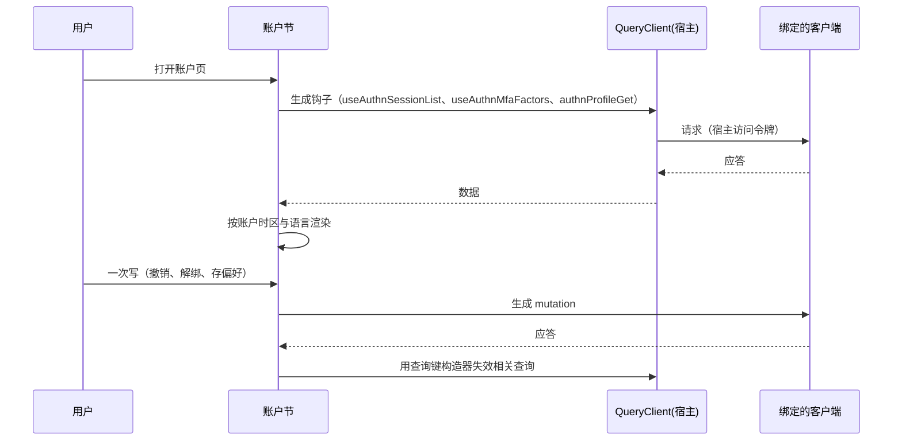

# account-ui

## 职责

`@speed/account-ui` 是一个 speed 前端已登录一方的账户管理组件族：一组节（section）组成宿主的账户页。它交付下列面：

- `PreferencesSection`：语言与时区两个下拉，编辑账户存下的偏好，走账户档案的自写面（`PATCH /auth/me`，[authn-profile](../authn/design-authn-profile.md)）。语言的取值集是 i18n 实例自己的受支持集；语言的选取先写账户、确认写入后再落设备（手选槽位），清空偏好只动账户；时区取值集是引擎的 IANA 列表加一个显式的「未选」。
- `SessionsSection`：账户的会话与设备列表，当前会话所属的那条打上当前徽标，逐条撤销与批量撤销「其它会话」。撤销自己的会话是低损失动作（行上不再确认），撤销其余是 ui-kit 危险 `ConfirmDialog` 的两步确认。
- `SocialBindingsSection` 加 `BindingCallbackHandler`：社交绑定面与在宿主回调路由上完成一次绑定的处理器。
- `MfaSection`：经加强认证（step-up）门控的两步验证设置——TOTP 认证器与通行密钥。

这些面是节，不是一个带路由的屏：拥有它们的页面、它们之上的标题、以及本包之外的其它面（档案字段、口令设置）都是宿主内容。

### 非职责

- **不做档案与口令的自助写。** 账户的显示名与通用属性由认证的自助档案面承载（[ADR-authn-selfservice-profile-2026-10-15](../../../adr/adr-authn-selfservice-profile-2026-10-15.md)），口令、手机号、删标识与解绑外部身份由登录自助面承载（[authn 登录](../authn/design-authn-login.md)）；本包只交付上述账户页的节。
- **不交付登录历史节。** 登录历史没有自助端点，只有管理员面（[authn-admin](../authn/design-authn-admin.md) 的审计读）；普通账户看不到自己的登录历史，故本包不交付这一节。
- **不交付恢复码。** 认证的因素面不提供恢复码（[authn-mfa](../authn/design-authn-mfa.md)），故本包不交付恢复码的显示或重生成。
- **不拥有查询客户端。** 每次读经 `@speed/api-sdk` 的生成 react-query 钩子，跑在宿主拥有的 QueryClient 上；本包从不自造 QueryClient，也不手写查询键，失效一律用导出的查询键构造器。
- **不读存储、不 attach 会话、不导航、不直接触网。** 会话只在一条生在流程之上、由本包节驱动的会话操作存在时以属性传入——绑定添加区起一条 `purpose: 'link'` 流程（`session.startAuthenticatedFlow`）与两步验证挑战起一条 `purpose: 'step-up'` 流程（同）。没有会话操作要驱动的节不接会话属性。
- **不发明规格没有的操作。** 认证的因素面只提供列出与删除（`GET`/`DELETE /auth/factors`），登记的入口是流程；故 `MfaSection` 的状态经读发现，登记走流程，不声明一个不存在的启用端点。
- **不 import `@speed/auth-ui`。** 同层包互不 import；`SocialProvider`、`SocialProviderConfig` 是本包自己的定义，与 auth-ui 的同名类型逐字一致并保持同步，渠道集以 authn 规格为共同来源。
- **不做服务端判定的替代。** 权限、租户隔离与账户归属都由服务端判定；本包只渲染应答。

## 外部接口契约

`web/packages/account-ui/src/index.ts` 是公开面：`PreferencesSection`；`SessionsSection`；`SocialBindingsSection`（连同 `SocialBindingsSectionProps`、`SocialProvider`、`SocialProviderConfig`）；`BindingCallbackHandler`（连同 `BindingCallbackHandlerProps`）；`MfaSection`（连同 `MfaSectionProps`）；以及命名为 `ACCOUNT_UI_NAMESPACE`、`accountUiResources` 的资源对。`web/packages/account-ui/src/internal/` 下的错误文案解析器、失败横幅、加强认证流程对话框与翻译钩子是族内管线，不外导。

```tsx
interface SocialBindingsSectionProps {
  readonly session: AuthSession
  readonly providers: readonly SocialProviderConfig[]
  readonly onAuthorizeUrl?: (url: string) => void
}

interface MfaSectionProps {
  readonly session: AuthSession // 登记与挑战都驱动流程
}
```

`SocialBindingsSection` 的 `session` 属性为添加区起一条 `purpose: 'link'` 的流程（`session.startAuthenticatedFlow`）；`MfaSection` 的 `session` 属性为登记起一条 `purpose: 'enroll'` 的流程、为挑战起一条 `purpose: 'step-up'` 的流程——读因子清单、删因子与解绑是走共享访问令牌的生成调用，不经会话操作。其余节不接属性：它们显示谁的会话或绑定，来自调用方绑定的客户端与它的访问令牌。

**查询键构造器是公开面。** 失效用本包导出的查询键构造器（如 `getAuthnSessionListQueryKey`），不经手写键。账户自己的标识与绑定读自 `GET /auth/me`（其 `identifiers` 与 `links` 字段），无独立的清单端点，故无对应查询键。

**稳定性承诺。** 公开面是上述导出集；`SocialProvider`、`SocialProviderConfig` 的形状与 auth-ui 的一致，渠道集以 authn 规格为共同来源。文档化的用法由 `web/packages/account-ui/src/usage-example.test.tsx` 端到端编译并运行，故 README 的装配不能与 API 漂移。

## 依赖

| 依赖 | 用途 |
|---|---|
| `@speed/auth-core` | 两处流程操作与档案读取的 `AuthSession` 类型与操作（`startAuthenticatedFlow`、`readFlow`） |
| `@speed/api-sdk` | 每次读的生成 react-query 钩子、每次写的生成 mutation、查询键构造器，以及档案读取（`authnProfileGet`）与社交回跳读取（`authnLoginCurrent`）的调用 |
| `@speed/ui-kit` | `ConfirmDialog`、`EmptyState` 与表单原语 |
| `@speed/i18n` | 命名空间注册与文案的翻译钩子 |
| `@tanstack/react-query` | peer（必需）：宿主供给的 QueryClient 与它上面的钩子 |
| `react`、`react-dom`、`@mui/material`、`@emotion/*`、`react-hook-form` | peer（必需）：宿主拥有的 React／MUI 树与表单库 |

`@speed/api-client` 是 devDependency：公开类型不引用它，只有测试夹具绑定真实客户端。方向是 `@speed/account-ui` 比 `@speed/auth-ui` 的层高一档，处于生成钩子这一层之上；`@speed/auth-ui` 从不被 import。

## UML 图

一次读取与一次写入的路径。图里画不到的约束：读经生成的钩子跑在宿主 QueryClient 上，写经同一 `bindRequestFn` 绑定的生成 mutation；时间一律以账户的时区链显式格式化，不用 Intl 的进程本地缺省；显示时间之外，服务端词表（登录方式、因素种类、渠道）只在白名单内渲染。



## 核心数据结构

| 概念 | 形状 | 说明 |
|---|---|---|
| 时区链 | `resolveTimeZone` | 存下的偏好，否则设备时区，否则 UTC；每个时间渲染都显式传 `timeZone` |
| 渠道词表 | `SocialProvider`、`SocialProviderConfig` | 本包自己的定义，与 auth-ui 的同名类型同步 |
| 加强认证流程 | `StepUpFlow` | 一条 `purpose: 'step-up'` 流程的驱动；成功后重跑被门控的动作 |
| 命名空间 | `accountUiResources` | `zh-CN` 与 `en-US` 两份目录，叶子键集相同 |

## 核心算法与流程

### 经流程门控的两步验证

`MfaSection` 不声明因子状态，状态经读发现（`GET /auth/factors`）。两次入口动作走同一条「先生成流程、再按步答复」的机器：

1. 登记一个因素。一次 `startAuthenticatedFlow({purpose: 'enroll', input: {kind}})` 打开向导，按应答的 `next.kind` 分派：`webauthn` 步把该因素自己的 JSON 对象（TOTP 的 `otpauth_uri`，或通行密钥的创建选项）交给客户端渲染并答复；`enroll` 步给出可登记的种类。答完即因素登记完成，它不改变本次会话的等级。
2. 提权以做安全类动作。一次 `startAuthenticatedFlow({purpose: 'step-up'})` 起一条加强认证流程；账户有可用因素时从 `factor` 步进入（清单在应答里），账户没有因素时退回第一因素。挑战对话框驱动这条流程，成功后重跑被门控的动作。

一次门控动作在被拒时打开加强认证流程，记住被门控的动作；一次成功的流程落定提权，成功路径重试那次被门控的操作恰好一次，取消则不重试。提权只活在那次会话的存续期内，对话框从不承诺不再询问。

### 绑定回调的续接

`BindingCallbackHandler` 挂在宿主的回调路由上，以 `session.readFlow()` 读回那条 `purpose: 'link'` 流程：流程已就绪（`next.kind = complete`）时以 `step: 'complete'` 取走结果，`link` 落地（`state: 'linked'`）后失效身份读取并触发 `onBound`；流程仍停在一步时渲染该步续接；交换失败渲染错误码文本与一个重试按钮。绑定的 `link` 不把任何人签进去。

## 错误与失败语义

**失败面是一个错误码白名单加受守卫的词表。** 每条失败路径解析成一个错误码，渲染在一条 `role="alert"` 横幅里；白名单外的码渲染 `errors.unknown`，永不渲染裸键。因素种类与渠道同样受守卫：令牌只在组件已知的取值表上才经 `t()` 渲染，否则渲染通用的其它标签。

| 情形 | 表现 |
|---|---|
| 一次写被拒（`authn.bad_request`、`authn.throttled`、`authn.unavailable`、`client.*`） | 一条横幅渲染错误码文本，相关查询在选择处失效 |
| 撤销自己的会话命中已死的会话 | 一条横幅渲染该码文本，列表重取以收敛 |
| 解绑会抽掉最后一个登录方式 | 一条横幅渲染该错误码文本，服务端按自己的登录方式计数判定 |
| 两步验证登记被拒（他人的登记抢先、因素消失） | 关掉向导并渲染错误码文本；一次错码是字段级错误、可重试 |
| 加强认证流程的码已被用过 | 清空字段、渲染用过的码文本，绝不用同一码重试 |
| 删除因素时它是账户最后一个 | 一条横幅渲染该错误码文本，服务端判定 |
| 偏好写入被拒（`authn.bad_request`） | 两行失败警报，控件退回存下的值（天然回退，无撤销记账） |

## 并发与事务边界

- **写后失效。** 每次成功的撤销、解绑或绑定都失效相关列表查询，让行收敛到服务端应答；失效用导出的查询键构造器。
- **提权的存续期随会话。** 一次加强认证流程的完成更新会话的等级与认证时刻；未被提权的安全类动作由服务端判 401 加强认证，本包据此打开挑战流程。
- 本包不打开事务；读与写都是宿主 QueryClient 与绑定客户端上的往返。

## 实现状态

| 能力 | 状态 | 代码 |
|---|---|---|
| 偏好节 | 已实现 | `web/packages/account-ui/src/PreferencesSection.tsx` `PreferencesSection` |
| 会话列表与撤销 | 已实现 | `web/packages/account-ui/src/SessionsSection.tsx` `SessionsSection` |
| 社交绑定与回调 | 已实现 | `web/packages/account-ui/src/SocialBindingsSection.tsx` `SocialBindingsSection`；`web/packages/account-ui/src/BindingCallbackHandler.tsx` `BindingCallbackHandler` |
| 两步验证设置 | 已实现 | `web/packages/account-ui/src/MfaSection.tsx` `MfaSection` |
| 命名空间资源 | 已实现 | `web/packages/account-ui/src/resources.ts` `ACCOUNT_UI_NAMESPACE`、`accountUiResources` |
