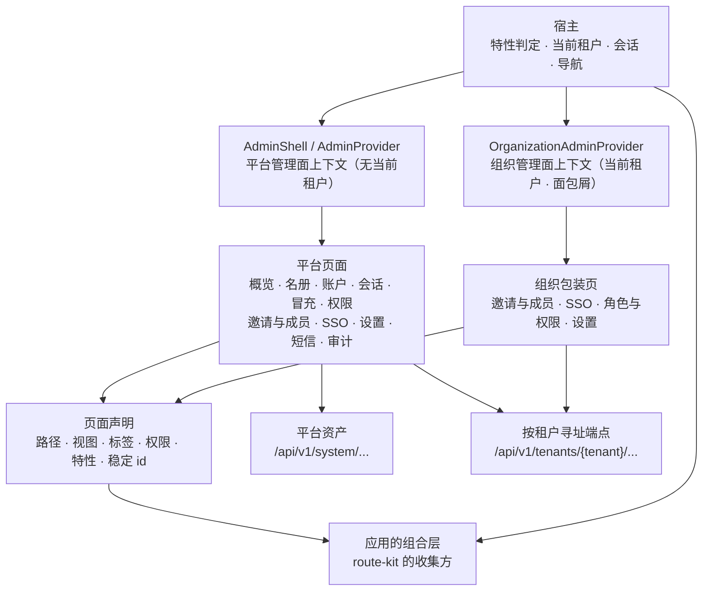

# admin-ui

## 职责

`@speed/admin-ui` 交付两个管理面，共用同一套页面组件、声明结构与操作束接口。

**平台管理面**是平台员工的管理后台组件族：把后端的平台管理面渲染成一组由平台员工操作的页面。它对应后端的下列管理面：

- **租户管理**：名册的读写，经 `/api/v1/system/tenants`（[tenant.admin](../tenant/design-tenant-admin.md)、[ADR-admin-tenant](../../../adr/adr-admin-tenant.md)）。
- **账户管理**：账户的列出、详情与写入，经 `/api/v1/system/auth/accounts`。
- **会话管理**：按账户列出会话并撤销，经 `/api/v1/system/auth/accounts/:id/sessions` 与 `/api/v1/system/auth/sessions/:id`。
- **冒充管理**：冒充记录的列出与终止，经 `/api/v1/system/tenants/{tenant}/impersonations`；运营者自身会话上的冒充状态读取、发起与结束，经 `/api/v1/auth/impersonation`。
- **权限管理**：角色、授权与账户绑定的读写，权限目录的读，经 `/api/v1/system`。
- **邀请与成员**：按租户读写邀请与成员，经 `/api/v1/tenants/{tenant}/invitations` 与 `/api/v1/tenants/{tenant}/members`。
- **SSO 提供方**：按租户读写提供方与域名，经 `/api/v1/tenants/{tenant}/sso/providers`。
- **设置读写**：运行期设置的读写，经 `/api/v1/system/settings`（[settings.admin](../settings/design-settings-admin.md)、[ADR-admin-settings](../../../adr/adr-admin-settings.md)）。
- **短信模板**：运行期短信模板的读写，经 `/api/v1/system/sms`。
- **审计查询**：审计记录的检索与导出，经 `/api/v1/system/audit`（[audit.admin](../audit/design-audit-admin.md)、[ADR-audit-admin](../../../adr/adr-audit-admin.md)）。

**组织管理面**是租户侧的管理面：挂在 `/organization/admin`，渲染在 [product-shell](design-web-product-shell.md) 之内，作用于宿主给出的当前租户。它经 `/api/v1/tenants/{tenant}/...` 寻址该租户的邀请与成员、SSO 提供方、运行期设置与角色权限，不读 `/api/v1/system` 下的任何接口。它把平台管理面的同一套页面组件按租户模式组合：租户是请求的路径段，页面不持租户选择器，不读平台账户检索。组织管理面的入口（账户菜单里的组织分组与首页卡片）由宿主从收窄后的声明与排除条件派生，见「入口的派生」与 [design-web](design-web.md) 的「管理面」。

**平台管理面的根（`/`）渲染仪表盘**，其指标与最近活动由名册读与审计读拼出；各管理面的列表页可链入其详情页。

**每个页面以 ui-kit 的 `PageHeader` 开篇**：页标题即该页的一级标题，一条从管理后台（组织管理面则从组织首页）到该页的面包屑，以及页头操作。页的刷新动作的位置与范围见「页的刷新动作」。标题层级因此不跳级——`AsyncSection` 的占位与各节的次级标题都渲染在它之下。

**平台管理面是平台侧的壳（第二种壳）。** 它的页面挂在两类端上。平台资产——名册、账户、会话、冒充记录、权限、设置、短信、审计——在 `/api/v1/system` 下，在平台域判定：名册是平台资产，审计表持有全部租户的行，设置的全局层是平台操作。邀请与成员、SSO 两页按租户寻址，在 `/api/v1/tenants/{tenant}` 下，在那个租户的域判定；持 `platform-admin` 本身不放行，调用方须在该租户另有绑定。平台管理面因此没有**当前租户**切换器，也没有租户作用域的查询键——它不认识「当前租户」这个概念；按租户寻址的两页持的是请求的实参（租户选择器），不是当前租户。组织管理面反之：当前租户由宿主给出、作为每条请求的路径段，租户作用域的查询键随之按租户分段；平台域权限在它上面同样不放行；它仍不持切换器，也不自己推导当前租户。

**平台管理面的外壳骨架是 [layout-kit](design-web-layout-kit.md) 的 `AppShell`。** 管理后台壳把带标签的声明派生出的平台导航交给 `AppShell` 渲染：固定顶栏、随视口变化的导航抽屉（`md` 及以上常驻、以下为临时覆盖式）与内容区都由它提供（[layout](design-web-layout.md)），本包不为平台管理面另造一套帧。组织管理面不渲染自己的帧：它挂在租户侧 `ProductShell` 的 `AppShell` 内容区，`OrganizationAdminProvider` 只安装上下文、不渲染 DOM。外壳形态由宿主经 `shellLayout` 选定，缺省顶栏形态，与本包出现之前逐字节一致；侧栏形态把品牌、头部动作、用户菜单移进侧栏，本包同样不重新解释。外壳的主导航标签取本包的 `shell.title`（「管理后台」），导航地标默认以本包的 `shell.navLabel`（「管理后台导航」）命名，宿主可经 `navLabel` 另给名字（经 `AppShell` 的 `navLabel`），与其它外壳的导航地标可区分。两处外壳因此形态一致——侧栏不随内容滚走，窄视口是汉堡抽屉而非把导航堆在内容上方，桌面侧栏由宿主显式选择收起，内容区是页面内容的唯一滚动层。

**平台管理面的按租户寻址页面持租户选择器。** 权限页、邀请与成员页、SSO 提供方页与冒充页都把租户当作**路径段参数**，但落点与判定域不同：权限页在 `/api/v1/system/tenants/:tenant/roles` 与 `/bindings` 下，邀请与成员页在 `/api/v1/tenants/{tenant}/invitations` 与 `/members` 下，SSO 提供方页在 `/api/v1/tenants/{tenant}/sso/providers` 下，冒充记录页在 `/api/v1/system/tenants/{tenant}/impersonations` 下。这些页面仍是平台员工的页面，但每条请求指名它作用到的租户；租户是请求的一个实参，不是会话的当前租户。**判定域随能力而定。** 邀请与成员页、SSO 提供方页按那个租户域判定：调用方要在该租户持有 `tenant-admin` 或相应权限，`platform-admin` 本身不放行——平台管理员要管理某个业务租户，得由该租户的管理员授予。权限页按平台域判定：调用方要在平台域持有 `authz.role.read` 或 `authz.role.manage`。冒充是平台能力，记录页与发起按平台域判定：路径或正文里的租户是被冒充记录限定的数据，不是策略域，平台管理员不必是目标租户的成员，只在目标租户持有 `tenant-admin` 的调用方不通过；被冒充账户必须是该租户的有效成员这条限制不变。页面因此持一个租户选择器（数据来自平台名册读 `GET /api/v1/system/tenants`），在其取值为空前禁用该页的租户作用域读。这四页各接受三个可选 prop：`tenant` 受控给出作用域（给出即锁定该值并隐藏选择器）、`defaultTenant` 作为初值（优先于 URL）与 `onTenantChange`（每次改选上报宿主）。三者都缺席时初值取自页面 URL 的 `tenant` 查询参数（缺省为空），故一条链接能把租户上下文带过页界；选择器仍是此后改变它的途径。这四页因此读 `tenant` 查询参数，README 写明这条。冒充页的发起表单与被冒充记录共用这一个选择：目标租户是请求的必填字段，被冒充账户必须是该租户的成员（REQ-platform-admin-024），故发起表单不另设租户输入，未选租户时提交不可用。

**两个面都复用声明式注册接口。** 每个页面导出的一份声明即 [route-kit](design-web-route-kit.md) 的 `RouteDeclaration`：路径 pattern、视图回调、可选导航标签、可选权限码、该页依赖的特性名（`requires`）（[ADR-web-route-seam](../../../adr/adr-web-route-seam.md)）。`permission` 是数据，本包不据它判定；`label` 缺席即该页不进导航。`requires` 同样是数据，本包不据它判定：宿主经 route-kit 按特性在场收窄注册接口，特性缺席的页面与未登记路径走同一个未命中回退，导航里也不出现（[ADR-web-route-kit](../../../adr/adr-web-route-kit.md)）。声明由应用的组合层收齐后交给路由层渲染；本包不 import `route-kit`，也不自己做路径匹配或导航。两个面的上下文都交出一个 `onNavigate` 回调接口：宿主给了它，帧内点一条导航项即把该项的路径交回调（由宿主的路由器就地跳转，不整页重载），不给则该项是整页链接。租户侧的 [product-shell](design-web-product-shell.md) 用同一份声明结构，两者只是壳不同。

### 非职责

- **不拥有、不切换当前租户。** 切换当前租户是租户侧的动作，归 [tenancy-ui](design-web-tenancy-ui.md)；管理名册（开租户、改名、停用）是平台管理面的动作。切换改的是宿主的路由，管理改的是名册，两者不共用控件、不共用查询键。平台管理面的按租户寻址页面持的租户选择器选的是**请求的实参**，不是当前租户；组织管理面把宿主给出的当前租户写进请求路径，仍不持切换器。两个面的租户都不由本包推导。
- **不做导航、不解析 URL。** 页面的路径匹配、链接构造、深链接解析与未命中回退归 `route-kit` 的收集方，特性缺席的页面落到未命中回退同样在那里发生；本包只提供页面与它们的声明，不做路径匹配。
- **不读特性态。** 本包不取回特性文档，也不调用 auth-core 读特性态的钩子；页内控件所依赖的特性是否在场，由宿主经 `AdminShell` 的 `hasFeature` 给出（[ADR-web-feature-state](../../../adr/adr-web-feature-state.md)）。
- **不做判定。** 名册、账户、会话、冒充、权限、邀请与成员、SSO、设置与审计的授权判定都在服务端做出（判定域按能力：冒充与权限在平台域，邀请与成员、SSO 在那个租户的域，设置的全局层在平台域、租户层在那个租户的域），本包只渲染应答；路由级的授权是宿主的组合（经 [layout-kit](design-web-layout-kit.md) 的路由守卫与 [auth-core](design-web-auth-core.md) 的权限读数），不在本包内。
- **不遮蔽敏感值。** 敏感设置项的值由 [settings.admin](../settings/design-settings-admin.md) 在应答里遮蔽；本包照渲染应答，不做第二处遮蔽。
- **不持规则、不持数据。** 每条路的动作是一次生成的调用；名册的写入语义、账户的状态机、权限的取值、审计的列都在各自的模块里定义。
- **不拥有查询客户端。** 读经 `@speed/api-sdk` 的生成 react-query（[REF-tanstack-query](../../../references.md)）钩子跑在宿主拥有的 QueryClient 上，写经同一 `bindRequestFn` 绑定的生成 mutation；本包从不自造 QueryClient。查询键由生成钩子自带（`get<operation>QueryKey`），本包不自写键；平台管理面按租户寻址的读的键由生成工厂按租户分段。组织操作束在生成键之外再经 [auth-core](design-web-auth-core.md) 的 `tenantQueryKey` 把当前租户写成键的最外层段（[ADR-web-tenant-query-key](../../../adr/adr-web-tenant-query-key.md)），写经同一工厂失效，故切租户即换键。

## 外部接口契约

本包的公开接口由 `web/packages/admin-ui/src/index.ts` 导出：平台管理面各页的页面声明集与页面组件、平台管理后台壳、导航分组表（`adminNavGroups` 与 `AdminNavGroup`）以及页面读写的操作束。组织管理面的公开接口是声明集 `organizationAdminRoutes`、无壳的 `OrganizationAdminProvider`、面包屑提供者 `OrganizationAdminBreadcrumbProvider`、轻量包装页、组织操作束及其发布上下文。页面声明的结构与壳的入参以及组织管理面各自的导出如下。

```tsx
// 一份页面声明：结构即 route-kit 的 `RouteDeclaration`——路径 pattern、视图回调、
// 可选导航标签、可选权限码、可选特性名列表。本包不 import `route-kit`，导出满足
// 该结构的值。`requires` 的元素类型是 `@speed/api-sdk/features` 的 `FeatureName`，
// 比 route-kit 的字符串更窄，故声明仍可赋值给 `RouteDeclaration`。
// `id`、`group` 与 `icon` 是本包自加的额外可选字段：`id` 是每个管理面的稳定
// 身份（兄弟链接按它解析），`group` 指定该页归属的导航分组（见下），`icon` 是
// 导航项的装饰性前导图标；三者都只是数据，不在 route-kit 的结构里，故带它们的
// 声明仍可赋值给 `RouteDeclaration`。
interface AdminRoute {
  readonly id?: string
  readonly path: string
  readonly view: (context: AdminRouteContext) => ReactNode
  readonly label?: ReactNode
  readonly permission?: string
  readonly requires?: readonly FeatureName[]
  readonly group?: string
  readonly icon?: ReactNode
}

// 一个导航分组：稳定 id、已翻译标题、可选装饰图标与可选初始折叠态。图标在
// 侧栏收起的窄栏里代替被裁剪的标题。本包导出 `adminNavGroups`
// 作为缺省分组表；宿主也可传入自己的（改顺序或改标题）。
interface AdminNavGroup {
  readonly id: string
  readonly label: ReactNode
  readonly icon?: ReactNode
  readonly defaultCollapsed?: boolean
}

// 管理后台壳：由带标签的声明派生平台导航，渲染宿主的路由内容。
interface AdminShellProps {
  readonly routes: readonly AdminRoute[]
  // 特性判定：答一个特性名在本进程是否在场。必填；壳经包内上下文把它交给
  // 页面，页内依赖特性的控件据它渲染与否（见「特性在场的接收」）。
  readonly hasFeature: (name: FeatureName) => boolean
  // 导航分组表：给了它即按分组渲染（组按表内顺序、组内按声明顺序，
  // 无分组的声明排在组之前）；不给即维持扁平单列，现有宿主不变。
  readonly navGroups?: readonly AdminNavGroup[]
  readonly children: ReactNode
  readonly title?: ReactNode
  readonly headerActions?: AppShellNavSlot   // 横幅标题之后的宿主内容；同外壳的槽形态，可给渲染函数取窄栏状态
  // 导航地标的可及名；不给时取本包的 `shell.navLabel`。
  readonly navLabel?: string
  // 帧内导航的点击回调：给了它即把被激活条目的路径交回调（宿主的路由器
  // 就地跳转）；不给即该项是整页链接。只有纯主键点击交回调，带修饰键、
  // 非主键或已由其它处理器声明的激活交给浏览器（layout-kit 的
  // `isPlainPrimaryClick`）。
  readonly onNavigate?: (href: string) => void
  // 某条路径是否是当前页，由宿主判定（本包不做路径匹配）；每个导航项的
  // `selected` 取自它。不给即无选中项。
  readonly isSelected?: (path: string) => boolean
  // 接受链接的构造器：给一条已签发邀请的令牌，返回接受链接（宿主相对的
  // 路径或绝对 URL）。邀请与成员页在签发成功后据此展示链接；不给则展示
  // 裸令牌。落点是宿主的公开路由，只有宿主知道，故路径由宿主给出。
  readonly invitationLink?: (token: string) => string
  // 宿主的账户设置页的位置（宿主相对的路径或绝对 URL），运营者在那里登记
  // 两步验证。步进对话框在本人账户没有启用的因素时据此渲染前往入口；不给
  // 则只渲染文案、不渲染入口。账户设置页是宿主的路由，只有宿主知道其路径。
  readonly accountHref?: string
  // 冒充开始或结束落定之后的宿主动作：宿主在其中逐出以旧身份取得的缓存、
  // 重读会话与依赖身份的宿主状态、把页面带到合适的位置。冒充页的发起与
  // 结束成功后、在该次尝试之外调用一次；它的拒绝被页面包住，不渲染失败，
  // 也不改判已落定的写入。给出它即由宿主让操作者持续得知冒充已开始（示范
  // 宿主由冒充横幅与顶部栏的身份指示承担）；不给则页面只失效自己的状态读与记录读。身份变更
  // 之后每个读所属的身份都变了，这件事只有持有缓存与会话的宿主做得了。
  readonly onImpersonationChange?: (change: 'started' | 'ended') => void | Promise<void>
  // 冒充写入发出之前的宿主动作：宿主的自有壳据此在请求落地前进入「正在开始」
  // 状态。返回的函数在该次尝试未落地（被拒、被步进门控接管或抛错）时调用；
  // 落地的那次由宿主在 `onImpersonationChange('started')` 落定后自行释放。
  readonly onImpersonationStarting?: () => void | (() => void)
  // 把角色的 `description_key` 连同角色本身解析成展示内容；不给时页面渲染裸键。
  readonly describeRole?: (descriptionKey: string, role: AdminRole) => ReactNode
  // AppShell 的帧槽与受控 prop，原样透传：桌面侧边栏收起对、抽屉宽度、
  // 整体菜单、横幅、受控的窄视口抽屉开合、抽屉纸内的首尾内容。
  readonly sidebarCollapsed?: boolean
  readonly onSidebarCollapsedChange?: (collapsed: boolean) => void
  readonly sidebarWidth?: number
  readonly shellLayout?: AppShellShellLayout
  readonly userMenu?: ReactNode
  readonly banner?: ReactNode
  readonly mobileOpen?: boolean
  readonly onMobileOpenChange?: (open: boolean) => void
  readonly navHeader?: AppShellNavSlot
  readonly navFooter?: AppShellNavSlot
  readonly sx?: SxProps<Theme>
}

// 无帧的包级上下文：AdminShell 安装的同一组上下文，不带 AppShell 与内容
// 内边距。给渲染自有平台壳（自有 chrome、对话框、侧边面板）的宿主使用。
interface AdminProviderProps {
  readonly hasFeature: (name: FeatureName) => boolean
  readonly onNavigate?: (href: string) => void
  readonly session?: AuthSession
  readonly invitationLink?: (token: string) => string
  readonly accountHref?: string
  readonly onImpersonationChange?: (change: 'started' | 'ended') => void | Promise<void>
  readonly onImpersonationStarting?: () => void | (() => void)
  readonly describeRole?: (descriptionKey: string, role: AdminRole) => ReactNode
  // 宿主交来的（已按特性在场收窄的）路由表；页面按声明的稳定 `id` 解析兄弟页。
  readonly routes?: readonly AdminRoute[]
  readonly children: ReactNode
}
```

- **框架 prop 原样透传。** `shellLayout` 是外壳形态，`sidebarCollapsed` / `onSidebarCollapsedChange` 是 `AppShell` 的桌面侧边栏收起对，`sidebarWidth`、`userMenu`、`banner`、`mobileOpen` / `onMobileOpenChange` 与 `navHeader` / `navFooter` 是帧的宽度、顶栏槽、横幅槽、受控的窄视口抽屉与抽屉纸内的首尾槽。这些 prop 被拾起后逐字转给 `AppShell`，本包不重新解释、不加自己的 chrome。给出收起回调即在帧的顶栏（侧栏形态下为抽屉纸顶部行）渲染收起／展开按钮并回报每次翻转，不给即维持一直展开的常驻抽屉；收起态是宿主持有的普通值。租户侧的 [product-shell](design-web-product-shell.md) 用同一组 prop，两处外壳在这条上一致。

- **无帧的 `AdminProvider`。** `AdminShell` 是「`AppShell` ＋ 本 provider ＋ 内容」的一种组合；provider 本身只安装包级上下文、不渲染任何 DOM，供渲染自有平台外壳的宿主使用（自有 chrome、对话框、侧边面板）。它安装与壳相同的上下文：导航回调、路由表、会话、账户设置页、接受链接构造器、冒充变更与冒充开始、角色描述解析、特性判定。`hasFeature` 与壳一样必填；其余 prop 缺席时上下文缺席或为空，页面维持各自的回退。它仍是平台员工的接口，不能承载租户侧页面，也不带任何当前租户设施。

- **导航选中由宿主判定。** 本包不做路径匹配，故哪条导航项是当前页由宿主的 `isSelected(path)` 给出，壳把每条带标签声明的路径交给它，取其答案作为该项的 `selected`。不给该判定即没有选中项。

- **只有纯主键点击就地路由。** 导航项与页内链接都是真链接，`href` 恒在；`onNavigate` 在场的普通左键点击被 `preventDefault` 并交回调，带 Ctrl／Command／Shift／Alt 的点击、非主键点击、自身带 `target="_blank"` 或 `download` 的链接以及已被其它处理器声明过的激活都交给浏览器，判定用 layout-kit 的 `isPlainPrimaryClick`。

- **稳定 id 与兄弟链接。** 每条声明可带一个按管理面取名的稳定 `id`（本包自己的声明都带）。壳与 provider 把宿主交来的（已按特性在场收窄的）路由表经包内上下文原样发布，页面按 `id` 找到兄弟声明再取它的路径，故管理后台挂在任何前缀下都能构造兄弟链接；找不到声明时不渲染该链接。链接同样叠加目标声明的 `requires`：目标页依赖的特性缺席时，链接不出现。

- **冒充开始前的宿主钩子。** `onImpersonationStarting` 在冒充发起写入发出之前同步调用，返回的函数在该次尝试未落地时调用：被服务端拒绝、被步进门控接管、或抛出。落地的那次不在此释放——宿主持有身份相关的帧，它在 `onImpersonationChange('started')` 的落定之后自行释放，因为新身份如何接管外壳由宿主决定。

- **角色描述由宿主解析。** 权限页的角色行携带 `description_key`，它指向宿主自己的资源叶；`describeRole(descriptionKey, role)` 把它解析成展示内容。不给解析器时页面渲染裸键，角色行不会因此留空。

- **导航按分组表聚合。** 页面声明可带 `group`，指向本包分组表里的一个组；壳把带标签的声明按其 `group` 聚成 [layout-kit](design-web-layout-kit.md) 的 `AppShellNavGroup`（组内是导航项、标题即折叠控件），组的顺序与标题来自宿主传入的分组表，组内顺序即声明顺序。分组表经 `navGroups` prop 传入，本包另导出 `adminNavGroups` 作为缺省：概览（仪表盘）／身份与访问（账户、会话、冒充、权限、邀请与成员、SSO）／租户（租户名册）／平台配置（设置、短信）／审计（审计）。未传分组表即维持扁平单列——十一个带标签的声明按声明顺序排成一组，现有宿主零改动；`group` 此时是数据、不起作用。无 `group` 或指向表外组的声明作为导航项排在组之前，空组（无声明指向）不渲染标题；只有一个可见条目的组同样不渲染标题，该条目作为无分组的导航项排在该组本应占据的位置——某个组此时剩几个可见条目，取决于该部署服务哪些特性。组标题经 admin-ui 命名空间解析（`nav.groups.*`），与页面标签同一套翻译路径；组标题可带装饰图标，收起的窄栏以它代替被裁剪的标题。

### 组织管理面的导出与上下文

组织管理面不渲染外壳：它挂在 [product-shell](design-web-product-shell.md) 的 `AppShell` 内容区里，由宿主把当前租户与页面需要的上下文交给它。

```tsx
// 组织管理面的页面声明表。结构同 AdminRoute：路径 pattern、视图、可选标签、
// 可选权限码、特性名列表与稳定 id；路径相对组织管理面根。
export const organizationAdminRoutes: readonly AdminRoute[]

// 组织管理面的上下文。只安装上下文，不渲染 DOM，也不带 AppShell。
interface OrganizationAdminProviderProps {
  readonly tenant: string                       // 宿主解析出的当前租户标识
  readonly operations: OrganizationAdminOperations // 组织操作束（见下）
  readonly hasFeature: (name: FeatureName) => boolean
  readonly session?: AuthSession
  readonly routes?: readonly AdminRoute[]        // 已按特性在场收窄的组织声明
  readonly onNavigate?: (href: string) => void
  readonly breadcrumbs?: readonly PageHeaderBreadcrumb[]
  // 接受链接的构造器：给一条已签发邀请的令牌，返回接受链接（宿主相对的
  // 路径或绝对 URL），形态同 `AdminShell` 的 `invitationLink`。邀请与成员页
  // 在签发成功后据此展示链接；不给则展示裸令牌。
  readonly invitationLink?: (token: string) => string
  // 该租户里不可改动、不可删除的角色名（宿主种入的 `tenant-admin` 等）；
  // 包装页把它交给角色与权限页，页面把那些行渲染为只读。缺席时没有行被
  // 视为受保护。
  readonly protectedRoles?: readonly string[]
  readonly children: ReactNode
}

function OrganizationAdminProvider(props: OrganizationAdminProviderProps): ReactElement

// 面包屑上下文：页头优先渲染它给出的面包屑，缺席时回退到页面自己的平台面包屑。
interface OrganizationAdminBreadcrumbProviderProps {
  readonly breadcrumbs: readonly PageHeaderBreadcrumb[]
  readonly children: ReactNode
}

function OrganizationAdminBreadcrumbProvider(
  props: OrganizationAdminBreadcrumbProviderProps,
): ReactElement

// 组织操作束：租户作用域的读钩子与写 mutation。邀请与成员、SSO 的成员
// 取自平台操作束的同一批生成绑定；设置与角色权限的成员取自
// settings.tenantadmin 与 authz.tenantadmin 的生成操作。租户作用域的读键
// 以租户标识为最外层段。
interface OrganizationAdminOperations {
  // 邀请与成员、SSO：/api/v1/tenants/{tenant}/...
  // 设置：/api/v1/tenants/{tenant}/settings[/{namespace}[/{key}]]
  // 角色、权限、授予与绑定：/api/v1/tenants/{tenant}/roles、/permissions、
  // /roles/{role}/grants 与 /bindings
}

export const organizationAdminOperations: OrganizationAdminOperations

// 操作束的发布上下文：OrganizationAdminProvider 挂载它，页面经只读钩子取用；
// 没有挂载时取出厂绑定 organizationAdminOperations。
interface OrganizationAdminOperationsProviderProps {
  readonly operations: OrganizationAdminOperations
  readonly children: ReactNode
}

function OrganizationAdminOperationsProvider(
  props: OrganizationAdminOperationsProviderProps,
): ReactElement

function useOrganizationAdminOperations(): OrganizationAdminOperations

// 四个轻量包装页：把下面的页面组件按租户模式组合，作为 organizationAdminRoutes 的视图。
export function OrganizationInvitationsPage(): ReactElement
export function OrganizationSsoPage(): ReactElement
export function OrganizationPermissionsPage(): ReactElement
export function OrganizationSettingsPage(): ReactElement
```

- **`OrganizationAdminProvider` 只安装上下文，不渲染外壳。** 宿主已用 `ProductShell` 渲染了租户侧的壳，组织管理面因此不另造一帧：provider 把当前租户、操作束、会话、特性判定、导航回调、路由表、面包屑、邀请链接构造器与受保护角色交给包装页，本身不渲染 DOM；操作束经 `OrganizationAdminOperationsProvider` 一并发布给页面。它不 import `product-shell` 与 `tenancy-ui`；当前租户是一个属性，不是它从会话或路由推导的值。
- **面包屑上下文优先。** 包装页经 `OrganizationAdminBreadcrumbProvider` 发布组织管理面的面包屑（组织首页到该页）；共用的页面组件在 `PageHeader` 上优先取这个上下文，没有它时渲染自己的平台管理面面包屑。页面组件因此不需要为面包屑新增属性，两个面的面包屑也不会互相泄漏。`OrganizationAdminProvider` 在给出 `breadcrumbs` 时挂载同一个提供者；渲染自有外壳、只用页面组件的宿主单独挂载它，形态同 `AdminSessionProvider`。
- **包装页是薄组合。** 四个包装页读 provider 的上下文，把当前租户作为受控租户交给底下的页面，并按租户模式配置页面（见「租户模式的页面行为」）。它们不复制页面逻辑：邀请与成员、SSO、设置与角色权限的读写都在既有页面里。角色权限包装页把 provider 的 `protectedRoles` 交给页面。
- **组织操作束是租户作用域的。** `OrganizationAdminOperations` 以 `/api/v1/tenants/{tenant}/...` 的生成操作为底，成员按能力分组：邀请指向 `authn.invitations`，成员与 SSO 指向 `authn.admin` 的租户作用域端点，设置指向 [settings.tenantadmin](../settings/design-settings-tenantadmin.md)，角色、授予与绑定指向 [authz.tenantadmin](../design-authz.md)。它不持有平台操作，也不接受 `/api/v1/system` 的路径。租户作用域的读键以租户标识为最外层段：`tenantQueryKey` 套在生成的裸键之外，写经同一工厂失效，切租户即换键、离任租户的缓存由宿主逐出。`organizationAdminOperations` 是出厂绑定；宿主可改挂自己的，页面经 `useOrganizationAdminOperations` 取用。

### 组织管理面的页面声明

`organizationAdminRoutes` 是组织管理面的声明表，路径相对组织管理面根（宿主挂到 `/organization/admin`）。每条声明带稳定 `id`、导航标签、权限码与特性列表；宿主收窄后同时用它派生账户菜单里的组织分组与首页卡片。

| 声明 | `id` | 路径 | 导航标签键 | 权限码 | 依赖的特性（`requires`） |
|---|---|---|---|---|---|
| 邀请与成员 | `organization-invitations` | `/invitations` | `organization.nav.invitations` | `authn.membership.manage` | `authn.admin`、`authn.invitations` |
| SSO 提供方 | `organization-sso` | `/sso` | `organization.nav.sso` | `authn.idp.manage` | `authn.admin`、`authn.admin.sso` |
| 角色与权限 | `organization-roles` | `/roles` | `organization.nav.roles` | `authz.tenant.role.read` | `authz.tenantadmin`、`authn.admin` |
| 设置 | `organization-settings` | `/settings` | `organization.nav.settings` | `settings.tenant.read` | `settings.tenantadmin` |

**组织声明用租户域的那一套权限码。** 邀请与 SSO 用 `authn.membership.manage` 与 `authn.idp.manage`；设置用 `settings.tenant.read`，角色与权限用 `authz.tenant.role.read`。写码不进声明：`settings.tenant.write` 与 `authz.tenant.role.manage` 由服务端在每次写上判定，页面照常渲染写控件（平台管理面同样只把读码列进声明）。两套码分属平台域与租户域，不互相替代。

**`requires` 只列该页依赖的租户作用域特性。** 邀请与成员、SSO 的读写由 `authn.admin` 与 `authn.invitations`、`authn.admin.sso` 服务；设置由 `settings.tenantadmin` 服务，角色与权限由 `authz.tenantadmin` 与 `authn.admin` 服务：该页的成员选择器经成员端点读该租户的成员，成员读由 `authn.admin` 带来。组织声明不列 `tenant.admin`：那是平台名册的特性，组织管理面不读名册、也不持租户选择器。

### 租户模式的页面行为

四个包装页把同一组页面按租户模式渲染。租户模式改变数据的来源与选择器，不改变页面布局、写入反馈与刷新动作。设置与权限两个页面组件因此各新增 `tenantMode` 选项：`SettingsPage` 另接受受控的 `tenant`，`PermissionsPage` 另接受 `protectedRoles`；平台管理面不传它们时行为不变。

- **邀请与成员。** 当前租户受控给出，租户选择器不渲染；成员写入表单以其账户字段经平台账户检索，故在租户模式下不渲染，页面因此不发出任何 `/api/v1/system` 读。成员读逐行携带 `display_name`；邀请人的身份从该租户的成员读中解析，不再经平台账户读。成员表的姓名列取成员记录的 `display_name`，账户列直接显示记录的账户标识、不解析。只有成员读无法解析的邀请人（读尚未落定、被拒，或应答不含该账户）按记录的标识渲染并标注身份未解析。签发、撤销邀请，移除成员与切换 SSO 豁免沿用既有控件与反馈。
- **SSO 提供方。** 当前租户受控给出，选择器不渲染；页面的读写全部落在该租户的提供方上。
- **设置。** 当前租户受控给出，层选不渲染；页面只读写 `/api/v1/tenants/{tenant}/settings`，从不读写 `/api/v1/system/settings`。全局层只在平台管理面出现。读携带该租户层解析到的值，每行另带来源层 `source`，取值是 `tenant`、`global` 与 `default`：租户层持有该键时为 `tenant`，租户层没有而全局层持有时为 `global`，两层都没有时为 `default`。页面把来源层渲染成单独一列，由服务端给出的 `source` 值选定显示文案（`tenant`、`global` 与 `default` 各一条本地化文案），不从行的状态推断——全局层持有时 `has_row` 为假，按状态推断会把来源读成默认值；平台设置页的读不带 `source`，故不渲染这一列。行的状态与移除控件仍按 `has_row` 判定，它报的是租户层是否持有该行，故来源为 `global` 或 `default` 的行没有可撤的覆盖行、不渲染移除控件。读写的查询键以当前租户为最外层段，与平台管理面的设置读不共用键，切租户即换键，离任租户的缓存由宿主逐出。命名空间导航仍由全量读的命名空间分组；平台专用命名空间由服务端在租户侧排除，页面照列读回的项，不补也不推断。
- **角色与权限。** 当前租户受控给出，租户选择器不渲染。角色、授予、绑定与账户绑定查询都读 `/api/v1/tenants/{tenant}/...`；权限目录读是 `GET /api/v1/tenants/{tenant}/permissions`，服务端只交出该租户管理员可授予的治理集，平台管理面读的则是完整的 `Catalog.Declared`。绑定与绑定查询的账户选择器换成成员选择器：它自己读该租户的成员（`GET /api/v1/tenants/{tenant}/members`），不再经平台账户检索；操作者的输入经成员路由的 `query` 在服务端收窄，一次只持一页并按游标翻页（游标是上一页最后一行的账户标识，路由不报下一页游标，选择器因此多读一行作为还有下一页的证据），暂停后再发起下一次检索。选项只含已启用（`active`）的成员：绑定要求成员启用，列出一名已停用的成员只会引来一次被拒的写。选择器自持读的进行状态与失败状态：读尚未落定时以加载态代替空态，读失败时渲染该次读的失败文案与重试，两者都不显示为空名单。绑定表的账户列由选择器读过的成员页解析，按租户累积，翻过一页后该成员的绑定行仍有名字；没有任何读带到的账户渲染记录的账户标识并标注身份未解析，与邀请与成员页同一来源，不发平台账户读。切租户时清空所选角色与账户草稿，它们命名的是离任租户的对象。宿主经 `OrganizationAdminProvider` 的 `protectedRoles` 属性交出该租户里不可改动、不可删除的角色名（宿主种入的 `tenant-admin` 等），包装页把它交给页面，页面把那些行渲染为只读，不渲染授予与删除控件，方式同平台管理面处理 `builtin` 角色；服务端标记的 `builtin` 角色在两面同样只读。授权表与权限目录仍按同一套完整权限码对照，页面的写控件照常渲染，由服务端判定。

### 平台管理面的页面声明

一个管理面导出一份页面声明表，全部汇总为 `adminRoutes`（扁平导航顺序即下表顺序；按分组渲染时组的顺序由分组表给出）。路径是相对管理后台根的 pattern，`id` 是该管理面的稳定身份（兄弟链接按它解析），导航标签是一个在渲染时经 admin-ui 命名空间解析的 `AdminNavLabel`，权限码是该页数据所持的平台权限（数据；本包不据它判定），`requires` 是该页依赖的特性名（数据；全部特性在场时该页才可渲染视图、可导航，本包不据它判定），`group` 是该页归属的导航分组（数据；见「导航按分组表聚合」），`icon` 是导航项的装饰性前导图标（数据；本包自己的管理面各带一个手绘 SVG 图标，见 `src/internal/icons.tsx`，随标签一起交给帧的 `AppShellNavItem.icon`，故收起态是[布局](design-web-layout.md)所说的图标窄栏，而不是把标签截半的文字栏；图标本身 `aria-hidden`，可及名仍是标签）。**一个管理面可含多于一条声明**：列表页携带标签与图标（进导航），详情页两者都不带（可达但不列出），由列表行链入；下表列出带标签的各页，与导航一一对应。

| 声明 | `id` | 路径 | 导航标签键 | 权限码 | 依赖的特性（`requires`） | 分组 | 导航图标 |
|---|---|---|---|---|---|---|---|
| `dashboardAdminRoutes` | `dashboard` | `/` | `dashboard.title` | `tenant.read` | `tenant.admin` | 概览 | `DashboardIcon`（四格仪表盘） |
| `tenantAdminRoutes` | `tenants` | `/tenants` | `tenants.title` | `tenant.read` | `tenant.admin` | 租户 | `TenantsIcon`（楼宇） |
| `accountsAdminRoutes` | `accounts` | `/accounts` | `accounts.title` | `authn.account.read` | `authn.admin` | 身份与访问 | `AccountsIcon`（人像） |
| `sessionsAdminRoutes` | `sessions` | `/sessions` | `sessions.title` | `authn.session.read` | `authn.admin.sessions` | 身份与访问 | `SessionsIcon`（屏幕） |
| `impersonationsAdminRoutes` | `impersonations` | `/impersonations` | `impersonations.title` | `authn.impersonation.read` | `authn.impersonation`、`authn.admin.impersonations`、`tenant.admin` | 身份与访问 | `ImpersonationsIcon`（两个人像） |
| `permissionsAdminRoutes` | `permissions` | `/permissions` | `permissions.title` | `authz.role.read` | `authz.admin`、`tenant.admin` | 身份与访问 | `PermissionsIcon`（盾牌） |
| `invitationsAdminRoutes` | `invitations` | `/invitations` | `invitations.title` | `authn.membership.manage` | `authn.invitations`、`authn.admin`、`tenant.admin` | 身份与访问 | `InvitationsIcon`（信封） |
| `ssoAdminRoutes` | `sso` | `/sso` | `sso.title` | `authn.idp.manage` | `authn.admin.sso`、`tenant.admin` | 身份与访问 | `SsoIcon`（钥匙） |
| `settingsAdminRoutes` | `settings` | `/settings` | `settings.title` | `settings.read` | `settings.admin` | 平台配置 | `SettingsIcon`（齿轮） |
| `smsAdminRoutes` | `sms` | `/sms` | `sms.title` | `sms.template.read` | `sms.admin` | 平台配置 | `SmsIcon`（消息气泡） |
| `auditAdminRoutes` | `audit` | `/audit` | `audit.title` | `audit.read` | `audit.admin` | 审计 | `AuditIcon`（记录单） |

详情声明的 `id` 是 `tenant-detail` 与 `audit-detail`；它们不进导航，兄弟链接也不指向它们。

**本包导出的每条声明都带非空的 `requires`，含不进导航的详情声明。** 详情声明带与其列表页相同的特性与权限码：`/tenants/:id` 带 `tenant.admin` 与 `tenant.read`，`/audit/:id` 带 `audit.admin` 与 `audit.read`。宿主的路由守卫只取精确命中的那条声明的权限码，不经路径前缀继承（[starters](../design-starters.md)），详情声明因而各自带码。

**带租户选择器的页面把 `tenant.admin` 列进 `requires`。** 冒充、权限、邀请与成员、SSO 页的租户选择器取自平台名册读，名册由 `tenant.admin` 服务，该特性缺席时这些页面选不出作用域。

**冒充页的权限码在平台域判定。** `impersonationsAdminRoutes` 的 `permission` 是 `authn.impersonation.read`，服务端在平台域判定它，所选租户是被冒充记录限定的数据，不是判定域；`tenant.admin` 在 `requires` 里只为租户选择器的名册读，不是记录页或发起的判定条件。

**导出带 `requires` 的声明，对宿主的路由层提出要求。** route-kit 拒绝一张含门控声明、却没给出特性在场判定与读取中、读取失败视图的路由表（[route-kit](design-web-route-kit.md)），故装配本包页面声明的宿主必须读取特性态（[auth-core](design-web-auth-core.md) 的 `featurePresence`），并作为 `presence` 交给路由层。

### 页型的骨架

平台管理面的页面按 [layout](design-web-layout.md) 的页型组装；组织管理面复用同一组页型（列表页与设置页），只是租户来自上下文而非选择器：

- **仪表盘**（`DashboardPage`）：管理后台根的路由（`/`）。一组等宽的租户指标块与一组平台健康度指标块，其下是最近活动列表。指标块按自身容器取档：容器窄于 `sm` 时一列，`sm` 起两列，`md` 起租户指标四列、平台健康度两列；768px 的概览上四张租户指标因而排成 2x2。租户指标由名册读拼出——名册读返回完整的租户集，租户总数即其长度，启用、停用与已删除各自的计数即其状态分布，它们相加等于总数。平台健康度由审计查询读拼出，它是唯一跨租户的读，两个读都以 `since` 为窗口起点：一读数出窗口内的全部记录，另一读以 `action=authn.login` 只数其中的成功登录。`since` 取发起读取的时刻往前 24 小时，挂载、刷新动作、标签页重新可见与重新联网各取一次新的起点，使「近 24 小时」始终成立；起点是查询键的一部分，读以新键发出。页面持有最近一次两个读都落定的那一对数值及其落定时刻：新键的读进行中继续渲染这一对、不渲染加载占位，两个新键读都落定后才一起换成新值，使同屏两个计数取自同一个窗口；新键的读失败时继续渲染旧的一对并给出陈旧提示，失败是 403 时按「读的失败情形」以权限拒绝占位替换；首次尚无落定的数值时渲染加载占位。这一条不交给查询库的占位数据承担。两个计数取自窗口化读的最新一页，故应答带下一页游标时该计数按**下界**渲染（数值后带 `+`）。最近活动取审计查询读的最新一页（`useAuditRecords` 带 `limit`），其列与优先级与审计查询页同一套。平台不声明统计端点，也不声明失败登录的读，故页面不发明契约不携带的聚合值，也不把审计表不持有的失败登录计入。平台健康度与最近活动只在特性 `audit.admin` 在场时渲染，见「特性在场的接收」。
- **列表页**（`TenantRosterPage`、`AccountsPage`、`SessionsPage`、`ImpersonationsPage`、`PermissionsPage`、`InvitationsPage`、`SsoPage`、`SmsPage`、`AuditPage`）：页头、工具栏或写入区、数据表、分页。行详情与创建表单在操作者需要参照列表时由侧边面板承载（`AccountsPage`），见「账户页的详情与创建面板」。**租户名册的状态列按名册的每一个状态取值渲染**，`active`、`disabled` 与 `deleted` 各一条文案，集合之外的值渲染同一条通用文案；已删除的行不渲染改名与启停控件——名册拒绝写它，摆出来的控件只能空转。停用的行在状态列里另带停用来源的文案（运营者或账户），取自视图的 `disabledBy` 字段，运营者据它判断这个租户会不会随账户恢复。
- **详情页**（`TenantDetailPage`、`AuditDetailPage`）：标题区加主栏与固定宽侧栏。主栏承载主体与其写入，侧栏承载标识与回链。路径是列表页路径加一段 `:id`（`/tenants/:id`、`/audit/:id`），声明不带标签，故不进导航。列表页接收声明传入的该列表页匹配路径（`basePath`），据此为每行构造详情链接 `${basePath}/${id}`；详情页接收 `parentHref`（匹配路径去掉 id 段），据此回链列表页；详情声明另把匹配路径去掉最后两段得到的管理后台根交给页面。租户详情页的兄弟链接按稳定 `id`（`permissions`、`invitations`、`sso`、`impersonations`）在壳发布的路由表里解析目标路径，不以字面 `/tenants` 匹配拼路径——管理后台挂在任何前缀下都成立；声明缺席或目标页依赖的特性缺席时该链接不渲染，`relatedHref` 可逐条覆写目标链接。每条链接把租户放进 `tenant` 查询参数——目标页从该参数取得选择器初值。审计详情页对记录携带的空字段渲染占位符而不是只留标签：字段为空本身是记录的一部分（平台级事件没有租户，动作可以没有用途），省掉这一行会掩盖记录携带空值。
- **设置页**（`SettingsPage`）：一条二级导航（按 namespace 分组，取出自全量设置读）、一张占满内容区的分页表（键／类型／当前值／状态／操作，租户模式在状态之后另加来源列）、底部一条粘性保存条。键格在键之下另叠该行的声明：先是它的说明，再是带标签的声明默认值，与相邻的当前值分开；没有声明默认值时这一行不渲染，也不以标签配空值。每行只取自己的声明，不借用别行的说明或默认值。键行本身取主辨识列的共用上限（`primaryColumnMaxWidthSx`）并在上限内截断，完整键由复制控件承载；说明与声明默认值是正文，不套这个上限，按单元格可用宽度换行。整行按顶部对齐（`rowVerticalAlign: 'top'`），当前值输入与复制控件因此贴住键行，而不是落在多行键格的垂直中点。行的状态取自该层视图的 `has_row`：该层没有行时值走回退（标「默认」），持有行时标「已覆盖」。租户模式下，行另显示当前值的来源层，取值是 `tenant`、`global` 与 `default`，规则见「租户模式的页面行为」。`written` 只用于显示，不参与判定——显式写入的空串与无行在文本上不可区分，行是否存在由 `has_row` 单独给出。只有持有行的行渲染可点的移除控件，默认行不渲染它——默认值没有可撤的覆盖行，摆一个只能空转的开关只会误导读屏用户与操作者；204 的幂等删除语义不变。**敏感项**：[settings.admin](../settings/design-settings-admin.md) 在应答里把敏感项的 `written` 与 `value` 换成遮蔽串，`has_row` 照常报出行是否存在，故页面按同一判据统计状态，并只对持有行的敏感项渲染移除控件；键格的「敏感」标记说明该行的值是遮蔽串。

**冒充页承载两部分。** 记录区是一个按租户寻址的列表页：它列出租户的冒充记录并终止一条。运营者自身会话区读调用方自己会话上的冒充（`GET /api/v1/auth/impersonation`，无冒充时是裸 404）、以 `POST /api/v1/auth/impersonation` 发起一条、以 `DELETE /api/v1/auth/impersonation` 结束它。自身会话区作用到调用方自己的会话，不按租户寻址，故它不随租户选择器启用，其读取的键也不分租户；发起控件只在当前会话没有生效中的冒充时呈现——模块对同一会话上的第二次发起答 409。这三个操作是生成的调用方会话操作（`useAuthnImpersonationStatus`、`useAuthnImpersonationStart`、`useAuthnImpersonationEnd`），页面直接调用它们并经生成键工厂（`getAuthnImpersonationStatusQueryKey`）失效状态读，与记录区的操作束不是同一组。**状态读落定为有冒充时，记录区不渲染、其读不发出。** 记录区包括租户选择器、记录列表与终止控件，换成一条说明（冒充期间不能读取或终止冒充记录，结束冒充后在此查看），页面只剩「当前冒充」节与结束控件。记录区的判定在平台域，被冒充的账户不持平台域权限（REQ-platform-admin-108），读与终止在冒充期间必被拒，渲染成空列表加陈旧提示会被读成「没有记录」。状态读未落定或失败时记录区照常渲染；结束成功后记录区恢复并重读，不需要刷新页面。宿主给了 `onImpersonationChange` 时，发起与结束成功后页面各调用它一次，页面不等待它，它的拒绝被页面包住；发起之后宿主重读会话并把页面带离管理后台（[design-starters](../design-starters.md) 的「冒充期间的壳」），记录区的收起因此只在宿主不做这些的装配里、或重读尚未落定的短暂窗口里被看到；结束之后宿主重读会话，页面留在原处，记录区恢复并重读。宿主给了 `onImpersonationStarting` 时，发起写入之前先同步调用它；这次尝试未落地（被拒、被步进门控接管或抛错）时页面调用其返回的释放函数，落地的尝试由宿主在 `onImpersonationChange('started')` 落定后自行释放。决策见 [ADR-web-impersonation-shell](../../../adr/adr-web-impersonation-shell.md)。

**页内导航复用壳的接口。** 管理后台壳把它的 `onNavigate` 经内部上下文交给它渲染的页内容；页内的详情链接经该回调就地路由（不做整页重载，否则内存态会话会丢），壳未给回调时是普通链接。这个接口与壳自身的导航项同一来源，故二者重载与否的行为一致：只有纯主键点击交回调，带修饰键、非主键与已由其它处理器声明的激活保持浏览器的行为，链接的 `href` 恒在。

### 特性在场的接收

**页内依赖特性的控件经 `hasFeature` 判定。** `AdminShell` 的必填属性 `hasFeature` 是宿主给出的同步判定，壳经包内上下文把它交给页面，形态同壳交会话的 `AdminSessionProvider`；组织管理面的 `OrganizationAdminProvider` 发布同一份判定上下文。本包不认识特性态的读取中与读取失败：宿主在特性态就绪之后才渲染管理后台壳（[starters](../design-starters.md)），两个面拿到的判定都恒有确定的答案。

**两个面都不按 `requires` 过滤导航。** 宿主交给 `routes` 的是已按特性在场收窄的声明（route-kit 的 `presentDeclarations` 的结果），壳与组织上下文照常由其中带标签的声明派生导航。

下表列出页内按特性门控的控件，是穷举的；表外的控件不受特性门控。

**门控的实现形态是按特性挂载子组件。** 一个受控区由页面在特性在场时挂载、缺席时不挂载：子组件携带的读随组件一并不存在，故特性缺席的控件既不渲染，也不发出本应属于它的请求。门控因此不改变公开接口——不新增「是否启用」选项，也不改变既有 prop 的含义。身份解析受 `authn.admin` 门控时，记录值照常渲染并标注身份未解析，不落入 404 的「已删除」分支；组织管理面的邀请人身份与角色权限页的绑定账户身份由成员读携带的 `display_name` 解析，不受这条门控；成员表的账户列直接显示成员记录里的账户标识。

| 页面与控件 | 特性 | 特性缺席时 |
|---|---|---|
| 仪表盘的平台健康度指标与最近活动 | `audit.admin` | 不渲染，不发审计查询读 |
| 审计查询页与仪表盘最近活动的操作者列身份解析 | `authn.admin` | 不发账户读，该格渲染记录值并标注身份未解析 |
| 审计详情页的操作者身份解析 | `authn.admin` | 不发账户读，该字段渲染记录值并标注身份未解析 |
| 邀请与成员页的邀请人身份解析（平台管理面） | `authn.admin` | 不发账户读，该格渲染记录值并标注身份未解析 |
| 邀请与成员页的成员账户身份解析（平台管理面） | `authn.admin` | 不发账户读，该格渲染记录值并标注身份未解析 |
| 冒充记录页与当前冒充面板的账户身份解析 | `authn.admin` | 不发账户读，该处渲染记录值并标注身份未解析 |
| 权限页绑定表的账户身份解析（平台管理面） | `authn.admin` | 不发账户读，该格渲染记录值并标注身份未解析 |
| 账户详情的因素列表、重置 MFA 与 MFA 要求控件、口令重置 | `authn.admin.factors` | 不渲染，不发因素读 |
| 账户详情的服务密钥（列出、新建、撤销） | `authn.admin.secrets` | 不渲染，不发密钥读 |
| 账户详情的会话（列出、撤销全部会话） | `authn.admin.sessions` | 不渲染，不发会话读 |
| SSO 页的元数据刷新控件 | `authn.admin.sso.metadata` | 不渲染 |
| 邀请与成员页成员表的 SSO 豁免列与切换控件 | `authn.admin.sso` | 不渲染 |
| 邀请与成员页成员写入表单的 SSO 豁免复选框 | `authn.admin.sso` | 不渲染，写入请求不带 `sso_exempt` |

口令重置随因素组门控：它的路由挂在因素组的挂载分支之内（[authn-admin](../authn/design-authn-admin.md)）。组织管理面的邀请人身份与角色权限页的绑定账户身份不在上表：成员读逐行携带 `display_name`，页面据它解析；只有该读无法解析的账户回退到记录值并标注身份未解析。成员表的姓名列取记录的 `display_name`，账户列不解析：它直接显示成员记录里的账户标识。

**特性缺席与无权限的处置不对称。** 特性缺席的控件不渲染，那个功能在本进程不存在；特性在场而调用者无权限的写入控件照常渲染，授权由服务端判定（[architecture](../../architecture.md#特性与前端定制)）。

### 写入的请求参数由平台的 OpenAPI 片段声明

本包的写请求经生成的客户端发出，请求体来自平台 OpenAPI（[REF-openapi](../../../references.md)）片段里该端点的 `requestBody`。片段为每个变更端点声明了请求体，故生成的客户端为每次写发送请求体，本包为每个写渲染控件。请求体的字段与后端处理器 `mount.Decode` 解码的目标结构一致，且片段里声明的 `requestBody` 与处理器是否解码请求体一致（`pkg/authn/admin/requestbody_test.go` 把这条当成契约守住：处理器解码请求体而片段未声明 `requestBody`，即该写从生成客户端不可达，测试即失败）。

**对外接口。** 公开接口是 `src/index.ts` 的导出集；每条路的请求经绑定的客户端，写经生成的 mutation。变更按 TypeScript 的源码语义分类：新增导出、新增可选字段是源码兼容的；删除导出或字段、改既有导出或字段的含义或名、改签名（参数或返回类型），是不兼容变更。把必选与可选互转按位置判：输入位（宿主提供的 prop 或参数）放宽兼容、收紧不兼容；输出位（宿主读取的返回类型或结果字段）相反——放宽为可选使读出的值成为 `T | undefined`，strictNullChecks 下只有在要求 `T` 处使用它的消费者无法编译（对可能为 undefined 的值做成员访问报 TS18048，赋给 `T` 或传入要求 `T` 的形参报 TS2322/TS2345），仅转发或在宽松处使用（模板串、比较、`??`、可选链）的消费者仍编译，故可能破坏消费者、是不兼容变更。平台管理面不提供当前租户；组织管理面从宿主属性取当前租户，不自己推导或切换它。本包不 import `route-kit`、`tenancy-ui` 与 `product-shell`。

## 依赖

| 依赖 | 用途 |
|---|---|
| `@speed/api-sdk` | 各管理面端点的生成读钩子与写 mutation；子路径 `@speed/api-sdk/features` 的特性名类型 `FeatureName`，用作 `requires` 的元素类型与 `hasFeature` 的参数类型 |
| `@speed/auth-core` | 会话：宿主把会话交给壳，页面在特权写被答 401 步进时打开重认证对话框、重放该写；门控用 auth-core 的 `useStepUpGate`，管理后台显式传入 `session.isStepUpShortfall` 作为判别。`./otpauth` 子路径解析 `otpauth://` 登记 URI 并格式化 base32 密钥供手工输入，通行密钥仪式（[REF-webauthn](../../../references.md)）经子路径 `@speed/auth-core/webauthn`。平台管理面不读当前租户；组织管理面从宿主属性取当前租户，不调 auth-core 的当前租户钩子 |
| `@speed/ui-kit` | 主题、表单、对话框、数据表与空态原语；页的刷新控件与机制（`RefreshButton`、`usePageRefresh`、`pageRefreshRead`）、按状态读失败（`httpStatusOf`）、复制控件与一次性值面板（`CopyButton`、`OneTimeValuePanel`）、认证器应用的登记面板 `TotpEnrollmentPanel` 也由它提供 |
| `@speed/layout-kit` | 外壳骨架：`AppShell` 的两种外壳形态（顶栏 / 侧栏）、响应式导航抽屉与内容区，以及就地导航的纯点击判定 `isPlainPrimaryClick` |
| `@speed/i18n` | 命名空间注册与文案的翻译钩子；时间渲染用 `formatInstant`（本包固定 UTC） |
| `@tanstack/react-query` | peer（必需）：宿主供给的 QueryClient |
| `react`、`react-dom`、`@mui/material`（[REF-mui](../../../references.md)）、`@emotion/*`（[REF-emotion](../../../references.md)） | peer（必需）：宿主拥有的 React／MUI 树 |

**本包不 import `route-kit`、`tenancy-ui` 与 `product-shell`。** 页面声明即 route-kit 的 `RouteDeclaration`，收集方在应用的组合层；平台管理面没有当前租户切换器，组织管理面也不持切换器，故租户侧的切换控件不在这里出现。平台管理面的按租户寻址页面持的租户选择器由本包自造，取自平台名册读，与 tenancy-ui 的切换控件无关；组织管理面的当前租户由宿主经 `OrganizationAdminProvider` 属性给出。两个面交出的 `onNavigate` 都是回调，由宿主接上它自己的路由器，本包与 `route-kit` 之间仍无 import 边。

**共享件在下层包里只有一份。** 本包不自带刷新控件与刷新机制、HTTP 状态的结构判定、复制控件与一次性值面板、通行密钥仪式、步进门控与时间格式化的副本：这些由 ui-kit、auth-core 与 i18n 提供，本包按上表接线。本包只在包内保留管理面专用的管道（错误文案白名单、反馈区域绑定、租户选择器、账户身份单元、零时刻判定等）；`src/internal/` 只转出两样公开接口——为宿主注解自己的回调而转出的纯类型导出，与壳用来把会话交给页面的 `AdminSessionProvider`（壳从其 `session` 属性挂载，不经壳组装页面的宿主自行挂载）。

## UML 图

两个面共用一份声明结构，打向三类后端端点；页面声明由应用的组合层收齐，特性判定、当前租户、路由表与会话由宿主交给壳或组织 provider、经包级上下文交给页面。图里画不到的约束：平台资产在 `/api/v1/system` 下、按平台域判定，平台管理面的邀请与成员、SSO 两页按租户寻址、在那个租户的域判定，壳里没有当前租户切换器；组织管理面挂在 `ProductShell` 之内，当前租户由宿主属性给出、写进每条请求的路径，组织的包装页是邀请与成员、SSO、角色与权限、设置四个；两个面的判定都在服务端做出，本包只渲染应答；声明结构即 route-kit 的 `RouteDeclaration`，但本包不 import `route-kit`；`requires` 由收集方据特性在场收窄，本包不据它判定。



## 核心数据结构

| 概念 | 结构 | 说明 |
|---|---|---|
| 页面声明 | `AdminRoute` | 即 route-kit 的 `RouteDeclaration`：路径 pattern、视图回调、可选导航标签、可选权限码、特性名列表，外加本包自加的可选导航分组与装饰性图标 |
| 特性判定 | `(name: FeatureName) => boolean` | 宿主经 `AdminShell` 的 `hasFeature` 给出，经包内上下文交给页面 |
| 租户作用域选择 | 页面自身状态 | 按租户寻址的页面持有的租户 id，作为请求实参，缺省为空即禁用该页的租户作用域读 |
| 账户选择 | `AccountSelector` 的 `value` | 页面持有的已选账户（不是 id 文本），选择器交出账户对象，页面从中取 id 作为请求实参 |
| 组织上下文 | `OrganizationAdminProviderProps` | 当前租户、组织操作束、会话、特性判定、路由表、面包屑、邀请链接构造器与受保护角色；只安装上下文，不渲染 DOM |
| 组织操作束 | `OrganizationAdminOperations` | 租户作用域的读钩子与写 mutation：邀请与成员、SSO、设置、角色、权限、授予与绑定，全部落在 `/api/v1/tenants/{tenant}/...`；读键以租户标识为最外层段 |
| 组织操作束的发布 | `OrganizationAdminOperationsProvider` | `OrganizationAdminProvider` 挂载它把操作束交给页面；页面经 `useOrganizationAdminOperations` 取用，没有挂载时取出厂绑定 |
| 面包屑 | `PageHeaderBreadcrumb` | 组织管理面的面包屑上下文值；页头优先渲染它，缺席时回退到页面自己的平台面包屑 |
| 受保护角色 | `protectedRoles` | 宿主经 `OrganizationAdminProvider` 给出的、租户模式下不可改动、不可删除的角色名；页面据此把那些行渲染为只读 |
| 命名空间 | `adminUiResources` | 双语文案目录，叶子键集跨语言相同 |

## 核心算法与流程

### 一次管理请求

1. 页面从生成钩子或 mutation 发出请求，经宿主绑定的客户端。平台管理面的请求打在 `/api/v1/system/...` 与平台域的按租户寻址路由；组织管理面的请求打在 `/api/v1/tenants/{tenant}/...`，`tenant` 是宿主给出的当前租户。
2. 服务端判定调用方的权限：平台管理面在平台域（设置的全局层与租户层按层选分别判定），组织管理面在那个租户的域；无身份 401，权限不足 403。
3. 应答落地：读渲染列表或详情的视图，写渲染结果并失效相关查询；被拒渲染错误码文本。
4. 写路由的强制档审计落在服务端动作之前；本包不写审计行。

### 入口的派生

组织管理面的入口（账户菜单里的组织分组与首页卡片）由宿主从一个判定派生，两个入口共用它，因此不会一处出现一处不出现。判据按次序，全部成立才出现：

1. 会话不是冒充身份。
2. 当前租户既不是系统租户（标识 `system`）也不是个人租户（`tenant.self` 应答的 `kind` 为 `personal`）。系统租户是平台的策略域，个人租户是单人空间，两者都不提供组织管理面。
3. 宿主按特性在场收窄 `organizationAdminRoutes`（route-kit 的 `presentDeclarations`），收窄结果非空。
4. 调用方的租户域权限集持有至少一条收窄后声明的权限码。

账户菜单给一个组织分组，其可访问名称是「组织管理」，不渲染可见标题；分组按次序列出这些可打开的声明，头像账户菜单与侧栏账户菜单列出同一份；首页卡片指向第一条可打开的声明。任一条件不成立时分组与卡片都不出现。入口只是示能：页面本身仍由宿主的权限守卫按精确命中的声明判定，服务端判定每一条请求。

**读失败是未知的回答，不是否定。** 判定所依赖的读——当前租户、租户种类、特性文档与租户域权限集——尚未落定时两个入口不出现、页面渲染等待；读失败时两个入口同样不出现，页面渲染带重试的失败页，而不是按条件不成立处理：失败说明答案未知，故不回退、也不重定向到当前租户首页，重试成功后按新的答案重新判定。只有落定的回答才能判出否定并走下面的页面级回退。

**页面级回退。** 一条声明所需的权限码未持有，或收窄后没有任何可进入页面时，宿主把请求转到当前可进入的第一条组织管理页；一条也没有时转到当前租户首页。冒充中、个人租户与系统租户的直达访问同样转到当前租户首页。回退只决定落点，不改变守卫按精确声明判定的规则。

### 组织管理面随当前租户重挂载

宿主持有当前租户；切换租户之后，组织管理面按新的租户重新挂载：页面的本地状态随卸载丢弃，租户作用域的查询键换到新租户，离任租户的缓存由宿主的 `evictTenantQueries` 逐出。本包不监听租户变化、不逐出缓存：它只读 provider 给出的 `tenant`，把它当请求的实参。切换本身与缓存的逐出见 [tenancy-ui](design-web-tenancy-ui.md)。

### 租户作用域的设置与权限

组织设置页只读写当前租户的层：端点是 [settings.tenantadmin](../settings/design-settings-tenantadmin.md) 的 `/api/v1/tenants/{tenant}/settings`，作用层由路径里的租户固定，没有层选；它的命名空间导航与状态判定沿用平台设置页的同一套规则，读的每一行另带服务端解析的来源层并渲染为一列（见「租户模式的页面行为」）。读写的查询键以当前租户为最外层段，与平台管理面的设置读不共用键。组织角色与权限页的目录读是 `GET /api/v1/tenants/{tenant}/permissions`，只交出 `Catalog.TenantGoverned()` 报出的治理集，授予只在集合内进行；角色、授予与绑定读 `/api/v1/tenants/{tenant}/roles`、`/roles/{role}/grants` 与 `/bindings`，绑定与绑定查询的账户选项取自成员读。目录与授权表仍按同一套完整权限码对照，页面的写控件照常渲染，由服务端判定。治理集是 `authz.tenant.role.read`、`authz.tenant.role.manage`、`settings.tenant.read`、`settings.tenant.write`、`authn.membership.manage` 与 `authn.idp.manage`。

### 邀请的交付

签发一张邀请的应答里带一枚只交出一次的接受令牌（回投给签发者，见 [authn-invite](../authn/design-authn-invite.md)）。邀请与成员页不丢弃它：签发成功后，以宿主经平台管理面的 `AdminShell` 或组织管理面的 `OrganizationAdminProvider` 的 `invitationLink` 交出的构造器把令牌变成接受链接并展示，供签发者经自己的渠道交给被邀请人；宿主未给构造器时展示裸令牌。链接指向的落点（形如 `/invitations/:token`）是宿主的公开路由，本包不知道它，故路径由宿主给出；构造器返回宿主相对的路径时，页面按当前 origin 解析成绝对链接供复制。

展示值旁是 [ui-kit](design-web-ui-kit.md) 的复制控件（`CopyButton`）：它把完整的展示值——构造器在场的绝对链接，构造器缺席的裸令牌——写入剪贴板，故交出去的是完整值而不是被折行折断的可视片段；复制成功后控件旁的状态区播报「已复制」，两秒后清空。运行环境不提供 Clipboard API 时点击不写入、不播报，页面不为此失败。

### SSO 页的提供方域名与认领令牌

**提供方读携带已声明的邮箱域。** 租户的提供方读（`GET /api/v1/tenants/{tenant}/sso/providers`，单条读与创建、更新、元数据刷新应答一致）为每个提供方带出 `domains`：该提供方声明过的每一个邮箱域及其 `verified` 状态。页面因此把域名列在提供方之下，不让操作者凭记忆键入：域名节先选一个提供方，随后逐行列出它的声明——域名取等宽字体，状态在旁标为「已验证」或「未验证」，未验证的行带「验证」控件，每一行带「移除」控件。列表之上说明列出的是已声明的域及其验证状态，且只有已验证的域参与按邮箱域的登录发现。运营者必须看清哪些已声明的域还在等 DNS 记录，哪些已经验证：只有已验证的域参与发现，未验证的声明若不出现在读与列表里，运营者就无从知道还差哪一步。认领、验证与移除各自重读提供方列表，行因此出现、转为已验证或消失。

**认领令牌与它要发布的记录一并交出。** 认领成功时页面给出一枚一次性的验证令牌，以及要发布的 DNS 记录名 `_speed-authn.<域>` 与完整记录值 `speed-authn=<令牌>`。令牌、记录名与记录值经 [ui-kit](design-web-ui-kit.md) 的 `OneTimeValuePanel` 呈现：令牌是面板的主值，记录名与记录值是带标签的明细，各带自己的复制控件，操作者仅凭面板就能发布 TXT 记录。面板的关闭控件可及名点名租户、提供方与域；它由页面自持，不属于任何反馈作用域的槽，故 `reset`、后续失败或上下文变化都不清掉它，保留到操作者显式关闭。

### 按租户寻址的请求

按租户寻址的读以租户选择器的取值为查询键的一段，故切租户即换键、旧租户的数据自行失效。取值为空时该读声明为禁用（不发出请求）；页面渲染一段说明，提示先选择租户。读被禁用的作用域里，页的刷新动作同样禁用，条件与理由见「页的刷新动作」。

### 读的失败情形：权限拒绝与其它失败

每个读经 `AdminAsyncSection`（ui-kit 的 `AsyncSection` 在本包内的绑定）渲染。一个 403 是权限拒绝而非加载失败——服务端应答了，是拒绝——故渲染权限拒绝文案（admin-ui 命名空间的 `forbidden.title` 与 `forbidden.description`），且不给重试动作；任何其它失败（429、5xx、传输错误）落回可重试的失败占位，带重试；占位文案说这次请求没有完成，不说服务端没有应答，因为 429 与 5xx 是应答。判定按应答本身做出（HTTP 状态 403，或无可读信封的裸 403 经 `client.http.403`），不按路由级权限读数——服务端写出 403，页面渲染应答。

### 页的刷新动作

**页面不轮询、不推送，刷新动作是对账手段。** 页面的数据在自动重读时更新：页面重新挂载、标签页由隐藏变为可见（查询客户端的聚焦重读只监听可见性变化，标签页始终可见时窗口失焦再得焦不触发）、重新联网与写入成功后的失效重读（[ui-kit](design-web-ui-kit.md) 的「异步读的状态分支」）。刷新动作服务于标签页一直停在前台、数据在别处被改动的场景：它立即重读，不等任一自动重读。

**刷新动作紧挨它所重读的对象。** 页面主体由选择器寻址的页（会话页的账户选择器，平台管理面的权限页、邀请页与 SSO 页的租户选择器），刷新动作在选择器所在的行内、紧贴选择器右侧：选择器收窄，刷新动作保持尺寸，窄视口下仍在同一行。其余页的刷新动作在页头操作里，页头是它最近的页级控件。组织管理面的权限页、邀请页与 SSO 页不渲染租户选择器，刷新动作留在选择器本应占据的那一行（页头之下的第一块）；设置页没有选择器，刷新动作在页头。冒充页的刷新动作也在页头：该页有状态区与记录区，记录区在冒充期间收起，选择器行不是稳定的落点。各页的刷新动作是 [ui-kit](design-web-ui-kit.md) 的同一个控件（`RefreshButton`），各页传入本包原有的「刷新」文案（`common.refresh`），可见文字、尺寸与状态规则因此不变，只有位置不同。这个页面清单是示例；判据是页面主体是否由一个选择器寻址。

**刷新重读该页描述页面主体的每一个读。** 机制是 [ui-kit](design-web-ui-kit.md) 的 `usePageRefresh`：页面以 `pageRefreshRead` 把每个体读的句柄与去重键配成一条，机制按结构读句柄，只依赖 React，从不发请求。判据：页面上不在模态面板内、描述页面主体的读，只要此刻启用，都由刷新动作重读；解析到同一查询键的读只重读一次。行内的账户身份解析、账户选择器的检索读与租户选择器的名册读不描述页面主体，不在其内；模态面板内的读在面板关闭后重新打开时重读。刷新动作只重读此刻启用的读：重读不看读的启用条件，重读一个被禁用的读会发出缺实参的请求，所以因所选角色为空而被禁用的授权读、因没有已应用的查询账户而被禁用的账户绑定读、因特性缺席而不发出的审计读都被跳过。审计查询页重读当前筛选下当前游标指向的那一页，不回到首页。示例：仪表盘的名册读、健康度读与最近活动读；权限页的角色读、权限目录读、绑定列表读，以及仅在已选角色时存在的授权读、仅在已应用查询账户时存在的账户绑定查询；设置页所选命名空间的设置读与命名空间导航所用的全量设置读，选中全部命名空间时这两个读同键、只重读一次；邀请页的邀请读与成员读；冒充页的状态读，以及记录区渲染且租户已选时的记录读。这个列表是示例；判据是上述不在模态面板内、描述页面主体的读。

**忙态只看读，禁用只看写入与寻址取值。** 本页被刷新重读的读有任一在进行中时，刷新动作带 `aria-busy` 与自带的忙态指示，保持原生可聚焦，再次激活不发第二次请求；它不置原生 `disabled`，因为聚焦的控件被禁用会使焦点落回文档，键盘用户按下 Enter 后要从页首重新 Tab。本页任一反馈作用域有写入在途时，刷新动作原生禁用而不标忙：刷新之后不会有先前上下文发起的尝试落定（[ui-kit](design-web-ui-kit.md) 的「写入的反馈」）。页面的寻址取值为空、页面因此只剩选择提示而没有可重读的读时（会话页未选账户，平台管理面的权限页、邀请页与 SSO 页未选租户，组织管理面的当前租户尚未给出），刷新动作原生禁用，并带 `aria-describedby` 指向页面原有的选择提示，使禁用的原因可被感知；页面只有这一份可见文本，启用后该关联撤除，写入在途的禁用不带它。这个页面清单是示例；判据是页面此刻没有可重读的读。冒充页不在其内：状态读不按租户寻址，租户未选时仍在屏，刷新动作照常可用、只重读状态读，记录读不发出。

**刷新是上下文变化，先 `reset` 本页描述页面主体的每个反馈作用域与页面标记，再发出重读。** 重读之后，旧的写入结果会被读成描述另一个上下文，例如一条「已移除」的确认停在重读后的表格旁（[ui-kit](design-web-ui-kit.md) 的「写入的反馈」）。同页的各作用域一并 `reset`，因为刷新重读的是整页。`reset` 清的是槽；与槽里那次结果同生命周期的页面状态——指出失败落在哪一行、哪个控件的行标记（设置页的 `failedKey`，权限页、邀请页、SSO 页与短信页各自的 `failed*`，租户名册行的 `failedAction`）——随槽一并清除：槽空了而标记仍在，控件会残留 `aria-invalid` 与指向已不渲染的说明的 `aria-describedby`。凡 `reset` 作用域的上下文变化（租户或选择器改变、刷新动作）共用同一个函数清槽与标记。一次性值的展示面板不属于槽，不受影响；模态面板内的作用域不在其内，面板打开期间刷新动作不可操作。租户名册每行的重命名与启停各是一个落在行组件里的作用域：页面持有一个每次刷新自增的刷新世代值，经属性交给各行，行在世代变化时 `reset` 自己的作用域并清行标记；行把写入在途态上报给页面，刷新动作的写入在途禁用取页面自己的作用域与全部行在途态之并；刷新不重挂载行，行内尚未提交的重命名草稿保留。设置页的刷新只 `reset` 作用域与标记并重读，不动未保存的草稿，也不回到第一页。自动重读不 `reset`；失效重读尤其不能，它重读的正是刚落定的那次写入的结果。

**权限页刷新后所选角色已不存在时清空选择并提示。** 刷新动作重读的角色列表成功落定、且读回的列表不再含所选角色时，选择被清空，授权区回到未选角色的状态（授权作用域随所选角色，按「上下文变化时作用域 `reset`」处理），并在页内一个随页面挂载的视觉隐藏 `role="status"` 区域里播报一条说明：所选角色已不存在，选择已清除。角色列表读失败时保持选择，由陈旧提示承担。这条提示在操作者下一次选择角色、切换租户或下一次刷新时清除。本页自己移除所选角色时，写入自身清空选择并落成功确认，不触发这条提示。文案在 zh-CN 与 en-US 语言包里各一键。

**SSO 页的刷新动作与行内元数据刷新有可区分的文字。** SSO 页的刷新动作在租户选择器行内，重读提供方列表及其携带的域名与验证状态，可见文字是「刷新」，可及名点名对象「刷新提供方列表」。行内元数据刷新是对 IdP 的一次写入，可见文字是「刷新元数据」，可及名是「刷新元数据（{{name}}）」。两种语言下两处的可见文字都不相同，可及名都以可见文字起头。

**更新时间与完成播报只设在审计查询页与仪表盘。** 刷新动作所在的动作组里，刷新动作之前显示静态文字「更新于 {{time}}」：取页面渲染着、且落定过数据的各个读最近一次成功的落定时刻，有多个读时取其中最旧的一个；换键后以旧数值留在屏上的读沿用换键前最后一次落定的时刻，直到新值落定；特性缺席而未发出的读、从未落定过的读（含始终被权限拒绝的读）不计；没有任何读落定过时不渲染。`time` 带日期、时分秒与 UTC 标注，经 [i18n](design-web-i18n.md) 的 `formatInstant` 按活动语言以 `dateStyle: 'medium'`、`timeStyle: 'long'`、`timeZone: 'UTC'` 格式化；本包其余时间同样经 `formatInstant` 固定 UTC 渲染，不由本包自带格式化器。带秒使连续两次刷新可分辨，带日期使前台静止过夜的页面仍能看出数据是哪一天的；不做相对时间，不逐秒变化。刷新失败时落定时刻不变，所示仍是最近一次成功的时间。用户点击刷新动作时，页面记下点击时刻并清空页内一个随页面挂载的视觉隐藏 `role="status"` 区域，该区域先空后填，与「更新于」是否渲染无关；被刷新重读的每一个读都成功落定、且落定时刻不早于点击时刻，向该区域写入一次「数据已刷新」，连续两次点击得到相同文本时先清空再填入，使第二次同样播报；任一读失败时不播报，失败由陈旧提示承担。判定取各读的落定时刻，不取重读调用的返回值：换键发出的读没有可等待的重读结果。自动重读不播报。「更新于 {{time}}」与「数据已刷新」在 zh-CN 与 en-US 语言包里各一键。

### 审计查询的筛选与分页

审计页把工具栏的 `since`、`until`、`action` 集合、`outcome` 集合与 `actor` 集合作为读的查询参数，在提交时应用（一次键入不触发请求）。`action`、`outcome` 与 `actor` 各自按逗号或空白切成集合送出，每项与行上的同名列相等即命中。审计读按游标分页：应答带出下一页的游标，页脚据此前进与后退；游标式读不数总数，故页脚不显示总数。「重置」清空全部筛选并回到第一页。

两张审计记录表——审计查询页与仪表盘的最近活动——共用同一套列与优先级。结果列必须在所有仍显示优先级列的宽度下保留：窄到 768px 的概览上，失败的记录与成功的记录仍要能分辨，而排查恰恰先看失败，故结果取最高优先级（容器 ≥600px 起显示，`sm` 档）；时间与动作不带优先级、永不隐藏。对象（记录所作用的路径）最先让位，容器低于 `lg`（1200px）即隐藏：动作已说明发生了什么，路径可由记录的详情页取得。操作者其次，`md`（≥900px）起显示。这一裁定对两张表同时生效：审计查询页在 13/14 寸笔记本上（容器宽 1184px，低于 `lg` 的 1200px）同样隐藏对象列，保留操作者与结果；这是共用声明带来的连带变更，不是审计查询页单独的选择。判定宽度取自表格自身的容器（`container-type: inline-size`），不取自视口。

**各列表页的列优先级与宽度上限**服从 [layout](design-web-layout.md) 的数据表规则。标识符列（账户与会话的 `id`）只显示前 8 个字符、设 `low`，完整值经 `cellFullValue` 给出（悬停标题与复制控件）；主辨识列不设优先级，取主辨识列的宽度上限；状态列设 `high`。逐页：账户页以显示名为主辨识列，状态 `high`，类型、MFA 与标识 `low`；会话页以创建时间为主辨识列，状态 `high`，保障等级 `medium`，种类、最近使用、到期与标识 `low`，`lg` 档放不下时按种类、到期的次序移出列；邀请页以邮箱为主辨识列，状态 `high`，邀请人 `medium`，到期 `low`；成员表以显示名为主辨识列；平台模式的账户列沿用账户身份单元，组织模式的账户列显示成员记录里的账户标识（`member.account`）；状态 `high`，来源 `medium`，SSO 豁免 `low`；显示名列与账户列都不随宽度隐藏；SSO 页以名称为主辨识列，协议与启用 `medium`，版本 `low`，行操作的可见文案取短形式（刷新元数据、重新验证、删除），完整含义与提供方名称由可及名给出；元数据刷新的可见文字不取单字「刷新」，使它与页的刷新动作可区分（见「页的刷新动作」）；三个操作与主辨识列仍须在 `sm` 档同屏，行内文字加长后须在浏览器层实测该档不换行、不撑破容器，放不下时调整列宽或操作形态，不退回单字「刷新」；审计表的优先级不变（见上），动作为主辨识列，取主辨识列的内容宽度上限，对象与操作者为长文本列，各取 160px（文本与复制控件合计），完整值已由 `cellFullValue` 给出。会话页的「当前会话」标记显示在主辨识列（创建时间）里，不放在会随优先级隐藏的标识列里，使撤销自己当前会话的提示在任一档都可见。账户详情面板里的表（服务密钥、会话、因素）按面板内容自身的容器宽度适用同一规则。

**成员表按游标分页。** 成员读接受 `limit` 与 `after`，只答一页，应答不带下一页游标。页面按固定页大小加一行读取（多出的一行只用于判断后面是否还有），以多读到的行存在为还有下一页的证据，展示时裁到页大小，以最后一行的账户标识作为下一页的 `after`；上一页回到页面已经过的游标。游标栈按租户分段，切换租户后的首帧即从空游标开始，刷新保留当前页。组织模式按已读过的页累积账户显示名，因此翻过一页之后，该页成员作为邀请人时仍以显示名命名。

**账户身份单元**把一处记录的账户标识解析成可读身份，页面展示另一条记录所携带的账户标识处都经它渲染：审计查询页与仪表盘最近活动的操作者列、审计详情页的操作者、平台管理面的邀请与成员页的邀请人与成员账户、冒充记录页与当前冒充面板的操作者与被冒充账户、平台管理面权限页绑定表及其账户查询结果的账户列。特性 `authn.admin` 在场时，它经 `GET /api/v1/system/auth/accounts/:id` 读账户的显示名；特性缺席时不发这条读，见「特性在场的接收」。该读受 `authn.account.read` 把守，页面自身的权限（`audit.read`、`authz.role.read` 等）不含它，因此只持页面权限的查看者的解析会被拒；该格此时渲染记录值并标注身份未解析，而不是把它当作已解析（或系统）的账户。读按账户标识缓存：同一账户的多行与重渲染共用一次读。绑定表的解绑控件以同一个解析结果命名账户：解析到显示名时用显示名，否则用记录值。会点名账户的成功文案按同一套四种形式命名：解析到显示名时用显示名，账户视图携带登录标识时并在其后插入首个登录标识；解析不到显示名但携带登录标识时只以该标识点名；两者皆无（解析未完成、被拒、回答 404 或特性缺席）时改用不点名的中性句式，任何路径都不插入记录标识。文案是 `succeed` 时刻的译文快照，所以解析在调用 `succeed` 之前完成，不阻塞确认；成员移除、成员写入、SSO 豁免的切换、账户的各项写入、权限绑定与解绑、冒充的发起、结束与终止这类点名账户或成员的文案都属此列；邀请的签发与撤销点名的是被邀请人的邮箱，不是账户，不经此单元。组织管理面的身份解析不经这个单元：邀请人、角色权限页绑定表的账户与解绑控件都由成员读携带的 `display_name` 解析，只有该读无法解析的账户回退到记录值并标注身份未解析；成员表的姓名列取记录的 `display_name`，账户列直接渲染成员记录里的账户标识，不解析。会点名账户的确认对话框插入解析到的显示名，账户视图携带登录标识时并在其后插入首个登录标识；解析不到显示名但携带登录标识时，只以该标识点名；解析未完成、被拒、回答 404 或特性缺席时不插入记录标识，改用不点名的中性句式（账户视图携带登录标识，见 [design-authn-admin](../authn/design-authn-admin.md)；记录标识是操作者无法与名册对应的机器值）。

### 审计记录的导出

审计查询页的工具栏在筛选之外带一个导出控件。它把**已应用**的筛选（`since`、`until`、`action`、`outcome` 与 `actor`，即当前列表读正在用的那一份）交给导出的操作，不带游标与页大小——导出的范围是筛选匹配的全部记录，不是当前页。

导出是契约里的二进制操作。200 的正文声明为 `application/x-ndjson`（[REF-ndjson](../../../references.md)），生成的调用因此带 `responseType: 'blob'`（[api-sdk](design-web-api-sdk.md) 的二进制路径），传输把正文读成 `Blob`。导出是操作束里的一个发起函数（不是查询钩子——挂成钩子会在渲染时发出一次导出），页面在点击时调用它一次。拿到 `Blob` 后页面经一个对象 URL 与带 `download` 的链接把它存成文件，文件名按发起导出的时刻给出（`audit-records-<UTC 时刻>.ndjson`），不读应答头；直接打开导出路由的调用方看到的文件名来自服务端的 `Content-Disposition`（[audit.admin](../audit/design-audit-admin.md)）。

导出发起后在途期间控件标忙、不发第二次。成功即交出文件，页面不另渲染别的——导出不写审计行，没有成功确认可播报。被拒绝（403）或被依赖故障（503）时控件恢复，页面渲染一条错误文案；这不走各读的占位处理，因为导出是一次点击的动作，不是描述页面主体的读。

**契约再生成是这条控件的来源。** 导出是 `audit.admin` 片段里的一条 operation：宿主的 `gen` 把它并进 `contracts/api.json`，`@speed/api-sdk` 的生成产物随之带出这个调用，本包的操作束引用它。后端改动这条 operation 时，片段、契约与生成产物一起再生成；新鲜度测试比对已提交的契约与二进制的声明。

### 账户查询的筛选

账户页把工具栏的筛选作为读的查询参数，在提交时应用（一次键入不触发请求）：登录标识前缀与它的类型成对送出（模块的索引按两者寻址，前缀缺类型即被拒），显示名前缀、状态与账户类型各自单独送出，未选的筛选不出现在请求里。显示名前缀是存储值的字节前缀、大小写敏感，页面的搜索框按用户所写原样送出。列表读按游标分页（应答带出下一页游标），页面只渲染读到的一页。账户详情与创建表单都在侧边面板内打开，见「账户页的详情与创建面板」。创建表单对用户账户要求一个显示名与一个用户名（REQ-platform-admin-013、REQ-account-060）：用户名是登录名，邮箱与手机是除此之外可填写的标识；缺显示名或用户名时「新建」保持禁用，提交路径也不再发出请求——管理面建户在账户存在之前取得合法用户名，界面上不产出必然被服务端拒绝的请求；用户名的规范化与保留字校验由服务端判定，页面把三种用户名拒绝（占用、保留、格式）渲染在用户名字段上（`aria-invalid`、焦点移到该字段），其余 400 走写入失败的文案。服务账户以服务密钥登录，不受这条要求，只需显示名。

### 账户选择器

会话页的账户、权限页的绑定账户与绑定查询账户、邀请与成员页的成员写入账户都是账户实参，这四处共用本包的账户选择器（`src/internal/account-selector.tsx` 的 `AccountSelector`）：一个可键盘操作的组合框，操作者键入显示名或登录标识，选中一行即交出该账户的 id，页面发出的请求带这个 id 而不是键入的文本。选择器以账户列表读（`useAccounts`）按显示名前缀与用户名／邮箱／手机号三种标识前缀各读一页，标识读只发与键入文本格式相符的种类（短于三字符或格式不符的种类不发），某个种类仍被服务端以请求格式拒绝（HTTP 400）时按该种类不适用处理，按账户 id 合并去重；未键入时不发账户读，故打开页面不会拉取账户表。每页读有上限、按输入检索，账户很多时也不会整表载入。可及名取自选择器旁的标签；搜索失败在弹层里说明，不呈现成「无匹配」。权限页绑定栏的角色仍是自由文本的文本框：它命名的是一条要绑定的角色，不是账户，不由这个选择器承担。

### 授权表与权限目录同一套写法

权限页的授权表按完整权限码列出一个角色持有的权限，与同一页的权限目录逐字一致（形如 `authn.account.read`），而不是 `resource`／`action` 两列：同一页的两块内容因此可直接对照，两个命名空间各自声明同名资源时也不会被读成同一行。行的码由已加载的权限目录把授权行的 `(resource, action)` 对映射回来——与撤销请求把同一对映射回码是同一次匹配；目录没有命名该对时，行退化为 `resource/action` 的拼写，且不提供撤销，因为撤销路由只按码命名权限。

**权限目录与授予选择器显示服务端渲染好的说明。** 目录读的每一行是 `permission` 与 `description` 两个字段：后者是服务端按请求语言把该权限的说明键渲染成的文本，不从宿主资源里另做解析。目录读的查询键带着当前界面语言，界面语言切换后目录重取，说明随之换成按新语言渲染的文本，而不是停在上一次请求的语言里。权限目录把权限码作为主文本，说明紧随其下作为次级文本；授予选择器的每个选项同样以权限码为主、说明在下，选定后收起的控件只显示权限码，保持单行高度。`description` 为空（装配里没有消息本地化器，或声明该权限的模块没有给出说明键）时两处都只显示权限码；非空时照收到的文本显示，即使它的形态是一条键——服务端没有可渲染的文本时只回写键本身，页面不判断也不替换它。说明不改变授权表的一致口径：授权表仍按权限目录主文本的完整权限码逐字列出。

### 破坏性动作的确认

会移除或作废既有数据的写入在发出前经 ui-kit 的确认对话框确认：控件的点击只打开对话框，写入在确认点击时发出，未确认即不发出请求。对话框一律用 `ConfirmDialog` 的 `variant="danger"`；确认的**轻重**随动作是否可逆而分：一个连同其从属记录一并销毁、界面上无从恢复的删除（删除账户、删除角色）额外带 `doubleConfirm` 两步守卫，第一次点击只把按钮改题为「再次点击确认」，第二次才发出；其余的可恢复的移除与撤销（移除成员、移除短信模板、撤销会话、撤销账户全部会话、撤销服务密钥、移除登录标识、重置 MFA、撤销邀请、移除 SSO 域名、移除设置项、删除 SSO 提供方）用单次确认点击——可恢复的动作不该比不可逆的更重。移除登录标识按操作者手输的标识值发起；手输用户名时由服务端以 409 `authn.username_immutable` 拒绝，页面渲染该码文本。撤销会话与撤销账户全部会话的目标含调用方自己的当前会话时（会话行带 `current` 标记，或所选账户的列表里有 `current` 为真的行），该行显示「当前会话」标记，确认文案说明撤销之后调用方自己也退出登录；标记取自会话读返回的 `current`，不取自前端对会话标识的比对，因为会话快照不携带会话标识。撤销落定之后调用方的下一次读被拒，由会话结束的既有处理接管，页面不另做处理。不改变既有数据的写入直接发出，不经确认；这些是名册登记与改名、设置写值、授权的授予与撤销、绑定与解绑、模板登记与提交审核、开关与冒充终止。

### 内建角色只读

服务端在角色行上持有内建标记（`builtin`），并对内建角色的改写、删除与授权写入答 409（`authz.ErrBuiltinRole`）：其权限集固定（REQ-platform-config-025），删除还会连同其授权与绑定一并撤销；读不受限。权限页据角色列表里的该标记，去掉内建行的「管理授权」与「删除」两个写控件，改留一个只读的「查看授权」入口（`permissions.roles.viewGrants`，可及名为 `permissions.roles.viewGrantsAria`），旁边是一句可读说明（`permissions.roles.builtinLocked`）。选中内建角色后，授权区照常列出它持有的权限，但授予表单与撤销列都不渲染，另以一句只读说明（`permissions.grants.builtinReadOnly`）表明原因。写控件换掉而不是禁用，是因为禁用的按钮不可聚焦、不进 Tab 顺序，依赖焦点或悬停的 tooltip 与 `aria-describedby` 对只用键盘的使用者不可达（它仍留在无障碍树里，读屏的浏览模式仍会读到它）；换成正文文字后，原因进入每个人的阅读顺序，也不向任何人呈现一个必然失败的控件。非内建角色不受影响。内建标记不由管理后台设置：角色表单只写角色名与描述键，标记由宿主的种入步骤置上。

### 与租户侧的分工

租户这个概念在三处是三类动作：**切换当前租户**（改变宿主路由解析出的租户）在租户侧，归 [tenancy-ui](design-web-tenancy-ui.md)；**管理租户名册**（开租户、改名、停用）是平台管理面的动作；**管理当前租户自身**（邀请与成员、SSO、设置、角色权限）是组织管理面的动作。平台管理面的按租户寻址页面持的租户选择器既不是当前租户、也不是名册管理：它是平台请求的一个实参。组织管理面的租户是宿主给出的当前租户，不是页面选择器。三者不共用控件、不共用查询键。

### 账户页的详情与创建面板

账户页的账户详情与账户创建各由一个侧边面板承载；容器取舍的判据见 [layout](design-web-layout.md)，决策见 [ADR-web-side-panel](../../../adr/adr-web-side-panel.md)。账户详情没有独立路由，管理后台里也没有页面链向它。

**打开。** 列表行的「管理」按钮打开该行的详情面板，按钮带 `aria-haspopup="dialog"`，只负责打开：面板是模态的，打开期间行不可点击，关闭走面板自己的出口。页头操作里，刷新动作之后是「新建账户」按钮，它打开创建面板。两个面板都取 `wide` 档。创建表单不再常驻页面；面板打开与关闭期间，列表的数据、已应用的筛选与滚动位置保持不变。

**详情面板的内容。** 标题是含账户 id 的 `h2`；内容是账户详情的全部既有内容——只读字段、账户级写入、因子、服务密钥、会话与按名移除标识的控件——各节标题从 `h3` 起，各读仍各自挂在 `AdminAsyncSection` 之后，保持各自的加载、空与可重试的错误占位。

**所选账户的存续。** 关闭面板时页面不立刻清掉所选账户，而在面板的 `onExited` 里清；退出过渡期间面板渲染的仍是该账户的详情。面板内的各反馈作用域在面板关闭时 `reset`，下一次打开（无论哪个账户）不带上一次的反馈。

**反馈随发起处。** 面板打开期间，背后的页面对辅助技术不可见，背后区域的内容读不到。因此：

- 面板内发起的写入各按节划分作用域，区域在面板内，位置贴近发起它的控件所在的节。
- 列表行上的写控件（删除账户）属于账户列表的作用域，区域在列表之下的页面里；该写入只在面板关闭时可发起。

**面板内的写入进行中，面板 `busy`。** 详情面板内任一作用域 `pending`（含经 `ConfirmDialog` 确认的写入与经步进门控重放的写入，以及不经确认的写入，如服务密钥新建与口令重置）时，面板 `busy`，关闭请求不上报；写入落定后恢复可关。面板内写入的结果因此总落在仍然挂载的区域里。

**新建的服务密钥由账户页自持。** 服务密钥是只交出一次的值，它的展示面板（见「写入的反馈与读的刷新」）的状态由 `AccountsPage` 持有，不放在随关闭卸载的面板内容里。详情面板内展示着未关闭的服务密钥时，关闭请求（按钮、Escape、遮罩点击）先经 `ConfirmDialog`（默认变体）确认放弃：确认则关闭并丢弃，取消则面板保持，与创建面板的未保存守卫一致。

**确认与步进验证叠在面板之上。** 面板内触发的破坏性确认（`ConfirmDialog`）与步进验证（`StepUpChallenge`）以对话框叠在面板之上，层级见 [layout](design-web-layout.md)；它们关闭后焦点回到面板内触发它们的控件。确认的轻重规则不变，见「破坏性动作的确认」。

**创建面板。**

- 表单是一个 `FormLayout`，`columns={2}`、`maxWidth={false}`：`wide` 档内保持两列，视口低于 `sm` 时面板占满视口、表单收为一列。提交按钮在 `FormLayout` 的动作行，随内容区滚动。
- 每次打开面板，表单都是初始值。
- 创建写入横跨面板的作用域与账户列表的作用域，是本包唯一的一例，因为面板内容随关闭卸载：失败属于创建面板的作用域，区域在表单之下、面板内，字段内容保留以便更正；成功属于账户列表的作用域，区域在列表之下，在面板的 `onExited` 之后才写入——背后的页面在面板关闭后才对辅助技术可见，成功文案若在面板打开期间写入就读不到。
- 提交进行中面板 `busy`，关闭请求不上报。
- 未保存守卫：表单有改动且不在提交中时，关闭请求不直接关闭，而是经 `ConfirmDialog`（默认变体）确认丢弃；确认则关闭并丢弃改动，取消则面板保持。

**其它页面的内联写入区不在此列。** 一个页面的写入区是否改由侧边面板承载，按 [layout](design-web-layout.md) 的判据逐页判定；租户详情与审计详情是带地址的整页，保持原样。

### 步进验证对话框

特权写被答 401 步进（会话仍成立、强度不足）时，页面打开步进对话框并记住被拒的写（[auth-core](design-web-auth-core.md) 的 `useStepUpGate`；管理后台显式传入 `session.isStepUpShortfall` 作为判别，故「会话已结束的 401」不被当成步进），挑战成功后重放该写恰好一次，取消不重放。对话框在发起流程之前读一次本人已登记的因素（`GET /api/v1/auth/factors`），按读的结果分阶段：

- **读未落定**：渲染起手中的占位，不发起流程。
- **读已落定且没有启用的因素**（读回的行里没有处于启用状态的）：管理后台里被步进门控的写，其要求是多因素，与账户有没有因素无关（例如账户的停用与删除、因素与密钥的管理、冒充的发起）；没有因素的账户既不能经步进强化会话，重新登录与重新证明第一因素也只能得到单因素会话，都满足不了这个要求，对话框因此不区分会话是否新鲜，提示先在账户设置里添加验证方式，不发起流程。账户自助写则按账户有没有因素选要求，没有因素时要的是新鲜的第一因素，见 [account-ui](design-web-account-ui.md)。`accountHref` 给出时附一个前往账户设置的链接，缺省不渲染链接，只留文案。
- **有启用的因素，或读失败**：发起流程。读失败不判定为没有因素，由流程自己的拒绝决定。起手被 401 `authn.insufficient_user_authentication` 拒绝（有因素，但没有能强化本会话的）时，对话框判定本部署无法完成升级，给出重新登录的出口，不渲染步骤。管理后台不写续做记录，因此这条说明只陈述成因与重新登录，不承诺重新登录后回到原处并重做被拒的写；续做承诺只在 account-ui 的出口（[account-ui](design-web-account-ui.md)）。

被拒的码是 401 `authn.sso_required` 时，本地因素满足不了它：对话框不读因素、不起流程，点名企业单点登录并只给重新登录出口（结束会话，宿主会话门收敛到登录页）。门控仍记住那次被拒的写，取消不重放它。

**就绪的确认步自动提交。** 流程落到就绪状态、下一步是 `complete` 时，这一步没有输入：`useStepUp` 自动以 `{step: 'complete'}` 提交它（同一 `seq` 只一次），对话框在此期间显示起手文案（`stepUp.starting`）；自动提交被拒时退回该步自带的确认按钮并渲染拒绝码，由用户手动重试。

**前往账户设置的目的地由宿主给出。** 对话框不持有任何宿主路径：`AdminShell` 的 `accountHref` 经包内上下文交给对话框，形态同 `invitationLink`；链接经壳的页内导航接口就地路由，壳未给回调时是普通链接。

**本人因素的读不经操作束。** 操作束收的是管理面的读写；本人账户的因素读是运营者对自己会话的调用，与冒充页的自身会话区同类：对话框直接调用生成的 `useAuthnMfaFactors`，跑在宿主的查询客户端上，不进操作束，宿主因此无法经操作束替换它。

**会发送验证码的答复先取其证明。** 部署要求人机验证时，选中短信第二因素或按短信方式复证第一因素（提交手机号）的答复会发送验证码；这条答复在证明到手之前被扣住（`StepUpState.pending`），对话框在这期间于步骤上方渲染 ui-kit 的 `HumanVerification` 块并让该步自己的动作让位，证明到手后答复自行带 `human_proof` 发出。门槛、当前步骤所属的面与证明由 `useStepUp` 经 `StepUpState.human` 与 `StepUpState.humanScope` 提供，短信发送取手机号面，证明出示后消耗，答复不发验证码时不取证明。

**步进对话框的失败情形。** 回答的错误码按本包白名单解析，白名单含步进回答路径会收到的认证码（`authn.login_failed`、`authn.flow_invalid`、`authn.throttled`、`authn.unavailable`、`authn.human_verification_required`）与限流层答 429 时的问题码 `ratelimit.throttled`，验证码输错渲染该码的文本而不是通用兜底。429 带 `Retry-After` 时，失败横幅（`role="alert"`）只渲染该码无秒数的静态句，播报一次；剩余秒数渲染在横幅之外的一条非 live 行（`aria-live="off"`），随 `retryAfterSeconds` 每秒更新，读屏不会整句重念。对话框在该时长内禁用这一步的提交（取消仍可用），倒计时到点后恢复可提交，非 live 行随之消失，横幅仍是该码的静态句。起手失败（既不是 401 步进不足，也不是会话仍成立时的 400）与回答被 `authn.flow_invalid` 拒绝（流程已过期、已被消费、已无可答复）同样处理：对话框不渲染描述正文（`stepUp.description`）与步骤表单，渲染该码的失败横幅、重新起手的动作与取消；重新起手是对话框本地的，由它重新驱动 `useStepUp`，不改 auth-core。通行密钥仪式的失败与服务端的失败横幅互斥，同一时刻只渲染一条（[ui-kit](design-web-ui-kit.md) 的「写入的反馈」）。步进对话框自带区域，失败横幅在模态之内。

**通行密钥仪式步的等待、取消与重试。** 断言仪式步到达即进入等待态，没有第二次点击：选择通行密钥因素的那次点击就是全部交互，界面直接显示等待文案与一个取消控件。登记仪式步（选项带 `user`）仍需一次点击开始，因为创建仪式在部分浏览器要求用户激活。到达按步号与挑战共同辨认：服务端在下一步重发同一挑战时仪式重新开始，普通重渲染不重开。仪式可能在浏览器上停留很久（没有可用认证器时一直等到用户放弃），等待通知因此挂成空的 `role="status"` 区域（`stepUp.passkeyWaiting`）、下一提交再填文本，焦点移到取消控件（`stepUp.passkeyCancel`，等待态取代了继续/入口控件）。取消不等仪式落定，立即渲染取消文案（`stepUp.passkeyCancelled`）并给出重试（`stepUp.passkeyRetry`），只尽力经 `AbortController` 让浏览器放弃仪式（凭据 API 不保证响应中止）；被放弃仪式的迟到应答按尝试序号丢弃，步在仪式途中卸载时同样放弃仪式。浏览器不支持 WebAuthn、用户放弃提示、设备已登记本账户的通行密钥与其余失败各渲染自己的文案：浏览器不支持 WebAuthn 取 `stepUp.passkeyUnsupported`，用户放弃提示取 `stepUp.passkeyCancelled`，设备已登记取 `stepUp.passkeyAlreadyRegistered`，其余失败按仪式取 `stepUp.passkeyFailedRegister` 或 `stepUp.passkeyFailedSignIn`，登记失败不视为登录失败。这一步与 auth-ui、account-ui 的两个副本保持同步：三处行为一致，一次改动同时落到三处。

**TOTP 登记步的二维码与手动密钥。** `webauthn` 步的选项带 `otpauth_uri` 时是认证器应用的登记步：`@speed/auth-core/otpauth` 解析该 URI，ui-kit 的 `TotpEnrollmentPanel` 渲染可扫描的二维码、可展开的 base32 密钥（配复制控件与算法、位数、周期说明）以及六位验证码字段；URI 本身不作文本展示，步骤的 JSON 也不作整块展示。URI 缺席或不解析时不出示二维码、手动入口与「扫描二维码」的引导，只保留验证码字段。验证码不在输入时提交，由确认控件触发，被拒时保留已输入内容。这一步与 auth-ui、account-ui 的两个副本保持同步：三处行为一致，一次改动同时落到三处。

### 写入的反馈与读的刷新

本包每个有写入的页面按 [ui-kit](design-web-ui-kit.md) 的「写入的反馈」组织反馈（[ADR-web-write-feedback](../../../adr/adr-web-write-feedback.md)）。应用于管理后台页面的条款如下。

**作用域按控件组划分，页面不聚合。** 控件组的判据见 ui-kit。权限页的角色、授权、绑定、账户绑定查询各是一组，账户绑定查询表的解绑动作用它自己的作用域，区域在查询表之下，不用绑定组的作用域；其余页面同样按带标题的节划分。页面不聚合多个 mutation 的错误，也不各持错误选取函数。表格行内的动作按行是否带自己的草稿输入区分：单击型的行动作（撤销、移除）共用该表的作用域，区域在表之下，成功文案点名被操作的行；带各自草稿输入的行（租户名册的重命名与启停）每行一个作用域，区域在该行内。写入自身的效果会卸载它所在节的控件时（冒充的发起使发起表单卸载），区域放在写入之后仍存活的最近祖先里：冒充的发起与结束的区域在「当前冒充」状态节内，不在发起表单内。面板打开期间的落点见「账户页的详情与创建面板」。

**上下文变化时作用域 `reset`，写入在途时改变上下文的控件禁用。** 一个作用域在它的写入所带的某个请求实参改变时 `reset`。租户是按租户寻址的页面上每次写入的实参，租户改变时该页全部作用域 `reset`，租户选择器在该页任一作用域 `pending` 时禁用。其余选择器按各自牵动的作用域：SSO 页的创建与编辑表单随编辑目标所选的提供方，域名节的认领、验证与移除随域名节所选的提供方，它们互不牵动；权限页的授权作用域随所选角色，绑定作用域随绑定账户，账户绑定查询的作用域随查询账户（应用另一个账户即 `reset`）；设置页的命名空间选择牵动设置表的作用域。这些选择器在它们牵动的作用域 `pending` 时禁用。页的刷新动作同样是上下文变化，见「页的刷新动作」。

**成功确认覆盖本包每个由操作者发起、落定且无一失败的动作**，包括只带表单清空或列表重读这类隐含变化的动作，例如账户创建与服务密钥创建、冒充的发起、结束与终止、邀请的撤销、成员的移除与写入、SSO 豁免的切换、SSO 提供方与域名的各写入、短信模板的各写入、租户详情的重命名与启停。这个列表是示例；判据是动作整体成功。冒充的发起同样落成功文案；宿主给了 `onImpersonationChange` 时页面随即被带离，持续的提示由租户框架里的冒充横幅承担。

**写入成功后失效它改变的每一个屏上可见的读。** 判据：这次写入成功后，屏上哪个读的结果不再成立，哪个读就失效重读，包括不在发起写入的那一节里的读。示例：移除角色连带撤销它的授权与绑定，故失效角色读、绑定列表读、该角色的授权读，以及该租户下任一账户的绑定查询（移除角色不知道页面正在查哪个账户，故按租户整体失效）；移除账户的登录标识改变按登录标识前缀与类别检索时账户列表的命中集合，且账户行与账户视图本身都携带登录标识，故同时失效账户列表与该账户自身的读（行与详情面板都读它），与添加登录标识对称；停用账户同步清理它的会话（[design-authn-admin](../authn/design-authn-admin.md)），故同时失效该账户的会话读。这个列表是示例；判据是这次写入成功后屏上结果不再成立的读。

**一次性值的展示面板与区域并列，不属于槽。** 邀请的接受链接、SSO 域名认领令牌、新建的服务密钥是只交出一次的值。呈现用 [ui-kit](design-web-ui-kit.md) 的 `OneTimeValuePanel`（带复制控件与显式关闭按钮；SSO 认领令牌另带记录名与完整记录值，各带自己的复制控件）；面板的状态由页面组件持有，不在 `useWriteFeedback` 的槽里，也不在随关闭卸载的面板内容里；它渲染在同一控件组之下、区域之侧，是单个 `role="status"` 的 live region，关闭按钮的可及名含所属的对象：邀请含租户与受邀人，SSO 认领令牌含租户、提供方与域名，服务密钥含账户。面板保留到操作者显式关闭或离开页面，不被 `reset`、下一次失败或上下文变化清掉；同一控件组再次发放时新值替换旧值，同一提供方与域名再次认领换发新令牌、旧令牌作废。

**批量保存是一次尝试。** 设置页的保存以一次 `run` 结算：逐项以 `mutateAsync` 发出并以 `Promise.allSettled` 等待，保存控件在整批落定之前保持忙态，忙态取自作用域的 `pending`，不取 mutation 观察者的 `isPending`。全部成功才落「设置已保存」；有失败时以提交顺序中第一个失败项的码落失败，失败项的草稿、行标记与待保存计数保留，成功项的草稿清掉，表格翻到第一个失败项所在的页，并把反馈区域滚入视野（用户偏好减少动效时不做平滑滚动）。部分落地的批量只报失败。

**创建成功后表单复位，必填为空时提交禁用。** 创建类动作落地后表单回到初始值：SSO 提供方创建成功后回到创建模式并清空全部输入，包括只写的客户端密钥；角色创建清空名称与描述。提交按钮在必填字段去掉首尾空白后为空时禁用，角色名与短信模板名同账户创建、授权、绑定一致。

**确认对话框在确认点击时关闭。** 破坏性动作的确认一律经 `usePendingConfirm`：写入在确认点击时发出，对话框在同一次点击里关闭、不等写入落定，失败在写入落定后落在区域里；权限页的角色删除同此，不以 `confirmLoading` 把对话框保持到落定。发起控件在写入进行中禁用并标忙，定义见 ui-kit。

**写入失败的文案。** 写入失败经本包白名单渲染：裸 HTTP 403 渲染权限不足文案；未被步进拦截的裸 401（会话已不再成立，或该写入不经步进闸）渲染会话已结束文案；经步进闸的写入先由 `intercept` 判定，会话仍成立的 401 打开步进对话框，不进入文案层。403 与该类 401 都不并入裸 HTTP 状态通用的 `errors.client.http` 叶子（`client.http.<status>` 经它渲染带状态码的「请稍后重试」文本）。冒充发起与管理员重置因素、重置口令被 403 `authn.factor_not_seasoned` 拒绝时，写入失败渲染一条说明：需要一个已启用满规定时长的非短信因素（认证器应用或通行密钥），刚登记的因素要等；应答不带时长，文案不写具体数字。步进对话框不拦截它，加强认证解不了这一条。403 `authn.impersonation_restricted` 在界面上几乎总是冒充发起被拒：服务端对发起者、目标、参数三组的违反不区分是哪一条（[design-authn-impersonation](../authn/design-authn-impersonation.md)），文案因此不指向单一原因，也不写「冒充期间」，而是逐类陈述对目标与当前会话的要求：目标是该租户中已启用、未受保护的成员账户，当前会话没有进行中的冒充。这条码不拆出「目标不是成员」之类的子码：拆出任何一类，应答就多告诉发起者一条关于目标账户的事实，取舍见 [ADR-authn-impersonation](../../../adr/adr-authn-impersonation.md)。写入被 403 `urn:speed:authn:contact-required`（客户端码 `authn.contact_required`）拒绝不是权限不足：发起者持有邮箱而没有一条已证明的邮箱，管理面的人工写操作按未验证账户拦下（REQ-platform-admin-017，见 [design-authn-admin](../authn/design-authn-admin.md)）。这条码的文案说明先到账户页的邮箱验证节证明邮箱，宿主的持续验证横幅提供前往该节的入口；步进对话框不拦截它，加强认证解不了这一条。判据与账户来源无关，管理员预置的账户在证明自己的邮箱之前同样会撞上它。租户准入层因租户要求企业 SSO 而拒绝一次写（401 `authn.sso_required`）时，邀请与成员页与 SSO 页在写入反馈区渲染已解析的文案并给出「重新登录」出口：出口结束会话，宿主的会话门收敛到登录页，运营者在那里经该租户的提供方重新登录。页面不打开步进对话框、不列出因素，因为没有本地因素能解这条拒绝；没有会话时不给该出口，因为没有可结束的会话。

**冒充的状态与记录。** 冒充状态读（`GET /api/v1/auth/impersonation`）的裸 404 是已落定的「未冒充」：该 404 不作为 `error` 交给 `AdminAsyncSection`，既不渲染失败占位也不渲染陈旧提示，并丢弃缓存里的旧授予；冒充经本页的结束、到期、另一个标签页或另一位管理员的终止而结束，重读都落到这条规则。结束请求答裸 404（已在别处结束）同样是已落定的「已结束」，按结束成功收尾：对状态读做 `resetQueries`、落成功确认、宿主给了回调时调用 `onImpersonationChange('ended')`；这条判定只用于结束，不用于其他写入。结束成功时对状态读做 `resetQueries` 并重取；发起与终止使状态读与记录列表失效重取。状态读经 `AdminAsyncSection` 渲染，其余失败走本包通用的占位与陈旧提示。

**读的失败情形。**

- 已有数据时的刷新失败：页面在最近一次刷新失败、数据在屏且读不在进行中时，经 `AdminAsyncSection` 以专门的陈旧文案（zh-CN 与 en-US 各一键，说明所示内容可能已过期）给出 ui-kit 的 `staleState`，重试发出后撤回它；页的刷新动作与各节的刷新控件在读进行中带 `aria-busy`、保持可聚焦而不置原生 `disabled`，重复激活不发出第二次读、也不排队（见「页的刷新动作」）；页面任一写入在途时该控件原生禁用，且不携带「先选择作用域」的说明。失败是权限拒绝（403）时，权限拒绝占位优先：替换缓存内容，不给 `staleState`、不给重试，`AdminAsyncSection` 的 403 判定不要求 `payload` 缺席。
- 邀请与成员页的邀请列表读被租户准入层以 401 `authn.sso_required` 拒绝时，页面渲染已解析的文案并给出「重新登录」出口，取代可重试的占位；本地会话下重试只会得到同一个拒绝。
- 按 id 读的详情页：404 渲染措辞为「记录不存在或暂不可用」的占位，仍带重试——服务端的「无此记录」是无类型的裸 404，与缺席副本的 404 在客户端无法区分，措辞因此不断言记录已被删除；刷新答 404 时同样以这个占位替换内容。403 渲染无权限占位且不给重试，其余失败渲染可重试占位。
- 租户选择器读平台名册：加载中以辅助文字标明并禁用；403 时辅助文字渲染权限不足、不给重试；其余失败时辅助文字渲染失败并给重试；名册为空时辅助文字说明没有已登记租户；URL 播种的租户在加载、失败与空态下都保持显示。判定 403 与本包其余的读同一个 `isForbidden`。
- 权限页的账户绑定查询经 `AdminAsyncSection` 渲染，加载、失败与空各有自己的占位。

## 错误与失败语义

本包的失败情形如下。

| 情形 | 表现 |
|---|---|
| 无身份 | 401，由服务端写出，宿主转入登录页 |
| 权限不足 | 403，由服务端写出；页面渲染权限拒绝文案且不给重试（重试只会再被拒一次）；路由级守卫由宿主组合 |
| 组织管理面的写被 403 `authz.protected` 拒绝（受保护的域，或调用方删除自己的租户管理员绑定） | 渲染受保护文案 `errors.authz.protected`，不渲染为权限不足；文案不区分原因——受保护的域与调用方删除自己的租户管理员绑定这两类拒绝共用同一条文案，界面不指明是哪一种 |
| 组织管理面的设置写被 403 `settings.protected` 拒绝（宿主拒绝该租户的设置写） | 渲染受保护文案 `errors.settings.protected`，不渲染为权限不足；该拒绝说明租户的设置写受宿主保护，不是调用方少一个权限 |
| 组织管理面无当前租户（宿主未给出 `tenant`） | 包装页不发出缺租户的请求；宿主在租户落定之后才渲染它 |
| 组织管理面的页面缺少该页权限码，或收窄后没有可进入页面 | 转到第一条可进入的组织管理页；一条也没有时转到当前租户首页 |
| 冒充中、个人租户或系统租户，而组织管理面被直接访问 | 转到当前租户首页 |
| 其它读失败（5xx、网络、404，以及缺席副本的配置没有认领该路径、请求落到前端时被传输层以 `client.html` 拒答的入口文档） | 可重试的未应答占位，带重试动作；页面的写入控件照常渲染 |
| 请求格式不可读 | 服务端写出 400，页面渲染错误码文本 |
| 名册的登记冲突 | 409（`urn:speed:tenant:conflict`），页面渲染冲突文本 |
| 敏感设置项 | 值由服务端遮蔽，页面渲染遮蔽串 |
| 账户身份解析被拒（无 `authn.account.read`），或特性 `authn.admin` 缺席 | 该处渲染记录值并标注身份未解析，页面本身仍可读 |
| 冒充页的结束请求被答裸 404 | 按已结束处理，走与结束成功相同的收尾，不渲染失败 |
| 自身会话无冒充（`GET /api/v1/auth/impersonation` 的裸 404） | 渲染「当前未冒充任何账户」的说明，按未冒充处理，不落入失败占位也不渲染陈旧提示；缓存里的旧授予被丢弃 |
| 冒充发起被 403 `authn.impersonation_restricted` 拒绝 | 渲染不指向单一原因的说明，逐类陈述对目标与当前会话的要求，不写「冒充期间」 |
| 自身会话有冒充（状态读落定为有授予） | 记录区不渲染、其读不发出，渲染一条说明；「当前冒充」节与结束控件照常 |
| 白名单外的码 | 渲染通用失败文本，不渲染裸键 |
| 步进对话框读本人因素已落定且没有启用的因素 | 渲染先添加验证方式的提示，不发起流程；`accountHref` 缺省时不渲染前往入口 |
| 步进对话框读本人因素失败 | 不判定为没有因素，照常发起流程，由服务端的拒绝决定 |
| 步进对话框起手失败（既非 401 步进不足，也非会话仍成立时的 400），或回答被 `authn.flow_invalid` 拒绝 | 该码的失败横幅、重新起手与取消，不渲染描述正文与步骤表单 |
| 已有数据的读刷新失败（非 403） | 内容保留，其上渲染陈旧提示与重试；重试发出后提示卸载，再次失败时重新挂载 |
| 已有数据的读刷新答 403 | 权限拒绝占位替换内容，不给 `staleState`、不给重试 |
| 按 id 读的详情页答 404（含刷新） | 「记录不存在或暂不可用」占位，带重试 |
| 租户选择器读名册答 403 | 辅助文字渲染权限不足，不给重试，URL 播种的租户仍显示 |
| 租户选择器读名册的其它失败 | 辅助文字渲染失败并给重试，URL 播种的租户仍显示 |
| 账户身份单元读账户答 404（已删除的账户，或不指向账户的行动者） | 该处渲染记录值并标注非账户行动者或已删除，不提示缺权限 |
| 设置页批量保存中有项失败 | 以提交顺序中第一个失败项的码落失败，失败项的草稿、行标记与待保存计数保留，不落「设置已保存」 |
| 写入被拒，裸 HTTP 403 | 渲染权限不足文案，不渲染状态码叶子 |
| 写入被拒，未被步进拦截的裸 401 | 渲染会话已结束文案，不渲染状态码叶子 |
| 冒充发起或管理员重置因素、口令被 403 `authn.factor_not_seasoned` 拒绝 | 渲染需要已启用满规定时长的非短信因素的说明，不开步进对话框 |
| 管理员重置口令或删除账户的最后一个被选作登录方式的邮箱登录名被 409 `authn.login_identifier_required` 拒绝 | 一条横幅渲染该码文本，说明账号需要至少一个登录名；账户状态不变 |
| 按用户名移除登录标识被 409 `authn.username_immutable` 拒绝（移除操作按手输的标识值发起，操作者手输用户名即得到该拒绝） | 白名单含该码；一条横幅渲染该码文本，说明用户名不可移除；账户状态不变 |
| 账户创建或标识添加被 409 `authn.email_taken` 拒绝 | 一条横幅渲染该码文本，点明邮箱地址已被另一个账户注册；输入保留，操作者改地址后可重试 |
| 创建用户账户被拒绝为用户名相关的问题码（409 `authn.username_taken`、400 `authn.username_reserved`、400 `authn.username_invalid`） | 用户名字段渲染 `accounts.create.usernameTaken` / `usernameReserved` / `usernameInvalid`（`aria-invalid`），焦点移到该字段，输入保留；服务账户没有用户名，不受这条约束 |
| 详情面板内有写入在途时收到关闭请求 | 面板 `busy`，不上报 `onClose` |
| 详情面板展示着未关闭的服务密钥时收到关闭请求 | 先经 `ConfirmDialog` 确认放弃，取消则面板保持 |
| 写入在途时操作租户选择器或其它改变上下文的选择器 | 选择器在它牵动的作用域 `pending` 时禁用 |

平台错误命名空间的 zh-CN 与 en-US 语言包各有一条 `errors.authz.protected` 文案，也各有一条 `errors.settings.protected` 文案；本包的 `ERROR_TEXT_CODES` 两者都收录，组织设置页的该拒绝渲染它自己的文案。

页面的特性缺席不经本包的失败处理：那样的页面命中后由宿主的路由层渲染回退视图，与未登记路径的 404 相同。特性在场的页面读取仍答 404 或入口文档，都出自同一个源背后的副本装配不一致，后者发生在缺席副本的配置没有认领该路径时，见 [feature](../design-feature.md) 的非保证；两者都落到上表的可重试占位。

### 非保证

- **设置页照列读回的每一项，含本进程未运行模块的键。** 键表取可用集，一个键可能由另一进程读取（[settings](../settings/design-settings.md#声明的收集与键表的建立)）；本包不按特性在场或启用集过滤设置项。平台设置页按层选读全局层或租户层，租户设置页读租户层：平台专用命名空间由服务端在租户侧排除，页面照列读回的项，不补也不推断（[settings.tenantadmin](../settings/design-settings-tenantadmin.md)）。
- **权限页与授予界面照列权限目录里的全部码，含本进程未运行模块的码。** 目录取全部已登记模块的声明（[authz](../design-authz.md#动作到查询的翻译)），一个码可以先于装配变更授予；本包不按特性在场过滤权限码。
- **前台静止的页面不保证反映别处刚做的改动。** 管理后台不轮询、不推送，页面在重新挂载、标签页重新可见、重新联网与本页写入成功之后更新；其余时刻的最新状态靠页的刷新动作取得（见「页的刷新动作」）。

## 实现状态

| 能力 | 状态 | 代码 |
|---|---|---|
| 管理后台壳与声明接口接入 | 已实现 | `web/packages/admin-ui/src/AdminShell.tsx` `AdminShell`、`AdminShellProps`；`web/packages/admin-ui/src/route.ts` `AdminRoute`、`AdminRouteTable` |
| 导航按分组表聚合（壳侧） | 已实现 | `web/packages/admin-ui/src/AdminShell.tsx` `AdminShell`、`buildNavEntries`；`web/packages/admin-ui/src/route.ts` `AdminNavGroup`、`AdminRoute.group`；`web/packages/admin-ui/src/nav-groups.tsx` `adminNavGroups` |
| 导航项图标（收起窄栏为图标栏） | 已实现 | `web/packages/admin-ui/src/route.ts` `AdminRoute.icon`；`web/packages/admin-ui/src/AdminShell.tsx` `navItemFor`；`web/packages/admin-ui/src/routes.tsx`；`web/packages/admin-ui/src/internal/icons.tsx` |
| 桌面侧边栏收起（框架 prop 对透传） | 已实现 | `web/packages/admin-ui/src/AdminShell.tsx` `sidebarCollapsed`、`onSidebarCollapsedChange` |
| 外壳形态透传（`shellLayout`） | 已实现 | `web/packages/admin-ui/src/AdminShell.tsx` `AdminShell`、`AppShellPassthroughProps` |
| 管理后台仪表盘（租户 KPI、平台健康度与最近活动） | 已实现 | `web/packages/admin-ui/src/DashboardPage.tsx` `DashboardPage`；`web/packages/admin-ui/src/routes.tsx` `dashboardAdminRoutes` |
| 租户管理页（PageHeader 开篇） | 已实现 | `web/packages/admin-ui/src/TenantRosterPage.tsx` `TenantRosterPage`；`web/packages/admin-ui/src/routes.tsx` `tenantAdminRoutes` |
| 名册的 `deleted` 状态文案、已删除行的只读渲染与停用来源文案 | 已实现 | `web/packages/admin-ui/src/TenantRosterPage.tsx` `TenantRosterPage`、`disabledByLabel`；`web/packages/admin-ui/src/TenantDetailPage.tsx` `TenantDetailPage`、`disabledByLabel`；测试 `TenantRosterPage.test.tsx`、`TenantDetailPage.test.tsx`；`web/packages/admin-ui/src/locales/zh-CN.json`、`en-US.json`（`tenants.status.deleted`、`tenants.disabledBy.*`） |
| 租户详情页（主栏与侧栏） | 已实现 | `web/packages/admin-ui/src/TenantDetailPage.tsx` `TenantDetailPage` |
| 审计详情页（主栏与侧栏） | 已实现 | `web/packages/admin-ui/src/AuditDetailPage.tsx` `AuditDetailPage` |
| 设置页的二级导航、默认／已覆盖状态与粘性保存条 | 已实现 | `web/packages/admin-ui/src/SettingsPage.tsx` `SettingsPage`、`settingState` |
| 读的失败情形（权限拒绝与其它失败分开） | 已实现 | `web/packages/admin-ui/src/internal/async-section.tsx` `AdminAsyncSection`、`isForbidden` |
| 读的失败占位文案不称服务端没有应答 | 已实现 | `web/packages/admin-ui/src/locales/zh-CN.json`、`en-US.json`（各读的 `*.error.description`） |
| 页内导航接口（详情链接就地路由） | 已实现 | `web/packages/admin-ui/src/internal/navigation.tsx` `AdminNavigationProvider`、`AdminLink`；`web/packages/admin-ui/src/AdminShell.tsx` `AdminShell` |
| 详情页的按 id 读 | 已实现 | `web/packages/admin-ui/src/operations.tsx` `useTenant`、`useAuditRecord` |
| 账户页（按标识前缀、显示名前缀、状态与类型筛选列出，详情、创建与全部写入） | 已实现 | `web/packages/admin-ui/src/AccountsPage.tsx` `AccountsPage`、`AccountCreateForm`、`AccountDetailWrites`；`web/packages/admin-ui/src/routes.tsx` `accountsAdminRoutes` |
| 账户详情的侧边面板（反馈随发起处，所选账户存续到 `onExited`） | 已实现 | `web/packages/admin-ui/src/AccountsPage.tsx` `AccountsPage`、`AccountDetailWrites`、`detailExited` |
| 账户创建的侧边面板（页头打开、未保存守卫、成功文案在 `onExited` 后写入） | 已实现 | `web/packages/admin-ui/src/AccountsPage.tsx` `AccountCreatePanel`、`AccountCreateForm`、`createPanelExited` |
| 步进对话框先读本人因素，没有启用的因素时给出提示而不发起流程 | 已实现 | `web/packages/admin-ui/src/internal/step-up-challenge.tsx` `StepUpChallenge`、`activeFactorCount` |
| 步进对话框会发送验证码的答复先取其证明（`StepUpState.pending`） | 已实现 | `web/packages/admin-ui/src/internal/step-up-challenge.tsx` `StepUpChallenge`；`web/packages/auth-core/src/step-up.ts` `useStepUp` |
| 步进对话框对 429 等待期的提交禁用与倒计时 | 已实现 | `web/packages/admin-ui/src/internal/step-up-challenge.tsx` `StepUpChallenge`；`web/packages/admin-ui/src/internal/inline-error.tsx` `InlineError`；`web/packages/i18n/src/error-text.ts` `waitCountdownText`；`web/packages/auth-core/src/step-up.ts` `useStepUp` |
| 前往账户设置的入口由宿主经 `accountHref` 给出 | 已实现 | `web/packages/admin-ui/src/AdminShell.tsx` `AdminShellProps.accountHref`；`web/packages/admin-ui/src/internal/account-href.tsx` `AdminAccountHrefProvider`、`useAdminAccountHref`；`web/packages/admin-ui/src/internal/step-up-challenge.tsx` `StepUpChallenge` |
| 各页的反馈作用域与成功确认 | 已实现 | `web/packages/admin-ui/src/internal/write-feedback.tsx` `WriteFeedbackRegion`、`failureTextOf`、`useFailureScroll`；`web/packages/admin-ui/src/AccountsPage.tsx` `AccountsPage`；`web/packages/admin-ui/src/PermissionsPage.tsx` `PermissionsPage`；`web/packages/admin-ui/src/SettingsPage.tsx` `SettingsPage`；`web/packages/admin-ui/src/InvitationsPage.tsx` `InvitationsPage`；`web/packages/admin-ui/src/SmsPage.tsx` `SmsPage`；`web/packages/admin-ui/src/TenantRosterPage.tsx` `TenantRosterPage`；`web/packages/admin-ui/src/ImpersonationsPage.tsx` `ImpersonationsPage`；`web/packages/admin-ui/src/SsoPage.tsx` `SsoPage`、`SsoProviderWriteForm` |
| 一次性值的展示面板（邀请链接、SSO 认领令牌含记录名与完整记录值、服务密钥） | 已实现 | `web/packages/ui-kit/src/components/OneTimeValuePanel.tsx` `OneTimeValuePanel`、`OneTimeValuePanelDetail`；`web/packages/admin-ui/src/AccountsPage.tsx` `OneTimeSecretNotice`；`web/packages/admin-ui/src/InvitationsPage.tsx` `InvitationLinkNotice`；`web/packages/admin-ui/src/SsoPage.tsx` `ClaimTokenNotice` |
| 设置页的批量保存按一次尝试 | 已实现 | `web/packages/admin-ui/src/SettingsPage.tsx` `SettingsPage` |
| 创建成功后表单复位与必填为空时提交禁用 | 已实现 | `web/packages/admin-ui/src/AccountsPage.tsx` `AccountCreateForm`；`web/packages/admin-ui/src/PermissionsPage.tsx` `saveRole`；`web/packages/admin-ui/src/SsoPage.tsx` `SsoProviderWriteForm`；`web/packages/admin-ui/src/SmsPage.tsx` `register`、`offer`、`registerReady`、`offerReady`；`web/packages/admin-ui/src/InvitationsPage.tsx` `InvitationsPage` |
| 确认对话框在确认点击时关闭（含权限页的角色删除） | 已实现 | `web/packages/admin-ui/src/PermissionsPage.tsx` `PermissionsPage`；`web/packages/admin-ui/src/internal/confirm.tsx` `usePendingConfirm` |
| 冒充状态读与结束后的呈现 | 已实现 | `web/packages/admin-ui/src/ImpersonationsPage.tsx` `ImpersonationsPage`、`isNotImpersonating` |
| 读的陈旧提示、刷新忙态与详情页 404 占位 | 已实现 | `web/packages/admin-ui/src/internal/async-section.tsx` `AdminAsyncSection`、`refreshing`、`notFoundState`、`isNotFound`；`web/packages/admin-ui/src/TenantDetailPage.tsx` `TenantDetailPage`；`web/packages/admin-ui/src/AuditDetailPage.tsx` `AuditDetailPage`；`web/packages/admin-ui/src/AccountsPage.tsx` `AccountsPage` |
| 租户选择器的加载、失败与空态 | 已实现 | `web/packages/admin-ui/src/internal/tenant-scope.tsx` `TenantScope` |
| 步进对话框的失败情形 | 已实现 | `web/packages/admin-ui/src/internal/step-up-challenge.tsx` `StepUpChallenge`；`web/packages/admin-ui/src/internal/flow-step.tsx` `FlowStep` |
| TOTP 登记步以二维码与手动密钥渲染，URI 不作文本 | 已实现 | `web/packages/admin-ui/src/internal/flow-step.tsx` `FlowStep`、`TotpEnrollStep`；`web/packages/auth-core/src/otpauth.ts` `parseOtpauth`、`formatSecretForDisplay`；`web/packages/ui-kit/src/components/TotpEnrollmentPanel.tsx` `TotpEnrollmentPanel` |
| 通行密钥仪式失败各取自身文案（含设备已登记，通用句按登记与登录区分） | 已实现 | `web/packages/admin-ui/src/internal/flow-step.tsx` `webauthnErrorKey`；`web/packages/admin-ui/src/locales/zh-CN.json`、`en-US.json` |
| 写入失败的裸 403 与裸 401 文案 | 已实现 | `web/packages/admin-ui/src/internal/error-text.ts` `useAdminUiErrorText`；`web/packages/admin-ui/src/locales/zh-CN.json`、`en-US.json` |
| `authn.factor_not_seasoned` 的失败文案 | 已实现 | `web/packages/admin-ui/src/internal/error-text.ts` `ERROR_TEXT_CODES`；`web/packages/admin-ui/src/locales/zh-CN.json`、`en-US.json` |
| `authn.login_identifier_required` 的失败文案 | 已实现 | `web/packages/admin-ui/src/internal/error-text.ts` `ERROR_TEXT_CODES`；`web/packages/admin-ui/src/locales/zh-CN.json`、`en-US.json` |
| `authn.username_immutable` 的失败文案（错误文案说明用户名不可移除） | 已实现 | `web/packages/admin-ui/src/internal/error-text.ts` `ERROR_TEXT_CODES`；`web/packages/admin-ui/src/locales/zh-CN.json`、`en-US.json` `errors.authn.username_immutable`；`web/packages/admin-ui/src/AccountsPage.test.tsx`（用户名不可删除的拒绝渲染为自身文案） |
| `authn.email_taken` 的失败文案 | 已实现 | `web/packages/admin-ui/src/internal/error-text.ts` `ERROR_TEXT_CODES`；`web/packages/admin-ui/src/locales/zh-CN.json`、`en-US.json` |
| `urn:speed:authn:contact-required` 的失败文案（客户端码 `authn.contact_required`，未验证账户的管理写，指向账户页的验证节） | 已实现 | `web/packages/admin-ui/src/internal/error-text.ts` `ERROR_TEXT_CODES`；`web/packages/admin-ui/src/locales/{zh-CN,en-US}.json` `errors.authn.contact_required` |
| 写入在途时改变上下文的控件禁用 | 已实现 | `web/packages/admin-ui/src/internal/tenant-scope.tsx` `TenantScope`；`web/packages/admin-ui/src/PermissionsPage.tsx` `PermissionsPage`、`anyPending`；`web/packages/admin-ui/src/InvitationsPage.tsx` `InvitationsPage`；`web/packages/admin-ui/src/ImpersonationsPage.tsx` `ImpersonationsPage`；`web/packages/admin-ui/src/SettingsPage.tsx` `SettingsPage`；`web/packages/admin-ui/src/SsoPage.tsx` `SsoPage` |
| 详情面板内写入在途时 `busy` 与服务密钥的关闭守卫 | 已实现 | `web/packages/admin-ui/src/AccountsPage.tsx` `AccountsPage`（`detailBusy`、`requestDetailClose`）、`OneTimeSecretNotice` |
| 账户身份单元区分已删除或非账户行动者与无权限 | 已实现 | `web/packages/admin-ui/src/internal/account-identity.tsx` `AccountIdentity`、`useAccountIdentity` |
| 权限页账户绑定查询的加载、失败与空占位 | 已实现 | `web/packages/admin-ui/src/PermissionsPage.tsx` `PermissionsPage`、`bindingColumns` |
| 各列表页的列优先级与宽度上限（账户、会话、邀请与成员、SSO、审计及账户详情面板里的表） | 已实现 | `web/packages/ui-kit/src/components/DataTable.tsx` `PRIMARY_COLUMN_MAX_WIDTH`、`LONG_TEXT_COLUMN_MAX_WIDTH`、`primaryColumnMaxWidthSx`；`web/packages/admin-ui/src/AccountsPage.tsx` `AccountsPage`；`web/packages/admin-ui/src/SessionsPage.tsx` `SessionsPage`；`web/packages/admin-ui/src/InvitationsPage.tsx` `InvitationsPage`；`web/packages/admin-ui/src/SsoPage.tsx` `SsoPage`；`web/packages/admin-ui/src/AuditPage.tsx` `AuditPage`；`web/packages/admin-ui/src/DashboardPage.tsx` `DashboardPage`；`web/packages/admin-ui/src/internal/account-identity.tsx` `AccountIdentity`；`web/packages/admin-ui/src/internal/identifier-prefix.ts` `identifierPrefix` |
| 会话页标记调用方自己的当前会话并在确认文案里说明 | 已实现 | `web/packages/admin-ui/src/SessionsPage.tsx` `SessionsPage`；`web/packages/admin-ui/src/AccountsPage.tsx` `AccountsPage`；`web/packages/admin-ui/src/locales/zh-CN.json`、`en-US.json` |
| 会话页（按账户列出与撤销） | 已实现 | `web/packages/admin-ui/src/SessionsPage.tsx` `SessionsPage`；`web/packages/admin-ui/src/routes.tsx` `sessionsAdminRoutes` |
| 冒充页（记录列出与终止；本会话冒充的状态、发起与结束） | 已实现 | `web/packages/admin-ui/src/ImpersonationsPage.tsx` `ImpersonationsPage`、`StartImpersonationForm`；`web/packages/admin-ui/src/routes.tsx` `impersonationsAdminRoutes` |
| 冒充发起被拒的文案、冒充期间记录区的收起 | 已实现 | `web/packages/admin-ui/src/ImpersonationsPage.tsx` `ImpersonationsPage`；`web/packages/admin-ui/src/internal/error-text.ts` `ERROR_TEXT_CODES`；`web/packages/admin-ui/src/locales/zh-CN.json`、`en-US.json`；`web/packages/admin-ui/src/operations.tsx` `useImpersonations` |
| `onImpersonationChange` 宿主回调 | 已实现 | `web/packages/admin-ui/src/AdminShell.tsx` `AdminShell`、`onImpersonationChange`；`web/packages/admin-ui/src/internal/impersonation-change.tsx` `AdminImpersonationChangeProvider`、`useAdminImpersonationChange`；`web/packages/admin-ui/src/ImpersonationsPage.tsx` `ImpersonationsPage`、`StartImpersonationForm` |
| 权限页（角色、授权、目录、绑定） | 已实现 | `web/packages/admin-ui/src/PermissionsPage.tsx` `PermissionsPage`；`web/packages/admin-ui/src/routes.tsx` `permissionsAdminRoutes` |
| 权限目录与授予选择器显示服务端渲染的权限说明 | 已实现 | `web/packages/admin-ui/src/PermissionsPage.tsx` `PermissionsPage`、`PermissionLabel` |
| 内建角色只读（保留查看授权入口，隐藏授予与撤销控件） | 已实现 | `web/packages/admin-ui/src/PermissionsPage.tsx` `PermissionsPage`；`web/packages/admin-ui/src/locales/zh-CN.json`、`en-US.json` |
| 邀请与成员页（邀请读写、成员列出与移除） | 已实现 | `web/packages/admin-ui/src/InvitationsPage.tsx` `InvitationsPage`；`web/packages/admin-ui/src/routes.tsx` `invitationsAdminRoutes` |
| SSO 页（创建、改动、列出、删除、元数据、域名列表与认领、验证、移除） | 已实现 | `web/packages/admin-ui/src/SsoPage.tsx` `SsoPage`、`SsoProviderWriteForm`；`web/packages/admin-ui/src/routes.tsx` `ssoAdminRoutes` |
| 设置读写页（PageHeader 开篇） | 已实现 | `web/packages/admin-ui/src/SettingsPage.tsx` `SettingsPage`；`web/packages/admin-ui/src/routes.tsx` `settingsAdminRoutes` |
| 短信模板页（列出、登记、提交、开关、移除） | 已实现 | `web/packages/admin-ui/src/SmsPage.tsx` `SmsPage`；`web/packages/admin-ui/src/routes.tsx` `smsAdminRoutes` |
| 短信模板页的读取失败一律落到通用失败处理，写入表单不收起 | 已实现 | `web/packages/admin-ui/src/SmsPage.tsx` `SmsPage`；`web/packages/admin-ui/src/internal/async-section.tsx` `AdminAsyncSection` |
| 审计查询页（筛选、游标分页、操作者可读身份） | 已实现 | `web/packages/admin-ui/src/AuditPage.tsx` `AuditPage`；`web/packages/admin-ui/src/routes.tsx` `auditAdminRoutes` |
| 审计查询页的导出控件（按已应用的筛选下载 NDJSON 文件） | 已实现 | `web/packages/admin-ui/src/AuditPage.tsx` `AuditPage`、`startExport`；`web/packages/admin-ui/src/operations.tsx` `exportAuditRecords`；`web/packages/admin-ui/src/internal/export-file.ts` `exportFileName`、`saveBlob`；`web/packages/admin-ui/src/locales/zh-CN.json`、`en-US.json` |
| 按租户寻址页面的租户选择器 | 已实现 | `web/packages/admin-ui/src/internal/tenant-scope.tsx` `TenantScope` |
| 账户选择器（按显示名或登录标识检索，交出账户 id） | 已实现 | `web/packages/admin-ui/src/internal/account-selector.tsx` `AccountSelector` |
| 账户的创建、改动、状态变更、MFA 要求、口令重置、标识新增、服务密钥新建 | 已实现 | `web/packages/admin-ui/src/AccountsPage.tsx` `AccountCreateForm`、`AccountDetailWrites`；`web/packages/admin-ui/src/operations.tsx` `useCreateAccount`、`usePatchAccount`、`useSetAccountStatus`、`useSetMFARequired`、`useResetPassword`、`useAddIdentifier`、`useCreateSecret` |
| SSO 提供方的创建与改动、域名的认领、验证、移除与重新验证 | 已实现 | `web/packages/admin-ui/src/SsoPage.tsx` `SsoProviderWriteForm`、`ClaimTokenNotice`；`web/packages/admin-ui/src/operations.tsx` `useCreateSsoProvider`、`useUpdateSsoProvider`、`useClaimSsoDomain`、`useVerifySsoDomain`、`useRemoveSsoDomain`、`useReverifySsoDomains` |
| 成员的写入与 SSO 豁免 | 已实现 | `web/packages/admin-ui/src/InvitationsPage.tsx` `MemberWriteForm`；`web/packages/admin-ui/src/operations.tsx` `useWriteMember`、`useSetMemberSsoExempt` |
| 页头、双语资源与错误码白名单 | 已实现 | `web/packages/admin-ui/src/locales/zh-CN.json`、`en-US.json`；`web/packages/admin-ui/src/internal/error-text.ts` |
| 页面声明的 `requires`（每条声明非空，元素类型 `FeatureName`） | 已实现 | `web/packages/admin-ui/src/routes.tsx` `adminRoutes`；`web/packages/admin-ui/src/route.ts` `AdminRoute` |
| 详情声明的权限码（`/tenants/:id` 带 `tenant.read`，`/audit/:id` 带 `audit.read`） | 已实现 | `web/packages/admin-ui/src/routes.tsx` `tenantAdminRoutes`、`auditAdminRoutes` |
| `AdminShell` 的 `hasFeature` 与包内特性判定上下文 | 已实现 | `web/packages/admin-ui/src/AdminShell.tsx` `AdminShell`；`web/packages/admin-ui/src/internal/features.tsx` `AdminFeatureProvider`、`useAdminHasFeature` |
| 页内控件按特性在场渲染（仪表盘、审计页操作者解析、账户详情、SSO 元数据刷新、成员 SSO 豁免） | 已实现 | `web/packages/admin-ui/src/DashboardPage.tsx` `DashboardPage`；`web/packages/admin-ui/src/internal/account-identity.tsx` `useAccountIdentity`；`web/packages/admin-ui/src/AccountsPage.tsx` `AccountsPage`、`AccountDetailWrites`；`web/packages/admin-ui/src/SsoPage.tsx` `SsoPage`；`web/packages/admin-ui/src/InvitationsPage.tsx` `ssoExemption` |
| 刷新动作的放置（选择器寻址的页在选择器行内，其余在页头）、读忙态带 `aria-busy` 而不置原生 `disabled` 且再次激活不发第二次请求 | 已实现 | `web/packages/ui-kit/src/components/RefreshButton.tsx` `RefreshButton`；`web/packages/admin-ui/src/internal/selector-row.tsx` `SelectorRow`；`web/packages/admin-ui/src/internal/tenant-scope.tsx` `TenantScope`；`web/packages/admin-ui/src/internal/account-selector.tsx` `AccountSelector` |
| 页面寻址取值为空时刷新动作原生禁用并以 `aria-describedby` 指向选择提示（会话页、权限页、邀请页、SSO 页）；冒充页在租户为空时刷新动作保持可用 | 已实现 | `web/packages/admin-ui/src/SessionsPage.tsx` `SessionsPage`；`web/packages/admin-ui/src/PermissionsPage.tsx` `PermissionsPage`；`web/packages/admin-ui/src/InvitationsPage.tsx` `InvitationsPage`；`web/packages/admin-ui/src/SsoPage.tsx` `SsoPage`；`web/packages/admin-ui/src/ImpersonationsPage.tsx` `ImpersonationsPage` |
| 刷新动作重读该页描述页面主体且此刻启用的每一个读，同键的读只重读一次（权限页、设置页、仪表盘） | 已实现 | `web/packages/ui-kit/src/use-page-refresh.ts` `usePageRefresh`、`pageRefreshRead` |
| 刷新动作先 `reset` 本页描述页面主体的反馈作用域与页面标记，作用域写入在途时原生禁用（含租户名册行作用域的刷新世代） | 已实现 | `web/packages/ui-kit/src/use-page-refresh.ts` `usePageRefresh`；`web/packages/admin-ui/src/TenantRosterPage.tsx` `TenantRosterPage` |
| 会话页与租户详情页的写入反馈迁入反馈作用域，租户详情的重命名与启停落成功确认 | 已实现 | `web/packages/admin-ui/src/SessionsPage.tsx` `SessionsPage`；`web/packages/admin-ui/src/TenantDetailPage.tsx` `TenantDetailPage` |
| 权限页刷新后所选角色已不存在时清空选择并提示 | 已实现 | `web/packages/admin-ui/src/PermissionsPage.tsx` `PermissionsPage` |
| 仪表盘健康度窗口起点随刷新动作、标签页重新可见与重新联网前移，旧数值保持到新值落定 | 已实现 | `web/packages/admin-ui/src/DashboardPage.tsx` `DashboardPage` |
| SSO 页刷新动作与行内元数据刷新的可区分文字 | 已实现 | `web/packages/admin-ui/src/SsoPage.tsx` `SsoPage`；`web/packages/ui-kit/src/components/RefreshButton.tsx` `RefreshButton` |
| 审计查询页与仪表盘的更新时间与刷新完成播报 | 已实现 | `web/packages/admin-ui/src/internal/refresh-status.tsx` `RefreshStatus`；`web/packages/ui-kit/src/use-page-refresh.ts` `usePageRefresh` |
| 写入成功后失效它改变的每一个屏上可见的读 | 已实现 | `web/packages/admin-ui/src/operations.tsx` `adminOperations` |
| 组织管理面的声明表 `organizationAdminRoutes`（邀请与成员、SSO、角色与权限、设置）与四个包装页（`organization-routes.tsx`、`organization-pages.tsx`） | 已实现 | `web/packages/admin-ui/src/organization-routes.tsx` `organizationAdminRoutes`；`web/packages/admin-ui/src/organization-pages.tsx` `OrganizationInvitationsPage`、`OrganizationSsoPage`、`OrganizationPermissionsPage`、`OrganizationSettingsPage` |
| 组织管理面的上下文与面包屑提供者（`OrganizationAdminProvider.tsx` 的 `OrganizationAdminProvider`、`OrganizationAdminBreadcrumb.tsx` 的 `OrganizationAdminBreadcrumbProvider`） | 已实现 | `web/packages/admin-ui/src/OrganizationAdminProvider.tsx` `OrganizationAdminProvider`、`useOrganizationAdminTenant`、`useOrganizationAdminProtectedRoles`；`web/packages/admin-ui/src/OrganizationAdminBreadcrumb.tsx` `OrganizationAdminBreadcrumbProvider`、`useOrganizationAdminBreadcrumbs` |
| 组织操作束（`organization-operations.tsx` 的 `OrganizationAdminOperations`、`organizationAdminOperations`）及其发布上下文 | 已实现 | `web/packages/admin-ui/src/organization-operations.tsx` `OrganizationAdminOperations`、`organizationAdminOperations`、`OrganizationAdminOperationsProvider`、`useOrganizationAdminOperations` |
| 邀请与成员、SSO 的租户模式页面行为 | 已实现 | `web/packages/admin-ui/src/InvitationsPage.tsx` `InvitationsPage`、`tenantMode`；`web/packages/admin-ui/src/SsoPage.tsx` `SsoPage` |
| 设置页的租户模式（只读写租户层、来源层列） | 已实现 | `web/packages/admin-ui/src/SettingsPage.tsx` `SettingsPage`、`SettingsPageProps`、`sourceColumn`；`web/packages/admin-ui/src/organization-pages.tsx` `OrganizationSettingsPage` |
| 权限页的租户模式（治理目录、成员选择器、受保护角色只读） | 已实现 | `web/packages/admin-ui/src/PermissionsPage.tsx` `PermissionsPage`、`PermissionsPageProps`、`TenantPermissionsPage`、`TenantMemberPicker`、`roleLocked`、`TenantUnbindButton`；`web/packages/admin-ui/src/internal/account-identity.tsx` `TenantAccountIdentity`；`web/packages/admin-ui/src/organization-pages.tsx` `OrganizationPermissionsPage` |
| 组织设置页的 `settings.protected` 失败文案 | 已实现 | `web/packages/admin-ui/src/internal/error-text.ts` `ERROR_TEXT_CODES`；`web/packages/admin-ui/src/locales/zh-CN.json`、`en-US.json`（`errors.settings.protected`）；测试 `web/packages/admin-ui/src/internal/error-text.test.ts` |
| 组织管理面的入口派生 | 已实现 | `starters/demo/web/src/organization-admin.ts` `useOrganizationAdminAdmission`、`useOrganizationAdminPermission` |
