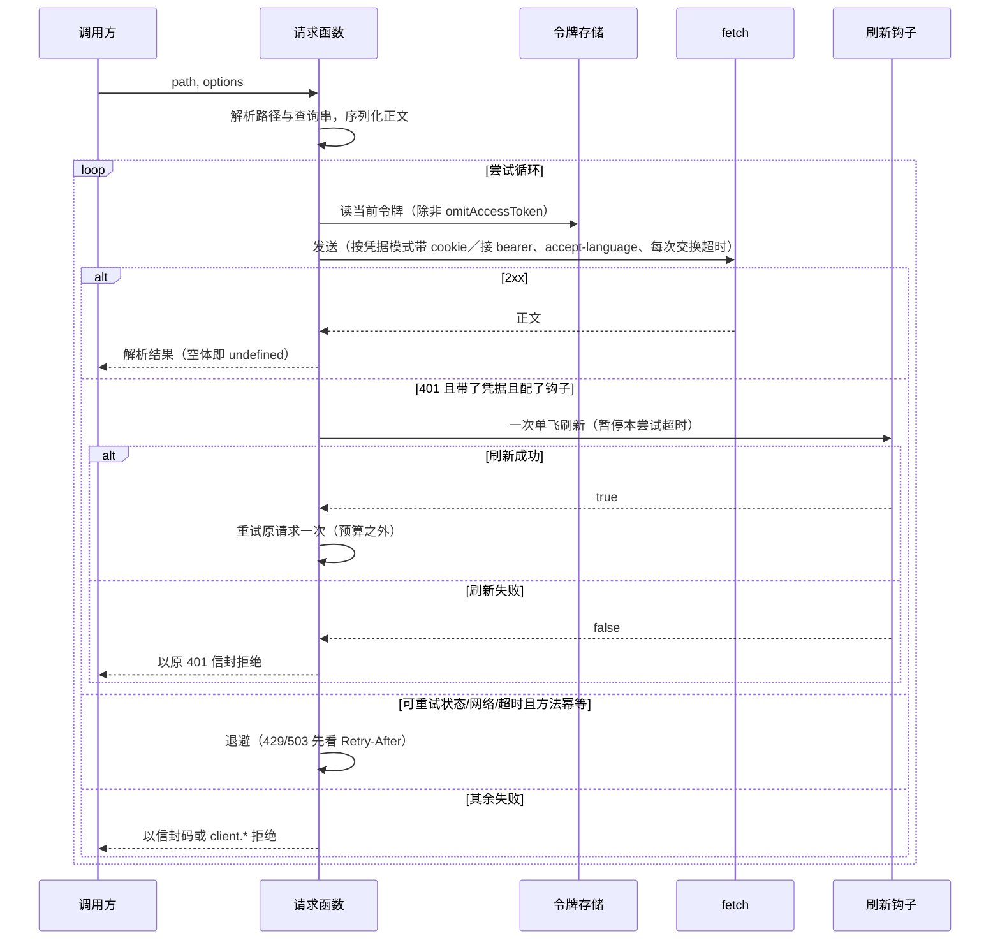

# api-client

## 职责

前端唯一的**手写 HTTP 运行时**，包 `web/packages/api-client`。`createClient` 把若干可注入的接缝——可注入的 `fetch`、可选的仅内存的访问令牌存储、凭据模式、401 刷新钩子、重试策略、每次交换的超时、结构化上报端、语言提供者、租户提供者——接成一个请求函数 `RequestFn`；前端的每一次 HTTP 调用都经它发出，每一次失败都以 `ApiError` 拒绝。

- **它为什么存在。** 契约的生成面（[api-sdk](design-web-api-sdk.md)、orval 的产物）产出的是**形状**——类型与每端点的函数、Query hook——它不产出**传输**。生成面把每次调用交给一个手写的适配器（`@speed/api-sdk` 的 `./runtime` 接缝），由适配器转发给本包的请求函数；宿主在装配处（[product-shell](design-web-product-shell.md) 的 `bootstrapSpeedApp`）以 `bindRequestFn` 把客户端绑进那条接缝。传输（基地址、令牌、刷新、重试、超时、上报、语言、租户）因此只在一处定义。工作区里除本包外没有任何一处手写 `fetch`/`axios`，这条由 `web/eslint.config.mjs` 的 `speed/no-direct-http` 规则守住，而白名单里只有本包。
- **每次尝试接凭据。** 配了访问令牌存储时，请求函数在每次发送时从存储读一次当前令牌，接成 `Authorization: Bearer <token>`；一次请求可声明 `omitAccessToken`，声明后完全不读存储、不接任何存储令牌。cookie 会话不需要这一路：凭据是服务端的 httpOnly 会话 cookie，由浏览器按 `credentials` 模式（同源缺省即带上）附上，故 cookie 宿主完全不配存储。令牌只在内存：本包没有任何存储 API，令牌不落 `localStorage`/`sessionStorage`/IndexedDB/cookie。
- **租户按尝试播报，且不在令牌里。** 宿主交来一个租户提供者，本包每次尝试读一次，接成 `X-Tenant` 头；租户是请求期的路由事实，不在访问令牌的声明里，后端解析层正是从请求面（按配置取头、子域或路径）读它。未配提供者、或提供者答空时该头缺席；调用方自带的 `x-tenant` 不覆盖。
- **静默的 401 单飞刷新。** 配了刷新钩子时，一次**带了凭据**（bearer 令牌，或凭据模式声明了 cookie 时会带的同源 cookie）的 401 触发一次刷新（并发的 401 共享同一次在飞刷新），随后原请求重试恰一次；凭据为空的 401 不经刷新路径，原样抛出。
- **仅幂等、仅瞬时的重试。** `GET`／`HEAD`／`OPTIONS` 上的 429（honour `Retry-After`）、502／503／504、网络失败与超时按策略重试，其余一律不重试。
- **每次交换一条超时，调用方取消原样透传。** `timeoutMs` 界定一次 HTTP 交换（一次发送加其正文读取）；调用方传入的 `AbortSignal` 取消时以原生 `AbortError` 拒绝，不包裹、不重试。
- **`ApiError` 归一。** 后端以 RFC 9457 问题对象出行（机器可读的类在 `type`，取值 `urn:speed:<模块>:<码>`，正文不带 `code` 成员），本包从 `type` 推得模块码 `<模块>.<码>`（码段里的连字符归一为下划线，`urn:speed:objectstore:not-found` → `objectstore.not_found`），并保留后端给了的 `traceId`／`params`／`message`／`details`；带 `code` 成员的信封以 `code` 为准；两者都没有的应答取本包保留的 `client.*` 码。
- **语言按尝试播报。** 宿主交来一个语言提供者，本包每次尝试读一次，接成 `accept-language`，是传输通道而非响应本地化开关。
- **结构化上报。** 本包自身只在刷新失败时经 `Reporter` 报一条警告；终态失败以 `ApiError` 拒绝，由调用方决定是否上报。
- **预认证配置端点的手写取回。** go/config 的公开端点在生成面之外另有一条按键映射的手写封装。
- **服务端事件流。** `createClient` 除请求函数外交出 `openEventStream`：经同一组接缝（fetch、令牌存储、租户与语言提供者、静默刷新）打开一条 `text/event-stream` 长连接，把 SSE 帧解析成事件交给调用方。它与请求函数分开承载，因为它不是一次请求/响应交换——无每次交换的超时、无幂等重试预算，也不重连。
- **`./react` 子路径。** 配置钩子在独立子路径下，使主入口保持无 React 依赖。

### 非职责

- **不生成类型与端点函数。** 每端点的类型、函数与 Query hook 由 orval 从契约生成，落在 [api-sdk](design-web-api-sdk.md)。本包对 spec 无关：它不认识任何端点路径、请求体或响应类型，只接受一个路径串与一组请求选项。
- **不认识租户，只播报宿主给的租户。** 本包不推导、不存租户标识，只在每次尝试把宿主经租户提供者交来的值接成 `X-Tenant` 头；租户从哪来（路由、会话）是宿主的事实，本包不决定。查询键的租户分段是框架别处的事（[ADR-web-tenant-query-key-2026-10-15](../../../adr/adr-web-tenant-query-key-2026-10-15.md)）。
- **不落存储。** 本包没有存储接缝，宿主因而无法配置令牌持久化；访问令牌只在内存，重载页面即登出直到会话层重建会话。刷新令牌的家在会话层（[auth-core](design-web-auth-core.md)），不在本包。
- **不持会话状态、不驱动会话。** 401 时调用的刷新钩子由宿主提供（`@speed/auth-core` 的会话刷新）；本包不持有会话，不决定会话存续。
- **不构造 QueryClient、不定义查询键。** 本包只交一个请求函数；server 状态的缓存归 TanStack Query，由宿主拥有。
- **不含用户可见文本，不带 i18n 资源。** 错误 `code` 是数据，由消费包在自己的文案目录里译成双语文本；上报消息是固定的英文串加 snake_case 属性；本包不渲染任何面向用户的文字。
- **带二进制正文与原始字节应答。** 请求正文为一个二进制值（`Blob`、`ArrayBuffer` 或类型化数组）时原样送出，不 JSON 序列化（对象存储的内容上传即此）；一次请求声明 `responseType: 'blob'` 时把 2xx 正文读成 `Blob`（对象存储的内容下载即此），错误应答仍按 JSON 信封解析。
- **服务端事件流由 `openEventStream` 承载。** 流式应答不是一次请求/应答交换，故不骑请求函数（它有逐次交换的超时与幂等重试预算，流没有），而由独立成员 `openEventStream` 经同一套接缝（fetch、令牌、租户、语言、单飞刷新）开启（见职责与外部接口契约）。

## 外部接口契约

### 主入口交付的符号

```ts
export function createClient(options: ClientOptions): SpeedClient

export type RequestFn = <T>(path: string, options?: RequestOptions) => Promise<T>
export type HttpMethod = 'GET' | 'HEAD' | 'OPTIONS' | 'POST' | 'PUT' | 'PATCH' | 'DELETE'

/** createClient 的产物：请求函数加事件流开启器。可赋给 RequestFn。 */
export type SpeedClient = RequestFn & {
  openEventStream(path: string, options?: EventStreamOptions): EventStreamHandle
}

export type EventStreamOpener = (path: string, options: EventStreamOptions) => EventStreamHandle
export interface EventStreamOptions {
  onEvent: (event: ServerSentEvent) => void
  onOpen?: () => void
  onError?: (error: ApiError) => void
  onClose?: () => void
  signal?: AbortSignal
}
export interface ServerSentEvent {
  readonly event: string   // 缺省 message
  readonly data: string
  readonly id?: string
  readonly retry?: number
}
export interface EventStreamHandle { close(): void }

export function createMemoryAccessTokenStore(): AccessTokenStore

export class ApiError extends Error { /* status, code, traceId, params, details, attempts, auth */ }
export const ERROR_CODE_NETWORK: 'client.network'
export const ERROR_CODE_TIMEOUT: 'client.timeout'
export const ERROR_CODE_PROTOCOL: 'client.protocol'
export function httpErrorCode(status: number): string
export function isApiError(value: unknown): value is ApiError
export function isTransportFailure(value: unknown): value is ApiError

export const DEFAULT_RETRY_POLICY: RetryPolicy
export function retryDelayMs(attempt: number, policy: RetryPolicy, random?: () => number): number
export function retryAfterDelayMs(header: string | null | undefined, now?: number): number | null

export function createConsoleReporter(): Reporter

export const CONFIG_PUBLIC_PATH: '/api/v1/config/public'
export const SYSTEM_FEATURES_PATH: '/api/v1/config/features'
export function fetchPublicConfig(api: RequestFn, options?: ConfigFetchOptions): Promise<PublicConfigResponse>
export function fetchSystemFeatures(api: RequestFn, options?: ConfigFetchOptions): Promise<SystemFeaturesResponse>
```

类型面：`ClientOptions`、`RequestOptions`、`AccessTokenStore`、`RetryPolicy`、`Reporter`、`ApiErrorInit`、`FieldError`、`ConfigFetchOptions`、`PublicConfigResponse`、`SystemFeaturesResponse`、`HttpMethod`、`RequestFn`。

### `./react` 子路径交付的符号

```ts
export function usePublicConfig(api: RequestFn): UsePublicConfigResult
export function useFeature(api: RequestFn, key: string): boolean
export type UsePublicConfigResult
```

### `createClient` 的选项（`ClientOptions`）

| 选项 | 契约 |
|---|---|
| `baseUrl` | scheme 加 host 加可选前缀；请求路径必须以 `/` 开头并原样接在其后。缺省或空串即 `createClient` 抛错。尾斜杠剥除。 |
| `fetch` | fetch 实现；缺省取构造时捕获的 `globalThis.fetch`，两处都无即抛错（环境无 fetch 时快速失败，而非每次请求失败） |
| `accessTokenStore` | 可选的仅内存令牌存储；缺席即请求不带 `Authorization`（cookie 会话与公开配置类端点都用这一档） |
| `credentials` | fetch 的 `credentials` 模式，原样传给 fetch；缺席取浏览器缺省（`same-origin`，cookie 会话靠它带上同源 cookie）。声明 `'same-origin'`/`'include'` 同时把本客户端标为 cookie 带凭据：一次带了 cookie 的 401（除声明 `omitAccessToken` 者）与带了 bearer 令牌的请求同等触发刷新钩子 |
| `refreshAccessToken` | 静默 401 刷新钩子：成功返回 `true`（随后原请求重试一次）；只对带了凭据（bearer 令牌，或 cookie 模式下的同源 cookie）的请求触发；并发 401 共享一次在飞刷新；每请求至多调用一次 |
| `timeoutMs` | 一次交换的超时毫秒；缺席即不装内部超时；`<= 0` 或非有限值抛错 |
| `retryPolicy` | 瞬时重试的次数与延时；缺省 `DEFAULT_RETRY_POLICY`；`maxAttempts < 1` 或非整数、延时为负或非有限即抛错 |
| `reporter` | 结构化诊断接收端；缺省 `createConsoleReporter()` |
| `languageProvider` | 每次尝试读一次，返回当前语言或 `null`/空串表示「无可播报」；接成 `accept-language`，不覆盖调用方自带的该头 |
| `tenantProvider` | 每次尝试读一次，返回当前租户或 `null`/空串表示「无可播报」；接成 `X-Tenant`，不覆盖调用方自带的 `x-tenant` |

**`RequestFn` 的契约，约束的主体是它的每次调用**：2xx 的 JSON 正文解析为 `T`，空的 2xx（204 式）解析为 `undefined`，除非请求声明了 `requireJsonBody`（此时空 2xx 以携带真实状态与尝试次数的 `client.protocol` 拒绝）；非 2xx 一律以 `ApiError` 拒绝；带信封的失败保留其码——正文自带的 `code`，或后端 RFC 9457 问题对象的 `type` 推得的 `<模块>.<码>`（`code` 与 `urn:speed:` 的 `type` 任一即可，`traceId` 可选），其余取保留的 `client.*` 码；调用方取消以原生 `AbortError` 拒绝。请求路径必须是以 `/` 开头的绝对路径；带查询串的路径与 `query` 选项同时给出即按程序员错误拒绝。

**`RequestOptions` 的字段**：`method`（缺省 `GET`）、`headers`、`omitAccessToken`、`query`（数组值按重复参数展开，供 Go 的 `r.URL.Query()` 解析）、`body`（JSON，或一个原样送出的二进制值）、`responseType`（`'blob'` 即把 2xx 正文读成 `Blob`）、`requireJsonBody`、`signal`。

**发送的默认头**：`accept` 缺省 `application/json`，有正文时 `content-type` 缺省 `application/json`；两者都只在调用方未自带时设置。

### 保留码词表

`client.network`（请求未到达可用响应）、`client.timeout`（本包的超时触发）、`client.http.<status>`（无模块码的非 2xx——正文既无 `code` 成员，也无 `urn:speed:` 的 `type`）、`client.protocol`（契约在任一方向被违反：非对象/数组的 2xx、声明了需要文档却是空 2xx、不可序列化的请求体）。**`client.*` 是保留命名空间**：`parseEnvelope` 在解析时拒绝任何以 `client.` 开头的码——不论它来自 `code` 成员还是由 `urn:speed:client:*` 的 `type` 推得——改以 `client.http.<status>` 合成。服务器码是模块作用域的，`client` 不属于任何模块，因而一个信封里的 `client.*` 是行为不端的后端或中间人。`isTransportFailure` 是消费方据以区分本包真实传输失败（`status` 为 0，任何 HTTP 应答都造不出）与服务器应答错误的判据。

### 对外接口面

主入口与 `./react` 子路径的导出集、各导出类型的字段与方法集、`createClient` 选项的语义、`RequestFn` 与 `RequestOptions` 的接口面、`SpeedClient` 与其 `openEventStream` 成员、保留码词表与保留的 `client.*` 前缀，是本包对消费方的接口面。变更按 TypeScript 的源码语义分类：新增导出、新增可选字段是源码兼容的；删除导出或字段、改既有导出或字段的含义或名、改签名（参数或返回类型），是不兼容变更。把必选与可选互转按位置判：输入位（宿主提供的 prop 或参数）放宽兼容、收紧不兼容；输出位（宿主读取的返回类型或结果字段）相反——放宽为可选使读出的值成为 `T | undefined`，strictNullChecks 下只有在要求 `T` 处使用它的消费者无法编译（对可能为 undefined 的值做成员访问报 TS18048，赋给 `T` 或传入要求 `T` 的形参报 TS2322/TS2345），仅转发或在宽松处使用（模板串、比较、`??`、可选链）的消费者仍编译，故可能破坏消费者、是不兼容变更。改缺省头、或不兼容地改保留码词表与保留的 `client.*` 前缀，同属语义层面的破坏性变更。主入口的导出集由 `src/index.test.ts` 的精确清单钉住：新增一个导出要同步更新那份清单，这是本包自己的回归守卫，不是对消费方的破坏；类型面有编译期漂移守卫。

### 事件流的契约

`openEventStream(path, options)` 对每个调用打开一次 `GET`：接同一组接缝头（`accept-language`、`X-Tenant`、bearer 令牌，按次读），再加 `accept: text/event-stream`。回应按下列规则处置：

- **2xx**：调 `onOpen`，读 `response.body` 流，按 `text/event-stream` 的组帧（空行分帧、字段首个冒号分键值、无 `data` 行的帧丢弃、事件名缺省 `message`）解析成 `ServerSentEvent`，逐帧调 `onEvent`；流被服务端正常收尾时调 `onClose`。
- **401 且带了 bearer 令牌且配了刷新钩子且此前未刷新过**：调一次刷新，成功即以新令牌重试一次；失败则读信封、以 `onError` 上报，再调 `onClose`。
- **其余非 2xx**：读信封（正文自带的 `code`，或 RFC 9457 问题对象 `type` 推得的模块码），以 `onError` 上报 `ApiError`（模块码或 `client.http.<status>`），再调 `onClose`。
- **传输失败**：以 `client.network` 的 `ApiError` 上报，再调 `onClose`。

**调用方自己的取消不上报。** `close()` 或已中止的 `signal` 结束连接，既不调 `onError` 也不调 `onClose`。`onError` 与 `onClose` 各至多一次，且 `onClose` 是「可以重连了」的信号：本包不重连，重连是消费方的策略。

### 事件流的非保证

- **无每次交换的超时。** 一条长连接没有可界定的交换边界，宿主需要超时须自己接线。
- **不重试、不重连、不补发。** 一次失败即一次失败，一条断开的连接即断开；要拿到确定内容的消费方回读。
- **不做回压。** 帧按到达顺序交给 `onEvent`；消费方自己控制读取节奏。

## 依赖

| 依赖 | 用途 |
|---|---|
| 环境的 `fetch`（无第三方依赖） | 传输；可注入，构造时捕获 |
| `react`（peer，可选） | 仅 `src/react.ts`（`./react` 子路径）import；可选 peer 使只用主入口的消费方不装 React |

本包**不依赖任何同族前端包**：它是前端依赖图的另一条地板，契约无关，`api-sdk` 经其 `runtime.ts` 接缝读它的请求函数。方向到这里终止，本包不 import `api-sdk`、`auth-core` 或任何 UI 包。

**React 只在 `./react` 子路径之后存在。** `src/react.ts` 是本包唯一可 import `react` 的文件；主入口的 import 图保持无 React。这条与 `@speed/i18n` 的 `./mui-locale` 隔离同形。

## UML 图

一次请求的整条生命周期。图里画不出的约束：令牌与语言都在**每次尝试**时读一次（刷新后重试的请求因此带上新令牌，语言切换后重试的请求播报新语言）；刷新轮是**自己的一次交换**，原尝试的超时在其间暂停，因而不把刷新耗时计入原交换；刷新的单飞由一次在飞承诺承担，原请求的重试在瞬时重试预算之外，恰一次。



## 核心数据结构

| 概念 | 类型 | 说明 |
|---|---|---|
| 请求函数 | `RequestFn` | `createClient` 的产物；泛型于解析结果类型 |
| 客户端选项 | `ClientOptions` | 基地址、fetch、可选的令牌存储、凭据模式、刷新钩子、超时、重试策略、上报端、语言提供者、租户提供者 |
| 单次请求选项 | `RequestOptions` | 方法、头、`omitAccessToken`、查询、正文（JSON 或二进制）、`responseType`、`requireJsonBody`、取消信号 |
| 归一错误 | `ApiError` | `status`、`code`、`traceId`、`params`、`details`、`attempts`、`auth`（`status === 401`） |
| 令牌存储 | `AccessTokenStore` | 同步的 `get`/`set`，仅内存；`set(null)` 即登出 |
| 重试策略 | `RetryPolicy` | `maxAttempts`、`initialDelayMs`、`maxDelayMs` |
| 上报端 | `Reporter` | `error`/`warn` 通道，固定消息加 snake_case 属性 |
| 信封（内部） | `Envelope` | 结构校验后的响应错误体：码由正文的 `code` 或问题对象 `type`（`urn:speed:<模块>:<码>`）推得，可选的 `traceId`/`params`/`message`/`details` |

**`ApiError` 的 `auth` 恰在 HTTP 401 时为真**，不论信封说了什么；配了刷新钩子的宿主只在刷新失败或重试后的请求再被拒时才见到它。

## 核心算法与流程

### 一次请求的生命周期

1. 校验路径是以 `/` 开头的绝对路径，按 `query` 选项拼 URL（数组值展开为重复参数；路径自带查询串与 `query` 选项并用即按程序员错误拒绝）。
2. 若给了正文，先序列化一次（正文不随尝试变化）；不可序列化（循环结构、顶层函数或符号、`toJSON()` 返回空）以 `client.protocol` 拒绝，早于任何发送。
3. 进入尝试循环：每次尝试接令牌（除非 `omitAccessToken`）、设默认头、按尝试读一次语言、装每次交换的超时、转发调用方的取消信号。
4. 发送后按结果分派：2xx 读体并解析（空体按 `requireJsonBody` 决定是 `undefined` 还是 `client.protocol`）；401 走刷新路径；可重试的失败按方法与预算决定退避重试；其余以 `ApiError` 拒绝。
5. 每次尝试结束（读毕、释放、放弃）都拆掉该尝试的超时与取消接线。

**被丢弃的响应的正文先取消。** 一个为被重试或因刷新成功而被丢弃的响应，其正文在退避或重试之前被取消，使连接被确定地释放，而不是被一个未读响应一直占住直到垃圾回收。

### 401 与静默刷新

刷新路径的准入由下列条件共同构成：该请求配置了刷新钩子、该请求带了凭据（bearer 令牌，或凭据模式声明了 cookie 且未声明 `omitAccessToken` 时的同源 cookie）、且这次请求此前未刷新过。

- **在任何时候，最多一次刷新在飞。** 并发的 401 汇入同一次在飞刷新；一次刷新完成后不记忆结果，下一个 401 起一次新的。
- **刷新轮是与原交换分离的一次交换。** 原尝试的超时在刷新轮期间暂停、之后按剩余的预算重上；刷新轮自身不竞态任何信号，故一个中途放弃的发起者不会把一次可能成功的刷新对已在飞的等待者判成失败。
- **凭据为空的 401 不经刷新。** 它意味着端点要求认证，而刷新给不出；它原样抛出。这条对会话装配是承重的：会话自身的刷新操作声明 `omitAccessToken`，凭据为空地出行，故刷新端点拒绝一个陈旧令牌时拒绝原样浮出，而不会重新进入刷新路径（那会 await 它自己所处的刷新）。
- **刷新失败**使原 401 作为一个可区分的认证 `ApiError` 浮出，并经 `Reporter` 报一条 `access token refresh failed` 警告（带该失败的码——信封的 `code` 或由 `type` 推得的模块码——有 `traceId` 时一并带上，以关联服务端日志）。

### 重试的判定与退避

仅当方法幂等（`GET`／`HEAD`／`OPTIONS`）且已用次数未达 `maxAttempts - 1` 时重试。可重试的结果是 429、502、503、504、网络失败与超时。延时：429 与 503 先看 `Retry-After`（delta-seconds 或 HTTP-date，受 `maxDelayMs` 封顶），其余走 full-jitter 指数退避（`retryDelayMs`，均匀分布在 `[0, min(maxDelayMs, initialDelayMs * 2**n))`）。退避的睡眠感知取消信号：取消一旦发生即以原生 `AbortError` 拒绝，不让一次已无意义的请求坐完整个退避。

### 语言的按尝试读取

`languageProvider` 在每次尝试读一次，接成 `accept-language`（`null`/空串即不设该头），且不覆盖调用方自带的该头。每次尝试读是这条的设计点：语言切换后重试的请求播报用户当前所看的语言，与令牌的每次尝试读同一纪律。

### 租户的按尝试读取

`tenantProvider` 在每次尝试读一次，接成 `X-Tenant`（`null`/空串即不设该头），且不覆盖调用方自带的 `x-tenant`。租户是请求期的路由事实，**不在访问令牌的声明里**：后端解析层按配置从请求面（头、子域或路径）读租户名，指向受租户保护的端点的请求因此必须带上它，demo 的栈正是从该头解析。每次尝试读是这条的设计点：切租户后重试的请求播报用户当前所处的租户，与令牌、语言同一纪律。租户从哪来（宿主的路由、会话）是宿主的事实，本包不推导。

### 配置端点的取回

`fetchPublicConfig`／`fetchSystemFeatures` 是预认证端点的按键映射层，经同一 `RequestFn` 发出，并以 `requireJsonBody` 拒绝空 2xx——go/config 的端点总是写一份 JSON 文档，一个空应答是坏的，而解析成 `undefined` 会冒充成那份类型化文档直到消费方读到它的一个字段。取回函数不接受租户参数：这两个端点从请求 host 解析租户，不读传输播报的 `X-Tenant` 头。

## 错误与失败语义

| 情形 | 表现 |
|---|---|
| 非 2xx 且带有效信封（`code` 或 `urn:speed:` 的 `type`） | `ApiError`，码取正文的 `code` 或由 `type` 推得的模块码（有则带 `traceId`/`params`/`message`/`details`） |
| 非 2xx 且无可解析信封（既无 `code` 也无 `urn:speed:` 的 `type`） | `ApiError`，`client.http.<status>` |
| 请求未到达可用响应（DNS／拒连／TLS／CORS／读体中途失败） | `ApiError`，`client.network`、`status` 为 0 |
| 本包的超时触发 | `ApiError`，`client.timeout`、`status` 为 0 |
| 2xx 正文不是 JSON 对象或数组 | `ApiError`，`client.protocol` |
| 声明了 `requireJsonBody` 却收到空 2xx | `ApiError`，`client.protocol`，带该交换的真实状态与尝试次数 |
| 请求体不可序列化为 JSON | `ApiError`，`client.protocol`，早于任何发送 |
| 路径不是以 `/` 开头的绝对路径，或路径自带查询串又与 `query` 并用 | 抛程序员错误（构造或调用期的配置错误，不是 `ApiError`） |
| 调用方取消 | 原生 `AbortError`，不包裹、不重试 |
| 401 且未配钩子／无凭据（无 bearer 令牌，且凭据模式非 cookie 或声明了 `omitAccessToken`）／重试后再被拒 | `ApiError`（认证，`auth` 为真） |
| 刷新失败 | 原 401 作为认证 `ApiError` 浮出，另报一条警告 |
| 构造期配置错误（空 `baseUrl`、无可用 fetch、`maxAttempts < 1`、非法超时） | `createClient` 抛程序员错误（早于任何请求） |

**本包不降级。** 一次请求要么被重试到期、以 `ApiError` 拒绝，要么以结果或取消结束。错误文本不携带令牌或凭据。

### 非保证

- **后端不发送 `traceId` 时，`ApiError` 不带它。** 实际后端写出的是 RFC 9457 问题对象（`{type, title, status, detail}`，机器可读的类在 `type`），它不带 `traceId`；把请求关联到服务端日志的 `traceId` 需要后端各模块的问题写出统一发出它。
- **配置取回的响应形状是手工维护的契约。** 公开配置体的类型只能是动态键的记录（schema 按模块可扩），按 key 的类型化在钩子里手工维护；一个违反该形状的载荷须软失败。

## 并发与事务边界

- **静默刷新是单飞。** 一次在飞刷新由所有并发的 401 共享；完成即释放槽位。这条防的是同一刷新令牌被同时呈现两次（认证服务读作盗用）。
- **`./react` 的配置缓存按 `RequestFn` 标识键控，不按组件生命期。** 同一 `api` 上最先挂载的消费方发起唯一一次取回，其余实例读并重渲染那份共享状态（`useSyncExternalStore`）；`refresh()` 向所有共享者重新发布一次强制取回。失败状态**不**进共享缓存：一次落在错误上的取回什么都不缓存，此后订阅的实例发起一次全新取回，故重连或重试后的挂载自行恢复。
- **本包不持连接池、不派生后台任务。** 一次请求是自足的一次调用；每次尝试的超时与取消接线在尝试结束时拆除。

## 扩展点

本包的可变面是 `createClient` 的**可注入接缝**，每个接缝都以其注入点为准：

- **`fetch`**：注入确定性替身（测试），或在无全局 fetch 的环境提供实现。
- **`accessTokenStore`**：注入替换的令牌存储（仍须仅在内存，不落存储——本包没有存储接缝）；cookie 会话不注入。
- **`credentials`**：声明客户端带 cookie（`'same-origin'`/`'include'`），使同源 cookie 随请求发送、且其 401 触发刷新钩子；跨源部署置 `'include'`。
- **`refreshAccessToken`**：把静默刷新接到宿主的会话（`@speed/auth-core`）；cookie 会话接 `session.restore()`，令牌会话接 `session.refresh()`。缺席即每个 401 原样浮出。
- **`retryPolicy`**：改瞬时重试的预算与延时；`{ maxAttempts: 1, ... }` 关闭瞬时重试。
- **`reporter`**：把诊断接到宿主的管道；`Reporter` 的 `error` 通道是宿主自身的调用点。
- **`languageProvider`**：把客户端的语言播报接到宿主的 i18n 实例。
- **`tenantProvider`**：把客户端的租户播报接到宿主当前租户（宿主的路由事实）。

**新增一个预认证端点的手写取回**即在 `config-fetcher.ts` 加一个常量与一个封装，与生成面保持路径一致。

## 实现状态

| 能力 | 状态 | 代码 |
|---|---|---|
| 请求函数与生命周期、令牌与语言与租户按尝试读 | 已实现 | `web/packages/api-client/src/client.ts` `createClient`、`SpeedClient`、`RequestFn`、`RequestOptions`、`ClientOptions`；`web/packages/api-client/src/seams.ts` `applySeamHeaders` |
| 服务端事件流开启器 | 已实现 | `web/packages/api-client/src/event-stream.ts` `createEventStreamOpener`、`EventStreamOpener`、`EventStreamOptions`、`ServerSentEvent`、`EventStreamHandle` |
| 归一错误与保留码词表、传输失败判据 | 已实现 | `web/packages/api-client/src/errors.ts` `ApiError`、`ERROR_CODE_NETWORK`、`ERROR_CODE_TIMEOUT`、`ERROR_CODE_PROTOCOL`、`httpErrorCode`、`isApiError`、`isTransportFailure` |
| 仅内存的访问令牌存储 | 已实现 | `web/packages/api-client/src/access-token.ts` `createMemoryAccessTokenStore`、`AccessTokenStore` |
| 重试策略与纯退避函数 | 已实现 | `web/packages/api-client/src/retry.ts` `DEFAULT_RETRY_POLICY`、`retryDelayMs`、`retryAfterDelayMs` |
| 结构化上报端 | 已实现 | `web/packages/api-client/src/reporter.ts` `createConsoleReporter`、`Reporter` |
| 预认证配置端点的手写取回 | 已实现 | `web/packages/api-client/src/config-fetcher.ts` `fetchPublicConfig`、`fetchSystemFeatures`、`CONFIG_PUBLIC_PATH`、`SYSTEM_FEATURES_PATH` |
| `./react` 配置钩子与按 `RequestFn` 标识的共享缓存 | 已实现 | `web/packages/api-client/src/react.ts` `usePublicConfig`、`useFeature` |
| 手写 HTTP 的 ESLint 白名单 | 已实现 | `web/eslint.config.mjs` `speed/no-direct-http` |
