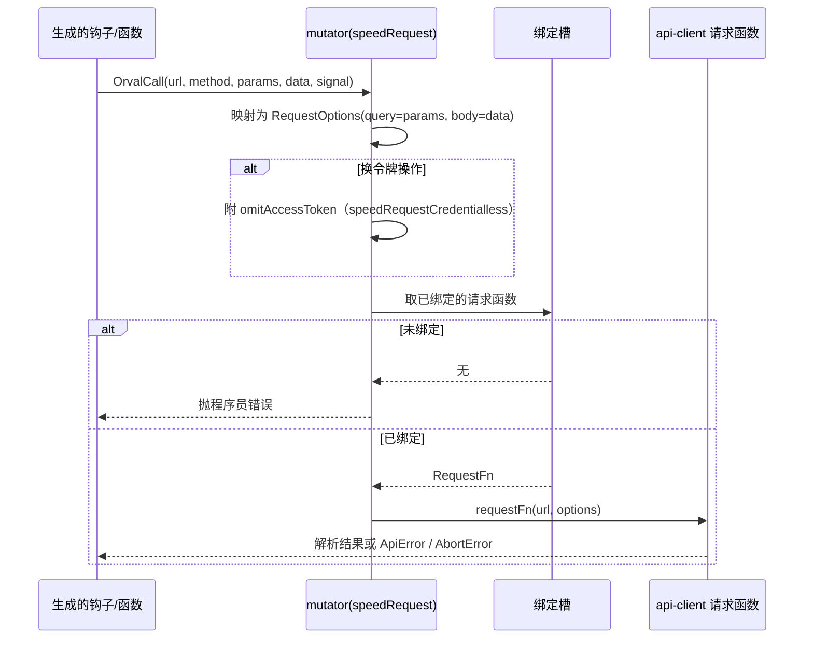
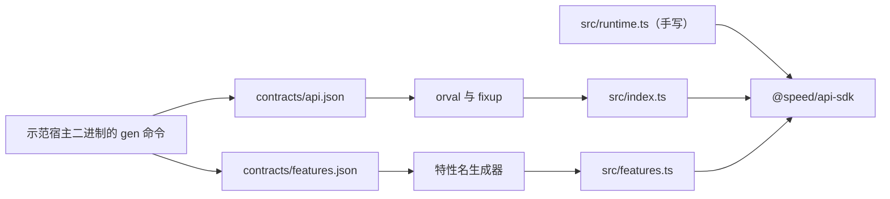

# api-sdk

## 职责

前端对 speed 平台的**生成式、契约优先的类型化接口面**，包 `web/packages/api-sdk`。操作函数、TanStack Query 钩子与响应模型由 orval 从合并的平台 OpenAPI 文档生成；特性名类型由特性名生成器从 `contracts/features.json` 生成；每一次生成的调用都经 [`api-client`](design-web-api-client.md) 的请求函数发出。

- **整份由契约生成。** `src/` 除一个文件外全是生成产物：orval 从 `contracts/api.json` 生成 `src/index.ts`，特性名生成器 `web/scripts/feature-names.mjs` 从 `contracts/features.json` 生成 `src/features.ts`。`src/index.ts` 带 `web/orval.config.ts` 注入的 DO-NOT-EDIT 头，头里锚着生成器的版本，故生成器与已提交产物之间的漂移表现为头本身的一次 diff；`src/features.ts` 带同形的 DO-NOT-EDIT 头。
- **唯一的源码接手点。** `src/runtime.ts` 是本包唯一的手写源码文件，作为 `./runtime` 子路径导出。它存在，是因为生成的代码不能知道宿主如何接上 HTTP 传输。
- **生成面与传输无关。** 生成的调用把一个 axios 形状的选项对象交给一个 mutator；mutator 把它适配成 [`api-client`](design-web-api-client.md) 的请求函数形状并转发。生成的代码里没有 `fetch`、没有 `axios`、没有租户头，也没有租户查询键。
- **生成面与租户无关。** 生成的查询键是裸的 spec 路径，不带租户维度；租户由服务端在请求期按端解析，生成面既不传也不收租户（[ADR-web-tenant-query-key-2026-10-15](../../../adr/adr-web-tenant-query-key-2026-10-15.md)）。
- **契约从模块片段流入。** orval 的输入是各平台模块 HTTP 片段经示范宿主的 `gen` 命令合并出的一份文档（落 `contracts/api.json`）；一个有 HTTP 片段的平台模块即合并文档的成员，因而进入本包的生成面。每个片段的端点路径与操作经 [api-client](design-web-api-client.md) 发出。
- **特性名从模块声明流入。** 后端模块以资源 `feature.Spec` 声明它服务的[特性](../../../glossary.md)（[feature](../design-feature.md)）；示范宿主的 `gen` 命令以 `--features` 写出 `contracts/features.json`：可用集里的全部特性声明，每项带名字、声明模块与是否条件特性，按名字排序。它与 `contracts/api.json` 同源，出自同一个二进制的 import 闭包，是同一份契约的另一半（[starters](../design-starters.md)、[ADR-feature-vocabulary-2026-10-17](../../../adr/adr-feature-vocabulary-2026-10-17.md)）。

### 非职责

- **不做 HTTP。** 生成的代码不做网络调用；每次调用经 mutator 转发给宿主绑定的 `@speed/api-client` 的请求函数。工作区里除 `api-client` 外没有一处手写 `fetch`/`axios`（`speed/no-direct-http` 规则，白名单只有 `api-client`）；本包的 `src/` 每次重生成后都必须仍通过该规则。
- **不认识租户。** 生成面里没有租户头、没有租户查询键，认证片段也不带任何租户字段：认证的请求与应答里没有 `tenant_id`，租户在请求期由服务端的解析层按端解析。租户查询键的分段是消费方壳的纪律（[auth-core](design-web-auth-core.md)）。
- **不含用户可见文本，不带 i18n 资源。** 错误以契约的 RFC 9457 问题对象类型化（机器可读的类在 `type`，取值 `urn:speed:<模块>:<码>`）；码由消费包的文案目录译成双语文本。
- **不构造 QueryClient。** `react` 与 `@tanstack/react-query` 是 peer，宿主共享一个 QueryClient/Provider；本包从不构造。
- **不接受手工编辑。** `src/index.ts` 与 `src/features.ts` 从不手改，也不在 `src/` 里另加一个手写源码文件来补生成的缺口：工具的问题归工具（见「核心算法与流程」的生成一节）。
- **不回答一个面在不在。** 合并文档与特性名清单都取可用集（[ADR-ops-spec-reader-2026-10-15](../../../adr/adr-ops-spec-reader-2026-10-15.md)）：本包里有某个操作函数，不能据此推断本部署服务它；一个名字属于 `FeatureName`，只说明它在可用集里有声明。特性在场由特性文档在运行期回答（[auth-core](design-web-auth-core.md)）。

## 外部接口契约

### 入口

- **`.`（生成的 `src/index.ts`）**——orval 从合并文档派生出的操作函数、钩子与响应模型。其形状是 orval 的，不是本包定义的；只有经生成器才会变。
- **`./features`（生成的 `src/features.ts`）**——特性名类型与全部特性名，由特性名生成器从 `contracts/features.json` 写出：

```ts
export interface FeatureNameRegistry { 'audit.admin': true; /* … */ }
export type FeatureName = keyof FeatureNameRegistry & string
export const FEATURE_NAMES: readonly FeatureName[] = [ /* … */ ]
```

`FeatureNameRegistry` 是可增补的登记接口，`FeatureName` 是它的键类型。前端写特性名的位置一律取 `FeatureName`，名字拼错即编译失败（[web](design-web.md) 的「特性门控」）；`FEATURE_NAMES` 供运行期断言一个名字属于清单，例如宿主测试断言路由表里每个 `requires` 都在其中。

- **`./runtime`（`src/runtime.ts`）**——宿主绑定的稳定手写接缝：

```ts
export function bindRequestFn(requestFn: RequestFn): void
export function speedRequest<T>(call: OrvalCall): Promise<T>
export function speedRequestCredentialless<T>(call: OrvalCall): Promise<T>
```

**`bindRequestFn` 的契约，约束的主体是它的每个调用方**：把 `createClient(...)` 返回的请求函数在启动处绑定一次，早于任何生成的钩子触发；重绑替换上一个函数，无一次守卫（测试与热重载自由重绑），最后绑定者胜；未绑定而发出的生成调用以一个程序员错误快速失败，而不是发出一次未配置的请求。

**`speedRequest`** 是每个生成操作函数默认调用的 mutator：把一个 axios 形状的 `OrvalCall`（`url`、`method`，按需带 `headers`/`params`/`data`/`signal`）适配为 `api-client` 的 `RequestOptions` 并转发。

**`speedRequestCredentialless`** 是另一个 mutator，由 `web/orval.config.ts` 为换令牌操作（`authn.token.issue`）选定：它以 `omitAccessToken` 声明该请求凭据为空、从不设普通 mutator 的形状。换令牌操作以请求体里的凭据（刷新令牌或客户端凭据）认证、绝不呈现访问令牌，且其 401 必须是终态的——否则会重新进入 `api-client` 的刷新路径，await 它自己所处的刷新（[api-client](design-web-api-client.md) 的 bearer-only 规则）。

### 转发的形状

```ts
interface OrvalCall {
  url: string
  method: HttpMethod
  headers?: Readonly<Record<string, string>>
  params?: Readonly<Record<string, string | number | boolean | null | undefined>>
  data?: unknown
  responseType?: 'blob'
  signal?: AbortSignal
}
```

`forward` 把 `OrvalCall` 映射为 `api-client` 的 `{ method, headers, query, body, signal }`（`params` 到 `query`，`data` 到 `body`），仅在声明凭据为空时附上 `omitAccessToken`，仅在操作声明了原始字节应答时附上 `responseType`。

**`responseType` 仅在声明时转发。** 契约里带字节的操作生成 `responseType: 'blob'`；接缝把它转发为 `api-client` 的同名请求选项，传输据此把 2xx 正文读成 `Blob`（[api-client](design-web-api-client.md) 的二进制路径）。它只在该操作声明时出现，故普通调用的选项对象逐字段不变。请求方向的字节无需标志：一个作为 `data` 交来的 `Blob` 到达传输即为 `body`，原样送出。

**未声明的 `requireJsonBody`。** 接缝在任何操作上都不声明 `requestOptions.requireJsonBody`：一个操作的运行期响应类型在此被擦除，接缝无从知道该操作是否声明了响应体，而无条件要求一个 JSON 文档会破坏合法的空成功操作（204 式删除、只需受理的应答）——那些操作本应解析为 `undefined`。因而**文档的存在性是消费方的守卫**：一个必须在 2xx 体里携带文档的操作，自己校验该体（在触及任何字段之前）并把空 2xx 拒为 `client.protocol`。

### 对外接口面

`./runtime` 的导出集（`bindRequestFn`、`speedRequest`、`speedRequestCredentialless`）与 `OrvalCall` 的字段、`.` 入口经 orval 派生的操作与钩子的形状，以及 `./features` 的 `FeatureNameRegistry`、`FeatureName`、`FEATURE_NAMES`，是消费方据以编写的接口面。变更按 TypeScript 的源码语义分类：新增导出、新增可选字段是源码兼容的；删除导出或字段、改既有导出或字段的含义或名、改签名（参数或返回类型），是不兼容变更。把必选与可选互转按位置判：输入位（宿主提供的 prop 或参数）放宽兼容、收紧不兼容；输出位（宿主读取的返回类型或结果字段）相反——放宽为可选使读出的值成为 `T | undefined`，strictNullChecks 下只有在要求 `T` 处使用它的消费者无法编译（对可能为 undefined 的值做成员访问报 TS18048，赋给 `T` 或传入要求 `T` 的形参报 TS2322/TS2345），仅转发或在宽松处使用（模板串、比较、`??`、可选链）的消费者仍编译，故可能破坏消费者、是不兼容变更。`.` 入口的形状归生成器；改动它要经 `web/orval.config.ts` 并重生成，绝不手改产物。`./features` 的形状归特性名生成器，名字集合归后端的特性声明：后端删除或改名一个特性，重生成后引用旧名的消费方编译失败，前后端名字的漂移借此在编译期被拦下（[ADR-feature-vocabulary-2026-10-17](../../../adr/adr-feature-vocabulary-2026-10-17.md)）。`./runtime` 的改动要与 AGENTS、README、`src/runtime.test.ts` 在同一提交内更新。

## 依赖

| 依赖 | 种类 | 用途 |
|---|---|---|
| `@speed/api-client` | 依赖 | 每个生成调用转发到的请求函数；本包只 import 它的类型（`RequestFn`、`RequestOptions`、`HttpMethod`） |
| `@tanstack/react-query` | peer（必需，^5） | 生成的钩子跑在宿主拥有的 QueryClient 上 |
| `react` | peer（必需） | 生成的钩子与宿主共享一个 React 树 |

方向满足前端的自下而上不变量：本包位于 `api-client` 之上，被 `auth-core` 及更高的 UI 包读。生成面刻意与 `fetch`/`axios`/租户无关，且不 import 任何 UI 包。

**orval 不进锁文件。** 每个运行方都以 `web/` 为工作目录执行 `pnpm dlx orval@8.17.0 --config orval.config.ts`，随后跑 fixup 脚本；orval 本身从不作为工作区依赖，因而不进 `pnpm-lock.yaml`。版本升级要在 `orval.config.ts` 的注释与调用处同时落地。

## UML 图

一次生成的调用从钩子到传输的转发。图里画不出的约束：生成面与传输无关（mutator 是唯一接缝），而 mutator 与宿主客户端之间是一次可变绑定（`bindRequestFn`，最后绑定者胜）；凭据为空是**按操作**选择的，只有换令牌操作走这条；生成的钩子跑在宿主拥有的 QueryClient 上，本包不构造它。



本包的每份生成产物都来自同一个二进制写出的一份契约。图里画不出的约束：`contracts/api.json` 与 `contracts/features.json` 由同一次 `gen` 从同一个 import 闭包写出，彼此同源；每份产物有自己的生成器，再生成时须一并运行；`src/runtime.ts` 不在任何生成器的输出里。



## 核心数据结构

| 概念 | 类型 | 说明 |
|---|---|---|
| 生成的接口面 | `src/index.ts` 的导出 | 操作函数、Query 钩子与响应模型；形状是 orval 的 |
| 调用形状 | `OrvalCall` | mutator 接收的 axios 形状：`url`、`method`，按需 `headers`/`params`/`data`/`responseType`/`signal` |
| 绑定槽 | `boundRequestFn`（模块级） | 宿主启动时经 `bindRequestFn` 绑定一次；重绑替换，最后绑定者胜 |
| 适配器 | `forward`（`src/runtime.ts`） | 把 `OrvalCall` 映射为 `RequestOptions` 并转发；凭据为空按调用布尔量 |
| 特性名类型 | `src/features.ts` 的导出 | `FeatureNameRegistry`、`FeatureName`、`FEATURE_NAMES`；名字集合取自 `contracts/features.json` |

## 核心算法与流程

### 生成

1. 输入是合并的平台文档——各平台模块 HTTP 片段经示范宿主的 `gen` 命令合并出的那份（落 `contracts/api.json`）。一个有 HTTP 片段的平台模块是成员。一个片段只有进入合并才到达本包。
2. `web/orval.config.ts` 定下 `client: 'react-query'`（生成 TanStack Query 钩子）与 `httpClient: 'axios'`；`httpClient` 使生成的调用是 axios 形状的选项对象，路由到 `src/runtime.ts` 导出的 `speedRequest`。`mode: 'single'` 使全部输出落进单个 `src/index.ts`。
3. 一个操作改走另一个 mutator：`authn.token.issue` 在配置里被覆写为 `speedRequestCredentialless`（见「转发的形状」的凭据为空一档）。
4. orval 的若干行为在配置与后处理里被规避：它把每个 mutator 的 import 写得没有文件扩展名（在 nodenext 构建下报错），`web/scripts/orval-nodenext-fixup.mjs` 在每次生成后确定性地把它们改写为显式 `./runtime.js`，并覆盖按操作覆写能产出的每一个 mutator 名；一次已修好的文件（import 已带 `.js`）退出 0，因而 fixup 可自由重跑。生成的 `src/index.ts` 与 fixup 后的形状是提交进仓库的产物。
5. DO-NOT-EDIT 头锚着生成器版本（当前 `8.17.0`），故生成器与产物之间的漂移在头的 diff 里可见。

### 特性名的生成

1. 输入是示范宿主的 `gen` 以 `--features` 写出的 `contracts/features.json`：可用集里的全部特性声明，按名字排序。
2. 特性名生成器 `web/scripts/feature-names.mjs` 读它，写出 `src/features.ts`：`FeatureNameRegistry` 为每个名字登记一项，`FEATURE_NAMES` 按同一顺序列出全部名字，文件带 DO-NOT-EDIT 头。这份 `contracts/features.json` 由示范宿主写出，示范宿主的应用模块不声明特性（[starters](../design-starters.md)），它因而只含平台模块的声明，本包登记的是平台模块的特性名。
3. 示范应用的契约再生成脚本（`starters/demo/web/package.json` 的 `api:gen`）在 `gen` 写出契约之后调用特性名生成器，`contracts/features.json` 与 `src/features.ts` 因此随同一次再生成更新。生成的 `src/features.ts` 是提交进仓库的产物。

`contracts/features.json` 覆盖任何一份可能的特性文档：静态特性都在可用集声明里；经 `feature.Board` 的 `Post` 报告的名字不是报告者声明的条件特性时，`feature.board` 让启动失败（[feature](../design-feature.md)）。所以 `FeatureName` 覆盖前端可能读到的每一个特性名。

### 特性名的对齐检查

- **新鲜度测试。** 本包的测试比对 `src/features.ts` 与 `contracts/features.json`，不一致即失败。后端的同类测试比对已提交的 `contracts/features.json` 与二进制的声明；这条测试与后端的同类测试合起来，让后端改名、删名而前端没跟上时变红。
- **类型断言。** 一条带 `// @ts-expect-error` 的断言确认拼错的名字（如 `'objectstore.objectz'`）不能赋给 `FeatureName`；类型若退化为 `string`，这条断言即失败。
- 新鲜度测试与类型断言都随 `make check` 运行（[ADR-feature-vocabulary-2026-10-17](../../../adr/adr-feature-vocabulary-2026-10-17.md)）。

### 一次生成调用的转发

1. 生成的钩子或函数以 `speedRequest`（或换令牌操作的 `speedRequestCredentialless`）调用一个 `OrvalCall`。
2. `forward` 取当前绑定的请求函数；未绑定即抛一个 `[speed-api-sdk]` 前缀的程序员错误。
3. `forward` 把 `OrvalCall` 映射为 `RequestOptions`（`params` 到 `query`、`data` 到 `body`、`headers`/`signal` 照传），仅在凭据为空时附 `omitAccessToken`。
4. 请求函数执行整条生命周期（令牌、幂等重试、超时、`ApiError` 归一），结果或 `ApiError`/原生 `AbortError` 回到生成的调用点。

### 模块片段的纳入

一个平台模块的 HTTP 片段进入合并文档即进入本包的生成面；反之，一个刻意不作为成员的片段（如应用自己的 API）不进平台 SDK——由应用经自己的生成流生成自己的 SDK。本包因此在发布层只能含平台端点，不能含某个应用的业务端点。

## 错误与失败语义

| 情形 | 表现 |
|---|---|
| 生成调用在未绑定请求函数时发出 | 抛程序员错误（`[speed-api-sdk] no request function bound: ...`） |
| 请求函数返回的 `ApiError` | 照原样传回生成调用点（码与形状不在此改变） |
| 调用方取消 | 原生 `AbortError` 照原样传回（标准查询取消语义） |
| 一个响应声明了文档却收到空 2xx | 接缝不拦；由消费方自己按其守卫拒为 `client.protocol`（见「转发的形状」） |
| 契约里带字节的操作被经此接缝调用 | `responseType: 'blob'` 被转发，传输把 2xx 正文读成 `Blob`；二进制请求体原样送出 |
| `src/features.ts` 与 `contracts/features.json` 不一致 | 本包的新鲜度测试失败 |
| 前端代码写了一个不在 `FeatureName` 里的名字 | 编译失败 |

本包不重试、不降级、不合成错误：瞬时重试属 `api-client`，带码的应答是重复无法挽回的确定答复。

## 并发与事务边界

- **绑定槽是模块级的有意单例。** `bindRequestFn` 在一个进程里绑定一次请求函数；重绑替换上一个，无一次守卫，故测试与热重载可自由重绑。绑定发生在启动处，早于任何生成的钩子触发。
- **本包不持缓存、不持连接。** 生成的钩子跑在宿主拥有的 QueryClient 上；缓存与逐出策略归宿主（见 [product-shell](design-web-product-shell.md) 的会话结束策略与 [ADR-web-tenant-query-key-2026-10-15](../../../adr/adr-web-tenant-query-key-2026-10-15.md) 的租户逐出）。

## 扩展点

- **新增一个平台模块的接口面**即让它的 HTTP 片段进入合并文档；重生成后其操作与钩子出现在 `.` 入口。本包不为任何单模块手写代码。
- **新增一个按操作的 mutator 覆写**在 `web/orval.config.ts` 的 `override.operations` 里加一条，使该操作改走另一个已导出的 mutator；`src/runtime.ts` 里另加一个源码文件被禁止，缺口在工具里补。
- **生成器升级**要同时改 `orval.config.ts` 的注释与每个调用方的命令（版本钉在一处，重生成后头里的版本随之更新）。
- **平台模块声明一个特性**即让该模块以 `feature.Spec` 声明它；重生成后名字出现在 `./features` 入口。
- **应用自己的特性名以模块增补并入。** 应用模块声明的特性不进平台包：应用的契约再生成写出的 `contracts/features.json` 含平台与应用两方的声明，生成器取其中不在平台包 `FEATURE_NAMES` 里的名字，在应用内写出 `declare module '@speed/api-sdk/features' { interface FeatureNameRegistry { … } }`，应用里的 `FeatureName` 因此同时含平台名与应用名，宿主与平台包读的是同一个类型。

## 实现状态

| 能力 | 状态 | 代码 |
|---|---|---|
| 生成的接口面（操作函数、Query 钩子、响应模型） | 已实现 | `web/packages/api-sdk/src/index.ts`（orval 生成，DO-NOT-EDIT 头） |
| 运行时接缝与 mutator、按操作覆写 | 已实现 | `web/packages/api-sdk/src/runtime.ts` `bindRequestFn`、`speedRequest`、`speedRequestCredentialless`、`forward`、`OrvalCall` |
| 生成配置（输入、mutator、按操作覆写） | 已实现 | `web/orval.config.ts` |
| nodenext 的 mutator import 后处理 | 已实现 | `web/scripts/orval-nodenext-fixup.mjs` |
| 入口的对外面（`.`、`./runtime` 与 `./features`） | 部分实现 | `web/packages/api-sdk/package.json` 的 `exports` |
| 特性名类型（`src/features.ts`） | 未实现 | — |
| 特性名生成器 | 未实现 | — |
| 特性名的新鲜度测试与类型断言 | 未实现 | — |
| 应用特性名的模块增补 | 未实现 | — |
