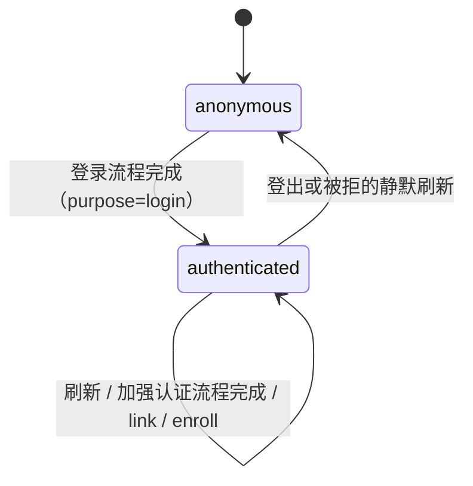

# auth-core

## 职责

浏览器会话生命周期，包 `web/packages/auth-core`。把 `@speed/api-sdk` 生成的 authn 操作接成一个可观察的、仅内存的会话状态机，并交付读取它的 React hook。

- **会话状态机。** `createAuthSession` 把生成的 authn 操作（登录流程的开始与推进、登出、方式列表，以及已登录身份上的 link、step-up、enroll 流程）接成一个会话。一个 `AccessTokenStore` 持有访问令牌——这是它与 `@speed/api-client` 的桥，客户端每次发送都读同一个存储（一次登录对每个后续请求立即可见）；刷新令牌只活在会话闭包内，从不进存储。订阅者观察 `AuthSnapshot` 的翻转。
- **登录按流程推进。** 一次登录是一条服务端流程记录，由前端经生成的 `authn.login` 操作分步推进：`POST /auth/flows` 开始，`POST /auth/flows/answer` 按步答复，`GET /auth/flows/current` 供页面刷新后续接，`DELETE /auth/flows/current` 放弃。流程绑定以 cookie 承载（开始请求的 `binding: 'cookie'`，缺省），前端从不读流程令牌——回跳类方式只在 cookie 绑定下走得完（[authn 登录](../authn/design-authn-login.md)）。流程在某一步就绪（`next.kind = complete`）时，客户端以 `step: 'complete'` 取走结果；交付方式取 `delivery: 'token'` 时，结果是一对令牌。
- **React hook。** `attachSession` 在启动期把一个会话接上（后接者胜），`useAuthState` 暴露快照，`useCurrentTenant` 暴露宿主当前租户，`usePermission` 在宿主附上的按域权限表上做 fail-closed 的集合查询。在接上会话之前与登出之后，每个 hook 都 fail-closed：匿名快照、租户为 null、权限为 false。
- **租户作用域的 query key 约定。** 交付一个 key 工厂与一个逐出助手，把「query 缓存按当前租户命名」这条约定收在一处（见「核心算法与流程」）。

会话状态机放在本包而非视图层：它无 UI、无 DOM，视图只读它的快照。

### 非职责

- **无 UI，无 DOM。** 本包不渲染任何东西；界面在 `auth-ui` 与各界面包。
- **不写存储，不持久化。** 访问令牌是内存凭据；刷新令牌只活在闭包内；本包不碰 `localStorage`，也没有 `restore`——重载页面按约定以匿名启动，用户重新登录。
- **不手写后端调用。** 每个请求都经 `@speed/api-sdk` 生成的操作，走单一 `bindRequestFn` 绑定；本包没有 `fetch`、没有以字符串写死的端点路径。
- **不求值权限。** 会话只携带宿主附上的按域列表并施加存活规则；集合归属由 hook 与外壳决定，绝不在本包内求值。这些检查是用户体验层面的示能，不是安全边界——服务端授权。
- **不把流程驱动成一幕。** 一次登录的步进由视图经本包的流程操作逐步驱动：要哪些字段、跳去哪、要不要第二因素由每一步的应答决定，本包不代视图决定渠道与步序。
- **不在本表面做身份绑定承诺。** 绑定是流程（`POST /auth/flows/authenticated` 目的 `link`），其终态是 `state: 'linked'`；本包把生成调用转发给视图，不把它当登录操作，也不改登录态。
- **不登记第二因素、不做加强认证。** 因素登记是 `POST /auth/flows/authenticated` 目的 `enroll`，加强认证是目的 `step-up`（[authn-mfa](../authn/design-authn-mfa.md)）；两者由消费视图经本包的流程操作驱动，本包不自己发起。
- **query key 工厂不求值、不取数、不判定。** 它只把当前租户拼进一个键，并提供一个按租户逐出子树的助手；某一行该不该取、该不该显示仍归宿主与服务端。

## 外部接口契约

宿主从 `web/packages/auth-core/src/index.ts` 取用以下符号。

### 会话

```ts
export function createAuthSession(store: AccessTokenStore): AuthSession

export interface AuthSnapshot {
  state: 'anonymous' | 'authenticated'
  principal: AuthnPrincipal | null
  permissionSets: AuthPermissionSets
}

export interface AuthPermissionSets {
  tenant: readonly string[] | null
  system: readonly string[] | null
}

export type AuthDomain = 'tenant' | 'system'
export type AuthSessionListener = (snapshot: AuthSnapshot) => void

export interface AuthSession {
  getSnapshot(): AuthSnapshot
  subscribe(listener: AuthSessionListener): () => void
  listMethods(): Promise<AuthnMethodList>
  discoverSso(email: string): Promise<AuthnSsoProvider[]>
  startFlow(request: AuthnLoginStartBody): Promise<AuthnFlowState>
  startAuthenticatedFlow(request: AuthnLoginStartAuthenticatedBody): Promise<AuthnFlowState>
  answerFlow(request: AuthnLoginAnswerBody): Promise<AuthnFlowState>
  readFlow(): Promise<AuthnFlowState | null>
  abandonFlow(): Promise<void>
  logout(): Promise<void>
  refresh(): Promise<boolean>
  setPermissionSet(domain: AuthDomain, perms: readonly string[] | null): void
}
```

- **流程操作接生成面；只有完成签发令牌时改会话。** `startFlow`、`startAuthenticatedFlow`、`answerFlow`、`readFlow`、`abandonFlow` 把 `authn.login` 的流程操作转发给视图，交回该步的 `AuthnFlowState`。只有 `answerFlow` 落定一次签发令牌的完成时才提交令牌、改会话：一次 `purpose: 'login'` 的完成（`state: 'authenticated'`）建会话、转已认证；一次 `step-up` 的完成（`state: 'elevated'`）更新令牌、主体不变；`purpose: 'link'` 与 `enroll` 的完成（`state: 'linked'`、`state: 'enrolled'`）不改登录态。
- **`listMethods` 读部署在场的登录方式发现文档。** 它转发 `GET /auth/methods` 并解析成方法描述符文档（每个方法自报渲染类别、线协议、品牌标签、首步字段与是否可开户，连同注册开关与部署级因素种类），随部署的 `authn.login.disabled-methods` 设置与在场模块而变，前端不写死；消费视图用它渲染渠道（[ADR-web-auth-channel-discovery-2026-10-16](../../../adr/adr-web-auth-channel-discovery-2026-10-16.md)、[ADR-authn-login-method-discovery-2026-10-16](../../../adr/adr-authn-login-method-discovery-2026-10-16.md)）。
- **`discoverSso` 读一个邮箱域映射的企业提供方。** 它转发 `POST /auth/sso/discover`，交回 `{id, name, protocol}` 列表；应答恒同形同长，无匹配时为空列表，故「无匹配」是一次成功的空读而非错误。企业提供方清单不多进发现文档：它按域发现，不泄露账户存在性（[authn-sso](../authn/design-authn-sso.md)）。
- **`logout` 结束会话。** 它调 `POST /auth/logout`（服务端撤销请求带来的会话），清本地令牌与主体、抬升世代、转匿名。
- **`refresh` 用被持有的刷新令牌换新令牌对。** 走 `POST /auth/token` 的 `grant_type = refresh_token`，凭据为空（[api-client](design-web-api-client.md) 的凭据为空一档，即 `speedRequestCredentialless`）；其令牌的落地与世代守卫见「单飞刷新」与「世代守卫」。
- **`setPermissionSet` 存防御性副本。** 传入的数组事后被改动不影响快照；`null` 清空该域。宿主应在每次登录与主体变更后重取 `/me` 派生的列表，而不是复用更早提交下取的列表。

### 生成的响应模型与解析守卫

authn 片段在契约里宣告各自的 2xx 响应 schema，orval 因而把它们的返回类型生成为具名模型：流程态（`AuthnLoginFlow`、`AuthnLoginToken`、`AuthnLoginActionResult`）、一步（`AuthnLoginStep`）、`AuthnLoginField`、`AuthnLoginFactor`、`AuthnPrincipal`、`AuthnLoginMethods`（连同每种方法的描述符、注册开关与部署级因素种类）与 `AuthnSsoProvider`。本包从生成面取用这些模型，并在其上为每个「2xx 必须携带文档」的操作配一个运行时解析守卫：守卫先校验体是对象、再校验其必需字段，任一项不过即拒为 `status: 200`、`code: client.protocol` 的 `ApiError`——一个契约违背的 2xx 不是成功。

本包把生成的 `AuthnLoginStep` 按 `kind` 收窄成一个判别联合 `AuthnStep`，使视图只读它自己那一步携带的字段；`AuthnFlowState` 把生成的流程应答按 `state` 收窄成开放流程（带 `seq` 与 `next`）与三类完成（`authenticated`、`elevated`、`linked`／`enrolled`）：

```ts
export type AuthnStep =
  | (AuthnLoginStep & { kind: 'challenge'; fields: AuthnLoginField[] })
  | (AuthnLoginStep & { kind: 'redirect'; url: string; method: string })
  | (AuthnLoginStep & { kind: 'factor'; factors: AuthnLoginFactor[] })
  | (AuthnLoginStep & { kind: 'enroll'; kinds: string[] })
  | (AuthnLoginStep & { kind: 'complete' })
  | (AuthnLoginStep & { kind: 'webauthn'; options: unknown })

export type AuthnMethodList = AuthnLoginMethods        // methods：描述符数组，外加 signup 与 mfa
export type AuthnMethodDescriptor = AuthnMethodDescriptorModel
export type AuthnSsoProvider = AuthnSsoProviderModel
```

`AuthnPrincipal` 逐字段取自 `GET /auth/me`（[authn-profile](../authn/design-authn-profile.md)）。`AuthnMethodList`、`AuthnMethodDescriptor` 与 `AuthnSsoProvider` 是发现面与企业发现面的生成模型，本包把它们经入口再导出（[ADR-web-auth-channel-discovery-2026-10-16](../../../adr/adr-web-auth-channel-discovery-2026-10-16.md)）。

### 失败契约的拒绝类型

```ts
export class OperationSupersededError extends Error {
  readonly snapshot: AuthSnapshot
}
export function isOperationSuperseded(value: unknown): value is OperationSupersededError
```

**`OperationSupersededError` 是一次签发令牌的提交操作在同门竞态中落败时的拒绝**（用 `isOperationSuperseded` 与 `ApiError` 区分；对它是 `isApiError` 为 false）。签发令牌的提交操作是登录流程的完成与加强认证流程的完成。它的自请求确曾 2xx，但另一次并发操作先提交，那次应答不再描述会话，故本操作不以胜者的快照静默 resolve 而以本错误拒绝——调用方不得把自己的 2xx 当作提交信号：不得为会话实际未运行的那个身份触发一次性副作用（一次登录后的跳转）。加强认证的完成另有一项代价要听：它轮换令牌，落败的提交已消耗服务端为它验证过的那个挑战，调用方绝不能再提供那个码，只能重开一条流程。

### hook

```ts
export function attachSession(session: AuthSession): void
export function useAuthState(): AuthSnapshot
export function usePermission(domain: AuthDomain, permission: string): boolean
```

`useCurrentTenant` 与租户上下文见「租户上下文与租户作用域的 query key」一节。

- **`useAuthState` fail-closed。** 在接上会话之前与登出之后返回一个引用稳定的匿名快照常量，`useSyncExternalStore` 因此不会在无会话期看到伪变化。
- **`usePermission` 是纯集合查询，fail-closed**：匿名为 false，域列表为 null 为 false，权限不在表中为 false；`tenant` 集绝不满足 `system` 查询，反之亦然。

### 租户上下文与租户作用域的 query key

租户在请求期由服务端的解析层按端从请求头、子域或路径解析，它是请求的路由事实，不随会话翻转、也不在主体里（[tenant 准入](../tenant/design-tenant-admission.md)）。宿主持有当前租户（由它的路由得出），经本包的一个上下文交给本包的约定：

```ts
export function TenantProvider(props: {
  tenantId: string | null
  children: ReactNode
}): ReactElement

export function useCurrentTenant(): { tenantId: string } | null

export function tenantQueryKey(
  tenantId: string | null,
  ...tail: readonly unknown[]
): readonly unknown[]

export interface TenantQueryKey {
  readonly tenantId: string | null
  readonly queryKey: readonly unknown[]
}

export function useTenantQueryKey(bareKey: readonly unknown[]): TenantQueryKey

export function evictTenantQueries(
  queryClient: QueryClient,
  tenantId: string,
): void
```

**`TenantProvider` 是宿主交来当前租户的接缝。** 宿主把它的路由解析出的租户标识挂在本 provider 上；`useCurrentTenant` 读它并交回 `{ tenantId }`，未挂 provider 时为 null。它以宿主交来的值为唯一来源，不由主体推导、不本地记住上次切换。

**约定归本包，因为租户作用域的缓存命名是本包已在管的「主体变更使什么失效」的一部分**（[ADR-web-tenant-query-key-2026-10-15](../../../adr/adr-web-tenant-query-key-2026-10-15.md)）。「query 缓存按当前租户命名、一次切租户即逐出离任租户的整棵子树」与权限表的存活规则是同一件事在 query 缓存上的落点。归 `@speed/api-client` 则不成立：`api-client` 在自己的契约里明确把租户排除在客户端之外（无租户头、其 hook 不接受也不推断租户），且 `auth-core` 已 import `api-client`，工厂放那里要么反向 import `auth-core` 成环，要么把租户 id 当裸参数传入而把一个概念拆到两个包。故本项归 `auth-core`，本包之外不重复这份约定。

**`tenantQueryKey` 把租户标识拼在生成的裸 spec 键之上作为最外层段**，一个租户下的全部读共用以租户标识为首的一个前缀。

**`useTenantQueryKey` 一次给出租户 id 与键。** 它调 `useCurrentTenant` 取当前租户，用 `tenantQueryKey` 造键；租户为 null（未挂 provider）时仍给出一个键，读取侧以 `enabled: tenantId !== null` 让其不取数，fail-closed 而不发明一个租户。一次读取从这一次 hook 调用同时得到键与使能条件。

**`evictTenantQueries` 逐出离任租户的整棵子树**：按 `tenantQueryKey(tenantId)` 得到的键前缀移除。调用时机是宿主完成一次租户切换之后，用切换之前读到的离任租户 id——不用新租户 id，它什么都不命名。

**稳定性承诺。** `createAuthSession`、`AuthSession`、`AuthSnapshot`、`AuthSessionListener`、`AuthDomain`、`AuthPermissionSets`、`OperationSupersededError`、`isOperationSuperseded`、`AuthnFlowState`、`AuthnStep`、`AuthnPrincipal`、`AuthnMethodList`、`AuthnMethodDescriptor`、`AuthnSsoProvider`、`TenantProvider` 与四个 hook 的名称与签名，以及本项的 `tenantQueryKey`、`useTenantQueryKey`、`evictTenantQueries`，是宿主可见面。

## 依赖

| 依赖 | 用途 |
|---|---|
| `@speed/api-client` | `AccessTokenStore` 接缝（桥），以及 `ApiError`、`isApiError`、`ERROR_CODE_PROTOCOL` |
| `@speed/api-sdk` | 生成的 authn 操作与其请求/响应类型 |

peer（必需）：`react`（任何渲染 hook 的宿主本就渲染 React）。本项使 `@tanstack/react-query` 加入本包的 peer——宿主本就提供 `QueryClient` 实例，本包只调它的 `removeQueries`，不构造它。

**方向：本包直接位于 `@speed/api-client` 与 `@speed/api-sdk` 之上，不被其中任何一个 import。** 本包不 import 任何 UI 包（`auth-ui`、`ui-kit` 等），也不 import 任何装配壳。

## UML 图

会话的一个状态机。图中画不出的约束：世代守卫与单飞刷新（见「并发与事务边界」）；权限表的存活规则（刷新与加强认证保留两域，登录与转匿名清两域）；刷新被拒与登出都落到匿名，但只有登出抬升世代。



## 核心数据结构

| 概念 | 类型 | 说明 |
|---|---|---|
| 快照 | `AuthSnapshot` | `state`、`principal`、按域权限表；按约定不可变 |
| 权限表 | `AuthPermissionSets` | 每域一份 `readonly string[] \| null`，null 表示未知（对该域 fail-closed） |
| 流程态 | `AuthnFlowState` | 生成的流程应答按 `state` 收窄：开放流程带 `seq` 与 `next`，或三类完成 |
| 一步 | `AuthnStep` | `next` 的判别联合：`challenge`／`redirect`／`factor`／`enroll`／`complete`／`webauthn` |
| 主体 | `AuthnPrincipal` | 生成模型，逐字段取自 `GET /auth/me` |
| 发现文档 | `AuthnMethodList` | 生成模型：方法描述符数组，外加注册开关与部署级因素种类 |
| 企业提供方 | `AuthnSsoProvider` | 生成模型：`id`、`name`、`protocol`（oidc 或 saml） |
| 已校验的签发应答 | `IssuedTokens`（内部） | `accessToken`、`refreshToken`（未铸造时为 null）、`principal` |
| 落败的竞态 | `OperationSupersededError` | 带当前（胜者）快照的拒绝 |
| 租户 query 键 | `TenantQueryKey`（本项） | `tenantId` 与以租户标识为最外层段的键 |

## 核心算法与流程

### 登录流程的推进

视图经 `startFlow` 开始一条 `purpose: 'login'` 的流程，按应答的 `next.kind` 分派：`challenge` 渲染要提交的字段、`redirect` 让用户代理去外部方、`factor` 渲染第二因素清单、`enroll` 渲染登记种类、`complete` 让客户端以 `step: 'complete'` 取走结果。每次 `answerFlow` 交回该步的 `AuthnFlowState`；`state: 'authenticated'` 时本包校验令牌并提交（见「一次令牌签发操作的提交」），转已认证。页面刷新后用 `readFlow` 读回当前步续接；放弃用 `abandonFlow`。

### 一次令牌签发操作的提交

1. 提交操作在入口捕获当前世代。
2. 请求返回后先校验应答（`parseIssued`）：缺 `access_token` 字符串、或该铸刷新令牌时缺 `refresh_token`，一律以 `status: 200`、`code: client.protocol` 的 `ApiError` 拒绝——一个契约违背的 2xx 不是成功登录。
3. 校验先于世代检查：即便本操作的世代已过期，契约违背的 2xx 仍然拒绝（调用方有权知道自己的请求失败）。
4. 世代仍相等才提交：写存储、更新闭包内的刷新令牌；登录另以刚写入的令牌读 `GET /auth/me` 取主体（`state: 'elevated'` 的提权保留既有主体，不重读），读不到即清空存储并拒绝；随后按 `nextPermissionSets` 计算权限表、抬升世代并通知订阅者。

### 世代守卫

用户操作在入口捕获世代、只在提交时抬升；刷新从不抬升。一次签发令牌的提交操作若自己的应答成功但其世代已前移（并发的兄弟操作先提交），以 `OperationSupersededError` 拒绝而非静默 resolve。刷新的写只在捕获的世代仍成立时落地，使一次已完成的登出胜过其后 resolve 的刷新、一次已提交的用户操作胜过其后 resolve 的刷新——落败那一对的访问令牌与主体绝不覆盖胜者。

**唯一例外是被持有的刷新令牌本身**：当胜出的操作保留了它（加强认证不铸造新刷新令牌），落败刷新的成功已在服务端消耗该令牌，会话只采纳轮换后的令牌，否则下次刷新会出示一个已消耗的令牌、被判为重放而死。落败刷新 resolve 什么取决于谁胜：加强认证保留同一主体，resolve true 安全。

**两种本地清空共用 `clearLocal`，但只有登出抬升世代。** 登出按调用方意图结束会话，抬升使一切在旧世代下启动的写在其迟到落地时落败（一次在飞的刷新不能复活已结束的会话）；刷新侧的清空故意不抬升——服务端的拒绝是会话之死，但在拒绝之前启动、在其之后落地的用户操作是会话的合法后继，必须仍能提交。

### 单飞刷新

刷新按被持有的刷新令牌单飞：呈现同一个令牌的并发调用共享一个在飞的请求。authn 服务端把同一令牌的并行呈现读作盗用并轮换整个令牌族，故会话自行串行化。飞行槽按令牌（而非世代）键控，使一次在加强认证提交之后启动的刷新（它保留了令牌）仍共享那个在飞请求，而不是再发一次同一令牌。

### 权限表的存活规则

一次主体变更提交时施加：静默刷新或加强认证（同一会话继续）保留两域；`link` 与 `enroll` 保留两域；登录（即便同一账户，其应答开启一个全新服务端会话）与转匿名清空两域。失败的操作什么都不改，含权限表。

### hook 的通知桥

`attachSession` 把一个会话的每次通知转发给所有订阅组件；每个监听者的重读取到会话的新快照。后接者胜：接到新会话时先退订前一个的桥（它的后续翻转不再到达组件），再唤醒所有订阅组件重读。hook 在无会话时返回一个引用稳定的匿名快照常量，`useSyncExternalStore` 因此不会在无会话期看到伪变化。

### 租户 query 键的派生

`useTenantQueryKey(bareKey)` 一次调用 `useCurrentTenant` 取当前租户，用 `tenantQueryKey(tenantId, ...bareKey)` 造键，把租户 id 与键一并返回；键以租户 id 与裸键为依赖记忆。宿主完成一次租户切换后，用切换之前捕获的离任租户 id 调 `evictTenantQueries`，按该租户的键前缀逐出整棵子树。

## 错误与失败语义

| 情形 | 表现 |
|---|---|
| 任一用户操作失败 | 拒绝原始 `ApiError`（`isApiError` 区分），存储、刷新令牌与快照保持原样 |
| 签发令牌的提交操作在并发中落败 | 拒绝 `OperationSupersededError`（`isApiError` 为 false），本操作令牌从不落地 |
| 令牌签发 2xx 违背契约（缺令牌或字段畸形） | `status: 200`、`code: client.protocol` 的 `ApiError`，任一状态变更之前拒绝 |
| 流程操作交回空 2xx 或形状不符的体 | `client.protocol` 拒绝（解析守卫），无状态变更 |
| `listMethods()` 交回形状不符的发现文档 | `client.protocol` 拒绝（解析守卫），无状态变更 |
| `discoverSso()` 交回形状不符的提供方列表 | `client.protocol` 拒绝（解析守卫），无状态变更 |
| `readFlow()` 被拒（流程绑定缺失或流程已失效的 401） | resolve `null`，不拒绝 |
| `abandonFlow()` 的流程已不在（401） | `DELETE flows/current` 幂等，resolve |
| 登录完成宣告已认证但读 `GET /auth/me` 失败 | 清空存储并拒绝该次提交的 `ApiError`，不转已认证 |
| `refresh()` 无令牌可刷 | resolve `false`，不读存储，不改状态 |
| `refresh()` 被持有令牌被拒（401 或违背契约的 2xx） | 本地清空并转匿名，resolve `false`，不拒绝 |
| `refresh()` 传输或服务端失败 | 重抛原始 `ApiError`，被持有令牌保持原样（刷新从不因它清空） |
| `logout()` 的 `POST /auth/logout` 被拒 | 仍清本地并转匿名（会话已不可信），拒绝原始 `ApiError` |
| 权限检查的域无列表 | `false`（fail-closed），`tenant` 与 `system` 互不满足 |

**响应校验 fail-closed 且先于任何状态变更。** 一个签发令牌的完成应答在 2xx 里不带它必须带的令牌，是契约违背，绝不是成功登录。

## 并发与事务边界

- **世代守卫是本包的并发不变量。** 用户操作捕获世代、只在提交时抬升；刷新从不抬升；一次过期的刷新应答不覆盖胜者状态，唯一例外是被保留的刷新令牌的轮换采纳（见「核心算法与流程」）。
- **刷新按被持有令牌单飞。** 同一令牌的并发呈现共享一个在飞请求。
- **两种本地清空非对称。** 只有登出在清空后抬升；刷新侧的清空不抬升。
- **订阅者被隔离。** 一个监听者抛错被吞掉：一个订阅者（宿主回调或测试观察者）不得冻结其他监听者，也不得损坏那次提交（通知若逃逸，会把一次本应 resolve 已提交快照的登录改判为以监听者的错误拒绝）。抛错的那个监听者是宿主的缺陷，它听到的提交仍然成立。
- **`setPermissionSet` 存副本。** 存储的是防御性副本，不是调用方数组的别名。

## 扩展点

- **`AccessTokenStore` 是客户端接缝。** 宿主可实现自己的存储（或用品包的内存实现）；同一存储被 `@speed/api-client` 每次发送读取，故一次登录对每个请求立即可见。刷新令牌不进这个存储。
- **权限表由宿主附上。** 宿主经 `setPermissionSet` 附 `/me` 派生的列表；会话只携带它们并施加存活规则，集合归属在 hook 与外壳决定。
- **租户上下文由宿主提供。** 宿主把它的路由解析出的租户标识经 `TenantProvider` 交来；本包不推导、不记忆。
- **`attachSession` 后接者胜。** 换一个会话即重接，前一会话的翻转不再到达组件。
- **租户 query 键约定归本包，唯一一处。** 新增的取数面若按租户分缓存，用本包这一个约定，不在别处再建一份。

## 实现状态

| 能力 | 状态 | 代码 |
|---|---|---|
| 会话状态机（流程驱动登录、发现读取、登出、加强认证、刷新与世代守卫） | 已实现 | `web/packages/auth-core/src/session.ts` `createAuthSession` |
| 生成响应模型的解析守卫 | 已实现 | `web/packages/auth-core/src/session.ts` `parseFlowState`、`parseStep`、`parsePrincipal`、`parseIssuedTokens`、`parseMethodList`、`parseMethodDescriptor`、`parseSsoProviders` |
| 会话 hook 与通知桥 | 已实现 | `web/packages/auth-core/src/hooks.ts` `attachSession`、`useAuthState`、`usePermission` |
| 租户上下文、租户作用域 query key 工厂与逐出助手 | 已实现 | `web/packages/auth-core/src/hooks.ts` `TenantProvider`、`useCurrentTenant`；`web/packages/auth-core/src/query-key.ts` `tenantQueryKey`、`useTenantQueryKey`、`evictTenantQueries` |
