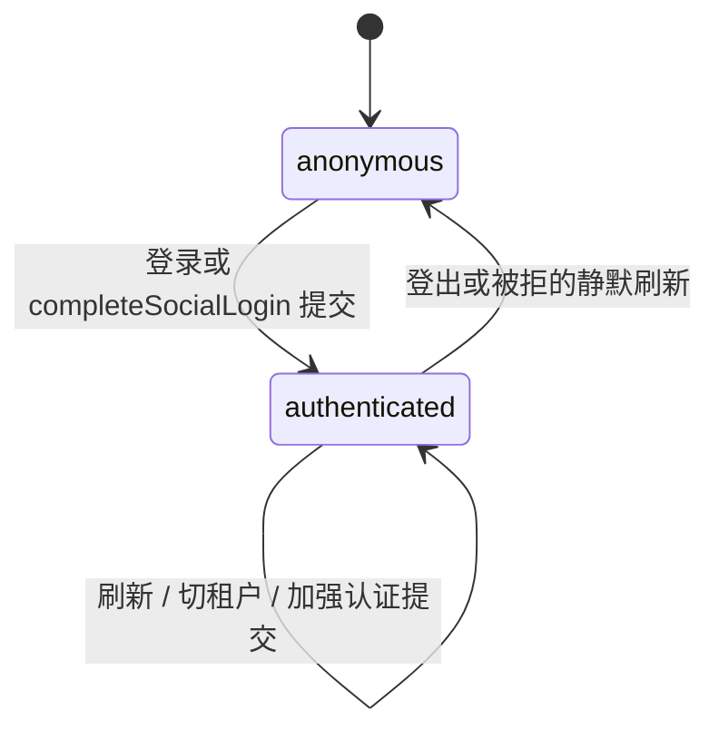

# auth-core

## 职责

浏览器会话生命周期，包 `web/packages/auth-core`。把 `@speed/api-sdk` 生成的 authn 操作接成一个可观察的、仅内存的会话状态机，并交付读取它的 React hook。

- **会话状态机。** `createAuthSession` 把生成的操作（口令与短信登录、登出、切租户、加强认证、刷新，以及注册与社交流所需的前会话操作）接成一个会话。一个 `AccessTokenStore` 持有访问令牌——这是它与 `@speed/api-client` 的桥，客户端每次发送都读同一个存储（一次登录对每个后续请求立即可见）；刷新令牌只活在会话闭包内，从不进存储。订阅者观察 `AuthSnapshot` 的翻转。
- **React hook。** `attachSession` 在启动期把一个会话接上（后接者胜），`useAuthState` 暴露快照，`useCurrentTenant` 暴露主体当前租户，`usePermission` 在宿主附上的按域权限表上做 fail-closed 的集合查询。在接上会话之前与登出之后，每个 hook 都 fail-closed：匿名快照、租户为 null、权限为 false。
- **租户作用域的 query key 约定。** 交付一个 key 工厂与一个逐出助手，把「query 缓存按主体所在租户命名」这条约定收在一处（见「核心算法与流程」）。这一项尚未实现。

会话状态机放在本包而非视图层：它无 UI、无 DOM，视图只读它的快照。

### 非职责

- **无 UI，无 DOM。** 本包不渲染任何东西；界面在 `auth-ui` 与各界面包。
- **不写存储，不持久化。** 访问令牌是内存凭据；刷新令牌只活在闭包内；本包不碰 `localStorage`，也没有 `restore`——重载页面按约定以匿名启动，用户重新登录。
- **不手写后端调用。** 每个请求都经 `@speed/api-sdk` 生成的操作，走单一 `bindRequestFn` 绑定；本包没有 `fetch`、没有以字符串写死的端点路径、没有自定义响应类型。
- **不求值权限。** 会话只携带宿主附上的按域列表并施加存活规则；集合归属由 hook 与外壳决定，绝不在本包内求值。这些检查是用户体验层面的示能，不是安全边界——服务端授权。
- **不在本表面做身份绑定流。** authn 的回调端点对已认证调用方做双重职责（其应答带已绑身份、不带令牌）；`completeSocialLogin` 以 `client.protocol` 拒绝该形状——本包的回调表面是登录表面。绑定回调本身是调用方令牌上的一次普通生成调用，不是会话操作。
- **query key 工厂不求值、不取数、不判定。** 它只把当前租户拼进一个键，并提供一个按租户逐出子树的助手；某一行该不该取、该不该显示仍归宿主与服务端。

## 外部接口契约

宿主从 `web/packages/auth-core/src/index.ts` 取用以下符号。

### 会话

```ts
export function createAuthSession(store: AccessTokenStore): AuthSession

export interface AuthSnapshot {
  state: 'anonymous' | 'authenticated'
  principal: AuthnPrincipal | null
  permissionSets: AuthPermissionSets
}

export interface AuthPermissionSets {
  tenant: readonly string[] | null
  system: readonly string[] | null
}

export type AuthDomain = 'tenant' | 'system'
export type AuthSessionListener = (snapshot: AuthSnapshot) => void

export interface AuthSession {
  getSnapshot(): AuthSnapshot
  subscribe(listener: AuthSessionListener): () => void
  loginWithPassword(request: AuthnLoginWithPasswordRequest): Promise<AuthSnapshot>
  loginWithSMSCode(request: AuthnLoginWithSMSCodeRequest): Promise<AuthSnapshot>
  requestSMSCode(request: AuthnRequestSMSCodeRequest): Promise<void>
  register(request: AuthnRegisterRequest): Promise<AuthnUser>
  socialAuthorizeUrl(provider: string, params: AuthnSocialAuthorizeParams): Promise<string>
  completeSocialLogin(provider: string, request: AuthnSocialCallbackRequest): Promise<AuthSnapshot>
  logout(): Promise<void>
  switchTenant(tenantId: string): Promise<AuthSnapshot>
  verifyStepUp(code: string): Promise<AuthSnapshot>
  setPermissionSet(domain: AuthDomain, perms: readonly string[] | null): void
  refresh(): Promise<boolean>
}
```

- **前会话操作不改状态。** `requestSMSCode`、`register`、`socialAuthorizeUrl` 在成功与失败时都不改会话：一次短信码请求是一次受理，一个已构造的授权 URL 无物可提交，一次注册返回创建的用户（注册不是登录）。`socialAuthorizeUrl` 永不导航——调用方决定那个 URL 的用途。
- **`completeSocialLogin` 是完整登录操作**，外加一次拒绝：以绑定形状应答（有用户与身份、无令牌）的登录流在任一状态变更之前以 `client.protocol` 拒绝。
- **`setPermissionSet` 存防御性副本。** 传入的数组事后被改动不影响快照；`null` 清空该域。宿主应在每次登录与切租户后重取 `/me` 派生的列表，而不是复用更早提交下取的列表——会话从不把列表与它被取时的主体相关联。

### 失败契约的拒绝类型

```ts
export class OperationSupersededError extends Error {
  readonly snapshot: AuthSnapshot
}
export function isOperationSuperseded(value: unknown): value is OperationSupersededError
```

**`OperationSupersededError` 是一个令牌签发操作在同门竞态中落败时的拒绝**（用 `isOperationSuperseded` 与 `ApiError` 区分；对它是 `isApiError` 为 false）。它的自请求确曾 2xx，但另一次并发操作先提交，那次应答不再描述会话，故本操作不以胜者的快照静默 resolve 而以本错误拒绝——调用方不得把自己的 2xx 当作提交信号：不得为会话实际未运行的那个租户或身份触发一次性副作用（一次切租户的 `onSwitched`、一次登录后的跳转）。`verifyStepUp` 的落败另有一项代价要听：加强认证码服务端一次性使用，落败的验证已消耗它自己的 2xx 验证过的那个码，调用方绝不能再提供那个码，只能提供新码。

### hook

```ts
export function attachSession(session: AuthSession): void
export function useAuthState(): AuthSnapshot
export function useCurrentTenant(): { tenantId: string } | null
export function usePermission(domain: AuthDomain, permission: string): boolean
```

- **`useCurrentTenant` 对给定租户引用稳定**：只在 `tenant_id` 本身变化（一次切换）时改身份，不在重渲染、刷新、加强认证时改。以它的结果作 query key 或副作用依赖的 hook 因此在整个停留期看到一个稳定键。
- **`usePermission` 是纯集合查询，fail-closed**：匿名为 false，域列表为 null 为 false，权限不在表中为 false；`tenant` 集绝不满足 `system` 查询，反之亦然。

### 租户作用域的 query key（尚未实现）

```ts
export function tenantQueryKey(
  tenantId: string,
  ...tail: readonly unknown[]
): readonly unknown[]

export interface TenantQueryKey {
  readonly tenantId: string | null
  readonly queryKey: readonly unknown[]
}

export function useTenantQueryKey(bareKey: readonly unknown[]): TenantQueryKey

export function evictTenantQueries(
  queryClient: QueryClient,
  tenantId: string,
): void
```

**约定归本包，因为租户是本包自己的事实**（[ADR-web-tenant-query-key-2026-10-15](../../../adr/adr-web-tenant-query-key-2026-10-15.md)）。租户 id 来自 `useCurrentTenant`（主体的自身声明，绝非本地记住的上次切换）；「query 缓存按当前租户命名、一次切租户即逐出离任租户的整棵子树」是本包已有的「主体变更使什么失效」概念（权限表存活规则）在 query 缓存上的同一件事。归 `@speed/api-client` 则不成立：`api-client` 在自己的契约里明确把租户排除在客户端之外（无租户头、其 hook 不接受也不推断租户），且 `auth-core` 已 import `api-client`，工厂放那里要么反向 import `auth-core` 成环，要么把租户 id 当裸参数传入而把一个概念拆到两个包。故本项归 `auth-core`，本包之外不重复这份约定。

**`tenantQueryKey` 把租户标识拼在生成的裸 spec 键之上作为最外层段**，一个租户下的全部读共用以租户标识为首的一个前缀。

**`useTenantQueryKey` 一次给出租户 id 与键。** 它调 `useCurrentTenant` 取当前租户，用 `tenantQueryKey` 造键；租户为 null（匿名或主体不带 `tenant_id`）时仍给出一个键，读取侧以 `enabled: tenantId !== null` 让其不取数，fail-closed 而不发明一个租户。一次读取从这一次 hook 调用同时得到键与使能条件。

**`evictTenantQueries` 逐出离任租户的整棵子树**：按 `tenantQueryKey(tenantId)` 得到的键前缀移除。调用时机是宿主的切租户提交之后，用切换之前读到的离任租户 id——不用新租户 id，它什么都不命名。

**稳定性承诺。** `createAuthSession`、`AuthSession`、`AuthSnapshot`、`AuthSessionListener`、`AuthDomain`、`AuthPermissionSets`、`OperationSupersededError`、`isOperationSuperseded` 与四个 hook 的名称与签名，以及本项的 `tenantQueryKey`、`useTenantQueryKey`、`evictTenantQueries`，是宿主可见面。

## 依赖

| 依赖 | 用途 |
|---|---|
| `@speed/api-client` | `AccessTokenStore` 接缝（桥），以及 `ApiError`、`isApiError`、`ERROR_CODE_PROTOCOL` |
| `@speed/api-sdk` | 生成的 authn 操作与其请求/响应类型 |

peer（必需）：`react`（任何渲染 hook 的宿主本就渲染 React）。本项新增使 `@tanstack/react-query` 加入本包的 peer——宿主本就提供 `QueryClient` 实例，本包只调它的 `removeQueries`，不构造它。

**方向：本包直接位于 `@speed/api-client` 与 `@speed/api-sdk` 之上，不被其中任何一个 import。** 本包不 import 任何 UI 包（`auth-ui`、`ui-kit` 等），也不 import 任何装配壳。

## UML 图

会话的一个状态机。图中画不出的约束：世代守卫与单飞刷新（见「并发与事务边界」）；权限表的存活规则（刷新与加强认证保留两域，切租户丢租户域留系统域，登录与转匿名清两域）；刷新被拒与登出都落到匿名，但只有登出抬升世代。



## 核心数据结构

| 概念 | 类型 | 说明 |
|---|---|---|
| 快照 | `AuthSnapshot` | `state`、`principal`、按域权限表；按约定不可变 |
| 权限表 | `AuthPermissionSets` | 每域一份 `readonly string[] \| null`，null 表示未知（对该域 fail-closed） |
| 已校验的签发应答 | `IssuedTokens`（内部） | `accessToken`、`refreshToken`（未铸造时为 null）、`principal` |
| 落败的竞态 | `OperationSupersededError` | 带当前（胜者）快照的拒绝 |
| 租户 query 键 | `TenantQueryKey`（本项） | `tenantId` 与以租户标识为最外层段的键 |

## 核心算法与流程

### 一次令牌签发操作的提交

1. 操作在入口捕获当前世代。
2. 请求返回后先校验应答（`parseIssued`）：缺 `access_token` 字符串、缺带 `user_id` 的 `principal`、或该铸刷新令牌时缺 `refresh_token`，一律以 `status: 200`、`code: client.protocol` 的 `ApiError` 拒绝——一个契约违背的 2xx 不是成功登录。
3. 校验先于世代检查：即便本操作的世代已过期，契约违背的 2xx 仍然拒绝（调用方有权知道自己的请求失败）。
4. 世代仍相等才提交：写存储、更新闭包内的刷新令牌、按 `nextPermissionSets` 计算权限表；随后抬升世代并通知订阅者。

### 世代守卫

用户操作在入口捕获世代、只在提交时抬升；刷新从不抬升。一个令牌签发操作若自己的应答成功但其世代已前移（并发的兄弟操作先提交），以 `OperationSupersededError` 拒绝而非静默 resolve。刷新的写只在捕获的世代仍成立时落地，使一次已完成的登出胜过其后 resolve 的刷新、一次已提交的用户操作胜过其后 resolve 的刷新——落败那一对的访问令牌与主体绝不覆盖胜者。

**唯一例外是被持有的刷新令牌本身**：当胜出的操作保留了它（切租户或加强认证不铸造新刷新令牌），落败刷新的成功已在服务端消耗该令牌，会话只采纳轮换后的令牌，否则下次刷新会出示一个已消耗的令牌、被判为重放而死。落败刷新 resolve 什么取决于谁胜：加强认证保留同一主体，resolve true 安全；切租户换了主体，resolve false，原请求失败而非在新令牌下重放。

**两种本地清空共用 `clearLocal`，但只有登出抬升世代。** 登出按调用方意图结束会话，抬升使一切在旧世代下启动的写在其迟到落地时落败（一次在飞的刷新不能复活已结束的会话）；刷新侧的清空故意不抬升——服务端的拒绝是会话之死，但在拒绝之前启动、在其之后落地的用户操作是会话的合法后继，必须仍能提交。

### 单飞刷新

刷新按被持有的刷新令牌单飞：呈现同一个令牌的并发调用共享一个在飞的请求。authn 服务端把同一令牌的并行呈现读作盗用并轮换整个令牌族，故会话自行串行化。飞行槽按令牌（而非世代）键控，使一次在切租户或加强认证提交之后启动的刷新（二者保留了令牌）仍共享那个在飞请求，而不是再发一次同一令牌。

### 权限表的存活规则

一次主体变更提交时施加：静默刷新或加强认证（同一会话继续）保留两域；切租户保留用户、改变租户，丢弃租户域、保留租户无关的系统域；登录（即便同一用户同一租户，其应答开启一个全新服务端会话）与转匿名清空两域。失败的操作什么都不改，含权限表。

### hook 的通知桥

`attachSession` 把一个会话的每次通知转发给所有订阅组件；每个监听者的重读取到会话的新快照。后接者胜：接到新会话时先退订前一个的桥（它的后续翻转不再到达组件），再唤醒所有订阅组件重读。hook 在无会话时返回一个引用稳定的匿名快照常量，`useSyncExternalStore` 因此不会在无会话期看到伪变化。

### 租户 query 键的派生（尚未实现）

`useTenantQueryKey(bareKey)` 一次调用 `useCurrentTenant` 取当前租户，用 `tenantQueryKey(tenantId, ...bareKey)` 造键，把租户 id 与键一并返回；键以租户 id 与裸键为依赖记忆。切租户提交后，宿主用切换之前捕获的离任租户 id 调 `evictTenantQueries`，按该租户的键前缀逐出整棵子树。

## 错误与失败语义

| 情形 | 表现 |
|---|---|
| 任一用户操作失败 | 拒绝原始 `ApiError`（`isApiError` 区分），存储、刷新令牌与快照保持原样 |
| 令牌签发操作在并发中落败 | 拒绝 `OperationSupersededError`（`isApiError` 为 false），本操作令牌从不落地 |
| 令牌签发 2xx 违背契约（缺令牌或主体、字段畸形） | `status: 200`、`code: client.protocol` 的 `ApiError`，任一状态变更之前拒绝 |
| `completeSocialLogin` 收到绑定形状应答 | `client.protocol` 拒绝，无状态变更 |
| `socialAuthorizeUrl` 的 2xx 无 `authorize_url` | `client.protocol` 拒绝 |
| `refresh()` 无令牌可刷 | resolve `false`，不读存储，不改状态 |
| `refresh()` 被持有令牌被拒（401 或违背契约的 2xx） | 本地清空并转匿名，resolve `false`，不拒绝 |
| `refresh()` 传输或服务端失败 | 重抛原始 `ApiError`，被持有令牌保持原样（刷新从不因它清空） |
| 切租户到无成员关系的租户 | 服务端拒绝，本地不变 |
| 权限检查的域无列表 | `false`（fail-closed），`tenant` 与 `system` 互不满足 |

**响应校验 fail-closed 且先于任何状态变更。** 一个令牌签发端点在 2xx 里不带它必须带的令牌或主体，是契约违背，绝不是成功登录。

## 并发与事务边界

- **世代守卫是本包的并发不变量。** 用户操作捕获世代、只在提交时抬升；刷新从不抬升；一次过期的刷新应答不覆盖胜者状态，唯一例外是被保留的刷新令牌的轮换采纳（见「核心算法与流程」）。
- **刷新按被持有令牌单飞。** 同一令牌的并发呈现共享一个在飞请求。
- **两种本地清空非对称。** 只有登出在清空后抬升；刷新侧的清空不抬升。
- **订阅者被隔离。** 一个监听者抛错被吞掉：一个订阅者（宿主回调或测试观察者）不得冻结其他监听者，也不得损坏那次提交（通知若逃逸，会把一次本应 resolve 已提交快照的登录改判为以监听者的错误拒绝）。抛错的那个监听者是宿主的缺陷，它听到的提交仍然成立。
- **`setPermissionSet` 存副本。** 存储的是防御性副本，不是调用方数组的别名。

## 扩展点

- **`AccessTokenStore` 是客户端接缝。** 宿主可实现自己的存储（或用品包的内存实现）；同一存储被 `@speed/api-client` 每次发送读取，故一次登录对每个请求立即可见。刷新令牌不进这个存储。
- **权限表由宿主附上。** 宿主经 `setPermissionSet` 附 `/me` 派生的列表；会话只携带它们并施加存活规则，集合归属在 hook 与外壳决定。
- **`attachSession` 后接者胜。** 换一个会话即重接，前一会话的翻转不再到达组件。
- **租户 query 键约定归本包，唯一一处。** 新增的取数面若按租户分缓存，用本包这一个约定，不在别处再建一份。

## 实现状态

| 能力 | 状态 | 代码 |
|---|---|---|
| 会话状态机（登录、登出、切租户、加强认证、刷新与世代守卫） | 已实现 | `web/packages/auth-core/src/session.ts` `createAuthSession`、`OperationSupersededError`、`isOperationSuperseded` |
| 会话 hook 与通知桥 | 已实现 | `web/packages/auth-core/src/hooks.ts` `attachSession`、`useAuthState`、`useCurrentTenant`、`usePermission` |
| 租户作用域 query key 工厂与逐出助手 | 未实现 | — |
