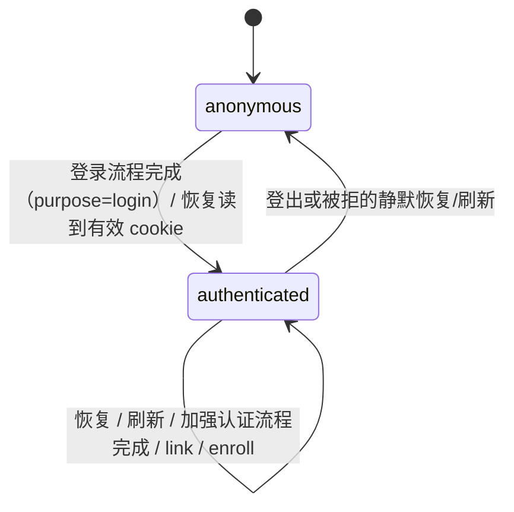
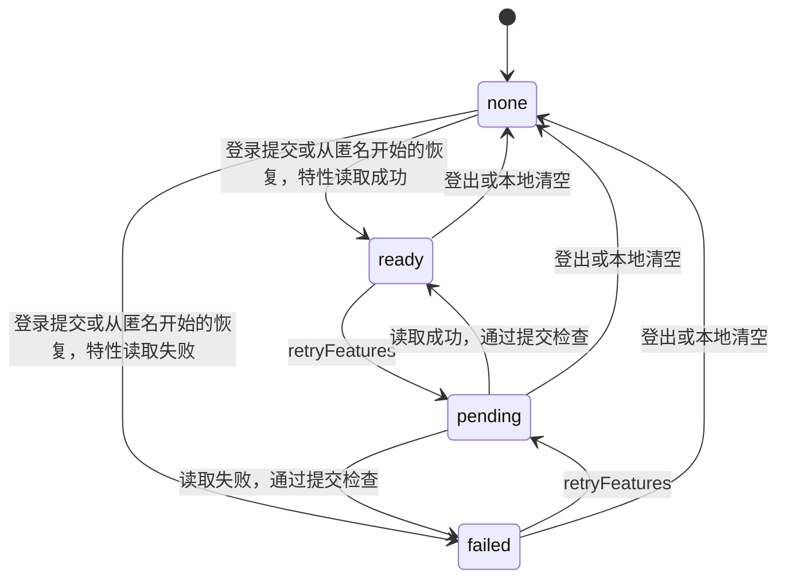

# auth-core

## 职责

浏览器会话生命周期，包 `web/packages/auth-core`。把 `@speed/api-sdk` 生成的 authn 操作接成一个可观察的会话状态机，并交付读取它的 React hook。

- **会话状态机（cookie 承载）。** `createAuthSession` 把生成的 authn 操作（登录流程的开始与推进、登出、方式列表、页面重载时的会话读取，以及已登录身份上的 link、step-up、enroll 流程）接成一个会话。会话由服务端 cookie 承载：cookie 路径的登录流程以 `delivery: 'session'` 开始，完成应答为 `{state: 'authenticated', session: {id, expires_at}}`，服务端在同一次应答里 `Set-Cookie`；浏览器自行把该 cookie 附到每个同源请求上，故本包不持有任何凭据——没有访问令牌，也没有刷新令牌。`restore()` 读 `GET /api/v1/auth/session` 从该 cookie 重建快照，这是页面重载后**仍保持登录**的机制，也是 cookie 失效时结束本地会话的机制。宿主另传一个 `AccessTokenStore` 时走**显式的令牌路径**：`delivery: 'token'` 的完成把访问令牌写进该存储（`@speed/api-client` 的桥），刷新令牌只活在会话闭包内，由 `refresh()` 驱动；平台自身的装配不传存储，故不持凭据。令牌路径的登录流程由宿主自己开始——用生成的 `authnLoginStart({ delivery: 'token' })`，再把每一步的答复交给 `answerFlow`，因为本包的 `startFlow` 一律强制 cookie 交付。令牌会话不经 `restore()` 重建（该方法读 `GET /api/v1/auth/session`，其应答来自会话 cookie，令牌宿主没有这条 cookie），页面重载即失去；`restore()` 只是 cookie 会话的静默腿。订阅者观察 `AuthSnapshot` 的翻转。
- **登录按流程推进。** 一次登录是一条服务端流程记录，由前端经生成的 `authn.login` 操作分步推进：`POST /api/v1/auth/flows` 开始，`POST /api/v1/auth/flows/answer` 按步答复，`GET /api/v1/auth/flows/current` 供页面刷新后续接，`DELETE /api/v1/auth/flows/current` 放弃。流程绑定以 cookie 承载（开始请求的 `binding: 'cookie'`，缺省），前端从不读流程令牌——回跳类方式只在 cookie 绑定下走得完（[authn 登录](../authn/design-authn-login.md)）。流程在某一步就绪（`next.kind = complete`）时，客户端以 `step: 'complete'` 取走结果；`startFlow` 与 `useStepUp` 开始的一律是 cookie 流程（前者以 `delivery: 'session'` 开始，后者不设交付方式、服务端取其缺省的 cookie 会话），故这两者交回的完成是会话文档而非令牌对；`startAuthenticatedFlow` 把交付方式留给调用方，账户面不设，故同样是 cookie 会话。浏览器部署里前端与 API 必须**同站**：会话 cookie 是 `SameSite=Lax`（运维可收紧为 `Strict`），服务端拒绝 `None`，跨站前端带不上这条凭据。
- **特性态。** 会话在登录提交与从匿名状态开始的恢复时，与 `GET /api/v1/auth/me` 并行取回[特性文档](../../../glossary.md)（`GET /api/v1/features`，[feature](../design-feature.md)），作为快照的 `features` 字段与主体一起提交；读取失败是独立的状态，既不当作特性缺席，也不当作特性在场。特性态与权限表同一套存活规则（[ADR-web-feature-state](../../../adr/adr-web-feature-state.md)）。
- **React hook。** `attachSession` 在启动期把一个会话接上（后接者胜），`useAuthState` 暴露快照，`useCurrentTenant` 暴露宿主当前租户，`usePermission` 在宿主附上的按域权限表上做 fail-closed 的集合查询，`useFeature` 与 `useFeatureState` 读特性态。在接上会话之前与登出之后，读接上的会话的每个 hook 都 fail-closed：匿名快照、租户为 null、权限为 false、特性为 false、特性态为 `none`。`useStepUp` 不读接上的会话，在入参的会话上驱动一次步进认证。
- **租户作用域的 query key 约定。** 交付一个 key 工厂与一个逐出助手，把「query 缓存按当前租户命名」这条约定收在一处（见「核心算法与流程」）。

会话状态机放在本包而非视图层：它无 UI，主入口无 DOM，视图只读它的快照。`./webauthn` 子路径是包级「无 DOM」的唯一例外：它驱动浏览器的通行密钥仪式，调用 `navigator.credentials`，但不渲染任何界面，也不被主入口引用。

### 非职责

- **无 UI；主入口无 DOM。** 本包不渲染任何东西；界面在 `auth-ui` 与各界面包。`./webauthn` 子路径是包级「无 DOM」的唯一例外：它调用浏览器的 `navigator.credentials.create/get` 完成一次通行密钥仪式，不渲染界面，也不出现在主入口的导出里。
- **不写存储。** 凭据是服务端的 httpOnly 会话 cookie，由浏览器管理、脚本读不到；本包只经 `@speed/api-client` 的凭据模式到达它。令牌路径下访问令牌是内存单元、刷新令牌只活在闭包内；特性态同样只在内存；本包不碰 `localStorage`。
- **不手写后端调用。** 每个请求都经 `@speed/api-sdk` 生成的操作，走单一 `bindRequestFn` 绑定；本包没有 `fetch`、没有以字符串写死的端点路径。
- **不求值权限。** 会话只携带宿主附上的按域列表并施加存活规则；集合归属由 hook 与外壳决定，绝不在本包内求值。这些检查是用户体验层面的示能，不是安全边界——服务端授权。
- **不把流程驱动成一幕。** 一次登录的步进由视图经本包的流程操作逐步驱动：要哪些字段、跳去哪、要不要第二因素由每一步的应答决定，本包不代视图决定渠道与步序。
- **不把注册当登录。** 匿名注册是 `register` 的一次请求，交回 `AuthnLoginRegistration`；它不建立会话、不写任何凭据、不改快照，随后的登录仍是一条流程。
- **不在本表面做身份绑定承诺。** 绑定是流程（`POST /api/v1/auth/flows/authenticated` 目的 `link`），其终态是 `state: 'linked'`；本包把生成调用转发给视图，不把它当登录操作，也不改登录态。
- **不登记第二因素、不做加强认证。** 因素登记是 `POST /api/v1/auth/flows/authenticated` 目的 `enroll`，加强认证是目的 `step-up`（[authn-mfa](../authn/design-authn-mfa.md)）；两者由消费视图经本包的流程操作驱动，本包不自己发起。
- **不门控界面。** 本包持有特性态，交出读它的 hook 与 `featurePresence`；据它收窄路由、隐藏导航项与控件归宿主与 [route-kit](design-web-route-kit.md)。本包不认识任何特性名的含义，也不据特性态改变会话的任何其他部分。
- **query key 工厂不求值、不取数、不判定。** 它只把当前租户拼进一个键，并提供一个按租户逐出子树的助手；某一行该不该取、该不该显示仍归宿主与服务端。

## 外部接口契约

宿主从 `web/packages/auth-core/src/index.ts` 取用以下符号。

### 会话

```ts
export function createAuthSession(store?: AccessTokenStore): AuthSession

export interface AuthSnapshot {
  state: 'anonymous' | 'authenticated'
  principal: AuthnPrincipal | null
  impersonating: boolean                                        // 当前会话挂着一条有效冒充；匿名时恒为 false
  permissionSets: AuthPermissionSets
  features: FeatureState
}

export type FeatureState =
  | { readonly state: 'none' }                                  // 匿名；从不取回
  | { readonly state: 'pending' }                               // 只在 retryFeatures 在途时出现
  | { readonly state: 'failed'; readonly error: unknown }
  | { readonly state: 'ready'; readonly names: ReadonlySet<string> }

export interface AuthPermissionSets {
  tenant: readonly string[] | null
  system: readonly string[] | null
}

export type AuthDomain = 'tenant' | 'system'
export type AuthSessionListener = (snapshot: AuthSnapshot) => void

export interface AuthSession {
  getSnapshot(): AuthSnapshot
  subscribe(listener: AuthSessionListener): () => void
  listMethods(): Promise<AuthnMethodList>
  register(request: AuthnLoginRegisterBody): Promise<AuthnLoginRegistration>
  discoverSso(email: string): Promise<AuthnSsoProvider[]>
  startFlow(request: AuthnLoginStartBody): Promise<AuthnFlowState>
  startAuthenticatedFlow(request: AuthnLoginStartAuthenticatedBody): Promise<AuthnFlowState>
  answerFlow(request: AuthnLoginAnswerBody): Promise<AuthnFlowState>
  readFlow(): Promise<AuthnFlowState | null>
  abandonFlow(): Promise<void>
  logout(): Promise<void>
  restore(issue?: RequestFn): Promise<boolean>
  beginIdentityTransition(): () => void
  refresh(): Promise<boolean>
  setPermissionSet(domain: AuthDomain, perms: readonly string[] | null): void
  retryFeatures(): Promise<void>
}
```

- **流程操作接生成面；只有完成开启会话时改会话。** `startFlow`、`startAuthenticatedFlow`、`answerFlow`、`readFlow`、`abandonFlow` 把 `authn.login` 的流程操作转发给视图，交回该步的 `AuthnFlowState`。只有 `answerFlow` 落定一次完成时才改会话：一次 `purpose: 'login'` 的完成（`state: 'authenticated'`）建会话、转已认证；一次 `step-up` 的完成（`state: 'authenticated'`，服务端已轮换 cookie；令牌会话为 `state: 'elevated'`）更新凭据、主体不变；`purpose: 'link'` 与 `enroll` 的完成（`state: 'linked'`、`state: 'enrolled'`）不改登录态。`startFlow` 一律以 `delivery: 'session'` 开始（cookie 会话），故它从不产生令牌完成；令牌路径的登录流程由宿主以生成的 `authnLoginStart({ delivery: 'token' })` 自行开始，再把答复交给 `answerFlow`。`startAuthenticatedFlow` 的交付方式留给调用方（账户面不设，服务端取其缺省，即 cookie 会话），`useStepUp` 不设交付方式，故它开的也是 cookie 流程。
- **`restore()` 从 cookie 重建会话。** 它读 `GET /api/v1/auth/session`：cookie 仍指向一个会话时，读 `GET /api/v1/auth/me` 取主体、转已认证并 resolve `true`，主体与 `impersonating` 一起提交，`impersonating` 取自 `GET /api/v1/auth/session` 应答的同名字段，缺省为 `false`——从匿名状态开始的恢复同时并行读 `GET /api/v1/features`，已认证状态下的恢复只读主体、保留特性态（见「特性态」）；无人登录（含读被 401 拒）时清本地并 resolve `false`；传输或服务端失败重抛原始 `ApiError`、本地快照不动。页面加载时调用一次即保持登录，同时也是 `@speed/api-client` 在被拒的带凭据请求上跑的那条静默腿。**身份过渡窗口打开期间发出的恢复（无论应答何时落定），以及发出之后窗口才打开的那次恢复，无人登录的应答被丢弃**：resolve `false`、快照不动（见下一条）。它接受可选的 `issue`——`@speed/api-client` 交给刷新钩子的轮作用域请求函数：两次读都经它发出，故其中任一次被拒即浮出给钩子，而不会加入正在 await 该调用的刷新轮；缺省时走生成的绑定请求函数。令牌会话不经它重建：该会话没有会话 cookie，`restore()` 只会读到无人登录；令牌会话的静默腿是 `refresh()`，要跨重载保持登录的宿主自行重建它。
- **`beginIdentityTransition()` 覆盖凭据被替换的那段短窗口。** 唯一会用到它的写入是开始冒充：服务端轮换会话 cookie，而会话本身继续。窗口内已发出的读带的是被换下的旧 cookie，可被 401 拒；传输层的静默腿随即用旧 cookie 跑 `restore()`，读到「无人登录」——会话并未结束，本地快照却翻成匿名，宿主看到一次假的登出。宿主在发出该写入之前调用 `beginIdentityTransition()`，在新身份落定之后（写入未落地时则立即）调用其返回的释放。窗口打开期间发出、或发出之后窗口才打开的恢复（无论应答何时落定）的无人登录应答被丢弃：`restore()` resolve `false`、快照不动，被拒的请求保留自己的 401；放行之后的下一次读落定真实状态——窗口内真的过期的会话也由那次读落定，不由带旧凭据的读落定。已认证的应答从不会被丢弃，故宿主在新凭据下的重读可在窗口内照常提交。释放按次幂等、窗口按次数计数：重叠的窗口要等每个释放都调用过才合上。**该守卫与身份无关，本包仍不知晓冒充的开始与结束**；它也不是世代守卫——轮换不是新会话，`restore()` 依旧不抬升世代。
- **`refresh()` 用被持有的刷新令牌换新令牌对（令牌会话）。** 走 `POST /api/v1/auth/token` 的 `grant_type = refresh_token`，凭据为空（[api-client](design-web-api-client.md) 的凭据为空一档，即 `speedRequestCredentialless`）；其令牌的落地与世代守卫见「单飞刷新」与「世代守卫」。cookie 会话不持刷新令牌，`refresh()` 不发请求即 resolve `false`；其静默腿是 `restore()`。
- **`listMethods` 读部署在场的登录方式发现文档。** 它转发 `GET /api/v1/auth/methods` 并解析成方法描述符文档（每个方法自报渲染类别、线协议、品牌标签、首步字段、是否可开户与绑定提供方，连同注册开关 `signup.enabled` 与 `signup.password.enabled`、部署级因素种类，以及匿名口令重置能力 `password_reset.enabled` 与可用渠道 `password_reset.methods`），随部署的 `authn.login.disabled-methods` 设置、`authn.login.password-reset` 开关与在场模块而变，前端不写死；消费视图用它渲染渠道与「忘记口令」入口（[ADR-web-auth-channel-discovery](../../../adr/adr-web-auth-channel-discovery.md)、[ADR-authn-login-method-discovery](../../../adr/adr-authn-login-method-discovery.md)）。
- **`register` 建号，不开启会话。** 它转发匿名注册操作 `POST /api/v1/auth/register`，请求体要求用户名、邮箱与口令，另可带显示名、语言与时区；交回 `AuthnLoginRegistration`（`state: 'registered'`、账户标识与未证明预留 `{state: 'pending', email}`）。快照、权限表与特性态都不变——注册不是登录，会话仍由随后的 `startFlow`／`answerFlow` 建立。自动登录被拒时账户已经建成，调用方退回登录表单。
- **`discoverSso` 读一个邮箱域映射的企业提供方。** 它转发 `POST /api/v1/auth/sso/discover`，交回 `{id, name, protocol}` 列表；应答恒同形同长，无匹配时为空列表，故「无匹配」是一次成功的空读而非错误。企业提供方清单不多进发现文档：它按域发现，不泄露账户存在性（[authn-sso](../authn/design-authn-sso.md)）。
- **`logout` 结束会话。** 它调 `POST /api/v1/auth/logout`（服务端撤销请求带来的会话并清 cookie），清本地令牌与主体、抬升世代、转匿名。
- **`setPermissionSet` 存防御性副本。** 传入的数组事后被改动不影响快照；`null` 清空该域。列表由宿主从它自己的来源取得——`GET /api/v1/auth/me` 的主体不带权限；宿主应在每次登录与主体变更后重取并重附，而不是复用更早提交下取的列表。**平台发布调用方自身持有的权限读**（`GET /api/v1/authz/me/permissions`，[design-authz](../design-authz.md)）：应答按平台域与请求解析到的租户域各交一份权限名，宿主按登录、主体变更与当前租户变更重取（租户域那一份是在请求解析到的租户里持有的集合），并分别以 `setPermissionSet('system', …)` 与 `setPermissionSet('tenant', …)` 附上；本包的接缝不变。
- **`retryFeatures()` 是特性态读取失败后的显式重试。** 它只在已认证时生效，规则见「特性态」。

### 生成的响应模型与解析守卫

authn 片段在契约里宣告各自的 2xx 响应 schema，orval 因而把它们的返回类型生成为具名模型：流程态（`AuthnLoginFlow`、`AuthnLoginToken`、`AuthnLoginActionResult`）、一步（`AuthnLoginStep`）、`AuthnLoginField`、`AuthnLoginFactor`、`AuthnPrincipal`、`AuthnLoginMethods`（连同每种方法的描述符、注册开关 `signup.enabled` 与 `signup.password.enabled`、部署级因素种类与匿名口令重置能力 `password_reset`）、注册操作 `register` 的请求体 `AuthnLoginRegisterBody` 与应答 `AuthnLoginRegistration`，以及 `AuthnSsoProvider`。本包从生成面取用这些模型，并在其上为每个「2xx 必须携带文档」的操作配一个运行时解析守卫：守卫先校验体是对象、再校验其必需字段，任一项不过即拒为 `status: 200`、`code: client.protocol` 的 `ApiError`——一个契约违背的 2xx 不是成功。

本包把生成的 `AuthnLoginStep` 按 `kind` 收窄成一个判别联合 `AuthnStep`，使视图只读它自己那一步携带的字段；`AuthnFlowState` 把生成的流程应答按 `state` 收窄成开放流程（带 `seq` 与 `next`）与三类完成（`authenticated`、`elevated`、`linked`／`enrolled`）：

```ts
export type AuthnStep =
  | (AuthnLoginStep & { kind: 'challenge'; fields: AuthnLoginField[] })
  | (AuthnLoginStep & { kind: 'redirect'; url: string; method: string })
  | (AuthnLoginStep & { kind: 'factor'; factors: AuthnLoginFactor[] })
  | (AuthnLoginStep & { kind: 'enroll'; kinds: string[] })
  | (AuthnLoginStep & { kind: 'complete' })
  | (AuthnLoginStep & { kind: 'webauthn'; options: unknown })

export type AuthnMethodList = AuthnLoginMethods        // methods：描述符数组，外加 signup（含 signup.password.enabled）、mfa 与 password_reset
export type PasswordResetChannel = 'email' | 'sms'     // 发现面 password_reset.methods 的元素类型
export type AuthnMethodDescriptor = AuthnMethodDescriptorModel
export type AuthnSsoProvider = AuthnSsoProviderModel
```

`AuthnPrincipal` 逐字段取自 `GET /api/v1/auth/me`（[authn-profile](../authn/design-authn-profile.md)）。`AuthnMethodList`、`AuthnMethodDescriptor` 与 `AuthnSsoProvider` 是发现面与企业发现面的生成模型，本包把它们经入口再导出（[ADR-web-auth-channel-discovery](../../../adr/adr-web-auth-channel-discovery.md)）。

### 失败契约的拒绝类型

```ts
export class OperationSupersededError extends Error {
  readonly snapshot: AuthSnapshot
}
export function isOperationSuperseded(value: unknown): value is OperationSupersededError
```

**`OperationSupersededError` 是一次建立会话的提交操作在同门竞态中落败时的拒绝**（用 `isOperationSuperseded` 与 `ApiError` 区分；对它是 `isApiError` 为 false）。建立会话的提交操作是登录流程的完成与加强认证流程的完成。它的自请求确曾 2xx，但另一次并发操作先提交，那次应答不再描述会话，故本操作不以胜者的快照静默 resolve 而以本错误拒绝——调用方不得把自己的 2xx 当作提交信号：不得为会话实际未运行的那个身份触发一次性副作用（一次登录后的跳转）。加强认证的完成另有一项代价要听：令牌会话的完成轮换令牌，落败的提交已消耗服务端为它验证过的那个挑战，调用方绝不能再提供那个码，只能重开一条流程。

### 特性态

快照的 `features` 字段承载本进程对已认证调用者发布的特性文档（[feature](../design-feature.md)）。它的取值是封闭集合：

- `none`：匿名；本包在匿名状态下从不请求 `GET /api/v1/features`。
- `pending`：只在 `retryFeatures()` 在途时出现。
- `failed`：读取失败，带该次的错误。
- `ready`：读取成功，带特性名集合。

**取回与存活规则，约束的主体是每一条改变会话的提交路径。** 特性态与权限表同一套存活规则（[ADR-web-feature-state](../../../adr/adr-web-feature-state.md)）：

| 提交 | 特性态 |
|---|---|
| 登录完成（cookie 会话与令牌会话）；从匿名状态开始的 `restore()` | 读 `GET /api/v1/auth/me` 时并行读 `GET /api/v1/features`，主体与特性文档的读取过同一个世代检查、一起提交。读资料失败则提交失败；特性读取失败时提交照常成功，特性态为 `failed` |
| 已认证状态下的 `restore()`、`refresh()`、加强认证、`link`、`enroll` | 保留，不发请求；`failed` 也不在这里重试 |
| 登出 | 清为 `none`；世代抬升，在途的读取结果被丢弃 |
| 恢复或刷新侧的本地清空（服务端告知会话已结束） | 清为 `none`；世代不抬升，在途的重试结果由提交检查丢弃 |
| `retryFeatures()` | 只在已认证时生效：特性态转 `pending`，读 `GET /api/v1/features`，通过提交检查后落为 `ready` 或 `failed`；匿名时不发请求、不改状态 |

**登录提交之外的特性写入要过提交检查。** 写入前须同时满足：世代未变；快照仍为已认证；`principal.account_id` 与开始读取时相同。任一条不满足即丢弃结果。只核对世代不够：服务端结束会话时的本地清空刻意不抬升世代（见「世代守卫」），之后到达的结果会落到匿名快照上。

**特性文档有解析守卫。** `parseFeatureDocument` 校验应答是对象、`features` 是字符串数组；任一项不过，特性态以 `code: client.protocol` 的错误进入 `failed`。应答里有前端不认识的名字时照收，不报错。

**冒充开始或结束都不重取。** 特性文档与调用者身份无关；冒充期间整页刷新时，从匿名状态开始的恢复照常读到它。

**冒充开始与结束改变的是主体与 `impersonating`，auth-core 自己不得知这两个事件**（决策见 [ADR-web-impersonation-shell](../../../adr/adr-web-impersonation-shell.md)）。冒充期间 `GET /api/v1/auth/me` 读的是被冒充账户，快照的 `principal` 因此是被冒充者；快照不携带发起者的标识，看着屏幕的就是发起者。开始或结束冒充的写入由宿主绑定的操作发出，宿主在它落定后调用 `restore()` 重读，快照随之改变。`restore()` 所读的 `GET /api/v1/auth/session` 与 `GET /api/v1/auth/me` 都登记为可冒充，冒充期间照常可读。**开始冒充会轮换会话 cookie**，这是 `beginIdentityTransition()` 存在的理由（见「外部接口契约」的「会话」）：宿主在发出该写入之前打开窗口、在新身份落定后释放。窗口覆盖的只是凭据替换：本包仍只知道凭据在被换，不知道换的是冒充；结束冒充不轮换令牌，宿主不为它打开窗口。

### hook

```ts
export function attachSession(session: AuthSession): void
export function useAuthState(): AuthSnapshot
export function usePermission(domain: AuthDomain, permission: string): boolean
export function useFeature(name: FeatureName): boolean
export function useFeatureState(): FeatureState
export function featurePresence(state: FeatureState):
  | { readonly state: 'pending' }
  | { readonly state: 'failed' }
  | { readonly state: 'ready'; readonly has: (name: string) => boolean }
export function useStepUp(session: AuthSession, active: boolean, onElevated: () => void, method?: string): StepUpState

export function useStepUpGate<A>(
  onRetry: (action: A) => void,
  isShortfall?: (error: unknown) => boolean,
): StepUpGate<A>

export interface StepUpGate<A> {
  readonly open: boolean
  readonly arm: (action: A) => void
  readonly cancel: () => void
  readonly succeed: () => void
  readonly intercept: (error: unknown, action: A) => boolean
}

export function isTenantAdmissionRefusal(error: unknown): boolean
```

`FeatureName` 取自 `@speed/api-sdk/features`（[api-sdk](design-web-api-sdk.md)）。

`useCurrentTenant` 与租户上下文见「租户上下文与租户作用域的 query key」一节。

- **`useAuthState` fail-closed。** 在接上会话之前与登出之后返回一个引用稳定的匿名快照常量，`useSyncExternalStore` 因此不会在无会话期看到伪变化。
- **`usePermission` 是纯集合查询，fail-closed**：匿名为 false，域列表为 null 为 false，权限不在表中为 false；`tenant` 集绝不满足 `system` 查询，反之亦然。
- **`useFeature` 是纯集合查询，fail-closed**：只在特性态为 `ready` 且集合含该名时为 true；`none`、`pending`、`failed` 与接上会话之前都为 false。参数取 `FeatureName`，拼错的名字编译失败。
- **`useFeatureState` 交出特性态本身**，接上会话之前为 `none`。宿主需要区分读取中、读取失败与特性缺席时用它。
- **`featurePresence` 把特性态映射为路由层的在场判定。** 它是纯函数：`ready` 映射为带 `has` 的就绪态，`failed` 映射为失败态，`pending` 与 `none` 都映射为读取中——匿名时没有特性态，按失败即关处理。它的结果与 [route-kit](design-web-route-kit.md) 的 `RoutePresence` 结构相同，本包不 import route-kit。
- **`useStepUp` 驱动一次步进认证。** `active` 为真时在入参的会话上开一个 `purpose: 'step-up'` 的流程并停在首步；入参可带 `method`：账户没有启用因素时，步进要求的是重新证明第一因素，调用方带上会话建立时用的第一因素的方法名（短信会话带 `sms`，口令会话带 `password`），流程停在该方法的首步，完成后提权刷新认证时刻；账户有因素时不带 `method`；`StepUpState` 的 `answer` 逐步转交答复；流程认定加强完成时 `onElevated` 触发一次，调用方据此重跑被拒的动作；`active` 转为假时放弃在途流程。会话以 401 拒绝开启步进时（有因素，但没有能强化本会话的），`phase` 停在 `unavailable`；其余失败（400 等）停在 `failed` 并带错误码。本 hook 不登录、不导航，不读接上的会话，只用入参的会话。会发送验证消息的答复——选中短信第二因素，或短信第一因素复证提交手机号——先出示部署要求的证明；`StepUpState.human` 暴露门槛与证明，调用方据此在会发送的步骤上渲染证明块，证明出示后消耗。
- **特性的 hook 与 `featurePresence` 只由宿主使用。** 能力 UI 包不调用它们，特性在场信息由宿主经属性或上下文组件交给它们（[web](design-web.md) 的「特性门控」、ADR-web-feature-state）。
- **`useStepUpGate` 记住一次被步进拒绝的动作并在挑战通过后原样重放它一次。** `arm` 记下动作（表单字段、行标识、重发写入的闭包），`succeed` 经 `onRetry` 重放一次并清空，`cancel` 什么都不重放；`intercept(error, action)` 是失败侧的同一条接线：判别为步进短耗时记下动作、置 `open` 并答 true，其余失败答 false 且不动门控。缺省判别认平台自己的两个拒绝码——`status` 为 401 且 `code` 为 `authn.insufficient_user_authentication`（本地多因素）或 `authn.sso_required`（经租户的提供方重新登录）；只看 401 不够，一个结束了会话的 401 没有可提升的会话。门控用 `stepUpReasonOf(code)` 记下原因是 `'mfa'` 还是 `'sso'`，对话框据此开本地因素流程或只给企业单点登录的重新登录出口；`arm` 的第二个入参可显式给出原因，缺省为 `'mfa'`。会话自身已能区分两者的调用方把 `session.isStepUpShortfall` 作为第二入参传入；它的错误仍带这两个码之一，故原因照读，其余码退回本地因素。`onRetry` 与 `isShortfall` 经 ref 读取，调用方每次渲染传新闭包不会改变 `succeed` 的身份。
- **`isTenantAdmissionRefusal` 结构判定准入层的裸 404。** 准入层拒绝一个调用者不可进入的租户时答裸 404（不带模块码），`@speed/api-client` 为它合成保留码 `client.http.404`；模块自己的类型化 404（`objectstore.not_found` 等）在同一状态上保留模块码。判定读码不读状态：`code` 为 `client.http.404` 即为准入拒绝；或 `status` 为 404 且 `code` 缺失或落在保留的 `client.` 命名空间里（合成之前同一应答的形态）。带模块码的 404 一律不是它。

### 人机验证证明

```ts
export type HumanVerificationStatus = 'idle' | 'working' | 'ready' | 'failed'

export interface HumanVerification {
  readonly gate: AuthnHumanGate | null
  readonly pending: boolean
  readonly proof: string | null
  readonly status: HumanVerificationStatus
  adoptToken(token: string | null): void
  retry(): void
  consume(): void
}

export function useHumanVerification(
  session: AuthSession,
  options?: { readonly gate?: AuthnHumanGate; readonly enabled?: boolean },
): HumanVerification

export function humanGateNeedsProof(gate: AuthnHumanGate | null | undefined): boolean
export function requestPowProof(
  requestChallenge?: () => Promise<ChallengeResponse>,
): Promise<string>
export function powProofFromChallenge(answer: ChallengeResponse): string | null
export function solvePowChallenge(challenge: string, difficulty: number): string | null
export const POW_HASH = 'sha256'
export type AuthnHumanGate = AuthnLoginHuman
```

- **门槛取自发现文档的 `human`。** `AuthnHumanGate` 是生成模型 `AuthnLoginHuman`：`required` 表示每次发送是否必须先交证明，`provider` 是 `off`、`pow` 或 `turnstile`，`site_key` 是 Turnstile 控件渲染用的公开标识。文档省略 `human` 时读作 `{required: false, provider: 'off'}`，比服务端新的客户端因此不会拒绝旧服务端的应答；`human` 在场时 `required` 与 `provider` 必填，`site_key` 出现时必须是字符串。宿主已经把文档读到手时经 `options.gate` 传入，hook 不再读一次。
- **`pow` 在 Worker 中求解。** `requestPowProof` 读 `POST /api/v1/auth/human/challenge`，校验应答的 `provider: 'pow'`、`algorithm: 'sha256'`、挑战与难度，再找满足难度的 nonce；证明是 `challenge.nonce`，与提供方 `Verify` 的解析形状一致。求解默认在 Web Worker 中运行（`src/pow.ts` 的紧凑 SHA-256，难度来自挑战）；平台没有 `Worker`、Worker 构造失败或加载失败时在调用线程求解。`powProofFromChallenge` 是不经 Worker 的同步入口，`solvePowChallenge` 是纯求解器。
- **`turnstile` 的 token 由控件交出。** 本包只经 `adoptToken` 存下 ui-kit 控件交来的 token，或在其过期、失败时清空；token 的取得与重置于本包无涉。
- **证明一次性。** 每次发送之后调用 `consume()`：证明清空，`pow` 立刻取一份新的，`turnstile` 的控件在证明清空时重置。`humanGateNeedsProof` 只对 `pow` 与 `turnstile` 答真；未知机制不阻塞发送，由服务端判定。
- **发现读失败读作 off，求解失败停在 `failed`。** 发现文档读失败不阻塞发送（服务端仍判定）；挑战读取或求解失败时 `status` 为 `failed`，控件提供重试，发送在取得证明之前保持不可用。`pending` 表示发现读仍在途。
- **`enabled` 决定是否读发现、求证明。** 缺省为真；持有未激活表面的调用方（关闭的对话框、尚未开启的挑战）传假，hook 不读方法文档也不求解，停在 off 且 `pending` 为假，直到 `enabled` 变真才读一次。

### 通行密钥仪式（`./webauthn` 子路径）

```ts
export type WebauthnStep = 'totp' | 'register' | 'assert'
export type WebauthnFailure = 'unsupported' | 'cancelled' | 'failed'
export class WebauthnError extends Error {
  readonly reason: WebauthnFailure
}
export function webauthnStepOf(options: unknown): WebauthnStep
export function runWebauthn(options: unknown, signal?: AbortSignal): Promise<string>
```

子路径只交付仪式驱动，不渲染界面，也不被主入口引用：只读会话的宿主因此不会加载触及 DOM 的代码。`webauthnStepOf` 由一步的 options 形状判定步骤——带 `otpauth_uri` 是 TOTP，带 `user` 是登记，其余是断言。`runWebauthn` 把服务端 marshal 的 options 里的 base64url 二进制字段解码为 `BufferSource` 交给 `navigator.credentials.create`（登记）或 `.get`（断言），再把返回的凭据重新编码成 go-webauthn 解码器读取的 JSON（`id`、`rawId`、`type`、`response.*`，每个二进制字段 base64url）。`signal` 是调用方放弃仪式的尽力而为手柄：浏览器若兑现它便自行收起提示并以 `AbortError` 拒绝；延迟到达的结果仍由调用方自行忽略。失败归为三类：浏览器没有 WebAuthn 或页面不是安全上下文（`unsupported`）、用户关闭提示或仪式被中止（`cancelled`）、其余仪式失败（`failed`）。TOTP 步骤不归它执行，请求它即 `failed`。

### 租户上下文与租户作用域的 query key

租户在请求期由服务端的解析层按端从请求头、子域或路径解析，它是请求的路由事实，不随会话翻转、也不在主体里（[tenant 准入](../tenant/design-tenant-admission.md)）。宿主持有当前租户（由它的路由得出），经本包的一个上下文交给本包的约定：

```ts
export function TenantProvider(props: {
  tenantId: string | null
  children: ReactNode
}): ReactElement

export function useCurrentTenant(): { tenantId: string } | null

export function tenantQueryKey(
  tenantId: string | null,
  ...tail: readonly unknown[]
): readonly unknown[]

export interface TenantQueryKey {
  readonly tenantId: string | null
  readonly queryKey: readonly unknown[]
}

export function useTenantQueryKey(bareKey: readonly unknown[]): TenantQueryKey

export function evictTenantQueries(
  queryClient: QueryClient,
  tenantId: string,
): void
```

**`TenantProvider` 是宿主交来当前租户的接缝。** 宿主把它的路由解析出的租户标识挂在本 provider 上；`useCurrentTenant` 读它并交回 `{ tenantId }`，未挂 provider 时为 null。它以宿主交来的值为唯一来源，不由主体推导、不本地记住上次切换。

**约定归本包，因为租户作用域的缓存命名是本包已在管的「主体变更使什么失效」的一部分**（[ADR-web-tenant-query-key](../../../adr/adr-web-tenant-query-key.md)）。「query 缓存按当前租户命名、一次切租户即逐出离任租户的整棵子树」与权限表的存活规则是同一件事在 query 缓存上的落点。归 `@speed/api-client` 则不成立：`api-client` 只把宿主交来的租户作传输播报（`tenantProvider` 的值接成 `X-Tenant` 头），不推导、不存租户标识，其 hook 不接受也不推断租户，且 `auth-core` 已 import `api-client`，工厂放那里要么反向 import `auth-core` 成环，要么把租户 id 当裸参数传入而把一个概念拆到两个包。故本项归 `auth-core`，本包之外不重复这份约定。

**`tenantQueryKey` 把租户标识拼在生成的裸 spec 键之上作为最外层段**，一个租户下的全部读共用以租户标识为首的一个前缀。

**`useTenantQueryKey` 一次给出租户 id 与键。** 它调 `useCurrentTenant` 取当前租户，用 `tenantQueryKey` 造键；租户为 null（未挂 provider）时仍给出一个键，读取侧以 `enabled: tenantId !== null` 让其不取数，fail-closed 而不发明一个租户。一次读取从这一次 hook 调用同时得到键与使能条件。

**`evictTenantQueries` 逐出离任租户的整棵子树**：按 `tenantQueryKey(tenantId)` 得到的键前缀移除。调用时机是宿主完成一次租户切换之后，用切换之前读到的离任租户 id——不用新租户 id，它什么都不命名。

**对外接口面。** `createAuthSession`、`AuthSession`、`AuthSnapshot`、`AuthSessionListener`、`AuthDomain`、`AuthPermissionSets`、`OperationSupersededError`、`isOperationSuperseded`、`AuthnFlowState`、`AuthnStep`、`AuthnPrincipal`、`AuthnMethodList`、`AuthnMethodDescriptor`、`AuthnSsoProvider`、`AuthnLoginRegistration`、`PasswordResetChannel`、`TenantProvider`、`FeatureState`、`featurePresence`、`StepUpState`、`StepUpPhase`、`AuthnFlowAnswer`、`useStepUpGate`、`StepUpGate`、`isTenantAdmissionRefusal` 与各 hook（`attachSession`、`useAuthState`、`usePermission`、`useCurrentTenant`、`useFeature`、`useFeatureState`、`useStepUp`）的名称与签名，以及本项的 `tenantQueryKey`、`useTenantQueryKey`、`evictTenantQueries`，是主入口的宿主可见面。`./webauthn` 子路径的 `runWebauthn`、`webauthnStepOf`、`WebauthnError`、`WebauthnStep`、`WebauthnFailure` 是同一层的另一处宿主可见面，只经该子路径取用。变更按 TypeScript 的源码语义分类：新增导出、新增可选字段是源码兼容的；删除导出或字段、改既有导出或字段的含义或名、改签名（参数或返回类型），是不兼容变更。把必选与可选互转按位置判：输入位（宿主提供的 prop 或参数）放宽兼容、收紧不兼容；输出位（宿主读取的返回类型或结果字段）相反——放宽为可选使读出的值成为 `T | undefined`，strictNullChecks 下只有在要求 `T` 处使用它的消费者无法编译（对可能为 undefined 的值做成员访问报 TS18048，赋给 `T` 或传入要求 `T` 的形参报 TS2322/TS2345），仅转发或在宽松处使用（模板串、比较、`??`、可选链）的消费者仍编译，故可能破坏消费者、是不兼容变更。`AuthSnapshot` 新增必选字段 `impersonating`：宿主构造的快照字面量与会话替身必须补上它，按本条是不兼容变更。`AuthSession` 新增方法 `beginIdentityTransition(): () => void`：宿主自行构造的会话替身必须补上它，同样是源码不兼容变更；不打开窗口的宿主返回一个空释放即可。`AuthSession` 还新增 `register(request: AuthnLoginRegisterBody): Promise<AuthnLoginRegistration>`，生成模型 `AuthnLoginRegistration` 随本包再导出：宿主自行构造的会话替身必须补上 `register`，同属源码不兼容变更；注册不改变会话快照，替身转发给真实会话或返回一次成功应答即可。

## 依赖

| 依赖 | 用途 |
|---|---|
| `@speed/api-client` | `AccessTokenStore` 接缝（桥），以及 `ApiError`、`isApiError`、`ERROR_CODE_PROTOCOL` |
| `@speed/api-sdk` | 生成的 authn 操作与其请求/响应类型；生成的特性文档读取 `featureBoardList`；`./features` 子路径的 `FeatureName` |

peer（必需）：`react`（任何渲染 hook 的宿主本就渲染 React）。本项使 `@tanstack/react-query` 加入本包的 peer——宿主本就提供 `QueryClient` 实例，本包只调它的 `removeQueries`，不构造它。

**方向：本包直接位于 `@speed/api-client` 与 `@speed/api-sdk` 之上，不被其中任何一个 import。** 本包不 import 任何 UI 包（`auth-ui`、`ui-kit` 等），也不 import 任何装配壳，也不 import `@speed/route-kit`：`featurePresence` 的结果与路由层的在场判定按结构相容。

## UML 图

会话的一个状态机。图中画不出的约束：世代守卫与单飞刷新（见「并发与事务边界」）；权限表与特性态的存活规则（恢复、刷新与加强认证保留两域与特性态，登录清两域并重取特性态，转匿名清两域并把特性态清为 `none`）；恢复被拒、刷新被拒与登出都落到匿名，但只有登出抬升世代；**身份过渡窗口内被丢弃的无人登录应答不产生这条「已认证 → 匿名」的边**，放行之后的下一次读才落定（见「外部接口契约」的「会话」）。



特性态是会话快照里的一个字段，有自己的生命周期。图里画不出的约束：登录提交从任何状态落到 `ready` 或 `failed`（换账户登录即重取）；只有显式的 `retryFeatures()` 使它进入 `pending`；`pending` 落定之前要过提交检查，过不了就丢弃结果、状态不动；会话快照在已认证状态内的其他翻转（恢复、刷新、加强认证、`link`、`enroll`）都不改它。



## 核心数据结构

| 概念 | 类型 | 说明 |
|---|---|---|
| 快照 | `AuthSnapshot` | `state`、`principal`、`impersonating`、按域权限表、特性态；按约定不可变 |
| 特性态 | `FeatureState` | `none`／`pending`／`failed`（带错误）／`ready`（带特性名集合） |
| 权限表 | `AuthPermissionSets` | 每域一份 `readonly string[] \| null`，null 表示未知（对该域 fail-closed） |
| 流程态 | `AuthnFlowState` | 生成的流程应答按 `state` 收窄：开放流程带 `seq` 与 `next`，或三类完成 |
| 一步 | `AuthnStep` | `next` 的判别联合：`challenge`／`redirect`／`factor`／`enroll`／`complete`／`webauthn` |
| 主体 | `AuthnPrincipal` | 生成模型，逐字段取自 `GET /api/v1/auth/me` |
| 发现文档 | `AuthnMethodList` | 生成模型：方法描述符数组，外加注册开关（`signup.enabled` 与 `signup.password.enabled`）、部署级因素种类与匿名口令重置能力（`password_reset.enabled` 与方法清单） |
| 注册应答 | `AuthnLoginRegistration` | 生成模型：`state: 'registered'`、账户标识与未证明预留 `{state: 'pending', email}`；注册不改变会话快照 |
| 企业提供方 | `AuthnSsoProvider` | 生成模型：`id`、`name`、`protocol`（oidc 或 saml） |
| 已校验的签发应答 | `IssuedTokens`（内部） | `accessToken`、`refreshToken`（未铸造时为 null）、`principal` |
| 落败的竞态 | `OperationSupersededError` | 带当前（胜者）快照的拒绝 |
| 人机门槛 | `AuthnHumanGate` | 生成模型：`required`、`provider`（`off`／`pow`／`turnstile`）与 `site_key`（Turnstile 控件用）；文档省略时读作 off |
| 人机证明 | `HumanVerification` | 门槛、发现读在途、当前证明、求解状态与 `adoptToken`／`retry`／`consume` |
| 租户 query 键 | `TenantQueryKey`（本项） | `tenantId` 与以租户标识为最外层段的键 |

## 核心算法与流程

### 登录流程的推进

视图经 `startFlow` 开始一条 `purpose: 'login'` 的流程，按应答的 `next.kind` 分派：`challenge` 渲染要提交的字段、`redirect` 让用户代理去外部方、`factor` 渲染第二因素清单、`enroll` 渲染登记种类、`complete` 让客户端以 `step: 'complete'` 取走结果。每次 `answerFlow` 交回该步的 `AuthnFlowState`；`state: 'authenticated'` 时本包校验完成应答并提交（见「一次会话建立操作的提交」），转已认证。页面刷新后用 `readFlow` 读回当前步续接；放弃用 `abandonFlow`。页面加载后用 `restore` 读会话 cookie 续接登录态。

### 一次会话建立操作的提交

完成应答分两类。cookie 会话的完成携带会话文档（`session`），令牌会话的完成携带令牌对；解析守卫按 `session` 是否存在判类。

1. 提交操作在入口捕获当前世代。
2. 请求返回后先校验应答：cookie 完成缺 `session.id`、或令牌完成缺 `access_token`（该铸刷新令牌时缺 `refresh_token`），一律以 `status: 200`、`code: client.protocol` 的 `ApiError` 拒绝——一个契约违背的 2xx 不是成功登录。
3. 校验先于世代检查：即便本操作的世代已过期，契约违背的 2xx 仍然拒绝（调用方有权知道自己的请求失败）。
4. 世代仍相等才提交。cookie 完成不写任何存储，只以 cookie 读 `GET /api/v1/auth/me` 取主体、并行读 `GET /api/v1/features` 取特性文档，清两域权限表。令牌完成写访问令牌进存储、更新闭包内的刷新令牌，再并行读 `GET /api/v1/auth/me` 与 `GET /api/v1/features`；`state: 'elevated'` 的令牌加强认证改令牌、保留既有主体与特性态，不重读。cookie 会话的两类完成应答同形（`state: 'authenticated'`），故本包按它启动流程时的 `purpose` 区分登录与加强认证：加强认证保留主体、两域权限表与特性态，不发读取；登录清两域，并以并行读到的特性文档替换特性态。主体与特性文档的读取都落定之后才过世代检查，主体与特性态在同一次提交里生效。任一路径读不到 `/me` 即按失败处理（令牌完成清空存储）；读不到特性文档时特性态为 `failed`，提交照常。随后抬升世代并通知订阅者。

### 世代守卫

用户操作在入口捕获世代、只在提交时抬升；恢复与刷新从不抬升。一次会话建立的提交操作若自己的应答成功但其世代已前移（并发的兄弟操作先提交），以 `OperationSupersededError` 拒绝而非静默 resolve。恢复与刷新的写只在捕获的世代仍成立时落地，使一次已完成的登出胜过其后 resolve 的恢复/刷新、一次已提交的用户操作胜过其后 resolve 的恢复/刷新——落败那一方的快照绝不覆盖胜者。

**唯一例外是被持有的刷新令牌本身**：当胜出的操作保留了它（令牌加强认证不铸造新刷新令牌），落败刷新的成功已在服务端消耗该令牌，会话只采纳轮换后的令牌，否则下次刷新会出示一个已消耗的令牌、被判为重放而死。落败刷新 resolve 什么取决于谁胜：令牌加强认证保留同一主体，resolve true 安全。

**两种本地清空共用 `clearLocal`，但只有登出抬升世代。** 登出按调用方意图结束会话，抬升使一切在旧世代下启动的写在其迟到落地时落败（一次在飞的恢复或刷新不能复活已结束的会话）；恢复与刷新侧的清空故意不抬升——服务端的应答是会话之死，但在它之前启动、在其之后落地的用户操作是会话的合法后继，必须仍能提交。

### 单飞刷新

刷新按被持有的刷新令牌单飞：呈现同一个令牌的并发调用共享一个在飞的请求。authn 服务端把同一令牌的并行呈现读作盗用并轮换整个令牌族，故会话自行串行化。飞行槽按令牌（而非世代）键控，使一次在加强认证提交之后启动的刷新（它保留了令牌）仍共享那个在飞请求，而不是再发一次同一令牌。

### 权限表与特性态的存活规则

一次主体变更提交时施加：静默恢复、静默刷新或加强认证（同一会话继续）保留两域；`link` 与 `enroll` 保留两域；登录（即便同一账户，其应答开启一个全新服务端会话）与转匿名清空两域。失败的操作什么都不改，含权限表。

特性态随同一组规则：保留两域的提交保留特性态，不发读取；登录以提交时并行读到的特性文档替换它；转匿名把它清为 `none`；失败的操作不改它。已认证状态内改写特性态的只有显式的 `retryFeatures()`。

`impersonating` 随同一组规则：它的真值只来自 `restore()` 读到的会话应答；登录完成、登出与恢复或刷新侧的本地清空把它置为 `false`；保留会话的提交（刷新、加强认证、`link`、`enroll`）不改它。

### 特性态的重试

1. 快照不是已认证时直接返回，不发请求、不改状态。
2. 已有一次重试在途时，交回同一次在途的结果：并发调用合并为一次请求。
3. 捕获当前世代与 `principal.account_id`，把特性态置为 `pending` 并通知订阅者。
4. 读 `GET /api/v1/features`，经解析守卫。
5. 过提交检查（世代未变、快照仍为已认证、账户未换）：通过即把特性态落为 `ready` 或 `failed` 并通知；不通过即丢弃结果——此时特性态已由胜出的那次提交或本地清空写定。

### hook 的通知桥

`attachSession` 把一个会话的每次通知转发给所有订阅组件；每个监听者的重读取到会话的新快照。后接者胜：接到新会话时先退订前一个的桥（它的后续翻转不再到达组件），再唤醒所有订阅组件重读。hook 在无会话时返回一个引用稳定的匿名快照常量，`useSyncExternalStore` 因此不会在无会话期看到伪变化。

### 租户 query 键的派生

`useTenantQueryKey(bareKey)` 一次调用 `useCurrentTenant` 取当前租户，用 `tenantQueryKey(tenantId, ...bareKey)` 造键，把租户 id 与键一并返回；键以租户 id 与裸键为依赖记忆。宿主完成一次租户切换后，用切换之前捕获的离任租户 id 调 `evictTenantQueries`，按该租户的键前缀逐出整棵子树。

## 错误与失败语义

| 情形 | 表现 |
|---|---|
| 任一用户操作失败 | 拒绝原始 `ApiError`（`isApiError` 区分），存储、刷新令牌与快照保持原样 |
| 会话建立的提交操作在并发中落败 | 拒绝 `OperationSupersededError`（`isApiError` 为 false），本操作的会话/令牌从不落地 |
| 完成 2xx 违背契约（缺令牌或会话文档、字段畸形） | `status: 200`、`code: client.protocol` 的 `ApiError`，任一状态变更之前拒绝 |
| 流程操作交回空 2xx 或形状不符的体 | `client.protocol` 拒绝（解析守卫），无状态变更 |
| `listMethods()` 交回形状不符的发现文档 | `client.protocol` 拒绝（解析守卫），无状态变更 |
| `listMethods()` 的发现文档省略 `human` | 读作 `{required: false, provider: 'off'}`，不拒绝（旧服务端） |
| `listMethods()` 的发现文档省略 `password_reset` | 读作 `{enabled: false, methods: []}`，不拒绝（旧服务端） |
| 人机挑战的读取或求解失败 | `requestPowProof` 拒绝；hook 置 `failed`，发送在取得证明之前不可用，控件提供重试 |
| `discoverSso()` 交回形状不符的提供方列表 | `client.protocol` 拒绝（解析守卫），无状态变更 |
| `readFlow()` 被拒（流程绑定缺失或流程已失效的 401） | resolve `null`，不拒绝 |
| `abandonFlow()` 的流程已不在（401） | `DELETE flows/current` 幂等，resolve |
| 登录完成宣告已认证但读 `GET /api/v1/auth/me` 失败 | 令牌完成清空存储并拒绝该次提交的 `ApiError`，不转已认证；cookie 完成同样拒绝 |
| `restore()` 无人登录（cookie 未指向会话，或读被 401 拒） | 本地清空并转匿名，resolve `false`，不拒绝 |
| `restore()` 的无人登录应答落在身份过渡窗口内（恢复在窗口打开期间发出，或发出之后窗口才打开；无论应答何时落定） | 丢弃该应答：快照不动，resolve `false`，不拒绝；放行之后的下一次读落定真实状态 |
| `restore()` 传输或服务端失败 | 重抛原始 `ApiError`，本地快照保持原样 |
| `refresh()` 无令牌可刷（含 cookie 会话） | resolve `false`，不读存储，不改状态 |
| `refresh()` 被持有令牌被拒（401 或违背契约的 2xx） | 本地清空并转匿名，resolve `false`，不拒绝 |
| `refresh()` 传输或服务端失败 | 重抛原始 `ApiError`，被持有令牌保持原样（刷新从不因它清空） |
| `logout()` 的 `POST /api/v1/auth/logout` 被拒 | 仍清本地并转匿名（会话已不可信），拒绝原始 `ApiError` |
| 权限检查的域无列表 | `false`（fail-closed），`tenant` 与 `system` 互不满足 |
| 登录提交或从匿名开始的恢复时 `GET /api/v1/features` 读取失败（网络、超时、5xx） | 特性态 `failed`，带该次的 `ApiError`；提交照常成功，不让登录失败 |
| `GET /api/v1/features` 答 404 或入口文档（前端所在监听上，`/api/v1/features` 落在某个端的非 `/` 认领之下、而那个端没有挂 `feature.board` 时是 404；不落在任何非 `/` 认领之下、请求落到前端时是入口文档） | 特性态 `failed`（`client.http.404` 或 `client.html`）；属部署错误，不当作全部特性缺席 |
| 特性文档形状不符（不是对象，或 `features` 不是字符串数组） | 特性态 `failed`，`client.protocol`（解析守卫） |
| `retryFeatures()` 的结果落地时世代已变、快照不再已认证或账户已换 | 丢弃结果，特性态保持胜出者写定的值 |
| 匿名时调用 `retryFeatures()` | 不发请求，不改状态 |
| 特性查询在特性态为 `none`、`pending` 或 `failed` 时 | `useFeature` 为 `false`；`featurePresence` 交出读取中或读取失败，不交出就绪 |

**响应校验 fail-closed 且先于任何状态变更。** 一个会话建立的完成应答在 2xx 里不带它必须带的令牌或会话文档，是契约违背，绝不是成功登录。

## 并发与事务边界

- **世代守卫是本包的并发不变量。** 用户操作捕获世代、只在提交时抬升；恢复与刷新从不抬升；一次过期的恢复/刷新应答不覆盖胜者状态，唯一例外是被保留的刷新令牌的轮换采纳（见「核心算法与流程」）。
- **刷新按被持有令牌单飞。** 同一令牌的并发呈现共享一个在飞请求。
- **两种本地清空非对称。** 只有登出在清空后抬升；恢复与刷新侧的清空不抬升。
- **订阅者被隔离。** 一个监听者抛错被吞掉：一个订阅者（宿主回调或测试观察者）不得冻结其他监听者，也不得损坏那次提交（通知若逃逸，会把一次本应 resolve 已提交快照的登录改判为以监听者的错误拒绝）。抛错的那个监听者是宿主的缺陷，它听到的提交仍然成立。
- **`setPermissionSet` 存副本。** 存储的是防御性副本，不是调用方数组的别名。
- **特性写入在世代之外再核对主体。** 登录提交的特性读取与主体读取过同一个世代检查；登录提交之外的特性写入（`retryFeatures()` 的落定）还要核对快照仍为已认证、账户未换，因为恢复与刷新侧的本地清空不抬升世代。
- **`retryFeatures()` 单飞。** 并发调用共享一次在途读取。

## 扩展点

- **`AccessTokenStore` 是令牌会话的客户端接缝，可选。** 平台自身的装配不传存储，走 cookie 会话；传了存储的宿主可实现自己的存储（或用品包的内存实现），同一存储被 `@speed/api-client` 每次发送读取。刷新令牌不进这个存储。
- **权限表由宿主附上。** 宿主经 `setPermissionSet` 附上它从自己的来源取得的列表（`GET /api/v1/auth/me` 不带权限）；会话只携带它们并施加存活规则，集合归属在 hook 与外壳决定。
- **特性按租户收窄时只扩键。** 特性文档按租户收窄（[feature](../design-feature.md) 的扩展点）时，本包把特性态的键扩为（世代，租户），宿主经 `TenantProvider` 交来的租户变化即重取，重取期间特性态为 `pending`；`featurePresence`、route-kit、各能力 UI 包与路由声明的 `requires` 都不变。
- **租户上下文由宿主提供。** 宿主把它的路由解析出的租户标识经 `TenantProvider` 交来；本包不推导、不记忆。
- **`attachSession` 后接者胜。** 换一个会话即重接，前一会话的翻转不再到达组件。
- **租户 query 键约定归本包，唯一一处。** 新增的取数面若按租户分缓存，用本包这一个约定，不在别处再建一份。

## 实现状态

| 能力 | 状态 | 代码 |
|---|---|---|
| 会话状态机（流程驱动登录、发现读取、登出、恢复、加强认证、刷新与世代守卫；特性态的取回、存活规则、提交检查与 `retryFeatures`） | 已实现 | `web/packages/auth-core/src/session.ts` `createAuthSession` |
| 生成响应模型的解析守卫（含特性文档的 `parseFeatureDocument`） | 已实现 | `web/packages/auth-core/src/session.ts` `parseFlowState`、`parseStep`、`parsePrincipal`、`parseSessionView`、`parseIssuedTokens`、`parseMethodList`、`parseMethodDescriptor`、`parseSsoProviders`、`parseFeatureDocument` |
| 会话 hook 与通知桥（含 `useFeature`、`useFeatureState` 与 `featurePresence`） | 已实现 | `web/packages/auth-core/src/hooks.ts` `attachSession`、`useAuthState`、`usePermission`、`useFeature`、`useFeatureState`、`featurePresence` |
| 快照的 `impersonating` 字段与 `restore()` 对它的写入 | 已实现 | `web/packages/auth-core/src/session.ts` `AuthSnapshot`、`restore` |
| 身份过渡窗口（`beginIdentityTransition()`）与其期间无人登录应答的丢弃 | 已实现 | `web/packages/auth-core/src/session.ts` `beginIdentityTransition`、`restore` |
| 步进认证的 hook | 已实现 | `web/packages/auth-core/src/step-up.ts` `useStepUp` |
| `useStepUp` 的 `method` 入参 | 已实现 | `web/packages/auth-core/src/step-up.ts` `useStepUp` |
| `useStepUp` 的短信人机证明（`human` 与会发送答复的 `human_proof`） | 已实现 | `web/packages/auth-core/src/step-up.ts` `useStepUp`、`answerSends`；`web/packages/auth-core/src/human.ts` `useHumanVerification` |
| 租户上下文、租户作用域 query key 工厂与逐出助手 | 已实现 | `web/packages/auth-core/src/hooks.ts` `TenantProvider`、`useCurrentTenant`；`web/packages/auth-core/src/query-key.ts` `tenantQueryKey`、`useTenantQueryKey`、`evictTenantQueries` |
| 泛型步进门控 | 已实现 | `web/packages/auth-core/src/step-up-gate.ts` `useStepUpGate` |
| 租户准入拒绝判定 | 已实现 | `web/packages/auth-core/src/tenant-refusal.ts` `isTenantAdmissionRefusal` |
| 通行密钥仪式驱动（`./webauthn` 子路径） | 已实现 | `web/packages/auth-core/src/webauthn.ts` `runWebauthn`、`webauthnStepOf`、`WebauthnError` |
| 匿名注册操作 `register` 与 `AuthnLoginRegistration` 的解析守卫 | 已实现 | `web/packages/auth-core/src/session.ts` `AuthSession.register`、`parseRegistration`；`web/packages/auth-core/src/index.ts` 的 `AuthnLoginRegisterBody`、`AuthnLoginRegistration` 导出 |
| 发现面的 `password_reset` 段解析与 `PasswordResetChannel` | 已实现 | `web/packages/auth-core/src/session.ts` `PasswordResetChannel`、`parsePasswordReset`、`parseMethodList`；`web/packages/auth-core/src/session.test.ts` |
