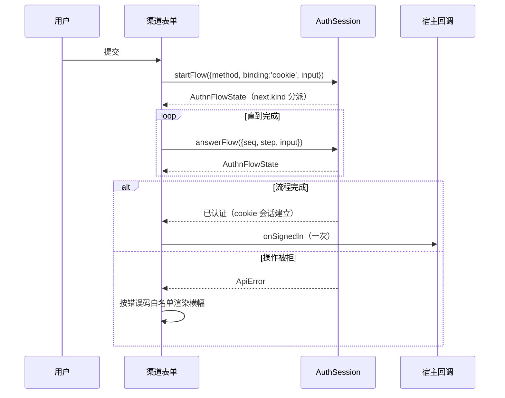

# auth-ui

## 职责

`@speed/auth-ui` 是一个 speed 前端的登录组件族：把 `@speed/auth-core` 会话契约的每一片渲染成受控组件，并渲染邀请受理面，由宿主装配成登录面。它交付一组表单与屏幕，不交付会话状态机。

族内各组件驱动会话契约的自己那一部分，登录一律按 `@speed/auth-core` 的流程操作分步推进：

- `SignInScreen` 读取部署的发现文档（`session.listMethods`），按每个方法描述符的 `kind` 分组渲染：`form` 收在标签页条之后，`redirect` 渲染按钮，`enterprise` 渲染邮箱优先入口，`webauthn` 渲染通行密钥按钮与仪式。四类的先后由宿主的 `order` 决定；屏幕可安插宿主内容（`slots`）、按提供方给出图标（`providerIcon`），并可在每次起手前询问宿主的门（`beforeStart`）。
- `PasswordSignInForm` 起一条 `method: 'password'` 的登录流程，按字段提交与后续步答复；`SMSSignInForm` 起 `method: 'sms'` 的流程，两步（手机号步与验证码步）收在同一个表单里；描述符为其他 `form` 方法给出首步字段时，由通用描述符表单驱动。三个可单独挂载的入口都接受同一个 `beforeStart` 门。
- `SocialSignInSection` 渲染一组 redirect 方法，每个方法起一条登录流程；开始响应的 `redirect` 步交出授权地址，由宿主导航。
- `SocialCallbackHandler` 在宿主的回调路由上读回那条流程（`session.readFlow`），据其状态续接。
- `SignOutButton` 驱动 `session.logout()`；`SignOutMenuItem` 是同一动作在宿主账户菜单里的形态，先调宿主的 `onActivate`（通常关闭菜单）再驱动登出，吞掉拒绝（登出是终局的，本地会话无论如何翻成匿名，菜单项也随之消失）。
- `SessionEndedScreen` 是宿主挂在一处已认证视图刚翻成匿名时的占位屏。它的文案不陈述成因：显式登出与会话死亡在快照上是同一个翻转，本包区分不了，所以屏上的话对两者都成立——已退出，或登录状态已失效，再次登录即可继续。
- `AcceptInvitationScreen` 渲染邀请受理面：读取令牌指向的邀请（acceptView）并受理它（accept）。它驱动的不是会话操作，而是宿主交给它的两个邀请操作。
- `ImpersonationBanner` 渲染冒充期间应用壳顶部栏之下的横幅：谁被冒充、租户、到期时刻与「结束冒充」，并带一个隐藏控件。`ImpersonationIndicator` 是顶部栏里的身份指示，冒充期间始终渲染，同时是横幅的显示开关。`ImpersonationEndMenuItem` 是宿主账户菜单里的「结束冒充」项。`ImpersonationNoticeProvider` 把这三个部件连到同一个隐藏状态与宿主的同一次结束尝试。`ImpersonationNoticeBanner` 与 `ImpersonationNoticeIndicator` 是读提供者的同名绑定：宿主不必手工把受控属性逐项接上。这些部件都不驱动会话，也不发请求，结束操作由宿主交给提供者。

驱动会话的组件各持有一个 `session` 属性，会话由宿主传入；`AcceptInvitationScreen` 不驱动会话，它的两个操作经属性的 `invitations` 取用（见「外部接口契约」）。组件不消费 auth-core 的**钩子**（`useAuthState`、`usePermission`），只经属性调用会话的**操作**——发现读取（`listMethods`、`discoverSso`）即在其列（见「非职责」）。内建文案一律取自 `auth-ui` 命名空间；品牌名（提供方自己的名字）由发现文档带，不进命名空间。

### 非职责

- **不拥有会话状态机。** 流程的推进、会话的建立与撤销归 `@speed/auth-core`（[authn 登录](../authn/design-authn-login.md)）；本包渲染的会话契约的每一项都是 auth-core 交付的操作。要在本包见不到的操作里做点别的，那是 auth-core 契约该长的地方，不是本包里的第二次 HTTP。
- **不拥有邀请状态机，不做登录门禁，不引用生成契约的类型。** 邀请的读取与受理由宿主交给 `AcceptInvitationScreen` 的 `InvitationOperations` 执行（生成操作在宿主侧绑定）；本包不发邀请的 HTTP、不把 `@speed/api-sdk` 的类型带上公开面，也不判定令牌有效性——有效性由服务端在应答里给出（无此邀请 404、已失效 409）。接受是公开的、令牌即凭据：成员关系落到**被邀请地址**的账户上，而非登录账号。宿主可在受理面前渲染它自己的登录面（先登录或注册再受理是宿主的组合），本包不内建这道门禁，那道门禁也不约束成员关系落到哪个账户。
- **不决定登录之后。** 登录成功之后导航到哪、是否刷新缓存、是否重新取权限，是宿主的；本包只触发一次回调。
- **不内建注册面，但内建注册入口。** 账户没有独立的注册端点：账户在登录流程的账户解析阶段按注册设置创建，或经邀请受理、管理员建户产生（[authn-account](../authn/design-authn-account.md)、[authn-invite](../authn/design-authn-invite.md)）。一次「注册」因此是一次登录流程在当前部署下开户的结果，本包不内建独立表单；`SignInScreen` 在部署允许首登开户（`discovery.signup.enabled` 且至少一个可见方法带 `opens_account`）时呈现一个「注册」入口，起的是同一条流程，开户仍由服务端完成。
- **不消费 auth-core 的钩子，不读存储。** 组件读到的会话状态只有它驱动的那些操作，其余状态经宿主的钩子观察。一个自己订阅会话的组件必须已挂在宿主的 `attachSession` 之下，故这一层留在宿主。**读取发现文档是一个例外**：`SignInScreen` 经它持有的 `session` 属性上的 `listMethods` 与 `discoverSso` 操作读取部署的登录方式与企业提供方，给了 `absent` 的 `SocialCallbackHandler` 经 `listMethods` 读取部署有没有 redirect 类与 enterprise 类方法——那是会话操作，不是 auth-core 的钩子，而组件本就在驱动这个会话；这条例外不放松「不消费钩子、不读存储」。
- **不认识路由与权限。** 本包不匹配 URL、不判定权限、不做路由守卫；回调返给宿主，宿主经自己的路由与权限组合处置。
- **不是运维面。** 平台员工的管理面与登录面无交集，那些面归 [console-ui](design-web-console-ui.md)。
- **不绑定一种文案。** 内建文案取自命名空间；宿主改文案靠重新注册整个命名空间，不靠在组件里改字。

## 外部接口契约

`@speed/auth-ui` 的公开面是 `web/packages/auth-ui/src/index.ts` 的导出：`SignInScreen`（连同 `SignInScreenProps`、`SignInChannel`、`SignInMode`、`SignInGroup`、`SignInScreenSlots`、`SignInBeforeStart`、`SignInStartContext`、`SignInContext`、`SocialSignInOptions`）、各渠道的表单（`PasswordSignInForm` 连同 `PasswordSignInFormProps`；`SMSSignInForm` 连同 `SMSSignInFormProps`）、社交对（`SocialSignInSection` 连同 `SocialSignInSectionProps`、`SocialProvider`、`SocialProviderConfig`，以及 `SocialCallbackHandler` 连同 `SocialCallbackHandlerProps`）、`SignOutButton`（连同 `SignOutButtonProps`）、`SignOutMenuItem`（连同 `SignOutMenuItemProps`）、`SessionEndedScreen`（连同 `SessionEndedScreenProps`）、`AcceptInvitationScreen`（连同 `AcceptInvitationScreenProps`、`InvitationOperations`、`InvitationSummary`、`AcceptInvitationInput`）、`ImpersonationBanner`（连同 `ImpersonationBannerProps`、`ImpersonationBannerState`）、冒充通告的提供者与部件（`ImpersonationNoticeProvider`、`ImpersonationIndicator`、`ImpersonationEndMenuItem`、`ImpersonationNoticeBanner`、`ImpersonationNoticeIndicator`、`useImpersonationNotice`，连同 `ImpersonationNoticeProviderProps`、`ImpersonationIndicatorProps`、`ImpersonationNotice`、`ImpersonationEndMenuItemProps`、`ImpersonationNoticeBannerProps`），以及命名空间对（`AUTH_UI_NAMESPACE`、`authUiResources`）。`web/packages/auth-ui/src/internal/` 下的助手（发现读取、方法标签、通用描述符表单、企业入口、通行密钥入口，以及把一步 `AuthnStep` 渲染成分支字段的步进渲染器）是族内共享管线，不外导。`SocialProvider` 是 `string`（方法名），不再是名字闭集：redirect 方法的集合由发现给出，见 [ADR-web-auth-channel-discovery-2026-10-16](../../../adr/adr-web-auth-channel-discovery-2026-10-16.md)。

### 受控组件的形状

每个组件从它驱动的会话操作取一个 `session` 属性，从该操作的结果取一个回调，不读别的会话状态：

```tsx
// SignInScreen：把发现文档的分组渲染成登录面。
interface SignInScreenProps {
  readonly session: AuthSession
  readonly discovery?: AuthnMethodList      // 宿主注入预算好的文档（SSR、测试）；省略时屏幕自己读
  readonly mode?: 'sign-in' | 'register'    // 纯呈现开关，起同一条流程
  readonly onModeChange?: (mode: SignInMode) => void // 给出即受控：mode 是唯一来源，开关只报告
  readonly onSignedIn?: (context: SignInContext) => void // 屏内渠道登录成功时报出上下文
  readonly beforeStart?: (context: SignInStartContext) => boolean | Promise<boolean> // 每次起手前的门
  readonly social?: SocialSignInOptions
  readonly slots?: SignInScreenSlots        // aboveChannels / belowForms 两个宿主内容位
  readonly order?: readonly SignInGroup[]   // 四组渠道的先后；未列出的组保持缺省次序排在后面
  readonly headingLevel?: 'h1' | 'h2' | 'h3' | 'h4' | 'h5' | 'h6' // 注册标题的元素，缺省 h2
  readonly providerIcon?: (provider: SocialProvider) => ReactNode // redirect 方法的图标
  readonly channels?: readonly SignInChannel[] // 已弃用：仍窄化 form 标签页条，一个 major 内生效
  readonly defaultChannel?: SignInChannel      // 已弃用
}

// 四组渠道与两个宿主内容位。
type SignInGroup = 'form' | 'redirect' | 'enterprise' | 'webauthn'
interface SignInScreenSlots {
  readonly aboveChannels?: ReactNode
  readonly belowForms?: ReactNode
}

// 起手门收到的上下文：要起的方法名，以及（屏幕给出时）当前呈现模式。
interface SignInStartContext {
  readonly method: string
  readonly mode?: 'sign-in' | 'register'
}

// 登录成功时屏幕所处的模式与走通的渠道。
interface SignInContext {
  readonly mode: 'sign-in' | 'register'
  readonly channel: string                  // 走通的方法名：password、sms、通行密钥或描述符表单的方法名
}

interface SocialSignInOptions {
  readonly providers?: readonly SocialProviderConfig[] // 已弃用：redirect 集合缺省来自发现
  readonly returnTo?: string                // 作为 redirect / enterprise 流程的 return_to
  readonly onAuthorizeUrl?: (provider: string, authorizeUrl: string) => void
}

// 每条渠道的表单起一条对应方法的登录流程，按步答复。beforeStart 只拦起手。
interface PasswordSignInFormProps {
  readonly session: AuthSession
  readonly onSignedIn?: () => void
  readonly beforeStart?: (context: SignInStartContext) => boolean | Promise<boolean>
}

// SocialCallbackHandler：在宿主的回调路由上读回流程并续接。
interface SocialCallbackHandlerProps {
  readonly session: AuthSession
  readonly onSignedIn?: () => void
  readonly absent?: ReactNode // 本部署没有 redirect 与 enterprise 方法时渲染；省略即不读发现
}

// AcceptInvitationScreen：读取一张邀请并受理它。两个邀请操作由宿主经
// `invitations` 绑定，故本包不含 HTTP、公开面不引用生成契约的类型。
interface AcceptInvitationScreenProps {
  readonly token: string
  readonly invitations: InvitationOperations
  readonly onAccepted?: () => void
  readonly newAccountFields?: {            // 新账户输入项；两项皆默认 true
    readonly displayName?: boolean
    readonly password?: boolean
  }
  readonly headingLevel?: 'h1' | 'h2' | 'h3' | 'h4' | 'h5' | 'h6' // 标题元素，缺省 h1；受理成功的小标题取下一级
}

interface InvitationOperations {
  readonly readInvitation: (token: string) => Promise<InvitationSummary>
  readonly acceptInvitation: (
    token: string,
    input: AcceptInvitationInput,
  ) => Promise<void>
}

// SignOutMenuItem：账户菜单里的登出项。先调 onActivate，再驱动 logout，吞掉拒绝。
interface SignOutMenuItemProps {
  readonly session: AuthSession
  readonly onActivate?: () => void
}

// ImpersonationBanner：冒充期间应用壳顶部栏之下的横幅。宿主始终挂载它，经
// `impersonation` 告诉它当前有没有冒充；结束尝试的状态与操作由宿主持有，经
// `onEnd`、`pending`、`failureCode`、`successMessage` 交给它。
interface ImpersonationBannerProps {
  readonly impersonation: ImpersonationBannerState | null // null 即当前没有冒充
  readonly onEnd: () => void                               // 发起宿主的那一次结束尝试
  readonly pending?: boolean                               // 该尝试在途：结束控件禁用并标忙
  readonly failureCode?: string | null                     // 该尝试的失败码，渲染在横幅内
  readonly successMessage?: string | null                  // 该尝试的成功文案，落在常驻 live region
  readonly dismissed?: boolean                             // 为真时不渲染横幅本体，常驻 live region 不受影响；缺省 false
  readonly onDismiss?: () => void                          // 给出时横幅渲染「隐藏」控件，缺省则没有该控件
  readonly regionId?: string                               // 横幅本体的 id，供身份指示的 aria-controls 引用
}

interface ImpersonationBannerState {
  readonly subject: string     // 被冒充账户的显示名，宿主已解析成文本
  readonly tenant?: string     // 冒充所在租户的展示文本，示范宿主传租户标识；读不到时缺省
  readonly expiresAt?: Date    // 冒充到期时刻，读不到时缺省
  readonly grantId?: string    // 冒充授予的稳定标识，隐藏状态据它判定是否新一次冒充；读不到时缺省
}

// ImpersonationNoticeProvider：把横幅、身份指示与账户菜单项连到同一个隐藏状态与
// 宿主的同一次结束尝试，三个部件都从它读。宿主把它挂在外壳之外。
interface ImpersonationNoticeProviderProps {
  readonly impersonation: ImpersonationBannerState | null
  readonly identityKey?: string          // 生效身份的稳定值；变化即复位隐藏
  readonly onEnd: () => void
  readonly pending?: boolean
  readonly failureCode?: string | null
  readonly successMessage?: string | null
  readonly children: ReactNode
}

// useImpersonationNotice()：在提供者之内返回下面的值，之外返回 null（从不冒充的外壳）。
interface ImpersonationNotice {
  readonly impersonation: ImpersonationBannerState | null
  readonly dismissed: boolean
  readonly regionId: string
  readonly pending: boolean
  readonly failureCode: string | null
  readonly successMessage: string | null
  readonly end: () => void               // 发起共用的结束尝试
  readonly show: () => void
  readonly dismiss: () => void           // 隐藏横幅并把焦点移到身份指示
  readonly toggle: () => void
  readonly indicatorRef: RefObject<HTMLDivElement | null> // 隐藏时焦点的去处
}

// ImpersonationIndicator：顶部栏里的身份指示，也是横幅的显示开关。
interface ImpersonationIndicatorProps {
  readonly impersonation: ImpersonationBannerState | null // null 时不渲染
  readonly expanded: boolean                               // 横幅当前是否显示
  readonly controls?: string                               // 横幅本体的 id，显示时作 aria-controls
  readonly onToggle: () => void                            // 显示或隐藏横幅，焦点留在指示上
  readonly ref?: Ref<HTMLDivElement>
}

// ImpersonationEndMenuItem：账户菜单里的「结束冒充」项；提供者之外或没有冒充时不渲染。
interface ImpersonationEndMenuItemProps {
  readonly onActivate?: () => void       // 激活之后，通常用来关闭菜单
  readonly divider?: boolean
}

// ImpersonationNoticeBanner：读提供者的横幅。隐藏控件由 dismissible 控制（缺省 true）；
// 提供者之外不渲染。
interface ImpersonationNoticeBannerProps {
  readonly dismissible?: boolean
}

// ImpersonationNoticeIndicator：读提供者的身份指示，绑定同一隐藏状态、区域 id 与焦点目标；
// 提供者之外不渲染。无属性。
function ImpersonationNoticeIndicator(): ReactElement | null
```

`SignInScreen` 的 `discovery` 缺省时经 `session.listMethods()` 读一次部署的发现文档（`useSignInDiscovery`）；给出时以注入的文档为准，不发起读取（SSR、测试）。`mode` 是纯呈现开关：注册入口的可见性由 `discovery.signup.enabled` 与至少一个可见方法带 `opens_account` 决定，起的是同一条登录流程。注册模式下屏上的每一种登录渠道（表单渠道条、重定向类、企业类与通行密钥）都只列带 `opens_account` 的方法，表单渠道默认选中第一个；说明文字因此不再对「所用的方式能否创建账户」设条件。标题、说明与切换按钮按模式命名（注册模式的标题是「创建账户」，切回去的按钮是「已有账户？登录」），两种模式下没有同名的按钮。登录模式下，`signup.enabled` 为真且屏上有带 `opens_account` 的短信渠道时，渠道下给一句同形的说明：未登记的手机号会创建账户——这句话对每个号码都一样，不泄露号码是否已登记；没有这样的短信渠道时不给这句话，因为它点名手机号。短信验证码步骤的拒绝用该步骤自己的文案（验证码有误或已失效，可重新输入或重新获取），不用口令渠道的通用句；手机号在本地校验不过时，焦点移到手机号字段，错误文字进入 live region，每次被拒的提交各播报一次，同一段文字重复被拒时也重新播报。`onSignedIn` 带一个 `context`：登录成功时屏幕所处的模式与走通的渠道，宿主据此区分一次注册与一次登录，例如注册模式下经短信渠道登录之后宿主引导账户设置用户名与口令（[starters](../design-starters.md)，[ADR-authn-signup-2026-10-18](../../../adr/adr-authn-signup-2026-10-18.md)）。屏幕自己驱动到完成的渠道（口令、短信、通行密钥与描述符表单）报出方法名；重定向类与企业类渠道经回调路由完成，不经本屏，也就不带上下文；单个渠道表单与回调处理器的 `onSignedIn` 形状不变。未知 `kind` 不渲染也不崩；方法显示名先按方法名取 `auth-ui` 命名空间里区分模式的词条（同一品牌经多种方式到达部署时，`wechat.mp` 与 `wechat.web` 的专属文案彼此可辨，且就是各自按钮的可及名），没有专属词条时取描述符的 `label`，再缺失时按方法名取通用词条，最后退回方法名本身。

屏幕的装配面由宿主决定，缺省不放宽也不收窄：

- `order` 给出四组渠道的先后。未列出的组按缺省次序排在列出的组之后——局部次序是重排，不会静默丢掉一组渠道。实际渲染的第一组用无「or」的分隔文案（`social.titleFirst`、`passkey.titleFirst`），因为「或」在它上面没有所指。
- `slots.aboveChannels` 与 `slots.belowForms` 是宿主的两个内容位：前者在渠道组之上、模式标题之下，后者在表单组（含它的开户说明）之下。
- `providerIcon` 为每个 redirect 方法给出图标，渲染在标签之前；已弃用的 `social.providers` 配置里每项自己的 `icon` 优先。
- `headingLevel` 是注册模式标题的元素，缺省 `h2`（屏幕通常挂在宿主页面标题之下）。
- `beforeStart` 是起手门：每次渠道起一条新流程前询问宿主，上下文是 `{ method, mode }`，答案可以是布尔或它的 promise；`false` 不发起任何请求、不渲染错误（动作没有离开页面，没有服务端应答可展示），抛出的门按拒绝包住。门只管起手：流程停下的步骤由 `answerFlow` 答复，不再过门。
- `onModeChange` 给出时 `mode` 成为受控属性：注册／登录开关只报告选择，由宿主带新值重渲染，屏幕不再持有自己的模式副本。

`SocialSignInSection` 的回调是 `onAuthorizeUrl?`，把某个渠道开始流程后得到的授权地址报给宿主，由宿主决定它是一次跳转、一个弹窗还是一个新标签。`SocialCallbackHandler` 在回调路由上读回流程，登录落地（会话已由服务端建于回跳应答）后触发一次 `onSignedIn`。它的可选属性 `absent` 是本部署不提供回调落点时宿主要渲染的内容；只在宿主给了 `absent` 时，处理器才读发现文档，规则见[本部署不提供回调落点时](#本部署不提供回调落点时)。

### 会话契约的每一片都由一个组件驱动

| 组件 | 驱动的会话操作 |
|---|---|
| `SignInScreen` | `session.listMethods`（发现） |
| `PasswordSignInForm` | `session.startFlow`（`method: 'password'`）、`session.answerFlow` |
| `SMSSignInForm` | `session.startFlow`（`method: 'sms'`）、`session.answerFlow` |
| 通用描述符表单 | `session.startFlow`（描述符的方法名）、`session.answerFlow` |
| `SocialSignInSection` | `session.startFlow`（redirect 方法） |
| 企业入口 | `session.discoverSso`、`session.startFlow`（enterprise 方法） |
| 通行密钥入口 | `session.startFlow`（webauthn 方法）、`session.answerFlow` |
| `SocialCallbackHandler` | `session.readFlow`（回跳续接）；给了 `absent` 时另有 `session.listMethods`（发现） |
| `SignOutButton` | `session.logout` |
| `SignOutMenuItem` | `session.logout` |
| `SessionEndedScreen` | 无 |

`AcceptInvitationScreen` 不在上表：它驱动的不是会话操作，而是宿主交给它的两个邀请操作（`invitations.readInvitation` 与 `invitations.acceptInvitation`）。冒充通告的部件（`ImpersonationBanner`、`ImpersonationIndicator`、`ImpersonationEndMenuItem`、`ImpersonationNoticeBanner`、`ImpersonationNoticeIndicator`、`ImpersonationNoticeProvider`）同样不在上表：它们不持 `session`，状态与操作都由宿主经属性交给提供者（`impersonation`、`identityKey`、`onEnd`、`pending`、`failureCode`、`successMessage`），结束冒充的 HTTP 在宿主绑定的那次尝试里。

每个渠道的表单只驱动它那一个方法：`startFlow` 起流程，后续每一步（第二因素、改口令、登记因素、通行密钥仪式）由步进渲染器按 `next.kind` 渲染并交 `session.answerFlow`，直到流程落到完成。一次登录的落地由 auth-core 在同一会话上提交，视图不自己持有登录态。

### 对外接口面

- **公开面是 `index.ts` 的导出集。** 变更按 TypeScript 的源码语义分类：新增导出、新增可选字段是源码兼容的；删除导出或字段、改既有导出或字段的含义或名、改签名（参数或返回类型），是不兼容变更。把必选与可选互转按位置判：输入位（宿主提供的 prop 或参数）放宽兼容、收紧不兼容；输出位（宿主读取的返回类型或结果字段）相反——放宽为可选使读出的值成为 `T | undefined`，strictNullChecks 下只有在要求 `T` 处使用它的消费者无法编译（对可能为 undefined 的值做成员访问报 TS18048，赋给 `T` 或传入要求 `T` 的形参报 TS2322/TS2345），仅转发或在宽松处使用（模板串、比较、`??`、可选链）的消费者仍编译，故可能破坏消费者、是不兼容变更。
- **每个驱动会话的组件持一个 `session` 属性，且不消费 auth-core 的钩子。** 这条是宿主据以装配的接口面：组件挂在宿主的 `attachSession` 之下，状态变化只经属性与回调进出。`SignInScreen` 的发现读取经这个 `session` 属性的操作完成，不构成对钩子的消费（见「非职责」）。
- **结果回调在操作判决之后触发，且被包住。** `onSignedIn` 与 `onAuthorizeUrl` 在各自的操作判决之后触发；一个抛出的回调不是那次操作的失败：本包不因此渲染错误横幅、不把结果重新归成失败态、不为一次已成功的操作提供重试，且把抛出挡在 fire-and-forget 的 promise 之外，不产生未处理的拒绝。另有三个回调报告控制事件而非结果：`onSignIn` 在查看者要求重新登录时触发，由宿主导航，其前没有操作；`onModeChange` 在模式切换被点击时触发，其前没有请求；`SignOutMenuItem` 的 `onActivate` 在 `session.logout()` 之前触发，其中抛出被挡下，登出照常进行。
- **文档化的用法是可执行的。** README 的快速开始由 `web/packages/auth-ui/src/usage-example.test.tsx` 端到端编译并运行，故文档里的装配不能与 API 漂移。

## 依赖

| 依赖 | 用途 |
|---|---|
| `@speed/auth-core` | 组件驱动的 `AuthSession` 类型、它的流程操作，以及流程响应模型（`AuthnFlowState`、`AuthnStep`、`AuthnField` 等）——后者是 auth-core 手写的响应模型并经它的入口再导出，本包从 auth-core 取用；`./webauthn` 子路径提供通行密钥仪式的驱动 |
| `@speed/ui-kit` | 表单骨架 `FormLayout`/`FormField`、空态 `EmptyState`、失败横幅 `InlineError` 与 `errorCodeOf`、`visuallyHiddenSx`，以及写入反馈的 `useWriteFeedback`、`WriteFeedbackRegion`、手机号缺省国家/地区上下文与显示时区上下文 |
| `@speed/i18n` | 命名空间注册与文案的翻译钩子 |
| `react`、`react-dom`、`@mui/material`、`@emotion/*`、`react-hook-form` | 同为 peer（必需）：宿主拥有 React 与 MUI 树，表单库由本包的表面拉入 |

`@speed/api-sdk` 是**开发依赖**：本包的公开类型不引用它，只有 README 的快速开始装配（由 `src/usage-example.test.tsx` 执行）在一个宿主绑定的客户端上用到它的运行时段与生成调用。同 `@speed/api-client`。

方向上 `@speed/ui-kit` 在本包之下，本包 import 它；本包与同为能力 UI 的其它包（account-ui 一类）同层，同层之间互不 import。本包 import `@speed/auth-core` 但 auth-core 不 import 本包，装配由 [product-shell](design-web-product-shell.md) 这种上层壳承担。

## UML 图

一次渠道提交的路径。图里画不到的约束：宿主回调在判决之后触发；文案取自 `auth-ui` 命名空间而非内联；第二因素与改口令等后续步由同一条流程的答复推进，不另起流程。



## 核心数据结构

| 概念 | 形状 | 说明 |
|---|---|---|
| 发现文档 | `AuthnMethodList` | auth-core 再导出的生成类型：`methods`（描述符数组）、`signup`、`mfa` |
| 方法描述符 | `AuthnMethodDescriptor` | 一个方法自报的渲染类别（`kind`）、线协议、品牌标签、首步字段与是否可开户 |
| 登录渠道 | `SignInChannel` | `password`／`sms`；已弃用的窄化与选中口径 |
| 呈现模式 | `SignInMode` | `sign-in`／`register`，纯呈现开关 |
| 社交渠道 | `SocialProvider` | 方法名字符串，定义在 `web/packages/auth-ui/src/SocialSignInSection.tsx` |
| 社交渠道配置 | `SocialProviderConfig` | 一个方法加它的品牌标签、宿主回调地址与可选图标 |
| 一步 | `AuthnStep` | auth-core 手写的流程步模型，步进渲染器按 `kind` 分派 |
| 邀请视图 | `InvitationSummary` | 受理面渲染的邀请字段：租户、地址、状态、期限 |
| 邀请操作 | `InvitationOperations` | 宿主绑定的两个邀请操作：读取与受理 |
| 受理入参 | `AcceptInvitationInput` | 受理可带的显示名与初始口令（地址尚无账户时用） |
| 命名空间 | `authUiResources` | `zh-CN` 与 `en-US` 两份目录，叶子键集相同 |

## 核心算法与流程

### 渠道的发现与分组

`SignInScreen` 挂载时经 `session.listMethods()` 读一次发现文档（宿主注入 `discovery` 时不读）。三个状态：读取中渲染一条 `role="status"` 通知（含一个重试不发的空转），读取失败渲染该错误码的横幅与一个重试按钮（重试再读一次），就绪后按描述符的 `kind` 分组：

- `form` 收进标签页条（只有一个时不显标签条——没有可切换项的表单不是一个选择），password 与 sms 各用专属表单，其余 `form` 方法由通用描述符表单按 `fields` 渲染；
- `redirect` 交给 `SocialSignInSection` 渲染按钮；
- `enterprise` 交给企业入口；
- `webauthn` 交给通行密钥入口。

未知 `kind` 不渲染也不崩；注册入口的可见性由 `discovery.signup.enabled` 与至少一个可见方法带 `opens_account` 决定。

### 一次提交

1. 表单校验本地字段，调 `session.startFlow` 起一条对应方法的登录流程。
2. 按应答的 `next.kind` 分派：`challenge` 渲染要提交的字段、`redirect` 把地址交给宿主、`factor` 渲染第二因素清单、`enroll` 渲染登记种类、`webauthn` 渲染通行密钥仪式、`complete` 以 `step: 'complete'` 取走结果。
3. 每一步的答复经 `session.answerFlow` 发出（本包不直接触网）；流程落定后分叉：完成触发一次回调；被拒按错误码渲染一条 `role="alert"` 横幅、状态原地不变、可重试。
4. 切换渠道时旧表单一并卸载，它的半填状态与整次失败的横幅随之消失——渠道的错误不跨面泄漏。

### 短信码的两步

`SMSSignInForm` 先以手机号起一条 `method: 'sms'` 的流程，把两步收在同一个表单里：`challenge` 步发出通知用 `role="status"` 报出接收号码；重发以同一号码再起一条流程（发码是方法 `Begin` 的职责，同一条流程内没有重发这一步）；改号退回第一步。一次新的发送（首发送、重发或改号）把验证码字段清空，使对着上一码输入的旧值不能搭上新一码。手机号步用 ui-kit 的两段式控件（`PhoneNumberField`）：国家/地区选择器与本地号码，提交前组装成 E.164。选择器初始取宿主给出的手机号缺省国家/地区（ui-kit 的 `PhoneCountryDefaultProvider`），缺席时取浏览器语言所指的国家/地区（zh-CN → +86，en-US → +1），按国家名、ISO 码或国际区号搜索；粘贴的完整国际号码会自行切换选择器并填入本地部分。号码按所选国家/地区在本地校验，位数不足等失败带出区号（「该号码在 +86 下位数不完整」）、不发起请求；服务端自己的拒绝文案只留给它能判断的失败（地区不支持、发送策略拒绝）。

### 社交登录与回调

`SocialSignInSection` 对某个渠道调 `session.startFlow`；开始应答的 `redirect` 步给出授权地址，经 `onAuthorizeUrl` 交给宿主，宿主把提供方的重定向引到该渠道的回调路由，在那里渲染 `SocialCallbackHandler`。**提供方自己的 `redirect_uri` 由服务端按部署的公开地址拼出，客户端不传**；`SocialProviderConfig` 的回调地址是宿主自己的回调路由，作为流程的 `return_to` 发出，使提供方的一次往返最终落回它。回跳以 303 落回 `return_to` 时流程停在就绪步（令牌不能放进回跳 URL）；处理器在挂载时调 `session.readFlow` 读回流程，若应答为 `next.kind = complete` 则以 `step: 'complete'` 取走令牌、登录落地，触发一次 `onSignedIn`；若流程仍停在一步（如需第二因素或登记因素）则渲染该步续接。挂载时会话已是已认证的，是一次登录完成之后重入回调路由：处理器不读流程，再触发一次 `onSignedIn`，由宿主把访客引向别处。

### 本部署不提供回调落点时

回调路由先于会话存在：宿主在任何会话门之前渲染处理器，匿名访客带着在途流程到达时照常完成登录。部署没有 redirect 类与 enterprise 类方法时，本部署上没有任何流程会回跳到这条路由，`absent` 让宿主在此给出与未登记路径相同的 404（[ADR-web-route-seam-2026-10-17](../../../adr/adr-web-route-seam-2026-10-17.md)）。是否提供回调落点是登录前的事实，取自发现文档，不经特性文档。

宿主给了 `absent` 时：

1. **会话已是已认证（重入）**：先读 `session.listMethods()`。没有 redirect 类与 enterprise 类方法，渲染 `absent`；有，触发 `onSignedIn`；发现读取失败，触发 `onSignedIn`。
2. **会话不是已认证**：先读在途流程。读到即照常续接，不读发现文档——在途流程本身表明本部署有流程回跳到这条路由。`session.readFlow()` 返回 `null`（它对任何 401 都返回 `null`）时读 `session.listMethods()`：没有 redirect 类与 enterprise 类方法，渲染 `absent`；有，渲染失败横幅与重试按钮；发现读取失败，渲染失败横幅与重试按钮。这一读不是安全门：匿名者本就能直接读 `GET /api/v1/auth/methods`。

宿主没给 `absent` 时，处理器的行为与「社交登录与回调」所述逐项相同，不读发现文档。

### 企业登录

企业入口先收一个邮箱，调 `session.discoverSso(email)` 得到该邮箱域映射的提供方（`POST /api/v1/auth/sso/discover`，恒同形同长，无匹配时为空列表）。**提供方清单不进发现文档**：它按域发现，不泄露账户存在性（[authn-sso](../authn/design-authn-sso.md)），故企业入口单独读它。空列表渲染一条「无匹配」通知与一个「换一个邮箱」按钮；有提供方时按每个提供方的名字渲染一个按钮，点击以该提供方的协议为方法、其 id 为 `input.provider` 起一条流程，`redirect` 步经 `onAuthorizeUrl` 交给宿主导航。

### 通行密钥登录

通行密钥入口是一个按钮（名字取自描述符的 `label`），点击以方法名起一条流程；流程的首步是 `webauthn` 仪式步，由步进渲染器渲染：`@speed/auth-core/webauthn` 把该步的请求选项解码后驱动 `navigator.credentials.get`，再把返回的凭据按后端解的 JSON 形状序列化成答复键 `credential`；登记步的 `otpauth_uri` 仍渲染为文本加一个 `code` 字段，等宽展示取主题的 mono 字体入口。答复后流程推进到完成。本包只渲染仪式步与等待、取消界面，凭据驱动的逻辑在 auth-core 的子路径里；本包不 import 同层的 account-ui——同层之间不互 import。

**仪式期间是显式的等待态，带取消。** 页面没有可用认证器时仪式会一直挂着，禁用的按钮不是可读的信号，所以点击后按钮换成一条 `role="status"` 的等待通知（`signInFlow.passkeyWaiting`）加一个取消按钮（`signInFlow.passkeyCancel`）。取消是一个立即的状态转换：显示取消文案（`signInFlow.passkeyCancelled`）并给出重试，不等仪式落定；它只尽力经 `AbortController` 让浏览器放弃仪式，晚到的凭据按尝试序号丢弃。取消之后、以及仪式以不受支持或失败告终之后，按钮的文字是 `signInFlow.passkeyRetry`，点击对同一仪式步重跑一次。三种失败各有自己的文案（`signInFlow.passkeyUnsupported`、`signInFlow.passkeyCancelled`、`signInFlow.passkeyFailed`），渲染为 `role="alert"` 横幅，不经错误码白名单。

**仪式驱动的归属由 [ADR-web-auth-seams-2026-10-19](../../../adr/adr-web-auth-seams-2026-10-19.md) 裁定为 `@speed/auth-core` 的 `./webauthn` 子路径**：本包渲染仪式步与等待、取消界面，凭据驱动的那段逻辑在 auth-core 的子路径里（`runWebauthn`、`webauthnStepOf`、`WebauthnError`）；本包也不 import 同层的 account-ui——同层之间不互 import。

### 邀请受理

1. 挂载时经 `invitations.readInvitation(token)` 读一次令牌指向的邀请，三个状态：读取中渲染一条 `role="status"` 通知；读取失败按失败形态分支（无此邀请 404 渲染「邀请不存在」文案、已失效 409 渲染「邀请已失效」文案、其余渲染该错误码的横幅加一个重试按钮，重试再读一次）；就绪后渲染邀请的租户、地址与期限。
2. 查看者以 `invitations.acceptInvitation(token, input)` 受理，`input` 带可选显示名与口令（`AcceptInvitationInput`）：被邀请地址尚无账户时受理会建一个账户，故受理面为这一支提供显示名与口令两个可留空的输入，填了即随受理发出、留空即不带；地址已有账户时服务端忽略它们。`newAccountFields` 让宿主收窄这两项（两项皆默认提供）；两项都隐藏时不渲染那条说明——它描述的是页面上不存在的输入。被拒时渲染应答的错误码文本、受理动作保持可重试；受理落地后渲染受理成功文案并触发一次 `onAccepted`（抛出的宿主回调被包住，不改变受理已落定的事实）。面内标题按 `headingLevel` 渲染（缺省 `h1`，受理面通常就是整页），受理成功的小标题取它的下一级。期限按宿主提供的显示时区渲染（ui-kit 的显示时区上下文），缺席时用设备时区。

### 冒充横幅

决策见 [ADR-web-impersonation-shell-2026-10-18](../../../adr/adr-web-impersonation-shell-2026-10-18.md)。

1. **宿主始终挂载它，`impersonation` 为 `null` 时只留一个空的 live region。** 没有冒充时不渲染横幅，不占高度；区域先挂空、冒充出现时再填入文本，刚结束冒充的成功文案也留在这个仍挂载的区域里，不随横幅卸载。播报状态下这个区域视觉隐藏，且不得成为可聚焦的滚动区域：键盘用户在横幅槽里的第一次 Tab 落在「结束冒充」上，不落在看不见的节点上。组件首次挂载时 `impersonation` 已非空（开始冒充后租户框架新挂载，或冒充中整页重载）同样先挂空区域、下一 tick 再填入文本，所以这两种情形都播报一次；冒充中重载时的这次播报是对仍处于冒充的提醒，不抑制。结束若发生在别的入口、使横幅所展示的冒充消失，组件自己在这个区域里落「冒充已结束」；宿主那次结束尝试自己的成功文案同样落在这里。
2. **`impersonation` 非空且 `dismissed` 不为真时渲染横幅。** 横幅是带可及名的 `region` 地标，文字说明正在以 `subject` 的身份操作，给出了 `tenant` 与 `expiresAt` 就一并陈述，`tenant` 按原样陈述，它可能是租户标识而不是可读名，并说明冒充期间管理功能不可用。观看者就是发起者，横幅不陈述发起者。组件不倒计时，也不在到期时自行动作；到期后的重读由宿主负责。版式压低占用的高度：这几句事实作为同一段文字行内流动，不按句分行；结束与隐藏控件与文字同排并靠右，仅在 `xs` 以下另起一行；纵向内边距与正文字号取最小的一档。主体与租户标识各取限宽（主体约 16 个字符宽，租户标识约 24 个字符宽），超出时单行省略，完整值作为 `title`，使值的长短不把控件挤出栏外，也使文字的行数有上界。高度目标按值的长短分两档：主体与租户标识都不被省略时，视口 1280px 的文字单行，高度 40 到 48px，800px 至多两行；值被限宽省略时，1280px 至多两行，800px 至多三行。固定的几句事实不为凑单行而删减：到期时刻与管理功能不可用是操作者在冒充期间要知道的内容，目标服从内容。
3. **「结束冒充」不依赖 `tenant` 与 `expiresAt`。** 这两项是宿主读状态得来的，读不到时缺省，结束控件照常渲染、照常可用。
4. **结束是宿主持有的一次写入尝试，所有入口共用它。** 宿主以 ui-kit 的 `useWriteFeedback` 持有这次尝试，横幅的结束控件与账户菜单里的「结束冒充」项都只调同一个 `onEnd`；`pending`、`failureCode`、`successMessage` 由该尝试派生，经提供者交给两处。在途时两处同时禁用并标忙，不发第二次；兑现即成功，成功文案「冒充已结束」落在组件自己的常驻区域，与横幅是否被隐藏无关；抛出即失败，失败码文本只落在横幅内、控件保持可重试，横幅此刻被隐藏时提供者在 `failureCode` 由空变为有值的那一刻复位隐藏状态，使它出现。「当前已无冒充可结束」（服务端的裸 404）由宿主的尝试当成兑现，组件不认识 HTTP 状态。
5. **横幅可隐藏，隐藏的是横幅本体；隐藏状态由 `ImpersonationNoticeProvider` 持有。** 给了 `onDismiss` 才渲染「隐藏」控件（图标按钮，可及名「隐藏冒充提示」）。点击调 `dismiss`，横幅本体卸载，**焦点移到应用栏里的 `ImpersonationIndicator`**，不留在已卸载的控件上。常驻的 live region 与身份指示不受影响，开始与结束的播报照常。隐藏状态是提供者的内存状态，不落任何存储，整页重载复位。下列时刻复位为显示：`grantId` 在两个已读到的值之间变化（同一账户被再次冒充也算）；`identityKey` 变化；冒充结束（`impersonation` 变为 `null`）；结束尝试失败。读到 `grantId` 之前做出的隐藏、随后 `grantId` 读到，不复位；同一授予内状态读的重读、标签页重新可见的重读与路由切换也不复位；到期临近不自动再显示。
6. **身份指示在冒充期间始终渲染。** `ImpersonationIndicator` 在 `impersonation` 非空时渲染为一个按钮，可见文字「冒充中」，可及名取这段可见文字，颜色与图标不单独承载含义；`null` 时不渲染。它是披露控件：`aria-expanded` 为横幅是否显示，`aria-controls` 指向横幅，激活调 `onToggle`，焦点留在指示上。它的提示文字随状态在「隐藏冒充提示」与「显示冒充提示」之间切换。触屏上的可点击目标不小于 44×44（[布局](design-web-layout.md)）。
7. **账户菜单在冒充期间多一项「结束冒充」。** `ImpersonationEndMenuItem` 在提供者之内且 `impersonation` 非空时渲染，文字是「结束冒充」，在途时是「正在结束冒充…」并禁用；激活调共用的 `end`，再调 `onActivate`（宿主用它关闭菜单）；提供者之外或没有冒充时不渲染。

### 失败横幅与步骤的推进

登录与受理面的失败与确认按 [ui-kit](design-web-ui-kit.md) 的「写入的反馈」组织（[ADR-web-write-feedback-2026-10-17](../../../adr/adr-web-write-feedback-2026-10-17.md)）；登录的每一步答复都是一次尝试。每个渠道组件（登录屏上当前的渠道表单、社交区、企业入口、各通行密钥入口）是各自的反馈作用域，经本包 `internal/` 的包装绑定 `useWriteFeedback` 与 `WriteFeedbackRegion`，只用其中的 `reset` 与 `fail`——逐步答复不是单个 promise。一个渠道的失败不清掉另一个渠道的横幅，离开渠道（切换标签）只清掉它自己的。

- **答复一步就是一次新尝试。** 口令、验证码、第二因素、登记的答复以清掉当前失败横幅开头；答复成功而流程停在下一步时，旧横幅不留在新步骤旁。每个渲染步骤的表单都满足这一条，不只是起手与重发。
- **同一渠道组件同一时刻至多一条整次尝试的失败横幅。** 通行密钥仪式的失败是客户端原因，文本取自本包 bundle 的键，不经错误码白名单；它与同一渠道服务端失败的横幅互斥，一条出现时另一条被清掉。
- **重发的「验证码已发送」仍可闻。** 通知用先挂空区域、再填文本的 `role="status"`；重发的文本与上一次相同时先清空、下一 tick 再填，使成功的重发也被播报，而不只是失败的重发经 `role="alert"` 被播报。
- **步骤失败原地保留，包括社交回跳路由。** 答复被拒且流程仍停在该步（失败码不是 `authn.flow_invalid`）时，失败横幅渲染在仍停着的步骤旁、状态原地不变、可重试；口令、短信与描述符表单和社交回跳处理器一致，步骤不被替换成横幅加重试。
- **没有停着步骤的失败在回跳路由上渲染横幅加重试。** 答复被 `authn.flow_invalid` 拒绝，或就绪流程的 `complete` 答复被拒时，没有可保留的步骤：处理器渲染失败横幅与一个重试按钮，重试重读一次流程，与读不到流程同形。渠道表单的「退回渠道第一步」只适用于渠道表单，回跳路由没有渠道第一步。
- **步骤切换后焦点落在新步骤的首个控件。** 每个被渲染的步骤至少带一个控件（不支持的步骤带出口），故首个控件总是存在；首次渲染出现的步骤不移动焦点，回跳路由上 `readFlow` 之后第一次出现的步骤同此。
- **交互之后才出现的成功与通知类结果用先挂空区域、再填文本的 live region。** 邀请受理成功的文案与企业登录「无匹配」的通知等属于这一类；整次尝试的失败横幅按 `InlineError` 为 `role="alert"`、失败时才挂载，不在此条之内；邀请读取的 404 与 409 占位（重试之后也可能落到这里）是静态块，不是 live region。
- **不支持的步骤带出口。** 渠道表单上，通知旁带一个回到该渠道首步字段的动作；社交回跳路由上，该动作重读一次流程，与重试是同一个操作，处理器不会回到等待状态而不发起读取。

## 错误与失败语义

**失败面是一个错误码白名单。** 每条服务端与传输失败解析成一个错误码，渲染该码在当前语言下的文本；通行密钥仪式的失败是唯一的客户端来源，文本取自本包 bundle 的键，不经白名单；除 `client.http.<status>` 族之外，白名单之外的码一律渲染 `errors.unknown`，故目录里永不出现裸键。键的构造与回退由 `@speed/i18n` 的共享解析器承担：本包把白名单与 `client.http.<status>` 这一族的参数化叶子（`errors.client.http`，状态随文本带出）交给它，不手工拼键。口令渠道的口令不符按渠道取文本：`authn.login_failed` 在口令表单上渲染 `passwordSignIn.loginFailed`，落在口令字段上而不是整次尝试横幅（见下表）。

| 情形 | 表现 |
|---|---|
| 发现读取被拒 | 一条 `role="alert"` 横幅渲染应答的错误码文本，加一个重试按钮（重跑一次 `session.listMethods`） |
| 企业 discover 被拒 | 企业入口渲染应答的错误码文本 |
| 流程操作被拒（验证码错、口令策略等） | 一条 `role="alert"` 横幅渲染应答的错误码文本，状态原地不变，可重试 |
| 口令渠道的口令不符（`authn.login_failed`） | 文本取 `passwordSignIn.loginFailed`，不提验证码，也不说明是不存在还是不符；作为口令字段的说明渲染，字段 `aria-invalid` 且 `aria-describedby` 指向该文本，焦点移到口令字段；不渲染整次尝试横幅。后续步骤（如第二因素）被拒时仍按上一行渲染 |
| 流程已失（`flow-invalid`：过期、被并发消费、绑定不符）于渠道表单 | 一条横幅渲染该码文本，视图退回渠道第一步重新开始 |
| 短信码步骤的验证码已用 | 用过的码渲染 `smsSignIn.codeUsed`，清空字段，对同一码的再提交在本地被拒 |
| 社交开始被拒（方法关闭、账户不可用） | 一条横幅渲染应答的错误码文本 |
| 回跳路由上读不到流程 | 一条横幅加一个重试按钮，重跑一次 `session.readFlow` |
| 回跳路由上读不到流程或重入，宿主给了 `absent`，且发现文档里没有 redirect 类与 enterprise 类方法 | 渲染 `absent`，不渲染横幅，不触发 `onSignedIn` |
| 邀请令牌不指向任何邀请（404） | 受理面渲染「邀请不存在」的标题与说明 |
| 邀请已过期、已撤销或已被接受（409） | 受理面渲染「邀请已失效」的标题与说明 |
| 邀请读取的其它失败 | 一条 `role="alert"` 横幅渲染应答的错误码文本，加一个重试按钮（重跑一次读取） |
| 邀请受理被拒 | 一条 `role="alert"` 横幅渲染应答的错误码文本，受理动作保持可重试 |
| 冒充的结束被拒或传输失败（任一结束入口发起） | 横幅内一条 `role="alert"` 渲染应答的错误码文本，结束控件保持可重试；横幅此刻被隐藏时先复位隐藏状态使它出现 |
| 冒充的结束尝试兑现 | 渲染「冒充已结束」的成功文案；横幅随宿主把 `impersonation` 置空而消失，文案留在仍挂载的区域里 |
| 隐藏横幅 | 横幅本体卸载，焦点移到顶部栏的身份指示；常驻 live region 与身份指示保留 |
| 一步答复被拒后，下一次答复成功而流程停在新步骤 | 旧的失败横幅被清掉，不留在新步骤旁 |
| 通行密钥仪式失败与服务端失败横幅先后出现 | 互斥：出现一条时清掉另一条 |
| 通行密钥仪式不受支持、被取消或失败 | 一条 `role="alert"` 横幅渲染本包 bundle 里对应情形的文本，不经错误码白名单 |
| 社交回跳路由上第二因素等步骤的答复被拒，流程仍停在该步 | 失败横幅渲染在仍停着的步骤旁，状态原地不变，可重试 |
| 社交回跳路由上答复被 `authn.flow_invalid` 拒绝，或就绪流程的 `complete` 答复被拒 | 失败横幅加重试按钮，重试重读一次流程 |
| 渠道表单上流程给出本包不渲染的步骤 | 通知与一个回到该渠道首步字段的动作 |
| 社交回跳路由上流程给出本包不渲染的步骤 | 通知与一个重读流程的动作 |

**本包不降级、不重试。** 一次失败的提交就是那次交互的结果，是否重来归用户与宿主。

## 并发与事务边界

- 组件无自有共享状态，可被 React 正常渲染；同一会话上的并发流程操作以应答落定次序裁定，后到者的完成覆盖前者的会话。
- 本包不打开事务、不持有客户端缓存；一次提交是一个会话操作的往返。

## 实现状态

| 能力 | 状态 | 代码 |
|---|---|---|
| 登录屏与发现驱动的渠道分组 | 已实现 | `web/packages/auth-ui/src/SignInScreen.tsx` |
| 发现读取与方法标签 | 已实现 | `web/packages/auth-ui/src/internal/use-signin-discovery.ts`；`web/packages/auth-ui/src/internal/labels.ts` |
| 分渠道表单（专属与通用描述符） | 已实现 | `web/packages/auth-ui/src/PasswordSignInForm.tsx`；`web/packages/auth-ui/src/SMSSignInForm.tsx`；`web/packages/auth-ui/src/internal/sign-in-methods.tsx` |
| 企业入口与通行密钥入口 | 已实现 | `web/packages/auth-ui/src/internal/sign-in-methods.tsx` |
| 步进渲染器（含通行密钥仪式） | 已实现 | `web/packages/auth-ui/src/internal/flow-step.tsx`；`web/packages/auth-ui/src/internal/use-flow-driver.ts`；`web/packages/auth-ui/src/internal/flow.ts` |
| 社交区与回调 | 已实现 | `web/packages/auth-ui/src/SocialSignInSection.tsx`；`web/packages/auth-ui/src/SocialCallbackHandler.tsx` |
| 会话面 | 已实现 | `web/packages/auth-ui/src/SignOutButton.tsx`；`web/packages/auth-ui/src/SignOutMenuItem.tsx`；`web/packages/auth-ui/src/SessionEndedScreen.tsx` |
| 登录屏的装配面：组次序与首组文案、宿主内容位、提供方图标、标题层级、受控模式、起手门 | 已实现 | `web/packages/auth-ui/src/SignInScreen.tsx` `SignInScreen`、`SignInScreenProps`、`SignInStartContext`；`web/packages/auth-ui/src/internal/start-gate.ts`；`web/packages/auth-ui/src/internal/group-heading.ts` |
| 会话结束屏的文案对主动退出与会话失效都成立，不陈述成因 | 未实现 | — |
| 邀请受理面 | 已实现 | `web/packages/auth-ui/src/AcceptInvitationScreen.tsx` `AcceptInvitationScreen` |
| 邀请受理的新账户输入项取舍、标题层级与显示时区 | 已实现 | `web/packages/auth-ui/src/AcceptInvitationScreen.tsx` `AcceptInvitationScreen`、`AcceptInvitationScreenProps` |
| 短信通道读取手机号缺省国家/地区 | 已实现 | `web/packages/auth-ui/src/SMSSignInForm.tsx` `SMSSignInForm` |
| 通行密钥仪式由 `@speed/auth-core/webauthn` 驱动 | 已实现 | `web/packages/auth-ui/src/internal/flow-step.tsx`；`web/packages/auth-core/src/webauthn.ts` |
| 错误码文本经 i18n 共享解析器（含 `client.http.<status>` 族） | 已实现 | `web/packages/auth-ui/src/internal/error-text.ts` |
| 冒充横幅 `ImpersonationBanner` | 已实现 | `web/packages/auth-ui/src/ImpersonationBanner.tsx` `ImpersonationBanner`、`ImpersonationBannerProps`、`ImpersonationBannerState` |
| 横幅的隐藏控件、顶部栏的 `ImpersonationIndicator`、与账户菜单项共用结束尝试 | 已实现 | `web/packages/auth-ui/src/ImpersonationBanner.tsx` `ImpersonationBanner`、`ImpersonationBannerProps`、`ImpersonationBannerState`；`web/packages/auth-ui/src/ImpersonationNotice.tsx` `ImpersonationNoticeProvider`、`ImpersonationIndicator`、`ImpersonationEndMenuItem`、`useImpersonationNotice` |
| 读提供者的横幅与身份指示 | 已实现 | `web/packages/auth-ui/src/ImpersonationNotice.tsx` `ImpersonationNoticeBanner`、`ImpersonationNoticeIndicator`、`ImpersonationNoticeBannerProps` |
| 登录屏的 `onSignedIn` 带模式与渠道上下文 | 已实现 | `web/packages/auth-ui/src/SignInScreen.tsx` `SignInScreen`、`SignInContext` |
| 横幅文字行内流动，主体与租户标识限宽省略，行数按值的长短有上界 | 已实现 | `web/packages/auth-ui/src/ImpersonationBanner.tsx` `ImpersonationBanner`、`ImpersonationBannerState` |
| 注册模式下各渠道的收窄、标题与切换按钮，登录模式的开户说明，短信验证码步骤的拒绝文案与手机号校验失败的焦点 | 已实现 | `web/packages/auth-ui/src/SignInScreen.tsx` `SignInScreen`；`web/packages/auth-ui/src/SMSSignInForm.tsx` `SMSSignInForm` |
| 渠道组件的反馈作用域，答复一步清掉失败横幅，仪式失败与服务端失败横幅互斥 | 未实现 | — |
| 社交回跳路由上的步骤失败原地保留，没有停着步骤时的重试 | 未实现 | — |
| 重发的「验证码已发送」可闻，步骤切换后的焦点 | 未实现 | — |
| 交互之后出现的结果用先挂空区域、再填文本的 live region | 未实现 | — |
| 不支持的步骤的出口 | 未实现 | — |
| 命名空间资源 | 已实现 | `web/packages/auth-ui/src/resources.ts` |
| 本部署不提供回调落点时渲染 `absent` | 已实现 | `web/packages/auth-ui/src/SocialCallbackHandler.tsx` `SocialCallbackHandler` |
