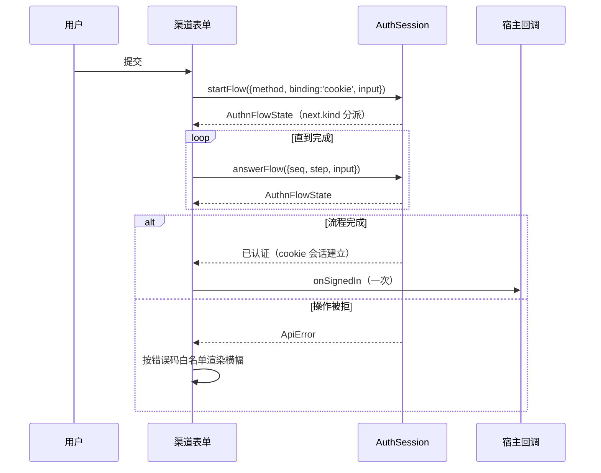

# auth-ui

## 职责

`@speed/auth-ui` 是一个 speed 前端的登录组件族：把 `@speed/auth-core` 会话契约的每一片渲染成受控组件，并渲染邀请受理面，由宿主装配成登录面。它交付一组表单与屏幕，不交付会话状态机。

族内各组件驱动会话契约的自己那一部分，登录一律按 `@speed/auth-core` 的流程操作分步推进：

- `SignInScreen` 读取部署的发现文档（`session.listMethods`），按每个方法描述符的 `kind` 分组渲染：`form` 收在标签页条之后，`redirect` 渲染按钮，`enterprise` 渲染邮箱优先入口，`webauthn` 渲染通行密钥按钮与仪式。
- `PasswordSignInForm` 起一条 `method: 'password'` 的登录流程，按字段提交与后续步答复；`SMSSignInForm` 起 `method: 'sms'` 的流程，两步（手机号步与验证码步）收在同一个表单里；描述符为其他 `form` 方法给出首步字段时，由通用描述符表单驱动。
- `SocialSignInSection` 渲染一组 redirect 方法，每个方法起一条登录流程；开始响应的 `redirect` 步交出授权地址，由宿主导航。
- `SocialCallbackHandler` 在宿主的回调路由上读回那条流程（`session.readFlow`），据其状态续接。
- `SignOutButton` 驱动 `session.logout()`。
- `SessionEndedScreen` 是宿主挂在一处已认证视图刚翻成匿名时的占位屏。
- `AcceptInvitationScreen` 渲染邀请受理面：读取令牌指向的邀请（acceptView）并受理它（accept）。它驱动的不是会话操作，而是宿主交给它的两个邀请操作。

驱动会话的组件各持有一个 `session` 属性，会话由宿主传入；`AcceptInvitationScreen` 不驱动会话，它的两个操作经属性的 `invitations` 取用（见「外部接口契约」）。组件不消费 auth-core 的**钩子**（`useAuthState`、`usePermission`），只经属性调用会话的**操作**——发现读取（`listMethods`、`discoverSso`）即在其列（见「非职责」）。内建文案一律取自 `auth-ui` 命名空间；品牌名（提供方自己的名字）由发现文档带，不进命名空间。

### 非职责

- **不拥有会话状态机。** 流程的推进、会话的建立与撤销归 `@speed/auth-core`（[authn 登录](../authn/design-authn-login.md)）；本包渲染的会话契约的每一项都是 auth-core 交付的操作。要在本包见不到的操作里做点别的，那是 auth-core 契约该长的地方，不是本包里的第二次 HTTP。
- **不拥有邀请状态机，不做登录门禁，不引用生成契约的类型。** 邀请的读取与受理由宿主交给 `AcceptInvitationScreen` 的 `InvitationOperations` 执行（生成操作在宿主侧绑定）；本包不发邀请的 HTTP、不把 `@speed/api-sdk` 的类型带上公开面，也不判定令牌有效性——有效性由服务端在应答里给出（无此邀请 404、已失效 409）。接受是公开的、令牌即凭据：成员关系落到**被邀请地址**的账户上，而非登录账号。宿主可在受理面前渲染它自己的登录面（先登录或注册再受理是宿主的组合），本包不内建这道门禁，那道门禁也不约束成员关系落到哪个账户。
- **不决定登录之后。** 登录成功之后导航到哪、是否刷新缓存、是否重新取权限，是宿主的；本包只触发一次回调。
- **不内建注册面，但内建注册入口。** 账户没有独立的注册端点：账户在登录流程的账户解析阶段按注册设置创建，或经邀请受理、管理员建户产生（[authn-account](../authn/design-authn-account.md)、[authn-invite](../authn/design-authn-invite.md)）。一次「注册」因此是一次登录流程在当前部署下开户的结果，本包不内建独立表单；`SignInScreen` 在部署允许首登开户（`discovery.signup.enabled` 且至少一个可见方法带 `opens_account`）时呈现一个「注册」入口，起的是同一条流程，开户仍由服务端完成。
- **不消费 auth-core 的钩子，不读存储。** 组件读到的会话状态只有它驱动的那些操作，其余状态经宿主的钩子观察。一个自己订阅会话的组件必须已挂在宿主的 `attachSession` 之下，故这一层留在宿主。**读取发现文档是一个例外**：`SignInScreen` 经它持有的 `session` 属性上的 `listMethods` 与 `discoverSso` 操作读取部署的登录方式与企业提供方——那是会话操作，不是 auth-core 的钩子，而组件本就在驱动这个会话；这条例外不放松「不消费钩子、不读存储」。
- **不认识路由与权限。** 本包不匹配 URL、不判定权限、不做路由守卫；回调返给宿主，宿主经自己的路由与权限组合处置。
- **不是运维面。** 平台员工的管理面与登录面无交集，那些面归 [console-ui](design-web-console-ui.md)。
- **不绑定一种文案。** 内建文案取自命名空间；宿主改文案靠重新注册整个命名空间，不靠在组件里改字。

## 外部接口契约

`@speed/auth-ui` 的公开面是 `web/packages/auth-ui/src/index.ts` 的导出：`SignInScreen`（连同 `SignInChannel`、`SignInMode`、`SocialSignInOptions`）、各渠道的表单（`PasswordSignInForm`、`SMSSignInForm`）、社交对（`SocialSignInSection` 连同 `SocialProvider`、`SocialProviderConfig`，以及 `SocialCallbackHandler`）、`SignOutButton`、`SessionEndedScreen`、`AcceptInvitationScreen`（连同 `InvitationOperations`、`InvitationSummary`、`AcceptInvitationInput`），以及命名空间对（`AUTH_UI_NAMESPACE`、`authUiResources`）。`web/packages/auth-ui/src/internal/` 下的助手（发现读取、方法标签、通用描述符表单、企业入口、通行密钥入口，以及把一步 `AuthnStep` 渲染成分支字段的步进渲染器）是族内共享管线，不外导。`SocialProvider` 是 `string`（方法名），不再是名字闭集：redirect 方法的集合由发现给出，见 [ADR-web-auth-channel-discovery-2026-10-16](../../../adr/adr-web-auth-channel-discovery-2026-10-16.md)。

### 受控组件的形状

每个组件从它驱动的会话操作取一个 `session` 属性，从该操作的结果取一个回调，不读别的会话状态：

```tsx
// SignInScreen：把发现文档的分组渲染成登录面。
interface SignInScreenProps {
  readonly session: AuthSession
  readonly discovery?: AuthnMethodList      // 宿主注入预算好的文档（SSR、测试）；省略时屏幕自己读
  readonly mode?: 'sign-in' | 'register'    // 纯呈现开关，起同一条流程
  readonly onSignedIn?: () => void
  readonly social?: SocialSignInOptions
  readonly channels?: readonly SignInChannel[] // 已弃用：仍窄化 form 标签页条，一个 major 内生效
  readonly defaultChannel?: SignInChannel      // 已弃用
}

interface SocialSignInOptions {
  readonly providers?: readonly SocialProviderConfig[] // 已弃用：redirect 集合缺省来自发现
  readonly returnTo?: string                // 作为 redirect / enterprise 流程的 return_to
  readonly onAuthorizeUrl?: (provider: string, authorizeUrl: string) => void
}

// 每条渠道的表单起一条对应方法的登录流程，按步答复。
interface PasswordSignInFormProps {
  readonly session: AuthSession
  readonly onSignedIn?: () => void
}

// AcceptInvitationScreen：读取一张邀请并受理它。两个邀请操作由宿主经
// `invitations` 绑定，故本包不含 HTTP、公开面不引用生成契约的类型。
interface AcceptInvitationScreenProps {
  readonly token: string
  readonly invitations: InvitationOperations
  readonly onAccepted?: () => void
}

interface InvitationOperations {
  readonly readInvitation: (token: string) => Promise<InvitationSummary>
  readonly acceptInvitation: (
    token: string,
    input: AcceptInvitationInput,
  ) => Promise<void>
}
```

`SignInScreen` 的 `discovery` 缺省时经 `session.listMethods()` 读一次部署的发现文档（`useSignInDiscovery`）；给出时以注入的文档为准，不发起读取（SSR、测试）。`mode` 是纯呈现开关：注册入口的可见性由 `discovery.signup.enabled` 与至少一个可见方法带 `opens_account` 决定，起的是同一条登录流程。未知 `kind` 不渲染也不崩；描述符给出的 `label` 优先作为方法显示名，缺失时按方法名查 `auth-ui` 命名空间，再退回方法名本身。

`SocialSignInSection` 的回调是 `onAuthorizeUrl?`，把某个渠道开始流程后得到的授权地址报给宿主，由宿主决定它是一次跳转、一个弹窗还是一个新标签。`SocialCallbackHandler` 在回调路由上读回流程，登录落地（会话已由服务端建于回跳应答）后触发一次 `onSignedIn`。

### 会话契约的每一片都由一个组件驱动

| 组件 | 驱动的会话操作 |
|---|---|
| `SignInScreen` | `session.listMethods`（发现） |
| `PasswordSignInForm` | `session.startFlow`（`method: 'password'`）、`session.answerFlow` |
| `SMSSignInForm` | `session.startFlow`（`method: 'sms'`）、`session.answerFlow` |
| 通用描述符表单 | `session.startFlow`（描述符的方法名）、`session.answerFlow` |
| `SocialSignInSection` | `session.startFlow`（redirect 方法） |
| 企业入口 | `session.discoverSso`、`session.startFlow`（enterprise 方法） |
| 通行密钥入口 | `session.startFlow`（webauthn 方法）、`session.answerFlow` |
| `SocialCallbackHandler` | `session.readFlow`（回跳续接） |
| `SignOutButton` | `session.logout` |
| `SessionEndedScreen` | 无 |

`AcceptInvitationScreen` 不在上表：它驱动的不是会话操作，而是宿主交给它的两个邀请操作（`invitations.readInvitation` 与 `invitations.acceptInvitation`）。

每个渠道的表单只驱动它那一个方法：`startFlow` 起流程，后续每一步（第二因素、改口令、登记因素、通行密钥仪式）由步进渲染器按 `next.kind` 渲染并交 `session.answerFlow`，直到流程落到完成。一次登录的落地由 auth-core 在同一会话上提交，视图不自己持有登录态。

### 对外接口面

- **公开面是 `index.ts` 的导出集。** 变更按 TypeScript 的源码语义分类：新增导出、新增可选字段是源码兼容的；删除导出或字段、改既有导出或字段的含义或名、改签名（参数或返回类型），是不兼容变更。把必选与可选互转按位置判：输入位（宿主提供的 prop 或参数）放宽兼容、收紧不兼容；输出位（宿主读取的返回类型或结果字段）相反——放宽为可选使读出的值成为 `T | undefined`，strictNullChecks 下只有在要求 `T` 处使用它的消费者无法编译（对可能为 undefined 的值做成员访问报 TS18048，赋给 `T` 或传入要求 `T` 的形参报 TS2322/TS2345），仅转发或在宽松处使用（模板串、比较、`??`、可选链）的消费者仍编译，故可能破坏消费者、是不兼容变更。
- **每个驱动会话的组件持一个 `session` 属性，且不消费 auth-core 的钩子。** 这条是宿主据以装配的接口面：组件挂在宿主的 `attachSession` 之下，状态变化只经属性与回调进出。`SignInScreen` 的发现读取经这个 `session` 属性的操作完成，不构成对钩子的消费（见「非职责」）。
- **宿主回调在操作判决之后触发，且被包住。** 一个抛出的回调不是那次操作的失败：本包不因此渲染错误横幅、不把结果重新归成失败态、不为一次已成功的操作提供重试，且把抛出挡在 fire-and-forget 的 promise 之外，不产生未处理的拒绝。
- **文档化的用法是可执行的。** README 的快速开始由 `web/packages/auth-ui/src/usage-example.test.tsx` 端到端编译并运行，故文档里的装配不能与 API 漂移。

## 依赖

| 依赖 | 用途 |
|---|---|
| `@speed/auth-core` | 组件驱动的 `AuthSession` 类型、它的流程操作，以及流程响应模型（`AuthnFlowState`、`AuthnStep`、`AuthnField` 等）——后者是 auth-core 手写的响应模型并经它的入口再导出，本包从 auth-core 取用 |
| `@speed/ui-kit` | 表单骨架 `FormLayout`/`FormField`、对话框与空态 `EmptyState` |
| `@speed/i18n` | 命名空间注册与文案的翻译钩子 |
| `react`、`react-dom`、`@mui/material`、`@emotion/*`、`react-hook-form` | 同为 peer（必需）：宿主拥有 React 与 MUI 树，表单库由本包的表面拉入 |

`@speed/api-sdk` 是**开发依赖**：本包的公开类型不引用它，只有 README 的快速开始装配（由 `src/usage-example.test.tsx` 执行）在一个宿主绑定的客户端上用到它的运行时段与生成调用。同 `@speed/api-client`。

方向是 `@speed/auth-ui` 与 `@speed/ui-kit`、`@speed/layout-kit` 同层；同层之间互不 import。本包 import `@speed/auth-core` 但 auth-core 不 import 本包，装配由 [product-shell](design-web-product-shell.md) 这种上层壳承担。

## UML 图

一次渠道提交的路径。图里画不到的约束：宿主回调在判决之后触发；文案取自 `auth-ui` 命名空间而非内联；第二因素与改口令等后续步由同一条流程的答复推进，不另起流程。



## 核心数据结构

| 概念 | 形状 | 说明 |
|---|---|---|
| 发现文档 | `AuthnMethodList` | auth-core 再导出的生成类型：`methods`（描述符数组）、`signup`、`mfa` |
| 方法描述符 | `AuthnMethodDescriptor` | 一个方法自报的渲染类别（`kind`）、线协议、品牌标签、首步字段与是否可开户 |
| 登录渠道 | `SignInChannel` | `password`／`sms`；已弃用的窄化与选中口径 |
| 呈现模式 | `SignInMode` | `sign-in`／`register`，纯呈现开关 |
| 社交渠道 | `SocialProvider` | 方法名字符串，见 [account-ui](design-web-account-ui.md) 的同名类型 |
| 社交渠道配置 | `SocialProviderConfig` | 一个方法加它的品牌标签与宿主回调地址 |
| 一步 | `AuthnStep` | auth-core 手写的流程步模型，步进渲染器按 `kind` 分派 |
| 邀请视图 | `InvitationSummary` | 受理面渲染的邀请字段：租户、地址、状态、期限 |
| 邀请操作 | `InvitationOperations` | 宿主绑定的两个邀请操作：读取与受理 |
| 受理入参 | `AcceptInvitationInput` | 受理可带的显示名与初始口令（地址尚无账户时用） |
| 命名空间 | `authUiResources` | `zh-CN` 与 `en-US` 两份目录，叶子键集相同 |

## 核心算法与流程

### 渠道的发现与分组

`SignInScreen` 挂载时经 `session.listMethods()` 读一次发现文档（宿主注入 `discovery` 时不读）。三个状态：读取中渲染一条 `role="status"` 通知（含一个重试不发的空转），读取失败渲染该错误码的横幅与一个重试按钮（重试再读一次），就绪后按描述符的 `kind` 分组：

- `form` 收进标签页条（只有一个时不显标签条——没有可切换项的表单不是一个选择），password 与 sms 各用专属表单，其余 `form` 方法由通用描述符表单按 `fields` 渲染；
- `redirect` 交给 `SocialSignInSection` 渲染按钮；
- `enterprise` 交给企业入口；
- `webauthn` 交给通行密钥入口。

未知 `kind` 不渲染也不崩；注册入口的可见性由 `discovery.signup.enabled` 与至少一个可见方法带 `opens_account` 决定。

### 一次提交

1. 表单校验本地字段，调 `session.startFlow` 起一条对应方法的登录流程。
2. 按应答的 `next.kind` 分派：`challenge` 渲染要提交的字段、`redirect` 把地址交给宿主、`factor` 渲染第二因素清单、`enroll` 渲染登记种类、`webauthn` 渲染通行密钥仪式、`complete` 以 `step: 'complete'` 取走结果。
3. 每一步的答复经 `session.answerFlow` 发出（本包不直接触网）；流程落定后分叉：完成触发一次回调；被拒按错误码渲染一条 `role="alert"` 横幅、状态原地不变、可重试。
4. 切换渠道时旧表单一并卸载，它的半填状态与整次失败的横幅随之消失——渠道的错误不跨面泄漏。

### 短信码的两步

`SMSSignInForm` 先以手机号起一条 `method: 'sms'` 的流程，把两步收在同一个表单里：`challenge` 步发出通知用 `role="status"` 报出接收号码；重发以同一号码再起一条流程（发码是方法 `Begin` 的职责，同一条流程内没有重发这一步）；改号退回第一步。一次新的发送（首发送、重发或改号）把验证码字段清空，使对着上一码输入的旧值不能搭上新一码。

### 社交登录与回调

`SocialSignInSection` 对某个渠道调 `session.startFlow`；开始应答的 `redirect` 步给出授权地址，经 `onAuthorizeUrl` 交给宿主，宿主把提供方的重定向引到该渠道的回调路由，在那里渲染 `SocialCallbackHandler`。**提供方自己的 `redirect_uri` 由服务端按部署的公开地址拼出，客户端不传**；`SocialProviderConfig` 的回调地址是宿主自己的回调路由，作为流程的 `return_to` 发出，使提供方的一次往返最终落回它。回跳以 303 落回 `return_to` 时流程停在就绪步（令牌不能放进回跳 URL）；处理器在挂载时调 `session.readFlow` 读回流程，若应答为 `next.kind = complete` 则以 `step: 'complete'` 取走令牌、登录落地，触发一次 `onSignedIn`；若流程仍停在一步（如需第二因素或登记因素）则渲染该步续接。

### 企业登录

企业入口先收一个邮箱，调 `session.discoverSso(email)` 得到该邮箱域映射的提供方（`POST /auth/sso/discover`，恒同形同长，无匹配时为空列表）。**提供方清单不进发现文档**：它按域发现，不泄露账户存在性（[authn-sso](../authn/design-authn-sso.md)），故企业入口单独读它。空列表渲染一条「无匹配」通知与一个「换一个邮箱」按钮；有提供方时按每个提供方的名字渲染一个按钮，点击以该提供方的协议为方法、其 id 为 `input.provider` 起一条流程，`redirect` 步经 `onAuthorizeUrl` 交给宿主导航。

### 通行密钥登录

通行密钥入口是一个按钮（名字取自描述符的 `label`），点击以方法名起一条流程；流程的首步是 `webauthn` 仪式步，由步进渲染器渲染：本包的 `internal/webauthn.ts` 把该步的请求选项解码后驱动 `navigator.credentials.get`，再把返回的凭据按后端解的 JSON 形状序列化成答复键 `credential`；登记步的 `otpauth_uri` 仍渲染为文本加一个 `code` 字段。答复后流程推进到完成。**仪式渲染在本包内实现**，不下沉到更低共享包，也不 import 同层的 account-ui——同层之间不互 import。

### 邀请受理

1. 挂载时经 `invitations.readInvitation(token)` 读一次令牌指向的邀请，三个状态：读取中渲染一条 `role="status"` 通知；读取失败按失败形态分支（无此邀请 404 渲染「邀请不存在」文案、已失效 409 渲染「邀请已失效」文案、其余渲染该错误码的横幅加一个重试按钮，重试再读一次）；就绪后渲染邀请的租户、地址与期限。
2. 查看者以 `invitations.acceptInvitation(token, input)` 受理，`input` 带可选显示名与口令（`AcceptInvitationInput`）：被邀请地址尚无账户时受理会建一个账户，故受理面为这一支提供显示名与口令两个可留空的输入，填了即随受理发出、留空即不带；地址已有账户时服务端忽略它们。被拒时渲染应答的错误码文本、受理动作保持可重试；受理落地后渲染受理成功文案并触发一次 `onAccepted`（抛出的宿主回调被包住，不改变受理已落定的事实）。

## 错误与失败语义

**失败面是一个错误码白名单。** 每条提交路径把它那一次失败解析成一个错误码，渲染该码在当前语言下的文本；不在白名单内的码一律渲染 `errors.unknown`，故目录里永不出现裸键。

| 情形 | 表现 |
|---|---|
| 发现读取被拒 | 一条 `role="alert"` 横幅渲染应答的错误码文本，加一个重试按钮（重跑一次 `session.listMethods`） |
| 企业 discover 被拒 | 企业入口渲染应答的错误码文本 |
| 流程操作被拒（口令不符、验证码错、口令策略等） | 一条 `role="alert"` 横幅渲染应答的错误码文本，状态原地不变，可重试 |
| 流程已失（`flow-invalid`：过期、被并发消费、绑定不符） | 一条横幅渲染该码文本，视图退回渠道第一步重新开始 |
| 短信码步骤的验证码已用 | 用过的码渲染 `smsSignIn.codeUsed`，清空字段，对同一码的再提交在本地被拒 |
| 社交开始被拒（方法关闭、账户不可用） | 一条横幅渲染应答的错误码文本 |
| 回跳路由上读不到流程 | 一条横幅加一个重试按钮，重跑一次 `session.readFlow` |
| 邀请令牌不指向任何邀请（404） | 受理面渲染「邀请不存在」的标题与说明 |
| 邀请已过期、已撤销或已被接受（409） | 受理面渲染「邀请已失效」的标题与说明 |
| 邀请读取的其它失败 | 一条 `role="alert"` 横幅渲染应答的错误码文本，加一个重试按钮（重跑一次读取） |
| 邀请受理被拒 | 一条 `role="alert"` 横幅渲染应答的错误码文本，受理动作保持可重试 |

**本包不降级、不重试。** 一次失败的提交就是那次交互的结果，是否重来归用户与宿主。

## 并发与事务边界

- 组件无自有共享状态，可被 React 正常渲染；同一会话上的并发流程操作以应答落定次序裁定，后到者的完成覆盖前者的会话。
- 本包不打开事务、不持有客户端缓存；一次提交是一个会话操作的往返。

## 实现状态

| 能力 | 状态 | 代码 |
|---|---|---|
| 登录屏与发现驱动的渠道分组 | 已实现 | `web/packages/auth-ui/src/SignInScreen.tsx` |
| 发现读取与方法标签 | 已实现 | `web/packages/auth-ui/src/internal/use-signin-discovery.ts`；`web/packages/auth-ui/src/internal/labels.ts` |
| 分渠道表单（专属与通用描述符） | 已实现 | `web/packages/auth-ui/src/PasswordSignInForm.tsx`；`web/packages/auth-ui/src/SMSSignInForm.tsx`；`web/packages/auth-ui/src/internal/sign-in-methods.tsx` |
| 企业入口与通行密钥入口 | 已实现 | `web/packages/auth-ui/src/internal/sign-in-methods.tsx` |
| 步进渲染器（含通行密钥仪式） | 已实现 | `web/packages/auth-ui/src/internal/flow-step.tsx`；`web/packages/auth-ui/src/internal/use-flow-driver.ts`；`web/packages/auth-ui/src/internal/flow.ts` |
| 社交区与回调 | 已实现 | `web/packages/auth-ui/src/SocialSignInSection.tsx`；`web/packages/auth-ui/src/SocialCallbackHandler.tsx` |
| 会话面 | 已实现 | `web/packages/auth-ui/src/SignOutButton.tsx`；`web/packages/auth-ui/src/SessionEndedScreen.tsx` |
| 邀请受理面 | 已实现 | `web/packages/auth-ui/src/AcceptInvitationScreen.tsx` `AcceptInvitationScreen` |
| 命名空间资源 | 已实现 | `web/packages/auth-ui/src/resources.ts` |
