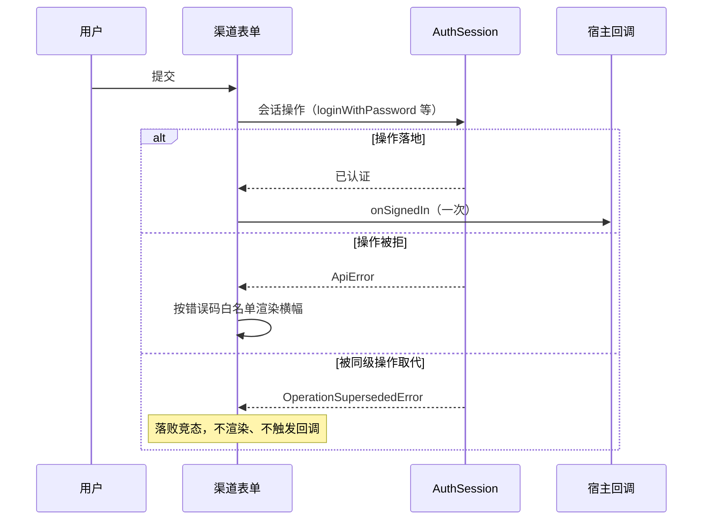

# auth-ui

## 职责

`@speed/auth-ui` 是一个 speed 前端的登录组件族：把 `@speed/auth-core` 会话契约的每一片渲染成受控组件，由宿主装配成登录面。它交付一组表单与屏幕，不交付会话状态机。

族内各组件驱动会话契约的自己那一部分：

- `PasswordSignInForm` 驱动口令登录（`session.loginWithPassword`）。
- `SMSSignInForm` 驱动短信码登录的两步流程（`session.requestSMSCode` 与 `session.loginWithSMSCode`）。
- `RegisterForm` 驱动注册（`session.register`）；注册不发起登录。
- `SocialSignInSection` 交出社交登录的授权入口，`SocialCallbackHandler` 在宿主的回调路由上完成那次交换。
- `SignInScreen` 把宿主声明的渠道收在一个标签页条之后，并在给出社交配置时把社交区渲染在表单之下。
- `SignOutButton` 驱动 `session.logout()`。
- `SessionEndedScreen` 是宿主挂在一处已认证视图刚翻成匿名时的占位屏。

每个组件持有一个 `session` 属性，会话由宿主传入；组件不消费 auth-core 的钩子。内建文案一律取自 `auth-ui` 命名空间。

### 非职责

- **不拥有会话状态机。** 登录流程的多步状态机、令牌的存放与刷新、会话的存续归 `@speed/auth-core`（[authn 登录](../authn/design-authn-login.md)）；本包渲染的会话契约的每一项都是 auth-core 交付的操作。要在本包见不到的操作里做点别的，那是 auth-core 契约该长的地方，不是本包里的第二次 HTTP。
- **不决定登录之后。** 登录成功之后导航到哪、是否刷新缓存、是否重新取权限，是宿主的；本包只触发一次回调。`RegisterForm` 与 `SessionEndedScreen` 都不登录，都把手交回宿主。
- **不消费 auth-core 的钩子，不读存储。** 组件读到的会话状态只有它驱动的那个操作，其余状态经宿主的钩子观察。一个自己订阅会话的组件必须已挂在宿主的 `attachSession` 之下，故这一层留在宿主。
- **不认识路由与权限。** 本包不匹配 URL、不判定权限、不做路由守卫；回调返给宿主，宿主经自己的路由与权限组合处置。
- **不是运维面。** 平台员工的管理面与登录面无交集，那些面归 [console-ui](design-web-console-ui.md)。
- **不绑定一种文案。** 内建文案取自命名空间；宿主改文案靠重新注册整个命名空间，不靠在组件里改字。

## 外部接口契约

`@speed/auth-ui` 的公开面是 `web/packages/auth-ui/src/index.ts` 的导出：`SignInScreen`（连同 `SignInChannel`、`SocialSignInOptions`）、各渠道的表单（`PasswordSignInForm`、`SMSSignInForm`、`RegisterForm`）、社交对（`SocialSignInSection` 连同 `SocialProvider`、`SocialProviderConfig`，以及 `SocialCallbackHandler`）、`SignOutButton`、`SessionEndedScreen`，以及命名空间对（`AUTH_UI_NAMESPACE`、`authUiResources`）。`web/packages/auth-ui/src/internal/` 下的助手是族内共享管线，不外导。

### 受控组件的形状

每个组件从它驱动的会话操作取一个 `session` 属性，从该操作的结果取一个回调，不读别的会话状态：

```tsx
// SignInScreen：把宿主声明的渠道收在标签页条之后。
interface SignInScreenProps {
  readonly session: AuthSession
  readonly channels?: readonly ('password' | 'sms')[] // 缺省两条都开
  readonly social?: SocialSignInOptions
  readonly defaultChannel?: 'password' | 'sms'
  readonly onSignedIn?: () => void
}

// 每条渠道的表单只驱动会话契约里对应的那一个操作。
interface PasswordSignInFormProps {
  readonly session: AuthSession
  readonly onSignedIn?: () => void
}
```

`RegisterForm` 的回调是 `onRegistered?: (user: AuthnUser) => void`，携带 `@speed/api-sdk` 生成的 `AuthnUser`；`SocialSignInSection` 的回调是 `onAuthorizeUrl?`，把某个渠道的授权 URL 报给宿主，由宿主决定它是一次跳转、一个弹窗还是一个新标签；`SocialCallbackHandler` 的回调是 `onBound`，在一次绑定形状的应答落地后触发一次。

### 会话契约的每一片都由一个组件驱动

| 组件 | 驱动的会话操作 |
|---|---|
| `PasswordSignInForm` | `session.loginWithPassword` |
| `SMSSignInForm` | `session.requestSMSCode`、`session.loginWithSMSCode` |
| `RegisterForm` | `session.register` |
| `SocialSignInSection` | `session.socialAuthorizeUrl` |
| `SocialCallbackHandler` | 社交回调端点（生成的调用，非会话操作） |
| `SignOutButton` | `session.logout` |
| `SessionEndedScreen` | 无 |

`SocialCallbackHandler` 的交换是一次生成的调用而非会话操作：绑定把一个外部身份加到调用方自己的账户上，不把任何人签进去——一次登录形状的应答（带令牌）由它渲染成另行签入面板，且不触发回调。

### 稳定性承诺

- **公开面是 `index.ts` 的导出集。** lockstep 版本下，增删一个导出或改动一个消费者可见签名是破坏性变更。
- **每个驱动会话的组件持一个 `session` 属性，且不消费 auth-core 的钩子。** 这条是宿主据以装配的契约：组件挂在宿主的 `attachSession` 之下，状态变化只经属性与回调进出。
- **宿主回调在操作判决之后触发，且被包住。** 一个抛出的回调不是那次操作的失败：本包不因此渲染错误横幅、不把结果重新归成失败态、不为一次已成功的操作提供重试，且把抛出挡在 fire-and-forget 的 promise 之外，不产生未处理的拒绝。
- **文档化的用法是可执行的。** README 的快速开始由 `web/packages/auth-ui/src/usage-example.test.tsx` 端到端编译并运行，故文档里的装配不能与 API 漂移。

## 依赖

| 依赖 | 用途 |
|---|---|
| `@speed/auth-core` | 组件驱动的 `AuthSession` 类型与它的会话操作 |
| `@speed/ui-kit` | 表单骨架 `FormLayout`/`FormField`、对话框与空态 `EmptyState` |
| `@speed/i18n` | 命名空间注册与文案的翻译钩子 |
| `@speed/api-sdk` | `RegisterForm` 回调携带的生成类型 `AuthnUser`（类型引用） |
| `react`、`react-dom`、`@mui/material`、`@emotion/*`、`react-hook-form` | 同为 peer（必需）：宿主拥有 React 与 MUI 树，表单库由本包的表面拉入 |

方向是 `@speed/auth-ui` 与 `@speed/ui-kit`、`@speed/layout-kit` 同层；同层之间互不 import。本包 import `@speed/auth-core` 但 auth-core 不 import 本包，装配由 [product-shell](design-web-product-shell.md) 这种上层壳承担。

## UML 图

一次渠道提交的路径。图里画不到的约束：宿主回调在判决之后触发；一场并发登录竞态的落败提交不触发回调，也不渲染横幅；文案取自 `auth-ui` 命名空间而非内联。



## 核心数据结构

| 概念 | 形状 | 说明 |
|---|---|---|
| 登录渠道 | `SignInChannel` | `password`／`sms` 的闭集，`SignInScreen` 的标签页顺序 |
| 社交渠道 | `SocialProvider` | 登录与绑定共用的渠道闭集，见 [account-ui](design-web-account-ui.md) 的同名类型 |
| 社交渠道配置 | `SocialProviderConfig` | 一个渠道加它的回调地址 |
| 命名空间 | `authUiResources` | `zh-CN` 与 `en-US` 两份目录，叶子键集相同 |

## 核心算法与流程

### 一次提交

1. 表单校验本地字段，把提交交给对应的会话操作。
2. 会话操作经宿主绑定的客户端发出请求（本包不直接触网）。
3. 判决落地后分叉：成功触发一次回调；被拒按错误码渲染一条 `role="alert"` 横幅、状态原地不变、可重试；落败竞态不渲染、不触发回调。
4. 切换渠道时旧表单一并卸载，它的半填状态与整次失败的横幅随之消失——渠道的错误不跨面泄漏。

### 短信码的两步

`SMSSignInForm` 先请求验证码，再把两步收在同一个表单里：发出通知用 `role="status"` 报出接收号码；重发对同一号码重复请求；改号退回第一步。一次新的发送（首发送、重发或改号）把验证码字段清空，使对着上一码输入的旧值不能搭上新一码。

### 社交登录与回调

`SocialSignInSection` 向会话要某个渠道的授权 URL，经 `onAuthorizeUrl` 交给宿主；宿主把提供方的重定向引到 `redirect_uri` 命名的回调路由，在那里渲染 `SocialCallbackHandler`，以提供方与 `code`／`state` 驱动那次交换。交换的应答形状分派结局：绑定形状刷新身份列表并触发 `onBound`；登录形状渲染另行签入面板、不触发回调。

## 错误与失败语义

**失败面是一个错误码白名单。** 每条提交路径把它那一次失败解析成一个错误码，渲染该码在当前语言下的文本；不在白名单内的码一律渲染 `errors.unknown`，故目录里永不出现裸键。

| 情形 | 表现 |
|---|---|
| 会话操作被拒（口令不符、验证码错、口令策略等） | 一条 `role="alert"` 横幅渲染应答的错误码文本，状态原地不变，可重试 |
| 提交输给一场并发登录竞态 | `OperationSupersededError`：不渲染横幅、不触发回调，会话已由胜出的调用签入 |
| 短信码步骤输给一场并发竞态 | 用过的码渲染 `smsSignIn.codeUsed`，清空字段，对同一码的再提交在本地被拒 |
| 注册被拒（标识格式、口令策略） | 一条横幅渲染应答的错误码文本 |
| 社交交换失败 | 一条横幅加一个重试按钮，对同一 `(code, state)` 重跑交换 |
| 回调收到登录形状的应答 | 渲染另行签入面板，不触发 `onBound` |

**本包不降级、不重试。** 一次失败的提交就是那次交互的结果，是否重来归用户与宿主。

## 并发与事务边界

- 组件无自有共享状态，可被 React 正常渲染；同一会话上的并发登录由 auth-core 以应答落定次序裁定取代，落败的提交是一次丢失的竞态而非失败。
- 本包不打开事务、不持有客户端缓存；一次提交是一个会话操作的往返。

## 实现状态

| 能力 | 状态 | 代码 |
|---|---|---|
| 登录屏与渠道表单 | 已实现 | `web/packages/auth-ui/src/SignInScreen.tsx` `SignInScreen`；`web/packages/auth-ui/src/PasswordSignInForm.tsx` `PasswordSignInForm`；`web/packages/auth-ui/src/SMSSignInForm.tsx` `SMSSignInForm`；`web/packages/auth-ui/src/RegisterForm.tsx` `RegisterForm` |
| 社交区与回调 | 已实现 | `web/packages/auth-ui/src/SocialSignInSection.tsx` `SocialSignInSection`；`web/packages/auth-ui/src/SocialCallbackHandler.tsx` `SocialCallbackHandler` |
| 会话面 | 已实现 | `web/packages/auth-ui/src/SignOutButton.tsx` `SignOutButton`；`web/packages/auth-ui/src/SessionEndedScreen.tsx` `SessionEndedScreen` |
| 命名空间资源 | 已实现 | `web/packages/auth-ui/src/resources.ts` `AUTH_UI_NAMESPACE`、`authUiResources` |
