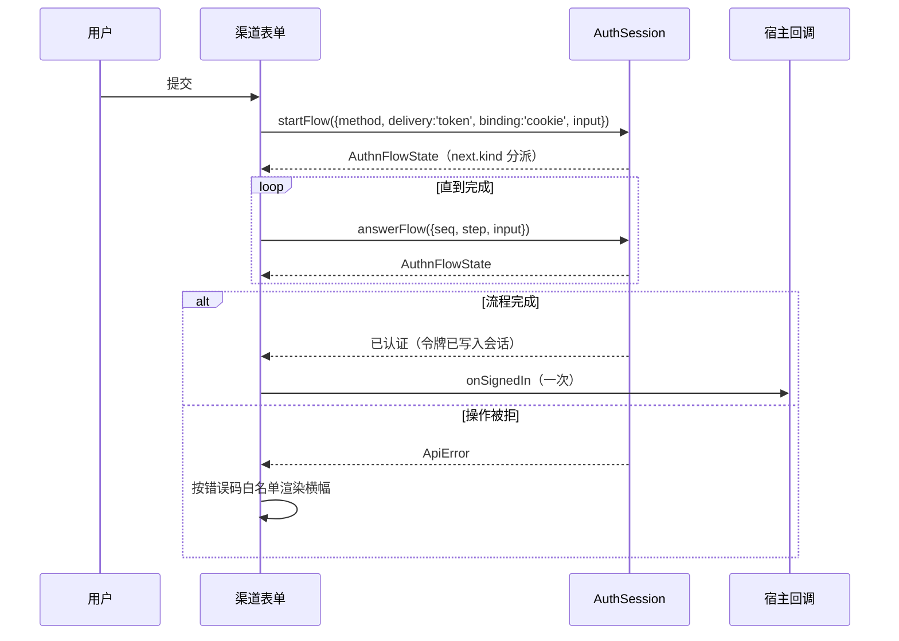

# auth-ui

## 职责

`@speed/auth-ui` 是一个 speed 前端的登录组件族：把 `@speed/auth-core` 会话契约的每一片渲染成受控组件，由宿主装配成登录面。它交付一组表单与屏幕，不交付会话状态机。

族内各组件驱动会话契约的自己那一部分，登录一律按 `@speed/auth-core` 的流程操作分步推进：

- `PasswordSignInForm` 起一条 `method: 'password'` 的登录流程，按字段提交与后续步答复。
- `SMSSignInForm` 起一条 `method: 'sms'` 的登录流程，两步（手机号步与验证码步）收在同一个表单里。
- `SocialSignInSection` 起一条某个社交方法的登录流程；开始响应的 `redirect` 步交出授权地址，由宿主导航。
- `SocialCallbackHandler` 在宿主的回调路由上读回那条流程（`session.readFlow`），据其状态续接。
- `SignInScreen` 把宿主声明的渠道收在一个标签页条之后，并在给出社交配置时把社交区渲染在表单之下。
- `SignOutButton` 驱动 `session.logout()`。
- `SessionEndedScreen` 是宿主挂在一处已认证视图刚翻成匿名时的占位屏。

每个组件持有一个 `session` 属性，会话由宿主传入；组件不消费 auth-core 的钩子。内建文案一律取自 `auth-ui` 命名空间。

### 非职责

- **不拥有会话状态机。** 流程的推进、会话的建立与撤销归 `@speed/auth-core`（[authn 登录](../authn/design-authn-login.md)）；本包渲染的会话契约的每一项都是 auth-core 交付的操作。要在本包见不到的操作里做点别的，那是 auth-core 契约该长的地方，不是本包里的第二次 HTTP。
- **不决定登录之后。** 登录成功之后导航到哪、是否刷新缓存、是否重新取权限，是宿主的；本包只触发一次回调。
- **不内建注册面。** 账户没有独立的注册端点：账户在登录流程的账户解析阶段按注册设置创建，或经邀请受理、管理员建户产生（[authn-account](../authn/design-authn-account.md)、[authn-invite](../authn/design-authn-invite.md)）。一次「注册」因此是一次登录流程在当前部署下开户的结果，不是本包的一个独立表单。
- **不消费 auth-core 的钩子，不读存储。** 组件读到的会话状态只有它驱动的那个操作，其余状态经宿主的钩子观察。一个自己订阅会话的组件必须已挂在宿主的 `attachSession` 之下，故这一层留在宿主。
- **不认识路由与权限。** 本包不匹配 URL、不判定权限、不做路由守卫；回调返给宿主，宿主经自己的路由与权限组合处置。
- **不是运维面。** 平台员工的管理面与登录面无交集，那些面归 [console-ui](design-web-console-ui.md)。
- **不绑定一种文案。** 内建文案取自命名空间；宿主改文案靠重新注册整个命名空间，不靠在组件里改字。

## 外部接口契约

`@speed/auth-ui` 的公开面是 `web/packages/auth-ui/src/index.ts` 的导出：`SignInScreen`（连同 `SignInChannel`、`SocialSignInOptions`）、各渠道的表单（`PasswordSignInForm`、`SMSSignInForm`）、社交对（`SocialSignInSection` 连同 `SocialProvider`、`SocialProviderConfig`，以及 `SocialCallbackHandler`）、`SignOutButton`、`SessionEndedScreen`，以及命名空间对（`AUTH_UI_NAMESPACE`、`authUiResources`）。`web/packages/auth-ui/src/internal/` 下的助手（含把一步 `AuthnStep` 渲染成分支字段的步进渲染器）是族内共享管线，不外导。

### 受控组件的形状

每个组件从它驱动的会话操作取一个 `session` 属性，从该操作的结果取一个回调，不读别的会话状态：

```tsx
// SignInScreen：把宿主声明的渠道收在标签页条之后。
interface SignInScreenProps {
  readonly session: AuthSession
  readonly channels?: readonly ('password' | 'sms')[] // 缺省两条都开
  readonly social?: SocialSignInOptions
  readonly defaultChannel?: 'password' | 'sms'
  readonly onSignedIn?: () => void
}

// 每条渠道的表单起一条对应方法的登录流程，按步答复。
interface PasswordSignInFormProps {
  readonly session: AuthSession
  readonly onSignedIn?: () => void
}
```

`SocialSignInSection` 的回调是 `onAuthorizeUrl?`，把某个渠道开始流程后得到的授权地址报给宿主，由宿主决定它是一次跳转、一个弹窗还是一个新标签。`SocialCallbackHandler` 在回调路由上读回流程，登录落地（会话已由服务端建于回跳应答）后触发一次 `onSignedIn`。

### 会话契约的每一片都由一个组件驱动

| 组件 | 驱动的会话操作 |
|---|---|
| `PasswordSignInForm` | `session.startFlow`（`method: 'password'`）、`session.answerFlow` |
| `SMSSignInForm` | `session.startFlow`（`method: 'sms'`）、`session.answerFlow` |
| `SocialSignInSection` | `session.startFlow`（社交方法） |
| `SocialCallbackHandler` | `session.readFlow`（回跳续接） |
| `SignOutButton` | `session.logout` |
| `SessionEndedScreen` | 无 |

每个渠道的表单只驱动它那一个方法：`startFlow` 起流程，后续每一步（第二因素、改口令、登记因素）由步进渲染器按 `next.kind` 渲染并交 `session.answerFlow`，直到流程落到完成。一次登录的落地由 auth-core 在同一会话上提交，视图不自己持有登录态。

### 稳定性承诺

- **公开面是 `index.ts` 的导出集。** lockstep 版本下，增删一个导出或改动一个消费者可见签名是破坏性变更。
- **每个驱动会话的组件持一个 `session` 属性，且不消费 auth-core 的钩子。** 这条是宿主据以装配的契约：组件挂在宿主的 `attachSession` 之下，状态变化只经属性与回调进出。
- **宿主回调在操作判决之后触发，且被包住。** 一个抛出的回调不是那次操作的失败：本包不因此渲染错误横幅、不把结果重新归成失败态、不为一次已成功的操作提供重试，且把抛出挡在 fire-and-forget 的 promise 之外，不产生未处理的拒绝。
- **文档化的用法是可执行的。** README 的快速开始由 `web/packages/auth-ui/src/usage-example.test.tsx` 端到端编译并运行，故文档里的装配不能与 API 漂移。

## 依赖

| 依赖 | 用途 |
|---|---|
| `@speed/auth-core` | 组件驱动的 `AuthSession` 类型、它的流程操作，以及流程响应模型（`AuthnFlowState`、`AuthnStep`、`AuthnField` 等）——后者是 auth-core 手写的响应模型并经它的入口再导出，本包从 auth-core 取用 |
| `@speed/ui-kit` | 表单骨架 `FormLayout`/`FormField`、对话框与空态 `EmptyState` |
| `@speed/i18n` | 命名空间注册与文案的翻译钩子 |
| `react`、`react-dom`、`@mui/material`、`@emotion/*`、`react-hook-form` | 同为 peer（必需）：宿主拥有 React 与 MUI 树，表单库由本包的表面拉入 |

`@speed/api-sdk` 是**开发依赖**：本包的公开类型不引用它，只有 README 的快速开始装配（由 `src/usage-example.test.tsx` 执行）在一个宿主绑定的客户端上用到它的运行时段与生成调用。同 `@speed/api-client`。

方向是 `@speed/auth-ui` 与 `@speed/ui-kit`、`@speed/layout-kit` 同层；同层之间互不 import。本包 import `@speed/auth-core` 但 auth-core 不 import 本包，装配由 [product-shell](design-web-product-shell.md) 这种上层壳承担。

## UML 图

一次渠道提交的路径。图里画不到的约束：宿主回调在判决之后触发；文案取自 `auth-ui` 命名空间而非内联；第二因素与改口令等后续步由同一条流程的答复推进，不另起流程。



## 核心数据结构

| 概念 | 形状 | 说明 |
|---|---|---|
| 登录渠道 | `SignInChannel` | `password`／`sms` 的闭集，`SignInScreen` 的标签页顺序 |
| 社交渠道 | `SocialProvider` | 登录与绑定共用的渠道闭集，见 [account-ui](design-web-account-ui.md) 的同名类型 |
| 社交渠道配置 | `SocialProviderConfig` | 一个渠道加它的回调地址 |
| 一步 | `AuthnStep` | auth-core 手写的流程步模型，步进渲染器按 `kind` 分派 |
| 命名空间 | `authUiResources` | `zh-CN` 与 `en-US` 两份目录，叶子键集相同 |

## 核心算法与流程

### 一次提交

1. 表单校验本地字段，调 `session.startFlow` 起一条对应方法的登录流程。
2. 按应答的 `next.kind` 分派：`challenge` 渲染要提交的字段、`redirect` 把地址交给宿主、`factor` 渲染第二因素清单、`enroll` 渲染登记种类、`complete` 以 `step: 'complete'` 取走结果。
3. 每一步的答复经 `session.answerFlow` 发出（本包不直接触网）；流程落定后分叉：完成触发一次回调；被拒按错误码渲染一条 `role="alert"` 横幅、状态原地不变、可重试。
4. 切换渠道时旧表单一并卸载，它的半填状态与整次失败的横幅随之消失——渠道的错误不跨面泄漏。

### 短信码的两步

`SMSSignInForm` 先以手机号起一条 `method: 'sms'` 的流程，把两步收在同一个表单里：`challenge` 步发出通知用 `role="status"` 报出接收号码；重发以同一号码再起一条流程（发码是方法 `Begin` 的职责，同一条流程内没有重发这一步）；改号退回第一步。一次新的发送（首发送、重发或改号）把验证码字段清空，使对着上一码输入的旧值不能搭上新一码。

### 社交登录与回调

`SocialSignInSection` 对某个渠道调 `session.startFlow`；开始应答的 `redirect` 步给出授权地址，经 `onAuthorizeUrl` 交给宿主，宿主把提供方的重定向引到该渠道的回调路由，在那里渲染 `SocialCallbackHandler`。**提供方自己的 `redirect_uri` 由服务端按部署的公开地址拼出，客户端不传**；`SocialProviderConfig` 的回调地址是宿主自己的回调路由，作为流程的 `return_to` 发出，使提供方的一次往返最终落回它。回跳以 303 落回 `return_to` 时流程停在就绪步（令牌不能放进回跳 URL）；处理器在挂载时调 `session.readFlow` 读回流程，若应答为 `next.kind = complete` 则以 `step: 'complete'` 取走令牌、登录落地，触发一次 `onSignedIn`；若流程仍停在一步（如需第二因素或登记因素）则渲染该步续接。

## 错误与失败语义

**失败面是一个错误码白名单。** 每条提交路径把它那一次失败解析成一个错误码，渲染该码在当前语言下的文本；不在白名单内的码一律渲染 `errors.unknown`，故目录里永不出现裸键。

| 情形 | 表现 |
|---|---|
| 流程操作被拒（口令不符、验证码错、口令策略等） | 一条 `role="alert"` 横幅渲染应答的错误码文本，状态原地不变，可重试 |
| 流程已失（`flow-invalid`：过期、被并发消费、绑定不符） | 一条横幅渲染该码文本，视图退回渠道第一步重新开始 |
| 短信码步骤的验证码已用 | 用过的码渲染 `smsSignIn.codeUsed`，清空字段，对同一码的再提交在本地被拒 |
| 社交开始被拒（方法关闭、账户不可用） | 一条横幅渲染应答的错误码文本 |
| 回跳路由上读不到流程 | 一条横幅加一个重试按钮，重跑一次 `session.readFlow` |

**本包不降级、不重试。** 一次失败的提交就是那次交互的结果，是否重来归用户与宿主。

## 并发与事务边界

- 组件无自有共享状态，可被 React 正常渲染；同一会话上的并发流程操作以应答落定次序裁定，后到者的完成覆盖前者的会话。
- 本包不打开事务、不持有客户端缓存；一次提交是一个会话操作的往返。

## 实现状态

| 能力 | 状态 | 代码 |
|---|---|---|
| 登录屏与渠道表单 | 已实现 | `web/packages/auth-ui/src/PasswordSignInForm.tsx`；`web/packages/auth-ui/src/SMSSignInForm.tsx`；`web/packages/auth-ui/src/SignInScreen.tsx` |
| 步进渲染器 | 已实现 | `web/packages/auth-ui/src/internal/flow-step.tsx`；`web/packages/auth-ui/src/internal/use-flow-driver.ts`；`web/packages/auth-ui/src/internal/flow.ts` |
| 社交区与回调 | 已实现 | `web/packages/auth-ui/src/SocialSignInSection.tsx`；`web/packages/auth-ui/src/SocialCallbackHandler.tsx` |
| 会话面 | 已实现 | `web/packages/auth-ui/src/SignOutButton.tsx`；`web/packages/auth-ui/src/SessionEndedScreen.tsx` |
| 命名空间资源 | 已实现 | `web/packages/auth-ui/src/resources.ts` |
