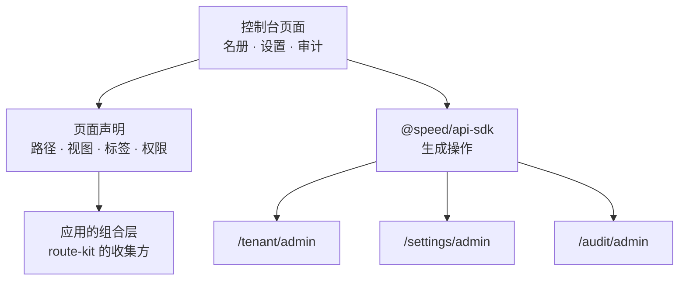

# console-ui

## 职责

`@speed/console-ui` 是平台员工的控制台面组件族：把后端的管理面渲染成一组由平台员工操作的页面。它对应后端的下列管理面：

- **租户管理**：名册的读写，经 `/tenant/admin`（[tenant.admin](../tenant/design-tenant-admin.md)、[ADR-console-tenant-2026-10-15](../../../adr/adr-console-tenant-2026-10-15.md)）。
- **设置读写**：运行期设置的读写，经 `/settings/admin`，判定按层分（[settings.admin](../settings/design-settings-admin.md)、[ADR-console-settings-2026-10-15](../../../adr/adr-console-settings-2026-10-15.md)）。
- **审计查询**：审计记录的检索，经 `/audit/admin`（[audit.admin](../audit/design-audit-admin.md)、[ADR-audit-admin-2026-10-15](../../../adr/adr-audit-admin-2026-10-15.md)）。

**它是平台侧的壳（第二种壳）。** 上述管理面挂在**不解析租户**的端上：名册是平台资产、审计表持有全部租户的行、设置的全局层是平台操作。故本包没有租户切换器，也就没有租户作用域的查询键——它不认识「当前租户」这个概念。

**它复用声明式注册面。** 每个页面导出的一份声明即 [route-kit](design-web-route-kit.md) 的 `RouteDeclaration`：路径 pattern、视图回调、可选导航标签、可选权限码（[ADR-web-route-seam-2026-10-15](../../../adr/adr-web-route-seam-2026-10-15.md)）。`permission` 是数据，本包不据它判定；`label` 缺席即该页不进导航。声明由应用的组合层收齐后交给路由层渲染；本包不 import `route-kit`，也不自己做路径匹配或导航。壳另交出一个 `onNavigate` 回调接缝：宿主给了它，帧内点一条导航项即把该项的路径交回调（由宿主的路由器就地跳转，不整页重载），不给则该项是整页链接。租户侧的 [product-shell](design-web-product-shell.md) 用同一份声明形状，两者只是壳不同。

### 非职责

- **不管理「当前租户」。** 切换当前租户是租户侧的动作，归 [tenancy-ui](design-web-tenancy-ui.md)；管理名册（开租户、改名、停用）是运维侧的动作，归本包。切换改的是宿主的路由，管理改的是名册，两者不共用控件、不共用查询键。
- **不做导航、不解析 URL。** 页面的路径匹配、链接构造、深链接解析与未命中回退归 `route-kit` 的收集方；本包只提供页面与它们的声明，不做路径匹配。
- **不做判定。** 名册、设置与审计的授权判定都在服务端的平台域（设置的租户层在那个租户的域）做出，本包只渲染应答；路由级的授权是宿主的组合（经 [layout-kit](design-web-layout-kit.md) 的路由守卫与 [auth-core](design-web-auth-core.md) 的权限读数），不在本包内。
- **不遮蔽敏感值。** 敏感设置项的值由 [settings.admin](../settings/design-settings-admin.md) 在应答里遮蔽；本包照渲染应答，不做第二处遮蔽。
- **不持规则、不持数据。** 每条路的动作是一次生成的调用；名册的写入语义、设置的取值范围、审计的列都在各自的模块里定义。
- **不拥有查询客户端。** 与 [account-ui](design-web-account-ui.md) 同档：读经 `@speed/api-sdk` 的生成 react-query 钩子跑在宿主拥有的 QueryClient 上，写经同一 `bindRequestFn` 绑定的生成 mutation；本包从不自造 QueryClient，也不手写查询键。

## 外部接口契约

本包的公开面由 `web/packages/console-ui/src/index.ts` 导出：三个管理面各自的页面声明集与页面组件、控制台壳、以及页面读写的操作束。页面声明的形状与壳的入参如下。

```tsx
// 一份页面声明：形状即 route-kit 的 `RouteDeclaration`——路径 pattern、视图回调、
// 可选导航标签、可选权限码。本包不 import `route-kit`，导出满足该结构的值。
interface ConsoleRoute {
  readonly path: string
  readonly view: (context: ConsoleRouteContext) => ReactNode
  readonly label?: ReactNode
  readonly permission?: string
}

// 控制台壳：由带标签的声明派生平台导航，渲染宿主的路由内容。
interface ConsoleShellProps {
  readonly routes: readonly ConsoleRoute[]
  readonly children: ReactNode
  readonly title?: ReactNode
  readonly headerActions?: ReactNode
  // 帧内导航的点击回调：给了它即把被激活条目的路径交回调（宿主的路由器
  // 就地跳转）；不给即该项是整页链接。
  readonly onNavigate?: (href: string) => void
  readonly sx?: SxProps<Theme>
}
```

页面按后端能力切：名册页、设置页与审计页各是一组声明。每个页面的读写经 `@speed/api-sdk` 的生成操作；权限经服务端判定；路由级守卫由宿主组合。

**稳定性承诺。** 公开面是 `src/index.ts` 的导出集；本包不认识租户、不提供租户切换器、不用租户作用域的查询键；每条路的请求经绑定的客户端。改动这些是消费者可见的破坏性变更。

## 依赖

| 依赖 | 用途 |
|---|---|
| `@speed/api-sdk` | 名册、设置与审计管理面端点的生成读钩子与写 mutation |
| `@speed/ui-kit` | 主题、表单、对话框与空态原语 |
| `@speed/i18n` | 命名空间注册与文案的翻译钩子 |
| `@tanstack/react-query` | peer（必需）：宿主供给的 QueryClient |
| `react`、`react-dom`、`@mui/material`、`@emotion/*` | peer（必需）：宿主拥有的 React／MUI 树 |

**本包不 import `route-kit` 与 `tenancy-ui`。** 页面声明即 route-kit 的 `RouteDeclaration`，收集方在应用的组合层；本包没有租户切换器，故租户侧的控件不在这里出现。壳交出的 `onNavigate` 是一个回调，由宿主接上它自己的路由器，本包与 `route-kit` 之间仍无 import 边。

## UML 图

页面经生成操作打向三个管理面端；页面声明由应用的组合层收齐。图里画不到的约束：本包所在的管理面挂在**不解析租户**的端上，故壳里没有租户切换器、没有租户作用域的查询键；判定在服务端做出，本包只渲染应答；声明形状即 route-kit 的 `RouteDeclaration`，但本包不 import `route-kit`。



## 核心数据结构

| 概念 | 形状 | 说明 |
|---|---|---|
| 页面声明 | `ConsoleRoute` | 即 route-kit 的 `RouteDeclaration`：路径 pattern、视图回调、可选导航标签、可选权限码 |
| 命名空间 | `consoleUiResources` | 双语文案目录，叶子键集跨语言相同 |

## 核心算法与流程

### 一次管理请求

1. 页面从生成钩子或 mutation 发出请求，经宿主绑定的客户端。
2. 服务端在平台域（设置的租户层在那个租户的域）判定调用方的权限；无身份 401，权限不足 403。
3. 应答落地：读渲染列表或详情的视图，写渲染结果并失效相关查询；被拒渲染错误码文本。
4. 写路由的强制档审计落在服务端动作之前；本包不写审计行。

### 与租户侧的分工

租户这个概念在两处是两类动作：**切换当前租户**（改变宿主路由解析出的租户）在租户侧，归 [tenancy-ui](design-web-tenancy-ui.md)；**管理租户名册**（开租户、改名、停用）在运维侧，归本包。切换改的是宿主的路由，管理改的是名册，两者不共用控件、不共用查询键。

## 错误与失败语义

本包的失败面如下。

| 情形 | 表现 |
|---|---|
| 无身份 | 401，由服务端写出，宿主转入登录面 |
| 权限不足 | 403，由服务端写出；路由级守卫由宿主组合 |
| 请求形状不可读 | 服务端写出 400，页面渲染错误码文本 |
| 名册的登记冲突 | 409（`urn:speed:tenant:conflict`），页面渲染冲突文本 |
| 敏感设置项 | 值由服务端遮蔽，页面渲染遮蔽串 |
| 白名单外的码 | 渲染通用失败文本，不渲染裸键 |

## 实现状态

| 能力 | 状态 | 代码 |
|---|---|---|
| 控制台壳与声明面接入 | 已实现 | `web/packages/console-ui/src/ConsoleShell.tsx` `ConsoleShell`、`ConsoleShellProps`；`web/packages/console-ui/src/route.ts` `ConsoleRoute`、`ConsoleRouteTable` |
| 租户管理页 | 已实现 | `web/packages/console-ui/src/TenantRosterPage.tsx` `TenantRosterPage`；`web/packages/console-ui/src/routes.tsx` `tenantAdminRoutes` |
| 设置读写页 | 已实现 | `web/packages/console-ui/src/SettingsPage.tsx` `SettingsPage`；`web/packages/console-ui/src/routes.tsx` `settingsAdminRoutes` |
| 审计查询页 | 已实现 | `web/packages/console-ui/src/AuditPage.tsx` `AuditPage`；`web/packages/console-ui/src/routes.tsx` `auditAdminRoutes` |
