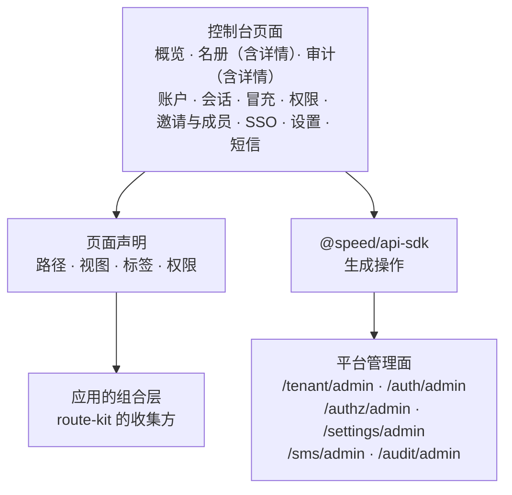

# console-ui

## 职责

`@speed/console-ui` 是平台员工的控制台面组件族：把后端的管理面渲染成一组由平台员工操作的页面。它对应后端的下列管理面：

- **租户管理**：名册的读写，经 `/tenant/admin`（[tenant.admin](../tenant/design-tenant-admin.md)、[ADR-console-tenant-2026-10-15](../../../adr/adr-console-tenant-2026-10-15.md)）。
- **账户管理**：账户的列出、详情与写入，经 `/auth/admin/accounts`。
- **会话管理**：按账户列出会话并撤销，经 `/auth/admin/accounts/:id/sessions` 与 `/auth/admin/sessions/:id`。
- **冒充管理**：冒充记录的列出与终止，经 `/auth/admin/impersonations`；运营者自身会话上的冒充状态读取与发起与结束，经 `/auth/impersonation`。
- **权限管理**：角色、授权、权限目录与账户绑定，经 `/authz/admin`。
- **邀请与成员**：按租户的邀请与成员，经 `/auth/admin/tenants/:tenant/invitations` 与 `/auth/admin/tenants/:tenant/members`。
- **SSO 提供方**：按租户的提供方与域名，经 `/auth/admin/sso/providers` 与 `/auth/admin/tenants/:tenant/sso/providers`。
- **设置读写**：运行期设置的读写，经 `/settings/admin`（[settings.admin](../settings/design-settings-admin.md)、[ADR-console-settings-2026-10-15](../../../adr/adr-console-settings-2026-10-15.md)）。
- **短信模板**：运行期短信模板的读写，经 `/sms/admin`。
- **审计查询**：审计记录的检索，经 `/audit/admin`（[audit.admin](../audit/design-audit-admin.md)、[ADR-audit-admin-2026-10-15](../../../adr/adr-audit-admin-2026-10-15.md)）。

**控制台根（`/`）渲染仪表盘**，其指标与最近活动由名册读与审计读拼出；各管理面的列表页可链入其详情页。

**每个页面以 ui-kit 的 `PageHeader` 开篇**：页标题即该页的一级标题，一条从控制台到该页的面包屑，以及一个重读该页数据的刷新动作（页头操作）。标题层级因此不跳级——`AsyncSection` 的占位与各节的次级标题都渲染在它之下。

**它是平台侧的壳（第二种壳）。** 上述管理面挂在**不解析租户**的端上：名册是平台资产、审计表持有全部租户的行、设置的全局层是平台操作。故本包没有**当前租户**切换器，也就没有租户作用域的查询键——它不认识「当前租户」这个概念。

**外壳骨架是 [layout-kit](design-web-layout-kit.md) 的 `AppShell`。** 控制台壳把带标签的声明派生出的平台导航交给 `AppShell` 渲染：固定顶栏、随视口变化的导航抽屉（`md` 及以上常驻、以下为临时覆盖式）与内容区都由它提供（[layout](design-web-layout.md)），本包不另造一套帧。导航地标以本包的 `shell.navLabel` 命名（经 `AppShell` 的 `navLabel`），与其它外壳的导航地标可区分。两处外壳因此同一形状——侧栏不随内容滚走、窄视口是汉堡抽屉而非把导航堆在内容上方、桌面侧栏由宿主显式选择收起、内容区是唯一滚动层。

**按租户寻址的页面持租户选择器。** 权限面、邀请与成员面、SSO 提供方面把租户当作**路由段参数**（`/authz/admin/tenants/:tenant/...`）；冒充面把租户当作读的**必填查询参数**（`/auth/admin/impersonations?tenant=`）。这些页面仍是平台员工的页面，但每条请求指名它作用到的租户；租户是请求的一个实参，不是会话的当前租户。页面因此持一个租户选择器（数据来自平台名册读 `GET /tenant/admin/tenants`），在其取值为空前禁用该页的租户作用域读。

**它复用声明式注册面。** 每个页面导出的一份声明即 [route-kit](design-web-route-kit.md) 的 `RouteDeclaration`：路径 pattern、视图回调、可选导航标签、可选权限码（[ADR-web-route-seam-2026-10-15](../../../adr/adr-web-route-seam-2026-10-15.md)）。`permission` 是数据，本包不据它判定；`label` 缺席即该页不进导航。声明由应用的组合层收齐后交给路由层渲染；本包不 import `route-kit`，也不自己做路径匹配或导航。壳另交出一个 `onNavigate` 回调接缝：宿主给了它，帧内点一条导航项即把该项的路径交回调（由宿主的路由器就地跳转，不整页重载），不给则该项是整页链接。租户侧的 [product-shell](design-web-product-shell.md) 用同一份声明形状，两者只是壳不同。

### 非职责

- **不管理「当前租户」。** 切换当前租户是租户侧的动作，归 [tenancy-ui](design-web-tenancy-ui.md)；管理名册（开租户、改名、停用）是运维侧的动作，归本包。切换改的是宿主的路由，管理改的是名册，两者不共用控件、不共用查询键。按租户寻址的页面的租户选择器选的是**请求的实参**，不是当前租户，它与切换控件不共用状态。
- **不做导航、不解析 URL。** 页面的路径匹配、链接构造、深链接解析与未命中回退归 `route-kit` 的收集方；本包只提供页面与它们的声明，不做路径匹配。
- **不做判定。** 名册、账户、会话、冒充、权限、邀请与成员、SSO、设置与审计的授权判定都在服务端的平台域（设置的租户层在那个租户的域）做出，本包只渲染应答；路由级的授权是宿主的组合（经 [layout-kit](design-web-layout-kit.md) 的路由守卫与 [auth-core](design-web-auth-core.md) 的权限读数），不在本包内。
- **不遮蔽敏感值。** 敏感设置项的值由 [settings.admin](../settings/design-settings-admin.md) 在应答里遮蔽；本包照渲染应答，不做第二处遮蔽。
- **不持规则、不持数据。** 每条路的动作是一次生成的调用；名册的写入语义、账户的状态机、权限的取值、审计的列都在各自的模块里定义。
- **不拥有查询客户端。** 读经 `@speed/api-sdk` 的生成 react-query 钩子跑在宿主拥有的 QueryClient 上，写经同一 `bindRequestFn` 绑定的生成 mutation；本包从不自造 QueryClient。查询键由生成钩子自带（`get<operation>QueryKey`），本包不自写键；按租户寻址的读的键由生成工厂按租户分段，故切租户即换键。

## 外部接口契约

本包的公开面由 `web/packages/console-ui/src/index.ts` 导出：各管理面的页面声明集与页面组件、控制台壳、以及页面读写的操作束。页面声明的形状与壳的入参如下。

```tsx
// 一份页面声明：形状即 route-kit 的 `RouteDeclaration`——路径 pattern、视图回调、
// 可选导航标签、可选权限码。本包不 import `route-kit`，导出满足该结构的值。
interface ConsoleRoute {
  readonly path: string
  readonly view: (context: ConsoleRouteContext) => ReactNode
  readonly label?: ReactNode
  readonly permission?: string
}

// 控制台壳：由带标签的声明派生平台导航，渲染宿主的路由内容。
interface ConsoleShellProps {
  readonly routes: readonly ConsoleRoute[]
  readonly children: ReactNode
  readonly title?: ReactNode
  readonly headerActions?: ReactNode
  // 帧内导航的点击回调：给了它即把被激活条目的路径交回调（宿主的路由器
  // 就地跳转）；不给即该项是整页链接。
  readonly onNavigate?: (href: string) => void
  // 接受链接的构造器：给一条已签发邀请的令牌，返回接受链接（宿主相对的
  // 路径或绝对 URL）。邀请与成员页在签发成功后据此展示链接；不给则展示
  // 裸令牌。落点是宿主的公开路由，只有宿主知道，故路径由宿主给出。
  readonly invitationLink?: (token: string) => string
  // 桌面侧边栏收起：AppShell 的受控 prop 对，原样透传给帧。给出后者即在帧的
  // 顶栏渲染收起／展开按钮并回报每次翻转；不给即维持一直展开的常驻抽屉。
  readonly sidebarCollapsed?: boolean
  readonly onSidebarCollapsedChange?: (collapsed: boolean) => void
  readonly sx?: SxProps<Theme>
}
```

- **框架 prop 原样透传。** `sidebarCollapsed` / `onSidebarCollapsedChange` 是 `AppShell` 的桌面侧边栏收起对，被拾起后逐字转给 `AppShell`，本包不重解释。给出后者即在帧的顶栏渲染收起／展开按钮并回报每次翻转，不给即维持一直展开的常驻抽屉；收起态是宿主持有的普通值。租户侧的 [product-shell](design-web-product-shell.md) 用同一对 prop，两处外壳在这条上也同形。

### 页面声明

一个管理面导出一份页面声明表，全部汇总为 `consoleRoutes`（导航顺序即下表顺序）。路径是相对控制台根的 pattern，导航标签是一个在渲染时经 console-ui 命名空间解析的 `ConsoleNavLabel`，权限码是该页数据所持的平台权限（数据；本包不据它判定）。**一个管理面可含多于一条声明**：列表页携带标签（进导航），详情页不带标签（可达但不列出），由列表行链入；下表列出带标签的各页，与导航一一对应。

| 声明 | 路径 | 导航标签键 | 权限码 |
|---|---|---|---|
| `dashboardAdminRoutes` | `/` | `dashboard.title` | `tenant.read` |
| `tenantAdminRoutes` | `/tenants` | `tenants.title` | `tenant.read` |
| `accountsAdminRoutes` | `/accounts` | `accounts.title` | `authn.account.read` |
| `sessionsAdminRoutes` | `/sessions` | `sessions.title` | `authn.session.read` |
| `impersonationsAdminRoutes` | `/impersonations` | `impersonations.title` | `authn.impersonation.read` |
| `permissionsAdminRoutes` | `/permissions` | `permissions.title` | `authz.role.read` |
| `invitationsAdminRoutes` | `/invitations` | `invitations.title` | `authn.membership.manage` |
| `ssoAdminRoutes` | `/sso` | `sso.title` | `authn.idp.manage` |
| `settingsAdminRoutes` | `/settings` | `settings.title` | `settings.read` |
| `smsAdminRoutes` | `/sms` | `sms.title` | `sms.template.read` |
| `auditAdminRoutes` | `/audit` | `audit.title` | `audit.read` |

### 页型的骨架

控制台页按 [layout](design-web-layout.md) 的页型组装：

- **仪表盘**（`DashboardPage`）：控制台根的路由（`/`）。一行等宽的租户指标卡、一行平台健康度指标卡，其下是最近活动列表。租户指标由名册读拼出——名册读返回完整的租户集，租户总数即其长度、启用与停用的计数即其状态分布。平台健康度由审计查询读拼出，它是唯一跨租户的读：`since` 取当前时刻往前 24 小时，一读数出窗口内的全部记录，另一读以 `action=authn.login` 只数其中的成功登录。两个计数取自窗口化读的最新一页，故应答带下一页游标时该计数按**下界**渲染（数值后带 `+`）。最近活动取审计查询读的最新一页（`useAuditRecords` 带 `limit`）。平台不声明统计端点，也不声明失败登录的读，故页面不发明契约不携带的聚合值，也不把审计表不持有的失败登录计入。
- **列表页**（`TenantRosterPage`、`AccountsPage`、`SessionsPage`、`ImpersonationsPage`、`PermissionsPage`、`InvitationsPage`、`SsoPage`、`SmsPage`、`AuditPage`）：页头、工具栏或写入区、数据表、分页。
- **详情页**（`TenantDetailPage`、`AuditDetailPage`）：标题区加主栏与固定宽侧栏。主栏承载主体与其写入，侧栏承载标识与回链。路径是列表页路径加一段 `:id`（`/tenants/:id`、`/audit/:id`），声明不带标签，故不进导航。列表页接收声明传入的该列表页匹配路径（`basePath`），据此为每行构造详情链接 `${basePath}/${id}`；详情页接收 `parentHref`（匹配路径去掉 id 段），据此回链列表页。
- **设置页**（`SettingsPage`）：一条二级导航（按 namespace 分组，取出自全量设置读）、一张占满内容区的分页表（键／类型／当前值／操作）、底部一条粘性保存条。

**冒充页承载两个面。** 记录面是一个按租户寻址的列表页：它列出租户的冒充记录并终止一条。运营者自身会话面读调用方自己会话上的冒充（`GET /auth/impersonation`，无冒充时是裸 404）、以 `POST /auth/impersonation` 发起一条、以 `DELETE /auth/impersonation` 结束它。自身会话面作用到调用方自己的会话，不按租户寻址，故它不随租户选择器启用，其读取的键也不分租户；发起控件只在当前会话没有在force的冒充时呈现——模块对同一会话上的第二次发起答 409。这三个操作是生成的调用方会话操作（`useAuthnImpersonationStatus`、`useAuthnImpersonationStart`、`useAuthnImpersonationEnd`），页面直接调用它们并经生成键工厂（`getAuthnImpersonationStatusQueryKey`）失效状态读，与记录面的操作束不是同一组。

**页内导航复用壳的接缝。** 控制台壳把它的 `onNavigate` 经内部上下文交给它渲染的页内容；页内的详情链接经该回调就地路由（不做整页重载，否则内存态会话会丢），壳未给回调时是普通链接。这条接缝与壳自身的导航项同一来源，故二者重载与否的行为一致。

### 写入的请求参数由平台的 OpenAPI 片段声明

本包的写请求经生成的客户端发出，请求体来自平台 OpenAPI 片段里该端点的 `requestBody`。片段为每个变更端点声明了请求体，故生成的客户端为每次写发送请求体，本包为每个写渲染控件。请求体的字段与后端处理器 `mount.Decode` 解码的目标结构一致，且片段里声明的 `requestBody` 与处理器是否解码请求体一致（`pkg/authn/admin/requestbody_test.go` 把这条当成契约守住：处理器解码请求体而片段未声明 `requestBody`，即该写从生成客户端不可达，测试即失败）。

**稳定性承诺。** 公开面是 `src/index.ts` 的导出集；本包不提供当前租户，不 import `route-kit` 与 `tenancy-ui`；每条路的请求经绑定的客户端，写经生成的 mutation。改动这些是消费者可见的破坏性变更。

## 依赖

| 依赖 | 用途 |
|---|---|
| `@speed/api-sdk` | 各管理面端点的生成读钩子与写 mutation |
| `@speed/auth-core` | 会话：抬高会话的步进（step-up）流程由它驱动——宿主把会话交给 `ConsoleShell`，页面在特权写被答 401 步进时打开重认证对话框、重放该写。仅此一处：本包不读当前租户 |
| `@speed/ui-kit` | 主题、表单、对话框、数据表与空态原语 |
| `@speed/layout-kit` | 外壳骨架：`AppShell` 的固定顶栏、响应式导航抽屉与内容区 |
| `@speed/i18n` | 命名空间注册与文案的翻译钩子 |
| `@tanstack/react-query` | peer（必需）：宿主供给的 QueryClient |
| `react`、`react-dom`、`@mui/material`、`@emotion/*` | peer（必需）：宿主拥有的 React／MUI 树 |

**本包不 import `route-kit` 与 `tenancy-ui`。** 页面声明即 route-kit 的 `RouteDeclaration`，收集方在应用的组合层；本包没有当前租户切换器，故租户侧的切换控件不在这里出现。按租户寻址的页面持的租户选择器由本包自造，取自平台名册读，与 tenancy-ui 的切换控件无关。壳交出的 `onNavigate` 是一个回调，由宿主接上它自己的路由器，本包与 `route-kit` 之间仍无 import 边。

## UML 图

页面经生成操作打向管理面端；页面声明由应用的组合层收齐。图里画不到的约束：本包所在的平台管理面挂在**不解析租户**的端上，故壳里没有当前租户切换器；按租户寻址的页面的租户是请求实参；判定在服务端做出，本包只渲染应答；声明形状即 route-kit 的 `RouteDeclaration`，但本包不 import `route-kit`。



## 核心数据结构

| 概念 | 形状 | 说明 |
|---|---|---|
| 页面声明 | `ConsoleRoute` | 即 route-kit 的 `RouteDeclaration`：路径 pattern、视图回调、可选导航标签、可选权限码 |
| 租户作用域选择 | 页面自身状态 | 按租户寻址的页面持有的租户 id，作为请求实参，缺省为空即禁用该页的租户作用域读 |
| 命名空间 | `consoleUiResources` | 双语文案目录，叶子键集跨语言相同 |

## 核心算法与流程

### 一次管理请求

1. 页面从生成钩子或 mutation 发出请求，经宿主绑定的客户端。
2. 服务端在平台域（设置的租户层在那个租户的域）判定调用方的权限；无身份 401，权限不足 403。
3. 应答落地：读渲染列表或详情的视图，写渲染结果并失效相关查询；被拒渲染错误码文本。
4. 写路由的强制档审计落在服务端动作之前；本包不写审计行。

### 邀请的交付

签发一张邀请的应答里带一枚只交出一次的接受令牌（投递归签发者，见 [authn-invite](../authn/design-authn-invite.md)）。邀请与成员页不丢弃它：签发成功后，以宿主经 `ConsoleShell` 的 `invitationLink` 交出的构造器把令牌变成接受链接并展示，供签发者经自己的渠道交给被邀请人；宿主未给构造器时展示裸令牌。链接指向的落点（形如 `/invitations/:token`）是宿主的公开路由，本包不知道它，故路径由宿主给出；构造器返回宿主相对的路径时，页面按当前 origin 解析成绝对链接供复制。

### 按租户寻址的请求

按租户寻址的读以租户选择器的取值为查询键的一段，故切租户即换键、旧租户的数据自行失效。取值为空时该读声明为禁用（不发出请求）；页面渲染一段说明，提示先选择租户。

### 读的失败面：权限拒绝与其它失败

每个读经 `ConsoleAsyncSection`（ui-kit 的 `AsyncSection` 在本包内的绑定）渲染。一个 403 是权限拒绝而非加载失败——面应答了，是拒绝——故渲染权限拒绝文案（console-ui 命名空间的 `forbidden.title` 与 `forbidden.description`），且不给重试动作；任何其它失败（5xx、传输错误）落回可重试的未应答占位，带重试。判定按应答本身做出（HTTP 状态 403，或无可读信封的裸 403 经 `client.http.403`），不按路由级权限读数——服务端写出 403，页面渲染应答。

### 审计查询的筛选与分页

审计页把工具栏的 `since`、`until` 与 `action` 集合作为读的查询参数，在提交时应用（一次键入不触发请求）。模块的读不声明按结果或操作者筛选的参数，故工具栏不提供这两项筛选，也不在客户端过滤服务端返回的一页。审计读按游标分页：应答带出下一页的游标，页脚据此前进与后退；游标式读不数总数，故页脚不显示总数。

操作者列把记录的账户标识解析成可读身份：它经 `GET /auth/admin/accounts/:id` 读账户的显示名。该读受 `authn.account.read` 把守，本页自身的 `audit.read` 不含它，因此只持 `audit.read` 的查看者的解析会被拒；该格此时渲染记录值并标注身份未解析，而不是把它当作已解析（或系统）的操作者。同名操作者的多行共用一次缓存读。

### 账户查询的筛选

账户页把工具栏的筛选作为读的查询参数，在提交时应用（一次键入不触发请求）：登录标识前缀与它的类型成对送出（模块的索引按两者寻址，前缀缺类型即被拒），状态与账户类型各自单独送出，未选的筛选不出现在请求里。列表读按游标分页（应答带出下一页游标），页面只渲染读到的一页。模块的读不声明按显示名检索的参数，故页面既不提供显示名搜索，也不在客户端过滤服务端返回的一页。

### 破坏性动作的确认

会移除或作废既有数据的写入在发出前经 ui-kit 的确认对话框确认：控件的点击只打开对话框，写入在确认点击时发出，未确认即不发出请求。对话框一律用 `ConfirmDialog` 的 `variant="danger"`；确认的**轻重**随动作是否可逆而分：一个连同其从属记录一并销毁、界面上无从恢复的删除（删除账户、删除角色）额外带 `doubleConfirm` 两步守卫，第一次点击只把按钮改题为「再次点击确认」，第二次才发出；其余的可恢复的移除与撤销（移除成员、移除短信模板、撤销会话、撤销账户全部会话、撤销服务密钥、移除登录标识、重置 MFA、撤销邀请、移除 SSO 域名、移除设置项、删除 SSO 提供方）用单次确认点击——可恢复的动作不该比不可逆的更重。不改变既有数据的写入直接发出，不经确认；这些是名册登记与改名、设置写值、授权的授予与撤销、绑定与解绑、模板登记与提交审核、开关与冒充终止。

### 与租户侧的分工

租户这个概念在两处是两类动作：**切换当前租户**（改变宿主路由解析出的租户）在租户侧，归 [tenancy-ui](design-web-tenancy-ui.md)；**管理租户名册**（开租户、改名、停用）在运维侧，归本包。按租户寻址的页面持的租户选择器既不是当前租户、也不是名册管理：它是平台请求的一个实参。三者不共用控件、不共用查询键。

## 错误与失败语义

本包的失败面如下。

| 情形 | 表现 |
|---|---|
| 无身份 | 401，由服务端写出，宿主转入登录面 |
| 权限不足 | 403，由服务端写出；页面渲染权限拒绝文案且不给重试（重试只会再被拒一次）；路由级守卫由宿主组合 |
| 其它读失败（5xx、网络） | 可重试的未应答占位，带重试动作 |
| 请求形状不可读 | 服务端写出 400，页面渲染错误码文本 |
| 名册的登记冲突 | 409（`urn:speed:tenant:conflict`），页面渲染冲突文本 |
| 敏感设置项 | 值由服务端遮蔽，页面渲染遮蔽串 |
| 短信管理面未挂载 | 读取失败，页面渲染可重试的错误占位，并说明该面只在配置了短信服务商的部署上挂载 |
| 审计操作者解析被拒（无 `authn.account.read`） | 该格渲染记录值并标注身份未解析，页面本身仍可读 |
| 自身会话无冒充（`GET /auth/impersonation` 的裸 404） | 渲染「当前未冒充任何账户」的说明，按未冒充处理，不落入失败占位 |
| 白名单外的码 | 渲染通用失败文本，不渲染裸键 |

## 实现状态

| 能力 | 状态 | 代码 |
|---|---|---|
| 控制台壳与声明面接入 | 已实现 | `web/packages/console-ui/src/ConsoleShell.tsx` `ConsoleShell`、`ConsoleShellProps`；`web/packages/console-ui/src/route.ts` `ConsoleRoute`、`ConsoleRouteTable` |
| 桌面侧边栏收起（框架 prop 对透传） | 已实现 | `web/packages/console-ui/src/ConsoleShell.tsx` `sidebarCollapsed`、`onSidebarCollapsedChange` |
| 控制台仪表盘（租户 KPI、平台健康度与最近活动） | 已实现 | `web/packages/console-ui/src/DashboardPage.tsx` `DashboardPage`；`web/packages/console-ui/src/routes.tsx` `dashboardAdminRoutes` |
| 租户管理页（PageHeader 开篇） | 已实现 | `web/packages/console-ui/src/TenantRosterPage.tsx` `TenantRosterPage`；`web/packages/console-ui/src/routes.tsx` `tenantAdminRoutes` |
| 租户详情页（主栏与侧栏） | 已实现 | `web/packages/console-ui/src/TenantDetailPage.tsx` `TenantDetailPage` |
| 审计详情页（主栏与侧栏） | 已实现 | `web/packages/console-ui/src/AuditDetailPage.tsx` `AuditDetailPage` |
| 设置页的二级导航与粘性保存条 | 已实现 | `web/packages/console-ui/src/SettingsPage.tsx` `SettingsPage` |
| 读的失败面（权限拒绝与其它失败分开） | 已实现 | `web/packages/console-ui/src/internal/async-section.tsx` `ConsoleAsyncSection`、`isForbidden` |
| 页内导航接缝（详情链接就地路由） | 已实现 | `web/packages/console-ui/src/internal/navigation.tsx` `ConsoleNavigationProvider`、`ConsoleLink`；`web/packages/console-ui/src/ConsoleShell.tsx` `ConsoleShell` |
| 详情页的按 id 读 | 已实现 | `web/packages/console-ui/src/operations.tsx` `useTenant`、`useAuditRecord` |
| 账户页（按标识前缀、状态与类型筛选列出，详情、创建与全部写入） | 已实现 | `web/packages/console-ui/src/AccountsPage.tsx` `AccountsPage`、`AccountCreateForm`、`AccountDetailWrites`；`web/packages/console-ui/src/routes.tsx` `accountsAdminRoutes` |
| 会话页（按账户列出与撤销） | 已实现 | `web/packages/console-ui/src/SessionsPage.tsx` `SessionsPage`；`web/packages/console-ui/src/routes.tsx` `sessionsAdminRoutes` |
| 冒充页（记录列出与终止；本会话冒充的状态、发起与结束） | 已实现 | `web/packages/console-ui/src/ImpersonationsPage.tsx` `ImpersonationsPage`、`StartImpersonationForm`；`web/packages/console-ui/src/routes.tsx` `impersonationsAdminRoutes` |
| 权限页（角色、授权、目录、绑定） | 已实现 | `web/packages/console-ui/src/PermissionsPage.tsx` `PermissionsPage`；`web/packages/console-ui/src/routes.tsx` `permissionsAdminRoutes` |
| 邀请与成员页（邀请读写、成员列出与移除） | 已实现 | `web/packages/console-ui/src/InvitationsPage.tsx` `InvitationsPage`；`web/packages/console-ui/src/routes.tsx` `invitationsAdminRoutes` |
| SSO 页（创建、改动、列出、删除、元数据、域名认领与操作） | 已实现 | `web/packages/console-ui/src/SsoPage.tsx` `SsoPage`、`SsoProviderWriteForm`；`web/packages/console-ui/src/routes.tsx` `ssoAdminRoutes` |
| 设置读写页（PageHeader 开篇） | 已实现 | `web/packages/console-ui/src/SettingsPage.tsx` `SettingsPage`；`web/packages/console-ui/src/routes.tsx` `settingsAdminRoutes` |
| 短信模板页（列出、登记、提交、开关、移除） | 已实现 | `web/packages/console-ui/src/SmsPage.tsx` `SmsPage`；`web/packages/console-ui/src/routes.tsx` `smsAdminRoutes` |
| 审计查询页（筛选、游标分页、操作者可读身份） | 已实现 | `web/packages/console-ui/src/AuditPage.tsx` `AuditPage`；`web/packages/console-ui/src/routes.tsx` `auditAdminRoutes` |
| 按租户寻址页面的租户选择器 | 已实现 | `web/packages/console-ui/src/internal/tenant-scope.tsx` `TenantScope` |
| 账户的创建、改动、状态变更、MFA 要求、口令重置、标识新增、服务密钥新建 | 已实现 | `web/packages/console-ui/src/AccountsPage.tsx` `AccountCreateForm`、`AccountDetailWrites`；`web/packages/console-ui/src/operations.tsx` `useCreateAccount`、`usePatchAccount`、`useSetAccountStatus`、`useSetMFARequired`、`useResetPassword`、`useAddIdentifier`、`useCreateSecret` |
| SSO 提供方的创建与改动、域名认领 | 已实现 | `web/packages/console-ui/src/SsoPage.tsx` `SsoProviderWriteForm`；`web/packages/console-ui/src/operations.tsx` `useCreateSsoProvider`、`useUpdateSsoProvider`、`useClaimSsoDomain` |
| 成员的写入与 SSO 豁免 | 已实现 | `web/packages/console-ui/src/InvitationsPage.tsx` `MemberWriteForm`；`web/packages/console-ui/src/operations.tsx` `useWriteMember`、`useSetMemberSsoExempt` |
| 页头、双语资源与错误码白名单 | 已实现 | `web/packages/console-ui/src/locales/zh-CN.json`、`en-US.json`；`web/packages/console-ui/src/internal/error-text.ts` |
