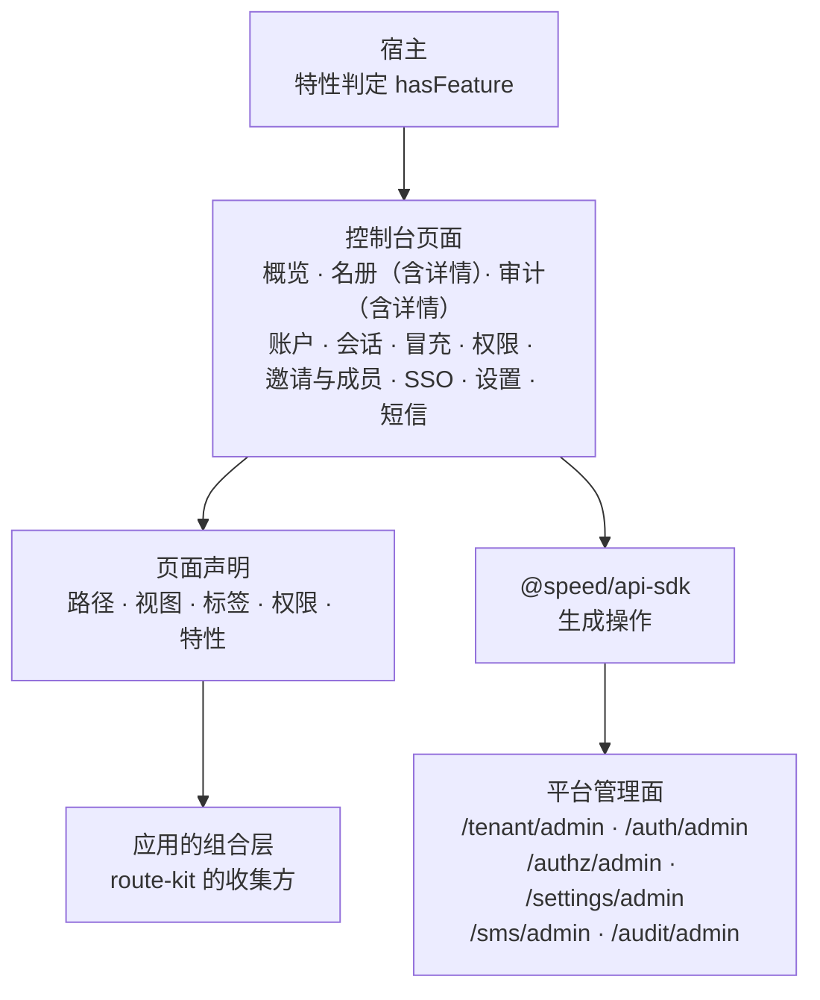

# console-ui

## 职责

`@speed/console-ui` 是平台员工的控制台面组件族：把后端的管理面渲染成一组由平台员工操作的页面。它对应后端的下列管理面：

- **租户管理**：名册的读写，经 `/tenant/admin`（[tenant.admin](../tenant/design-tenant-admin.md)、[ADR-console-tenant-2026-10-15](../../../adr/adr-console-tenant-2026-10-15.md)）。
- **账户管理**：账户的列出、详情与写入，经 `/auth/admin/accounts`。
- **会话管理**：按账户列出会话并撤销，经 `/auth/admin/accounts/:id/sessions` 与 `/auth/admin/sessions/:id`。
- **冒充管理**：冒充记录的列出与终止，经 `/auth/admin/impersonations`；运营者自身会话上的冒充状态读取与发起与结束，经 `/auth/impersonation`。
- **权限管理**：角色、授权、权限目录与账户绑定，经 `/authz/admin`。
- **邀请与成员**：按租户的邀请与成员，经 `/auth/admin/tenants/:tenant/invitations` 与 `/auth/admin/tenants/:tenant/members`。
- **SSO 提供方**：按租户的提供方与域名，经 `/auth/admin/sso/providers` 与 `/auth/admin/tenants/:tenant/sso/providers`。
- **设置读写**：运行期设置的读写，经 `/settings/admin`（[settings.admin](../settings/design-settings-admin.md)、[ADR-console-settings-2026-10-15](../../../adr/adr-console-settings-2026-10-15.md)）。
- **短信模板**：运行期短信模板的读写，经 `/sms/admin`。
- **审计查询**：审计记录的检索，经 `/audit/admin`（[audit.admin](../audit/design-audit-admin.md)、[ADR-audit-admin-2026-10-15](../../../adr/adr-audit-admin-2026-10-15.md)）。

**控制台根（`/`）渲染仪表盘**，其指标与最近活动由名册读与审计读拼出；各管理面的列表页可链入其详情页。

**每个页面以 ui-kit 的 `PageHeader` 开篇**：页标题即该页的一级标题，一条从控制台到该页的面包屑，以及一个重读该页数据的刷新动作（页头操作）。标题层级因此不跳级——`AsyncSection` 的占位与各节的次级标题都渲染在它之下。

**它是平台侧的壳（第二种壳）。** 上述管理面挂在**不解析租户**的端上：名册是平台资产、审计表持有全部租户的行、设置的全局层是平台操作。故本包没有**当前租户**切换器，也就没有租户作用域的查询键——它不认识「当前租户」这个概念。

**外壳骨架是 [layout-kit](design-web-layout-kit.md) 的 `AppShell`。** 控制台壳把带标签的声明派生出的平台导航交给 `AppShell` 渲染：固定顶栏、随视口变化的导航抽屉（`md` 及以上常驻、以下为临时覆盖式）与内容区都由它提供（[layout](design-web-layout.md)），本包不另造一套帧。导航地标以本包的 `shell.navLabel` 命名（经 `AppShell` 的 `navLabel`），与其它外壳的导航地标可区分。两处外壳因此同一形状——侧栏不随内容滚走、窄视口是汉堡抽屉而非把导航堆在内容上方、桌面侧栏由宿主显式选择收起、内容区是唯一滚动层。

**按租户寻址的页面持租户选择器。** 权限面、邀请与成员面、SSO 提供方面把租户当作**路由段参数**（`/authz/admin/tenants/:tenant/...`）；冒充面把租户当作读的**必填查询参数**（`/auth/admin/impersonations?tenant=`）。这些页面仍是平台员工的页面，但每条请求指名它作用到的租户；租户是请求的一个实参，不是会话的当前租户。页面因此持一个租户选择器（数据来自平台名册读 `GET /tenant/admin/tenants`），在其取值为空前禁用该页的租户作用域读。选择器的初值取自页面 URL 的 `tenant` 查询参数（缺省为空），故一条链接能把租户上下文带过页界；选择器仍是此后改变它的途径。冒充页的发起表单与被冒充记录共用这一个选择：目标租户是请求的必填字段，被冒充账户必须是该租户的成员，故发起表单不另设租户输入，未选租户时提交不可用。

**它复用声明式注册面。** 每个页面导出的一份声明即 [route-kit](design-web-route-kit.md) 的 `RouteDeclaration`：路径 pattern、视图回调、可选导航标签、可选权限码、该页依赖的特性名（`requires`）（[ADR-web-route-seam-2026-10-15](../../../adr/adr-web-route-seam-2026-10-15.md)）。`permission` 是数据，本包不据它判定；`label` 缺席即该页不进导航。`requires` 同样是数据，本包不据它判定：宿主经 route-kit 按特性在场收窄注册面，特性缺席的页面与未登记路径走同一个未命中回退，导航里也不出现（[ADR-web-route-seam-2026-10-17](../../../adr/adr-web-route-seam-2026-10-17.md)）。声明由应用的组合层收齐后交给路由层渲染；本包不 import `route-kit`，也不自己做路径匹配或导航。壳另交出一个 `onNavigate` 回调接缝：宿主给了它，帧内点一条导航项即把该项的路径交回调（由宿主的路由器就地跳转，不整页重载），不给则该项是整页链接。租户侧的 [product-shell](design-web-product-shell.md) 用同一份声明形状，两者只是壳不同。

### 非职责

- **不管理「当前租户」。** 切换当前租户是租户侧的动作，归 [tenancy-ui](design-web-tenancy-ui.md)；管理名册（开租户、改名、停用）是运维侧的动作，归本包。切换改的是宿主的路由，管理改的是名册，两者不共用控件、不共用查询键。按租户寻址的页面的租户选择器选的是**请求的实参**，不是当前租户，它与切换控件不共用状态。
- **不做导航、不解析 URL。** 页面的路径匹配、链接构造、深链接解析与未命中回退归 `route-kit` 的收集方，特性缺席的页面落到未命中回退同样在那里发生；本包只提供页面与它们的声明，不做路径匹配。
- **不读特性态。** 本包不取回特性文档，也不调用 auth-core 读特性态的钩子；页内控件所依赖的特性是否在场，由宿主经 `ConsoleShell` 的 `hasFeature` 给出（[ADR-web-feature-state-2026-10-17](../../../adr/adr-web-feature-state-2026-10-17.md)）。
- **不做判定。** 名册、账户、会话、冒充、权限、邀请与成员、SSO、设置与审计的授权判定都在服务端的平台域（设置的租户层在那个租户的域）做出，本包只渲染应答；路由级的授权是宿主的组合（经 [layout-kit](design-web-layout-kit.md) 的路由守卫与 [auth-core](design-web-auth-core.md) 的权限读数），不在本包内。
- **不遮蔽敏感值。** 敏感设置项的值由 [settings.admin](../settings/design-settings-admin.md) 在应答里遮蔽；本包照渲染应答，不做第二处遮蔽。
- **不持规则、不持数据。** 每条路的动作是一次生成的调用；名册的写入语义、账户的状态机、权限的取值、审计的列都在各自的模块里定义。
- **不拥有查询客户端。** 读经 `@speed/api-sdk` 的生成 react-query 钩子跑在宿主拥有的 QueryClient 上，写经同一 `bindRequestFn` 绑定的生成 mutation；本包从不自造 QueryClient。查询键由生成钩子自带（`get<operation>QueryKey`），本包不自写键；按租户寻址的读的键由生成工厂按租户分段，故切租户即换键。

## 外部接口契约

本包的公开面由 `web/packages/console-ui/src/index.ts` 导出：各管理面的页面声明集与页面组件、控制台壳、导航分组表（`consoleNavGroups` 与 `ConsoleNavGroup`）、以及页面读写的操作束。页面声明的形状与壳的入参如下。

```tsx
// 一份页面声明：形状即 route-kit 的 `RouteDeclaration`——路径 pattern、视图回调、
// 可选导航标签、可选权限码、可选特性名列表。本包不 import `route-kit`，导出满足
// 该结构的值。`requires` 的元素类型是 `@speed/api-sdk/features` 的 `FeatureName`，
// 比 route-kit 的字符串更窄，故声明仍可赋值给 `RouteDeclaration`。
// `group` 与 `icon` 是本包自加的额外可选字段：前者指定该页归属的导航分组
// （见下），后者是导航项的装饰性前导图标；两者都只是数据，不在 route-kit
// 的形状里，故带这两者的声明仍可赋值给 `RouteDeclaration`。
interface ConsoleRoute {
  readonly path: string
  readonly view: (context: ConsoleRouteContext) => ReactNode
  readonly label?: ReactNode
  readonly permission?: string
  readonly requires?: readonly FeatureName[]
  readonly group?: string
  readonly icon?: ReactNode
}

// 一个导航分组：稳定 id、已翻译标题、可选装饰图标与可选初始折叠态。图标在
// 侧栏收起的窄栏里代替被裁剪的标题。本包导出 `consoleNavGroups`
// 作为缺省分组表；宿主也可传入自己的（改顺序或改标题）。
interface ConsoleNavGroup {
  readonly id: string
  readonly label: ReactNode
  readonly icon?: ReactNode
  readonly defaultCollapsed?: boolean
}

// 控制台壳：由带标签的声明派生平台导航，渲染宿主的路由内容。
interface ConsoleShellProps {
  readonly routes: readonly ConsoleRoute[]
  // 特性判定：答一个特性名在本进程是否在场。必填；壳经包内上下文把它交给
  // 页面，页内依赖特性的控件据它渲染与否（见「特性在场的接收」）。
  readonly hasFeature: (name: FeatureName) => boolean
  // 导航分组表：给了它即按分组渲染（组按表内顺序、组内按声明顺序，
  // 无分组的声明排在组之前）；不给即维持扁平单列，现有宿主不变。
  readonly navGroups?: readonly ConsoleNavGroup[]
  readonly children: ReactNode
  readonly title?: ReactNode
  readonly headerActions?: ReactNode
  // 帧内导航的点击回调：给了它即把被激活条目的路径交回调（宿主的路由器
  // 就地跳转）；不给即该项是整页链接。
  readonly onNavigate?: (href: string) => void
  // 接受链接的构造器：给一条已签发邀请的令牌，返回接受链接（宿主相对的
  // 路径或绝对 URL）。邀请与成员页在签发成功后据此展示链接；不给则展示
  // 裸令牌。落点是宿主的公开路由，只有宿主知道，故路径由宿主给出。
  readonly invitationLink?: (token: string) => string
  // 宿主的账户设置页的位置（宿主相对的路径或绝对 URL），运营者在那里登记
  // 两步验证。步进对话框在本人账户没有启用的因素时据此渲染前往入口；不给
  // 则只渲染文案、不渲染入口。账户设置页是宿主的路由，只有宿主知道其路径。
  readonly accountHref?: string
  // 冒充开始或结束落定之后的宿主动作：宿主在其中逐出以旧身份取得的缓存、
  // 重读会话与依赖身份的宿主状态、把页面带到合适的位置。冒充页的发起与
  // 结束成功后、在该次尝试之外调用一次；它的拒绝被页面包住，不渲染失败，
  // 也不改判已落定的写入。给出它即由宿主让操作者持续得知冒充已开始（示范
  // 宿主由冒充横幅承担）；不给则页面只失效自己的状态读与记录读。身份变更
  // 之后每个读所属的身份都变了，这件事只有持有缓存与会话的宿主做得了。
  readonly onImpersonationChange?: (change: 'started' | 'ended') => void | Promise<void>
  // 桌面侧边栏收起：AppShell 的受控 prop 对，原样透传给帧。给出后者即在帧的
  // 顶栏渲染收起／展开按钮并回报每次翻转；不给即维持一直展开的常驻抽屉。
  readonly sidebarCollapsed?: boolean
  readonly onSidebarCollapsedChange?: (collapsed: boolean) => void
  readonly sx?: SxProps<Theme>
}
```

- **框架 prop 原样透传。** `sidebarCollapsed` / `onSidebarCollapsedChange` 是 `AppShell` 的桌面侧边栏收起对，被拾起后逐字转给 `AppShell`，本包不重解释。给出后者即在帧的顶栏渲染收起／展开按钮并回报每次翻转，不给即维持一直展开的常驻抽屉；收起态是宿主持有的普通值。租户侧的 [product-shell](design-web-product-shell.md) 用同一对 prop，两处外壳在这条上也同形。

- **导航按分组表聚合。** 页面声明可带 `group`，指向本包分组表里的一个组；壳把带标签的声明按其 `group` 聚成 [layout-kit](design-web-layout-kit.md) 的 `AppShellNavGroup`（组内是导航项、标题即折叠控件），组的顺序与标题来自宿主传入的分组表，组内顺序即声明顺序。分组表经 `navGroups` prop 传入，本包另导出 `consoleNavGroups` 作为缺省：概览（仪表盘）／身份与访问（账户、会话、冒充、权限、邀请与成员、SSO）／租户（租户名册）／平台配置（设置、短信）／审计（审计）。未传分组表即维持扁平单列——十一个带标签的声明按声明顺序排成一组，现有宿主零改动；`group` 此时是数据、不起作用。无 `group` 或指向表外组的声明作为导航项排在组之前，空组（无声明指向）不渲染标题；只有一个可见条目的组同样不渲染标题，该条目作为无分组的导航项排在该组本应占据的位置——某个组此时剩几个可见条目，取决于该部署服务哪些特性。组标题经 console-ui 命名空间解析（`nav.groups.*`），与页面标签同一套翻译路径；组标题可带装饰图标，收起的窄栏以它代替被裁剪的标题。

### 页面声明

一个管理面导出一份页面声明表，全部汇总为 `consoleRoutes`（扁平导航顺序即下表顺序；按分组渲染时组的顺序由分组表给出）。路径是相对控制台根的 pattern，导航标签是一个在渲染时经 console-ui 命名空间解析的 `ConsoleNavLabel`，权限码是该页数据所持的平台权限（数据；本包不据它判定），`requires` 是该页依赖的特性名（数据；全部特性在场时该页才可渲染视图、可导航，本包不据它判定），`group` 是该页归属的导航分组（数据；见「导航按分组表聚合」），`icon` 是导航项的装饰性前导图标（数据；本包自己的管理面各带一个手绘 SVG 图标，见 `src/internal/icons.tsx`，随标签一起交给帧的 `AppShellNavItem.icon`，故收起态是[布局](design-web-layout.md)所说的图标窄栏，而不是把标签截半的文字栏；图标本身 `aria-hidden`，可及名仍是标签）。**一个管理面可含多于一条声明**：列表页携带标签与图标（进导航），详情页两者都不带（可达但不列出），由列表行链入；下表列出带标签的各页，与导航一一对应。

| 声明 | 路径 | 导航标签键 | 权限码 | 依赖的特性（`requires`） | 分组 | 导航图标 |
|---|---|---|---|---|---|---|
| `dashboardAdminRoutes` | `/` | `dashboard.title` | `tenant.read` | `tenant.admin` | 概览 | `DashboardIcon`（四格仪表盘） |
| `tenantAdminRoutes` | `/tenants` | `tenants.title` | `tenant.read` | `tenant.admin` | 租户 | `TenantsIcon`（楼宇） |
| `accountsAdminRoutes` | `/accounts` | `accounts.title` | `authn.account.read` | `authn.admin` | 身份与访问 | `AccountsIcon`（人像） |
| `sessionsAdminRoutes` | `/sessions` | `sessions.title` | `authn.session.read` | `authn.admin.sessions` | 身份与访问 | `SessionsIcon`（屏幕） |
| `impersonationsAdminRoutes` | `/impersonations` | `impersonations.title` | `authn.impersonation.read` | `authn.impersonation`、`authn.admin.impersonations`、`tenant.admin` | 身份与访问 | `ImpersonationsIcon`（两个人像） |
| `permissionsAdminRoutes` | `/permissions` | `permissions.title` | `authz.role.read` | `authz.admin`、`tenant.admin` | 身份与访问 | `PermissionsIcon`（盾牌） |
| `invitationsAdminRoutes` | `/invitations` | `invitations.title` | `authn.membership.manage` | `authn.invitations`、`authn.admin`、`tenant.admin` | 身份与访问 | `InvitationsIcon`（信封） |
| `ssoAdminRoutes` | `/sso` | `sso.title` | `authn.idp.manage` | `authn.admin.sso`、`tenant.admin` | 身份与访问 | `SsoIcon`（钥匙） |
| `settingsAdminRoutes` | `/settings` | `settings.title` | `settings.read` | `settings.admin` | 平台配置 | `SettingsIcon`（齿轮） |
| `smsAdminRoutes` | `/sms` | `sms.title` | `sms.template.read` | `sms.admin` | 平台配置 | `SmsIcon`（消息气泡） |
| `auditAdminRoutes` | `/audit` | `audit.title` | `audit.read` | `audit.admin` | 审计 | `AuditIcon`（记录单） |

**本包导出的每条声明都带非空的 `requires`，含不进导航的详情声明。** 详情声明带与其列表页相同的特性与权限码：`/tenants/:id` 带 `tenant.admin` 与 `tenant.read`，`/audit/:id` 带 `audit.admin` 与 `audit.read`。宿主的路由守卫只取精确命中的那条声明的权限码，不经路径前缀继承（[starters](../design-starters.md)），详情声明因而各自带码。

**带租户选择器的页面把 `tenant.admin` 列进 `requires`。** 冒充、权限、邀请与成员、SSO 页的租户选择器取自平台名册读，名册由 `tenant.admin` 服务，该特性缺席时这些页面选不出作用域。

**导出带 `requires` 的声明，对宿主的路由层提出要求。** route-kit 拒绝一张含门控声明、却没给出特性在场判定与读取中、读取失败视图的路由表（[route-kit](design-web-route-kit.md)），故装配本包页面声明的宿主必须读取特性态（[auth-core](design-web-auth-core.md) 的 `featurePresence`），并作为 `presence` 交给路由层。

### 页型的骨架

控制台页按 [layout](design-web-layout.md) 的页型组装：

- **仪表盘**（`DashboardPage`）：控制台根的路由（`/`）。一行等宽的租户指标卡、一行平台健康度指标卡，其下是最近活动列表。租户指标由名册读拼出——名册读返回完整的租户集，租户总数即其长度、启用与停用的计数即其状态分布。平台健康度由审计查询读拼出，它是唯一跨租户的读：`since` 取当前时刻往前 24 小时，一读数出窗口内的全部记录，另一读以 `action=authn.login` 只数其中的成功登录。两个计数取自窗口化读的最新一页，故应答带下一页游标时该计数按**下界**渲染（数值后带 `+`）。最近活动取审计查询读的最新一页（`useAuditRecords` 带 `limit`），其列与优先级与审计查询页同一套。平台不声明统计端点，也不声明失败登录的读，故页面不发明契约不携带的聚合值，也不把审计表不持有的失败登录计入。平台健康度与最近活动只在特性 `audit.admin` 在场时渲染，见「特性在场的接收」。
- **列表页**（`TenantRosterPage`、`AccountsPage`、`SessionsPage`、`ImpersonationsPage`、`PermissionsPage`、`InvitationsPage`、`SsoPage`、`SmsPage`、`AuditPage`）：页头、工具栏或写入区、数据表、分页。行详情与创建表单在操作者需要参照列表时由侧边面板承载（`AccountsPage`），见「账户页的详情与创建面板」。
- **详情页**（`TenantDetailPage`、`AuditDetailPage`）：标题区加主栏与固定宽侧栏。主栏承载主体与其写入，侧栏承载标识与回链。路径是列表页路径加一段 `:id`（`/tenants/:id`、`/audit/:id`），声明不带标签，故不进导航。列表页接收声明传入的该列表页匹配路径（`basePath`），据此为每行构造详情链接 `${basePath}/${id}`；详情页接收 `parentHref`（匹配路径去掉 id 段），据此回链列表页。租户详情页另接收控制台根路径（匹配路径去掉 `/tenants/:id`），据此给出通往按该租户寻址的兄弟页面的链接（权限与角色、邀请与成员、SSO 提供方、冒充记录），每条链接把租户放进 `tenant` 查询参数——目标页从该参数取得选择器初值。审计详情页对记录携带的空字段渲染占位符而不是只留标签：字段为空本身是记录的一部分（平台级事件没有租户、动作可以没有用途），省掉这一行会掩盖记录携带空值。
- **设置页**（`SettingsPage`）：一条二级导航（按 namespace 分组，取出自全量设置读）、一张占满内容区的分页表（键／类型／当前值／状态／操作）、底部一条粘性保存条。行的状态取自该层视图的 `has_row`：该层没有行时值走回落（标「默认」），持有行时标「已覆盖」。`written` 只用于显示，不参与判定——显式写入的空串与无行在文本上不可区分，行是否存在由 `has_row` 单独给出。只有持有行的行渲染可点的移除控件，默认行不渲染它——默认值没有可撤的覆盖行，摆一个只能空转的开关只会误导读屏与操作者；204 的幂等删除语义不变。**敏感项**：[settings.admin](../settings/design-settings-admin.md) 在应答里把敏感项的 `written` 与 `value` 换成遮蔽串，`has_row` 照常报出行是否存在，故页面按同一判据统计状态，并只对持有行的敏感项渲染移除控件；键格的「敏感」标记说明该行的值是遮蔽串。

**冒充页承载两个面。** 记录面是一个按租户寻址的列表页：它列出租户的冒充记录并终止一条。运营者自身会话面读调用方自己会话上的冒充（`GET /auth/impersonation`，无冒充时是裸 404）、以 `POST /auth/impersonation` 发起一条、以 `DELETE /auth/impersonation` 结束它。自身会话面作用到调用方自己的会话，不按租户寻址，故它不随租户选择器启用，其读取的键也不分租户；发起控件只在当前会话没有生效中的冒充时呈现——模块对同一会话上的第二次发起答 409。这三个操作是生成的调用方会话操作（`useAuthnImpersonationStatus`、`useAuthnImpersonationStart`、`useAuthnImpersonationEnd`），页面直接调用它们并经生成键工厂（`getAuthnImpersonationStatusQueryKey`）失效状态读，与记录面的操作束不是同一组。**状态读落定为有冒充时，记录面不渲染、其读不发出。** 记录面包括租户选择器、记录列表与终止控件，换成一条说明（冒充期间不能读取或终止冒充记录，结束冒充后在此查看），页面只剩「当前冒充」节与结束控件。平台管理面对冒充身份一律被网关拒绝，记录面的读与名册读在冒充期间必被拒，渲染成空列表加陈旧提示会被读成「没有记录」。状态读未落定或失败时记录面照常渲染；结束成功后记录面恢复并重读，不需要刷新页面。宿主给了 `onImpersonationChange` 时，发起与结束成功后页面各调用它一次，页面不等待它，它的拒绝被页面包住；发起之后宿主重读会话并把页面带离控制台（[design-starters](../design-starters.md) 的「冒充期间的壳」），记录面的收起因此只在宿主不做这些的装配里、或重读尚未落定的短暂窗口里被看到；结束之后宿主重读会话，页面留在原处，记录面恢复并重读。决策见 [ADR-web-impersonation-shell-2026-10-18](../../../adr/adr-web-impersonation-shell-2026-10-18.md)。

**页内导航复用壳的接缝。** 控制台壳把它的 `onNavigate` 经内部上下文交给它渲染的页内容；页内的详情链接经该回调就地路由（不做整页重载，否则内存态会话会丢），壳未给回调时是普通链接。这条接缝与壳自身的导航项同一来源，故二者重载与否的行为一致。

### 特性在场的接收

**页内依赖特性的控件经 `hasFeature` 判定。** `ConsoleShell` 的必填属性 `hasFeature` 是宿主给出的同步判定，壳经包内上下文把它交给页面，形态同壳交会话的 `ConsoleSessionProvider`。本包不认识特性态的读取中与读取失败：宿主在特性态就绪之后才渲染控制台壳（[starters](../design-starters.md)），壳拿到的判定恒有确定的答案。

**壳不按 `requires` 过滤导航。** 宿主交给 `routes` 的是已按特性在场收窄的声明（route-kit 的 `presentDeclarations` 的结果），壳照常由其中带标签的声明派生导航。

下表列出页内按特性门控的控件，是穷举的；表外的控件不受特性门控。

| 页面与控件 | 特性 | 特性缺席时 |
|---|---|---|
| 仪表盘的平台健康度指标与最近活动 | `audit.admin` | 不渲染，不发审计查询读 |
| 审计查询页与仪表盘最近活动的操作者列身份解析 | `authn.admin` | 不发账户读，该格渲染记录值并标注身份未解析 |
| 审计详情页的操作者身份解析 | `authn.admin` | 不发账户读，该字段渲染记录值并标注身份未解析 |
| 邀请与成员页的邀请人身份解析 | `authn.admin` | 不发账户读，该格渲染记录值并标注身份未解析 |
| 邀请与成员页的成员账户身份解析 | `authn.admin` | 不发账户读，该格渲染记录值并标注身份未解析 |
| 冒充记录页与当前冒充面板的账户身份解析 | `authn.admin` | 不发账户读，该处渲染记录值并标注身份未解析 |
| 权限页绑定表的账户身份解析 | `authn.admin` | 不发账户读，该格渲染记录值并标注身份未解析 |
| 账户详情的因素列表、重置 MFA 与 MFA 要求控件、口令重置 | `authn.admin.factors` | 不渲染，不发因素读 |
| 账户详情的服务密钥（列出、新建、撤销） | `authn.admin.secrets` | 不渲染，不发密钥读 |
| 账户详情的会话（列出、撤销全部会话） | `authn.admin.sessions` | 不渲染，不发会话读 |
| SSO 页的元数据刷新控件 | `authn.admin.sso.metadata` | 不渲染 |
| 邀请与成员页成员表的 SSO 豁免列与切换控件 | `authn.admin.sso` | 不渲染 |

口令重置随因素组门控：它的路由挂在因素组的挂载分支之内（[authn-admin](../authn/design-authn-admin.md)）。

**特性缺席与无权限的处置不对称。** 特性缺席的控件不渲染，那个面在本进程不存在；特性在场而调用者无权限的写入控件照常渲染，授权由服务端判定（[architecture](../../architecture.md#特性与前端定制)）。

### 写入的请求参数由平台的 OpenAPI 片段声明

本包的写请求经生成的客户端发出，请求体来自平台 OpenAPI 片段里该端点的 `requestBody`。片段为每个变更端点声明了请求体，故生成的客户端为每次写发送请求体，本包为每个写渲染控件。请求体的字段与后端处理器 `mount.Decode` 解码的目标结构一致，且片段里声明的 `requestBody` 与处理器是否解码请求体一致（`pkg/authn/admin/requestbody_test.go` 把这条当成契约守住：处理器解码请求体而片段未声明 `requestBody`，即该写从生成客户端不可达，测试即失败）。

**对外接口面。** 公开面是 `src/index.ts` 的导出集；每条路的请求经绑定的客户端，写经生成的 mutation。变更按 TypeScript 的源码语义分类：新增导出、新增可选字段是源码兼容的；删除导出或字段、改既有导出或字段的含义或名、改签名（参数或返回类型），是不兼容变更。把必选与可选互转按位置判：输入位（宿主提供的 prop 或参数）放宽兼容、收紧不兼容；输出位（宿主读取的返回类型或结果字段）相反——放宽为可选使读出的值成为 `T | undefined`，strictNullChecks 下只有在要求 `T` 处使用它的消费者无法编译（对可能为 undefined 的值做成员访问报 TS18048，赋给 `T` 或传入要求 `T` 的形参报 TS2322/TS2345），仅转发或在宽松处使用（模板串、比较、`??`、可选链）的消费者仍编译，故可能破坏消费者、是不兼容变更。本包不提供当前租户，不 import `route-kit` 与 `tenancy-ui`。

## 依赖

| 依赖 | 用途 |
|---|---|
| `@speed/api-sdk` | 各管理面端点的生成读钩子与写 mutation；子路径 `@speed/api-sdk/features` 的特性名类型 `FeatureName`，用作 `requires` 的元素类型与 `hasFeature` 的参数类型 |
| `@speed/auth-core` | 会话：抬高会话的步进（step-up）流程由它驱动——宿主把会话交给 `ConsoleShell`，页面在特权写被答 401 步进时打开重认证对话框、重放该写。仅此一处：本包不读当前租户 |
| `@speed/ui-kit` | 主题、表单、对话框、数据表与空态原语 |
| `@speed/layout-kit` | 外壳骨架：`AppShell` 的固定顶栏、响应式导航抽屉与内容区 |
| `@speed/i18n` | 命名空间注册与文案的翻译钩子 |
| `@tanstack/react-query` | peer（必需）：宿主供给的 QueryClient |
| `react`、`react-dom`、`@mui/material`、`@emotion/*` | peer（必需）：宿主拥有的 React／MUI 树 |

**本包不 import `route-kit` 与 `tenancy-ui`。** 页面声明即 route-kit 的 `RouteDeclaration`，收集方在应用的组合层；本包没有当前租户切换器，故租户侧的切换控件不在这里出现。按租户寻址的页面持的租户选择器由本包自造，取自平台名册读，与 tenancy-ui 的切换控件无关。壳交出的 `onNavigate` 是一个回调，由宿主接上它自己的路由器，本包与 `route-kit` 之间仍无 import 边。

## UML 图

页面经生成操作打向管理面端；页面声明由应用的组合层收齐，特性判定由宿主交给壳、经壳交给页面。图里画不到的约束：本包所在的平台管理面挂在**不解析租户**的端上，故壳里没有当前租户切换器；按租户寻址的页面的租户是请求实参；判定在服务端做出，本包只渲染应答；声明形状即 route-kit 的 `RouteDeclaration`，但本包不 import `route-kit`；`requires` 由收集方据特性在场收窄，本包不据它判定。



## 核心数据结构

| 概念 | 形状 | 说明 |
|---|---|---|
| 页面声明 | `ConsoleRoute` | 即 route-kit 的 `RouteDeclaration`：路径 pattern、视图回调、可选导航标签、可选权限码、特性名列表，外加本包自加的可选导航分组与装饰性图标 |
| 特性判定 | `(name: FeatureName) => boolean` | 宿主经 `ConsoleShell` 的 `hasFeature` 给出，经包内上下文交给页面 |
| 租户作用域选择 | 页面自身状态 | 按租户寻址的页面持有的租户 id，作为请求实参，缺省为空即禁用该页的租户作用域读 |
| 账户选择 | `AccountSelector` 的 `value` | 页面持有的已选账户（不是 id 文本），选择器交出账户对象，页面从中取 id 作为请求实参 |
| 命名空间 | `consoleUiResources` | 双语文案目录，叶子键集跨语言相同 |

## 核心算法与流程

### 一次管理请求

1. 页面从生成钩子或 mutation 发出请求，经宿主绑定的客户端。
2. 服务端在平台域（设置的租户层在那个租户的域）判定调用方的权限；无身份 401，权限不足 403。
3. 应答落地：读渲染列表或详情的视图，写渲染结果并失效相关查询；被拒渲染错误码文本。
4. 写路由的强制档审计落在服务端动作之前；本包不写审计行。

### 邀请的交付

签发一张邀请的应答里带一枚只交出一次的接受令牌（投递归签发者，见 [authn-invite](../authn/design-authn-invite.md)）。邀请与成员页不丢弃它：签发成功后，以宿主经 `ConsoleShell` 的 `invitationLink` 交出的构造器把令牌变成接受链接并展示，供签发者经自己的渠道交给被邀请人；宿主未给构造器时展示裸令牌。链接指向的落点（形如 `/invitations/:token`）是宿主的公开路由，本包不知道它，故路径由宿主给出；构造器返回宿主相对的路径时，页面按当前 origin 解析成绝对链接供复制。

展示值旁是一个复制控件：它把完整的展示值——构造器在场的绝对链接，构造器缺席的裸令牌——写入剪贴板，故交出去的是完整值而不是被折行折断的可视片段；复制成功后控件旁的状态区播报「已复制」，两秒后清空。运行环境不提供 Clipboard API 时点击不写入、不播报，页面不为此失败。

### 按租户寻址的请求

按租户寻址的读以租户选择器的取值为查询键的一段，故切租户即换键、旧租户的数据自行失效。取值为空时该读声明为禁用（不发出请求）；页面渲染一段说明，提示先选择租户。

### 读的失败面：权限拒绝与其它失败

每个读经 `ConsoleAsyncSection`（ui-kit 的 `AsyncSection` 在本包内的绑定）渲染。一个 403 是权限拒绝而非加载失败——面应答了，是拒绝——故渲染权限拒绝文案（console-ui 命名空间的 `forbidden.title` 与 `forbidden.description`），且不给重试动作；任何其它失败（5xx、传输错误）落回可重试的未应答占位，带重试。判定按应答本身做出（HTTP 状态 403，或无可读信封的裸 403 经 `client.http.403`），不按路由级权限读数——服务端写出 403，页面渲染应答。

### 审计查询的筛选与分页

审计页把工具栏的 `since`、`until`、`action` 集合、`outcome` 集合与 `actor` 集合作为读的查询参数，在提交时应用（一次键入不触发请求）。`action`、`outcome` 与 `actor` 各自按逗号或空白切成集合送出，每项与行上的同名列相等即命中。审计读按游标分页：应答带出下一页的游标，页脚据此前进与后退；游标式读不数总数，故页脚不显示总数。「重置」清空全部筛选并回到第一页。

两张审计记录表——审计查询页与仪表盘的最近活动——共用同一套列与优先级。记录的身份是动作（HTTP 方法）与对象（路由）的组合，故时间与动作不带优先级、永不隐藏，对象紧随其后（容器 ≥600px 起显示，`sm` 档），操作者与结果同在 `md` 档（≥900px 起显示）。结果不能最先让位：在 13/14 寸笔记本上，容器宽 1184px（低于 `lg` 的 1200px），若结果按 `lg` 隐藏，失败的记录与成功的记录在列表上就看不出差别，而排查恰恰先看失败；故它与操作者一起留在 `md` 档。判定宽度取自表格自身的容器（`container-type: inline-size`），不取自视口。

**账户身份单元**把一处记录的账户标识解析成可读身份，页面展示另一条记录所携带的账户标识处都经它渲染：审计查询页与仪表盘最近活动的操作者列、审计详情页的操作者、邀请与成员页的邀请人与成员账户、冒充记录页与当前冒充面板的操作者与被冒充账户、权限页绑定表及其账户查询结果的账户列。特性 `authn.admin` 在场时，它经 `GET /auth/admin/accounts/:id` 读账户的显示名；特性缺席时不发这条读，见「特性在场的接收」。该读受 `authn.account.read` 把守，页面自身的权限（`audit.read`、`authz.role.read` 等）不含它，因此只持页面权限的查看者的解析会被拒；该格此时渲染记录值并标注身份未解析，而不是把它当作已解析（或系统）的账户。读按账户标识缓存：同一账户的多行与重渲染共用一次读。绑定表的解绑控件以同一个解析结果命名账户：解析到显示名时用显示名，否则用记录值。成功文案点名账户时同样经它：文案是 `succeed` 时刻的译文快照，所以解析在调用 `succeed` 之前完成，解析失败或被拒时回落记录值，不阻塞确认；成员移除、成员写入与 SSO 豁免的切换这类点名成员账户的确认都属此列；邀请的签发与撤销点名的是被邀请人的邮箱，不是账户，不经此单元。

### 账户查询的筛选

账户页把工具栏的筛选作为读的查询参数，在提交时应用（一次键入不触发请求）：登录标识前缀与它的类型成对送出（模块的索引按两者寻址，前缀缺类型即被拒），显示名前缀、状态与账户类型各自单独送出，未选的筛选不出现在请求里。显示名前缀是存储值的字节前缀、大小写敏感，页面的搜索框按用户所写原样送出。列表读按游标分页（应答带出下一页游标），页面只渲染读到的一页。账户详情与创建表单都在侧边面板内打开，见「账户页的详情与创建面板」。创建表单对用户账户要求一个显示名与至少一个登录标识（用户名、邮箱或手机号）：不满足时「新建」保持禁用，提交路径也不再发出请求——没有登录标识的用户账户无法使用，界面上不产出它；服务账户以服务密钥登录，不受这条要求，只需显示名。

### 账户选择器

会话页的账户、权限页的绑定账户与绑定查询账户、邀请与成员页的成员写入账户都是账户实参，这四处共用本包的账户选择器（`src/internal/account-selector.tsx` 的 `AccountSelector`）：一个可键盘操作的组合框，操作者键入显示名或登录标识，选中一行即交出该账户的 id，页面发出的请求带这个 id 而不是键入的文本。选择器以账户列表读（`useAccounts`）按显示名前缀与用户名／邮箱／手机号三种标识前缀各读一页，标识读只发与键入文本形状相符的种类（短于三字符或形状不符的种类不发），某个种类仍被服务端以请求形状拒绝（HTTP 400）时按该种类不适用处理，按账户 id 合并去重；未键入时不发账户读，故打开页面不会拉取账户表。每页读有上限、按输入检索，账户很多时也不会整表载入。可及名取自选择器旁的标签；搜索失败在弹层里说明，不呈现成「无匹配」。权限页绑定栏的角色仍是自由文本的文本框：它命名的是一条要绑定的角色，不是账户，不由这个选择器承担。

### 授权表与权限目录同一套写法

权限页的授权表按完整权限码列出一个角色持有的权限，与同一页的权限目录逐字同形（形如 `authn.account.read`），而不是 `resource`／`action` 两列：同一页的两个面因此可直接对照，两个命名空间各自声明同名资源时也不会被读成同一行。行的码由已加载的权限目录把授权行的 `(resource, action)` 对映射回来——与撤销请求把同一对映射回码是同一次匹配；目录没有命名该对时，行退化为 `resource/action` 的拼写，且不提供撤销，因为撤销路由只按码命名权限。

### 破坏性动作的确认

会移除或作废既有数据的写入在发出前经 ui-kit 的确认对话框确认：控件的点击只打开对话框，写入在确认点击时发出，未确认即不发出请求。对话框一律用 `ConfirmDialog` 的 `variant="danger"`；确认的**轻重**随动作是否可逆而分：一个连同其从属记录一并销毁、界面上无从恢复的删除（删除账户、删除角色）额外带 `doubleConfirm` 两步守卫，第一次点击只把按钮改题为「再次点击确认」，第二次才发出；其余的可恢复的移除与撤销（移除成员、移除短信模板、撤销会话、撤销账户全部会话、撤销服务密钥、移除登录标识、重置 MFA、撤销邀请、移除 SSO 域名、移除设置项、删除 SSO 提供方）用单次确认点击——可恢复的动作不该比不可逆的更重。不改变既有数据的写入直接发出，不经确认；这些是名册登记与改名、设置写值、授权的授予与撤销、绑定与解绑、模板登记与提交审核、开关与冒充终止。

### 内建角色只读

服务端在角色行上持有内建标记（`builtin`），并对内建角色的改写、删除与授权写入答 409（`authz.ErrBuiltinRole`）：其权限集固定，删除还会连同其授权与绑定一并撤销；读不受限。权限页据角色列表里的该标记，去掉内建行的「管理授权」与「删除」两个写控件，改留一个只读的「查看授权」入口（`permissions.roles.viewGrants`，可及名为 `permissions.roles.viewGrantsAria`），旁边是一句可读说明（`permissions.roles.builtinLocked`）。选中内建角色后，授权区照常列出它持有的权限，但授予表单与撤销列都不渲染，另以一句只读说明（`permissions.grants.builtinReadOnly`）表明原因。写控件换掉而不是禁用，是因为禁用的按钮不可聚焦、不进 Tab 顺序，依赖焦点或悬停的 tooltip 与 `aria-describedby` 对只用键盘的使用者不可达（它仍留在无障碍树里，读屏的浏览模式仍会读到它）；换成正文文字后，原因进入每个人的阅读顺序，也不向任何人呈现一个必然失败的控件。非内建角色不受影响。内建标记不由控制台设置：角色表单只写角色名与描述键，标记由宿主的种入步骤置上。

### 与租户侧的分工

租户这个概念在两处是两类动作：**切换当前租户**（改变宿主路由解析出的租户）在租户侧，归 [tenancy-ui](design-web-tenancy-ui.md)；**管理租户名册**（开租户、改名、停用）在运维侧，归本包。按租户寻址的页面持的租户选择器既不是当前租户、也不是名册管理：它是平台请求的一个实参。三者不共用控件、不共用查询键。

### 账户页的详情与创建面板

账户页的账户详情与账户创建各由一个侧边面板承载；容器取舍的判据见 [layout](design-web-layout.md)，决策见 [ADR-web-side-panel-2026-10-17](../../../adr/adr-web-side-panel-2026-10-17.md)。账户详情没有独立路由，控制台里也没有页面链向它。

**打开。** 列表行的「管理」按钮打开该行的详情面板，按钮带 `aria-haspopup="dialog"`，只负责打开：面板是模态的，打开期间行不可点击，关闭走面板自己的出口。页头操作里，刷新动作之后是「新建账户」按钮，它打开创建面板。两个面板都取 `wide` 档。创建表单不再常驻页面；面板打开与关闭期间，列表的数据、已应用的筛选与滚动位置保持不变。

**详情面板的内容。** 标题是含账户 id 的 `h2`；内容是账户详情的全部既有内容——只读字段、账户级写入、因子、服务密钥、会话与按名移除标识的控件——各节标题从 `h3` 起，各读仍各自挂在 `ConsoleAsyncSection` 之后，保持各自的加载、空与可重试的错误占位。

**所选账户的存续。** 关闭面板时页面不立刻清掉所选账户，而在面板的 `onExited` 里清；退出过渡期间面板渲染的仍是该账户的详情。面板内的各反馈作用域在面板关闭时 `reset`，下一次打开（无论哪个账户）不带上一次的反馈。

**反馈随发起面。** 面板打开期间，背后的页面对辅助技术不可见，背后区域的内容读不到。因此：

- 面板内发起的写入各按节划分作用域，区域在面板内，位置贴近发起它的控件所在的节。
- 列表行上的写控件（删除账户）属于账户列表的作用域，区域在列表之下的页面里；该写入只在面板关闭时可发起。

**面板内的写入进行中，面板 `busy`。** 详情面板内任一作用域 `pending`（含经 `ConfirmDialog` 确认的写入与经步进门控重放的写入，以及不经确认的写入，如服务密钥新建与口令重置）时，面板 `busy`，关闭请求不上报；写入落定后恢复可关。面板内写入的结果因此总落在仍然挂载的区域里。

**新建的服务密钥由账户页自持。** 服务密钥是只交出一次的值，它的展示面板（见「写入的反馈与读的刷新」）的状态由 `AccountsPage` 持有，不放在随关闭卸载的面板内容里。详情面板内展示着未关闭的服务密钥时，关闭请求（按钮、Escape、遮罩点击）先经 `ConfirmDialog`（默认变体）确认放弃：确认则关闭并丢弃，取消则面板保持，与创建面板的未保存守卫同形。

**确认与步进验证叠在面板之上。** 面板内触发的破坏性确认（`ConfirmDialog`）与步进验证（`StepUpChallenge`）以对话框叠在面板之上，层级见 [layout](design-web-layout.md)；它们关闭后焦点回到面板内触发它们的控件。确认的轻重规则不变，见「破坏性动作的确认」。

**创建面板。**

- 表单是一个 `FormLayout`，`columns={2}`、`maxWidth={false}`：`wide` 档内保持两列，视口低于 `sm` 时面板占满视口、表单收为一列。提交按钮在 `FormLayout` 的动作行，随内容区滚动。
- 每次打开面板，表单都是初始值。
- 创建写入横跨面板的作用域与账户列表的作用域，是本包唯一的一例，因为面板内容随关闭卸载：失败属于创建面板的作用域，区域在表单之下、面板内，字段内容保留以便更正；成功属于账户列表的作用域，区域在列表之下，在面板的 `onExited` 之后才写入——背后的页面在面板关闭后才对辅助技术可见，成功文案若在面板打开期间写入就读不到。
- 提交进行中面板 `busy`，关闭请求不上报。
- 未保存守卫：表单有改动且不在提交中时，关闭请求不直接关闭，而是经 `ConfirmDialog`（默认变体）确认丢弃；确认则关闭并丢弃改动，取消则面板保持。

**其它页面的内联写入区不在此列。** 一个页面的写入区是否改由侧边面板承载，按 [layout](design-web-layout.md) 的判据逐页判定；租户详情与审计详情是带地址的整页，保持原样。

### 步进验证对话框

特权写被答 401 步进（会话仍成立、强度不足）时，页面打开步进对话框并记住被拒的写（`useStepUpGate`），挑战成功后重放该写恰好一次，取消不重放。对话框在发起流程之前读一次本人已登记的因素（`GET /auth/factors`），按读的结果分阶段：

- **读未落定**：渲染起手中的占位，不发起流程。
- **读已落定且没有启用的因素**（读回的行里没有处于启用状态的）：账户没有能强化会话的因素，重新登录也只能得到同样强度的单因素会话，对话框提示先在账户设置里添加验证方式，不发起流程。`accountHref` 给出时附一个前往账户设置的链接，缺省不渲染链接，只留文案。
- **有启用的因素，或读失败**：发起流程。读失败不判定为没有因素，由流程自己的拒绝决定。起手被 401 `authn.insufficient_user_authentication` 拒绝（有因素，但没有能强化本会话的）时，对话框判定本部署无法完成升级，给出重新登录的出口，不渲染步骤。

**前往账户设置的目的地由宿主给出。** 对话框不持有任何宿主路径：`ConsoleShell` 的 `accountHref` 经包内上下文交给对话框，形态同 `invitationLink`；链接经壳的页内导航接缝就地路由，壳未给回调时是普通链接。

**本人因素的读不经操作束。** 操作束收的是管理面的读写；本人账户的因素读是运营者对自己会话的调用，与冒充页的自身会话面同类：对话框直接调用生成的 `useAuthnMfaFactors`，跑在宿主的查询客户端上，不进操作束，宿主因此无法经操作束替换它。

**步进对话框的失败面。** 回答的错误码按本包白名单解析，白名单含步进回答路径会收到的认证码（`authn.login_failed`、`authn.flow_invalid`、`authn.throttled`、`authn.unavailable`），验证码输错渲染该码的文本而不是通用兜底。起手失败（既不是 401 步进不足，也不是会话仍成立时的 400）与回答被 `authn.flow_invalid` 拒绝（流程已过期、已被消费、已无可答复）同样处理：对话框不渲染描述正文（`stepUp.description`）与步骤表单，渲染该码的失败横幅、重新起手的动作与取消；重新起手是对话框本地的，由它重新驱动 `useStepUp`，不改 auth-core。通行密钥仪式的失败与服务端的失败横幅互斥，同一时刻只渲染一条（[ui-kit](design-web-ui-kit.md) 的「写入的反馈」）。步进对话框自带区域，失败横幅在模态之内。

### 写入的反馈与读的刷新

本包每个有写入的页面按 [ui-kit](design-web-ui-kit.md) 的「写入的反馈」组织反馈（[ADR-web-write-feedback-2026-10-17](../../../adr/adr-web-write-feedback-2026-10-17.md)）。应用于控制台页面的条款如下。

**作用域按控件组划分，页面不聚合。** 控件组的判据见 ui-kit。权限页的角色、授权、绑定、账户绑定查询各是一组，账户绑定查询表的解绑动作用它自己的作用域，区域在查询表之下，不用绑定组的作用域；其余页面同样按带标题的节划分。页面不聚合多个 mutation 的错误，也不各持错误选取函数。表格行内的动作按行是否带自己的草稿输入区分：单击型的行动作（撤销、移除）共用该表的作用域，区域在表之下，成功文案点名被操作的行；带各自草稿输入的行（租户名册的重命名与启停）每行一个作用域，区域在该行内。写入自身的效果会卸载它所在节的控件时（冒充的发起使发起表单卸载），区域放在写入之后仍存活的最近祖先里：冒充的发起与结束的区域在「当前冒充」状态节内，不在发起表单内。面板打开期间的落点见「账户页的详情与创建面板」。

**上下文变化时作用域 `reset`，写入在途时改变上下文的控件禁用。** 一个作用域在它的写入所带的某个请求实参改变时 `reset`。租户是按租户寻址的页面上每次写入的实参，租户改变时该页全部作用域 `reset`，租户选择器在该页任一作用域 `pending` 时禁用。其余选择器按各自牵动的作用域：SSO 页的创建与编辑表单随编辑目标所选的提供方，域名认领、验证与移除随域名栏所选的提供方，它们互不牵动；权限页的授权作用域随所选角色，绑定作用域随绑定账户，账户绑定查询的作用域随查询账户（应用另一个账户即 `reset`）；设置页的命名空间选择牵动设置表的作用域。这些选择器在它们牵动的作用域 `pending` 时禁用。

**成功确认覆盖本包每个由操作者发起、落定且无一失败的动作**，包括只带表单清空或列表重读这类隐含变化的动作，例如账户创建与服务密钥创建、冒充的发起、结束与终止、邀请的撤销、成员的移除与写入、SSO 豁免的切换、SSO 提供方与域名的各写入、短信模板的各写入、租户详情的重命名与启停。这个列表是示例；判据是动作整体成功。冒充的发起同样落成功文案；宿主给了 `onImpersonationChange` 时页面随即被带离，持续的提示由租户框架里的冒充横幅承担。

**一次性值的展示面板与区域并列，不属于槽。** 邀请的接受链接、SSO 域名认领令牌、新建的服务密钥是只交出一次的值。展示面板的状态由页面组件持有，不在 `useWriteFeedback` 的槽里，也不在随关闭卸载的面板内容里；它渲染在同一控件组之下、区域之侧，是单个 `role="status"` 的 live region，带一个显式关闭的按钮，可及名含所属的对象：邀请含租户与受邀人，SSO 认领令牌含租户、提供方与域名，服务密钥含账户。面板保留到操作者显式关闭或离开页面，不被 `reset`、下一次失败或上下文变化清掉；同一控件组再次发放时新值替换旧值，同一提供方与域名再次认领换发新令牌、旧令牌作废。

**批量保存是一次尝试。** 设置页的保存以一次 `run` 结算：逐项以 `mutateAsync` 发出并以 `Promise.allSettled` 等待，保存控件在整批落定之前保持忙态，忙态取自作用域的 `pending`，不取 mutation 观察者的 `isPending`。全部成功才落「设置已保存」；有失败时以提交顺序中第一个失败项的码落失败，失败项的草稿、行标记与待保存计数保留，成功项的草稿清掉，表格翻到第一个失败项所在的页，并把反馈区域滚入视野（用户偏好减少动效时不做平滑滚动）。部分落地的批量只报失败。

**创建成功后表单复位，必填为空时提交禁用。** 创建类动作落地后表单回到初始值：SSO 提供方创建成功后回到创建模式并清空全部输入，包括只写的客户端密钥；角色创建清空名称与描述。提交按钮在必填字段去掉首尾空白后为空时禁用，角色名与短信模板名同账户创建、授权、绑定一致。

**确认对话框在确认点击时关闭。** 破坏性动作的确认一律经 `usePendingConfirm`：写入在确认点击时发出，对话框在同一次点击里关闭、不等写入落定，失败在写入落定后落在区域里；权限页的角色删除同此，不以 `confirmLoading` 把对话框保持到落定。发起控件在写入进行中禁用并标忙，定义见 ui-kit。

**写入失败的文案。** 写入失败经本包白名单渲染：裸 HTTP 403 渲染权限不足文案；未被步进拦截的裸 401（会话已不再成立，或该写入不经步进闸）渲染会话已结束文案；经步进闸的写入先由 `intercept` 判定，会话仍成立的 401 打开步进对话框，不进入文案层。403 与该类 401 都不并入裸 HTTP 状态通用的 `errors.client.http` 叶子（`client.http.<status>` 经它渲染带状态码的「请稍后重试」文本）。冒充发起与管理员重置因素、重置口令被 403 `authn.factor_not_seasoned` 拒绝时，写入失败渲染一条说明：需要一个已启用满规定时长的非短信因素（认证器应用或通行密钥），刚登记的因素要等；应答不带时长，文案不写具体数字。步进对话框不拦截它，加强认证解不了这一条。403 `authn.impersonation_restricted` 在界面上几乎总是冒充发起被拒：服务端对发起者、目标、参数三组的违反不区分是哪一条（[design-authn-impersonation](../authn/design-authn-impersonation.md)），文案因此不指向单一原因，也不写「冒充期间」，而是逐类陈述对目标与当前会话的要求：目标是该租户中已启用、未受保护的成员账户，当前会话没有进行中的冒充。这条码不拆出「目标不是成员」之类的子码：拆出任何一类，应答就多告诉发起者一条关于目标账户的事实，取舍见 [ADR-authn-impersonation-2026-10-10](../../../adr/adr-authn-impersonation-2026-10-10.md)。

**冒充的状态与记录。** 冒充状态读（`GET /auth/impersonation`）的裸 404 是已落定的「未冒充」：该 404 不作为 `error` 交给 `ConsoleAsyncSection`，既不渲染失败占位也不渲染陈旧提示，并丢弃缓存里的旧授予；冒充经本页的结束、到期、另一个标签页或另一位管理员的终止而结束，重读都落到这条规则。结束请求答裸 404（已在别处结束）同样是已落定的「已结束」，按结束成功收尾：对状态读做 `resetQueries`、落成功确认、宿主给了回调时调用 `onImpersonationChange('ended')`；这条判定只用于结束，不用于其他写入。结束成功时对状态读做 `resetQueries` 并重取；发起与终止使状态读与记录列表失效重取。状态读经 `ConsoleAsyncSection` 渲染，其余失败走本包通用的占位与陈旧提示。

**读的失败面。**

- 已有数据时的刷新失败：页面在最近一次刷新失败、数据在屏且读不在进行中时，经 `ConsoleAsyncSection` 以专门的陈旧文案（zh-CN 与 en-US 各一键，说明所示内容可能已过期）给出 ui-kit 的 `staleState`，重试发出后撤回它；页头的刷新动作与各节的刷新控件在读进行中禁用并标忙。失败是权限拒绝（403）时，权限拒绝占位优先：替换缓存内容，不给 `staleState`、不给重试，`ConsoleAsyncSection` 的 403 判定不要求 `payload` 缺席。
- 按 id 读的详情页：404 渲染措辞为「记录不存在或暂不可用」的占位，仍带重试——服务端的「无此记录」是无类型的裸 404，与缺席副本的 404 在客户端无法区分，措辞因此不断言记录已被删除；刷新答 404 时同样以这个占位替换内容。403 渲染无权限占位且不给重试，其余失败渲染可重试占位。
- 租户选择器读平台名册：加载中以辅助文字标明并禁用；403 时辅助文字渲染权限不足、不给重试；其余失败时辅助文字渲染失败并给重试；名册为空时辅助文字说明没有已登记租户；URL 播种的租户在加载、失败与空态下都保持显示。判定 403 与本包其余的读同一个 `isForbidden`。
- 权限页的账户绑定查询经 `ConsoleAsyncSection` 渲染，加载、失败与空各有自己的占位。

## 错误与失败语义

本包的失败面如下。

| 情形 | 表现 |
|---|---|
| 无身份 | 401，由服务端写出，宿主转入登录面 |
| 权限不足 | 403，由服务端写出；页面渲染权限拒绝文案且不给重试（重试只会再被拒一次）；路由级守卫由宿主组合 |
| 其它读失败（5xx、网络、404，以及缺席副本的配置没有认领该路径、请求落到前端时被传输层以 `client.html` 拒答的入口文档） | 可重试的未应答占位，带重试动作；页面的写入控件照常渲染 |
| 请求形状不可读 | 服务端写出 400，页面渲染错误码文本 |
| 名册的登记冲突 | 409（`urn:speed:tenant:conflict`），页面渲染冲突文本 |
| 敏感设置项 | 值由服务端遮蔽，页面渲染遮蔽串 |
| 账户身份解析被拒（无 `authn.account.read`），或特性 `authn.admin` 缺席 | 该处渲染记录值并标注身份未解析，页面本身仍可读 |
| 冒充页的结束请求被答裸 404 | 按已结束处理，走与结束成功相同的收尾，不渲染失败 |
| 自身会话无冒充（`GET /auth/impersonation` 的裸 404） | 渲染「当前未冒充任何账户」的说明，按未冒充处理，不落入失败占位也不渲染陈旧提示；缓存里的旧授予被丢弃 |
| 冒充发起被 403 `authn.impersonation_restricted` 拒绝 | 渲染不指向单一原因的说明，逐类陈述对目标与当前会话的要求，不写「冒充期间」 |
| 自身会话有冒充（状态读落定为有授予） | 记录面不渲染、其读不发出，渲染一条说明；「当前冒充」节与结束控件照常 |
| 白名单外的码 | 渲染通用失败文本，不渲染裸键 |
| 步进对话框读本人因素已落定且没有启用的因素 | 渲染先添加验证方式的提示，不发起流程；`accountHref` 缺省时不渲染前往入口 |
| 步进对话框读本人因素失败 | 不判定为没有因素，照常发起流程，由服务端的拒绝决定 |
| 步进对话框起手失败（既非 401 步进不足，也非会话仍成立时的 400），或回答被 `authn.flow_invalid` 拒绝 | 该码的失败横幅、重新起手与取消，不渲染描述正文与步骤表单 |
| 已有数据的读刷新失败（非 403） | 内容保留，其上渲染陈旧提示与重试；重试发出后提示卸载，再次失败时重新挂载 |
| 已有数据的读刷新答 403 | 权限拒绝占位替换内容，不给 `staleState`、不给重试 |
| 按 id 读的详情页答 404（含刷新） | 「记录不存在或暂不可用」占位，带重试 |
| 租户选择器读名册答 403 | 辅助文字渲染权限不足，不给重试，URL 播种的租户仍显示 |
| 租户选择器读名册的其它失败 | 辅助文字渲染失败并给重试，URL 播种的租户仍显示 |
| 账户身份单元读账户答 404（已删除的账户，或不指向账户的行动者） | 该处渲染记录值并标注非账户行动者或已删除，不提示缺权限 |
| 设置页批量保存中有项失败 | 以提交顺序中第一个失败项的码落失败，失败项的草稿、行标记与待保存计数保留，不落「设置已保存」 |
| 写入被拒，裸 HTTP 403 | 渲染权限不足文案，不渲染状态码叶子 |
| 写入被拒，未被步进拦截的裸 401 | 渲染会话已结束文案，不渲染状态码叶子 |
| 冒充发起或管理员重置因素、口令被 403 `authn.factor_not_seasoned` 拒绝 | 渲染需要已启用满规定时长的非短信因素的说明，不开步进对话框 |
| 详情面板内有写入在途时收到关闭请求 | 面板 `busy`，不上报 `onClose` |
| 详情面板展示着未关闭的服务密钥时收到关闭请求 | 先经 `ConfirmDialog` 确认放弃，取消则面板保持 |
| 写入在途时操作租户选择器或其它改变上下文的选择器 | 选择器在它牵动的作用域 `pending` 时禁用 |

页面的特性缺席不经本包的失败面：那样的页面命中后由宿主的路由层渲染回退视图，与未登记路径的 404 相同。特性在场的页面读取仍答 404 或入口文档，都出自同一个源背后副本装配不一致，后者发生在缺席副本的配置没有认领该路径时，见 [feature](../design-feature.md) 的非保证；两者都落到上表的可重试占位。

### 非保证

- **设置页照列键表里的全部键，含本进程未运行模块的键。** 键表取可用集，一个键可能由另一进程读取（[settings](../settings/design-settings.md#声明的收集与键表的建立)）；本包不按特性在场或启用集过滤设置项。
- **权限页与授予面照列权限目录里的全部码，含本进程未运行模块的码。** 目录取全部已登记模块的声明（[authz](../design-authz.md#动作到查询的翻译)），一个码可以先于装配变更授予；本包不按特性在场过滤权限码。

## 实现状态

| 能力 | 状态 | 代码 |
|---|---|---|
| 控制台壳与声明面接入 | 已实现 | `web/packages/console-ui/src/ConsoleShell.tsx` `ConsoleShell`、`ConsoleShellProps`；`web/packages/console-ui/src/route.ts` `ConsoleRoute`、`ConsoleRouteTable` |
| 导航按分组表聚合（壳侧） | 已实现 | `web/packages/console-ui/src/ConsoleShell.tsx` `ConsoleShell`、`buildNavEntries`；`web/packages/console-ui/src/route.ts` `ConsoleNavGroup`、`ConsoleRoute.group`；`web/packages/console-ui/src/nav-groups.tsx` `consoleNavGroups` |
| 导航项图标（收起窄栏为图标栏） | 已实现 | `web/packages/console-ui/src/route.ts` `ConsoleRoute.icon`；`web/packages/console-ui/src/ConsoleShell.tsx` `navItemFor`；`web/packages/console-ui/src/routes.tsx`；`web/packages/console-ui/src/internal/icons.tsx` |
| 桌面侧边栏收起（框架 prop 对透传） | 已实现 | `web/packages/console-ui/src/ConsoleShell.tsx` `sidebarCollapsed`、`onSidebarCollapsedChange` |
| 控制台仪表盘（租户 KPI、平台健康度与最近活动） | 已实现 | `web/packages/console-ui/src/DashboardPage.tsx` `DashboardPage`；`web/packages/console-ui/src/routes.tsx` `dashboardAdminRoutes` |
| 租户管理页（PageHeader 开篇） | 已实现 | `web/packages/console-ui/src/TenantRosterPage.tsx` `TenantRosterPage`；`web/packages/console-ui/src/routes.tsx` `tenantAdminRoutes` |
| 租户详情页（主栏与侧栏） | 已实现 | `web/packages/console-ui/src/TenantDetailPage.tsx` `TenantDetailPage` |
| 审计详情页（主栏与侧栏） | 已实现 | `web/packages/console-ui/src/AuditDetailPage.tsx` `AuditDetailPage` |
| 设置页的二级导航、默认／已覆盖状态与粘性保存条 | 已实现 | `web/packages/console-ui/src/SettingsPage.tsx` `SettingsPage`、`settingState` |
| 读的失败面（权限拒绝与其它失败分开） | 已实现 | `web/packages/console-ui/src/internal/async-section.tsx` `ConsoleAsyncSection`、`isForbidden` |
| 页内导航接缝（详情链接就地路由） | 已实现 | `web/packages/console-ui/src/internal/navigation.tsx` `ConsoleNavigationProvider`、`ConsoleLink`；`web/packages/console-ui/src/ConsoleShell.tsx` `ConsoleShell` |
| 详情页的按 id 读 | 已实现 | `web/packages/console-ui/src/operations.tsx` `useTenant`、`useAuditRecord` |
| 账户页（按标识前缀、显示名前缀、状态与类型筛选列出，详情、创建与全部写入） | 已实现 | `web/packages/console-ui/src/AccountsPage.tsx` `AccountsPage`、`AccountCreateForm`、`AccountDetailWrites`；`web/packages/console-ui/src/routes.tsx` `accountsAdminRoutes` |
| 账户详情的侧边面板（反馈随发起面，所选账户存续到 `onExited`） | 已实现 | `web/packages/console-ui/src/AccountsPage.tsx` `AccountsPage`、`AccountDetailWrites`、`detailExited` |
| 账户创建的侧边面板（页头打开、未保存守卫、成功文案在 `onExited` 后写入） | 已实现 | `web/packages/console-ui/src/AccountsPage.tsx` `AccountCreatePanel`、`AccountCreateForm`、`createPanelExited` |
| 步进对话框先读本人因素，没有启用的因素时给出提示而不发起流程 | 已实现 | `web/packages/console-ui/src/internal/step-up-challenge.tsx` `StepUpChallenge`、`activeFactorCount` |
| 前往账户设置的入口由宿主经 `accountHref` 给出 | 已实现 | `web/packages/console-ui/src/ConsoleShell.tsx` `ConsoleShellProps.accountHref`；`web/packages/console-ui/src/internal/account-href.tsx` `ConsoleAccountHrefProvider`、`useConsoleAccountHref`；`web/packages/console-ui/src/internal/step-up-challenge.tsx` `StepUpChallenge` |
| 各页的反馈作用域与成功确认 | 部分实现 | `web/packages/console-ui/src/internal/write-feedback.tsx` `WriteFeedbackRegion`、`failureTextOf`、`useFailureScroll`；`web/packages/console-ui/src/AccountsPage.tsx` `AccountsPage`；`web/packages/console-ui/src/PermissionsPage.tsx` `PermissionsPage`；`web/packages/console-ui/src/SettingsPage.tsx` `SettingsPage`；`web/packages/console-ui/src/InvitationsPage.tsx` `InvitationsPage`；`web/packages/console-ui/src/SmsPage.tsx` `SmsPage`；`web/packages/console-ui/src/TenantRosterPage.tsx` `TenantRosterPage`；`web/packages/console-ui/src/ImpersonationsPage.tsx` `ImpersonationsPage` |
| 一次性值的展示面板（邀请链接、SSO 令牌、服务密钥） | 部分实现 | `web/packages/console-ui/src/AccountsPage.tsx` `OneTimeSecretNotice`；`web/packages/console-ui/src/InvitationsPage.tsx` `InvitationsPage`、`CopyControl`；`web/packages/console-ui/src/SsoPage.tsx` `SsoPage` |
| 设置页的批量保存按一次尝试 | 已实现 | `web/packages/console-ui/src/SettingsPage.tsx` `SettingsPage` |
| 创建成功后表单复位与必填为空时提交禁用 | 未实现 | — |
| 确认对话框在确认点击时关闭（含权限页的角色删除） | 已实现 | `web/packages/console-ui/src/PermissionsPage.tsx` `PermissionsPage`；`web/packages/console-ui/src/internal/confirm.tsx` `usePendingConfirm` |
| 冒充状态读与结束后的呈现 | 已实现 | `web/packages/console-ui/src/ImpersonationsPage.tsx` `ImpersonationsPage`、`isNotImpersonating` |
| 读的陈旧提示、刷新忙态与详情页 404 占位 | 部分实现 | `web/packages/console-ui/src/internal/async-section.tsx` `ConsoleAsyncSection`、`refreshing` |
| 租户选择器的加载、失败与空态 | 未实现 | — |
| 步进对话框的失败面 | 已实现 | `web/packages/console-ui/src/internal/step-up-challenge.tsx` `StepUpChallenge`；`web/packages/console-ui/src/internal/flow-step.tsx` `FlowStep` |
| 写入失败的裸 403 与裸 401 文案 | 未实现 | — |
| `authn.factor_not_seasoned` 的失败文案 | 已实现 | `web/packages/console-ui/src/internal/error-text.ts` `ERROR_TEXT_CODES`；`web/packages/console-ui/src/locales/zh-CN.json`、`en-US.json` |
| 写入在途时改变上下文的控件禁用 | 部分实现 | `web/packages/console-ui/src/internal/tenant-scope.tsx` `TenantScope`；`web/packages/console-ui/src/PermissionsPage.tsx` `PermissionsPage`、`anyPending`；`web/packages/console-ui/src/InvitationsPage.tsx` `InvitationsPage`；`web/packages/console-ui/src/ImpersonationsPage.tsx` `ImpersonationsPage`；`web/packages/console-ui/src/SettingsPage.tsx` `SettingsPage` |
| 详情面板内写入在途时 `busy` 与服务密钥的关闭守卫 | 已实现 | `web/packages/console-ui/src/AccountsPage.tsx` `AccountsPage`（`detailBusy`、`requestDetailClose`）、`OneTimeSecretNotice` |
| 账户身份单元区分已删除或非账户行动者与无权限 | 未实现 | — |
| 权限页账户绑定查询的加载、失败与空占位 | 已实现 | `web/packages/console-ui/src/PermissionsPage.tsx` `PermissionsPage`、`bindingColumns` |
| 会话页（按账户列出与撤销） | 已实现 | `web/packages/console-ui/src/SessionsPage.tsx` `SessionsPage`；`web/packages/console-ui/src/routes.tsx` `sessionsAdminRoutes` |
| 冒充页（记录列出与终止；本会话冒充的状态、发起与结束） | 已实现 | `web/packages/console-ui/src/ImpersonationsPage.tsx` `ImpersonationsPage`、`StartImpersonationForm`；`web/packages/console-ui/src/routes.tsx` `impersonationsAdminRoutes` |
| 冒充发起被拒的文案、冒充期间记录面的收起 | 已实现 | `web/packages/console-ui/src/ImpersonationsPage.tsx` `ImpersonationsPage`；`web/packages/console-ui/src/internal/error-text.ts` `ERROR_TEXT_CODES`；`web/packages/console-ui/src/locales/zh-CN.json`、`en-US.json`；`web/packages/console-ui/src/operations.tsx` `useImpersonations` |
| `onImpersonationChange` 宿主回调 | 已实现 | `web/packages/console-ui/src/ConsoleShell.tsx` `ConsoleShell`、`onImpersonationChange`；`web/packages/console-ui/src/internal/impersonation-change.tsx` `ConsoleImpersonationChangeProvider`、`useConsoleImpersonationChange`；`web/packages/console-ui/src/ImpersonationsPage.tsx` `ImpersonationsPage`、`StartImpersonationForm` |
| 权限页（角色、授权、目录、绑定） | 已实现 | `web/packages/console-ui/src/PermissionsPage.tsx` `PermissionsPage`；`web/packages/console-ui/src/routes.tsx` `permissionsAdminRoutes` |
| 内建角色只读（保留查看授权入口，隐藏授予与撤销控件） | 已实现 | `web/packages/console-ui/src/PermissionsPage.tsx` `PermissionsPage`；`web/packages/console-ui/src/locales/zh-CN.json`、`en-US.json` |
| 邀请与成员页（邀请读写、成员列出与移除） | 已实现 | `web/packages/console-ui/src/InvitationsPage.tsx` `InvitationsPage`；`web/packages/console-ui/src/routes.tsx` `invitationsAdminRoutes` |
| SSO 页（创建、改动、列出、删除、元数据、域名认领与操作） | 已实现 | `web/packages/console-ui/src/SsoPage.tsx` `SsoPage`、`SsoProviderWriteForm`；`web/packages/console-ui/src/routes.tsx` `ssoAdminRoutes` |
| 设置读写页（PageHeader 开篇） | 已实现 | `web/packages/console-ui/src/SettingsPage.tsx` `SettingsPage`；`web/packages/console-ui/src/routes.tsx` `settingsAdminRoutes` |
| 短信模板页（列出、登记、提交、开关、移除） | 已实现 | `web/packages/console-ui/src/SmsPage.tsx` `SmsPage`；`web/packages/console-ui/src/routes.tsx` `smsAdminRoutes` |
| 短信模板页的读取失败一律落到通用失败面，写入表单不收起 | 未实现 | — |
| 审计查询页（筛选、游标分页、操作者可读身份） | 已实现 | `web/packages/console-ui/src/AuditPage.tsx` `AuditPage`；`web/packages/console-ui/src/routes.tsx` `auditAdminRoutes` |
| 按租户寻址页面的租户选择器 | 已实现 | `web/packages/console-ui/src/internal/tenant-scope.tsx` `TenantScope` |
| 账户选择器（按显示名或登录标识检索，交出账户 id） | 已实现 | `web/packages/console-ui/src/internal/account-selector.tsx` `AccountSelector` |
| 账户的创建、改动、状态变更、MFA 要求、口令重置、标识新增、服务密钥新建 | 已实现 | `web/packages/console-ui/src/AccountsPage.tsx` `AccountCreateForm`、`AccountDetailWrites`；`web/packages/console-ui/src/operations.tsx` `useCreateAccount`、`usePatchAccount`、`useSetAccountStatus`、`useSetMFARequired`、`useResetPassword`、`useAddIdentifier`、`useCreateSecret` |
| SSO 提供方的创建与改动、域名认领 | 已实现 | `web/packages/console-ui/src/SsoPage.tsx` `SsoProviderWriteForm`；`web/packages/console-ui/src/operations.tsx` `useCreateSsoProvider`、`useUpdateSsoProvider`、`useClaimSsoDomain` |
| 成员的写入与 SSO 豁免 | 已实现 | `web/packages/console-ui/src/InvitationsPage.tsx` `MemberWriteForm`；`web/packages/console-ui/src/operations.tsx` `useWriteMember`、`useSetMemberSsoExempt` |
| 页头、双语资源与错误码白名单 | 已实现 | `web/packages/console-ui/src/locales/zh-CN.json`、`en-US.json`；`web/packages/console-ui/src/internal/error-text.ts` |
| 页面声明的 `requires`（每条声明非空，元素类型 `FeatureName`） | 已实现 | `web/packages/console-ui/src/routes.tsx` `consoleRoutes`；`web/packages/console-ui/src/route.ts` `ConsoleRoute` |
| 详情声明的权限码（`/tenants/:id` 带 `tenant.read`，`/audit/:id` 带 `audit.read`） | 已实现 | `web/packages/console-ui/src/routes.tsx` `tenantAdminRoutes`、`auditAdminRoutes` |
| `ConsoleShell` 的 `hasFeature` 与包内特性判定上下文 | 已实现 | `web/packages/console-ui/src/ConsoleShell.tsx` `ConsoleShell`；`web/packages/console-ui/src/internal/features.tsx` `ConsoleFeatureProvider`、`useConsoleHasFeature` |
| 页内控件按特性在场渲染（仪表盘、审计页操作者解析、账户详情、SSO 元数据刷新、成员 SSO 豁免） | 未实现 | — |
