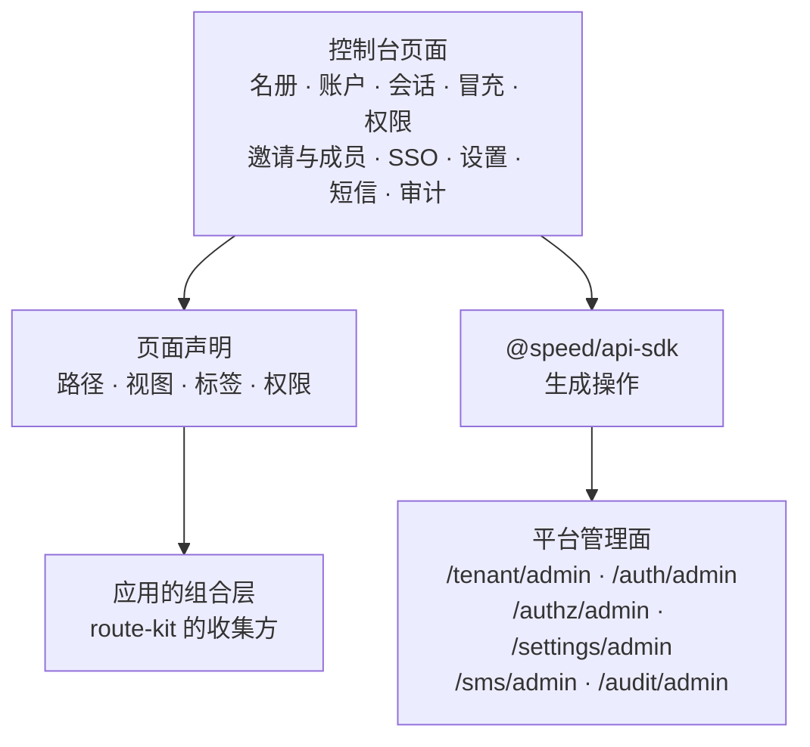

# console-ui

## 职责

`@speed/console-ui` 是平台员工的控制台面组件族：把后端的管理面渲染成一组由平台员工操作的页面。它对应后端的下列管理面：

- **租户管理**：名册的读写，经 `/tenant/admin`（[tenant.admin](../tenant/design-tenant-admin.md)、[ADR-console-tenant-2026-10-15](../../../adr/adr-console-tenant-2026-10-15.md)）。
- **账户管理**：账户的列出、详情与无请求体写入，经 `/auth/admin/accounts`。
- **会话管理**：按账户列出会话并撤销，经 `/auth/admin/accounts/:id/sessions` 与 `/auth/admin/sessions/:id`。
- **冒充管理**：冒充记录的列出与终止，经 `/auth/admin/impersonations`。
- **权限管理**：角色、授权、权限目录与账户绑定，经 `/authz/admin`。
- **邀请与成员**：按租户的邀请与成员，经 `/auth/admin/tenants/:tenant/invitations` 与 `/auth/admin/tenants/:tenant/members`。
- **SSO 提供方**：按租户的提供方与域名，经 `/auth/admin/sso/providers` 与 `/auth/admin/tenants/:tenant/sso/providers`。
- **设置读写**：运行期设置的读写，经 `/settings/admin`（[settings.admin](../settings/design-settings-admin.md)、[ADR-console-settings-2026-10-15](../../../adr/adr-console-settings-2026-10-15.md)）。
- **短信模板**：运行期短信模板的读写，经 `/sms/admin`。
- **审计查询**：审计记录的检索，经 `/audit/admin`（[audit.admin](../audit/design-audit-admin.md)、[ADR-audit-admin-2026-10-15](../../../adr/adr-audit-admin-2026-10-15.md)）。

**每个页面以 ui-kit 的 `PageHeader` 开篇**：页标题即该页的一级标题，一条从控制台到该页的面包屑，以及一个重读该页数据的刷新动作（页头操作）。标题层级因此不跳级——`AsyncSection` 的占位与各节的次级标题都渲染在它之下。

**它是平台侧的壳（第二种壳）。** 上述管理面挂在**不解析租户**的端上：名册是平台资产、审计表持有全部租户的行、设置的全局层是平台操作。故本包没有**当前租户**切换器，也就没有租户作用域的查询键——它不认识「当前租户」这个概念。

**按租户寻址的页面持租户选择器。** 权限面、邀请与成员面、SSO 提供方面把租户当作**路由段参数**（`/authz/admin/tenants/:tenant/...`）。这些页面仍是平台员工的页面，但每条请求指名它作用到的租户；租户是请求的一个实参，不是会话的当前租户。页面因此持一个租户选择器（数据来自平台名册读 `GET /tenant/admin/tenants`），在其取值为空前禁用该页的租户作用域读。

**它复用声明式注册面。** 每个页面导出的一份声明即 [route-kit](design-web-route-kit.md) 的 `RouteDeclaration`：路径 pattern、视图回调、可选导航标签、可选权限码（[ADR-web-route-seam-2026-10-15](../../../adr/adr-web-route-seam-2026-10-15.md)）。`permission` 是数据，本包不据它判定；`label` 缺席即该页不进导航。声明由应用的组合层收齐后交给路由层渲染；本包不 import `route-kit`，也不自己做路径匹配或导航。壳另交出一个 `onNavigate` 回调接缝：宿主给了它，帧内点一条导航项即把该项的路径交回调（由宿主的路由器就地跳转，不整页重载），不给则该项是整页链接。租户侧的 [product-shell](design-web-product-shell.md) 用同一份声明形状，两者只是壳不同。

### 非职责

- **不管理「当前租户」。** 切换当前租户是租户侧的动作，归 [tenancy-ui](design-web-tenancy-ui.md)；管理名册（开租户、改名、停用）是运维侧的动作，归本包。切换改的是宿主的路由，管理改的是名册，两者不共用控件、不共用查询键。按租户寻址的页面的租户选择器选的是**请求的实参**，不是当前租户，它与切换控件不共用状态。
- **不做导航、不解析 URL。** 页面的路径匹配、链接构造、深链接解析与未命中回退归 `route-kit` 的收集方；本包只提供页面与它们的声明，不做路径匹配。
- **不做判定。** 名册、账户、会话、冒充、权限、邀请与成员、SSO、设置与审计的授权判定都在服务端的平台域（设置的租户层在那个租户的域）做出，本包只渲染应答；路由级的授权是宿主的组合（经 [layout-kit](design-web-layout-kit.md) 的路由守卫与 [auth-core](design-web-auth-core.md) 的权限读数），不在本包内。
- **不遮蔽敏感值。** 敏感设置项的值由 [settings.admin](../settings/design-settings-admin.md) 在应答里遮蔽；本包照渲染应答，不做第二处遮蔽。
- **不持规则、不持数据。** 每条路的动作是一次生成的调用；名册的写入语义、账户的状态机、权限的取值、审计的列都在各自的模块里定义。
- **不拥有查询客户端。** 读经 `@speed/api-sdk` 的生成 react-query 钩子跑在宿主拥有的 QueryClient 上，写经同一 `bindRequestFn` 绑定的生成 mutation；本包从不自造 QueryClient。查询键由生成钩子自带（`get<operation>QueryKey`），本包不自写键；按租户寻址的读的键由生成工厂按租户分段，故切租户即换键。

## 外部接口契约

本包的公开面由 `web/packages/console-ui/src/index.ts` 导出：各管理面的页面声明集与页面组件、控制台壳、以及页面读写的操作束。页面声明的形状与壳的入参如下。

```tsx
// 一份页面声明：形状即 route-kit 的 `RouteDeclaration`——路径 pattern、视图回调、
// 可选导航标签、可选权限码。本包不 import `route-kit`，导出满足该结构的值。
interface ConsoleRoute {
  readonly path: string
  readonly view: (context: ConsoleRouteContext) => ReactNode
  readonly label?: ReactNode
  readonly permission?: string
}

// 控制台壳：由带标签的声明派生平台导航，渲染宿主的路由内容。
interface ConsoleShellProps {
  readonly routes: readonly ConsoleRoute[]
  readonly children: ReactNode
  readonly title?: ReactNode
  readonly headerActions?: ReactNode
  // 帧内导航的点击回调：给了它即把被激活条目的路径交回调（宿主的路由器
  // 就地跳转）；不给即该项是整页链接。
  readonly onNavigate?: (href: string) => void
  readonly sx?: SxProps<Theme>
}
```

### 页面声明

每个管理面导出一份页面声明表，全部汇总为 `consoleRoutes`（导航顺序即下表顺序）。路径是相对控制台根的 pattern，导航标签是一个在渲染时经 console-ui 命名空间解析的 `ConsoleNavLabel`，权限码是该页数据所持的平台权限（数据；本包不据它判定）。

| 声明 | 路径 | 导航标签键 | 权限码 |
|---|---|---|---|
| `tenantAdminRoutes` | `/tenants` | `tenants.title` | `tenant.read` |
| `accountsAdminRoutes` | `/accounts` | `accounts.title` | `authn.account.read` |
| `sessionsAdminRoutes` | `/sessions` | `sessions.title` | `authn.session.read` |
| `impersonationsAdminRoutes` | `/impersonations` | `impersonations.title` | `authn.impersonation.read` |
| `permissionsAdminRoutes` | `/permissions` | `permissions.title` | `authz.role.read` |
| `invitationsAdminRoutes` | `/invitations` | `invitations.title` | `authn.membership.manage` |
| `ssoAdminRoutes` | `/sso` | `sso.title` | `authn.idp.manage` |
| `settingsAdminRoutes` | `/settings` | `settings.title` | `settings.read` |
| `smsAdminRoutes` | `/sms` | `sms.title` | `sms.template.read` |
| `auditAdminRoutes` | `/audit` | `audit.title` | `audit.read` |

### 写入的请求参数由平台的 OpenAPI 片段声明

本包的写请求经生成的客户端发出，请求体来自平台 OpenAPI 片段里该端点的 `requestBody`。下列端点在平台的片段中没有 `requestBody` 声明，生成的客户端不为它们发送请求体，故本包不为这些写入渲染控件：账户的创建、改动、状态变更、MFA 要求、口令重置、标识新增、服务密钥新建；SSO 提供方的创建与改动、域名的认领；成员写入与 SSO 豁免。这些端点在后端处理器上解码请求体，但片段未声明它。

**稳定性承诺。** 公开面是 `src/index.ts` 的导出集；本包不提供当前租户，不 import `route-kit` 与 `tenancy-ui`；每条路的请求经绑定的客户端，写经生成的 mutation。改动这些是消费者可见的破坏性变更。

## 依赖

| 依赖 | 用途 |
|---|---|
| `@speed/api-sdk` | 各管理面端点的生成读钩子与写 mutation |
| `@speed/ui-kit` | 主题、表单、对话框、数据表与空态原语 |
| `@speed/i18n` | 命名空间注册与文案的翻译钩子 |
| `@tanstack/react-query` | peer（必需）：宿主供给的 QueryClient |
| `react`、`react-dom`、`@mui/material`、`@emotion/*` | peer（必需）：宿主拥有的 React／MUI 树 |

**本包不 import `route-kit` 与 `tenancy-ui`。** 页面声明即 route-kit 的 `RouteDeclaration`，收集方在应用的组合层；本包没有当前租户切换器，故租户侧的切换控件不在这里出现。按租户寻址的页面持的租户选择器由本包自造，取自平台名册读，与 tenancy-ui 的切换控件无关。壳交出的 `onNavigate` 是一个回调，由宿主接上它自己的路由器，本包与 `route-kit` 之间仍无 import 边。

## UML 图

页面经生成操作打向管理面端；页面声明由应用的组合层收齐。图里画不到的约束：本包所在的平台管理面挂在**不解析租户**的端上，故壳里没有当前租户切换器；按租户寻址的页面的租户是请求实参；判定在服务端做出，本包只渲染应答；声明形状即 route-kit 的 `RouteDeclaration`，但本包不 import `route-kit`。



## 核心数据结构

| 概念 | 形状 | 说明 |
|---|---|---|
| 页面声明 | `ConsoleRoute` | 即 route-kit 的 `RouteDeclaration`：路径 pattern、视图回调、可选导航标签、可选权限码 |
| 租户作用域选择 | 页面自身状态 | 按租户寻址的页面持有的租户 id，作为请求实参，缺省为空即禁用该页的租户作用域读 |
| 命名空间 | `consoleUiResources` | 双语文案目录，叶子键集跨语言相同 |

## 核心算法与流程

### 一次管理请求

1. 页面从生成钩子或 mutation 发出请求，经宿主绑定的客户端。
2. 服务端在平台域（设置的租户层在那个租户的域）判定调用方的权限；无身份 401，权限不足 403。
3. 应答落地：读渲染列表或详情的视图，写渲染结果并失效相关查询；被拒渲染错误码文本。
4. 写路由的强制档审计落在服务端动作之前；本包不写审计行。

### 按租户寻址的请求

按租户寻址的读以租户选择器的取值为查询键的一段，故切租户即换键、旧租户的数据自行失效。取值为空时该读声明为禁用（不发出请求）；页面渲染一段说明，提示先选择租户。

### 审计查询的筛选与分页

审计页把工具栏的 `since`、`until` 与 `action` 集合作为读的查询参数，在提交时应用（一次键入不触发请求）。审计读按游标分页：应答带出下一页的游标，页脚据此前进与后退；游标式读不数总数，故页脚不显示总数。

### 与租户侧的分工

租户这个概念在两处是两类动作：**切换当前租户**（改变宿主路由解析出的租户）在租户侧，归 [tenancy-ui](design-web-tenancy-ui.md)；**管理租户名册**（开租户、改名、停用）在运维侧，归本包。按租户寻址的页面持的租户选择器既不是当前租户、也不是名册管理：它是平台请求的一个实参。三者不共用控件、不共用查询键。

## 错误与失败语义

本包的失败面如下。

| 情形 | 表现 |
|---|---|
| 无身份 | 401，由服务端写出，宿主转入登录面 |
| 权限不足 | 403，由服务端写出；路由级守卫由宿主组合 |
| 请求形状不可读 | 服务端写出 400，页面渲染错误码文本 |
| 名册的登记冲突 | 409（`urn:speed:tenant:conflict`），页面渲染冲突文本 |
| 敏感设置项 | 值由服务端遮蔽，页面渲染遮蔽串 |
| 短信管理面未挂载 | 读取失败，页面渲染可重试的错误占位，并说明该面只在配置了短信服务商的部署上挂载 |
| 白名单外的码 | 渲染通用失败文本，不渲染裸键 |

## 实现状态

| 能力 | 状态 | 代码 |
|---|---|---|
| 控制台壳与声明面接入 | 已实现 | `web/packages/console-ui/src/ConsoleShell.tsx` `ConsoleShell`、`ConsoleShellProps`；`web/packages/console-ui/src/route.ts` `ConsoleRoute`、`ConsoleRouteTable` |
| 租户管理页（PageHeader 开篇） | 已实现 | `web/packages/console-ui/src/TenantRosterPage.tsx` `TenantRosterPage`；`web/packages/console-ui/src/routes.tsx` `tenantAdminRoutes` |
| 账户页（列出、详情、无请求体写入） | 已实现 | `web/packages/console-ui/src/AccountsPage.tsx` `AccountsPage`；`web/packages/console-ui/src/routes.tsx` `accountsAdminRoutes` |
| 会话页（按账户列出与撤销） | 已实现 | `web/packages/console-ui/src/SessionsPage.tsx` `SessionsPage`；`web/packages/console-ui/src/routes.tsx` `sessionsAdminRoutes` |
| 冒充页（列出与终止） | 已实现 | `web/packages/console-ui/src/ImpersonationsPage.tsx` `ImpersonationsPage`；`web/packages/console-ui/src/routes.tsx` `impersonationsAdminRoutes` |
| 权限页（角色、授权、目录、绑定） | 已实现 | `web/packages/console-ui/src/PermissionsPage.tsx` `PermissionsPage`；`web/packages/console-ui/src/routes.tsx` `permissionsAdminRoutes` |
| 邀请与成员页（邀请读写、成员列出与移除） | 已实现 | `web/packages/console-ui/src/InvitationsPage.tsx` `InvitationsPage`；`web/packages/console-ui/src/routes.tsx` `invitationsAdminRoutes` |
| SSO 页（列出、删除、元数据、域名操作） | 已实现 | `web/packages/console-ui/src/SsoPage.tsx` `SsoPage`；`web/packages/console-ui/src/routes.tsx` `ssoAdminRoutes` |
| 设置读写页（PageHeader 开篇） | 已实现 | `web/packages/console-ui/src/SettingsPage.tsx` `SettingsPage`；`web/packages/console-ui/src/routes.tsx` `settingsAdminRoutes` |
| 短信模板页（列出、登记、提交、开关、移除） | 已实现 | `web/packages/console-ui/src/SmsPage.tsx` `SmsPage`；`web/packages/console-ui/src/routes.tsx` `smsAdminRoutes` |
| 审计查询页（筛选、游标分页、操作者可读身份） | 已实现 | `web/packages/console-ui/src/AuditPage.tsx` `AuditPage`；`web/packages/console-ui/src/routes.tsx` `auditAdminRoutes` |
| 按租户寻址页面的租户选择器 | 已实现 | `web/packages/console-ui/src/internal/tenant-scope.tsx` `TenantScope` |
| 账户的创建、改动、状态变更、MFA 要求、口令重置、标识新增、服务密钥新建 | 未实现 | — |
| SSO 提供方的创建与改动、域名认领 | 未实现 | — |
| 成员的写入与 SSO 豁免 | 未实现 | — |
| 页头、双语资源与错误码白名单 | 已实现 | `web/packages/console-ui/src/locales/zh-CN.json`、`en-US.json`；`web/packages/console-ui/src/internal/error-text.ts` |
