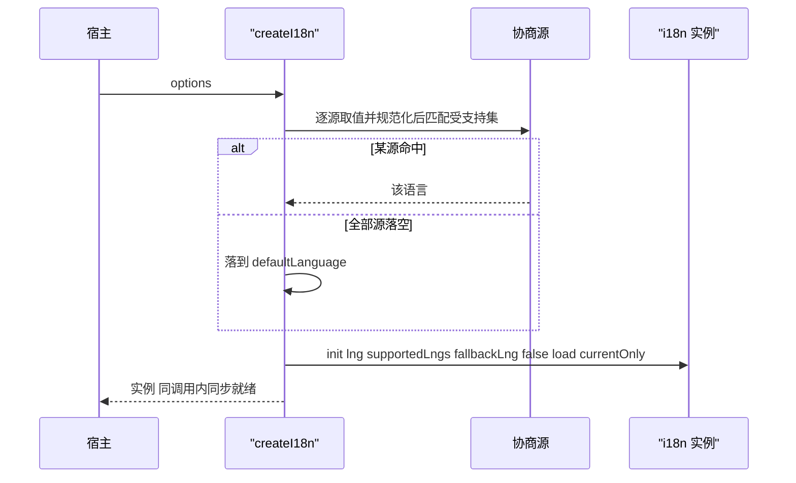

# i18n

## 职责

本包是 web 包树的国际化层，包裹 react-i18next 与 i18next 并加上一套纪律：每宿主一个实例，一个协商出的起始语言，按包注册的命名空间（注册时校验覆盖与键集），以及**缺键绝不静默回落到另一种语言**。

它把一个宿主需要的整条 i18n 面收在一处：实例创建（`createI18n`）、语言切换（`switchLanguage`）、命名空间注册（`registerNamespace`）、实例自身受支持语言的读取（`readSupportedLanguages`）、缺键处置（`defaultMissingKeyHandler` 与 `MissingKeyDetails`）、错误码到文本的约定（`createErrorTextResolver` 与共享错误码家族），以及 react-i18next 的绑定再导出（`I18nextProvider`、`useTranslation`）。MUI 本地化助手在独立子路径 `@speed/i18n/mui-locale`，平台错误文案包在 `@speed/i18n/platform-errors`。

react 绑定只从这里再导出，组件包与宿主不直接 import `react-i18next`：版本锁步使一个树里只有一个 react-i18next 副本，`useTranslation` 在交付出去的组件里因此安全。

### 非职责

- **不渲染服务端生成的文案。** 错误响应、通知类的正文由产生它们的后端模块渲染，客户端与服务端的分工被记为 [ADR-i18n-scope-2026-10-13](../../../adr/adr-i18n-scope-2026-10-13.md)：客户端界面的文案由前端自己的机制承担，服务端文案不进这里。本包只渲染前端界面文案，机器码（如错误码）由前端按码解析成文本。
- **不持某个具体包的文案，也不在组件或 provider 内注册命名空间。** 每个包交付自己的双语资源，宿主在启动处调用一次 `registerNamespace`；命名空间注册两次会抛错，因此它不能落在组件生命周期里。
- **不生成文案。** 后端错误码到前端文本的包是 `@speed/i18n/platform-errors` 的机械产物，由生成器从后端目录产出；本包只承载并注册它。
- **不做 MUI 本地化本身。** MUI 的本地化对象由 MUI 提供，本包只把语言标签映射到它（见扩展点）。
- **不持业务状态，不发请求。** 档案语言的解析（如经 `/me`）在宿主一侧，本包只接受其结果。

## 外部接口契约

```ts
export function createI18n(options?: CreateI18nOptions): I18nInstance
export function switchLanguage(instance: I18nInstance, language: string, storage?: StorageLike | null): Promise<void>
export function registerNamespace(instance: I18nInstance, namespace: string, resources: Readonly<Record<string, ResourceBundle>>): void
export function readSupportedLanguages(instance: I18nInstance): readonly string[]

export const DEFAULT_LANGUAGE: 'en-US'
export const DEFAULT_SUPPORTED_LANGUAGES: readonly ['zh-CN', 'en-US']
export const SPEED_LOCALE_STORAGE_KEY: 'speed.locale'
export function normalizeLanguageTag(input: string): string | null
export function matchSupportedLanguage(candidate: string, supported: readonly string[]): string | null

export function defaultMissingKeyHandler(details: MissingKeyDetails): void
export function createErrorTextResolver(t: (key: string) => string, knownCodes: ReadonlySet<string>): (code: string) => string
export const SESSION_LIFECYCLE_ERROR_CODES: readonly string[]
export const CLIENT_TRANSPORT_ERROR_CODES: readonly string[]

export { I18nextProvider, useTranslation } from 'react-i18next'
```

`@speed/i18n/mui-locale`：`muiLocaleFor(language)` 与 `MuiLocale`。
`@speed/i18n/platform-errors`：`PLATFORM_ERRORS_NAMESPACE` 与 `registerPlatformErrors(instance)`。

**`createI18n` 的选项契约**（`CreateI18nOptions`）：`supportedLanguages`、`defaultLanguage`、`urlParameterName`、`searchParams`、`storage`、`storageKey`、`profileLanguage`、`navigatorLanguages`、`onMissingKey`、`fallbackNamespaces`。除实例选项外，每个可协商输入都可注入（`searchParams`、`storage`、`navigatorLanguages`），浏览器对象只经守卫读，因而测试与非浏览器宿主是确定性的。

**`switchLanguage` 的契约，约束的主体是它的每个调用方**：目标语言必须是实例受支持集里的成员，否则抛错而不静默切到别处；持久化是尽力而为，写存储失败只记一条 `[speed-i18n]` 前缀的可见告警，不使切换失败——promise 恰在实例语言改变时 resolve，拒绝则一定是切换没有发生。**实例没有携带存储绑定**（不是 `createI18n` 创建的实例）时同样只记一条可见告警并完成切换：持久化悄悄不发生与写失败同样不可接受。可选的 storage 入参是三态：`undefined` 用创建时绑定的存储，`null` 不持久化，一个 `StorageLike` 改向到那个存储。**人工切换界面用持久化态，应用服务端解析出的档案语言必须用 `null`**——存储槽是协商链里的人工选择层，持久化一次档案应用会在此后每次访问盖过档案层。

**`registerNamespace` 的契约**：命名空间必须是裸名（`[A-Za-z][A-Za-z0-9_-]*`，不长成 npm 作用域名）；资源以规范语言标签映射到 bundle，每个键都必须是实例受支持的语言，**每个受支持语言都必须出现**；所有 bundle 必须携带**相同的叶子键集**；叶子必须是非空字符串；复数形是后缀叶子，其族必须覆盖每个受支持语言能选中的全部计数类别。任一不符即抛错，且**在落地任何资源之前**抛出。

**`readSupportedLanguages` 的契约**：报告实例创建时钉住的受支持语言集，过滤掉 i18next 内部的 `cimode` 元语言；未钉住该集的实例返回空数组——`registerNamespace` 与 `switchLanguage` 都拒绝这种实例。

### 对外接口面

`createI18n` 的选项、`registerNamespace` 的语义、入口的导出面（由 `index.test.ts` 的精确导出清单钉住），以及缺键纪律所依赖的实例选项（`fallbackLng: false`、`load: 'currentOnly'`、`saveMissing: true`、始终安装的缺键处理器）和插值纪律（`interpolation.escapeValue: false`），是本包对消费方的接口面。变更按 TypeScript 的源码语义分类：新增导出、新增可选字段是源码兼容的；删除导出或字段、改既有导出或字段的含义或名、改签名（参数或返回类型），是不兼容变更。把必选与可选互转按位置判：输入位（宿主提供的 prop 或参数）放宽兼容、收紧不兼容；输出位（宿主读取的返回类型或结果字段）相反——放宽为可选使读出的值成为 `T | undefined`，strictNullChecks 下只有在要求 `T` 处使用它的消费者无法编译（对可能为 undefined 的值做成员访问报 TS18048，赋给 `T` 或传入要求 `T` 的形参报 TS2322/TS2345），仅转发或在宽松处使用（模板串、比较、`??`、可选链）的消费者仍编译，故可能破坏消费者、是不兼容变更。入口的精确导出清单在新增导出时同步更新——那是本包的回归守卫，不是对消费方的破坏；扩展入口面要与 AGENTS、README 与测试在同一提交内更新。

## 依赖

| 依赖 | 种类 | 用途 |
|---|---|---|
| `i18next`、`react-i18next` | 依赖 | 引擎 |
| `react` | peer（必需，^18 或 ^19） | 入口安装 `initReactI18next`，返回的实例即宿主渲染所用的 react-i18next 实例 |
| `@mui/material` | peer（可选，^9） | 只有 `./mui-locale` 子路径 import 它；可选 peer 使不装 MUI 的消费方不背这棵树 |

本包不依赖任何同族前端包：它是前端依赖图的地板，`ui-kit` 读它，方向到这里终止。DOM 依赖不扩大：对 location、localStorage、navigator 的读一律守卫且可注入。

## UML 图

一次实例创建：协商链逐源匹配受支持集，全部落空才落到默认语言；实例在同一调用内同步就绪。图里画不出的约束：每个协商源在匹配前先规范化，匹配不到受支持语言的源被跳过而非被采用；默认语言必为受支持集成员，创建时即校验；缺键路径与这里无关——缺键在查找时渲染为键本身，从不落到另一种语言。



## 核心数据结构

| 概念 | 类型 | 说明 |
|---|---|---|
| 宿主实例 | `I18nInstance` | i18next 实例；每宿主一个，已安装 `initReactI18next` |
| 创建选项 | `CreateI18nOptions` | 受支持集、默认语言、各协商源、缺键回调、回退命名空间；各协商源可注入 |
| 资源包 | `ResourceBundle` | 语言到 bundle；bundle 是嵌套的字符串叶子 |
| 存储面 | `StorageLike` | `getItem`/`setItem`；满足 localStorage 与宿主测试替身 |
| 存储绑定 | 挂在实例自身上的私有记录 | 创建时解析的存储与键以包内注册符号为键挂在实例上，切换经同一绑定写；从实例派生的对象（如 `useTranslation` 交回的包装）连同其余自有属性一起携带它 |
| 缺键详情 | `MissingKeyDetails` | 查找涉及的语言、命名空间、键 |

**实例由创建时的选项定型**：纪律选项（受支持集、`fallbackLng: false`、`load: 'currentOnly'`、`saveMissing` 与缺键处理器）保证缺键不回落到别的语言，协商结果（起始语言）决定从哪种语言开始。**插值按原样进入文本**：实例固定 `interpolation.escapeValue: false`，因为 React 把译文字符串当作文本节点渲染时已转义一次，引擎再转义一次会把实体本身（路径里的 `/` 显示成 `&#x2F;`、租户名里的 `&` 显示成 `&amp;`）呈现给用户；本包只渲染进 React，没有任何一层消费 HTML。这条前提由工作区的 `speed/no-dangerous-html` ESLint 规则守住：运行时源码里的 `dangerouslySetInnerHTML`、`innerHTML` 或 `outerHTML` 的赋值、`insertAdjacentHTML` 与 `document.write` 报错，故新增一处 HTML 消费点不会让本实例的原文插值静默变成 XSS 通道。`fallbackNamespaces` 是唯一到达 i18next 自身选项面的宿主选项（落为 `fallbackNS`），其未设状态（`fallbackNS` 为 false）与「没有配置回退命名空间」是同一件事。

## 核心算法与流程

### 起始语言的协商

按下列次序逐源取值，第一个匹配到受支持语言者胜，全部落空才用默认语言：

1. **URL 参数**（缺省 `lang`），分享链接的显式覆盖。
2. **持久化的选择**，人工语言切换经 `switchLanguage` 写入的槽。
3. **档案语言**，已登录用户解析出的语言，由宿主在创建前解析。
4. **浏览器语言**，按偏好次序。
5. **默认语言** `en-US`。

匹配先按规范标签大小写不敏感地精确匹配，再做双向的语言子标签放宽，且**从不跨语言**：一个带区域的请求（如 `ja-JP`）选中同语言的受支持裸标签（如 `ja`），一个裸请求（如 `en`）选中唯一带其主子标签的受支持标签。每个源在匹配前先规范化（下划线转连字符），匹配不到受支持语言的源被跳过。

**未知的浏览器语言落到 `en-US` 是有意的协商默认**，可被 `defaultLanguage` 覆盖；它与缺键规则是两回事，后者从不回落。默认语言 `en-US` 是平台默认，与后端内容链的落点一致（[ADR-i18n-default-locale-2026-10-13](../../../adr/adr-i18n-default-locale-2026-10-13.md)）。

### 命名空间注册的校验

1. 命名空间匹配裸名模式，否则抛错。
2. 实例未钉住受支持集、或该命名空间已在本实例注册过，抛错。
3. 资源非空，且每个语言键都在受支持集内；每个受支持语言都必须有 bundle，缺一抛错。
4. 逐一收集每个 bundle 的叶子路径；遇空字符串叶子抛错；遇非字符串非对象的叶子抛错。
5. 以一个参照语言的键集为准，逐语言比对缺失键与多余键，有差即抛错并列出叶路径。
6. 收集复数族（末段以 `_<类别>` 结尾的叶子），用与渲染端同一套 `Intl.PluralRules` 解析每个受支持语言的计数类别，凡某语言可选而族未携的类别即抛错并点名。
7. 校验全过之后才逐个 `addResourceBundle` 落地；落地中任一失败则回滚已落地的 bundle，命名空间保持未注册；全部落地后才记下已注册标记。

**键集对齐的代价落在每个 bundle 上**：一个语言需要的复数形要在全体语言的 bundle 里都携（zh-CN 带 `_one` 形，供 en-US 计数为一时选中，zh-CN 自身从不选中）。新增一种复数类别更丰富的语言，要扩每份 bundle 里每个复数族。

### 缺键的处置

关键缺键时渲染为键本身，**绝不渲染同一键在另一种语言里的文本**；同时触发缺键处理器，携带 `MissingKeyDetails`——默认处理器记一条 `[speed-i18n]` 前缀的可见告警，宿主可在创建时给 `onMissingKey`。缺键处理器是除告警外不抛错的表面：一次生产查找必须可见地降级，而不是崩溃。注册时的覆盖与键集校验是配套保证：整语言或整键的缺口在注册时即以错误浮现。注册之后出现的缺口无法经本包的 API 驱动——`registerNamespace` 校验键集并拒绝二次注册，i18next 自身的移除是按语言与命名空间、从不按键。

**回退命名空间是唯一允许的扩展，且是命名空间回退、从不是语言回退**：宿主经 `fallbackNamespaces` 点名被查命名空间缺键时改查的命名空间，每个被改查的命名空间都在同一协商语言下解析（`fallbackLng` 仍为 false，`load` 仍为 `currentOnly`），且已注册命名空间总覆盖全集，因而不可能供给另一种语言的文本。未设该选项即不配置任何回退命名空间。

### 错误码到文本

失败以码到达（API 信封的码、api-client 的传输码、分类器的坍缩目标），文本从码解析，而不是取自 API 的英文兜底消息（那仅供日志分诊）。约定：白名单内的码解析到 bundle 的 `errors` 段下它自己的叶子（`errors.<code>`，平台错误包与各包自带的 `errors` 段同用这一段），未列出的码解析到 `errors.unknown`。`createErrorTextResolver` 因此永不渲染裸键，缺译也不泄漏另一种语言的文本。共享错误码家族随本包交付，因为每个受保护表面都可能被它们答复；**共享码的文本住在各消费包自己的 bundle 里**，同层包不互相 import 文案。

### 语言切换与持久化

`switchLanguage` 先校验目标在受支持集内，再向绑定（或入参指定的）存储写入选择（写失败只告警；实例未携带绑定时同样只告警），最后 `changeLanguage`。`createI18n` 侧的读同样受保护：读存储抛错即视为「没有已存选择」，协商继续，创建从不因存储失败而失败。

**绑定随实例走，而不按创建时的对象身份查表**：人工切换界面拿到实例的路径是 `useTranslation`，它交回的是以实例自有属性描述符构造出的派生对象，与 `createI18n` 返回的对象并非同一身份；绑定以注册符号挂为实例的自有属性，派生对象连同其余自有属性一起携带它，模块出现第二份副本时同一注册符号也仍指向同一个键。读受支持集走的是实例选项，不查绑定，因此「没有抛错」从来不能证明绑定还在——这类缺陷只有持久化本身能暴露。

### MUI 本地化映射

`muiLocaleFor` 把规范语言标签映射到 `createTheme` 需要的 MUI 本地化对象，未知标签抛错而不静默配错语言。`AppThemeProvider` 在渲染路径上不用它的抛错形态，改用一个落到 en-US MUI 本地化的兜底（见 [ui-kit](design-web-ui-kit.md)）。

## 错误与失败语义

| 情形 | 表现 |
|---|---|
| 受支持集为空、或含非规范标签 | `createI18n` 抛错，点名规范拼写或「不是语言标签」 |
| 默认语言不是受支持集成员 | `createI18n` 抛错，列出受支持集 |
| 命名空间名不符模式、或已注册 | `registerNamespace` 抛错 |
| 资源缺某个受支持语言、或含不受支持语言 | `registerNamespace` 抛错，列出缺的或多的语言 |
| 键集在有语言间不一致 | `registerNamespace` 抛错，列出缺失与多余的叶路径 |
| 叶子为空字符串 | `registerNamespace` 抛错，点名叶路径 |
| 复数族缺某语言可选的类别 | `registerNamespace` 抛错，点名族、语言与缺的形 |
| 某语言的复数类别无法解析（Intl 拒绝该标签） | `registerNamespace` 抛错，明说复数校验无法运行 |
| `switchLanguage` 目标不受支持 | 抛错，列出受支持标签 |
| 在未钉住受支持集的裸实例上注册或切换 | 抛错，点名用 `createI18n` 创建 |
| `muiLocaleFor` 收到未知标签 | 抛错（直呼者想要主题装配期的响亮失败） |
| 缺键 | 渲染为键本身并触发缺键处理器；不抛错，不回落 |
| 存储写失败 | 仅记可见告警，切换照常完成 |
| 实例未携带存储绑定（不是 `createI18n` 创建的实例） | 仅记可见告警，切换照常完成 |
| 创建时读存储失败 | 视为无已存选择，不使创建失败 |

**注册是端到端原子的**：任一校验失败在落地前抛出；落地中途失败回滚，命名空间保持未注册，重试即一次全新注册。

## 并发与事务边界

- **注册标记按实例隔离**：已注册命名空间记在一个以实例为键的 `WeakMap` 里，随实例回收，不跨实例泄漏。一个命名空间在同一个实例上注册恰好一次。
- **注册是一个事务边界**：校验全部先行，落地失败回滚已落地的 bundle，注册标记只在全部落地后才置。
- **存储绑定随实例走**：创建时解析的存储与键作为包内注册符号属性挂在实例自身，`switchLanguage` 经同一绑定写，使创建期的探测与之后的切换保持一致；派生对象（`useTranslation` 的包装）与模块的第二个副本都不会把绑定同实例分开。
- 本包不持跨请求的连接或后台任务；语言切换是一个 promise，在实例语言改变时 resolve。

## 扩展点

- **新增一种语言。** 触及：`DEFAULT_SUPPORTED_LANGUAGES` 与 `DEFAULT_LANGUAGE` 的选择、`muiLocaleFor` 的映射（MUI 本地化必须存在）、每个命名空间的双语夹具、每份 bundle 里每个复数族的覆盖，以及键集与覆盖测试。一个语言只在每个命名空间都能覆盖它时才发布——部分支持在注册时被拒。
- **新增一个命名空间。** 消费包在自己的 `locales/` 下出 zh-CN 与 en-US、结构一致、无空串、每个复数族带齐类别，宿主在启动处注册一次。
- **新增错误码家族。** 消费包组合自己的可达码与 `SESSION_LIFECYCLE_ERROR_CODES`、`CLIENT_TRANSPORT_ERROR_CODES`，把本命名空间的 `t` 绑进 `createErrorTextResolver`；在包内手搓键的构造会重新打开裸键与跨语言的缺口。

## 实现状态

| 能力 | 状态 | 代码 |
|---|---|---|
| 实例创建与语言协商链 | 已实现 | `web/packages/i18n/src/create.ts` `createI18n`；`web/packages/i18n/src/languages.ts` `detectLanguage`、`matchSupportedLanguage`、`normalizeLanguageTag`、`readSupportedLanguages` |
| 语言切换与持久化 | 已实现 | `web/packages/i18n/src/create.ts` `switchLanguage`；`web/packages/i18n/src/storage.ts` `SPEED_LOCALE_STORAGE_KEY`、`StorageLike` |
| 命名空间注册与校验 | 已实现 | `web/packages/i18n/src/register.ts` `registerNamespace`、`ResourceBundle` |
| 缺键纪律 | 已实现 | `web/packages/i18n/src/missing-key.ts` `defaultMissingKeyHandler`、`MissingKeyDetails` |
| 错误码文本约定 | 已实现 | `web/packages/i18n/src/error-text.ts` `createErrorTextResolver`、`SESSION_LIFECYCLE_ERROR_CODES`、`CLIENT_TRANSPORT_ERROR_CODES` |
| MUI 本地化映射 | 已实现 | `web/packages/i18n/src/mui-locale.ts` `muiLocaleFor`、`MuiLocale` |
| 平台错误文案包与注册 | 已实现 | `web/packages/i18n/src/platform-errors.ts` `PLATFORM_ERRORS_NAMESPACE`、`registerPlatformErrors` |
| react 绑定再导出 | 已实现 | `web/packages/i18n/src/index.ts` `I18nextProvider`、`useTranslation` |
