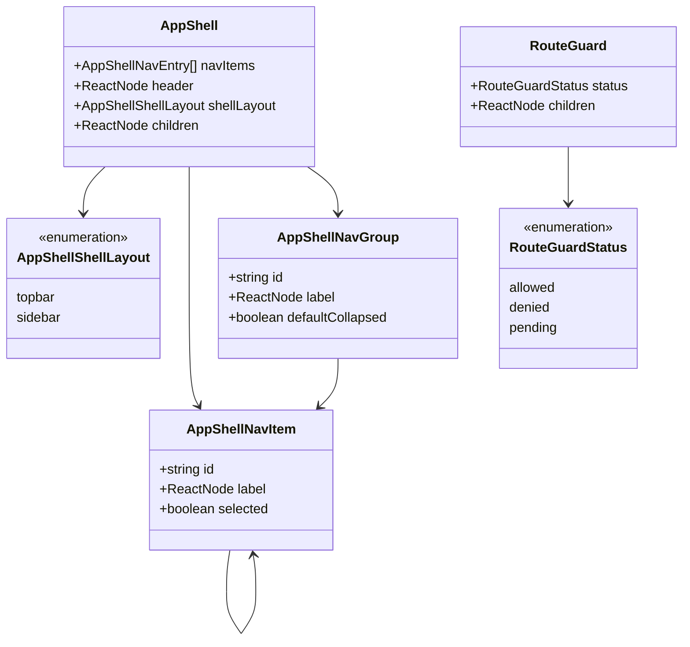

# layout-kit

## 职责

与认证无关的应用外壳，包 `web/packages/layout-kit`。交付 `AppShell`、`RouteGuard` 与 `Avatar`，以及它们渲染自身文字所用的双语命名空间。

- `AppShell` 交付一块响应式应用外壳，含两种 chrome 形态：顶栏形态（缺省）把一个固定的顶部栏（`header`/banner 地标）、一个随视口变化的导航抽屉（`nav` 地标，`md` 断点及以上常驻、以下为临时覆盖式）与一个 `main` 内容区装配在一起；侧栏形态在 `md` 及以上不渲染顶栏，把品牌、收起开关、头部动作与用户菜单移进抽屉纸，`md` 以下渲染一条只含抽屉触发与品牌的极简顶栏。它把宿主交来的导航项、头部内容与子节点原样摆进这些地标，自身不做任何路由判定。桌面侧边栏可收起——一个由宿主显式选择的受控面（收为仅图标的窄栏，见下）。
- `Avatar` 交付一个纯展示的身份块：有图渲染图、无图取名字首字母，可对无障碍树隐身（外层控件自带标签）。
- `RouteGuard` 按宿主算好的一个状态值（`RouteGuardStatus`）决定是否放行子节点。三态互斥——放行、等待、拒绝——等待态与拒绝态各有一个缺省占位，可由宿主整体替换。
- 两者都不认识任何具体的认证或路由机制。`RouteGuard` 的判决是一个由宿主计算并传入的普通值，不是一个它去调用的回调；`AppShell` 的导航项（含哪一项选中）完全由宿主算好。这层「宿主注入一切」的形状，使租户侧装配壳与平台侧外壳能共用同一个包而各自接上不同的授权来源：授权来源一变，本包不变。

### 非职责

- **不导入任何具体认证或路由包。** `RouteGuard` 不得 import `@speed/auth-core`、任何路由器，或任何假设了某种认证机制的包；授权判决以 `status` 值传入。`AppShell` 不做路径匹配——不同宿主用不同路由器，本包对它们一视同仁，`selected` 由宿主算。
- **不发任何 HTTP 请求。** 本包是外壳与门，取数归宿主与其数据层。
- **不持业务与租户语义。** 导航项标签、头部、横幅、用户菜单、子节点都是宿主内容，本包不发明它们，也不认识「租户」这个概念。
- **不做认证机制本身。** 登录、登出、会话读取与权限求值都不在本包内；`RouteGuard` 只按传入的判决渲染。把某个授权来源接上 `RouteGuard` 是宿主的组装工作。
- **不发明新的宿主可见行为来应付窄视口。** 窄视口防护是纯附加样式，不新增也不改动任何 prop；AppShell 只渲染宿主交来的内容，没有自动收起的溢出菜单这类隐式行为。桌面侧边栏的收起与之相反：是一个宿主显式选择的受控 prop 对，不是隐式的响应式行为。
- **不把外壳形态开放为自由布局。** 形态是一个闭合的枚举，不是可由宿主拼装的插槽集合：地标结构、焦点顺序、固定头占位测量与抽屉两态是外壳的可及性保证，形态只能作为枚举成员加入本包，并随模板一并被测试与文档覆盖。内容定制仍由槽位承担。

## 外部接口契约

宿主与同级包从 `web/packages/layout-kit/src/index.ts` 取用以下符号；其余实现细节留在 `src/internal/`，不导出。

### AppShell

```ts
export interface AppShellNavItem {
  readonly id: string                              // React key，不渲染
  readonly label: ReactNode                        // 宿主内容，已翻译
  readonly icon?: ReactNode
  readonly href?: string                           // 有则渲染成链接
  readonly onClick?: MouseEventHandler<HTMLElement> // 有无 href 都触发
  readonly selected?: boolean                      // 宿主计算
  readonly children?: readonly AppShellNavItem[]    // 二级嵌套：缩进渲染的真实路由子项
}

export interface AppShellNavGroup {
  readonly id: string                              // 稳定 id，兼作初始态键
  readonly label: ReactNode                        // 标题，宿主内容，已翻译
  readonly icon?: ReactNode                         // 可选前导图标；窄栏以它代替被裁剪的标题
  readonly items: readonly AppShellNavItem[]       // 组内导航项
  readonly defaultCollapsed?: boolean              // 初始折叠态，缺省 false 即展开
}

export type AppShellNavEntry = AppShellNavItem | AppShellNavGroup

export interface AppShellNavSlotState {
  readonly narrow: boolean                         // 已挂载的抽屉是否为收起窄栏；临时抽屉恒为 false
  readonly closeDrawer: () => void                 // 关临时抽屉：非受控自关、受控时经 onMobileOpenChange(false) 上报；常驻抽屉下无操作
}

export type AppShellNavSlot =
  | ReactNode
  | ((state: AppShellNavSlotState) => ReactNode)

/** 外壳形态：chrome 在顶栏与侧栏之间的两种落点。缺省 'topbar'。 */
export type AppShellShellLayout = 'topbar' | 'sidebar'

export interface AppShellProps {
  readonly shellLayout?: AppShellShellLayout   // 缺省 'topbar'，即既有行为
  readonly navItems: readonly AppShellNavEntry[]   // 元素为导航项或分组，纯附加拓宽
  readonly header?: ReactNode
  readonly headerActions?: AppShellNavSlot        // 同 navHeader 的渲染函数形态，见下
  readonly userMenu?: AppShellNavSlot             // 同上
  readonly banner?: ReactNode                       // 应用栏之下的整幅横幅，宿主内容，已翻译；缺席、null、false 不渲染容器，宿主节点自身渲染为空时容器零高度
  readonly navLabel?: string                        // 导航地标（与临时抽屉）的可及名，缺省 appShell.navLabel
  readonly navHeader?: AppShellNavSlot              // 抽屉纸内导航地标之前的宿主内容；缺席、null、false 不渲染、不占高
  readonly navFooter?: AppShellNavSlot              // 抽屉纸内导航地标之后的宿主内容；缺席、null、false 不渲染、不占高
  readonly children: ReactNode
  readonly mobileOpen?: boolean                    // 与下一项成对，控制态
  readonly onMobileOpenChange?: (open: boolean) => void
  readonly sidebarCollapsed?: boolean              // 桌面侧边栏收起态，缺省 false
  readonly onSidebarCollapsedChange?: (collapsed: boolean) => void
  readonly sidebarWidth?: number                   // 缺省 280
  readonly sx?: SxProps<Theme>
}

export function AppShell(props: AppShellProps): ReactElement
```

- **`shellLayout` 是外壳形态的纯附加可选 prop。** `'topbar'`（缺省）是既有宿主得到的唯一形态：固定顶栏承载品牌、头部动作与用户菜单。`'sidebar'` 在 `md` 及以上把 chrome 移进抽屉纸：顶部行是 `header` 与桌面收起开关（`onSidebarCollapsedChange` 给出时），中部依次是 `navHeader`、`nav`（撑满剩余高度、自身滚动）、`navFooter`，底部行是 `headerActions` 与 `userMenu`，贴住纸底。抽屉纸在这一形态下 `overflow: hidden`，导航列取 `flex: 1 1 auto` 配 `minHeight: 0` 与 `overflowY: auto`，底部行取 `flexShrink: 0`；这三条只加在 `sidebar` 形态，顶栏形态的纸保持自身滚动。`main` 仍是页面内容的唯一滚动层。`md` 以下，侧栏形态渲染一条只含抽屉触发按钮与 `header` 的极简顶栏；`headerActions` 与 `userMenu` 在临时抽屉的底部行，临时抽屉没有顶部行，品牌全页只出现一次。窄视口下两种形态的 `banner` 都在顶栏之下；侧栏形态的桌面横幅贴在视口顶，且不渲染顶栏，因此没有 `banner` 地标，其极简顶栏是 `md` 以下的 `banner` 地标。
- **固定头只在有内容时渲染。** 顶栏形态的顶栏恒在；侧栏形态在桌面且无 `banner` 时不渲染固定头容器，三处偏移占位返回 `null`，否则未测量的占位会把主题工具条高度留成永久空隙。固定头的渲染高度由 `ResizeObserver` 测量，`main` 与抽屉纸内的占位取同一个值；切换形态或跨断点时测量值复位。收起开关在 `sidebar` 形态落在抽屉纸顶部行末尾，在 `topbar` 形态仍在顶栏；移动端触发按钮的文案复用 `appShell.openNav`/`closeNav`。
- **顶栏形态的顶部栏按视口宽度排成一排或两排。** `md` 及以上不施加分排：抽屉触发（或桌面收起开关）、品牌、`headerActions` 与 `userMenu` 依次排在同一行，品牌占满剩余宽度，仅在内容超宽时按换行回落。`md` 以下排成至多两排：抽屉触发、品牌与 `headerActions` 在第一排，`userMenu` 独占整宽的第二排；工具条左右内边距与控件间距同时收紧一档，品牌以零弹性基准让出宽度并在自身框内省略，第一排因此容得下动作。收紧只作用于顶栏形态：侧栏形态的极简顶栏只有触发按钮与品牌，保持主题的两步间距。两种排布下每个头部控件的可及名、可点击与可见尺寸都保留，排布不靠隐藏或禁用控件取得。

- **导航项与分组是同一入口的两种元素，拓宽是纯附加的。** `navItems` 的元素类型由 `AppShellNavItem` 拓宽为 `AppShellNavItem | AppShellNavGroup`（`AppShellNavEntry`）。这是一处纯附加：`AppShellNavItem[]` 仍可赋值给这个联合数组，未使用分组的宿主逐字节不变。分组渲染为一个带标题的可折叠区：标题本身即展开控件（`aria-expanded` 与其目标 `aria-controls`），组内是普通导航项。带 `children` 的项渲染为一个可展开的父项，其子项缩进渲染，各是真实链接或按钮；父项自身不再是一条导航行（其 `href`/`onClick`/`selected` 不渲染，路由在子项里）。分组与嵌套都复用同一套叶子激活（先 `onClick`、再 `onNavigate`）与 `selected`/`aria-current` 约定。折叠态的组或父项把其子项以 `hidden` 留在 DOM 里，故无障碍树与角色查询在收起时都取不到它们。分组标题可带一个可选图标（`AppShellNavGroup.icon`，纯附加的可选字段）：收起为窄栏时，带图标的标题按图标行呈现，标题文本裁剪但仍作可及名并由提示补足；无图标的标题保留截断的文本，与无图标条目同一回落。
- **`banner` 是与顶部栏同属外壳固定头部的整幅槽，位于顶部栏之下，纯附加的可选字段**（决策见 [ADR-web-impersonation-shell](../../../adr/adr-web-impersonation-shell.md)）。外壳的固定头是一个固定在视口顶部的容器，顶部栏与横幅按文档流依次排在其中：顶部栏始终贴着视口顶，横幅紧随其下、占满视口宽度；内容区的顶部占位随之加高，使内容不被二者盖住；导航抽屉纸仍从视口顶开始，纸内的顶部占位同样加高，使抽屉里的内容落在顶部栏与横幅之下，常驻抽屉纸顶部被二者盖住的那一段不放内容。页面滚动时顶部栏与横幅一起留在视口里，外壳其余部分不动。顶部栏因内容换行而变高时，横幅随之下移，二者不重叠。任一断点都不隐藏它，宿主节点在窄屏下自行换行。它与顶部栏同层（`drawer` 加一），高于页面内容与抽屉纸、低于模态的侧边面板与对话框，不抢焦点。焦点顺序依文档顺序：跳转链接是外壳里第一个可聚焦元素，其后依次是顶部栏里的控件、横幅槽里的可聚焦内容、导航抽屉里的导航项，最后是 `main`。槽容器不带内边距、边框与最小高度，高度完全取自宿主节点：`banner` 缺席、为 `null` 或 `false` 时不渲染容器，宿主节点自身渲染为空（例如只含一个空的 live region）时容器零高度，顶部栏之下不留空隙，未使用它的宿主的外观与焦点顺序不变。槽不加地标也不加 `aria-live`，宿主节点自带它需要的角色与播报；它不是 `banner` 地标，`banner` 地标仍是顶部栏。槽属于 `AppShell` 自身，不属于 `children`，路由切换时不卸载、不重挂。

- **`navHeader` 与 `navFooter` 是抽屉纸内导航地标前后的宿主内容槽，两者都是纯附加的可选字段。** 两个槽都渲染在抽屉纸里：`navHeader` 紧接在 `nav` 地标之前，`navFooter` 紧随其后，常驻与临时两种抽屉一致。它们是地标的兄弟节点而非其内容，故 `nav` 地标及其可及名不变，也不向导航项集合添加条目。槽可给普通宿主节点，也可给一个渲染函数，后者收到已挂载抽屉的状态（`AppShellNavSlotState`）：`narrow` 仅在挂载的是收起窄栏时为真，临时抽屉恒为假；`closeDrawer` 关闭非受控的临时抽屉、受控时经 `onMobileOpenChange(false)` 上报、常驻抽屉下无操作。槽缺席、为 `null` 或 `false` 时不渲染、不占高度。`headerActions` 与 `userMenu` 取同一状态：侧栏形态把它们放进底部行，收起窄栏时 `narrow` 为真，放到窄栏里放不下的宿主控件于是渲染其图标形态，而不是被纸面裁切。

### isPlainPrimaryClick

```ts
export function isPlainPrimaryClick(event: React.MouseEvent | MouseEvent): boolean
```

- **内嵌导航的「普通主键点击」判定。** 只在四项条件全部成立时返回真：主键（`button` 为 `0`，或事件不带该值）、无 ctrl/meta/shift/alt 修饰键、事件未被先前的处理器 `defaultPrevented`、激活所在的最近 `a` 元素既无 `target="_blank"`（按浏览器语义不区分大小写）也无 `download` 属性。链接组件据此决定是否接管一次点击（`preventDefault` 后原地路由）：带修饰键的点击、中键、新标签链接与下载链接保留浏览器自身行为。判定取点击目标最近的锚点祖先，点在链接的子元素上与点在链接上同判。
- **`@speed/console-ui` 的导航点击取用本函数；`@speed/route-kit` 按设计保留一份私有的变体。** 后者独立于全部同级包，不 import 本包。该变体比本函数更严格：`button` 必须恰为 `0`（缺值即拒绝，不视为主键），且除缺失、空串与 `_self` 外的任何 `target` 都判为非普通点击，`_top`、`_parent` 与具名窗口一概交给浏览器；本函数只拒绝 `target="_blank"`，并把缺 `button` 值的事件视为主键。任一方判定的条件改动，须在同一改动中同步到两份副本。

### Avatar

```ts
export interface AvatarProps {
  readonly name?: string        // 显示名；无图时取其首字母
  readonly src?: string         // 图片 URL；缺省或加载失败时退回首字母
  readonly size?: number        // 边长 px，缺省 40
  readonly decorative?: boolean // 为真时移出无障碍树（外层控件自带标签）
  readonly sx?: SxProps<Theme>
}
export function Avatar(props: AvatarProps): ReactElement
```

- **一个纯展示的身份块，不持状态、不发请求。** 有 `src` 时渲染图片（其 `alt` 即 `name`）；否则由 `name` 取最多两个大写首字母（首词与末词）。带名且非装饰时，它暴露 `name` 为其可及名（`role="img"` 加 `aria-label`），使有名无图的头像读作名字而非裸首字母；`decorative` 为真时整块移出无障碍树，由包着它的控件（一个 `aria-label` 的按钮）承担唯一播报。**移出可及树不等于移出可见文本**：无障碍检查按可见文本核对可及名，包着装饰头像的控件若把首字母显示在按钮里，可及名必须含那串首字母，否则判 `label-content-name-mismatch`。
- **`AppShell` 的桌面侧边栏收起是宿主显式选择的受控面。** `sidebarCollapsed` 是收起态，`onSidebarCollapsedChange` 是收起开关的回报通道；给出后者即在顶栏渲染收起／展开按钮，两者都省略即维持一直展开的常驻抽屉。收起能力未选择时，宿主的抽屉形态与收起出现前相同；唯一对所有宿主都生效的加严是触摸设备上的可点击目标下限（**所有可点击目标**不小于 44×44，导航项随主题层一并满足，见[布局](design-web-layout.md)的指针能力查询一节），它随无障碍要求一并落下，与是否选择收起无关。收起只在 `md` 及以上生效，移动（临时）抽屉不受影响。收起态是宿主持有的普通值，本包不在内部推导。收起把常驻抽屉收为仅图标的窄栏：固定宽（由主题间距基数算出，且不小于其内容所需的下限——触摸目标下限、焦点环在控件两侧的外扩与纸面的分隔线之和）、图标保留、标签裁剪并以提示补足文案，条目无图标时保留其标签；收起态两行的水平内边距取焦点环的外扩值，不随主题间距基数收缩。抽屉本身不卸载，`nav` 地标与各条目的可及名都保留。标签的裁切与省略号落在标签的文本元素上（按钮的 `overflow` 只作兜底）：文本在按钮内的后代块里，`text-overflow` 只作用于元素自身的行内内容，挂在按钮上时省略号永不生效、按钮的裁切会把字从中间切断；落在文本元素上，无图标条目才以可读的省略收尾。

- **槽位原样渲染。** `header`、`headerActions`、`userMenu`、`banner`、`navHeader`、`navFooter`、`children` 渲染宿主交来的内容本身；某个槽缺席就什么都不渲染，不代以占位。
- **导航地标的名字可由宿主给出。** `navLabel` 是导航地标与临时抽屉的可及名，宿主已翻译好；缺省取本包的 `appShell.navLabel`。宿主在另一套外壳的导航旁再挂一个本帧时给出区分名，使两个地标在无障碍树里互不混淆。
- **移动抽屉的开合是唯一的交互局部状态。** `mobileOpen` 与 `onMobileOpenChange` 成对给出时是受控的；都省略时由 AppShell 内部管理（非受控）。从临时抽屉越到常驻抽屉（视口从 `md` 以下越到 `md` 及以上）时，移动抽屉的开合被复位为关，经同一个 `onMobileOpenChange` 通道报出。
- **`selected` 由宿主算。** AppShell 不做路径匹配，`aria-current` 与选中样式都取自这个值。

### RouteGuard

```ts
export type RouteGuardStatus = 'allowed' | 'denied' | 'pending'

export interface RouteGuardProps {
  readonly status: RouteGuardStatus
  readonly children?: ReactNode
  readonly pendingFallback?: ReactNode
  readonly deniedFallback?: ReactNode
  readonly headingLevel?: EmptyStateProps['headingLevel']  // 只作用于缺省拒绝态，缺省 'h1'
  readonly onDenied?: () => void
}

export function RouteGuard(props: RouteGuardProps): ReactElement
```

- **判决是值，不是回调。** `status` 是宿主计算并随之重渲染的普通值，RouteGuard 从不调用宿主来获知判决，也不持有任何认证状态。
- **缺省占位。** 等待态的缺省是一个居中的、带无障碍标签的 MUI `CircularProgress`；拒绝态的缺省是 `@speed/ui-kit` 的 `EmptyState variant="noPermission"`，按 `headingLevel` 渲染标题层级。`deniedFallback` 或 `pendingFallback` 给出时整体替换缺省占位。
- **`onDenied` 每次进入拒绝态触发一次。** 它从一个按 `status` 键控的副作用中触发，只在从非拒绝态转入拒绝态的那一次沿上触发，一次「一直停在拒绝态」的重渲染不再触发。
- **`headingLevel` 只作用于缺省拒绝态。** 拒绝态的缺省占位替换它所守住的那页内容，其标题即该页自身标题，故缺省为 `h1`；宿主自带标题时传入续接的层级。宿主以 `deniedFallback` 整体替换时不咨询这一项。

### 命名空间

```ts
export const LAYOUT_KIT_NAMESPACE = 'layout-kit'
export const layoutKitResources: Readonly<Record<string, ResourceBundle>>
```

宿主在 `createI18n` 之后用 `registerNamespace` 恰好注册一次（重复注册抛错，故不得发生在组件或 provider 内）。本包渲染自身文字经 `useLayoutKitTranslation`，从 `src/locales/zh-CN.json` 与 `en-US.json` 这对叶子键集相同的双语文件读取。

**对外接口面。** `AppShell`、`AppShellProps`、`AppShellShellLayout`、`AppShellNavItem`、`AppShellNavGroup`、`AppShellNavEntry`、`AppShellNavSlot`、`AppShellNavSlotState`、`RouteGuard`、`RouteGuardProps`、`RouteGuardStatus`、`Avatar`、`AvatarProps`、`isPlainPrimaryClick` 的字段与方法集，`LAYOUT_KIT_NAMESPACE`、`layoutKitResources`，以及 `sidebarWidth` 缺省值 `280`、缺省拒绝态与等待态的形状，是宿主可见面。变更按 TypeScript 的源码语义分类：新增导出、新增可选字段是源码兼容的；删除导出或字段、改既有导出或字段的含义或名、改签名（参数或返回类型），是不兼容变更。把必选与可选互转按位置判：输入位（宿主提供的 prop 或参数）放宽兼容、收紧不兼容；输出位（宿主读取的返回类型或结果字段）相反——放宽为可选使读出的值成为 `T | undefined`，strictNullChecks 下只有在要求 `T` 处使用它的消费者无法编译（对可能为 undefined 的值做成员访问报 TS18048，赋给 `T` 或传入要求 `T` 的形参报 TS2322/TS2345），仅转发或在宽松处使用（模板串、比较、`??`、可选链）的消费者仍编译，故可能破坏消费者、是不兼容变更。新增的可选字段在未被使用时宿主行为不变。收起能力是纯附加的可选 prop 对（`sidebarCollapsed` 的呈现由「隐藏侧栏」改为「收为仅图标的窄栏」——prop 名、必选性、受控与否均未变，属呈现变更而非签名变更），`navLabel` 是纯附加的可选 prop；两者都未传时宿主的抽屉形态与它们出现前相同（触摸设备上的可点击目标下限除外，那是对所有宿主一并生效的无障碍加严）。分组与二级嵌套同样是纯附加：`AppShellNavGroup` 与 `AppShellNavEntry` 是新增导出，`AppShellNavItem.children` 是新增的可选字段，`AppShellProps.navItems` 的元素类型由 `AppShellNavItem` 拓宽为 `AppShellNavItem | AppShellNavGroup`——`AppShellNavItem[]` 仍可赋值给它，故这是源码兼容的拓宽而非签名变更：未使用分组或嵌套的宿主行为逐字节不变。`AppShellProps.navHeader`、`AppShellProps.navFooter` 与 `isPlainPrimaryClick` 同样是纯附加：两个槽是新增的可选字段（连同新增导出 `AppShellNavSlot`、`AppShellNavSlotState`），判定是新增导出；未使用它们的宿主行为不变。`AppShellShellLayout` 与 `AppShellProps.shellLayout` 亦然：新增的联合类型与可选字段，缺省 `'topbar'` 使既有宿主逐字节不变。

## 依赖

| 依赖 | 类型 | 用途 |
|---|---|---|
| `react`、`react-dom` | peer（必需） | 宿主持有 React 树 |
| `@mui/material` | peer（必需） | `AppBar`、`Drawer`、`CircularProgress` 与经 `useTheme()` 读取的环境主题（断点、z-index） |
| `@emotion/react`、`@emotion/styled` | peer（必需） | MUI 的运行时要求 |
| `@speed/i18n` | dependency | 命名空间注册与翻译 hook |
| `@speed/ui-kit` | dependency | `RouteGuard` 缺省拒绝态的 `EmptyState`；`AppShell` 收起窄栏的 `visuallyHiddenSx`（裁剪标签保留可及名）。触摸目标下限由主题层对基础控件统一给出，本包不逐处指定 |

**方向是自下而上。** 本包位于 `@speed/i18n` 与 `@speed/ui-kit` 之上，被 `@speed/product-shell` 取用。**本包不 import `@speed/auth-core`、`@speed/api-client`、`@speed/api-sdk`**，也不 import 任何具体认证或路由包；`web/eslint.config.mjs` 的 `speed/no-direct-http` 规则（白名单只有 `api-client`）使本包无处可发起请求。**不直接依赖 `@speed/tokens`**：`AppShell` 经环境 MUI 主题读 `breakpoints.values` 与 `zIndex.values`，与 `ui-kit` 自家组件一致，二者都已是 MUI 同值缺省。

## UML 图

`RouteGuard` 只依赖一个普通的三值状态，不依赖任何包；这是本包存在的理由——同一块外壳与同一道门，供授权来源不同的宿主共用。图里画不出的约束：`status` 由宿主计算并重渲染，RouteGuard 从不调用宿主；`AppShell` 的 `selected` 同样由宿主算，本包不做路径匹配；外壳形态是闭集枚举，`shellLayout` 只改变 chrome 的落点，不改变抽屉两态与地标职责；两层都不 import 认证或路由包。



## 核心数据结构

| 概念 | 类型 | 说明 |
|---|---|---|
| 导航项 | `AppShellNavItem` | 稳定 `id`、已翻译 `label`、可选 `icon`/`href`/`onClick`、宿主算出的 `selected`、可选 `children`（二级嵌套） |
| 导航分组 | `AppShellNavGroup` | 稳定 `id`、已翻译 `label`、可选 `icon`、`items`、可选 `defaultCollapsed`（标题即折叠控件） |
| 导航元素 | `AppShellNavEntry` | `AppShellNavItem \| AppShellNavGroup`，`navItems` 的元素类型 |
| 外壳形态 | `AppShellShellLayout` | `'topbar'`（缺省）或 `'sidebar'`：决定 chrome 落在顶栏还是抽屉纸 |
| 外壳 prop | `AppShellProps` | 外壳形态、槽位（含抽屉纸内导航地标前后的 `navHeader`/`navFooter`）加抽屉控制加 `sidebarWidth`/`sx` |
| 抽屉槽 | `AppShellNavSlot` / `AppShellNavSlotState` | 导航地标前后的宿主内容或其渲染函数，`headerActions`/`userMenu` 同形；状态为 `narrow` 与 `closeDrawer` |
| 门状态 | `RouteGuardStatus` | `allowed` / `denied` / `pending` 的闭集，互斥 |
| 门 prop | `RouteGuardProps` | 状态、子节点、两种占位替换、`headingLevel`、`onDenied` |
| 命名空间 | `LAYOUT_KIT_NAMESPACE` / `layoutKitResources` | 双语字符串对，宿主注册一次 |

## 核心算法与流程

### AppShell 的响应式与地标

1. 以 `useMediaQuery(theme.breakpoints.up('md'))` 得到桌面/移动的布尔值，不引入新断点。抽屉的两态由此布尔值在 JS 中选择（桌面 `permanent`、移动 `temporary`），而非经 CSS 断点 sx 切换，使「桌面抽屉是否在显示」只有一个确定答案，避免两个 DOM 节点在绘制上竞争。
2. 地标按形态落位：顶栏形态的顶部栏是 `header`/banner 地标；侧栏形态在桌面不渲染顶部栏，因而没有该地标，其窄视口的极简顶栏承担它。导航抽屉恒是带无障碍名（`appShell.navLabel`）的 `nav` 地标，内容区恒是 `main` 地标。
3. 跳转链接（`appShell.skipToContent`）是外壳里第一个可聚焦元素，激活时以编程方式把焦点移到 `main` 地标，而不是导航到一个片段：片段导航会改写 `location.hash`，在以 hash 路由的宿主里那个片段就是路由本身，导航会顶掉当前路由。
4. 顶部栏在 `md` 及以上是一排、以下至多两排（见「顶栏形态的顶部栏按视口宽度排成一排或两排」），横幅的高度取自宿主节点；固定头容器的渲染高度由 `ResizeObserver` 测量，`main` 与抽屉纸内的三处偏移占位由这一个测量取值，使换行的顶部栏或较高的横幅不遮住其下内容。只测这一个容器，不分别测顶部栏与横幅再互相推算偏移；抽屉纸元素本身不设顶偏移，每一处高度只被计一次。切换形态或跨断点时测量值复位，旧形态的测量不残留到新形态。侧栏形态在桌面且无横幅时不渲染固定头，也不渲染占位。占位的高度写成不会被主题工具条的断点规则覆盖的形式（内联样式，或不带该规则的元素），否则桌面断点上占位恒为主题的工具条高度，固定头之下的内容被它盖住；jsdom 不求值媒体查询，占位高度因此要有真实浏览器里的覆盖。无 `ResizeObserver` 时（jsdom）占位退回主题的单行工具条高度；横幅按文档流排在顶部栏之下，不依赖测量，测量尚未到达时也不与顶部栏重叠。

### AppShell 的抽屉交互

- **非受控时抽屉自持开合。** 导航项激活后，临时抽屉自行关闭；激活先跑宿主自己的 `onClick`，再关闭。
- **受控时不关闭。** 宿主自行观察导航并经自己的下一次渲染关闭，本包此时不报也不关。
- **越断点复位。** 从移动越到桌面（临时越到常驻）时，移动抽屉的开合被复位为关——一个在竖屏打开的抽屉不能在视口变宽回落时又被打开——经 `onMobileOpenChange` 报出。
- **抽屉头尾槽随已挂载的抽屉形态取值。** `navHeader`/`navFooter` 的渲染函数收到 `narrow` 与 `closeDrawer`：常驻抽屉的 `narrow` 取其收起态，临时抽屉恒为假；`closeDrawer` 在非受控的临时抽屉下自关、在受控的临时抽屉下经 `onMobileOpenChange(false)` 上报、在常驻抽屉下无操作。`headerActions`/`userMenu` 收到同一份状态，窄栏的底部行据此交给宿主图标的形态。

### RouteGuard 的三态渲染与单次触发

1. `status` 为 `allowed` 时渲染 `children`。
2. `status` 为 `pending` 时渲染 `pendingFallback`，或缺省的居中 spinner。
3. `status` 为 `denied` 时渲染 `deniedFallback`，或缺省的 `ui-kit` 无权限 `EmptyState`。
4. 一个 ref 记住「本次拒绝是否已触发过 `onDenied`」：第一个拒绝态渲染置位并触发，`status` 离开拒绝态时复位，故后一次「再次进入拒绝」会再触发一次，而连续两次都停在拒绝态不会重复触发。

## 扩展点

- **授权来源经 `status` 接入。** 宿主按所用机制（真认证包背后的 hook、认证包落地前的 `useState` 桩、测试里的静态值）算出一个 `RouteGuardStatus` 传入即可，本包不改。
- **占位与文案经 prop 与命名空间替换。** 等待态与拒绝态各可由 `pendingFallback` / `deniedFallback` 整体替换；宿主改本包文案的途径是装配入口（`@speed/product-shell` 的 `bootstrapSpeedApp`）的 `resourceOverrides` 选项——按命名空间在唯一一次注册前合并宿主提供的语言包；在 `namespaces` 里列出 `LAYOUT_KIT_NAMESPACE` 则整包替换本包的出厂语言包（[ADR-web-host-language-sets](../../../adr/adr-web-host-language-sets.md)）。同一实例上自行再次注册 `LAYOUT_KIT_NAMESPACE` 不可行：二次注册即抛错。
- **槽位即扩展点。** 顶部栏、头部动作、用户菜单、横幅、抽屉头尾（`navHeader`/`navFooter`）、导航项与内容区都是宿主内容，本包不发明。
- **新增一种外壳形态。** `AppShellShellLayout` 的联合就是已内置形态的登记处。新增一种形态 = 加一个联合成员、在 `AppShell` 里给出区域映射、补 jsdom 与真实浏览器的几何用例、更新本包与 [布局](design-web-layout.md) 的文档；宿主的调用面不变。客户只换内容（品牌、动作、菜单）不换结构时走现有槽位，不动 `shellLayout`。

## 实现状态

| 能力 | 状态 | 代码 |
|---|---|---|
| `AppShell`（响应式头部、导航抽屉、内容区与地标） | 已实现 | `web/packages/layout-kit/src/components/AppShell.tsx` `AppShell`、`AppShellProps`、`AppShellNavItem` |
| `AppShell` 的两种外壳形态（`topbar`/`sidebar`）与窄视口极简顶栏 | 已实现 | `web/packages/layout-kit/src/components/AppShell.tsx` `AppShell`、`AppShellShellLayout`、`shellLayout`、`hasFixedHead`、`sidebarTopRow`、`sidebarBottomRow` |
| `AppShell` 的 `banner` 槽（应用栏之下的整幅横幅） | 已实现 | `web/packages/layout-kit/src/components/AppShell.tsx` `AppShell`、`AppShellProps`、`banner` |
| `AppShell` 的 `navHeader`/`navFooter` 槽（抽屉纸内导航地标前后的宿主内容） | 已实现 | `web/packages/layout-kit/src/components/AppShell.tsx` `AppShell`、`AppShellProps`、`AppShellNavSlot`、`AppShellNavSlotState`、`renderNavSlot` |
| 内嵌导航的普通主键点击判定 | 已实现 | `web/packages/layout-kit/src/isPlainPrimaryClick.ts` `isPlainPrimaryClick` |
| 桌面侧边栏收起（受控 prop 对，收为仅图标的窄栏） | 已实现 | `web/packages/layout-kit/src/components/AppShell.tsx` `sidebarCollapsed`、`onSidebarCollapsedChange`、`railIconItemSx`／`railTextItemSx`、`RailTooltip` |
| 收起窄栏的宽度下限 | 已实现 | `web/packages/layout-kit/src/components/AppShell.tsx` `COLLAPSED_SIDEBAR_MIN_WIDTH`、`RAIL_ROW_INSET_PX`、`collapsedSidebarWidth` |
| 身份块 Avatar | 已实现 | `web/packages/layout-kit/src/components/Avatar.tsx` `Avatar`、`AvatarProps` |
| `RouteGuard`（按注入状态放行的三态门） | 已实现 | `web/packages/layout-kit/src/components/RouteGuard.tsx` `RouteGuard`、`RouteGuardProps`、`RouteGuardStatus` |
| 双语命名空间资源 | 已实现 | `web/packages/layout-kit/src/resources.ts` `LAYOUT_KIT_NAMESPACE`、`layoutKitResources` |
