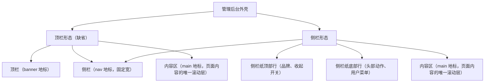

# layout

layout 是 web 前端在布局与各宽度下的共同约定，不交付可调用的符号。它拥有管理后台外壳的区域划分与滚动职责、断点标度、外壳级与组件级的响应分工，以及窄视口的降级次序。它不持有设计取值、不实现外壳与组件、不做导航与路径匹配。进入职责清单前的心智模型只有一句：区域的变化由视口决定，组件的变化由容器决定。

## 职责

本设计规定 web 前端在布局与各宽度下的共同约定：管理后台外壳的区域划分与滚动职责、断点标度、外壳级与组件级响应手段的分工、窄视口下各区域的降级次序。它约束各前端包渲染出的结构如何随可用宽度变化，自身不交付可调用的符号。

各包与它的关系固定：外壳骨架是 `layout-kit` 的 `AppShell`，组件级响应落在 `ui-kit` 的组件，管理后台页由 `admin-ui` 组装，断点取值来自 `tokens`。

### 非职责

- **不持有设计取值。** 断点的数值、间距基数、圆角与配色归 [tokens](design-web-tokens.md)；本设计声明断点标度是哪一套、谁在什么条件下取用，不定义数值。
- **不实现外壳与组件。** 外壳归 [layout-kit](design-web-layout-kit.md)，组件族归 [ui-kit](design-web-ui-kit.md)，管理后台页归 [admin-ui](design-web-admin-ui.md)。本设计只约束它们的布局与响应手段。
- **不做导航与路径匹配。** 归 [route-kit](design-web-route-kit.md)。
- **不组织业务页面。** 哪些页进管理后台由各能力 UI 包经声明式注册接口声明，不在本设计内。

## 外部接口契约

本设计对外的接口是各包共同遵守的布局与响应约定，逐条如下。

### 外壳形态

管理后台外壳有两种形态，装配期由宿主经 `AppShell` 的 `shellLayout` 选定：**顶栏形态**（`'topbar'`，缺省）与**侧栏形态**（`'sidebar'`）。两种形态共用同一套地标职责、抽屉两态与滚动分工，差别只在 chrome 落在哪块区域。

顶栏形态：

- **顶栏** 横贯全宽、位于最上，承载全局入口：组织与身份、搜索、通知、用户菜单。它对内容区恒定可见，不随内容滚动移出。顶栏的表面取主题的表面色（`background.paper`），文字取正文色（`text.primary`），与内容区之间以分隔线（`divider`）划分；主色留给动作控件，不铺满顶栏。
- **侧栏** 位于顶栏之下、内容区之左，承载平台导航。宽度是固定值（`AppShell` 的 `sidebarWidth`，缺省 280），不参与内容区的伸缩。
- **内容区** 占据余下空间，用 `flex: 1` 与 `min-width: 0` 承载：`min-width: 0` 使内部宽内容在外壳内自行滚动，而不是把外壳撑破。

侧栏形态在 `md` 及以上把 chrome 移进侧栏，内容区因此占满整个视口宽度：

- **固定头** 不渲染顶栏。给出 `banner` 槽时，固定头容器只承载横幅：横幅贴视口顶、占满视口宽度。桌面上因此没有 `banner` 地标。
- **侧栏纸顶部行** 承载品牌（`header`）与桌面收起开关（宿主给出 `onSidebarCollapsedChange` 时）。行高取顶栏工具条的 64px，两种形态的 chrome 因此从同一条线开始；品牌的字形起点对齐导航图标的绘制边（图标在 24px 框内有几像素内缩）。顶部行是导航之上的 chrome，与导航列的其余内容之间以主题分隔线分开（宿主给出 `navHeader` 时，线先分开的是那个槽），和顶栏形态中顶栏与内容区之间的分隔线同一个组件与配方；顶部行没有内容时不渲染，也就不画这条线。分隔线之下导航不再加自己的顶部内边距，首个导航项紧贴这条线。**收起窄栏**里品牌不绘制（留在无障碍树，读屏仍能读到），收起按钮在纸内居中，不贴左缘。
- **侧栏纸中部** 依次是 `navHeader`、`nav` 地标（撑满剩余高度、自身滚动）、`navFooter`。
- **侧栏纸底部行** 承载 `headerActions` 与 `userMenu`，贴住纸底。
- **内容区** 与顶栏形态相同。

**窄视口（`md` 以下）的降级。** 侧栏形态渲染一条极简顶栏，只含抽屉触发按钮与品牌；`headerActions` 与 `userMenu` 留在临时抽屉的底部行，临时抽屉没有顶部行，品牌全页只出现一次。顶栏形态的完整顶栏在窄视口原样保留，头部动作与用户菜单仍在顶栏内。窄视口下两种形态的 `banner` 都在顶栏之下；侧栏形态的桌面横幅贴在视口顶，因为没有顶栏可依附。侧栏形态的极简顶栏是这一宽度下的 `banner` 地标；该形态在桌面上没有该地标。这一地标差异是两种形态的唯一地标差异：`nav`、`main` 与跳转链接在各形态下的角色与顺序不变。

**固定头只在有内容时渲染。** 顶栏形态的顶栏恒在；侧栏形态只在有 `banner` 或位于 `md` 以下时渲染固定头容器，桌面且无横幅时不渲染它，也不渲染偏移占位：否则未测量的占位会把主题工具条的高度留成永久空隙。固定头的渲染高度由 `ResizeObserver` 测量，`main` 与抽屉纸内的偏移占位取同一个值。

**滚动分工。** 内容区仍是页面内容的**唯一滚动层**。侧栏形态另有一处受限滚动：导航列在抽屉纸内自身滚动，纸本身不滚动，顶部行与底部行固定不动；它不是页面内容的滚动层，页面内容不经过它。为此，纸、导航与底部行各取一条声明：纸 `overflow: hidden`、导航 `flex: 1 1 auto` 配 `minHeight: 0` 与 `overflowY: auto`、底部行 `flexShrink: 0`。这些声明只加在侧栏形态；顶栏形态的抽屉纸保持自身滚动，给导航无条件加 `flexGrow` 会把 `navFooter` 推到纸底，改变顶栏形态的行为。抽屉纸与底部行在两种形态下都保持宿主的抽屉两态（常驻与临时）。

**收起窄栏。** 侧栏形态的收起开关落在抽屉纸顶部行末尾，顶栏形态仍在顶栏。收起后的固定宽由主题间距基数算出，且不小于 44px 的触摸目标下限：间距基数较小的主题不会把窄栏压到下限之下。品牌容器在收起时裁剪但保留可及名。

区域的地标与实现见 [layout-kit](design-web-layout-kit.md)，形态取舍见 [ADR-web-shell-layout-variant](../../../adr/adr-web-shell-layout-variant.md)。

### 侧栏的层次

侧栏导航分四层：容器、分组、导航项、二级嵌套。

- **容器**：固定宽度，或收为仅图标的窄态；窄态下每个图标以提示补足文案。窄态以图标为主，条目无图标时保留其标签（在窄栏内截断显示），使窄态不出现空白格。
- **分组**：一组导航项的标题，整组可折叠；标题可带可选图标，窄态下以该图标呈现，无图标时保留标题文本（在窄栏内截断显示）。
- **导航项**：图标、标签与可选计数，选中态由宿主算。
- **二级嵌套**：展开的子项，是真实路由，不是悬停浮层。

分组与二级嵌套按导航规模选用：导航项少到无需分组时用扁平单列。

### 内容区的宽度

内容区里的页型占满内容区：表格页、详情页、设置页与仪表盘的宽度即信息量。管理后台没有受限宽的内容区容器：成块的表单放进侧边面板，宽度取面板的宽度档（见“次级任务的容器”）；内联写入区的控件随所在的节排布。

### 内容表面

管理后台页的每个内容块落在 `SectionCard` 的容器表面上：列表页的表格节、详情页的每一节、设置页的每一节、仪表盘的图表区与活动列表。页面底取 `page` 表面（`background.default`），内容块取 `container` 表面（白底、1px 描边、`shape.borderRadius` 圆角）。

- **标题层级。** 页面的 `h1` 是 `PageHeader`；内容节的标题由 `SectionCard` 渲染为 `h2`，节内再分的块为 `h3`，依次向下。
- **表格节贴边。** 表格所在的内容节用 `flushContent`，表格到达卡片的边缘，圆角由卡片裁切收住；表头底色取 `header` 表面。
- **浮层不叠卡片。** 对话框、菜单、工具提示与临时抽屉取 `overlay` 表面；侧边面板本身是浮层表面，面板内不叠 `SectionCard`，用标题与分隔线分节。
- **节内不叠第二个表面。** 仪表盘的指标块（`DashboardPage` 的 `KpiCard`）与起始页的能力卡（`HomePage` 的 `StartCardView`）是节内的描边内嵌块：取卡片表面的描边色（`surface.container.borderColor`）与 `shape.borderRadius` 圆角，不另起一层容器表面。两层半透明表面叠加会在玻璃主题里叠加不透明度，内层因此接近不透明，与外围卡片脱节。
- **常驻侧栏是 chrome，不是卡片。** 它取 `container` 表面：整列、无圆角、只在与内容相邻的一侧留描边，与顶栏的“只在下沿分隔”同构。
- **表面不引入宽度上限。** `SectionCard` 占满所在的内容列；管理后台仍没有受限宽的内容区容器（见“内容区的宽度”）。

表面取值与组件映射见 [ui-kit](design-web-ui-kit.md)，决策见 [ADR-web-surface-system](../../../adr/adr-web-surface-system.md)。

### 页型的骨架

管理后台页的骨架有下列几种，都以页头开篇（页头见 [admin-ui](design-web-admin-ui.md)）：

- **列表页**：页头、工具栏、表格、分页。工具栏在行被选中时整条切换为批量操作条。
- **详情页**：标题区、标签页，其下分主栏与侧栏：主栏承载主体，侧栏（固定宽）承载元信息。
- **设置页**：二级导航（比主侧栏窄）与一张占满内容区的表并列，底部固定一条保存条。
- **仪表盘**：等宽的指标块网格，其下是图表区与活动列表。

### 次级任务的容器

管理后台页内的次级任务按下列性质选容器：任务是否需要立即决策，任务是否有自己的地址；其余留在页内的任务再按操作者是否需要参照背后的页面分流。

- **对话框**（ui-kit 的 `ConfirmDialog`，以及各包自带的流程对话框，如加强认证）：需要立即决策、内容限于一段说明与一个确认或一步验证的任务，例如确认移除、确认丢弃、加强认证。
- **侧边面板**（ui-kit 的 `SidePanel`）：任务需要比对话框更多的空间，且操作者在其间仍需参照背后的页面，例如查看列表行的详情、填写字段超出一两行的创建表单。
- **整页**：任务有自己的地址，需要能被链接或在新窗口打开，或要占满内容区才摆得下，例如租户详情、审计详情。

下列约束绑定每一个侧边面板：

- **侧边面板与导航抽屉是两种东西。** 导航抽屉是外壳的 `nav` 地标，随视口在常驻与临时之间切换；侧边面板是页内任务的容器，是带可及名的 `dialog`，只在页面发起任务时出现。
- **侧边面板是模态的、锚定视口右缘的覆盖层。** 它占满视口高度，打开时背后的页面被遮罩盖住、不可交互，并对辅助技术不可见。
- **层级自下而上为内容区、固定头、侧边面板、对话框。** 固定头取主题 `zIndex.drawer + 1`（[layout-kit](design-web-layout-kit.md)），顶栏形态下即顶栏，侧栏形态下即横幅容器；侧边面板取 `zIndex.modal`，使面板的头部不被固定头遮挡；对话框同取 `zIndex.modal`，挂载晚于面板而位于其上。
- **宽度取档按视口，不按容器。** 面板是锚定视口的覆盖层，不在内容区的流里；它在 `sm` 及以上取所选档位的固定宽度，`sm` 以下占满视口宽度。面板内的组件（`FormLayout`、`DataTable`）仍按各自的容器响应，面板的宽度档因此决定其内的表单取一列还是两列。
- **同一页面同时打开的侧边面板至多一个，面板内不再打开另一个面板。** 面板内需要二次确认或加强认证时用对话框；需要更重的流程时该流程升为整页。
- **面板的打开状态是页内状态，不进路由，不进 URL。** 刷新页面回到未打开的状态（[ADR-web-side-panel](../../../adr/adr-web-side-panel.md)）。

### 断点标度

断点取值来自 tokens 的 `breakpoints.values`，等于所安装 MUI（[REF-mui](../../../references.md)）主题的默认值（[tokens](design-web-tokens.md) 把这一相等钉住），标签为 `xs`、`sm`、`md`、`lg`、`xl`。响应式只在既有标度上取区间；新增数值刻度是对本设计的偏离。

### 响应手段的分工

- **外壳级响应走视口。** 整体形态的变化（导航在常驻与抽屉之间切换、侧栏是否显示）由视口宽度决定，读 MUI 主题的 `breakpoints`；`AppShell` 以 `useMediaQuery(theme.breakpoints.up('md'))` 在两态之间选择。外壳形态本身是装配期选择（`shellLayout`），不随视口切换；窄视口只改变该形态的降级表现。
- **组件级响应走容器。** 会随可用宽度改变自身排布的组件（数据表、表单、卡片网格）按**所在容器**的宽度响应，不按视口。容器上下文由组件自建：组件在自身根节点声明 `container-type: inline-size`。
- **一次一行的组件用内在换行。** 有些行的排布既不需要断点，也不需要容器上下文：固定 `flex-basis` 配 `flex-wrap`，换行点自然跟随所在容器的可用宽度。页头的标题与动作行、`SectionCard` 的标题块是这个形态，即“组件级响应”的免查询形态：判据与容器查询相同（按自身可用宽度重排），只是不必声明容器上下文。仪表盘的指标行不是这一形态：它的列数按档位切换，属于下面的卡片网格。
- **指针能力走能力查询。** 依赖悬停的交互（悬停展开、悬停显出的操作）只在指针设备上启用；触摸设备上这些操作常显。触摸设备上**所有可点击目标**不小于 44×44，不分是否依赖悬停；下限由主题层对基础控件统一给出，各包继承，不逐处指定。判据是 `hover` 与 `pointer` 媒体查询，不是视口宽度：带键盘的平板与触屏笔记本都是宽视口下的触摸设备。
- **页面骨架按视口取档。** 详情页的主栏与侧栏、设置页的二级导航与内容并列，都是**页型骨架**：它们占满内容区，内容区的宽度由视口与外壳状态（侧栏是否常驻）决定，宿主不会把它们放进任意窄容器。因此它们按视口断点取档（`admin-ui` 的 `DetailLayout`、`SettingsPage`），是“组件级响应走容器”的例外。

外壳级、组件级与内在换行三条的判据是**一个区域的变化由视口决定，还是由它被放进多宽的容器决定**；内在换行只是组件级里不需要声明容器上下文的那一种写法。外壳的整体形态占满视口，故由视口决定；一个组件既可能占满内容区、也可能被放进窄侧栏，只有按容器响应才能在两种处境下各自正确。

### 窄视口的降级

按可用宽度递减，在断点标度上逐档降级，不一步切换形态：

- **侧栏**：从常驻变为覆盖式抽屉。
- **数据表**：先隐藏低优先级列，仍放不下时在容器内横向滚动兜底。短值列与标识符列按列声明不折行，单元格因此不会被拆行压扁；内容撑不住容器宽度时，滚动兜底才实际发生。行操作列与主辨识列（名称、标题）不设优先级、永不隐藏（REQ-presentation-022）。优先级阈值所在的每个断点档（`sm`、`md`、`lg`），在该档的下限宽度下可见列的不可断宽度之和不得超过该档下限，使滚动兜底出现之前主辨识列与行操作总是同屏，不被横向滚动分开；容器窄于 `sm` 时只剩不设优先级的列，放不下由横向滚动兜底，不适用这条。某一档放不下时按次序处理：先降低该档新增列中最不重要的列的优先级；再给主辨识列与长文本列设按容器档位取值的宽度上限，上限作用于任意长度的值，超出的内容在 `cellWrap: 'nowrap'` 的列截断、在 `cellWrap: 'wrap'` 的列换行（不可断的长值也随处断行），完整值经悬停标题、复制控件或详情取得；已是 `low` 的列才移出列表。一档里只剩不设优先级的列、降优先级无从下手时（例如 `sm` 档只剩名称、状态与操作），只有宽度上限这一种办法，不移列。主辨识列的宽度上限在 `md` 以下取 160px、`md` 起取 200px，各页沿用；一张表的可见列在某一档放不下时，该表按该档收紧这一上限（成员与邀请页的成员表在 `md` 以下取 96px，其邀请表的邮箱与邀请人两列在 `md` 以下各取 120px），不另定其余数值；上限约束整个单元格内容，带完整值复制控件的列把控件计入（[ui-kit](design-web-ui-kit.md) 的 `contentMaxWidth`）。主辨识格在标识之下另叠说明文字副行时（设置页的键与其说明、声明默认值），上限只管标识行与复制控件，副行按单元格可用宽度换行，不压进主辨识上限。主辨识列之外的长文本列（审计的对象与操作者、对象存储的内容类型）取 160px，不随档位增大，使一张表里多个长文本列的合计不随容器变宽而超出该档下限。
- **表单**：由多列收为单列。
- **卡片网格**：在窄档位收为单列、在更高档位展开为多列；档位取网格所在容器的宽度，不取视口。管理后台仪表盘的指标块（`DashboardPage` 的 `KpiRow`）是这一形态：容器窄于 `sm` 时一列，`sm` 起两列，`md` 起租户指标四列、平台健康度两列。768px 的概览因此把四张租户指标排成 2x2。
- **侧边面板**：从定宽收为占满视口宽度，档位取视口的 `sm`。

## 依赖

| 依赖 | 用途 |
|---|---|
| [tokens](design-web-tokens.md) | 断点标度的取值 |
| [layout-kit](design-web-layout-kit.md) | 外壳的区域划分与视口两态 |
| [ui-kit](design-web-ui-kit.md) | 组件级响应的承载组件与主题 |
| [admin-ui](design-web-admin-ui.md) | 管理后台页的组装 |

## UML 图

图给出两种外壳形态的区域构成。图里画不出的约束：内容区是页面内容的唯一滚动层；侧栏形态的导航列在抽屉纸内自身滚动；侧栏宽度是固定值、不参与内容区伸缩；区域的地标由外壳渲染，供无障碍树识别；侧栏形态在桌面上没有 `banner` 地标。

## 核心数据结构

| 概念 | 说明 |
|---|---|
| 外壳形态 | 顶栏形态（缺省）或侧栏形态，装配期选定；决定 chrome 落在顶栏还是侧栏纸 |
| 外壳区域 | 顶栏形态为顶栏、侧栏、内容区；侧栏形态为侧栏纸顶部行、导航、底部行与内容区。各区域的地标与滚动职责见外部接口契约 |
| 断点标度 | `xs`、`sm`、`md`、`lg`、`xl`，取自 token 的 `breakpoints.values` |
| 容器查询上下文 | 组件在自身根节点经 `container-type: inline-size` 建立的容器；响应按它自身的宽度取档 |

## 核心算法与流程

### 一次外壳的响应式判定

外壳读 MUI 主题的断点做一次判定，得到桌面或移动的布尔值，据此在常驻侧栏与覆盖式抽屉之间选择；越过断点时把移动抽屉的开合复位为关。装配期选定的外壳形态决定同一布尔值上哪块区域承载 chrome：顶栏形态的顶栏在两种宽度下都在，侧栏形态在桌面不渲染顶栏、在窄视口渲染极简顶栏。切换形态或跨断点时，固定头的测量高度复位，旧形态的测量残值不进入新形态。判定与复位的完整流程见 [layout-kit](design-web-layout-kit.md)。

### 一次组件级响应

一个启用容器查询的组件是它自己的容器：它在自身根节点建立容器上下文，随**自身**宽度重排：宽于某档时显示全部列或多列排布，窄于该档时隐藏低优先级列、横向滚动或收为单列。响应由 CSS 容器查询完成，不经 JavaScript 的布局判定。

## 错误与失败语义

| 情形 | 表现 |
|---|---|
| 内容区未设 `min-width: 0` | 内部宽内容把外壳撑破，横向溢出整页 |
| 侧栏形态的桌面无横幅 | 不渲染固定头容器与偏移占位；不应留出工具条高度的空隙 |
| 传入 `shellLayout` 联合之外的值（绕过类型检查） | 按顶栏形态渲染 |

## 扩展点

- **新增一种外壳形态。** 形态是闭合的枚举，不是自由插槽：新增一种形态 = 在 `AppShellShellLayout` 上加一个成员、在 `AppShell` 里给出该形态的区域映射、补 jsdom（[REF-jsdom](../../../references.md)）与真实浏览器的用例、更新本设计与 [layout-kit](design-web-layout-kit.md)；宿主的调用接口不变。
- **只换内容不换结构。** 客户换品牌、头部动作或用户菜单时走现有槽位，不动 `shellLayout`。
- **新增一个组件。** 若它会随可用宽度改变自身排布，按容器响应：在自身根节点声明 `container-type: inline-size`，并按自身的宽度取档重排。
- **新增一个管理后台页。** 页内的排布沿用本设计的区域与降级约定；页的组织归该页所属的能力 UI 包。
- **新增一个管理后台内容块。** 它落在 `SectionCard` 上，标题从 `h2` 起；不手写描边 `Paper` 或裸 `section` 作为表面。

## 实现状态

| 能力 | 状态 | 代码 |
|---|---|---|
| 外壳的区域划分与地标 | 已实现 | `web/packages/layout-kit/src/components/AppShell.tsx` `AppShell` |
| 两种外壳形态（顶栏 / 侧栏）与窄视口极简顶栏 | 已实现 | `web/packages/layout-kit/src/components/AppShell.tsx` `AppShell`、`shellLayout`、`AppShellShellLayout` |
| 外壳的视口两态（常驻侧栏 / 覆盖式抽屉） | 已实现 | `web/packages/layout-kit/src/components/AppShell.tsx` `AppShell` |
| 桌面侧栏的收起 | 已实现 | `web/packages/layout-kit/src/components/AppShell.tsx` `sidebarCollapsed` |
| 侧栏的扁平导航项与选中态 | 已实现 | `web/packages/layout-kit/src/components/AppShell.tsx` `AppShellNavItem` |
| 侧栏的分组与二级嵌套 | 已实现 | `web/packages/layout-kit/src/components/AppShell.tsx` `AppShellNavGroup`、`AppShellNavItem.children`；`web/packages/admin-ui/src/nav-groups.tsx` `adminNavGroups` |
| 断点标度等于所装 MUI 主题默认 | 已实现 | `web/packages/tokens/src/breakpoints.ts` `breakpointTokens` |
| 内容区的宽度（页型占满内容区） | 已实现 | `web/packages/admin-ui/src/internal/layout.tsx` `DetailLayout` |
| 管理后台内容块落在 SectionCard 容器表面 | 已实现 | `web/packages/ui-kit/src/components/SectionCard.tsx` `SectionCard`；`web/packages/admin-ui/src/TenantRosterPage.tsx` `TenantRosterPage`；`web/packages/admin-ui/src/TenantDetailPage.tsx` `TenantDetailPage`；`web/packages/admin-ui/src/SettingsPage.tsx` `SettingsPage`；`web/packages/admin-ui/src/DashboardPage.tsx` `DashboardPage` |
| 列表页骨架 | 已实现 | `web/packages/admin-ui/src/TenantRosterPage.tsx` `TenantRosterPage` |
| 详情页骨架（主栏与侧栏） | 已实现 | `web/packages/admin-ui/src/internal/layout.tsx` `DetailLayout`；`web/packages/admin-ui/src/TenantDetailPage.tsx` `TenantDetailPage` |
| 设置页骨架（二级导航与表） | 已实现 | `web/packages/admin-ui/src/SettingsPage.tsx` `SettingsPage` |
| 仪表盘骨架 | 已实现 | `web/packages/admin-ui/src/DashboardPage.tsx` `DashboardPage` |
| 数据表各断点档的可见列宽度之和不超过该档下限 | 已实现 | `web/packages/admin-ui/test-utils/browser-overflow.ts` `TIER_FLOORS`、`expectNoHorizontalOverflow`（把每张表的容器钉到各档下限，断言该档可见列不溢出）；`web/packages/ui-kit/src/components/DataTable.tsx` `PRIMARY_COLUMN_MAX_WIDTH`、`LONG_TEXT_COLUMN_MAX_WIDTH`、`primaryColumnMaxWidthSx`；`web/packages/admin-ui/src/PermissionsPage.tsx` `PermissionsPage`（角色名与权限码取主辨识上限，角色说明取长文本上限，目录的权限码上限只约束标识行） |
| 数据表的列优先级降级 | 已实现 | `web/packages/ui-kit/src/components/DataTable.tsx` `columnVisibilitySx` |
| 数据表超宽的容器内滚动兜底 | 已实现 | `web/packages/ui-kit/src/components/DataTable.tsx` `DataTable` |
| 侧边面板的层级与视口宽度档 | 已实现 | `web/packages/ui-kit/src/components/SidePanel.tsx` `SidePanel` |
| 卡片网格的多列收为单列 | 已实现 | `starters/demo/web/src/pages/home-page.tsx` `HomePage`；`web/packages/admin-ui/src/DashboardPage.tsx` `KpiRow` |
| 数据表按列的折行策略 | 已实现 | `web/packages/ui-kit/src/components/DataTable.tsx` `columnCellWrapSx` |
| 组件级容器查询 | 已实现 | `web/packages/ui-kit/src/components/DataTable.tsx` `DataTable`；`web/packages/ui-kit/src/components/FormLayout.tsx` `containerSx`；`starters/demo/web/src/pages/home-page.tsx` `HomePage`；`web/packages/admin-ui/src/DashboardPage.tsx` `KpiRow` |
| 窄视口逐档降级 | 已实现 | `web/packages/ui-kit/src/components/DataTable.tsx` `columnVisibilitySx`；`web/packages/layout-kit/src/components/AppShell.tsx` `AppShell`（收起为仅图标的窄栏）；`web/packages/ui-kit/src/components/FormLayout.tsx` `containerSx`；`starters/demo/web/src/pages/home-page.tsx` `HomePage`；`web/packages/admin-ui/src/DashboardPage.tsx` `KpiRow` |
| 收起窄栏不小于 44px | 已实现 | `web/packages/layout-kit/src/components/AppShell.tsx` `COLLAPSED_SIDEBAR_MIN_WIDTH`、`collapsedSidebarWidth` |
| 指针能力查询 | 已实现 | `web/packages/ui-kit/src/internal/pointer.ts`；`web/packages/ui-kit/src/theme/touch-floor.ts` `touchFloorComponents`（基础控件的主题级下限，各包继承）；`web/packages/ui-kit/src/touch-target.ts` `touchTargetSx`（主题覆盖不到的裸控件兜底） |
