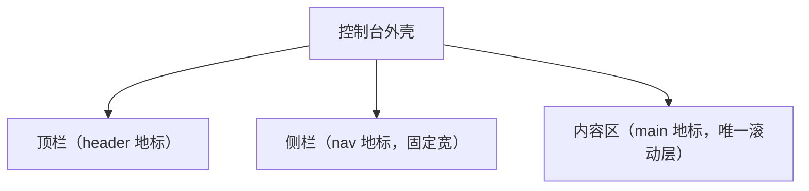

# layout

## 职责

本设计持有 web 前端在布局与各宽度下的共同约定：控制台外壳的区域划分与滚动职责、断点标度、外壳级与组件级两种响应手段的分工、窄视口下各区域的降级次序。它约束各前端包渲染出的结构如何随可用宽度变化，自身不交付可调用的符号。

各包与它的关系固定：外壳骨架是 `layout-kit` 的 `AppShell`，组件级响应落在 `ui-kit` 的组件，控制台页由 `console-ui` 组装，断点取值来自 `tokens`。

### 非职责

- **不持有设计取值。** 断点的数值、间距基数、圆角与配色归 [tokens](design-web-tokens.md)；本设计声明断点标度是哪一套、谁在什么条件下取用，不定义数值。
- **不实现外壳与组件。** 外壳归 [layout-kit](design-web-layout-kit.md)，组件族归 [ui-kit](design-web-ui-kit.md)，控制台页归 [console-ui](design-web-console-ui.md)。本设计只约束它们的布局与响应手段。
- **不做导航与路径匹配。** 归 [route-kit](design-web-route-kit.md)。
- **不组织业务页面。** 哪些页进控制台由各能力 UI 包经声明式注册面声明，不在本设计内。

## 外部接口契约

本设计对外的面是各包共同遵守的布局与响应约定，逐条如下。

### 外壳的区域划分

控制台外壳由顶栏、侧栏与内容区构成，滚动职责各不同。

- **顶栏** 横贯全宽、位于最上，承载全局入口：工作区与身份、搜索、通知、用户菜单。它对内容区恒定可见，不随内容滚动移出。
- **侧栏** 位于顶栏之下、内容区之左，承载平台导航。宽度是固定值（`AppShell` 的 `sidebarWidth`，缺省 280），不参与内容区的伸缩。
- **内容区** 占据余下空间，是**唯一的滚动层**——外壳其余部分不动，只有这里滚动。它的宽度随视口变化，用 `flex: 1` 与 `min-width: 0` 一并承载：`min-width: 0` 使内部宽内容在外壳内自行滚动，而不是把外壳撑破。

区域的地标与实现见 [layout-kit](design-web-layout-kit.md)。

### 侧栏的层次

侧栏导航分四层：容器、分组、导航项、二级嵌套。

- **容器**：固定宽度，或收为仅图标的窄态；窄态下每个图标以提示补足文案。窄态以图标为主，条目无图标时保留其标签（在窄栏内截断显示），使窄态不出现空白格。
- **分组**：一组导航项的标题，整组可折叠；标题可带可选图标，窄态下以该图标呈现，无图标时保留标题文本（在窄栏内截断显示）。
- **导航项**：图标、标签与可选计数，选中态由宿主算。
- **二级嵌套**：展开的子项，是真实路由，不是悬停浮层。

分组与二级嵌套按导航规模选用：导航项少到无需分组时用扁平单列。

### 内容区的宽度分岔

内容区按页型取两种宽度：

- **全宽**：表格页与仪表盘占满内容区，宽度即信息量。
- **受限宽**：表单收在一段居中的窄宽（640–960px），使输入控件不随视口拉长。

两种宽度在同一产品里并存，由页面的容器显式区分。

### 页型的骨架

控制台页的骨架有下列几种，都以页头开篇（页头见 [console-ui](design-web-console-ui.md)）：

- **列表页**：页头、工具栏、表格、分页。工具栏在行被选中时整条切换为批量操作条。
- **详情页**：标题区、标签页，其下分主栏与侧栏——主栏承载主体，侧栏（固定宽）承载元信息。
- **设置页**：二级导航（比主侧栏窄）与一张占满内容区的表并列，底部固定一条保存条。
- **仪表盘**：一行等宽的指标卡，其下是图表区与活动列表。

### 次级任务的容器

控制台页内的次级任务按下列性质选容器：任务是否需要立即决策，任务是否有自己的地址；其余留在页内的任务再按操作者是否需要参照背后的页面分流。

- **对话框**（ui-kit 的 `ConfirmDialog`，以及各包自带的流程对话框，如步进验证）：需要立即决策、内容限于一段说明与一个确认或一步验证的任务，例如确认移除、确认丢弃、步进验证。
- **侧边面板**（ui-kit 的 `SidePanel`）：任务需要比对话框更多的空间，且操作者在其间仍需参照背后的页面，例如查看列表行的详情、填写字段超出一两行的创建表单。
- **整页**：任务有自己的地址，需要被链接或在新窗口打开，或要占满内容区才摆得下，例如租户详情、审计详情。

下列约束绑定每一个侧边面板：

- **侧边面板与导航抽屉是两种东西。** 导航抽屉是外壳的 `nav` 地标，随视口在常驻与临时之间切换；侧边面板是页内任务的容器，是带可及名的 `dialog`，只在页面发起任务时出现。
- **侧边面板是模态的、锚定视口右缘的覆盖层。** 它占满视口高度，打开时背后的页面被遮罩盖住、不可交互，并对辅助技术不可见。
- **层级自下而上为内容区、顶栏、侧边面板、对话框。** 顶栏取主题 `zIndex.drawer + 1`（[layout-kit](design-web-layout-kit.md)），侧边面板取 `zIndex.modal`，使面板的头部不被顶栏遮挡；对话框同取 `zIndex.modal`，挂载晚于面板而位于其上。
- **宽度取档按视口，不按容器。** 面板是锚定视口的覆盖层，不在内容区的流里；它在 `sm` 及以上取所选档位的固定宽度，`sm` 以下占满视口宽度。面板内的组件（`FormLayout`、`DataTable`）仍按各自的容器响应，面板的宽度档因此决定其内的表单取一列还是两列。
- **同一页面同时打开的侧边面板至多一个，面板内不再打开另一个面板。** 面板内需要二次确认或步进验证时用对话框；需要更重的流程时该流程升为整页。
- **面板的打开状态是页内状态，不进路由，不进 URL。** 刷新页面回到未打开的状态（[ADR-web-side-panel-2026-10-17](../../../adr/adr-web-side-panel-2026-10-17.md)）。

### 断点标度

断点取值来自 tokens 的 `breakpoints.values`，等于所安装 MUI 主题的默认值（[tokens](design-web-tokens.md) 把这一相等钉住），标签为 `xs`、`sm`、`md`、`lg`、`xl`。响应式只在既有标度上取区间；新增数值刻度是对本设计的偏离。

### 响应手段的分工

- **外壳级响应走视口。** 整体形态的变化——导航在常驻与抽屉之间切换、侧栏是否显示——由视口宽度决定，读 MUI 主题的 `breakpoints`；`AppShell` 以 `useMediaQuery(theme.breakpoints.up('md'))` 在两态之间选择。
- **组件级响应走容器。** 会随可用宽度改变自身排布的组件——数据表、表单、卡片网格——按**所在容器**的宽度响应，不按视口。容器上下文由组件自建：组件在自身根节点声明 `container-type: inline-size`。
- **一次一行的组件用内在换行。** 有些行的排布既不需要断点，也不需要容器上下文：固定 `flex-basis` 配 `flex-wrap`，换行点自然跟随所在容器的可用宽度。控制台仪表盘的指标卡行是这个形态（`DashboardPage` 的 `KpiRow`）——它是「组件级响应」的免查询形态：判据与容器查询相同（按自身可用宽度重排），只是不必声明容器上下文。
- **指针能力走能力查询。** 依赖悬停的交互（悬停展开、悬停显出的操作）只在指针设备上启用；触摸设备上这些操作常显。触摸设备上**所有可点击目标**不小于 44×44——不分是否依赖悬停；下限由主题层对基础控件统一给出，各包继承，不逐处指定。判据是 `hover` 与 `pointer` 媒体查询，不是视口宽度——带键盘的平板与触屏笔记本都是宽视口下的触摸设备。
- **页面骨架按视口取档。** 详情页的主栏与侧栏、设置页的二级导航与内容并列、以及内容区的受限宽，都是**页型骨架**：它们占满内容区，内容区的宽度由视口与外壳状态（侧栏是否常驻）决定，宿主不会把它们放进任意窄容器。因此它们按视口断点取档（`console-ui` 的 `DetailLayout`、`SettingsPage`、`FormWidth`），是「组件级响应走容器」的例外。

外壳级、组件级与内在换行三条的判据是**一个区域的变化由视口决定，还是由它被放进多宽的容器决定**；内在换行只是组件级里不需要声明容器上下文的那一种写法。外壳的整体形态占满视口，故由视口决定；一个组件既可能占满内容区、也可能被放进窄侧栏，只有按容器响应才能在两种处境下各自正确。

### 窄视口的降级

按可用宽度递减，在断点标度上逐档降级，不一步切换形态：

- **侧栏**：从常驻变为覆盖式抽屉。
- **数据表**：先隐藏低优先级列，仍放不下时在容器内横向滚动兜底。短值列与标识符列按列声明不折行，单元格因此不会被拆行压扁；内容撑不住容器宽度时，滚动兜底才实际发生。
- **表单**：由多列收为单列。
- **卡片网格**：由多列收为单列；档位取网格所在容器的宽度，不取视口。
- **侧边面板**：从定宽收为占满视口宽度，档位取视口的 `sm`。

## 依赖

| 依赖 | 用途 |
|---|---|
| [tokens](design-web-tokens.md) | 断点标度的取值 |
| [layout-kit](design-web-layout-kit.md) | 外壳的区域划分与视口两态 |
| [ui-kit](design-web-ui-kit.md) | 组件级响应的承载组件与主题 |
| [console-ui](design-web-console-ui.md) | 控制台页的组装 |

## UML 图

图给出外壳的区域构成。图里画不出的约束：内容区是唯一滚动层；侧栏宽度是固定值、不参与伸缩；区域的地标由外壳渲染而出，供无障碍树识别。

## 核心数据结构

| 概念 | 说明 |
|---|---|
| 外壳区域 | 顶栏、侧栏、内容区：各带一个无障碍地标，伸缩与滚动职责见外部接口契约 |
| 断点标度 | `xs`、`sm`、`md`、`lg`、`xl`，取自 token 的 `breakpoints.values` |
| 容器查询上下文 | 组件在自身根节点经 `container-type: inline-size` 建立的容器；响应按它自身的宽度取档 |

## 核心算法与流程

### 一次外壳的响应式判定

外壳读 MUI 主题的断点做一次判定，得到桌面或移动的布尔值，据此在常驻侧栏与覆盖式抽屉之间选择；越断点时把移动抽屉的开合复位为关。判定与复位的完整流程见 [layout-kit](design-web-layout-kit.md)。

### 一次组件级响应

一个启用容器查询的组件是它自己的容器：它在自身根节点建立容器上下文，随**自身**宽度重排——宽于某档时显示全部列或多列排布，窄于该档时隐藏低优先级列、横向滚动或收为单列。响应由 CSS 容器查询完成，不经 JavaScript 的布局判定。

## 错误与失败语义

| 情形 | 表现 |
|---|---|
| 内容区未设 `min-width: 0` | 内部宽内容把外壳撑破，横向溢出整页 |

## 扩展点

- **新增一个组件。** 若它会随可用宽度改变自身排布，按容器响应：在自身根节点声明 `container-type: inline-size`，并按自身的宽度取档重排。
- **新增一个控制台页。** 页内的排布沿用本设计的区域与降级约定；页的组织归该页所属的能力 UI 包。

## 实现状态

| 能力 | 状态 | 代码 |
|---|---|---|
| 外壳的区域划分与地标 | 已实现 | `web/packages/layout-kit/src/components/AppShell.tsx` `AppShell` |
| 外壳的视口两态（常驻侧栏 / 覆盖式抽屉） | 已实现 | `web/packages/layout-kit/src/components/AppShell.tsx` `AppShell` |
| 桌面侧栏的收起 | 已实现 | `web/packages/layout-kit/src/components/AppShell.tsx` `sidebarCollapsed` |
| 侧栏的扁平导航项与选中态 | 已实现 | `web/packages/layout-kit/src/components/AppShell.tsx` `AppShellNavItem` |
| 侧栏的分组与二级嵌套 | 已实现 | `web/packages/layout-kit/src/components/AppShell.tsx` `AppShellNavGroup`、`AppShellNavItem.children`；`web/packages/console-ui/src/nav-groups.tsx` `consoleNavGroups` |
| 断点标度等于所装 MUI 主题默认 | 已实现 | `web/packages/tokens/src/breakpoints.ts` `breakpointTokens` |
| 内容区的宽度分岔 | 已实现 | `web/packages/console-ui/src/internal/layout.tsx` `DetailLayout`、`FormWidth` |
| 列表页骨架 | 已实现 | `web/packages/console-ui/src/TenantRosterPage.tsx` `TenantRosterPage` |
| 详情页骨架（主栏与侧栏） | 已实现 | `web/packages/console-ui/src/internal/layout.tsx` `DetailLayout`；`web/packages/console-ui/src/TenantDetailPage.tsx` `TenantDetailPage` |
| 设置页骨架（二级导航与表） | 已实现 | `web/packages/console-ui/src/SettingsPage.tsx` `SettingsPage` |
| 仪表盘骨架 | 已实现 | `web/packages/console-ui/src/DashboardPage.tsx` `DashboardPage` |
| 数据表的列优先级降级 | 已实现 | `web/packages/ui-kit/src/components/DataTable.tsx` `columnVisibilitySx` |
| 数据表超宽的容器内滚动兜底 | 已实现 | `web/packages/ui-kit/src/components/DataTable.tsx` `DataTable` |
| 侧边面板的层级与视口宽度档 | 已实现 | `web/packages/ui-kit/src/components/SidePanel.tsx` `SidePanel` |
| 卡片网格的多列收为单列 | 已实现 | `starters/demo/web/src/pages/home-page.tsx` `HomePage` |
| 数据表按列的折行策略 | 已实现 | `web/packages/ui-kit/src/components/DataTable.tsx` `columnCellWrapSx` |
| 组件级容器查询 | 已实现 | `web/packages/ui-kit/src/components/DataTable.tsx` `DataTable`；`web/packages/ui-kit/src/components/FormLayout.tsx` `containerSx`；`starters/demo/web/src/pages/home-page.tsx` `HomePage` |
| 窄视口逐档降级 | 已实现 | `web/packages/ui-kit/src/components/DataTable.tsx` `columnVisibilitySx`；`web/packages/layout-kit/src/components/AppShell.tsx` `AppShell`（收起为仅图标的窄栏）；`web/packages/ui-kit/src/components/FormLayout.tsx` `containerSx`；`starters/demo/web/src/pages/home-page.tsx` `HomePage` |
| 指针能力查询 | 已实现 | `web/packages/ui-kit/src/internal/pointer.ts`；`web/packages/ui-kit/src/theme/touch-floor.ts` `touchFloorComponents`（基础控件的主题级下限，各包继承）；`web/packages/ui-kit/src/touch-target.ts` `touchTargetSx`（主题覆盖不到的裸控件兜底） |
