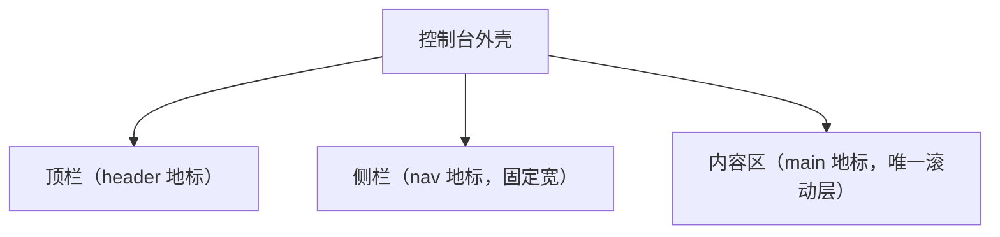

# layout

## 职责

本设计持有 web 前端在布局与各宽度下的共同约定：控制台外壳的区域划分与滚动职责、断点标度、外壳级与组件级两种响应手段的分工、窄视口下各区域的降级次序。它约束各前端包渲染出的结构如何随可用宽度变化，自身不交付可调用的符号。

各包与它的关系固定：外壳骨架是 `layout-kit` 的 `AppShell`，组件级响应落在 `ui-kit` 的组件，控制台页由 `console-ui` 组装，断点取值来自 `tokens`。

### 非职责

- **不持有设计取值。** 断点的数值、间距基数、圆角与配色归 [tokens](design-web-tokens.md)；本设计声明断点标度是哪一套、谁在什么条件下取用，不定义数值。
- **不实现外壳与组件。** 外壳归 [layout-kit](design-web-layout-kit.md)，组件族归 [ui-kit](design-web-ui-kit.md)，控制台页归 [console-ui](design-web-console-ui.md)。本设计只约束它们的布局与响应手段。
- **不做导航与路径匹配。** 归 [route-kit](design-web-route-kit.md)。
- **不组织业务页面。** 哪些页进控制台由各能力 UI 包经声明式注册面声明，不在本设计内。

## 外部接口契约

本设计对外的面是各包共同遵守的布局与响应约定，逐条如下。

### 外壳的区域划分

控制台外壳由顶栏、侧栏与内容区构成，滚动职责各不同。

- **顶栏** 横贯全宽、位于最上，承载全局入口：工作区与身份、搜索、通知、用户菜单。它对内容区恒定可见，不随内容滚动移出。
- **侧栏** 位于顶栏之下、内容区之左，承载平台导航。宽度是固定值（`AppShell` 的 `sidebarWidth`，缺省 280），不参与内容区的伸缩。
- **内容区** 占据余下空间，是**唯一的滚动层**——外壳其余部分不动，只有这里滚动。它的宽度随视口变化，用 `flex: 1` 与 `min-width: 0` 一并承载：`min-width: 0` 使内部宽内容在外壳内自行滚动，而不是把外壳撑破。

区域的地标与实现见 [layout-kit](design-web-layout-kit.md)。

### 断点标度

断点取值来自 tokens 的 `breakpoints.values`，等于所安装 MUI 主题的默认值（[tokens](design-web-tokens.md) 把这一相等钉住），标签为 `xs`、`sm`、`md`、`lg`、`xl`。响应式只在既有标度上取区间；新增数值刻度是对本设计的偏离。

### 响应手段的分工

- **外壳级响应走视口。** 整体形态的变化——导航在常驻与抽屉之间切换、侧栏是否显示——由视口宽度决定，读 MUI 主题的 `breakpoints`；`AppShell` 以 `useMediaQuery(theme.breakpoints.up('md'))` 在两态之间选择。
- **组件级响应走容器。** 会随可用宽度改变自身排布的组件——数据表、表单、卡片网格——按**所在容器**的宽度响应，不按视口。前提是它们的父级声明 `container-type: inline-size`。
- **指针能力走能力查询。** 依赖悬停的交互（悬停展开、悬停显出的操作）只在指针设备上启用；触摸设备上这些操作常显，可点击目标不小于 44×44。判据是 `hover` 与 `pointer` 媒体特性，不是视口宽度——带键盘的平板与触屏笔记本都是宽视口下的触摸设备。

前两条的判据是**一个区域的变化由视口决定，还是由它被放进多宽的容器决定**。外壳的整体形态占满视口，故由视口决定；一个组件既可能占满内容区、也可能被放进窄侧栏，只有按容器响应才能在两种处境下各自正确。

### 窄视口的降级

按可用宽度递减，在断点标度上逐档降级，不一步切换形态：

- **侧栏**：从常驻变为覆盖式抽屉。
- **数据表**：先隐藏低优先级列，仍放不下时在容器内横向滚动兜底。
- **表单**：由多列收为单列。

## 依赖

| 依赖 | 用途 |
|---|---|
| [tokens](design-web-tokens.md) | 断点标度的取值 |
| [layout-kit](design-web-layout-kit.md) | 外壳的区域划分与视口两态 |
| [ui-kit](design-web-ui-kit.md) | 组件级响应的承载组件与主题 |
| [console-ui](design-web-console-ui.md) | 控制台页的组装 |

## UML 图

图给出外壳的区域构成。图里画不出的约束：内容区是唯一滚动层；侧栏宽度是固定值、不参与伸缩；区域的地标由外壳渲染而出，供无障碍树识别。

## 核心数据结构

| 概念 | 说明 |
|---|---|
| 外壳区域 | 顶栏、侧栏、内容区：各带一个无障碍地标，伸缩与滚动职责见外部接口契约 |
| 断点标度 | `xs`、`sm`、`md`、`lg`、`xl`，取自 token 的 `breakpoints.values` |
| 容器查询上下文 | 父级经 `container-type: inline-size` 建立的、供组件级响应取用的容器 |

## 核心算法与流程

### 一次外壳的响应式判定

外壳读 MUI 主题的断点做一次判定，得到桌面或移动的布尔值，据此在常驻侧栏与覆盖式抽屉之间选择；越断点时把移动抽屉的开合复位为关。判定与复位的完整流程见 [layout-kit](design-web-layout-kit.md)。

### 一次组件级响应

一个启用容器查询的组件随其**容器**宽度重排：容器宽于某档时显示全部列或多列排布，窄于该档时隐藏低优先级列、横向滚动或收为单列。响应由 CSS 容器查询完成，不经 JavaScript 的布局判定。

## 错误与失败语义

| 情形 | 表现 |
|---|---|
| 组件的父级未声明 `container-type` | 该组件的容器查询不匹配，不随容器宽度重排 |
| 内容区未设 `min-width: 0` | 内部宽内容把外壳撑破，横向溢出整页 |

## 扩展点

- **新增一个组件。** 若它会随可用宽度改变自身排布，按容器响应，并声明它依赖的容器宽度；其父级负责建立容器查询上下文。
- **新增一个控制台页。** 页内的排布沿用本设计的区域与降级约定；页的组织归该页所属的能力 UI 包。

## 实现状态

| 能力 | 状态 | 代码 |
|---|---|---|
| 外壳的区域划分与地标 | 已实现 | `web/packages/layout-kit/src/components/AppShell.tsx` `AppShell` |
| 外壳的视口两态（常驻侧栏 / 覆盖式抽屉） | 已实现 | `web/packages/layout-kit/src/components/AppShell.tsx` `AppShell` |
| 桌面侧栏的收起 | 已实现 | `web/packages/layout-kit/src/components/AppShell.tsx` `sidebarCollapsed` |
| 断点标度等于所装 MUI 主题默认 | 已实现 | `web/packages/tokens/src/breakpoints.ts` `breakpointTokens` |
| 数据表的列优先级降级 | 部分实现 | `web/packages/ui-kit/src/components/DataTable.tsx` `columnVisibilitySx` |
| 数据表超宽的容器内滚动兜底 | 已实现 | `web/packages/ui-kit/src/components/DataTable.tsx` `DataTable` |
| 组件级容器查询 | 未实现 | — |
| 窄视口逐档降级 | 未实现 | — |
| 指针能力查询 | 未实现 | — |
