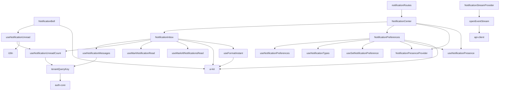

# notification-ui

notification-ui 是站内通知在浏览器里的界面，位于能力 UI 包这一层，覆盖后端通知能力的收件箱、偏好与推送。它拥有未读铃铛、收件箱、偏好矩阵、通知界面、实时订阅与声明式入口。它不做 HTTP、不定义契约、不做路由与权限判定，也不读会话。进入职责清单前的心智模型只有一句：提醒经生成钩子读写，实时连接只经宿主交来的开启器，[特性](../../../glossary.md)在场由宿主经 provider 给出。

## 职责

本包交付站内通知在浏览器里的界面（包 `web/packages/notification-ui`）：一个能力 UI 包对应一个后端能力目录（[web](design-web.md) 的划分轴），覆盖后端通知能力的收件箱、偏好与推送。它交付：

- **未读铃铛**：`NotificationBell` 读调用方的未读数（`GET /api/v1/notifications/messages/unread-count`），渲染为图标按钮。**未读为零时不渲染徽标**：没有未读就没有数字，也不留一个可见的 `0`；未读数尚未读出或读取失败时同样不渲染徽标，此刻它不知道有没有未读，摆一个 `0` 是把未知说成没有；计数非零时徽标字形对无障碍树隐藏，计数落在按钮的可及名上（前端规范的图标按钮规则），读屏只播报一次。它受控：`onClick` 是宿主的导航，铃铛本身不含路由。
- **未读计数**：`useNotificationUnread` 把同一份未读数交给任何要带徽标的控件：计数本身、徽标要印的文本、可及名要加的短语，各自一件；`enabled` 为假时不发这条读。`NOTIFICATION_BADGE_MAX` 是徽标印制的上限。铃铛仍由本包交付；宿主不挂铃铛时，可以用这个钩子把未读数放在自己的控件上。
- **收件箱界面**：`NotificationInbox` 读一页消息（`GET /api/v1/notifications/messages`），逐行渲染标题、正文、时间与未读/已读标记，未读行提供“标记为已读”（`POST /api/v1/notifications/messages/:id/read`），页头提供“全部标记为已读”（`POST /api/v1/notifications/messages/read-all`）。可选入参让宿主按分组过滤、按页大小翻页、在每行附上详情、把带链接的行交给宿主打开，并以嵌入形态去掉页头、改在指定层级渲染标题。
- **偏好矩阵**：`NotificationPreferences` 读按类型的渠道矩阵（`GET /api/v1/notifications/preferences`）与类型分类法（`GET /api/v1/notifications/types`，取每类型是否可退订），写入单个渠道的目标态（`PUT /api/v1/notifications/preferences/:type_key/:channel`）。渠道列是 `in_app` 加宿主给出的、特性在场的可选渠道。
- **通知界面**：`NotificationCenter` 是默认组合：收件箱与其下的偏好矩阵；特性 `notification.preferences` 缺席时只有收件箱。
- **实时订阅**：`NotificationStreamProvider` 经宿主交来的开启器打开 `GET /api/v1/notifications/stream`，每来一帧 `message` 即失效当前租户的未读数与消息列表。
- **特性在场的接收**：`NotificationPresenceProvider` 接收宿主给出的特性在场事实（偏好界面是否在场与各可选渠道）使后代组件据此决定是否渲染偏好界面、显示哪些可选渠道。
- **声明式入口**：`notificationRoutes` 是包对声明式注册表的贡献：通知界面在 `/notifications`，带标签因而贡献一条导航项，依赖特性 `notification.inbox`。
- **文案命名空间**：本包以 `NOTIFICATION_UI_NAMESPACE` 声明裸名命名空间、以 `notificationUiResources` 交付双语资源，界面渲染自身文字时经它解析。

### 非职责

- **不做 HTTP。** 读写都经生成接口 `@speed/api-sdk` 的 react-query（[REF-tanstack-query](../../../references.md)） hooks，实时连接经宿主交来的 `@speed/api-client` 事件流开启器；本包不建客户端、不手写请求、不手写端点路径与响应类型。
- **不定义契约。** 端点路径、请求体与响应结构由后端模块的 OpenAPI（[REF-openapi](../../../references.md)）片段给出；本包只声明这些界面怎么渲染。
- **不做路由与路径匹配。** `notificationRoutes` 是结构与 `@speed/route-kit` 的声明相同的数据加视图，宿主收集并交给它选的路由层。
- **不判定权限。** 通知的后端路由不带自有权限闸，访问控制由宿主侧的授权决定；本包不声明权限点，也不据权限隐藏入口。
- **不读会话。** 实时订阅是否需要打开由宿主的 `enabled` 入参给出，本包不为它读会话状态；本包只读当前租户（`@speed/auth-core` 的 `useCurrentTenant`），供查询键分段。
- **不持连接策略的存储态。** 重连与页面隐藏时的暂停是 provider 的运行期行为，不落任何存储。

## 外部接口契约

### 交付的符号

包以 `src/index.ts` 为公开接口，交付下列符号。

| 导出 | 种类 | 说明 |
|---|---|---|
| `NotificationBell` | 组件 | 带未读徽标的铃铛；`onClick` 上报激活事件，可选 `icon` 替换字形。 |
| `useNotificationUnread` | hook | 调用方的未读数，结构供任何带徽标的控件使用：`count`、`badgeText`、`phrase`；可选 `enabled` 关掉这条读。 |
| `NOTIFICATION_BADGE_MAX` | 常量 | 徽标印制的上限（`99`），超过时印“99+”。 |
| `NotificationUnread` | 类型 | 上面这个 hook 的返回结构。 |
| `NotificationInbox` | 组件 | 收件箱界面：消息列表、行内标记已读、全部标记已读；可选激活、详情、分组与翻页、嵌入形态。 |
| `NotificationPreferences` | 组件 | 按类型的渠道偏好矩阵；可选类型标签与分组标签。 |
| `NotificationCenter` | 组件 | 收件箱与偏好矩阵的组合页；可选透传入参。 |
| `NotificationStreamProvider` | 组件 | 实时订阅 provider；入参 `openStream`、`enabled`、`children`。 |
| `NotificationPresenceProvider` | 组件 | 特性在场 provider；入参 `preferences`、`channels`、`children`。 |
| `NotificationBellProps`、`NotificationInboxProps`、`NotificationPreferencesProps`、`NotificationCenterProps`、`NotificationPresenceProviderProps` | 类型 | 各组件的入参结构（见下）。 |
| `useNotificationStreamOpener` | hook | 读嵌套组件可见的开启器，无 provider 时为 null。 |
| `notificationRoutes` | 声明表 | 通知界面的一个声明：路径 `/notifications`、视图、导航标签、`requires: ['notification.inbox']`。 |
| `NotificationRoute`、`NotificationRouteContext`、`NotificationRouteParams`、`NotificationRouteTable` | 类型 | 声明接口的结构性类型，与 route-kit 的声明结构相同；`NotificationRoute` 的可选字段 `requires` 的类型是 `readonly FeatureName[]`（`@speed/api-sdk/features`）。 |
| `NOTIFICATION_UI_NAMESPACE`、`notificationUiResources` | 常量 | 裸名命名空间与其双语资源。 |

### 实时订阅的入参

```ts
interface NotificationStreamProviderProps {
  openStream?: EventStreamOpener   // 装配客户端的事件流开启器；缺席即不连
  enabled?: boolean                // 缺省 true；宿主据此在匿名时、实时流特性缺席时不连
  children: ReactNode
}
```

`openStream` 是装配处（`@speed/product-shell/bootstrap` 的 `bootstrapSpeedApp`）建的客户端的事件流开启器（`SpeedClient.openEventStream`）。`enabled` 是宿主的会话事实：本包不为它读会话状态，匿名的访客因此不会打开一个只会被拒的连接。宿主把特性 `notification.stream` 是否在场并进同一个入参：该特性缺席的部署上，打开的连接被准入层以裸 404 拒绝后停止重连，只在租户或生效身份改变，或标签页重新可见时重开一次；宿主仍应把特性是否在场并进 `enabled`，使缺席的部署不去打开它。两者之一缺席或 `enabled` 为 false 时，订阅是惰性的，界面仍按挂载与标签页重新可见各自读一次。

### 收件箱界面的入参

```ts
interface NotificationInboxProps {
  onOpen?: (message: NotificationMessage) => void        // 带 link 的行激活后交给宿主；先标已读
  renderDetail?: (message: NotificationMessage) => ReactNode  // 每行尾部追加的内容
  group?: string                                          // 只看一个分组；空串等同缺席
  pageSize?: number                                       // 给出即按响应 total 翻页
  variant?: 'page' | 'embedded'                           // 缺省 page
  headingLevel?: EmptyStateHeadingLevel                   // embedded 的标题层级，缺省 h2
}
```

`onOpen` 给出时，消息的 `link` 非空的行把标题渲染为激活控件。未读行的激活先写该条的已读，写成功后才回调 `onOpen`；已读行直接回调。写失败时该界面的内联错误横幅渲染失败码，`onOpen` 不被调用，宿主因此不会在一个没有落地的状态上导航。

`pageSize` 给出时列表按 `limit` 与 `offset` 读取，页脚按响应的 `total` 渲染“上一页”“下一页”：首页的“上一页”与末页的“下一页”呈不可用（仍可聚焦），`total` 不超过一页时不渲染页脚。翻页是一次上下文变化，页脚动作清空该界面反馈作用域里的成功确认与失败的写状态。`group` 给出时列表只读该分组；标记已读与全部标记已读仍按服务的路由作用，不受列表过滤影响。

`variant` 为 `embedded` 时省去页头，改在 `headingLevel` 渲染标题，标记全部已读的动作仍在标题旁；错误与拒绝两种占位跟随 `headingLevel`，空占位与 `page` 形态下一样不带标题，因为它落在界面自身的标题之下，再出一级标题会重复进入大纲。缺省 `page` 以页头渲染标题。

### 偏好矩阵的入参

```ts
interface NotificationPreferencesProps {
  typeLabel?: (type: { key: string; group: string }) => string  // 缺省为 type key
  groupLabel?: (group: string) => string                        // 给出即按分组渲染
}
```

`typeLabel` 的返回值同时用于行的可见标签与每个渠道格的 `aria-label` 中的类型名，读屏与视觉因此得到同一个名字。`groupLabel` 给出时行按 `group` 的首次出现顺序分组，每组之前渲染一行横跨全部列的组标题；不给时整张表不分组。

### 通知界面的入参

```ts
interface NotificationCenterProps {
  inbox?: NotificationInboxProps
  preferences?: NotificationPreferencesProps
}
```

`NotificationCenter` 把 `inbox` 透传给收件箱界面、把 `preferences` 透传给偏好矩阵；偏好矩阵仍只在特性在场时挂载（见下）。

### 铃铛的入参

```ts
interface NotificationBellProps {
  onClick: (event: MouseEvent<HTMLButtonElement>) => void  // 宿主的导航
  icon?: ReactNode                                          // 缺省为内置铃铛字形
}
```

`onClick` 收到激活事件，宿主可据修饰键或目标决定落点。`icon` 只替换徽标内的字形，可及名仍由本包给出。

### 未读计数的入参

```ts
const NOTIFICATION_BADGE_MAX = 99

interface NotificationUnread {
  readonly count: number                  // 未读数；读落定之前为 0
  readonly badgeText: string | null       // 徽标印的文本（"3"、"99+"），没有未读时为 null
  readonly phrase: string | null          // 加进控件可及名的短语，没有未读时为 null
}

function useNotificationUnread(enabled?: boolean): NotificationUnread
```

三件各回答一个问题：`count` 是数字本身，`badgeText` 是徽标印的文本，`phrase` 是同一个事实给可及名用的说法。计数为零时 `badgeText` 与 `phrase` 都是 `null`，宿主因此不渲染徽标：一个隐藏起来的“0”仍是可及名没有携带的可见文本（WCAG 2.5.3）。计数超过 `NOTIFICATION_BADGE_MAX` 时 `badgeText` 印“99+”，`phrase` 用同一段文本，可见徽标因此落在可及名之内。`enabled` 缺省为真；宿主在部署不服务收件箱时传假，这条读不发。

**徽标用 `error.light` 填充、`grey.900` 字色。** 预设把语义色按自己的画布加深过：玻璃预设的 `error.main` 读起来接近黑色，`error.dark` 用在浅色填充上又只在那种预设里够对比。中性字色在浅色与深色两种模式下、每个预设里都够，铃铛与宿主自己的徽标同用这一对颜色。

### 特性在场的入参

```ts
interface NotificationPresenceProviderProps {
  preferences: boolean                       // 特性 notification.preferences 是否在场
  channels: readonly ('email' | 'sms')[]     // 特性在场的可选渠道；in_app 恒在，不列
  children: ReactNode
}
```

`NotificationPresenceProvider` 与 `NotificationStreamProvider` 结构相同：入参是宿主给出的特性在场事实，本包不为它读会话或特性态（[ADR-web-feature-state](../../../adr/adr-web-feature-state.md)）。宿主取特性 `notification.preferences` 给出 `preferences`，把特性在场的 `notification.channel.email`、`notification.channel.sms` 映射成 `channels`。没有 provider 时按 `preferences` 为假、`channels` 为空处理：偏好界面与可选渠道都按特性缺席隐藏，方向是失败即关。

收件箱与铃铛不经这个 provider：通知界面的声明以 `requires` 列出 `notification.inbox`，特性缺席时由宿主的路由层渲染与未登记路径相同的 404（[route-kit](design-web-route-kit.md)）；铃铛由宿主按同一个特性决定挂不挂。

### 对外接口

`src/index.ts` 的导出集、各组件的 props 结构（含 `NotificationBellProps`、`NotificationInboxProps`、`NotificationPreferencesProps`、`NotificationCenterProps`）、`useNotificationUnread` 的返回结构与 `enabled` 语义、`NOTIFICATION_BADGE_MAX` 的取值、`notificationRoutes` 的类型与它所列的特性、`NotificationStreamProvider` 与 `NotificationPresenceProvider` 的入参语义（含没有 provider 时的处理），以及 `NOTIFICATION_UI_NAMESPACE` 与 `notificationUiResources` 是对使用者的接口。包以锁定版本组发布。变更按 TypeScript 的源码语义分类：新增导出、新增可选字段是源码兼容的；删除导出或字段、改既有导出或字段的含义或名、改签名（参数或返回类型），是不兼容变更。把必选与可选互转按位置判：输入位（宿主提供的 prop 或参数）放宽兼容、收紧不兼容；输出位（宿主读取的返回类型或结果字段）相反：放宽为可选使读出的值成为 `T | undefined`，strictNullChecks 下只有在要求 `T` 处使用它的消费者无法编译（对可能为 undefined 的值做成员访问报 TS18048，赋给 `T` 或传入要求 `T` 的形参报 TS2322/TS2345），仅转发或在宽松处使用（模板串、比较、`??`、可选链）的消费者仍编译，故可能破坏消费者、是不兼容变更。

## 依赖

依赖方向满足架构不变量：依赖只从上层流向下层，同层不互相依赖。

| 依赖 | 种类 | 用途 |
|---|---|---|
| `@speed/api-sdk` | 依赖 | 通知的生成 operation 与查询键构造器；响应类型；子路径 `@speed/api-sdk/features` 的特性名类型 `FeatureName` |
| `@speed/api-client` | 依赖 | 事件流开启器与帧的类型（`EventStreamOpener`、`EventStreamOptions`、`EventStreamHandle`、`ServerSentEvent`） |
| `@speed/auth-core` | 依赖 | 当前租户（`useCurrentTenant`）与租户作用域查询键（`tenantQueryKey`、`useTenantQueryKey`）；准入层拒绝的判定（`isTenantAdmissionRefusal`） |
| `@speed/i18n` | 依赖 | 命名空间翻译与错误码文本解析（`createErrorTextResolver`、会话生命周期与传输码） |
| `@speed/ui-kit` | 依赖 | 页头、空态、列表骨架、四态分支、内联错误等受控组件；显示时区的时间格式化（`useFormatInstant`） |
| `react`、`react-dom`、`@mui/material`（[REF-mui](../../../references.md)）、`@emotion/*`（[REF-emotion](../../../references.md)）、`@tanstack/react-query` | peer | 宿主持有的 React/MUI 树与查询客户端；单份使主题与查询上下文不分裂 |

本包不 import 同层的其他能力 UI 包，也不同 `@speed/route-kit` 建边：`notificationRoutes` 的结构是复制的，不是 import 的。

## UML 图

图给出本包各符号与它依赖的同类包。图里画不出的约束：读写都经生成接口的 hooks（经宿主绑定的请求函数发请求），实时连接只经宿主交来的开启器；查询键以租户标识为最外层段；包不做路由、不读会话；特性在场只经宿主交来的 provider，缺 provider 时按特性缺席处理。



## 核心数据结构

| 概念 | 类型 | 说明 |
|---|---|---|
| 消息 | `NotificationMessage`（api-sdk） | 一条站内信视图：`id`、`type_key`、`group`、`title`、`body`、`params`、`link`、`read_at`、`created_at` |
| 消息页 | `NotificationInbox`（本包内部） | 生成响应收窄成 `{ messages, total }`，缺体读成空页 |
| 偏好行 | `NotificationPreference`（api-sdk） | 一个类型一行：`type_key`、`group`、`channels`（有效集）、`explicit` |
| 类型声明 | `NotificationType`（api-sdk） | 分类法一项：`key`、`group`、`default_channels`、`unsubscribable`、`recipient_visible_params` |
| 服务端事件 | `ServerSentEvent`（api-client） | 一帧：`event`（缺省 message）、`data`、可选 `id`/`retry` |
| 事件流开启器 | `EventStreamOpener`（api-client） | `(path, options) => EventStreamHandle` |

**消息的 `read_at` 在运行期可为 `null`。** 后端消息视图的 `read_at` 没有值时写 JSON `null`；契约声明该字段可空，生成的类型是 `read_at?: string | null`。界面把 `null` 与缺席读成未读（[ADR-api-time-format](../../../adr/adr-api-time-format.md)）。

## 核心算法与流程

### 读写的失效范围

一次读经生成的 react-query hook，键以租户标识为最外层段（`tenantQueryKey(tenantId, ...生成键尾)`），仅当租户已知时启用。一次写（标记一条已读、全部标记已读、写一个渠道）成功后失效当前租户的消息列表、未读数与偏好矩阵三处键：键的尾段取自生成接口的键构造器（`getNotificationInboxListMessagesQueryKey` 等），读与写因此共用一处定义，写不会失效一个读不出的键。

### 实时订阅、重连与页面隐藏

订阅在挂载、租户已知且 `enabled` 为真时打开一条连接。每来一帧 `message`，重置重连退避并失效当前租户的未读数与消息列表；帧只点名一条消息的标识（推送模块的契约），界面因而不从帧补缓存，而是回读。

订阅按（租户，收件人）登记，收件人是身份的生效账户，冒充期间是被冒充账户（[notification-stream](../notification/design-notification-stream.md)）。因此订阅不只随租户变化重开：开始或结束冒充之后，宿主以身份变更代数重建 `NotificationStreamProvider`，订阅按新的生效账户重新连接（[design-starters](../design-starters.md) 的“冒充期间的壳”）。

连接结束或失败各上报一次，provider 以封顶的指数退避重开（基 1s，封顶 30s）。页面隐藏时关闭连接、可见时立即重开：后台标签页不需要一条长连接，返回的访客也不必等退避走完。撤销时关闭连接并移除可见性监听。

### 偏好矩阵的渲染

矩阵的行来自偏好读（每个在册类型一行），渠道列是 `in_app` 加 `NotificationPresenceProvider` 给出的、特性在场的可选渠道，按平台封闭渠道词表（`in_app`、`email`、`sms`）的次序排列，勾选态取该行的有效集。宿主列出可选渠道的次序不参与列序。没有 provider 时可选渠道为空，矩阵只有 `in_app` 一列；单独挂载的矩阵按同一规则渲染。类型分类法给出每类型的 `unsubscribable`：为 false 的类型整行呈不可用（仍可聚焦）并标注不可退订（一次写入会被拒 409），分类法尚未到时按未知处理、保持可勾。一次勾选写上该渠道的目标态并回读，勾选态因而是最近一次成功读到的服务端应答；一次写只带被勾的那个渠道。

**隐藏一个渠道列不改变偏好的取值。** 偏好按（类型，渠道）逐格写入，隐藏列的已存值不受影响，渠道的取值集也不因装配增减（[notification-preferences](../notification/design-notification-preferences.md)、[ADR-notification-channels](../../../adr/adr-notification-channels.md)）；渠道列只决定矩阵渲染哪些格。

### 偏好界面按特性在场渲染

`NotificationCenter` 只在 `NotificationPresenceProvider` 给出 `preferences` 为真时渲染偏好矩阵；为假时只渲染收件箱，也不发分类法与偏好读。

### 收件箱的激活、翻页与嵌入

一行是否可激活只取决于消息的 `link` 与宿主的 `onOpen`：两者都在场时标题成为激活控件，否则标题是纯文本。未读行的激活先走生成接口的标记已读写，写成功后调用 `onOpen`；已读行不写、直接调用。激活与行内的“标记为已读”是两个控制，点击后者只写不回调。

分页只由两个可选入参决定：`pageSize` 给出 `limit`，当前页乘出 `offset`，页脚按响应的 `total` 决定两个方向是否可用。响应 `total` 不超过一页时页脚不渲染。翻页与分组、页大小变化一样是一次上下文变化：该界面的成功确认与上一次写失败随翻页的上下文变化一起清空。

嵌入形态只改变头的结构：页头换成 `headingLevel` 层级的标题，动作为同一处“全部标记为已读”；错误与拒绝占位跟随 `headingLevel`，空占位不带标题。

### 时间的渲染

消息时间经 `@speed/ui-kit` 的 `useFormatInstant` 渲染：显示时区与活动语言都在这一个入口解析，宿主上下文、浏览器时区与 UTC 的链只在 `@speed/i18n` 一处，本包不固定时区，也不直接读浏览器时区。引擎解析不了的字段按原文渲染。

标题与正文里的时间不是服务端定格的时刻，而是标记：U+E000、`time:`、参数名、U+E001。本包用 `internal/message-text` 的 `resolveMessageText` 按消息的 `params` 与同一个 `useFormatInstant` 入口替换每个标记，因此查看者改显示时区或语言后，已收到的旧消息重新渲染即变；服务端不按收件人时区为站内信定格时间（[ADR-notification-inbox-time-render](../../../adr/adr-notification-inbox-time-render.md)）。参数缺失、`null`、布尔、对象、数组与空串替换成空串；字符串无法解析时原样显示；任何情况都不把标记字符留在页面上。行标题、正文与“标记为已读”的可及名都走同一解析；`renderDetail` 仍收到原始消息，宿主若自行渲染标题或正文，需调用本包自包根导出的 `resolveMessageText` 走同一解析。

### 写入的反馈

收件箱与偏好矩阵各是一个反馈作用域，按 [ui-kit](design-web-ui-kit.md) 的“写入的反馈”组织（[ADR-web-write-feedback](../../../adr/adr-web-write-feedback.md)）。

- **收件箱的标记已读与全部标记已读共用一个槽，作用域内的写入控件互锁。** 任一写入进行中，全部标记已读与每一行的标记已读一并呈不可用并标忙，都保持可聚焦（见 ui-kit“写入的反馈”），与偏好矩阵一致；作用域内的尝试因此不重叠，一次全部已读的失败不会被并发的标记已读的成功替换。标记一条已读也落成功文案，不只靠行上的已读标记翻转。
- **偏好矩阵的写入落成功文案，点明类型与渠道；失败渲染一条横幅，文本是该失败码的文本，紧贴矩阵。** 写入进行中整张矩阵呈不可用（仍可聚焦）；失败的单元由矩阵回到服务端应答而可辨认，单元的 `aria-label` 给出它的类型与渠道。
- **读的刷新失败保留旧数据并标明。** 收件箱列表与偏好矩阵在已有数据时刷新失败（标记已读或写偏好之后的失效重读、标签页重新可见的重读）都保持旧内容，其上渲染陈旧提示与重试；勾选态因此是最近一次成功读到的服务端应答。类型分类法的刷新失败不标明：分类法只作提示，不因写入而失效，缓存值仍然正确。
- **未读铃铛没有失败态，这是有意的。** 未读数读失败时铃铛保持最后一次读到的值（从未读到过则为零），不渲染错误与重试，也不显示实时连接的状态；未读数的读失败不在任何界面上可见，收件箱列表与偏好矩阵的读失败各在自己的界面上渲染占位。

## 错误与失败语义

| 情形 | 表现 |
|---|---|
| 读失败（列表、偏好），屏上没有数据 | 该界面的四态分支落到可重试的错误占位 |
| 列表或偏好读被准入层拒绝：没有问题对象的裸 404，不区分租户不存在、已停用与非成员（[tenant 准入](../tenant/design-tenant-admission.md)） | 该界面渲染“无法访问当前组织”空态，说明它可能不存在，或你还不是该组织的成员，并指引联系管理员发送邀请；不给重试，与读失败的可重试占位分开 |
| 已有列表或偏好数据时刷新失败 | 旧内容保留，其上渲染陈旧提示与重试 |
| 未读数读失败 | 铃铛与任何带该徽标的控件保持最后一次读到的值（从未读到过则为零），不渲染错误与重试 |
| 类型分类法读失败 | 按未知处理，偏好矩阵保持可勾，不渲染错误占位 |
| 写失败（标记已读、全部已读、写偏好） | 该界面的内联错误横幅渲染应答的码文本（白名单外落 `errors.unknown`）；被准入层拒绝的裸 404 渲染同一句“无法访问当前组织” |
| 无租户（无路由或未挂 provider） | 读以 `enabled: false` 不取，失败关闭而非造一个租户 |
| 后端消息视图的 `read_at` 为 JSON `null` | 读成未读（`null`、`undefined`、空串等同） |
| 未挂开启器或 `enabled` 为 false | 订阅惰性，界面仍按挂载与标签页重新可见各自读一次 |
| 未挂 `NotificationPresenceProvider` | 按 `preferences` 为假、`channels` 为空处理：通知界面不渲染偏好矩阵、不发分类法与偏好读，单独挂载的偏好矩阵只有 `in_app` 一列 |
| 实时连接被断开 | 一次失败上报，provider 以封顶的指数退避重开，退避随连续失败增长，在收到一帧或标签页由隐藏变为可见时复位；宿主不感知单次失败 |
| 打开连接被准入层拒绝（没有问题对象的裸 404） | provider 停止重连：重试不能改变这个拒绝，每次重连都会刷新一条浏览器控制台错误；租户或生效身份改变，或标签页由隐藏变为可见时重新打开一次 |

本包不重试读与写（重试归传输层与宿主的查询客户端），实时连接的重连是 provider 自己的策略。

## 扩展点

- **宿主改写措辞。** 在启动处向 `NOTIFICATION_UI_NAMESPACE` 注册自己的一对同键 bundle，`notificationUiResources` 只是发布的默认。
- **收件箱的结构。** 宿主可用 `group` 收窄到一个分组，用 `pageSize` 打开翻页，用 `renderDetail` 在行尾追加自己的内容，用 `onOpen` 接管带链接行的打开动作，用 `variant` 与 `headingLevel` 把同一个界面嵌进自己的页面。
- **偏好界面与渠道。** `NotificationCenter` 把偏好矩阵放在通知界面内；一个宿主也可单独挂 `NotificationPreferences` 到自己的账户页，挂不挂由宿主按特性 `notification.preferences` 决定，渠道列同样取自 `NotificationPresenceProvider`。类型标签与分组标题经 `typeLabel`、`groupLabel` 交给宿主。
- **铃铛的字形。** `icon` 替换徽标内的字形，可及名与未读数的播报仍由本包给出。
- **宿主自己的控件带未读徽标。** 用 `useNotificationUnread` 取计数、徽标文本与可及名短语，控件本身由宿主渲染；零未读时不渲染徽标、徽标配色与铃铛相同。
- **不开实时。** 宿主不传 `openStream` 或传 `enabled: false` 即得一个只按挂载与标签页重新可见读通知的界面，无需改动本包。
- **新增一个后端通知界面的渲染。** 加一个组件并经生成接口发请求，加进本包的公开接口与命名空间；不改壳，不改传输。

## 实现状态

| 能力 | 状态 | 代码 |
|---|---|---|
| 实时订阅随身份变更重建 | 已实现 | `web/packages/notification-ui/src/NotificationStream.tsx` `NotificationStreamProvider`、`identityGeneration` |
| 未读铃铛与徽标 | 已实现 | `web/packages/notification-ui/src/NotificationBell.tsx` `NotificationBell` |
| 未读计数供任何控件使用，含上限与可及名短语 | 已实现 | `web/packages/notification-ui/src/useNotificationUnread.ts` `useNotificationUnread`、`NotificationUnread`、`NOTIFICATION_BADGE_MAX` |
| 收件箱界面与标记已读 | 已实现 | `web/packages/notification-ui/src/NotificationInbox.tsx` `NotificationInbox` |
| 偏好矩阵的读写 | 已实现 | `web/packages/notification-ui/src/NotificationPreferences.tsx` `NotificationPreferences` |
| 通知界面的组合 | 已实现 | `web/packages/notification-ui/src/NotificationCenter.tsx` `NotificationCenter` |
| 实时订阅 provider | 已实现 | `web/packages/notification-ui/src/NotificationStream.tsx` `NotificationStreamProvider` |
| 声明式路由入口 | 已实现 | `web/packages/notification-ui/src/routes.tsx` `notificationRoutes` |
| 租户作用域读写与失效 | 已实现 | `web/packages/notification-ui/src/internal/queries.ts` `useNotificationMessages`、`useNotificationUnreadCount`、`useNotificationPreferences`、`useMarkNotificationRead`、`useMarkAllNotificationsRead`、`useSetNotificationPreference` |
| 文案命名空间与双语资源 | 已实现 | `web/packages/notification-ui/src/resources.ts` `NOTIFICATION_UI_NAMESPACE`、`notificationUiResources` |
| 收件箱与偏好矩阵的反馈作用域与成功确认 | 部分实现 | `web/packages/notification-ui/src/NotificationInbox.tsx` `useWriteFeedback`、`WriteFeedbackRegion`、`markOneRead`；`web/packages/notification-ui/src/NotificationPreferences.tsx` `useWriteFeedback`、`WriteFeedbackRegion` |
| 收件箱列表与偏好矩阵读的陈旧提示 | 已实现 | `web/packages/notification-ui/src/internal/tenant-section.tsx` `TenantAsyncSection`；`web/packages/notification-ui/src/NotificationInbox.tsx`、`web/packages/notification-ui/src/NotificationPreferences.tsx` |
| 特性在场 provider `NotificationPresenceProvider` | 已实现 | `web/packages/notification-ui/src/NotificationPresence.tsx` `NotificationPresenceProvider` |
| 偏好矩阵的渠道列取 `in_app` 与特性在场的可选渠道 | 已实现 | `web/packages/notification-ui/src/NotificationPreferences.tsx` `columns` |
| 通知界面在特性 `notification.preferences` 缺席时不渲染偏好矩阵、不发其读取 | 已实现 | `web/packages/notification-ui/src/NotificationCenter.tsx` `presence.preferences` 分支 |
| `notificationRoutes` 的 `requires` | 已实现 | `web/packages/notification-ui/src/routes.tsx` `notificationRoutes`；`web/packages/notification-ui/src/route.ts` `NotificationRoute` |
| 准入层的裸 404 渲染为“无法访问当前组织”，不渲染成可重试的失败 | 已实现 | `web/packages/notification-ui/src/internal/tenant-section.tsx` `TenantAsyncSection`、`@speed/auth-core` 的 `isTenantAdmissionRefusal`；`web/packages/notification-ui/src/internal/error-text.ts` `useNotificationUiErrorText` |
| 实时连接被准入层拒绝时停止重连 | 已实现 | `web/packages/notification-ui/src/NotificationStream.tsx` `NotificationStreamProvider` |
