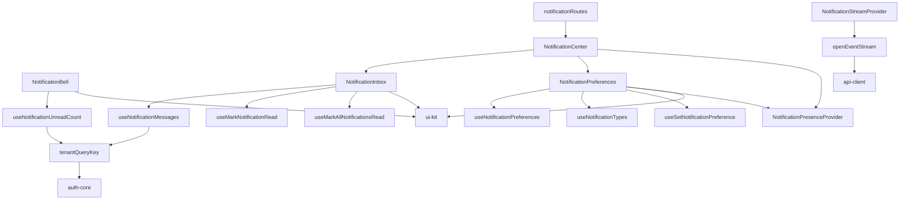

# notification-ui

## 职责

本包是站内通知在浏览器里的面，包 `web/packages/notification-ui`。一个能力 UI 包对一个后端能力目录（[web](design-web.md) 的划分轴），本包对后端通知能力的收件箱、偏好与推送三个面。它交付：

- **未读铃铛**：`NotificationBell` 读调用方的未读数（`GET /api/v1/notifications/messages/unread-count`），渲染为带徽标的图标按钮。计数落在按钮的可及名上（前端规范的图标按钮规则），徽标字形对无障碍树隐藏，读屏只播报一次。它受控：`onClick` 是宿主的导航，铃铛本身不含路由。
- **收件箱面**：`NotificationInbox` 读一页消息（`GET /api/v1/notifications/messages`），逐行渲染标题、正文、时间与未读/已读标记，未读行提供「标记为已读」（`POST /api/v1/notifications/messages/:id/read`），页头提供「全部标记为已读」（`POST /api/v1/notifications/messages/read-all`）。
- **偏好矩阵**：`NotificationPreferences` 读按类型的渠道矩阵（`GET /api/v1/notifications/preferences`）与类型分类法（`GET /api/v1/notifications/types`，取每类型是否可退订），写入单个渠道的目标态（`PUT /api/v1/notifications/preferences/:typeKey/:channel`）。渠道列是 `in_app` 加宿主给出的、特性在场的可选渠道。
- **通知面**：`NotificationCenter` 是默认组合——收件箱与其下的偏好矩阵；特性 `notification.preferences` 缺席时只有收件箱。
- **实时订阅**：`NotificationStreamProvider` 经宿主交来的开启器打开 `GET /api/v1/notifications/stream`，每来一帧 `message` 即失效当前租户的未读数与消息列表。
- **特性在场的接收**：`NotificationPresenceProvider` 承载宿主给出的特性在场事实：偏好面与各可选渠道。
- **声明式入口**：`notificationRoutes` 是包对声明式注册面的贡献——通知面在 `/notifications`，带标签因而贡献一条导航项，依赖特性 `notification.inbox`。
- **文案命名空间**：`NOTIFICATION_UI_NAMESPACE` 与 `notificationUiResources`。

### 非职责

- **不做 HTTP。** 读写都经生成面 `@speed/api-sdk` 的 react-query hooks，实时连接经宿主交来的 `@speed/api-client` 事件流开启器；本包不建客户端、不手写请求、不手写端点路径与响应类型。
- **不定义契约。** 端点路径、请求体与响应形状由后端模块的 OpenAPI 片段给出；本包只声明这些面怎么渲染。
- **不做路由与路径匹配。** `notificationRoutes` 是结构与 `@speed/route-kit` 的声明相同的数据加视图，宿主收集并交给它选的路由层。
- **不判定权限。** 通知的后端路由不带自有权限闸，访问控制由宿主侧的授权决定；本包不声明权限点，也不据权限隐藏入口。
- **不读会话。** 实时订阅是否需要打开由宿主的 `enabled` 入参给出，本包不为它读会话状态；本包只读当前租户（`@speed/auth-core` 的 `useCurrentTenant`），供查询键分段。
- **不持连接策略的存储态。** 重连与页面隐藏时的暂停是 provider 的运行期行为，不落任何存储。

## 外部接口契约

### 交付的符号

包以 `src/index.ts` 为公开面，交付下列符号。

| 导出 | 种类 | 说明 |
|---|---|---|
| `NotificationBell` | 组件 | 带未读徽标的铃铛；`onClick` 上报激活。 |
| `NotificationInbox` | 组件 | 收件箱面：消息列表、行内标记已读、全部标记已读。 |
| `NotificationPreferences` | 组件 | 按类型的渠道偏好矩阵。 |
| `NotificationCenter` | 组件 | 收件箱与偏好矩阵的组合页。 |
| `NotificationStreamProvider` | 组件 | 实时订阅 provider；入参 `openStream`、`enabled`、`children`。 |
| `NotificationPresenceProvider` | 组件 | 特性在场 provider；入参 `preferences`、`channels`、`children`。 |
| `useNotificationStreamOpener` | hook | 读嵌套组件可见的开启器，无 provider 时为 null。 |
| `notificationRoutes` | 声明表 | 通知面的一个声明：路径 `/notifications`、视图、导航标签、`requires: ['notification.inbox']`。 |
| `NotificationRoute`、`NotificationRouteContext`、`NotificationRouteParams`、`NotificationRouteTable` | 类型 | 声明面的结构性类型，与 route-kit 的声明形状相同；`NotificationRoute` 的可选字段 `requires` 的类型是 `readonly FeatureName[]`（`@speed/api-sdk/features`）。 |
| `NOTIFICATION_UI_NAMESPACE`、`notificationUiResources` | 常量 | 裸名命名空间与其双语资源。 |

### 实时订阅的入参

```ts
interface NotificationStreamProviderProps {
  openStream?: EventStreamOpener   // 装配客户端的事件流开启器；缺席即不连
  enabled?: boolean                // 缺省 true；宿主据此在匿名时、实时流特性缺席时不连
  children: ReactNode
}
```

`openStream` 是装配处（`@speed/product-shell/bootstrap` 的 `bootstrapSpeedApp`）建的客户端的事件流开启器（`SpeedClient.openEventStream`）。`enabled` 是宿主的会话事实：本包不为它读会话状态，一个匿名的访客因此不会打开一个只会被拒的连接。宿主把特性 `notification.stream` 是否在场并进同一个入参：该特性缺席的部署上，打开的连接每次被拒后都会按退避重开。两者之一缺席或 `enabled` 为 false 时，订阅是惰性的，面仍按挂载与标签页重新可见各自读一次。

### 特性在场的入参

```ts
interface NotificationPresenceProviderProps {
  preferences: boolean                       // 特性 notification.preferences 是否在场
  channels: readonly ('email' | 'sms')[]     // 特性在场的可选渠道；in_app 恒在，不列
  children: ReactNode
}
```

`NotificationPresenceProvider` 与 `NotificationStreamProvider` 同形：入参是宿主给出的特性在场事实，本包不为它读会话或特性态（[ADR-web-feature-state-2026-10-17](../../../adr/adr-web-feature-state-2026-10-17.md)）。宿主取特性 `notification.preferences` 给出 `preferences`，把特性在场的 `notification.channel.email`、`notification.channel.sms` 映射成 `channels`。没有 provider 时按 `preferences` 为假、`channels` 为空处理：偏好面与可选渠道都按特性缺席隐藏，方向是失败即关。

收件箱与铃铛不经这个 provider：通知面的声明以 `requires` 列出 `notification.inbox`，特性缺席时由宿主的路由层渲染与未登记路径相同的 404（[route-kit](design-web-route-kit.md)）；铃铛由宿主按同一个特性决定挂不挂。

### 对外接口面

`src/index.ts` 的导出集、各组件的 props 形状、`notificationRoutes` 的类型与它所列的特性、`NotificationStreamProvider` 与 `NotificationPresenceProvider` 的入参语义（含没有 provider 时的处理），以及 `NOTIFICATION_UI_NAMESPACE` 与 `notificationUiResources` 是对使用者的接口面。包以锁定版本组发布。变更按 TypeScript 的源码语义分类：新增导出、新增可选字段是源码兼容的；删除导出或字段、改既有导出或字段的含义或名、改签名（参数或返回类型），是不兼容变更。把必选与可选互转按位置判：输入位（宿主提供的 prop 或参数）放宽兼容、收紧不兼容；输出位（宿主读取的返回类型或结果字段）相反——放宽为可选使读出的值成为 `T | undefined`，strictNullChecks 下只有在要求 `T` 处使用它的消费者无法编译（对可能为 undefined 的值做成员访问报 TS18048，赋给 `T` 或传入要求 `T` 的形参报 TS2322/TS2345），仅转发或在宽松处使用（模板串、比较、`??`、可选链）的消费者仍编译，故可能破坏消费者、是不兼容变更。

## 依赖

依赖方向满足架构不变量：依赖只从上层流向下层，同层不互相依赖。

| 依赖 | 种类 | 用途 |
|---|---|---|
| `@speed/api-sdk` | 依赖 | 通知的生成 operation 与查询键构造器；响应类型；子路径 `@speed/api-sdk/features` 的特性名类型 `FeatureName` |
| `@speed/api-client` | 依赖 | 事件流开启器与帧的类型（`EventStreamOpener`、`EventStreamOptions`、`EventStreamHandle`、`ServerSentEvent`） |
| `@speed/auth-core` | 依赖 | 当前租户（`useCurrentTenant`）与租户作用域查询键（`tenantQueryKey`、`useTenantQueryKey`） |
| `@speed/i18n` | 依赖 | 命名空间翻译与错误码文本解析（`createErrorTextResolver`、会话生命周期与传输码） |
| `@speed/ui-kit` | 依赖 | 页头、空态、列表骨架、四态分支、内联错误等受控组件 |
| `react`、`react-dom`、`@mui/material`、`@emotion/*`、`@tanstack/react-query` | peer | 宿主持有的 React/MUI 树与查询客户端；单份使主题与查询上下文不分叉 |

本包不 import 同层的其他能力 UI 包，也不同 `@speed/route-kit` 建边：`notificationRoutes` 的形状是复制的，不是 import 的。

## UML 图

图给出本包各符号与它依赖的同族包。图里画不出的约束：读写都经生成面的 hooks（经宿主绑定的请求函数发请求），实时连接只经宿主交来的开启器；查询键以租户标识为最外层段；包不做路由、不读会话；特性在场只经宿主交来的 provider，缺 provider 时按特性缺席处理。



## 核心数据结构

| 概念 | 类型 | 说明 |
|---|---|---|
| 消息 | `NotificationMessage`（api-sdk） | 一条站内信视图：`id`、`type_key`、`group`、`title`、`body`、`params`、`link`、`read_at`、`created_at` |
| 消息页 | `NotificationInbox`（本包内部） | 生成响应收窄成 `{ messages, total }`，缺体读成空页 |
| 偏好行 | `NotificationPreference`（api-sdk） | 一个类型一行：`type_key`、`group`、`channels`（有效集）、`explicit` |
| 类型声明 | `NotificationType`（api-sdk） | 分类法一项：`key`、`group`、`default_channels`、`unsubscribable`、`recipient_visible_params` |
| 服务端事件 | `ServerSentEvent`（api-client） | 一帧：`event`（缺省 message）、`data`、可选 `id`/`retry` |
| 事件流开启器 | `EventStreamOpener`（api-client） | `(path, options) => EventStreamHandle` |

**消息的 `read_at` 在运行期可为 `null`。** 后端消息视图的 `read_at` 是无 omitempty 的 `*time.Time`，未读消息因而写出 JSON `null`，而生成的类型把该字段建模成可选字符串。面把 `null`、`undefined` 与空串一律读成未读。

## 核心算法与流程

### 读写的失效面

一次读经生成的 react-query hook，键以租户标识为最外层段（`tenantQueryKey(tenantId, ...生成键尾)`），仅当租户已知时启用。一次写（标记一条已读、全部标记已读、写一个渠道）成功后失效当前租户的消息列表、未读数与偏好矩阵三处键：键的尾段取自生成面的键构造器（`getNotificationInboxListMessagesQueryKey` 等），读与写因此共用一处定义，写不会失效一个读不出的键。

### 实时订阅、重连与页面隐藏

订阅在挂载、租户已知且 `enabled` 为真时打开一条连接。每来一帧 `message`，重置重连退避并失效当前租户的未读数与消息列表；帧只点名一条消息的标识（推送模块的契约），面因而不从帧补缓存，而是回读。

订阅按（租户，收件人）登记，收件人是身份的生效账户，冒充期间是被冒充账户（[notification-stream](../notification/design-notification-stream.md)）。因此订阅不只随租户变化重开：开始或结束冒充之后，宿主以身份变更代数重建 `NotificationStreamProvider`，订阅按新的生效账户重新连接（[design-starters](../design-starters.md) 的「冒充期间的壳」）。

连接结束或失败各上报一次，provider 以封顶的指数退避重开（基 1s，封顶 30s）。页面隐藏时关闭连接、可见时立即重开：后台标签页不需要一条长连接，返回的访客也不必等退避走完。撤销时关闭连接并移除可见性监听。

### 偏好矩阵的渲染

矩阵的行来自偏好读（每个在册类型一行），渠道列是 `in_app` 加 `NotificationPresenceProvider` 给出的、特性在场的可选渠道，按平台封闭渠道词表（`in_app`、`email`、`sms`）的次序排列，勾选态取该行的有效集。类型分类法给出每类型的 `unsubscribable`：为 false 的类型整行禁用并标注不可退订（一次写入会被拒 409），分类法尚未到时按未知处理、保持可勾。一次勾选写上该渠道的目标态并回读，勾选态因而是最近一次成功读到的服务端应答；一次写只带被勾的那个渠道。

**隐藏一个渠道列不改变偏好的取值。** 偏好按（类型，渠道）逐格写入，隐藏列的已存值不受影响，渠道的取值集也不因装配增减（[notification-preferences](../notification/design-notification-preferences.md)、[ADR-notification-channels-2026-10-15](../../../adr/adr-notification-channels-2026-10-15.md)）；渠道列只决定矩阵渲染哪些格。

### 偏好面按特性在场渲染

`NotificationCenter` 只在 `NotificationPresenceProvider` 给出 `preferences` 为真时渲染偏好矩阵；为假时只渲染收件箱，也不发分类法与偏好读。

### 写入的反馈

收件箱与偏好矩阵各是一个反馈作用域，按 [ui-kit](design-web-ui-kit.md) 的「写入的反馈」组织（[ADR-web-write-feedback-2026-10-17](../../../adr/adr-web-write-feedback-2026-10-17.md)）。

- **收件箱的标记已读与全部标记已读共用一个槽，作用域内的写入控件互锁。** 任一写入进行中，全部标记已读与每一行的标记已读同处禁用并标忙，与偏好矩阵同形；作用域内的尝试因此不重叠，一次全部已读的失败不会被并发的标记已读的成功替换。标记一条已读也落成功文案，不只靠行上的已读标记翻转。
- **偏好矩阵的写入落成功文案，点明类型与渠道；失败渲染一条横幅，文本是该失败码的文本，紧贴矩阵。** 写入进行中整张矩阵禁用；失败的单元由矩阵回到服务端应答而可辨认，单元的 `aria-label` 给出它的类型与渠道。
- **读的刷新失败保留旧数据并标明。** 收件箱列表与偏好矩阵在已有数据时刷新失败（标记已读或写偏好之后的失效重读、标签页重新可见的重读）都保持旧内容，其上渲染陈旧提示与重试；勾选态因此是最近一次成功读到的服务端应答。类型分类法的刷新失败不标明：分类法只作提示，不被写入失效，缓存值仍然正确。
- **未读铃铛没有失败态，这是有意的。** 未读数读失败时铃铛保持最后一次读到的值（从未读到过则为零），不渲染错误与重试，也不显示实时连接的状态；未读数的读失败不在任何面上可见，收件箱列表与偏好矩阵的读失败各在自己的面上渲染占位。

## 错误与失败语义

| 情形 | 表现 |
|---|---|
| 读失败（列表、偏好），屏上没有数据 | 该面的四态分支落到可重试的错误占位 |
| 列表或偏好读被准入层拒绝：没有问题对象的裸 404，不区分租户不存在、已停用与非成员（[tenant 准入](../tenant/design-tenant-admission.md)） | 该面渲染「无法访问当前组织」空态，说明它可能不存在、或你还不是该组织的成员，并指引联系管理员发送邀请；不给重试，与读失败的可重试占位分开 |
| 已有列表或偏好数据时刷新失败 | 旧内容保留，其上渲染陈旧提示与重试 |
| 未读数读失败 | 铃铛保持最后一次读到的值（从未读到过则为零），不渲染错误与重试 |
| 类型分类法读失败 | 按未知处理，偏好矩阵保持可勾，不渲染错误占位 |
| 写失败（标记已读、全部已读、写偏好） | 该面的内联错误横幅渲染应答的码文本（白名单外落 `errors.unknown`）；被准入层拒绝的裸 404 渲染同一句「无法访问当前组织」 |
| 无租户（无路由或未挂 provider） | 读以 `enabled: false` 不取，失败关闭而非造一个租户 |
| 后端消息视图的 `read_at` 为 JSON `null` | 读成未读（`null`、`undefined`、空串等同） |
| 未挂开启器或 `enabled` 为 false | 订阅惰性，面仍按挂载与标签页重新可见各自读一次 |
| 未挂 `NotificationPresenceProvider` | 按 `preferences` 为假、`channels` 为空处理：通知面不渲染偏好矩阵、不发分类法与偏好读，单独挂载的偏好矩阵只有 `in_app` 一列 |
| 实时连接被断开 | 一次失败上报，provider 以封顶的指数退避重开，退避随连续失败增长、只在收到一帧时复位；宿主不感知单次失败 |
| 打开连接被准入层拒绝（没有问题对象的裸 404） | provider 停止重连：重试不能改变这个拒绝，每次重连都会刷新一条控制台错误；租户或生效身份改变、或标签页由隐藏变为可见时重新打开一次 |

本包不重试读与写（重试归传输层与宿主的查询客户端），实时连接的重连是 provider 自己的策略。

## 扩展点

- **宿主改写措辞。** 在启动处向 `NOTIFICATION_UI_NAMESPACE` 注册自己的一对同键 bundle，`notificationUiResources` 只是发布的默认。
- **偏好面的落点。** `NotificationCenter` 把偏好矩阵放在通知面内；一个宿主也可单独挂 `NotificationPreferences` 到自己的账户页，挂不挂由宿主按特性 `notification.preferences` 决定，渠道列同样取自 `NotificationPresenceProvider`。
- **不开实时。** 宿主不传 `openStream` 或传 `enabled: false` 即得一个只按挂载与标签页重新可见读通知的面，无需改动本包。
- **新增一个后端通知面的渲染。** 加一个组件并经生成面发请求，加进本包的公开面与命名空间；不改壳，不改传输。

## 实现状态

| 能力 | 状态 | 代码 |
|---|---|---|
| 实时订阅随身份变更重建 | 已实现 | `web/packages/notification-ui/src/NotificationStream.tsx` `NotificationStreamProvider`、`identityGeneration` |
| 未读铃铛与徽标 | 已实现 | `web/packages/notification-ui/src/NotificationBell.tsx` `NotificationBell` |
| 收件箱面与标记已读 | 已实现 | `web/packages/notification-ui/src/NotificationInbox.tsx` `NotificationInbox` |
| 偏好矩阵的读写 | 已实现 | `web/packages/notification-ui/src/NotificationPreferences.tsx` `NotificationPreferences` |
| 通知面的组合 | 已实现 | `web/packages/notification-ui/src/NotificationCenter.tsx` `NotificationCenter` |
| 实时订阅 provider | 已实现 | `web/packages/notification-ui/src/NotificationStream.tsx` `NotificationStreamProvider` |
| 声明式路由入口 | 已实现 | `web/packages/notification-ui/src/routes.tsx` `notificationRoutes` |
| 租户作用域读写与失效 | 已实现 | `web/packages/notification-ui/src/internal/queries.ts` `useNotificationMessages`、`useNotificationUnreadCount`、`useNotificationPreferences`、`useMarkNotificationRead`、`useMarkAllNotificationsRead`、`useSetNotificationPreference` |
| 文案命名空间与双语资源 | 已实现 | `web/packages/notification-ui/src/resources.ts` `NOTIFICATION_UI_NAMESPACE`、`notificationUiResources` |
| 收件箱与偏好矩阵的反馈作用域与成功确认 | 未实现 | — |
| 收件箱列表与偏好矩阵读的陈旧提示 | 未实现 | — |
| 特性在场 provider `NotificationPresenceProvider` | 未实现 | — |
| 偏好矩阵的渠道列取 `in_app` 与特性在场的可选渠道 | 未实现 | — |
| 通知面在特性 `notification.preferences` 缺席时不渲染偏好矩阵、不发其读取 | 未实现 | — |
| `notificationRoutes` 的 `requires` | 已实现 | `web/packages/notification-ui/src/routes.tsx` `notificationRoutes`；`web/packages/notification-ui/src/route.ts` `NotificationRoute` |
| 准入层的裸 404 渲染为「无法访问当前组织」，不渲染成可重试的失败 | 已实现 | `web/packages/notification-ui/src/internal/tenant-section.tsx` `TenantAsyncSection`、`isTenantRefusal`；`web/packages/notification-ui/src/internal/error-text.ts` `useNotificationUiErrorText` |
| 实时连接被准入层拒绝时停止重连，退避随连续失败增长 | 未实现 | — |
