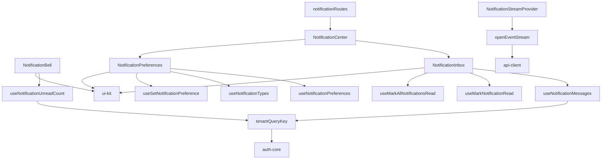

# notification-ui

## 职责

本包是站内通知在浏览器里的面，包 `web/packages/notification-ui`。一个能力 UI 包对一个后端能力目录（[web](design-web.md) 的划分轴），本包对后端通知能力的收件箱、偏好与推送三个面。它交付：

- **未读铃铛**：`NotificationBell` 读调用方的未读数（`GET /api/v1/notifications/messages/unread-count`），渲染为带徽标的图标按钮。计数落在按钮的可及名上（前端规范的图标按钮规则），徽标字形对无障碍树隐藏，读屏只播报一次。它受控：`onClick` 是宿主的导航，铃铛本身不含路由。
- **收件箱面**：`NotificationInbox` 读一页消息（`GET /api/v1/notifications/messages`），逐行渲染标题、正文、时间与未读/已读标记，未读行提供「标记为已读」（`POST /api/v1/notifications/messages/:id/read`），页头提供「全部标记为已读」（`POST /api/v1/notifications/messages/read-all`）。
- **偏好矩阵**：`NotificationPreferences` 读按类型的渠道矩阵（`GET /api/v1/notifications/preferences`）与类型分类法（`GET /api/v1/notifications/types`，取每类型是否可退订），写入单个渠道的目标态（`PUT /api/v1/notifications/preferences/:typeKey/:channel`）。
- **通知面**：`NotificationCenter` 是默认组合——收件箱与其下的偏好矩阵。
- **实时订阅**：`NotificationStreamProvider` 经宿主交来的开启器打开 `GET /api/v1/notifications/stream`，每来一帧 `message` 即失效当前租户的未读数与消息列表。
- **声明式入口**：`notificationRoutes` 是包对声明式注册面的贡献——通知面在 `/notifications`，带标签因而贡献一条导航项。
- **文案命名空间**：`NOTIFICATION_UI_NAMESPACE` 与 `notificationUiResources`。

### 非职责

- **不做 HTTP。** 读写都经生成面 `@speed/api-sdk` 的 react-query hooks，实时连接经宿主交来的 `@speed/api-client` 事件流开启器；本包不建客户端、不手写请求、不手写端点路径与响应类型。
- **不定义契约。** 端点路径、请求体与响应形状由后端模块的 OpenAPI 片段给出；本包只声明这些面怎么渲染。
- **不做路由与路径匹配。** `notificationRoutes` 是结构与 `@speed/route-kit` 的声明相同的数据加视图，宿主收集并交给它选的路由层。
- **不判定权限。** 通知的后端路由不带自有权限闸，访问控制由宿主侧的授权决定；本包不声明权限点，也不据权限隐藏入口。
- **不读会话。** 实时订阅是否需要打开由宿主的 `enabled` 入参给出，本包不为它读会话状态；本包只读当前租户（`@speed/auth-core` 的 `useCurrentTenant`），供查询键分段。
- **不持连接策略的存储态。** 重连与页面隐藏时的暂停是 provider 的运行期行为，不落任何存储。

## 外部接口契约

### 交付的符号

包以 `src/index.ts` 为公开面，交付下列符号。

| 导出 | 种类 | 说明 |
|---|---|---|
| `NotificationBell` | 组件 | 带未读徽标的铃铛；`onClick` 上报激活。 |
| `NotificationInbox` | 组件 | 收件箱面：消息列表、行内标记已读、全部标记已读。 |
| `NotificationPreferences` | 组件 | 按类型的渠道偏好矩阵。 |
| `NotificationCenter` | 组件 | 收件箱与偏好矩阵的组合页。 |
| `NotificationStreamProvider` | 组件 | 实时订阅 provider；入参 `openStream`、`enabled`、`children`。 |
| `useNotificationStreamOpener` | hook | 读嵌套组件可见的开启器，无 provider 时为 null。 |
| `notificationRoutes` | 声明表 | 通知面的一个声明：路径 `/notifications`、视图、导航标签。 |
| `NotificationRoute`、`NotificationRouteContext`、`NotificationRouteParams`、`NotificationRouteTable` | 类型 | 声明面的结构性类型，与 route-kit 的声明形状相同。 |
| `NOTIFICATION_UI_NAMESPACE`、`notificationUiResources` | 常量 | 裸名命名空间与其双语资源。 |

### 实时订阅的入参

```ts
interface NotificationStreamProviderProps {
  openStream?: EventStreamOpener   // 装配客户端的事件流开启器；缺席即不连
  enabled?: boolean                // 缺省 true；宿主据此在匿名时不连
  children: ReactNode
}
```

`openStream` 是装配处（`@speed/product-shell/bootstrap` 的 `bootstrapSpeedApp`）建的客户端的事件流开启器（`SpeedClient.openEventStream`）。`enabled` 是宿主的会话事实：本包不为它读会话状态，一个匿名的访客因此不会打开一个只会被拒的连接。两者之一缺席或 `enabled` 为 false 时，订阅是惰性的，面仍按挂载与聚焦各自读一次。

### 稳定性承诺

`src/index.ts` 的导出集、各组件的 props 形状、`notificationRoutes` 的类型、`NotificationStreamProvider` 的入参语义，以及 `NOTIFICATION_UI_NAMESPACE` 与 `notificationUiResources` 是对使用者的契约。包以锁定版本组发布。变更按 TypeScript 的源码语义分类：新增导出、新增可选字段是源码兼容的；删除导出或字段、改既有导出或字段的含义或名、改签名（参数或返回类型），是不兼容变更。把必选与可选互转按位置判：输入位（宿主提供的 prop 或参数）放宽兼容、收紧不兼容；输出位（宿主读取的返回类型或结果字段）相反——放宽为可选使读出的值成为 `T | undefined`，strictNullChecks 下只有在要求 `T` 处使用它的消费者无法编译（对可能为 undefined 的值做成员访问报 TS18048，赋给 `T` 或传入要求 `T` 的形参报 TS2322/TS2345），仅转发或在宽松处使用（模板串、比较、`??`、可选链）的消费者仍编译，故可能破坏消费者、是不兼容变更。

## 依赖

依赖方向满足架构不变量：依赖只从上层流向下层，同层不互相依赖。

| 依赖 | 种类 | 用途 |
|---|---|---|
| `@speed/api-sdk` | 依赖 | 通知的生成 operation 与查询键构造器；响应类型 |
| `@speed/api-client` | 依赖 | 事件流开启器与帧的类型（`EventStreamOpener`、`EventStreamOptions`、`EventStreamHandle`、`ServerSentEvent`） |
| `@speed/auth-core` | 依赖 | 当前租户（`useCurrentTenant`）与租户作用域查询键（`tenantQueryKey`、`useTenantQueryKey`） |
| `@speed/i18n` | 依赖 | 命名空间翻译与错误码文本解析（`createErrorTextResolver`、会话生命周期与传输码） |
| `@speed/ui-kit` | 依赖 | 页头、空态、列表骨架、四态分支、内联错误等受控组件 |
| `react`、`react-dom`、`@mui/material`、`@emotion/*`、`@tanstack/react-query` | peer | 宿主持有的 React/MUI 树与查询客户端；单份使主题与查询上下文不分叉 |

本包不 import 同层的其他能力 UI 包，也不同 `@speed/route-kit` 建边：`notificationRoutes` 的形状是复制的，不是 import 的。

## UML 图

图给出本包各符号与它依赖的同族包。图里画不出的约束：读写都经生成面的 hooks（经宿主绑定的请求函数发请求），实时连接只经宿主交来的开启器；查询键以租户标识为最外层段；包不做路由、不读会话。



## 核心数据结构

| 概念 | 类型 | 说明 |
|---|---|---|
| 消息 | `NotificationMessage`（api-sdk） | 一条站内信视图：`id`、`type_key`、`group`、`title`、`body`、`params`、`link`、`read_at`、`created_at` |
| 消息页 | `NotificationInbox`（本包内部） | 生成响应收窄成 `{ messages, total }`，缺体读成空页 |
| 偏好行 | `NotificationPreference`（api-sdk） | 一个类型一行：`type_key`、`group`、`channels`（有效集）、`explicit` |
| 类型声明 | `NotificationType`（api-sdk） | 分类法一项：`key`、`group`、`default_channels`、`unsubscribable`、`recipient_visible_params` |
| 服务端事件 | `ServerSentEvent`（api-client） | 一帧：`event`（缺省 message）、`data`、可选 `id`/`retry` |
| 事件流开启器 | `EventStreamOpener`（api-client） | `(path, options) => EventStreamHandle` |

**消息的 `read_at` 在运行期可为 `null`。** 后端消息视图的 `read_at` 是无 omitempty 的 `*time.Time`，未读消息因而写出 JSON `null`，而生成的类型把该字段建模成可选字符串。面把 `null`、`undefined` 与空串一律读成未读。

## 核心算法与流程

### 读写的失效面

一次读经生成的 react-query hook，键以租户标识为最外层段（`tenantQueryKey(tenantId, ...生成键尾)`），仅当租户已知时启用。一次写（标记一条已读、全部标记已读、写一个渠道）成功后失效当前租户的消息列表、未读数与偏好矩阵三处键：键的尾段取自生成面的键构造器（`getNotificationInboxListMessagesQueryKey` 等），读与写因此共用一处定义，写不会失效一个读不出的键。

### 实时订阅、重连与页面隐藏

订阅在挂载、租户已知且 `enabled` 为真时打开一条连接。每来一帧 `message`，重置重连退避并失效当前租户的未读数与消息列表；帧只点名一条消息的标识（推送模块的契约），面因而不从帧补缓存，而是回读。

连接结束或失败各上报一次，provider 以封顶的指数退避重开（基 1s，封顶 30s）。页面隐藏时关闭连接、可见时立即重开：后台标签页不需要一条长连接，返回的访客也不必等退避走完。撤销时关闭连接并移除可见性监听。

### 偏好矩阵的渲染

矩阵的行来自偏好读（每个在册类型一行），渠道列取平台封闭渠道词表（`in_app`、`email`、`sms`），勾选态取该行的有效集。类型分类法给出每类型的 `unsubscribable`：为 false 的类型整行禁用并标注不可退订（一次写入会被拒 409），分类法尚未到时按未知处理、保持可勾。一次勾选写上该渠道的目标态并回读，勾选态因而始终是服务端的应答。

## 错误与失败语义

| 情形 | 表现 |
|---|---|
| 读失败（列表、未读数、偏好、分类法） | 该面的四态分支落到可重试的错误占位 |
| 写失败（标记已读、全部已读、写偏好） | 该面的内联错误横幅渲染应答的码文本（白名单外落 `errors.unknown`） |
| 无租户（无路由或未挂 provider） | 读以 `enabled: false` 不取，失败关闭而非造一个租户 |
| 后端消息视图的 `read_at` 为 JSON `null` | 读成未读（`null`、`undefined`、空串等同） |
| 未挂开启器或 `enabled` 为 false | 订阅惰性，面仍按挂载与聚焦各自读一次 |
| 实时连接被拒或被断开 | 一次失败上报，provider 以退避重开；宿主不感知单次失败 |

本包不重试读与写（重试归传输层与宿主的查询客户端），实时连接的重连是 provider 自己的策略。

## 扩展点

- **宿主改写措辞。** 在启动处向 `NOTIFICATION_UI_NAMESPACE` 注册自己的一对同键 bundle，`notificationUiResources` 只是发布的默认。
- **偏好面的落点。** `NotificationCenter` 把偏好矩阵放在通知面内；一个宿主也可单独挂 `NotificationPreferences` 到自己的账户页。
- **不开实时。** 宿主不传 `openStream` 或传 `enabled: false` 即得一个只按挂载与聚焦读通知的面，无需改动本包。
- **新增一个后端通知面的渲染。** 加一个组件并经生成面发请求，加进本包的公开面与命名空间；不改壳，不改传输。

## 实现状态

| 能力 | 状态 | 代码 |
|---|---|---|
| 未读铃铛与徽标 | 已实现 | `web/packages/notification-ui/src/NotificationBell.tsx` `NotificationBell` |
| 收件箱面与标记已读 | 已实现 | `web/packages/notification-ui/src/NotificationInbox.tsx` `NotificationInbox` |
| 偏好矩阵的读写 | 已实现 | `web/packages/notification-ui/src/NotificationPreferences.tsx` `NotificationPreferences` |
| 通知面的组合 | 已实现 | `web/packages/notification-ui/src/NotificationCenter.tsx` `NotificationCenter` |
| 实时订阅 provider | 已实现 | `web/packages/notification-ui/src/NotificationStream.tsx` `NotificationStreamProvider` |
| 声明式路由入口 | 已实现 | `web/packages/notification-ui/src/routes.tsx` `notificationRoutes` |
| 租户作用域读写与失效 | 已实现 | `web/packages/notification-ui/src/internal/queries.ts` `useNotificationMessages`、`useNotificationUnreadCount`、`useNotificationPreferences`、`useMarkNotificationRead`、`useMarkAllNotificationsRead`、`useSetNotificationPreference` |
| 文案命名空间与双语资源 | 已实现 | `web/packages/notification-ui/src/resources.ts` `NOTIFICATION_UI_NAMESPACE`、`notificationUiResources` |
