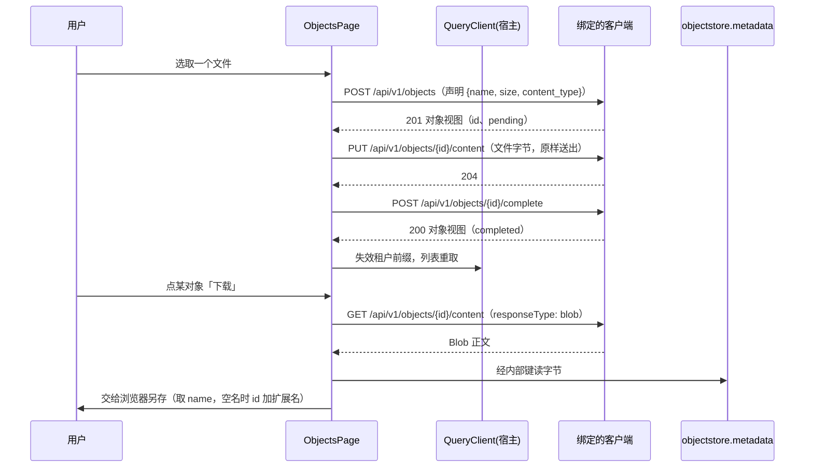

# objectstore-ui

## 职责

`@speed/objectstore-ui` 是对象存储能力（[objectstore](../design-objectstore.md)）在浏览器里的面：一个租户作用域的对象页。它交付下列面：

- `ObjectsPage`：本租户的对象列表（名称、对象标识、状态、大小、内容类型、创建时间，以及每行的下载、详情与删除控件），经 `@speed/ui-kit` 的 `FileUploader` 驱动的上传面（每个文件走对象存储模块的三步传输：声明 → 上传字节 → 完成），一个逐对象的详情对话框，一次下载与一次删除。删除经 ui-kit 危险 `ConfirmDialog` 的 `doubleConfirm` 两步守卫确认——对象连同其字节一并销毁、界面上无从恢复。
- `ObjectDetailDialog`：单个对象的元数据（含名称），读 `GET /api/v1/objects/{id}`，由 `ObjectsPage` 的「详情」控件打开。
- 命名为 `OBJECTSTORE_UI_NAMESPACE` 与 `objectstoreUiResources` 的双语命名空间资源。

**本包是能力 UI 包，与一个后端能力目录对应**（[design-web](design-web.md) 的划分轴）：`@speed/objectstore-ui` 对 `pkg/objectstore`，把该模块的路由渲染成一个页面。它处在生成钩子这一层之上，与 `@speed/account-ui`、`@speed/console-ui` 同层而互不 import。

页面由宿主装配：本包不 import 路由、不持路径、不导航。对象页挂在解析租户的端上，页面从 `@speed/auth-core` 的租户上下文读当前租户，把它作为每个读的查询键最外段，并据此启用读。

**宿主挂载对象页的路由声明带 `requires: ['objectstore.objects']`。** 特性 `objectstore.objects` 由 `objectstore.metadata` 声明（[objectstore](../design-objectstore.md)）；该特性缺席时，宿主的路由层把对象页的路径与未登记路径同样渲染为 404，导航里也不出现该页（[route-kit](design-web-route-kit.md)）。本包不读特性态，也不另行处理特性缺席。

### 非职责

- **不做路由、导航与路径。** 宿主把它挂在自选的路由上（示例宿主挂在 `/objects` 并加一条导航标签）；本包不知道任何路径。
- **不持会话、不落存储、不携令牌。** 它从不读访问令牌、写存储或驱动会话；凭据由宿主绑定进 api-sdk 运行期接缝的客户端携带。
- **不自己写 HTTP。** 每次调用都是生成操作；本包不含 `fetch`/`axios`（工作区的 `speed/no-direct-http` 规则守住），也从不构造客户端、不定义查询键。
- **不拥有查询客户端。** 每个读经 `@speed/api-sdk` 的生成 react-query 钩子、跑在宿主拥有的 QueryClient 上；失效一律用租户前缀。
- **名称取模块规整后的值，按文本渲染。** 对象视图的 `name` 已由模块规整，不含路径分隔符与控制字符；本包把它当文本节点渲染，不当 HTML、不拼进路径。列表单元格单行截断，完整名称在详情对话框；`name` 为空串时列表显示「未命名」文案，下载文件名回落为 `id` 加一个由 `mime` 推出的扩展名。
- **列的优先级保证名称与操作同屏。** 名称与操作不设优先级、永不隐藏；状态为 `high`，创建时间为 `medium`，内容类型、大小与对象标识为 `low`。对象标识列只显示标识的前 8 个字符，完整标识经 `cellFullValue` 给出（悬停标题与可聚焦的复制控件），详情对话框也显示完整标识。各档可见列的不可断宽度之和不得超过该档下限（容器宽度 600、900、1200 三档），实测超出时按对象标识、内容类型、大小的次序把列移出列表。判据是在这三个容器宽度下表格都不出现横向滚动。
- **不判定权限。** 403 是服务端写出的应答，本包只渲染它；前端的权限判断是 UX 可供性，不是安全边界。

## 外部接口契约

`web/packages/objectstore-ui/src/index.ts` 是公开面：

```tsx
interface ObjectsPageProps {
  readonly pageSize?: number // 列表请求的页大小，模块另施自己的缺省与上限
}

interface ObjectDetailDialogProps {
  readonly id: string | null // null 即关闭，读被禁用
  readonly onClose: () => void
}
```

导出集为 `OBJECTSTORE_UI_NAMESPACE`、`objectstoreUiResources`、`ObjectsPage`（连同 `ObjectsPageProps`）、`ObjectDetailDialog`（连同 `ObjectDetailDialogProps`）。`src/internal/` 下的错误文案解析器、失败横幅、异步分支、上传编排与格式化助手是页内管线，不外导。

**对外接口面。** 上述导出集与 `ObjectsPageProps`、`ObjectDetailDialogProps` 的形状是对宿主的接口面。变更按 TypeScript 的源码语义分类：新增导出、新增可选字段是源码兼容的；删除导出或字段、改既有导出或字段的含义或名、改签名（参数或返回类型），是不兼容变更。把必选与可选互转按位置判：输入位（宿主提供的 prop 或参数）放宽兼容、收紧不兼容；输出位（宿主读取的返回类型或结果字段）相反——放宽为可选使读出的值成为 `T | undefined`，strictNullChecks 下只有在要求 `T` 处使用它的消费者无法编译（对可能为 undefined 的值做成员访问报 TS18048，赋给 `T` 或传入要求 `T` 的形参报 TS2322/TS2345），仅转发或在宽松处使用（模板串、比较、`??`、可选链）的消费者仍编译，故可能破坏消费者、是不兼容变更。包以锁定版本组发布。

## 依赖

| 依赖 | 用途 |
|---|---|
| `@speed/api-sdk` | 生成的 objectstore 操作与响应模型 |
| `@speed/auth-core` | `TenantProvider`/`useCurrentTenant`、`useTenantQueryKey`、`tenantQueryKey` |
| `@speed/ui-kit` | `DataTable`、`FileUploader`、`AsyncSection`、`ConfirmDialog`、`InlineError`、`WriteFeedbackRegion`、`useWriteFeedback`、`PageHeader`、`ListSkeleton` |
| `@speed/i18n` | 命名空间注册、文案翻译钩子与错误码文本解析器 |
| `@tanstack/react-query` | peer（必需）：宿主供给的 QueryClient 与它上面的钩子 |
| `react`、`react-dom`、`@mui/material`、`@emotion/*` | peer（必需）：宿主拥有的 React／MUI 树 |

`@speed/api-client` 是 devDependency：公开类型不引用它，只有测试夹具绑定真实客户端。方向满足架构不变量：依赖只从上层流向下层，本包取 `ui-kit`、`i18n`、`api-sdk`、`auth-core`，同层包不互相 import。

**上传的字节腿与下载的字节回走 api-client 的二进制路径。** 生成的上传操作把被选文件作为请求体（一个 Blob），api-client 的请求函数把它原样送出、从不 JSON 序列化；生成的下载操作声明 `responseType: 'blob'`，api-client 把 2xx 正文读成 Blob（[api-client](design-web-api-client.md)）。

## UML 图

一次上传（三步）与一次下载的路径。图里画不到的约束：读经生成钩子跑在宿主 QueryClient 上、键以租户标识为最外段；上传与下载的字节走 api-client 的二进制路径；上传成功后失效整个租户前缀，让列表收敛到已提交的行。



## 核心数据结构

| 概念 | 形状 | 说明 |
|---|---|---|
| 对象视图 | `StoredObject` | 生成类型 `ObjectstoreObject` 的别名：`id`、`name`、`state`、`size`、`mime`、`checksum_sha256`、`expires_at`、`created_at`、`updated_at` |
| 生命周期状态 | `ObjectState` | `pending`／`uploaded`／`completed`／`deleted` 的闭集；页外的值渲染通用标签 |
| 一页对象 | `ObjectPage` | 生成类型 `ObjectstoreMetadataListObjects200`：`objects` 与 `next_cursor` |
| 单对象体 | `ObjectDetail` | 生成类型 `ObjectstoreMetadataGetObject200` |
| 租户查询键 | 数组 | `useTenantQueryKey(bareKey)` 产出以租户标识为最外段的键；无租户时读被禁用 |
| 上传队列行 | `FileUploaderRow` | 宿主拥有的一行：`id`、`name`、`status`（`uploading`／`succeeded`／`failed`）、可选 `error` |

## 核心算法与流程

### 上传三步

`useObjectUploads`（`src/internal/uploads.ts`）持有队列并驱动每个文件的三步：一次 `create`（`POST /objects`，体为 `{name, size, content_type}`，`name` 取文件的 `name`，`content_type` 取文件的 `type`，为空折成 `application/octet-stream`）→ 一次 `upload`（`PUT /objects/{id}/content`，文件作为 Blob 体）→ 一次 `complete`（`POST /objects/{id}/complete`）。三步按序 `await`；任一步失败即把该行置 `failed` 并带上该失败码的文本，前一步落下的声明留在原地（模块语义：一个上传失败的已声明对象保持 `pending` 直到窗口关闭）。成功即把该行置 `succeeded` 并失效租户前缀。重试用行上的文件重跑整条链。

### 键集游标的分页

`List` 按 `(created_at, id)` 升序返回一页与它最后一行的游标。页面持一个游标栈：栈顶是当前页的游标（首页为空串），「下一页」压入应答的 `next_cursor`，「上一页」弹出一层。空 `next_cursor` 即无下一页。键随游标变化，react-query 按内容缓存，回退复用已取的页。

### 下载

「下载」以 `objectstoreMetadataGetObjectContent(id)` 取回 Blob，交 `saveBlob`（`src/internal/download.ts`）经一个临时对象 URL 上的锚点另存，文件名取视图的 `name`，`name` 为空串时取 `id` 加一个由 `mime` 推出的扩展名（`extensionForMime`）。对象 URL API 按其是否存在探测：无 `createObjectURL` 的环境（测试 DOM）仍得到锚点，运行不抛。

### 写入的反馈

对象页的下载与删除共用一个反馈作用域，区域在列表之下、分页控件之上，按 [ui-kit](design-web-ui-kit.md) 的「写入的反馈」组织（[ADR-web-write-feedback-2026-10-17](../../../adr/adr-web-write-feedback-2026-10-17.md)）。

- **一个槽，翻页与刷新也 `reset`，它们在下载或删除进行中禁用。** 下载的失败不与「对象已删除」并存；翻页与刷新改变列表的上下文，旧结果不留在新的一页之上，因此翻页与刷新在作用域 `pending` 时禁用。
- **删除的确认对话框在确认点击时关闭；删除进行中，本页全部删除控件禁用并标忙。** 删除因此不重叠，一个槽不丢结果。
- **刷新控件在读进行中禁用并标忙，已有数据的刷新失败保留旧列表并渲染陈旧提示**，来源包括刷新、窗口重新聚焦与上传或删除后的失效重读；刷新失败是 403 时，无权限空态替换旧列表并隐藏分页控件，不渲染陈旧提示、不给重试。
- **删除失败也使租户子树失效重读**，使服务端已不存在的行（`objectstore.not_found`、`objectstore.conflict`）不留在屏上。
- **上传队列每行自成一个槽，不占用页面的下载与删除的槽。** 行的状态与错误是该行的结果，重试把行回到上传中，结算播报点名文件；一次选取多个文件是多次尝试。
- **上传行的失败文本取自错误码。** 上传三步的任一步失败，行上渲染该失败码在当前语言下的文本，而不是一句固定的「上传失败」；非 ApiError 形状的抛出经 `errorCodeOf` 折叠，渲染未知兜底。
- **错误白名单组合 `SESSION_LIFECYCLE_ERROR_CODES`。** 本包的白名单在 `CLIENT_TRANSPORT_ERROR_CODES` 之外组合该族（[i18n](design-web-i18n.md) 的「扩展点」），每个码在 zh-CN 与 en-US 的 `errors.<码>` 下各有一条叶子，使会话在途中失效时到达的这类码渲染各自的文案，而不是 `errors.unknown`。

## 错误与失败语义

**失败面是一个错误码白名单加一族按状态参数化的叶子。** 每次失败解析成一个错误码，渲染在一条 `role="alert"` 横幅里；白名单外的码渲染 `errors.unknown`，永不渲染裸键。

**对象存储的拒绝以 RFC 9457 问题对象出行**（一个 `type` `urn:speed:objectstore:<码>`，正文不带 `code` 成员）；api-client 从该 `type` 推得模块码 `<模块>.<码>`（码段里的连字符归一为下划线，[api-client](design-web-api-client.md)），故这些拒绝在客户端表现为 `objectstore.bad_request`／`objectstore.not_found`／`objectstore.conflict`，各自在命名空间白名单里有一条叶子，渲染双语文本而非通用兜底。授权守卫的 403（`type` `urn:speed:authz:forbidden`）同样到达为 `authz.forbidden`：读路径按状态分到无权限空态，写路径（下载、删除）由该码的叶子渲染文本。

| 情形 | 表现 |
|---|---|
| 列表读失败（5xx、传输失败），屏上没有数据 | 可重试的错误占位，一条重试按钮 |
| 列表读被拒 403，不论是否有缓存数据 | 无权限空态替换内容，无重试按钮（重试只会再被拒），分页控件隐藏 |
| 已有列表数据时刷新失败（非 403） | 旧列表保留，其上渲染陈旧提示与重试；重试发出后提示卸载，再次失败时重新挂载 |
| 上传任一步失败 | 该行置 `failed` 并渲染该失败码的文本；`failed` 行给一个重试按钮 |
| 下载失败 | 列表之下的反馈区域渲染错误码文本 |
| 删除失败 | 列表之下的反馈区域渲染错误码文本，租户子树失效重读以收敛 |
| 无租户在场 | 读被禁用，列表停在加载占位，不发请求（fail-closed） |
| 详情读失败 | 对话框内的可重试错误占位 |

## 并发与事务边界

- **写后失效。** 每次成功的上传与删除都失效当前租户的整棵查询子树（`tenantQueryKey(tenantId)` 前缀），让列表收敛到服务端应答。
- **一次上传的三步无跨后端事务**（模块自身的边界）：字节经 `Store` 存下与行状态推进不在同一事务里；本包只按序发三次调用，不代模块重试。
- 本包不打开事务；读与写都是宿主 QueryClient 与绑定客户端上的往返。

## 扩展点

- **页面大小的提示。** `ObjectsPageProps.pageSize` 是列表请求的页大小提示，模块另施自己的缺省与上限。
- **措辞改写。** 宿主在启动处向 `OBJECTSTORE_UI_NAMESPACE` 注册自己的一对同键 bundle，`objectstoreUiResources` 只是发布的默认。
- **挂点。** 宿主把 `ObjectsPage` 挂在自选的路由上、加自己的导航标签与 `requires`；本包不声明路由。

## 实现状态

| 能力 | 状态 | 代码 |
|---|---|---|
| 对象页（列表、上传、下载、删除、详情） | 已实现 | `web/packages/objectstore-ui/src/ObjectsPage.tsx` `ObjectsPage` |
| 详情对话框 | 已实现 | `web/packages/objectstore-ui/src/ObjectDetailDialog.tsx` `ObjectDetailDialog` |
| 生成的读与写、租户查询键、失效 | 已实现 | `web/packages/objectstore-ui/src/internal/queries.ts` `useObjectsListQuery`、`useObjectDetailQuery`、`useInvalidateObjects`、`getObjectContent` |
| 上传队列编排 | 已实现 | `web/packages/objectstore-ui/src/internal/uploads.ts` `useObjectUploads` |
| 格式化与下载落盘 | 已实现 | `web/packages/objectstore-ui/src/internal/format.ts` `formatUtc`、`formatByteNumber`、`downloadFilename`；`web/packages/objectstore-ui/src/internal/download.ts` `saveBlob` |
| 错误文案与异步分支 | 已实现 | `web/packages/objectstore-ui/src/internal/error-text.ts` `useObjectstoreUiErrorText`；`web/packages/objectstore-ui/src/internal/async-section.tsx` `ObjectAsyncSection` |
| 命名空间资源 | 已实现 | `web/packages/objectstore-ui/src/resources.ts` `OBJECTSTORE_UI_NAMESPACE`、`objectstoreUiResources` |
| 对象页的反馈作用域、删除的忙态与刷新的陈旧提示 | 未实现 | — |
| 删除失败后的失效重读 | 未实现 | — |
| 对象名称的列表列、详情字段与下载文件名 | 已实现 | `web/packages/objectstore-ui/src/ObjectsPage.tsx` `ObjectsPage`；`web/packages/objectstore-ui/src/ObjectDetailDialog.tsx` `ObjectDetailDialog`；`web/packages/objectstore-ui/src/internal/format.ts` `downloadFilename` |
| 对象列表的列优先级与对象标识的短显示 | 未实现 | — |
| 错误白名单组合会话生命周期码族及其双语文案 | 未实现 | — |
| 上传行的失败文本取自错误码 | 未实现 | — |
