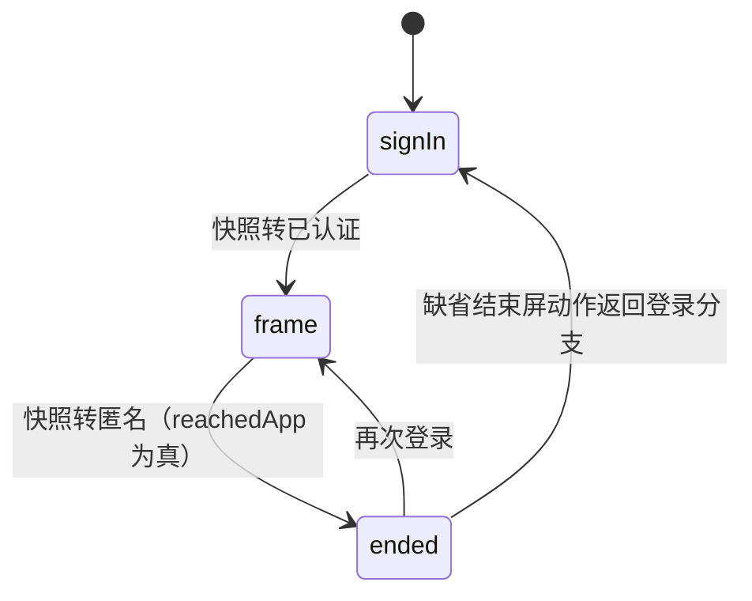

# product-shell

## 职责

租户侧装配壳，包 `web/packages/product-shell`。把共享外壳（[layout-kit](design-web-layout-kit.md) 的 `AppShell`）、登录界面族（`@speed/auth-ui`）与无头的会话 hook（[auth-core](design-web-auth-core.md)）组合成一个面向租户的业务应用前端门面，并交付一次装配整页入口的调用。

本包交付两处：

- **`ProductShell`** —— 一台三支的视图机，读 `@speed/auth-core` 的会话快照（经 `useAuthState`，只读不驱动），按快照落到三个分支之一：已认证分支用 layout-kit 的框架包住业务子节点；会话结束分支用于「曾进过应用、随后转匿名」的访问者，渲染 `sessionEnded` 槽；未登录分支用于全新访问者或尚未接上会话的页面，渲染 `signIn` 槽。
- **`bootstrapSpeedApp(container, definition)`** —— 应用入口装配，交付在 `@speed/product-shell/bootstrap` 子路径下。它以一份声明式定义一次装配整页：i18n 命名空间、会话、API 客户端、QueryClient 与主题，再按定义渲染视图。

会话结束分支的存在正是本包作为组件而非两行 hook 的理由：一个曾在应用内的用户被登出后，绝不能退回新访问者的登录页，而应落到一个有「再次登录」出路的结束页。

### 非职责

- **不做任何会话操作。** 视图机不调用登录、登出、刷新、切租户；这些是宿主交来的视图（`auth-ui` 的表单、登出按钮）在事件处理器里的动作。`bootstrapSpeedApp` 会创建并接上会话、把刷新交给客户端作 401 腿、订阅会话结束策略——那是入口装配的职责，与视图机分开。
- **不导航。** 本包不检查 URL，也不改 `location`；导航选择在 `navItems` 里由宿主算好。
- **不发任何请求。** 组合视图发出的每一个请求都是经宿主绑定的 `api-client` 进行的会话操作；`bootstrapSpeedApp` 构造那个客户端，但自身不发请求。
- **不做权限门。** 视图机从不消费 layout-kit 的 `RouteGuard`，从不调 `usePermission`，从不 `setPermissionSet`；路由级授权是宿主在 `children` 里的组装——把门挂在 `children` 内，喂给它一个由宿主自己附上的权限表算出的 `status`。
- **不持租户切换器。** 切换租户是会话操作，切换控件属于 `userMenu` 槽的宿主组装；本包代码里不出现切换器。
- **不提供缺省登录界面。** 渠道组合（口令、短信、社交、注册）是产品决策，`signIn` 槽缺席时未登录分支什么都不渲染。
- **不持租户作用域的 query key 约定。** key 工厂与逐租户逐出助手归 [auth-core](design-web-auth-core.md)（见该文档「职责」与「核心算法与流程」），本包不在两处都写。

## 外部接口契约

### ProductShell

```ts
export interface ProductShellProps {
  // AppShell 的框架 prop 原样透传（经 Pick<AppShellProps, ...> 声明）
  readonly navItems: readonly AppShellNavItem[]
  readonly header?: ReactNode
  readonly headerActions?: ReactNode
  readonly userMenu?: ReactNode
  readonly mobileOpen?: boolean
  readonly onMobileOpenChange?: (open: boolean) => void
  readonly sidebarWidth?: number
  readonly sx?: SxProps<Theme>
  // 本包自己的三个槽
  readonly signIn?: ReactNode
  readonly sessionEnded?: ReactNode
  readonly children: ReactNode
}

export function ProductShell(props: ProductShellProps): ReactElement
```

- **框架 prop 原样透传。** `navItems`、`header`、`headerActions`、`userMenu`、抽屉控制与 `sx` 被拾起后逐字转给 `AppShell`；本包不重解释、不重排序、不做路径匹配。加一个框架 prop 意味着加进那个 `Pick<AppShellProps, ...>`，而不是另建一套解释。
- **`signIn` 缺席时未登录分支什么都不渲染。** 缺省结束屏的「再次登录」动作需要这个视图存在：它把访问者送回登录分支，而视图机拒绝复位到一个什么都不渲染的分支，故没有 `signIn` 槽的宿主其会话中途结束时停在结束屏。
- **`sessionEnded` 缺席时渲染 `auth-ui` 的 `SessionEndedScreen`**，并把它的「再次登录」动作接成返回登录分支。给出 `sessionEnded` 节点时原样渲染，视图机状态一并交给该节点，由它自持返回应用的出路。
- **`children` 只在快照为已认证时渲染进框架的 `main` 地标内。**

### 应用入口装配 `@speed/product-shell/bootstrap`

```ts
export interface SpeedAppNamespace {
  readonly namespace: string
  readonly resources: Readonly<Record<string, ResourceBundle>>
}

export interface SpeedAppServices {
  readonly session: AuthSession
  readonly api: RequestFn
  readonly queryClient: QueryClient
}

export type SpeedAppProvider = (
  services: SpeedAppServices,
  children: ReactNode,
) => ReactElement

export interface SpeedSessionEndContext {
  readonly session: AuthSession
  readonly queryClient: QueryClient
  readonly evictAllQueries: () => void
}

export type SpeedSessionEndedHandler = (context: SpeedSessionEndContext) => void

export interface SpeedAppDefinition {
  readonly namespaces?: readonly SpeedAppNamespace[]
  readonly providers?: readonly SpeedAppProvider[]
  readonly view: ReactNode
  readonly sessionEnded?: SpeedSessionEndedHandler
  readonly baseUrl?: string
}

export interface SpeedAppBootstrap {
  readonly root: Root
  readonly i18n: I18nInstance
  readonly queryClient: QueryClient
  readonly session: AuthSession
}

export function bootstrapSpeedApp(
  container: Element,
  definition: SpeedAppDefinition,
): SpeedAppBootstrap

export function watchSessionEnd(
  session: AuthSession,
  queryClient: QueryClient,
  handler?: SpeedSessionEndedHandler,
): () => void

export function createQueryClient(): QueryClient
```

**`SpeedAppDefinition` 的各项即本包定义的可变面。** `namespaces` 是应用自己的命名空间（装配自身组合的四个族命名空间自动注册，不得在此重复列出，否则双重注册抛错）；`providers` 是标准 provider 栈与视图之间的应用级 provider，最外层在前；`view` 是视图根（通常是宿主槽齐备的 `ProductShell` 组合）；`sessionEnded` 覆盖出厂的会话结束动作；`baseUrl` 是客户端基地址。

**`baseUrl` 缺省是 `window.location.origin`，即假设同源部署**——页面与 API 由同一个源提供。**跨域部署要在运行期给出该源地址**：产物在入口文档旁带一份 `runtime-config.json`，应用入口以相对路径取它、把其中的 origin 作为 `baseUrl` 传给本包；取不到时回落到同源。机制归 [design-web](design-web.md) 与 [ADR-web-runtime-config-2026-10-15](../../../adr/adr-web-runtime-config-2026-10-15.md)；本包只消费注入后的值，不自行发现源。

**`watchSessionEnd` 与 `createQueryClient` 是给手工组装宿主的导出。** 一个不在 `bootstrapSpeedApp` 之下的视图级测试台或自定义组合，用同一份 `createQueryClient` 与同一条 `watchSessionEnd` 策略，而不是重建一份可能与本包漂移的副本。

### 命名空间

```ts
export const PRODUCT_SHELL_NAMESPACE = 'product-shell'
export const productShellResources: Readonly<Record<string, ResourceBundle>>
```

本包自身只渲染一句文字：会话结束翻转的礼貌播报。框架的内建文字来自 layout-kit 命名空间，缺省结束屏的来自 auth-ui 命名空间；其余都是宿主内容。`bootstrapSpeedApp` 为它组合的包自动注册四个族命名空间（含本包自己的），故经装配启动的页面不会漏注册。

**稳定性承诺。** `ProductShell`、`ProductShellProps`、`PRODUCT_SHELL_NAMESPACE`、`productShellResources`，以及 `SpeedAppDefinition`、`SpeedAppNamespace`、`SpeedAppProvider`、`SpeedAppServices`、`SpeedSessionEndContext`、`SpeedSessionEndedHandler`、`SpeedAppBootstrap`、`bootstrapSpeedApp`、`watchSessionEnd`、`createQueryClient` 的字段与方法集，是宿主可见面。加导出、改签名或改字段名是不兼容变更。

## 依赖

| 依赖 | 用途 |
|---|---|
| `@speed/layout-kit` | 已认证分支的框架：`AppShell` 与地标 |
| `@speed/auth-ui` | 缺省的会话结束屏 `SessionEndedScreen` |
| `@speed/auth-core` | 视图机读取的会话 hook；`./bootstrap` 创建并接上的会话 |
| `@speed/i18n` | 读本包自身命名空间的翻译 hook |
| `@speed/api-client` | 仅 `./bootstrap`：凭据存储与 HTTP 客户端 |
| `@speed/api-sdk` | 仅 `./bootstrap`：绑定每个生成调用经过的运行时接缝（`./runtime`） |
| `@speed/ui-kit` | 仅 `./bootstrap`：主题 provider；主入口只经 layout-kit 间接用到它 |

peer（必需）：`react`、`react-dom`、`@mui/material`、`@emotion/react`、`@emotion/styled`、`react-hook-form`（配对的 auth-ui 登录族渲染所依）、`@tanstack/react-query`（装配的 QueryClient 所在库，宿主提供实例）。

**主入口的依赖下限止于四个包**——`layout-kit`、`auth-ui`、`auth-core`、`i18n`。平台侧的同层兄弟外壳必须能原样复用这条下限，故 `ui-kit`、`api-client`、`api-sdk` 不进主入口的 import 图。`./bootstrap` 子路径额外 import `api-client`、`api-sdk`、`ui-kit` 与 `@tanstack/react-query`，每一项都已在主入口依赖的传递闭包内（auth-core 拉前两者，layout-kit 与 auth-ui 拉 ui-kit），故不为消费者新增安装项。`@speed/tenancy-ui` 故意缺席：切换器是 `userMenu` 槽里的宿主组装，tenancy-ui 只是测试套件的 dev 依赖，本包不 import、不打包、不依赖它。

## UML 图

三支视图机的一个状态。图中画不出的约束：快照只来自 `useAuthState`，视图机从不驱动它；`reachedApp` 是组件局部记忆，是「未登录分支」与「会话结束分支」唯一的分界；接上会话之前视图机 fail-closed 到匿名快照，故未接会话的外壳只可能停在未登录分支（或什么都不渲染）；进入会话结束分支的翻转额外经 `role="status"` 区域播报。



## 核心数据结构

| 概念 | 类型 | 说明 |
|---|---|---|
| 分支 | 组件内部判别式 | `frame`（已认证）/ `ended`（曾进过应用）/ `signIn`（全新或未接会话） |
| 外壳 prop | `ProductShellProps` | 框架 prop 透传加 `signIn`/`sessionEnded`/`children` 三槽 |
| 应用定义 | `SpeedAppDefinition` | `namespaces`、`providers`、`view`、`sessionEnded`、`baseUrl` |
| 装配服务 | `SpeedAppServices` | `session`、`api`（即 `RequestFn`）、`queryClient`，交给定义的 provider |
| 会话结束上下文 | `SpeedSessionEndContext` | `session`、`queryClient`、`evictAllQueries` 三项 |
| 装配产物 | `SpeedAppBootstrap` | `root`、`i18n`、`queryClient`、`session` 四项 |

## 核心算法与流程

### 视图机的分支判定

1. 读 `useAuthState()` 取会话快照。
2. 一个副作用按 `snapshot.state` 键控：快照为已认证时把 `reachedApp` 置真。**这条记忆在登出时故意不复位**——那是缺省结束屏动作或宿主自己结束视图的职责。
3. 分支按顺序判定：已认证即 `frame`；否则 `reachedApp` 为真即 `ended`；否则 `signIn`。
4. `ended` 分支在 `signIn` 槽存在时，其缺省结束屏的「再次登录」动作把 `reachedApp` 复位为假（回到登录分支）；`signIn` 槽缺席时该动作什么都不做，访问者停在结束屏。

**已认证分支用 `AppShell` 包住 `children`；会话结束分支的容器本身即页面的 `main` 地标**（整页被替换，同一时刻只渲染一个分支，页面的 `main` 唯一）。焦点经同一个 `tabIndex={-1}` 机制落到该容器。

### 翻转的无障碍契约

- **每次分支翻转把焦点移入新分支的容器**（各分支渲染在一个可聚焦、非 Tab 停靠的包装里），首次渲染不移焦点（页面加载的焦点归宿主），分支未变的重渲染也不移。
- **进入会话结束分支的翻转额外经 `role="status"` 区域播报**——服务端会话死亡与显式登出是同一个快照翻转，本包区分不了成因，而两者都把访问者落在本包自己放下的那个屏上。播报文字由翻转副作用在结束分支以空区域提交之后再置入，使文字作为一次插入进入已在树中的活区（可靠播报的形态）。
- **未注册 `product-shell` 命名空间的宿主得到焦点转移与不出现的原始键文本**：播报区域只在命名空间已注册时渲染，命名空间未注册是配置状态而非缺键，缺键噪声不得回退进视野。

### 入口装配的接线次序

`bootstrapSpeedApp` 按下列次序装配，不偏离：

1. **i18n** —— 一份全新的双语实例（`?lang=` 参数、已存选择、navigator 语言、`en-US` 兜底），注册本包组合的四个族命名空间（ui-kit、layout-kit、auth-ui、product-shell），并以平台错误文案包（`@speed/i18n/platform-errors`）为实例的兜底命名空间；再把定义的 `namespaces` 逐个注册。注册先于渲染，且每个命名空间恰好一次。
2. **会话** —— 一个内存访问令牌存储（凭据不落存储）喂给 auth-core 的会话状态机，跑在生成的 authn 操作上，经 `attachSession` 接上。一次刷新按约定转回匿名启动。
3. **客户端** —— `createClient` 建立在环境的 `fetch` 上，以会话的静默刷新作 401 刷新腿，以 i18n 实例作语言源（每次尝试读一次，故语言切换后重试的请求播报用户当前所看的语言）；再经 `bindRequestFn` 绑进 api-sdk 的运行时接缝，此后一切 API 流量都是生成代码的流量。
4. **QueryClient 与会话结束策略** —— 无重试的 `createQueryClient`，加 `watchSessionEnd` 的出厂缺省：会话一结束即逐出离任主体读过的全部缓存。
5. **provider 栈** —— `I18nextProvider` 包 `AppThemeProvider` 包 `QueryClientProvider`，再加定义的 `providers`（最外层在前）包定义的 `view`。

### 会话结束策略

`watchSessionEnd` 只看一个沿——已认证转匿名（登出或静默刷新被拒，auth-core 把两者归成同一个翻转）——在那个沿上跑定义的 `sessionEnded`，或缺省的 `evictAllQueries()`。只轮换主体的沿（切租户保持已认证）不触发；从未认证过的会话不触发（首个快照是内存的基线，不是翻转）；未认证转已认证的沿只把内存前移。

**出厂缺省是整体逐出缓存。** 缓存里的每一行都是在离任主体的访问令牌下取的，而身份域的行（裸 spec 路径键——会话、登录历史、已绑身份，`@speed/api-sdk` 里没有任何键带租户段）没有租户段可供按租户逐出触达；只有整体逐出能阻止此后登录的另一个账户从共享的 query client 内存里继承先前账户的行。

### 无重试的查询策略

`createQueryClient` 让查询与变更都不重试：瞬时重试属传输层（`api-client` 的冻结重试策略只重试可挽回的瞬时类，且在单次请求内），带码的应答是重复无法挽回的确定答复，而变更在应答丢失后绝不能重发（创建可能已在服务端提交）。每一项 `staleTime` 为 0，故重挂载或窗口重新聚焦会在当前令牌下重读。

## 错误与失败语义

| 情形 | 表现 |
|---|---|
| 未接会话（`attachSession` 之前） | 视图机 fail-closed 到匿名快照，只渲染登录分支（或其空） |
| `signIn` 槽缺席 | 未登录分支渲染空；缺省结束屏动作不复位，访问者停在结束屏 |
| `product-shell` 命名空间未注册 | 播报区域不渲染，焦点转移照常，无原始键文本 |
| 会话结束（登出或静默刷新被拒） | 缺省整体逐出 query 缓存；定义的 `sessionEnded` 覆盖它 |
| 双重注册同名命名空间 | 装配期抛错（每个命名空间恰好注册一次） |
| 同一容器内二次 bootstrap | 双重挂载；一页只 bootstrap 一次 |

**装配不降级、不重试。** 一次会话结束即触发一次策略动作；缺省策略是同步逐出，不等待网络。

## 扩展点

- **定义即扩展面。** `namespaces` 追加应用自己的命名空间，`providers` 在标准栈与视图之间插入应用级 provider（收到装配后的 `session`、`api`、`queryClient`），`view` 换掉整个视图根，`sessionEnded` 覆盖会话结束动作（上下文里的 `evictAllQueries()` 供其组合），`baseUrl` 给出客户端基地址（跨域部署的运行期源地址）。
- **槽即扩展面。** `signIn` 与 `sessionEnded` 是宿主的视图，`children` 是宿主的业务内容（路由与 `RouteGuard` 门在此组装）；框架 prop 透传给 `AppShell`。
- **手工组装经两个导出。** 不在 `bootstrapSpeedApp` 之下的宿主用 `createQueryClient` 与 `watchSessionEnd` 复用同一策略。

## 实现状态

| 能力 | 状态 | 代码 |
|---|---|---|
| `ProductShell` 三支视图机 | 已实现 | `web/packages/product-shell/src/components/ProductShell.tsx` `ProductShell`、`ProductShellProps` |
| 应用入口装配 `bootstrapSpeedApp` 与定义类型 | 已实现 | `web/packages/product-shell/src/bootstrap.tsx` `bootstrapSpeedApp`、`SpeedAppDefinition`、`SpeedAppServices`、`watchSessionEnd`、`createQueryClient` |
| 双语命名空间资源 | 已实现 | `web/packages/product-shell/src/resources.ts` `PRODUCT_SHELL_NAMESPACE`、`productShellResources` |
