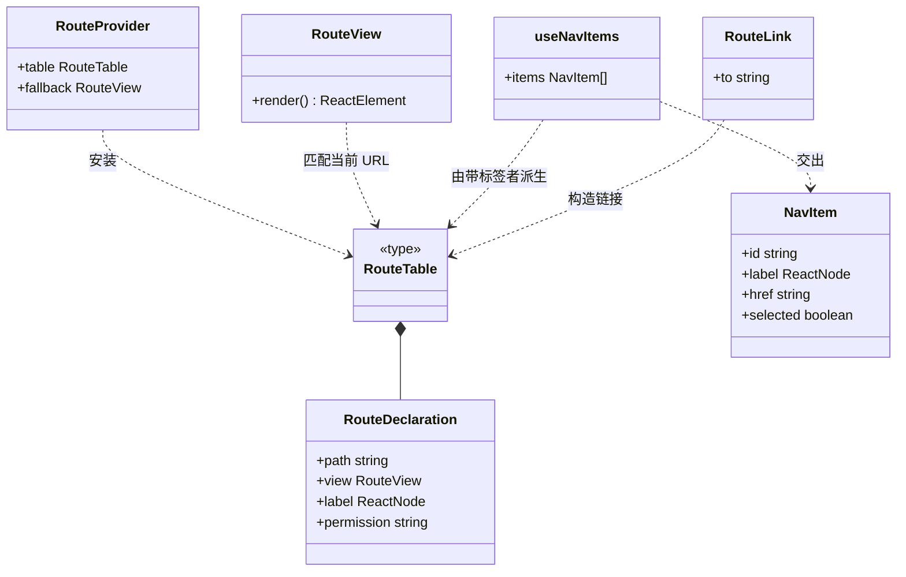

# route-kit

## 职责

`@speed/route-kit` 承载一个产品的**路由与导航**：一份声明式注册面把产品的页面登记在一处，路径匹配、深链接解析、链接构造、导航选中态与未命中回退由本包一处承担。

- **声明式注册面。** 产品的每个页面导出一份声明——路径、视图、导航标签、所需权限；产品在一处点名它由哪些页面组成。这与后端的命令树对称：后端由命令树在一处点名一个程序由哪些模块组成，前端由注册面在一处点名一个产品由哪些页面组成（[ADR-web-route-seam-2026-10-15](../../../adr/adr-web-route-seam-2026-10-15.md)）。
- **路由与导航独立成层。** 本包是独立包，**不被壳 import，也不 import 任何同族前端包**；一个产品要加页面，插的是本包的注册面，不动壳。它交出的导航条目是一种结构性形状（`id`、`label`、`href`、`selected`），壳的框架按结构接受它，因而不需要一条共享类型边。
- **这些事由本包一处承担：** 选中态（当前 URL 命中哪一条导航项）、链接构造（由路径生成可点的链接）、深链接解析（一个深链接直接打开对应页面）、未命中回退（没有登记项匹配时渲染回退视图）。
- **壳共用同一注册面。** 租户侧装配壳 [product-shell](design-web-product-shell.md) 与平台控制台壳 [console-ui](design-web-console-ui.md) 都用这套注册面，差别只在各自的壳。

### 非职责

- **不做授权。** 登记项里的权限码是**数据**；本包不校验一个页面占的路径与它所需的权限、不据权限拦一条路由、也不据权限生成或过滤导航项。路由级授权是宿主在内容区里的组合——把 [layout-kit](design-web-layout-kit.md) 的 `RouteGuard` 挂在内容区，喂它一个由宿主算出、其读数来自 [auth-core](design-web-auth-core.md) 权限 hook 的 `status`（[ADR-web-route-seam-2026-10-15](../../../adr/adr-web-route-seam-2026-10-15.md)）。
- **不渲染壳的框架。** 本包不被 product-shell import；壳继续只渲染宿主算好的导航条目，契约不变。导航条目由产品从本包取到后传进壳的 `navItems` 槽，壳不因本包而知道路由。
- **不持会话状态、不发请求、不做数据读取。** 本包在渲染期把当前 URL 匹配到一条登记项并渲染其视图；页面自己的数据经 [api-sdk](design-web-api-sdk.md) 的生成操作读取，与本包无关。
- **不认识任何具体业务页面。** 一个页面的内容、标题与其读取的数据都是声明方的事；本包只按登记面匹配路径、按标签收集导航。
- **不做服务端渲染与预取。** 本包是浏览器里的渲染期层。

## 外部接口契约

宿主从 `web/packages/route-kit/src/index.ts` 取用以下符号。

### 声明面

一份页面声明是一个产品路由表的成员：

```ts
// 路径参数：命中的 `:name` 段到其取值的映射。
type RouteParams = Readonly<Record<string, string>>

// 一次匹配的上下文：命中的路径与它的参数。
interface RouteContext {
  readonly path: string            // 命中的路径（不含查询串）
  readonly params: RouteParams     // 路径参数
}

// 一份页面声明。
interface RouteDeclaration {
  readonly path: string                              // 路径 pattern，例如 '/cases/:caseId'
  readonly view: (context: RouteContext) => ReactNode // 该路径的视图
  readonly label?: ReactNode                          // 导航标签；缺席即该路由不进导航
  readonly permission?: string                        // 该页所需的权限码（数据；本包不据此判定）
}

// 产品的路由表：一份声明集合。
type RouteTable = readonly RouteDeclaration[]
```

**`path` 是路径 pattern**：字面段按字面匹配，`:name` 段匹配任意一个路径段并从匹配结果取出成 `RouteContext.params` 的一项。

**`label` 是导航参与标记**：一条声明带 `label` 即向导航贡献一条目；不带 `label` 的路由（详情页、回调页、分享页这类）仍可被 URL 命中并渲染，却不进导航。（一个页面族若要在导航里隐藏某些页面，就让那几条声明不带标签，而不是让本包按权限过滤。）

**`permission` 是数据。** 本包只携带它、不对它做任何决定；它是登记方与宿主读的字段（宿主据以为内容区里的 `RouteGuard` 算出 `status`）。把它接错（一个页面渲染了它无权取的资源）不在路由层被拦下（[ADR-web-route-seam-2026-10-15](../../../adr/adr-web-route-seam-2026-10-15.md)）。

### 接线与渲染

```tsx
// 安装路由器并把注册面交给它；子节点里任意深度可用 RouteView、useNavItems、RouteLink。
function RouteProvider(props: {
  readonly table: RouteTable
  readonly fallback: (context: RouteContext) => ReactNode // 未命中回退
  readonly children: ReactNode
}): ReactElement

// 渲染当前 URL 命中的登记项视图；无命中即渲染 fallback。
function RouteView(): ReactElement

// 导航条目：本包自己定义的结构性形状；由带标签的登记项派生，与壳的框架所接受的
// 条目形状（id、label、href、selected）同构，两者因此无需共享类型。
interface NavItem {
  readonly id: string
  readonly label: ReactNode
  readonly href: string
  readonly selected: boolean
}
function useNavItems(): readonly NavItem[]

// 链接构造：按目标路径渲染一个可点的链接。
function RouteLink(props: { readonly to: string; readonly children: ReactNode }): ReactElement

// 命令式导航：把一个目标路径推入历史。
function useNavigate(): (to: string) => void
```

**声明面的每一处都由产品在一处给出。** 产品把它的全部页面声明组成一张 `RouteTable`，交给 `RouteProvider`；`RouteView` 渲染命中的页面，`useNavItems` 交出导航条目，而 `RouteView` 与 `useNavItems` 读同一份注册面，因而不一致无从产生。

**稳定性承诺。** `RouteDeclaration`、`RouteTable`、`RouteContext`、`RouteParams` 的字段与形状，`RouteProvider`、`RouteView`、`RouteLink`、`useNavItems`、`useNavigate` 的签名，是宿主可见面。变更按 TypeScript 的源码语义分类：新增导出、新增可选字段、把必选放宽为可选是源码兼容的；删除导出或字段、改既有导出或字段的含义或名、改签名（参数或返回类型）、把可选收紧为必选，是不兼容变更，须随发布对账（[ADR-web-route-seam-2026-10-15](../../../adr/adr-web-route-seam-2026-10-15.md)）。

## 依赖

| 依赖 | 种类 | 用途 |
|---|---|---|
| `react`、`react-dom` | peer（必需） | 登记面、渲染与钩子 |
| `react-router-dom` | peer（必需） | 路径匹配、历史导航与链接构造的底座；本包的接缝建在它之上，产品不直接 import 它 |

**方向的落点。** 本包**不 import 任何同族前端包**：它交出的导航条目是结构性形状，壳的框架按结构接受它，因而不需要一条指向 layout-kit 的类型边（[design-web](design-web.md) 的「依赖」）。本包被**产品装配**取用，但**不被壳 import**。产品侧的方向是：产品 import 本包与壳，本包不认识任何壳、任何会话、任何业务页面。

**与 product-shell 的分工是「谁做导航」。** 壳保持不做导航（不检查 URL、不改 `location`、不重解释 `navItems`），本包承担路由；产品的装配是：把壳的整棵组合包在 `RouteProvider` 里，用 `useNavItems()` 算出的条目喂给壳的 `navItems` 槽，把 `RouteView` 作为壳的 `children` 渲染。于是壳仍只渲染宿主算好的条目，路由在它之外的一层。

## UML 图

本包的结构：一份声明集合、一个把它装成路由器的 provider、以及从它派生的消费面。图里画不出的约束：注册面是**唯一**的事实来源（导航与渲染同读它，不会不一致）；`label` 的在场与否决定一条路由是否进导航；`permission` 只是数据，本包不对它做任何事；本包与壳之间**没有依赖边**（产品在两者之上把它们接到一起）。



## 核心数据结构

| 概念 | 类型 | 说明 |
|---|---|---|
| 页面声明 | `RouteDeclaration` | 路径 pattern、视图、可选导航标签、可选权限码 |
| 路由表 | `RouteTable` | 一份声明集合；产品的页面组成写在一处 |
| 匹配上下文 | `RouteContext` | 命中的路径与路径参数 |
| 导航条目 | `NavItem` | `id`、`label`、`href`、`selected`；由带标签的登记项派生；结构性形状，壳的框架按结构接受 |
| 回退视图 | `RouteView`（`fallback` 入参） | 无登记项匹配当前 URL 时渲染 |

## 核心算法与流程

### 一次渲染的匹配

1. `RouteProvider` 从当前 URL 取路径（不含查询串）与历史状态。
2. 按 `table` 里各声明的 `path` 逐条匹配：字面段按字面相等，`:name` 段收下该段的值。
3. 命中一条即以其 `view(context)` 渲染，`context.params` 是收下的路径参数。
4. 无命中即渲染 `fallback(context)`；`context.path` 是未命中的路径。

### 导航的收集与选中态

1. `useNavItems` 遍历 `table`，为每条**带 `label`** 的声明派生一条目：`id` 取声明的路径、`label` 取声明的标签、`href` 由路径构造。
2. 每条目的 `selected` 由当前 URL 判定：当前路径命中该声明的 pattern，或**落在该声明路径之下**（当前路径以该声明的字面路径为前缀）即为真；「落在路径之下」这一条使一条子路由（如 `/cases/:caseId`）落在其父级导航项（`/cases`）之下，从而选中父级。
3. 多条同时满足时，**取字面前缀最长者**为选中项；无 `label` 的声明与未命中的 URL 都不使任何条目选中。

### 链接构造与命令式导航

`RouteLink` 由目标路径生成一个可点链接，点击经历史导航推入该路径，不整页刷新；`useNavigate` 交出一个把目标路径推入历史的函数，供事件处理器使用（如一个成败提示后的返回）。`RouteLink` 与 `useNavigate` 都只改 URL，页面随之被 `RouteView` 按匹配重渲染——`RouteView` 读的是 URL，不是任何组件局部状态。

## 错误与失败语义

本包的失败面如下。

| 情形 | 表现 |
|---|---|
| 没有登记项匹配当前 URL | 渲染 `fallback`；不抛错、不回退到某个未声明的页面 |
| 一条路径 pattern 的来源有重复或歧义 | 登记面自洽校验失败，在装配处抛出并点名冲突的声明（早于渲染） |
| `fallback` 缺席 | 登记面自洽校验失败，装配处抛出（回退是必填的） |
| 一条从未被任何声明覆盖的深链接 | 与「没有登记项匹配」同形，落到 `fallback` |
| 一个页面渲染了它无权取的资源 | 不在路由层被拦下；授权由宿主在内容区里组合（本包按路径匹配，不看 `permission`） |

**本包不降级、不重试、不发请求。** 一次匹配是渲染期的一次纯判定；失败是登记面的配置错误（在装配处抛出）或未命中（落到回退视图）。

## 扩展点

- **新增一个页面**即由页面所属的包导出一份 `RouteDeclaration`，产品把它并进自己的 `RouteTable`——与「加一个后端模块」在后端的对应动作是「命令树点名模块」。这是「加一个业务页面」在前端的唯一动作（见 [starters](../design-starters.md) 的「扩展点」）。
- **页面带权限**由声明里的 `permission` 表达、由宿主读它去组合 `RouteGuard`；本包不据此过滤。
- **导航分组与子路由**由路径形状表达（父级声明带标签、子路由不带标签），不由本包新增结构。

## 实现状态

| 能力 | 状态 | 代码 |
|---|---|---|
| 声明面（`RouteDeclaration`、`RouteTable`、`RouteContext`） | 已实现 | `web/packages/route-kit/src/types.ts` `RouteDeclaration`、`RouteTable`、`RouteContext`、`RouteParams` |
| 接线与渲染（`RouteProvider`、`RouteView`、未命中回退） | 已实现 | `web/packages/route-kit/src/RouteProvider.tsx` `RouteProvider`；`web/packages/route-kit/src/RouteView.tsx` `RouteView` |
| 导航收集与选中态（`useNavItems`） | 已实现 | `web/packages/route-kit/src/hooks.ts` `useNavItems`；`web/packages/route-kit/src/nav.ts` `deriveNavItems` |
| 链接构造与命令式导航（`RouteLink`、`useNavigate`） | 已实现 | `web/packages/route-kit/src/RouteLink.tsx` `RouteLink`；`web/packages/route-kit/src/hooks.ts` `useNavigate` |
