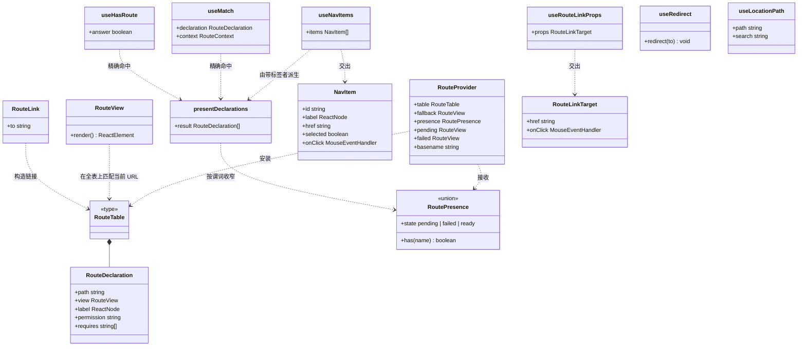
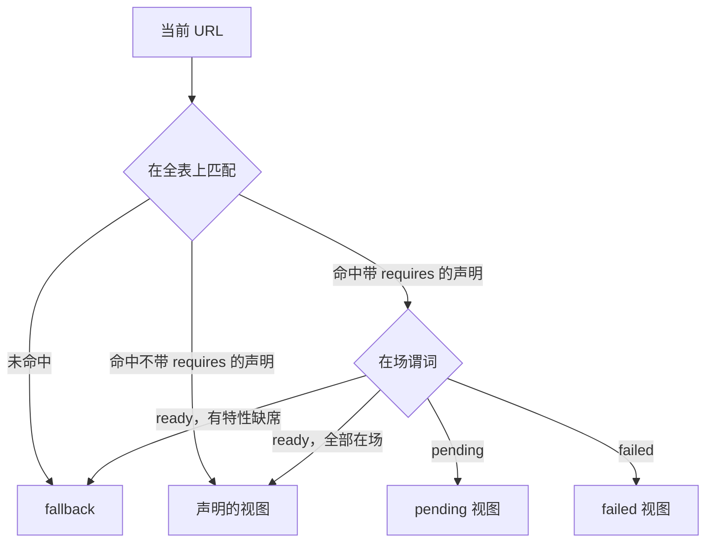

# route-kit

route-kit 是产品的路由与导航层，独立于壳与其它同族包，由应用的组合层取用。它拥有声明式注册表、路径匹配、链接构造、导航选中态、深链接解析与未命中回退，并按[宿主](../../../glossary.md)给出的在场谓词收窄注册表。它不据权限拦路由、不取回特性集合、不渲染壳的框架，也不持会话状态。进入职责清单前的心智模型只有一句：页面在一处登记，导航与渲染读同一份有效注册表，特性缺席与路径不存在落到同一个回退。

第一遍为「职责」「术语表」与「外部接口契约」的「声明接口」「接线与渲染」，给出声明、有效注册表与渲染的对应；「依赖」「UML 图」「核心数据结构」随读随查，「核心算法与流程」按匹配、导航与链接查阅，「错误与失败语义」与「扩展点」作查表用。边界情形（装配期校验、特性缺席与未命中同落回退、读取中与读取失败的分支）是最后的自检项。

## 职责

`@speed/route-kit` 承载一个产品的**路由与导航**：一份声明式注册表把产品的页面登记在一处，路径匹配、深链接解析、链接构造、导航选中态与未命中回退由本包一处承担。

- **声明式注册表。** 产品的每个页面导出一份声明——路径、视图、导航标签、所需权限、所需特性；产品在一处点名它由哪些页面组成。这与后端的命令树对称：后端由命令树在一处点名一个程序由哪些模块组成，前端由注册表在一处点名一个产品由哪些页面组成（[ADR-web-route-seam](../../../adr/adr-web-route-seam.md)）。
- **按特性在场收窄注册表。** 宿主给出在场谓词，本包据它算出有效注册表：带 `requires` 的声明只在其中特性全部在场时渲染视图、进入导航；特性缺席的页面与未登记的路径走同一个 `fallback`。谓词读取中或读取失败时，门控的路径渲染宿主给出的等待视图或失败视图（[ADR-web-route-kit](../../../adr/adr-web-route-kit.md)）。
- **路由与导航独立成层。** 本包是独立包，**不被壳 import，也不 import 任何同类前端包**；一个产品要加页面，插的是本包的注册表，不动壳。它交出的导航条目是一种结构性类型（`id`、`label`、`href`、`selected` 与可选 `onClick`），壳的框架按结构接受它，因而不需要一条共享类型边。
- **这些事由本包一处承担：** 选中态（当前 URL 命中哪一条导航项）、链接构造（由路径生成可点的链接）、深链接解析（一个深链接直接打开对应页面）、未命中回退（没有登记项匹配时渲染回退视图）、精确命中的查询（当前 URL 在有效注册表上命中哪一条声明），以及入口判定（一条路径是否在有效注册表上有声明）。
- **链接属性与历史动作也由本包交出。** `RouteLink` 渲染可点链接并透传其余 props；`useRouteLinkProps` 交出宿主自绘锚点所需的 `href` 与点击处理器；`useNavigate` 推入历史、`useRedirect` 替换当前历史项、`useLocationPath` 交出当前 URL 的原始路径与查询串。宿主因此不直接 import react-router-dom（[REF-react-router](../../../references.md)）。
- **壳共用同一注册表。** 租户侧装配壳 [product-shell](design-web-product-shell.md) 与平台管理后台壳 [admin-ui](design-web-admin-ui.md) 都用这套注册表，差别只在各自的壳。

### 非职责

- **不据权限拦路由，也不据权限过滤导航；按宿主给出的在场谓词收窄注册表。** 登记项里的权限码是**数据**；本包不校验一个页面占的路径与它所需的权限是否相符，不据权限拦一条路由，也不据权限生成或过滤导航项。路由级授权是宿主在内容区里的组合——把 [layout-kit](design-web-layout-kit.md) 的 `RouteGuard` 挂在内容区，喂它一个由宿主算出、其读数来自 [auth-core](design-web-auth-core.md) 权限 hook 的 `status`（[ADR-web-route-seam](../../../adr/adr-web-route-seam.md)）。特性在场不是授权：本包据在场谓词收窄的是哪些页面存在，不是谁能进入（[ADR-web-route-kit](../../../adr/adr-web-route-kit.md)）。
- **不取回特性集合，也不认识任何特性名。** 在场谓词由宿主给出，特性态归 [auth-core](design-web-auth-core.md)；`requires` 里的名字是数据，本包只把它交给谓词判定。
- **不渲染壳的框架。** 本包不被 product-shell import；壳继续只渲染宿主算好的导航条目，契约不变。导航条目由产品从本包取到后传进壳的 `navItems` 槽，壳不因本包而知道路由。
- **不持会话状态、不发请求、不做数据读取。** 本包在渲染期把当前 URL 匹配到一条登记项并渲染其视图；页面自己的数据经 [api-sdk](design-web-api-sdk.md) 的生成操作读取，与本包无关。
- **不认识任何具体业务页面。** 一个页面的内容、标题与其读取的数据都是声明方的事；本包只按注册表匹配路径、按标签收集导航。
- **不做服务端渲染与预取。** 本包是浏览器里的渲染期层。

## 术语表

以下术语的含义限于本文档；其他前端文档提到它们时写 `RoutePresence`、`presentDeclarations` 或链到本文档。

| 术语 | 英文 | 适用范围 | 定义 |
|---|---|---|---|
| 在场谓词 | presence predicate | 本文档 | 宿主经 `RouteProvider` 的 `presence` 给出的 `RoutePresence`：读取中、读取失败，或就绪并带一个按特性名回答该特性是否在场的函数 `has`。 |
| 有效注册表 | effective registration surface | 本文档 | 路由表中可渲染视图、可进导航的那部分声明：不带 `requires` 的全部声明，加上在场谓词就绪，且 `requires` 中特性全部在场的声明。它是 `presentDeclarations` 的结果。 |

## 外部接口契约

宿主从 `web/packages/route-kit/src/index.ts` 取用以下符号。

### 声明接口

一份页面声明是一个产品路由表的成员：

```ts
// 路径参数：命中的 `:name` 段到其取值的映射。
type RouteParams = Readonly<Record<string, string>>

// 一次匹配的上下文：命中的路径与它的参数。
interface RouteContext {
  readonly path: string            // 命中的路径（不含查询串）
  readonly params: RouteParams     // 路径参数
}

// 一份页面声明。
interface RouteDeclaration {
  readonly path: string                              // 路径 pattern，例如 '/cases/:caseId'
  readonly view: (context: RouteContext) => ReactNode // 该路径的视图
  readonly label?: ReactNode                          // 导航标签；缺席即该路由不进导航
  readonly permission?: string                        // 该页所需的权限码（数据；本包不据此判定）
  readonly requires?: readonly string[]               // 该页所需的特性名；全部在场才算在场（数据）
}

// 产品的路由表：一份声明集合。
type RouteTable = readonly RouteDeclaration[]

// 在场谓词：宿主给出的特性在场判定。
type RoutePresence =
  | { readonly state: 'pending' }
  | { readonly state: 'failed' }
  | { readonly state: 'ready'; readonly has: (name: string) => boolean }
```

**`path` 是路径 pattern**：字面段按字面匹配，`:name` 段匹配任意一个路径段并从匹配结果取出为 `RouteContext.params` 的一项。

**`label` 是导航参与标记**：一条声明带 `label` 即向导航贡献一条目；不带 `label` 的路由（详情页、回调页、分享页这类）仍可被 URL 命中并渲染，却不进导航。（一个页面组若要在导航里隐藏某些页面，就让那几条声明不带标签，而不是让本包按权限过滤。）

**`permission` 是数据。** 本包只携带它，不对它做任何决定；它是声明方与宿主读的字段（宿主据以为内容区里的 `RouteGuard` 算出 `status`）。把它接错（一个页面渲染了它无权取的资源）不在路由层被拦下（[ADR-web-route-seam](../../../adr/adr-web-route-seam.md)）。

**`requires` 是数据。** 它列出该页所需的[特性](../../../glossary.md)名，其中全部特性在场时这条声明才在有效注册表上；不带 `requires` 的声明不受在场谓词影响。本包不解释名字，只把它交给在场谓词的 `has`。名字的类型是字符串，因为本包不 import 任何同类包；要在编译期检查名字的页面组，在自己的声明类型上把它收紧为 `@speed/api-sdk/features` 的 `FeatureName`（[api-sdk](design-web-api-sdk.md)）。

**`RoutePresence` 是结构性类型。** 宿主从 [auth-core](design-web-auth-core.md) 的 `featurePresence` 得到结构相同的值，`featurePresence` 的结果类型与 `RoutePresence` 不共享声明。

### 接线与渲染

```tsx
// 安装路由器并把注册表交给它；子节点里任意深度可用 RouteView、useNavItems、RouteLink。
function RouteProvider(props: {
  readonly table: RouteTable
  readonly fallback: (context: RouteContext) => ReactNode // 未命中回退，也是特性缺席的回退
  readonly presence?: RoutePresence                       // 在场谓词
  readonly pending?: (context: RouteContext) => ReactNode // 谓词读取中时门控路径的视图
  readonly failed?: (context: RouteContext) => ReactNode  // 谓词读取失败时门控路径的视图
  readonly basename?: string                              // 部署路径前缀，缺省为源站根
  readonly children: ReactNode
}): ReactElement

// 渲染当前 URL 命中的登记项视图；无命中，或命中的门控声明特性缺席，即渲染 fallback。
function RouteView(): ReactElement

// 导航条目：本包自己定义的结构性类型；由有效注册表上带标签的登记项派生，与壳的框架所接受的
// 条目结构（id、label、href、selected）同构，两者因此无需共享类型。
interface NavItem {
  readonly id: string                              // 声明路径，应用内导航按它走
  readonly label: ReactNode
  readonly href: string                            // 含部署的 basename，可直接交给浏览器打开
  readonly selected: boolean
  readonly onClick?: MouseEventHandler<HTMLElement> // 普通主键单击在应用内导航，其余点击交给浏览器
}
function useNavItems(): readonly NavItem[]

// 有效注册表：按在场谓词收窄一份声明集合。
function presentDeclarations<T extends { readonly requires?: readonly string[] }>(
  table: readonly T[],
  presence: RoutePresence | undefined,
): readonly T[]

// 当前 URL 在有效注册表上的精确命中。
function useMatch(): { readonly declaration: RouteDeclaration; readonly context: RouteContext } | undefined

// 一条路径是否精确命中有效注册表上的某条声明。
function useHasRoute(path: string): boolean

// 链接构造：按目标路径渲染一个可点的链接；其余 props 透传给 react-router-dom 的 Link，
// 因而可作为 MUI 的 component 目标。
function RouteLink(props: Omit<LinkProps, 'to'> & { readonly to: string }): ReactElement

// 链接属性：宿主自绘锚点（或交给接受 href 与 onClick 的组件）时使用。
interface RouteLinkTarget {
  readonly href: string                          // 含部署的 basename
  readonly onClick: React.MouseEventHandler<HTMLElement> // 仅普通主键单击导航
}
function useRouteLinkProps(to: string): RouteLinkTarget

// 命令式导航：把一个目标路径推入历史。
function useNavigate(): (to: string) => void

// 替换当前历史项：回调页、登录完成这类不应留在后退栈里的跳转。
function useRedirect(): (to: string) => void

// 当前 URL 的原始路径与查询串；路径不因是否命中声明而不同。
interface RouteLocationPath {
  readonly path: string
  readonly search: string
}
function useLocationPath(): RouteLocationPath
```

**声明接口的每一处都由产品在一处给出。** 产品把它的全部页面声明组成一张 `RouteTable`，交给 `RouteProvider`；`RouteView` 渲染命中的页面，`useNavItems` 交出导航条目，而 `RouteView` 与 `useNavItems` 读同一份注册表与同一个在场谓词，因而不一致无从产生。

**带 `requires` 的表要求在场谓词与等待、失败视图，约束的主体是每个交出这种表的宿主。** 表里只要有一条声明带 `requires`，`presence`、`pending`、`failed` 缺任何一项，`RouteProvider` 即在装配处抛错，与缺 `fallback` 同样处理。不带 `requires` 的表不需要这几项，匹配与导航的结果与只按注册表进行时逐项相同。

**`presentDeclarations` 计算有效注册表。** 它保留不带 `requires` 的全部声明；带 `requires` 的声明只在谓词就绪，且其中每个名字的 `has` 都为真时保留，谓词缺席、读取中或读取失败时一律不保留。它是泛型的：宿主可以把它用在自己的声明类型上，例如宿主用它收窄管理后台的页面声明，再交给 [admin-ui](design-web-admin-ui.md) 的 `AdminShell`，管理后台侧栏与本包的导航因此读同一个集合。

**`useMatch` 交出精确命中，不做前缀继承。** 它交出当前 URL 在有效注册表上完整匹配的那条声明及其匹配上下文；一个落在某条导航项路径之下、自己却没有声明的路径，不因此命中那条导航项。宿主据它取该页的 `permission` 交给权限守卫。没有精确命中——未命中、特性缺席，或门控路径的谓词尚未就绪——时，`RouteView` 渲染回退、等待或失败视图，宿主不为它取权限码，判定次序因此是先存在性，后权限。

**`useHasRoute` 让入口跟随目标页。** `useHasRoute(path)` 当且仅当 `path` 精确命中有效注册表上的某条声明时为真；带参数的 pattern 按路径匹配。指向某页的入口控件（首页卡片、跳转按钮）据它决定是否渲染，目标页特性缺席时入口一并消失，「这一页在不在」只写在页面声明里一处。

**`RouteProvider` 缺省安装一个路由器。** 它挂载 react-router-dom 的 `BrowserRouter`：页面得到真实路径 URL，深链接由平台的 SPA 回退提供。`basename` 给出部署路径前缀（例如应用挂在 `/admin/` 时传 `/admin`），缺省为源站根；它不是换路由器的口子，第三方路由器是包级决定（[ADR-web-route-seam](../../../adr/adr-web-route-seam.md)）。`useNavItems` 交出的 `href` 同样带上这个前缀——新标签、复制链接或中键点击直接打开应用实际服务的 URL——而 `id` 保持声明路径，应用内导航按 `id` 交给路由器，前缀由路由器自己加，不会叠加两次。

**链接只在普通主键单击时接管。** `useRouteLinkProps` 与 `useNavItems` 用同一条判定：主键、无修饰键、`target` 缺失或为 `_self`、无 `download` 属性，且未被先前的处理器 `preventDefault` 的点击，在应用内导航并阻止默认行为；其余点击一概不处理，交给浏览器完成新标签、下载或默认导航。判定在包内私有：本包不 import 同类包，layout-kit 的 `isPlainPrimaryClick` 因此是另一份独立实现。两者共享同一条策略（只接管本意留在应用内的点击），但代码并不等价：本包要求 `event.button === 0`，layout-kit 也接受没有 `button` 值的事件；本包除缺失、空串与 `_self` 外的 `target` 一律不接管，layout-kit 只拒绝 `_blank`（大小写不敏感）；本包从 `event.currentTarget` 取锚点（处理器挂在链接本身），layout-kit 从 `event.target` 找最近的 `a`（处理器可挂在容器上）。改动其中一份时要同时审视另一份，但不得假定两份逐条相同。

**`NavItem` 的 `onClick` 由 `useNavItems` 填入。** 它与 `useRouteLinkProps` 的处理器同一判定，配合 `href` 让壳的条目在普通单击时留在应用内、在修饰键单击时开新标签。`NavItem` 的必填字段与附加的可选字段（`onClick`）同壳的框架条目结构兼容，两者因此仍不需要共享类型边。

**对外接口。** `RouteDeclaration`、`RouteTable`、`RouteContext`、`RouteParams`、`RoutePresence`、`NavItem`、`RouteLinkTarget`、`RouteLocationPath` 的字段与结构，`RouteProvider`、`RouteView`、`RouteLink`、`RouteLinkProps`、`useRouteLinkProps`、`useNavItems`、`useNavigate`、`useRedirect`、`useLocationPath`、`presentDeclarations`、`useMatch`、`useHasRoute` 的签名，是宿主可见的接口。变更按 TypeScript 的源码语义分类：新增导出、新增可选字段是源码兼容的；删除导出或字段、改既有导出或字段的含义或名、改签名（参数或返回类型），是不兼容变更。把必选与可选互转按位置判：输入位（宿主提供的 prop 或参数）放宽兼容、收紧不兼容；输出位（宿主读取的返回类型或结果字段）相反——放宽为可选使读出的值成为 `T | undefined`，strictNullChecks 下只有在要求 `T` 处使用它的消费者无法编译（对可能为 undefined 的值做成员访问报 TS18048，赋给 `T` 或传入要求 `T` 的形参报 TS2322/TS2345），仅转发或在宽松处使用（模板串、比较、`??`、可选链）的消费者仍编译，故可能破坏消费者、是不兼容变更。变更分类与判据见 [ADR-web-route-seam](../../../adr/adr-web-route-seam.md)。

## 依赖

| 依赖 | 种类 | 用途 |
|---|---|---|
| `react`、`react-dom` | peer（必需） | 声明接口、渲染与钩子 |
| `react-router-dom` | peer（必需） | 路径匹配、历史导航与链接构造的底座；本包建在它之上，产品不直接 import 它 |

**方向的落点。** 本包**不 import 任何同类前端包**：它交出的导航条目是结构性类型，壳的框架按结构接受它，因而不需要一条指向 layout-kit 的类型边（[design-web](design-web.md) 的「依赖」）；在场谓词同样是结构性类型，宿主从 auth-core 得到的值按结构交给本包，不需要一条指向 auth-core 的边。本包被**产品装配**取用，但**不被壳 import**。产品侧的方向是：产品 import 本包与壳，本包不认识任何壳、任何会话、任何业务页面。

**与 product-shell 的分工是「谁做导航」。** 壳保持不做导航（不检查 URL、不改 `location`、不重解释 `navItems`），本包承担路由；产品的装配是：把壳的整棵组合包在 `RouteProvider` 里，用 `useNavItems()` 算出的条目喂给壳的 `navItems` 槽，把 `RouteView` 作为壳的 `children` 渲染。于是壳仍只渲染宿主算好的条目，路由在它之外的一层。

## UML 图

本包的结构：一份声明集合、一个把它装成路由器的 provider、宿主给出的在场谓词，以及从它们派生的使用接口。图里画不出的约束：注册表是**唯一**的事实来源（导航与渲染同读它与同一个谓词，不会不一致）；`label` 的在场与否决定一条路由是否进导航；`permission` 只是数据，本包不对它做任何事；`requires` 只交给谓词判定，本包不认识其中的名字；匹配在全表上做，导航、`useMatch` 与 `useHasRoute` 只看有效注册表；链接只在普通主键单击时接管，其余点击交给浏览器；`basename` 是部署前缀，不是换路由器的口子；本包与壳之间**没有依赖边**（产品在两者之上把它们接到一起）。



一次渲染命中一条声明之后的分支如下。图里的每个分支都由同一份表与同一个谓词决定；特性缺席与未命中落在同一个 `fallback` 分支，这是「特性缺席的页面与不存在的路径得到相同的 404」在结构上的保证。



## 核心数据结构

| 概念 | 类型 | 说明 |
|---|---|---|
| 页面声明 | `RouteDeclaration` | 路径 pattern、视图、可选导航标签、可选权限码、可选所需特性 |
| 路由表 | `RouteTable` | 一份声明集合；产品的页面组成写在一处 |
| 匹配上下文 | `RouteContext` | 命中的路径与路径参数 |
| 在场谓词 | `RoutePresence`（`presence` 入参） | 读取中、读取失败，或就绪并带 `has` |
| 有效注册表 | `presentDeclarations` 的结果 | 不带 `requires` 的声明，加上谓词就绪且所需特性全部在场的声明 |
| 导航条目 | `NavItem` | `id`、`label`、`href`、`selected`，可选 `onClick`；由有效注册表上带标签的登记项派生；结构性类型，壳的框架按结构接受 |
| 链接属性 | `RouteLinkTarget` | `href`（含部署的 basename）与 `onClick`（仅普通主键单击导航）；供宿主自绘锚点 |
| 导航位置 | `RouteLocationPath` | 当前 URL 的原始路径与查询串，路径不因是否命中声明而不同 |
| 回退视图 | `RouteView`（`fallback` 入参） | 无登记项匹配当前 URL，或命中的门控声明特性缺席时渲染 |
| 等待与失败视图 | `pending`、`failed` 入参 | 谓词读取中、读取失败时，门控路径渲染的视图 |

## 核心算法与流程

### 装配期的校验

`RouteProvider` 在子节点渲染之前对**全表**校验：路径合法，每条声明有视图，没有重复或无法由顺序消解的歧义 pattern，`fallback` 在场；表里只要有一条声明带 `requires`，`presence`、`pending`、`failed` 都须在场。同深度的字面 pattern 与 `:name` pattern 可重叠：字面 pattern 更具体，排在前面即由声明顺序解析——字面 URL 命中它，其余 URL 命中 `:name` pattern；更宽泛的 pattern 排在前面会遮挡字面 pattern，装配期报歧义。两个只在参数名上不同的 pattern 同样报歧义。特性在场与否不影响合法性：一张表在任何谓词下都按同一组规则校验。

### 一次渲染的匹配

1. `RouteProvider` 从当前 URL 取路径（不含查询串）与历史状态。
2. 按 `table` 里各声明的 `path` 在**全表**上逐条匹配：字面段按字面相等，`:name` 段收下该段的值。先声明者先命中；表通过顺序消解字面与 `:name` 的重叠，因此一条路径至多命中一条声明。
3. 无命中即渲染 `fallback(context)`；`context.path` 是未命中的路径。
4. 命中一条不带 `requires` 的声明，即以其 `view(context)` 渲染，`context.params` 是收下的路径参数。
5. 命中一条带 `requires` 的声明，按在场谓词分派：就绪且全部在场，渲染其视图；就绪且有特性缺席，渲染 `fallback(context)`，与未命中同一分支，该声明的视图不被调用；读取中渲染 `pending(context)`；读取失败渲染 `failed(context)`。

**匹配在全表上做、而不在有效注册表上做**，是读取中与读取失败两态得以区分的前提：一条门控路径在谓词未就绪时仍命中它的声明，从而渲染等待或失败视图；一条未登记的路径在任何谓词状态下都立刻落到 `fallback`。

### 导航的收集与选中态

1. `useNavItems` 遍历**有效注册表**，为每条**带 `label`** 的声明派生一条目：`id` 取声明的路径，`label` 取声明的标签，`href` 由路径构造。特性缺席的声明，以及谓词读取中、读取失败时的全部门控声明，都不进入导航。
2. 每条目的 `selected` 由当前 URL 判定：当前路径命中该声明的 pattern，或**落在该声明路径之下**（当前路径以该声明的字面路径为前缀）即为真；「落在路径之下」这一条使一条子路由（如 `/cases/:caseId`）落在其父级导航项（`/cases`）之下，从而选中父级。
3. 多条同时满足时，**取字面前缀最长者**为选中项；无 `label` 的声明、不在有效注册表上的声明与未命中的 URL 都不使任何条目选中。

谓词从读取中转为就绪时，导航只增不减：门控项在就绪之前不出现，就绪之后按在场与否出现，不会先显示后隐藏。

### 精确命中与入口判定

`useMatch` 在有效注册表上找与当前路径完整匹配的那条声明，交回它与匹配上下文；选中态用的前缀继承不参与这一步。`useHasRoute(path)` 对给定路径做同一判定，命中即为真。`useMatch`、`useHasRoute` 与导航读同一个有效注册表：一条声明不在导航里，它也既不被 `useMatch` 交出，也不使 `useHasRoute` 为真。

### 链接构造与命令式导航

`RouteLink` 由目标路径生成一个可点链接，点击经历史导航推入该路径，不整页刷新；其余 props 透传给 react-router-dom 的 `Link`，因此可以充当 MUI（[REF-mui](../../../references.md)）的 `component` 目标。`useRouteLinkProps` 交出同一目标路径的 `href` 与点击处理器：`href` 经 `useHref` 生成、含部署的 basename，处理器只在普通主键单击时导航（主键、无修饰键、`target` 缺失或为 `_self`、无 `download`、未被 `preventDefault`），其余点击不处理而由浏览器完成新标签、下载或默认导航。宿主自绘锚点，或把两者交给接受 `href` 与 `onClick` 的组件时用它。

`useNavigate` 推入历史，供事件处理器使用（如一个成败提示后的返回）；`useRedirect` 以替换语义改当前历史项，用于回调页、登录完成这类不应留在后退栈里的跳转；`useLocationPath` 交出当前 URL 的原始路径与查询串，路径不因是否命中声明而不同。这些接口都只改或读 URL，页面随之被 `RouteView` 按匹配重渲染——`RouteView` 读的是 URL，不是任何组件局部状态。

## 错误与失败语义

本包的失败情形如下。

| 情形 | 表现 |
|---|---|
| 没有登记项匹配当前 URL | 渲染 `fallback`；不抛错、不回退到某个未声明的页面 |
| 命中一条带 `requires` 的声明，谓词就绪且有特性缺席 | 渲染 `fallback`，与未命中同一分支；该声明的视图不被调用；导航里没有该项 |
| 命中一条带 `requires` 的声明，谓词读取中 | 渲染 `pending`；`fallback` 不被调用；导航里不出现门控项 |
| 命中一条带 `requires` 的声明，谓词读取失败 | 渲染 `failed`；导航里不出现门控项；不带 `requires` 的页面照常渲染 |
| 一条路径 pattern 的来源有重复或歧义 | 注册表自洽校验失败，在装配处抛出并点名冲突的声明（早于渲染） |
| `fallback` 缺席 | 注册表自洽校验失败，装配处抛出（回退是必填的） |
| 表里有带 `requires` 的声明，而 `presence`、`pending`、`failed` 缺任一项 | 注册表自洽校验失败，装配处抛出 |
| 一条从未被任何声明覆盖的深链接 | 与「没有登记项匹配」相同，落到 `fallback` |
| `requires` 里写了一个永远不会在场的名字 | 与特性缺席无法区分，该页恒落到 `fallback`；本包不拦，由名字对齐检查在编译期拦下（[ADR-feature-vocabulary](../../../adr/adr-feature-vocabulary.md)） |
| 一个页面渲染了它无权取的资源 | 不在路由层被拦下；授权由宿主在内容区里组合（本包按路径匹配，不看 `permission`） |

**本包不降级、不重试、不发请求。** 一次匹配是渲染期的一次纯判定；失败是注册表的配置错误（在装配处抛出）或未命中（落到回退视图）。谓词读取失败时的重试是宿主的事：宿主在 `failed` 视图里给出重试，重试改变的是它交来的谓词，本包随之重渲染。

## 扩展点

- **新增一个页面**即由页面所属的包导出一份 `RouteDeclaration`，产品把它并进自己的 `RouteTable`——与「加一个后端模块」在后端的对应动作是「命令树点名模块」。这是「加一个业务页面」在前端的唯一动作（见 [starters](../design-starters.md) 的「扩展点」）。
- **页面带权限**由声明里的 `permission` 表达、由宿主读它去组合 `RouteGuard`；本包不据此过滤。
- **页面带特性门控**由声明里的 `requires` 表达；宿主给出在场谓词与等待、失败视图，本包据它收窄注册表。在场谓词从哪来不归本包：特性按租户收窄时，宿主交来的谓词随租户变化，本包与声明都不变。
- **导航分组与子路由**由路径结构表达（父级声明带标签、子路由不带标签），不由本包新增结构。
- **导航条目的装饰（图标、分组）**由宿主在自己的声明类型上追加可选字段（如 `icon`、`group`）承载，再按 `NavItem.id`（即声明的路径，跨渲染稳定）回查。这些字段属于产品呈现，不属于路由注册表，本包不新增 `icon` 或分组字段；`RouteProvider` 照常接受带附加可选字段的表。

## 实现状态

| 能力 | 状态 | 代码 |
|---|---|---|
| 声明接口（`RouteDeclaration`、`RouteTable`、`RouteContext`、`requires`、`RoutePresence`） | 已实现 | `web/packages/route-kit/src/types.ts` `RouteDeclaration`、`RouteTable`、`RouteContext`、`RouteParams`、`RoutePresence` |
| 接线与渲染（`RouteProvider`、`RouteView`、未命中回退、按在场谓词分派） | 已实现 | `web/packages/route-kit/src/RouteProvider.tsx` `RouteProvider`；`web/packages/route-kit/src/RouteView.tsx` `RouteView` |
| 装配期的注册表校验 | 已实现 | `web/packages/route-kit/src/table.ts` `assertRouteTable` |
| 导航收集与选中态（`useNavItems`，只在有效注册表上） | 已实现 | `web/packages/route-kit/src/hooks.ts` `useNavItems`；`web/packages/route-kit/src/nav.ts` `deriveNavItems` |
| 有效注册表（`presentDeclarations`） | 已实现 | `web/packages/route-kit/src/presence.ts` `presentDeclarations` |
| 精确命中与入口判定（`useMatch`、`useHasRoute`） | 已实现 | `web/packages/route-kit/src/hooks.ts` `useMatch`、`useHasRoute`；`web/packages/route-kit/src/pathing.ts` `matchDeclaration` |
| 链接构造与命令式导航（`RouteLink`、`useNavigate`） | 已实现 | `web/packages/route-kit/src/RouteLink.tsx` `RouteLink`；`web/packages/route-kit/src/hooks.ts` `useNavigate` |
| 链接属性与点击判定（`useRouteLinkProps`、`NavItem.onClick`） | 已实现 | `web/packages/route-kit/src/hooks.ts` `useRouteLinkProps`、`useNavItems`；`web/packages/route-kit/src/link.ts` `isPlainPrimaryClick`、`createLinkClickHandler`；`web/packages/route-kit/src/types.ts` `NavItem` |
| 历史动作与原始定位（`useRedirect`、`useLocationPath`） | 已实现 | `web/packages/route-kit/src/hooks.ts` `useRedirect`、`useLocationPath` |
| 部署路径前缀（`RouteProvider.basename`） | 已实现 | `web/packages/route-kit/src/RouteProvider.tsx` `RouteProvider` |
