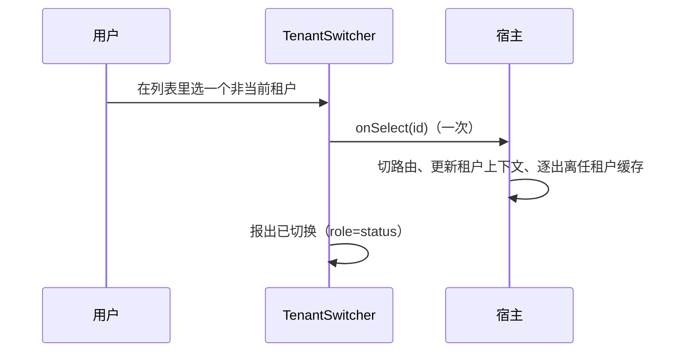

# tenancy-ui

tenancy-ui 是[租户](../../../glossary.md)切换控件，位于 ui-kit 与 i18n 之上，由宿主放进自己的外壳。它拥有受控的 `TenantSwitcher`、该控件的属性类型与命名空间资源。它不管理租户、不拥有当前租户、不做切换，也不读租户列表。进入职责清单前的心智模型只有一句：控件只把用户的选择报给宿主，路由变更、上下文更新与缓存逐出都在宿主。

## 职责

`@speed/tenancy-ui` 交付租户切换：一个受控的 `TenantSwitcher`，触发器显示当前租户，打开宿主给出的租户列表，选中一个不同的租户即把选择交给宿主。宿主已经拥有一个自己的菜单时，同一套行逻辑以 `TenantMenuItems` 交付：只渲染租户行，由宿主嵌进那个菜单；切换确认的 `role="status"` 区域另以 `TenantSwitchAnnouncement` 交付，由宿主挂在菜单之外。包还交付这些符号的属性类型与 `tenancy-ui` 命名空间资源，不交付别的。

租户是请求的路由事实：服务端的解析层按端从请求头、子域或路径解析当前租户，认证不携带租户（[authn 登录](../authn/design-authn-login.md)、[tenant 准入](../tenant/design-tenant-admission.md)）。切换租户因而是一次宿主的路由变更，不是会话上的一次操作：本控件只把用户的意图报给宿主，由宿主改变它的路由并更新它交给 [auth-core](design-web-auth-core.md) 的租户上下文。

**列表的来源是宿主的本人租户读取接口。** 宿主经平台的一个读取接口（`GET /api/v1/auth/me/tenants`，[tenant.self](../tenant/design-tenant.md)）取得调用方持有有效成员关系的租户，映射成 `TenantOption`：`id` 是租户标识，`name` 是名称；个人租户那一行是宿主自己的组织文案。本控件不调用这个读取接口，也不判定哪个租户是个人租户：个人租户是宿主的策略；平台应答携带 `kind`，宿主把它映射成组织文案；本控件不读也不判定它（[ADR-tenant-self](../../../adr/adr-tenant-self.md)）。

控件的结构：

- **触发器显示当前租户。** 标签是租户列表里与 `currentTenantId` 相配那一行的名字（宿主数据），原样渲染，从不翻译。没有相配的行，或 `currentTenantId` 为空时，触发器禁用并显示 `tenantSwitcher.noCurrentTenant` 文案。
- **打开列表列出全部租户，当前那一行禁用**，它的点击守卫在任何回调之前返回，故合成点击也改不动。
- **选中另一行调 `onSelect(id)`。** 用户的选择报给宿主，由宿主把路由切到那个租户、更新租户上下文并逐出离任租户的查询缓存。
- **一次选择安静地播报。** 提交给宿主之后，一个 `role="status"` 区域报出已切换到的新租户（`tenantSwitcher.switchedTo`）。该区域从控件挂载起存在，`announcement` 决定确认文本是否在触发器旁绘制。
- **宿主条目可以跟在列表后面。** `menuFooter` 在租户行之后、同一菜单内的分隔线下方渲染宿主条目；它收到的 `close` 关闭菜单，供跳转前调用。

**宿主自有的菜单由两件组成。** 宿主把租户行嵌进一个已经存在的菜单（示范的账户菜单即如此）时用 `TenantMenuItems` 与 `TenantSwitchAnnouncement`。`TenantMenuItems` 只渲染行：`currentTenantId` 相中的那一行禁用、带 `aria-current` 与勾选标记，点击守卫在任何回调之前返回，合成点击也改不动；其余行调一次 `onSelect`，`onDismiss` 先于它运行，宿主用它关闭菜单。行上不画分组标题、也不挂播报区域，分组名由宿主给在容器上。`leading` 给每行加一个宿主决定的前导标记（示范用它放组织首字块），`itemSx` 让行与菜单其余条目对齐。`TenantSwitchAnnouncement` 是播报区域本身：从首次渲染起存在、内容为空，收到切换后的租户名才填入文本；`announcement` 选 `inline`（在宿主旁边绘制）或 `visually-hidden`（缺省，始终裁切、只留在无障碍树中）。它必须挂在菜单之外：菜单在选行后关闭，一个随菜单生灭的播报区域不可靠。

### 非职责

- **不管理租户。** 开租户、改名、停用、授成员是运维侧的动作，归 [admin-ui](design-web-admin-ui.md)（[tenant.admin](../tenant/design-tenant-admin.md)）；本控件只把当前租户的选择报给宿主。
- **不拥有当前租户。** 当前租户是宿主的事实（`currentTenantId` 属性，由宿主的路由得出），不在本控件内推导。控件存在的意义是把用户的选择报出去。
- **不做切换。** 本控件不认识会话、不发请求、不导航；它调一次 `onSelect`，实际的路由变更、上下文更新与缓存逐出都在宿主。
- **不认识租户列表的来源。** 列表由宿主给出、原样渲染；哪个用户可切哪些租户是宿主的数据，经它自己的生成操作取。
- **不读租户列表，不重试，不缓存。** 列表读取失败时宿主给什么，本控件渲染什么：已经落定的上一份列表或它此刻能给出的那一份（见 [starters](../design-starters.md) 的租户区）。
- **不做缓存逐出。** 租户作用域查询键的移除是宿主的动作（见 [auth-core](design-web-auth-core.md) 的 `evictTenantQueries` 与 [product-shell](design-web-product-shell.md) 的装配说明）。

## 外部接口契约

`web/packages/tenancy-ui/src/index.ts` 是公开接口：`TenantSwitcher`、`TenantSwitcherProps`、`TenantOption`、`TenantMenuItems`、`TenantMenuItemsProps`、`TenantSwitchAnnouncement`、`TenantSwitchAnnouncementProps`，以及命名为 `TENANCY_UI_NAMESPACE`、`tenancyUiResources` 的资源对。`web/packages/tenancy-ui/src/internal/` 下的翻译钩子是组内管线，不外导。

```tsx
interface TenantOption {
  readonly id: string
  readonly name: string
}

interface TenantSwitcherProps {
  readonly tenants: readonly TenantOption[]
  readonly currentTenantId: string | null
  readonly onSelect: (tenantId: string) => void
  readonly menuFooter?: (close: () => void) => ReactNode
  readonly announcement?: 'inline' | 'visually-hidden'
  readonly triggerProps?: Pick<ButtonProps, 'variant' | 'size' | 'sx' | 'startIcon'>
  readonly compact?: boolean
}

interface TenantMenuItemsProps {
  readonly tenants: readonly TenantOption[]
  readonly currentTenantId: string | null
  readonly onSelect: (tenantId: string) => void
  readonly onDismiss?: () => void
  readonly itemSx?: SxProps<Theme>
  readonly leading?: (tenant: TenantOption) => ReactNode
}

interface TenantSwitchAnnouncementProps {
  readonly tenantName: string | null
  readonly announcement?: 'inline' | 'visually-hidden'
}
```

**`tenants`、`currentTenantId`、`onSelect` 是必需属性，`TenantOption` 的字段均只读。** 这是本控件对宿主的语义契约：宿主必须提供 `tenants`、`currentTenantId` 与 `onSelect`。把其中任一个放宽为可选，类型上属于源码兼容的放宽，但它破坏了这条语义契约：一个不再提供它们的宿主仍能通过编译，故这是契约语义层面的破坏性变更，而不是类型不兼容。`TenantOption` 的字段与这些属性同属宿主提供的输入：宿主构造租户列表，控件只读取渲染。故按同一分类，给 `TenantOption` 新增可选字段是源码兼容的；新增必选字段、删除字段、或改字段的含义或名，是不兼容变更。

**`menuFooter`、`announcement`、`triggerProps`、`compact`、`onDismiss`、`itemSx`、`leading` 是可选属性，缺省时行为不变。`TenantSwitchAnnouncement` 的 `tenantName` 是必需属性，`null` 表示还没有过切换。**

- `menuFooter(close)` 在租户行之后、同一菜单内的分隔线下方渲染宿主条目。`close` 关闭菜单；需要跳转的宿主条目在跳转前调用它。未提供时菜单只有租户行。
- `announcement` 选择切换确认的位置：`inline` 在触发器（或宿主自己安排的位置）旁绘制确认文本，`visually-hidden` 始终裁切、只留在无障碍树中播报。两种取值都从挂载起就渲染同一个 `role="status"` 区域。`TenantSwitcher` 缺省 `inline`，`TenantSwitchAnnouncement` 缺省 `visually-hidden`。
- `onDismiss` 在 `TenantMenuItems` 的每次选择生效之前运行一次，宿主用它关闭嵌入这些行的菜单；未提供时选择照常上报。
- `itemSx` 展开到 `TenantMenuItems` 的每一行上，使行与宿主菜单的其余条目对齐；未提供时用菜单条目的缺省间距。
- `leading(tenant)` 为 `TenantMenuItems` 的每行渲染一个前导标记，放在菜单的图标格里，使名字与其他条目的标签同轨；未提供时行只有名字。标记是装饰，行的可及名仍是租户名。
- `triggerProps` 只携带呈现属性（`variant`、`size`、`sx`、`startIcon`），展开到触发器按钮上，使控件的外观与宿主自己的 chrome 一致。未提供时触发器是继承环境文字颜色的描边按钮。
- `compact` 把触发器收成仅图标形态，供放不下租户名的窄 chrome（收起侧栏的图标窄栏）使用：可及名仍是文字触发器会显示的那个租户名，`triggerProps.startIcon` 给出时作图标，否则用包内字形；MUI（[REF-mui](../../../references.md)）按钮的 64px 最小宽度与两侧内边距在形态内取消。列表、当前租户行的禁用与切换播报不变。

**`onSelect` 在用户选一个非当前租户时触发一次，携带选中的租户标识。** 宿主在那里把路由切过去、更新租户上下文、重取数据并逐出上一租户的查询缓存；回调抛出不是选择失败，本包把它包住，既不当错误渲染，也不让它变成未处理的拒绝。

**对外接口。** 公开接口是上述导出集；控件受控、只调 `onSelect`、不使用 auth-core 的钩子、不发请求；触发器与列表项渲染宿主文本，内建文案只覆盖控件自己的状态。变更按 TypeScript 的源码语义分类：新增导出、新增可选字段是源码兼容的；删除导出或字段、改既有导出或字段的含义或名、改签名（参数或返回类型），是不兼容变更。把必选与可选互转按位置判：输入位（宿主提供的 prop 或参数）放宽兼容、收紧不兼容；输出位（宿主读取的返回类型或结果字段）相反：放宽为可选使读出的值成为 `T | undefined`，strictNullChecks 下只有在要求 `T` 处使用它的消费者无法编译（对可能为 undefined 的值做成员访问报 TS18048，赋给 `T` 或传入要求 `T` 的形参报 TS2322/TS2345），仅转发或在宽松处使用（模板串、比较、`??`、可选链）的消费者仍编译，故可能破坏消费者、是不兼容变更。

## 依赖

| 依赖 | 用途 |
|---|---|
| `@speed/i18n` | 命名空间注册与文案的翻译钩子 |
| `@speed/ui-kit` | `src/` 取共享的裁切配方 `visuallyHiddenSx`；`test-utils/` 用它的主题 provider 与 `ui-kit` 命名空间，宿主在 ui-kit 的主题下组合本包 |
| `@mui/material`、`react`、`react-dom`、`@emotion/*`（[REF-emotion](../../../references.md)） | peer（必需）：`Button`／`Menu`／`MenuItem` 原语与宿主拥有的 MUI／React 树 |

`@speed/auth-core`、`@speed/api-client` 与 `@speed/api-sdk` 是 devDependency：本包的 `src/` 不引用它们，公开类型也不引用。`@speed/ui-kit` 在本包之下，本包的 `src/` 只从它取共享的裁切配方 `visuallyHiddenSx`；本包与 `@speed/auth-ui` 同为能力 UI，同层之间互不 import。

## UML 图

一次选择的路径。图里画不到的约束：触发器标签与列表项是宿主文本；当前租户由宿主属性给出，不在本控件推导；真正的切换（路由变更、上下文更新、缓存逐出）在宿主，本控件只报出选择。



## 核心数据结构

| 概念 | 结构 | 说明 |
|---|---|---|
| 可切换租户 | `TenantOption` | `id`（`onSelect` 携带的稳定标识）与 `name`（触发器与列表显示的名字） |
| 命名空间 | `tenancyUiResources` | `zh-CN` 与 `en-US` 两份目录，叶子键集相同 |

## 核心算法与流程

### 一次选择

1. 用户在列表里点一个非当前租户的行；行的点击守卫先确认它不是当前租户，再把菜单关掉、调 `onSelect(id)`。
2. 宿主接手：把路由切到那个租户，更新它交给 `TenantProvider` 的租户标识，并用切换之前读到的离任租户 id 逐出该租户的查询子树。
3. 控件报出已切换的租户（`role="status"`）。该区域在控件挂载时就已存在、内容为空，选择时才填入文本，使第一次选择也被播报；`announcement` 为 `visually-hidden` 时该区域始终裁切、只留在无障碍树中。示范的账户菜单不用 `TenantSwitcher`：它用 `TenantMenuItems` 把行嵌进自己的菜单，并把 `TenantSwitchAnnouncement` 挂在菜单之外：菜单在选行后关闭，播报区域须比它活得久。运行期只依赖 `@speed/i18n`、`@speed/ui-kit`（仅取共享的裁切配方 `visuallyHiddenSx`）与 MUI，区域是本包自己的，遵守与 `InlineSuccess` 同一套先挂空区域、再填文本的做法；租户切换是宿主回调，不是写入，不在 `useWriteFeedback` 的作用域之内。

### 当前租户收敛

控件是受控的：用户的选行只把意图报给宿主，触发器显示的租户始终由宿主的 `currentTenantId` 决定。宿主完成切换后把新的 `currentTenantId` 传回，触发器随之收敛；在宿主完成之前，控件不自己改显示。

### 切换与组织管理面

组织管理面（[admin-ui](design-web-admin-ui.md) 的 `/organization/admin`）作用在当前租户上，一次切换因此改变它的全部输入。控件仍只做一件事：把选中的租户标识交给 `onSelect` 一次。在“一次选择”的逐出与租户上下文更新之外，宿主按次序：

1. 把租户域的权限集置回未知，并按新租户重读；读回之前，组织管理面的入口与页面按未知处置，不按旧租户的权限渲染。
2. 以新的租户标识重挂载组织管理面的子树。页面的本地状态随卸载丢弃，租户作用域的查询键换到新租户。
3. 切换时如果页面在 `/organization/admin` 之下，把页面带到新租户的租户区首页，不留在管理面：新租户不一定授予同一组管理权限，停在旧页面只会渲染一个无权限页面。

当前租户从未知落定为某个租户不是切换：重读权限、重挂子树与带回租户区首页都不执行。

## 错误与失败语义

**内建文案只覆盖控件自己的状态。** 切换本身由宿主执行，其失败（无成员资格、令牌校验失败、路由不可达）是宿主在其路由与数据层处置的，不在本控件的失败范围。列表读取的失败同样是宿主的失败范围：控件只按 `tenants` 与 `currentTenantId` 渲染，不区分列表是刚刚读过、沿用上一份，还是此刻只能给出这些。

| 情形 | 表现 |
|---|---|
| 触发器对应的租户不在列表里（或 `currentTenantId` 为空） | 触发器禁用并显示 `tenantSwitcher.noCurrentTenant` |
| 选中的行是当前租户 | 点击守卫在调 `onSelect` 之前返回，无动作 |
| `onSelect` 抛出 | 被本包包住，不当错误渲染，也不成为未处理的拒绝 |

## 并发与事务边界

- 控件无自有共享状态，可被 React 正常渲染；一次选择是一次同步回调，不做往返。
- 本包不打开事务、不持有客户端缓存。

## 实现状态

| 能力 | 状态 | 代码 |
|---|---|---|
| 租户切换控件 | 已实现 | `web/packages/tenancy-ui/src/TenantSwitcher.tsx` `TenantSwitcher`、`TenantOption`、`TenantSwitcherProps` |
| 命名空间资源 | 已实现 | `web/packages/tenancy-ui/src/resources.ts` `TENANCY_UI_NAMESPACE`、`tenancyUiResources` |
| 切换通知的区域在控件挂载时存在 | 已实现 | `web/packages/tenancy-ui/src/TenantSwitcher.tsx` `TenantSwitcher`；`web/packages/tenancy-ui/src/TenantSwitchAnnouncement.tsx` `TenantSwitchAnnouncement` |
| 宿主自有菜单里的租户行，含前导标记与行内呈现选项 | 已实现 | `web/packages/tenancy-ui/src/TenantMenuItems.tsx` `TenantMenuItems`、`TenantMenuItemsProps` |
| 菜单之外的切换播报区域 | 已实现 | `web/packages/tenancy-ui/src/TenantSwitchAnnouncement.tsx` `TenantSwitchAnnouncement`、`TenantSwitchAnnouncementProps` |
| 菜单页脚、播报位置与触发器呈现选项 | 已实现 | `web/packages/tenancy-ui/src/TenantSwitcher.tsx` `TenantSwitcherProps` |
| 切换时的租户权限集清除、组织管理面重挂载与离开管理面到租户首页（宿主侧） | 已实现 | `starters/demo/web/src/chrome.tsx` `useTenantSelection`；`starters/demo/web/src/app.tsx` `TenantFrame` |
