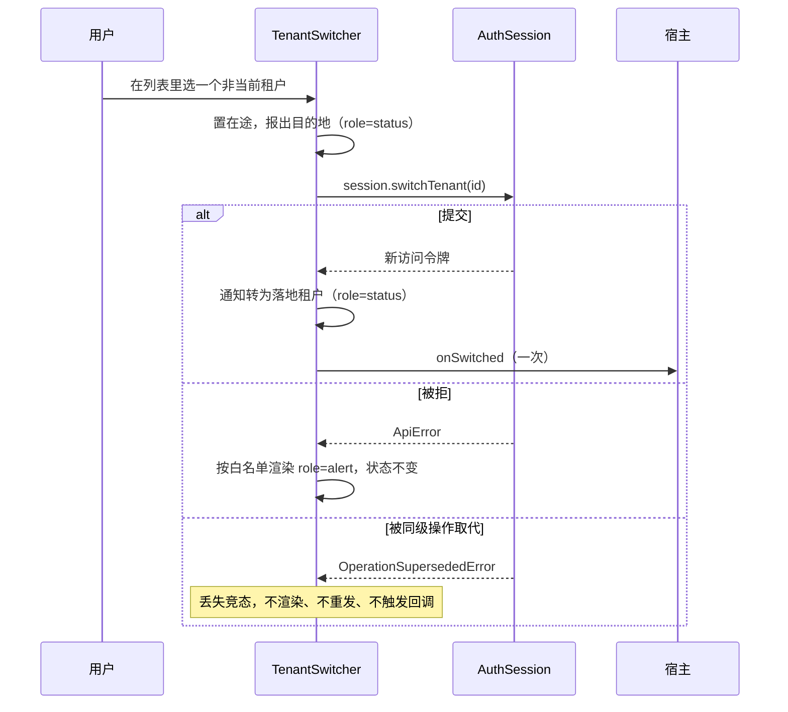

# tenancy-ui

## 职责

`@speed/tenancy-ui` 交付租户切换控件：一个受控的 `TenantSwitcher`，触发器显示当前租户，打开宿主给出的租户列表，选中一个不同的租户即把会话切过去。它交付这一个控件、它的属性类型与 `tenancy-ui` 命名空间资源，不交付别的。

控件的形状：

- **触发器显示当前租户。** 标签是租户列表里与 `currentTenantId` 相配那一行的名字——宿主数据，原样渲染，从不翻译。没有相配的行，或 `currentTenantId` 为空时，触发器禁用并显示 `tenantSwitcher.noCurrentTenant` 文案。
- **打开列表列出全部租户，当前那一行禁用**，它的点击守卫在任何会话调用之前返回，故合成点击也改不动。
- **选中另一行调 `session.switchTenant(id)`。** 租户走在切换请求的正文里，不在请求头里（租户上下文走访问令牌）。
- **切换在途时触发器惰性化，一条 `role="status"` 通知先报目的地（`tenantSwitcher.switchingTo`），提交后变成落地的租户（`tenantSwitcher.switchedTo`）**，故控件不在一次切换之后排队第二次，一次完成的上下文变化也不静默。
- **一次成功的切换安静地宣布，且 `onSwitched` 每次提交恰好触发一次**，在提交之后——丢失竞态与失败的切换都不触发。

### 非职责

- **不管理租户。** 开租户、改名、停用、授成员是运维面的动作，归 [console-ui](design-web-console-ui.md)（[tenant.admin](../tenant/design-tenant-admin.md)）；本包只切换当前会话所在的租户，即租户侧的一次上下文变更，不是平台侧的名册管理。
- **不拥有当前租户。** 当前租户是宿主的事实（`currentTenantId` 属性），不在本包内推导。控件存在的意义是改变这个事实，并把它经 `onSwitched` 报出去。
- **不重新挂载权限集。** 一次切换提交会按 auth-core 的存续规则丢掉租户域的权限列表；本包从不重新挂载，宿主必须重取，否则切过去的租户会带着陈旧权限渲染。
- **不消费 auth-core 的钩子。** 会话以属性传入；控件只驱动 `session.switchTenant` 这一个操作，不读会话状态、不 attach 会话、不导航、不直接触网。
- **不认识租户列表的来源。** 列表由宿主给出、原样渲染；哪个用户可切哪些租户是宿主的数据，经它自己的生成操作取。
- **不做缓存逐出。** 租户作用域查询键的移除是宿主在 `onSwitched` 里的动作（同样见 [console-ui](design-web-console-ui.md) 与 [product-shell](design-web-product-shell.md) 的装配说明）。

## 外部接口契约

`web/packages/tenancy-ui/src/index.ts` 是公开面：`TenantSwitcher`、`TenantSwitcherProps`、`TenantOption`，以及命名为 `TENANCY_UI_NAMESPACE`、`tenancyUiResources` 的资源对。`web/packages/tenancy-ui/src/internal/` 下的错误文案解析器、失败横幅与翻译钩子是族内管线，不外导。

```tsx
interface TenantOption {
  readonly id: string
  readonly name: string
}

interface TenantSwitcherProps {
  readonly session: AuthSession
  readonly tenants: readonly TenantOption[]
  readonly currentTenantId: string | null
  readonly onSwitched?: (tenantId: string) => void
}
```

**`session`、`tenants`、`currentTenantId` 是必需属性，`TenantOption` 的两个字段只读。** 把其中任一个改成可选、或给 `TenantOption` 扩形状，是消费者可见的破坏性变更。

**`onSwitched` 在每次提交的切换之后触发一次，携带会话现在所在的租户标识。** 宿主在那里重取数据、清掉上一租户的查询缓存、重挂权限列表；回调抛出不是切换失败，本包把它包住，既不当错误渲染，也不让它逃成未处理的拒绝。

**稳定性承诺。** 公开面是上述导出集；控件受控、只驱动 `session.switchTenant`、不消费 auth-core 的钩子；触发器与列表项渲染宿主文本，内建文案只覆盖控件自己的状态。

## 依赖

| 依赖 | 用途 |
|---|---|
| `@speed/auth-core` | `TenantSwitcherProps.session` 的 `AuthSession` 类型与运行期助手 `isOperationSuperseded`（把被同级操作取代的切换与真正的失败分开） |
| `@speed/i18n` | 命名空间注册与文案的翻译钩子 |
| `@speed/ui-kit` | 共享失败横幅对：`InlineError`（绑定本包自己的文案解析器）与 `errorCodeOf` 分类器 |
| `@mui/material`、`react`、`react-dom`、`@emotion/*` | peer（必需）：`Button`／`Menu`／`MenuItem` 原语与宿主拥有的 MUI／React 树 |

`@speed/api-client` 与 `@speed/api-sdk` 是 devDependency：本包的 `src/` 不引用它们，公开类型也不引用。`ui-kit` 的主题提供者只出现在 `test-utils/`，因为测试树必须挂在真实宿主组合下渲染。方向是 `@speed/tenancy-ui` 与 `@speed/auth-ui`、`@speed/ui-kit` 同层，同层之间互不 import。

## UML 图

一次切换的路径。图里画不到的约束：触发器标签与列表项是宿主文本；当前租户由宿主属性给出，不在本包推导；一次切换在途时控件惰性化，且不在其上排队第二次；一场被同级操作取代的切换原地丢失，不渲染、不重发、不触发回调。



## 核心数据结构

| 概念 | 形状 | 说明 |
|---|---|---|
| 可切换租户 | `TenantOption` | `id`（切换调用携带的稳定标识）与 `name`（触发器与列表显示的名字） |
| 通知 | `SwitchNotice` | 在途通知与落地确认共用一个 `role="status"` 区，文本从 `switchingTo` 变为 `switchedTo` |
| 命名空间 | `tenancyUiResources` | `zh-CN` 与 `en-US` 两份目录，叶子键集相同 |

## 核心算法与流程

### 一次切换

1. 用户在列表里点一个非当前租户的行；行的点击守卫先确认它不是当前租户，再把菜单关掉、发起切换。
2. 切换处理器的入口守卫同步检查在途标志（一个 ref，不是 state），在途时拒绝，绝不排队。
3. 通知报出目的地；`session.switchTenant(id)` 发出。
4. 判决分叉：提交时通知转为落地确认并触发 `onSwitched` 一次；被拒时把应答的错误码文本渲染在一条 `role="alert"` 横幅里、状态原地不变、下一次选行可重试（重试清掉上一条横幅）；被同级操作取代时原地丢失。
5. 收尾清除在途标志，触发器重新可用。

### 丢失竞态

当本实例的切换请求成功应答、而同一会话上的一场并发同级操作先提交时，auth-core 以 `OperationSupersededError` 拒绝。这场切换按丢失的竞态处理：不渲染、不重发、不触发 `onSwitched`——胜出操作自己的提交已为会话真正所在的租户触发过一次，本控件受控，触发器经宿主的 `currentTenantId` 收敛到同一租户。重发被取代的请求反而会把用户已经放弃的租户重新提交。

## 错误与失败语义

**失败面是一个可达码白名单。** 一次被拒的切换把应答解析成一个可达的错误码，渲染该码文本；白名单外的码渲染 `errors.unknown` 回退，故屏上永不出现裸键。

| 情形 | 表现 |
|---|---|
| 切换被拒（无成员资格、账户不可用、令牌校验失败、会话生命期） | 一条 `role="alert"` 横幅渲染应答的错误码文本，令牌不变、触发器在同一当前租户上重新可用 |
| 传输层失败（`client.network`、`client.timeout`、`client.protocol`） | 同上，落入同一横幅 |
| 白名单外的码 | 渲染 `errors.unknown` 回退，不渲染裸键 |
| 被同级会话操作取代 | `OperationSupersededError`：丢失的竞态，不渲染横幅、不重发、不触发回调 |
| 一次切换在途时再次选行 | 入口守卫同步拒绝，不排队、不触达会话 |

**错误文案的复制是刻意的。** 与登录面共享同一含义的码，其 `errors.authn.*` 与 `errors.client.*` 文本是 [auth-ui](design-web-auth-ui.md) 同码文本的逐字副本（同层包不能互相 import 目录），由本包的错误文案测试双向钉住，并从 auth-ui 的目录直接取为测试数据，使两处的漂移在本包测试里失败而非流到产品。

## 并发与事务边界

- **一次只切换一次。** 入口守卫同步设一个在途标志，在途时拒绝第二次选行，绝不排队，因为惰性触发器要到下一帧才渲染，来不及拦同一窗口里对正在关闭的列表的重复激活。
- **同会话上的并发切换以应答落定次序裁定取代**，不由发送次序；胜出的提交是唯一的一次，其所在实例为会话真正所在的租户触发一次 `onSwitched`。
- 本包不打开事务、不持有客户端缓存；一次切换是一个会话操作的往返。

## 实现状态

| 能力 | 状态 | 代码 |
|---|---|---|
| 租户切换控件 | 已实现 | `web/packages/tenancy-ui/src/TenantSwitcher.tsx` `TenantSwitcher`、`TenantOption`、`TenantSwitcherProps` |
| 命名空间资源 | 已实现 | `web/packages/tenancy-ui/src/resources.ts` `TENANCY_UI_NAMESPACE`、`tenancyUiResources` |
