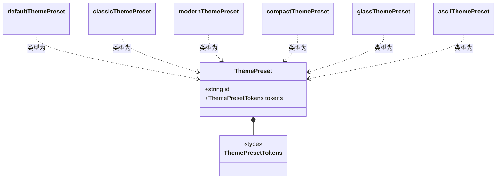

# theme-presets

## 职责

主题预设的货架，包 `web/packages/theme-presets`。它是一个纯数据包：每个预设是一份 `ThemePreset`，内容是相对默认 token 树的一份差异，由装配层与其它层一并交给主题 provider。

- **交付随包的成品风格。** 基线 `default`，以及 `classic`（传统管理后台）、`modern`（时尚产品页）、`compact`（信息密集型）、`glass`（液态玻璃）、`ascii`（ASCII 终端）。
- **只写设计取值。** 预设改 token 的段——配色、排版、间距、圆角、阴影、表面——不写 MUI（[REF-mui](../../../references.md)）的组件覆盖。效果映射是主题适配器的事（[ui-kit](design-web-ui-kit.md)）。
- **不持文案。** 预设只有 `id` 与 `tokens`；显示名是产品文案，归宿主的 i18n 资源。

### 非职责

- **不定义合并机制。** 一棵默认树、`deepMerge` 与覆写类型归 [tokens](design-web-tokens.md)。本包不认识层的数量与层名，只产出可作一层的数据。
- **不认识 React、MUI 与 i18n。** 包不 import 任何运行时依赖，不注册命名空间，不渲染文案。
- **不拥有活动预设。** 当前选中哪一项、切换后如何生效、是否持久化，归 [ui-kit](design-web-ui-kit.md) 的 provider 与宿主。
- **不改布局与层叠契约。** `breakpoints` 是被布局设计钉死的功能契约，`zIndex` 被侧边面板与对话框的层序依赖；两者都不在预设可写的段内。

## 外部接口契约

```ts
import type { TokensOverride } from '@speed/tokens'

/** 预设可改的段：布局与层叠的契约段被排除。 */
export type ThemePresetTokens = Omit<TokensOverride, 'breakpoints' | 'zIndex'>

export interface ThemePreset {
  readonly id: string
  readonly tokens: ThemePresetTokens
}

export const defaultThemePreset: ThemePreset   // { id: 'default', tokens: {} }
export const classicThemePreset: ThemePreset
export const modernThemePreset: ThemePreset
export const compactThemePreset: ThemePreset
export const glassThemePreset: ThemePreset
export const asciiThemePreset: ThemePreset
export const themePresets: readonly ThemePreset[]
```

- **每个预设是「相对默认树的差异」。** `tokens` 的形状与 `@speed/tokens` 的 `TokensOverride` 相同，只是类型层排除了 `breakpoints` 与 `zIndex`：预设改这两段不是风格问题，是破坏布局与层序契约，因此在编译期拒绝。随包预设由测试守住这条限制。
- **`themePresets` 是随包货架。** 第一项是 `defaultThemePreset`，其后依次是 `classic`、`modern`、`compact`、`glass`、`ascii`。宿主可以直接把它交给主题 provider，也可以只取其中几项或自行提供预设。
- **预设是冻结的共享数据。** 随包预设经深度冻结，读方不能就地改写；`themePresets` 本身也是冻结数组。
- **包不携带显示名。** 一个预设的展示名称不属于它的数据；宿主按 `id` 从自己的语言资源取文案。
- **预设的 id 在货架内唯一。** 主题 provider 按 id 建索引，重复 id 时后项覆盖前项，前项在索引中不可达。

随包风格的判别性取值：

| id | 判别性取值 |
|---|---|
| `default` | 空差异，等于默认树 |
| `classic` | 圆角 4；行高 1.15 / 1.4 / 1.6；主色更深（`#1D4ED8`）；分隔线与阴影更硬 |
| `modern` | 圆角 14；行高 1.35 / 1.65 / 1.9；主色更亮（`#4F46E5`）；阴影更柔更大 |
| `compact` | 字号阶整体缩小；行高 1.15 / 1.35 / 1.5；间距基数 `spacing.unit` 为 6 |
| `glass` | 圆角 24；`container`/`overlay` 半透明（不写填充，按模式继承纸色）加背景模糊与饱和；`header` 填充透明且不加模糊，表头随卡片本身玻璃、由分隔线区分；画布渐变的明暗两套止色；raised 表面的描边也分两套（浅色深描边、深色白描边）；浅色 error 主色加深以保证文字对比度 |
| `ascii` | 全站等宽字体栈（末尾补 CJK 回退）；圆角 0；近黑表面配硬绿描边；绿/琥珀语义色；阴影全为 `none`；正文辉光 |

**对外接口面。** `ThemePreset`、`ThemePresetTokens`、`defaultThemePreset`、`classicThemePreset`、`modernThemePreset`、`compactThemePreset`、`glassThemePreset`、`asciiThemePreset` 与 `themePresets` 的类型与形状，是宿主与 [ui-kit](design-web-ui-kit.md) 据以编写的接口面。新增导出、新增可选字段是源码兼容的；删除导出或字段、改既有导出或字段的含义或名、改签名是不兼容变更。随包预设的 `id` 是宿主的语言资源键与设备存储值，改名同样是不兼容变更。

## 依赖

| 依赖 | 类型 | 用途 |
|---|---|---|
| `@speed/tokens` | 仅类型 | `TokensOverride` 的类型；本包只 `import type`，没有运行时依赖 |

**方向是自下而上。** 本包与 `@speed/tokens` 同属前端依赖图的地板，之上由 [ui-kit](design-web-ui-kit.md) 的主题 provider 取用，再之上是装配壳与宿主。[`@speed/tokens`](design-web-tokens.md) 仍是唯一的合并机制与默认树；本包只是它的数据消费者。

## UML 图

图给出预设的形状与随包条目。图里画不出的约束：`tokens` 在类型层不含 `breakpoints` 与 `zIndex`；随包预设深度冻结；预设不携带显示名，合并次序与切换归主题 provider。



## 核心数据结构

| 概念 | 类型 | 说明 |
|---|---|---|
| 预设 | `ThemePreset` | 一个 `id` 加一份相对默认树的 token 差异 |
| 可写段 | `ThemePresetTokens` | `Omit<TokensOverride, 'breakpoints' \| 'zIndex'>`；排除布局与层叠契约 |
| 基线 | `defaultThemePreset` | `id` 为 `default`，`tokens` 为空对象 |
| 随包货架 | `themePresets` | 基线在首位的冻结数组 |

## 核心算法与流程

### 一次预设的装配

预设不参与合并本身；它由主题 provider 作为一层交给 `@speed/tokens` 的 `deepMerge`。

1. 宿主把 `themePresets`（或自选的预设集合）与一个起始 id 交给主题 provider，或经装配壳的 `theme` 选项转交。
2. provider 解析活动预设：显式选择优先，其次是起始 id，其次是货架第一项；空货架不叠预设层。
3. provider 把活动预设的 `tokens` 合到项目层之前：`deepMerge(preset.tokens, projectTokens)`，再由主题工厂按 `defaultTokens → 该结果 → tenantOverrides` 建成主题。

装配层序因此是 `defaultTokens → 预设 → projectTokens → tenantOverrides`：客户的品牌色压过预设，租户覆写仍最高。预设因此可以只声明风格差异，不必知道项目的品牌色。

### 半透明与画布的合成

`glass` 一类预设经 `surface.*.opacity` 与 `color.background.canvas` 表达半透明。预设不写 `fill`：主题适配器先按活动模式解析出继承的纸色（浅色为白、深色为深色纸面），再乘 alpha，因此同一份 `opacity` 在明暗两种模式下都与该模式的文字色保持对比度；写死白色填充会在深色画布上合成出中灰，令深色模式的浅色文字跌破 4.5:1。画布按模式取对应的止色，绘制在页填充之上。三处字段的形状与绘制次序见 [tokens](design-web-tokens.md)；映射归 [ui-kit](design-web-ui-kit.md)。

## 错误与失败语义

| 情形 | 表现 |
|---|---|
| 预设声明 `breakpoints` 或 `zIndex` | 类型检查报错，预设不能编译 |
| 货架内两个预设同 id | 后项覆盖前项；前项在 provider 的索引中不可达 |
| 活动预设 id 不在货架里 | 由 provider 回落到第一项，不抛错（见 [ui-kit](design-web-ui-kit.md)） |
| 预设的 `tokens` 为空 | 合法；等于默认树 |

本包是纯数据，自身不抛错、不做运行期校验、无降级与重试面。

## 扩展点

- **新增一套风格。** 写一份 `ThemePreset` 数据交给装配，不需要改平台包；随包预置只是开箱用的起点。
- **只取一部分。** 宿主可以把 `themePresets` 的子集交给 provider，或提供一个完全自有的货架。
- **预设的呈现。** 宿主按 `id` 从自己的语言资源取显示名，经 [account-ui](design-web-account-ui.md) 的 `AppearanceSection` 呈现选择。

## 实现状态

| 能力 | 状态 | 代码 |
|---|---|---|
| 预设形状与可写段（排除 `breakpoints`/`zIndex`） | 已实现 | `web/packages/theme-presets/src/index.ts` `ThemePreset`、`ThemePresetTokens` |
| 基线预设 | 已实现 | `web/packages/theme-presets/src/index.ts` `defaultThemePreset` |
| 随包风格 | 已实现 | `web/packages/theme-presets/src/index.ts` `classicThemePreset`、`modernThemePreset`、`compactThemePreset`、`glassThemePreset`、`asciiThemePreset` |
| 随包货架与冻结 | 已实现 | `web/packages/theme-presets/src/index.ts` `themePresets`、`createPreset` |
