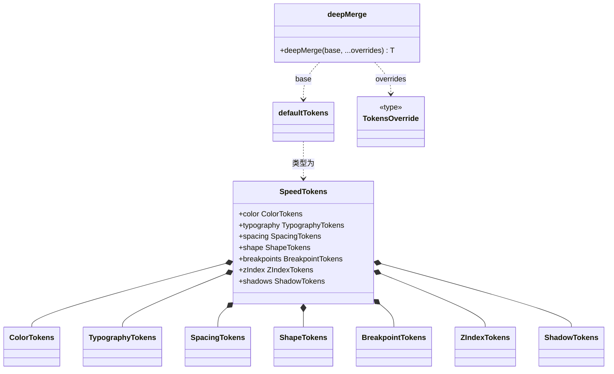

# tokens

## 职责

把平台的设计取值——语义配色、字体栈与字号、间距基数、圆角、断点、层级、阴影——作为**纯数据**交付：一棵默认 token 树 `defaultTokens`，加唯一一个不修改入参的覆写方式 `deepMerge`。消费方在这棵树上叠加自己的差异层，得到一份新的 token 树，交给 `ui-kit` 的主题工厂建成 MUI 主题。

运行时面**刻意只有这两个符号**，其余导出全是类型：token 作者与主题适配器因此拿到完整的编译期形状，而不为此背任何运行时代价。

白标分层由调用方用 `deepMerge` 的多层入参表达：`deepMerge(defaultTokens, projectTokens, tenantOverrides)`，靠后的层覆盖靠前的层。本包只定义「一棵树加一个合并」，**层数与层名由调用方决定**（内置默认、项目、租户），分层这一事实不在这里固化。

### 非职责

- **不成主题，不出样式表。** 本包不 import React，不做 CSS-in-JS，不产出 MUI 主题对象。token 如何变成 MUI 主题——阴影数组的插值、中性色阶到 `palette.grey` 的映射、字号到排版角色的指派——是 `ui-kit` 主题工厂的适配决策，见 [ui-kit](design-web-ui-kit.md)。本包不预先替它做这类导出。
- **不认识租户、项目、品牌。** 分层的名字、层数、每一层由谁提供，都在调用方；本包只提供合并机制。
- **不含运行期依赖，也不含宿主可见文本。** 本包不登记语言资源，不渲染任何文案，因而不参与前端的语言协商。
- **不产出布局与组件。** 断点是取值，不是排版行为；把断点用成响应式规则是消费方的事。

## 外部接口契约

### 交付的符号

```ts
export const defaultTokens: SpeedTokens
export function deepMerge<T extends object>(base: T, ...overrides: Array<DeepPartial<T>>): T

export type SpeedTokens        // 完整 token 树
export type TokensOverride     // DeepPartial<SpeedTokens>
export type DeepPartial<T>     // 递归可选；数组与函数是叶子
// 外加各段的取值类型（颜色、排版、间距、圆角、断点、层级、阴影）
```

**`deepMerge` 的契约，约束的主体是每一次调用**：

- 不改任何入参。写时复制：未被覆写触及的分支按标识与 `base` 共享，被触及的分支重建为新对象，归该结果独有。
- 结果是 `base` 的忠实副本：`base` 的每个自有键都留在结果里，即使其值为 `undefined`——一次覆写省略某个键，不会让该键从结果中消失。
- 覆写里的 `undefined` 值被跳过，一次局部覆写不会把一个 token 抹空。其余任何值（含 `null`）整体替换。
- 同一个键上两个纯对象递归合并；其余一律替换。
- 覆写按入参次序生效，靠后者胜，每一层叠加在前一层的结果上。
- 每个键经 `Object.defineProperty` 落为自有数据属性：`__proto__` 这类恶意键既不能改动结果的原型，也不被静默丢弃——它被定义为不可枚举，深合并后仍可从结果读出，但任何基于 `[[Set]]` 的拷贝（如 `Object.assign`）都带不走它。

**`defaultTokens` 的契约**：装配时深度冻结。不可变性由运行期强制，而不只由类型声明：经 `defaultTokens` 本身，或经一次合并结果中与它按标识共享的分支写值，在严格模式下抛错，而不会静默污染每一层覆写都从它出发的那棵树。`SpeedTokens` 的每个字段都是 `readonly`。

**覆写形状错误是编译期错误**：`TokensOverride` 由 `SpeedTokens` 派生，未知的段、错误的取值种类、用对象覆写字符串都在类型检查时报出，由测试里的 `@ts-expect-error` 行钉住。

### MUI 对齐口径是承诺

`breakpoints.values`、`zIndex.values` 与间距基数**有意等于 MUI 主题的默认值**，并由测试对着**安装的 MUI 主题本身**钉住（测试经仅开发期的 `@mui/material` 依赖 import MUI 的真 `createTheme`，与本包出不出运行期依赖无关）。`shape.borderRadius` 是记录在案的例外：token 出 8，MUI 默认为 4，这一偏离本身被钉住，MUI 的默认一旦收敛到该值测试即失败。参照物从不是树内抄下的期望值——抄来的期望只能与它抄自的 token 一致。

### 对外接口面

`defaultTokens`、`deepMerge`、`SpeedTokens` 及其各段类型的字段名与形状，以及 MUI 对齐口径，是消费方（`ui-kit` 主题工厂、取用原始取值的应用）据以编写的接口面。变更按 TypeScript 的源码语义分类：新增导出、新增可选字段是源码兼容的；删除导出或字段、改既有导出或字段的含义或名、改签名（参数或返回类型），是不兼容变更。把必选与可选互转按位置判：输入位（宿主提供的 prop 或参数）放宽兼容、收紧不兼容；输出位（宿主读取的返回类型或结果字段）相反——放宽为可选使读出的值成为 `T | undefined`，strictNullChecks 下只有在要求 `T` 处使用它的消费者无法编译（对可能为 undefined 的值做成员访问报 TS18048，赋给 `T` 或传入要求 `T` 的形参报 TS2322/TS2345），仅转发或在宽松处使用（模板串、比较、`??`、可选链）的消费者仍编译，故可能破坏消费者、是不兼容变更。MUI 大版本升级若改了默认值，本包的对齐测试指名要重新裁定哪一条，而不是放宽测试。

## 依赖

本包**零运行期依赖**：任何加进来的依赖都会落进每个消费项目的产物，因此合并行为若需要一个新的助手，在本包内写（小而测得），而不是引入一个库。

仅开发期依赖 `@mui/material`，只用于让对齐测试对着 MUI 安装版本的真默认值比较；本包不发布它，也不在源码里 import 它。

本包不依赖任何同族前端包：它是前端依赖图的地板，其余包（`i18n`、`ui-kit`）读它，方向到这里终止。

## UML 图

图给出 `SpeedTokens` 的段划分与运行时符号的位置。图里画不出的约束：每个段字段都是 `readonly`，装配后的整棵树深度冻结；`DeepPartial` 把数组与函数当叶子（整体替换，不逐项合并），token 树不含数组与函数，但助手是泛型的因而必须如此；`deepMerge` 的层数是变参，图上的入参只是当次调用。



## 核心数据结构

| 概念 | 类型 | 说明 |
|---|---|---|
| token 树 | `SpeedTokens` | `color`、`typography`、`spacing`、`shape`、`breakpoints`、`zIndex`、`shadows`；每个字段 `readonly` |
| 覆写形状 | `TokensOverride` | `DeepPartial<SpeedTokens>`，一次覆写能写到的最深形状 |
| 递归可选 | `DeepPartial<T>` | 对象递归可选；数组与函数是叶子，覆写整体替换 |
| 默认树 | `defaultTokens` | 由各段装配成的单棵树，装配时深度冻结 |
| 合并助手 | `deepMerge` | 基加若干覆写层，纯函数，见外部接口契约 |

**各段的取值形状**（摘要，详细字段在代码与各段模块）：

| 段 | 形状 |
|---|---|
| `color` | `semantic` 为若干语义角色，每个角色带 `main`/`light`/`dark`/`contrastText`：`main` 是浅色表面上的色调、`light` 是给深色表面的色调、`dark` 是最深的一档、`contrastText` 是落在 `main` 上的文字色；`neutral` 为数值色阶；`text`/`background`/`divider` |
| `typography` | `fontFamily.sans`/`mono`（拉丁优先、附 CJK 回退）、`fontSize` 命名步、`fontWeight` 命名权重、`lineHeight`、`letterSpacing` |
| `spacing` | `unit`，布局间隙为它的整数倍 |
| `shape` | `borderRadius` 单一半径 |
| `breakpoints` | `values`，若干命名断点 |
| `zIndex` | `values`，槽名与 MUI 同名 |
| `shadows` | 按高度槽名给出的完整 `box-shadow` 值 |

**深色表面的角色色调来自 `light`。** ui-kit 的主题工厂在深色模式下把 `main` 与 `light` 都取角色的 `light` 色调，悬停填充由该色调向白色派生；因此给品牌换色只覆写 `main` 不会作用于深色模式，需同时设置 `light`。

**颜色字面量按段各置一处**：`defaultTokens` 从各段模块装配，同一段里的十六进制值只在该段模块里拼写一次。

## 核心算法与流程

### 一次覆写

1. 调用方给出一个 `TokensOverride`，或若干层（内置默认之下依次为项目层、租户层）。
2. `deepMerge(defaultTokens, ...layers)` 先浅拷贝 `defaultTokens` 的每个自有键，再按次序把每一层并入。
3. 并入一个键时：值为 `undefined` 则跳过；纯对象则取出同键的已有值（纯对象就拷贝它）递归并入；其余值直接替换。每次写入经自有数据属性落值，`__proto__` 被降为非枚举。
4. 返回一份新的树。未被任何层触及的分支仍与 `defaultTokens` 按标识共享，因而仍是冻结节点；被触及的分支是归该结果独有的新对象。

### 合并的写时复制

合并**从不就地写**任何入参：结果从一个新对象起，只并入差异。分层因此可以任意叠加而不互相污染：租户层覆盖在一份由项目层覆盖默认层得到的新树之上，每一层都拿得到完整的树，而默认树始终不被触及。写时复制也让「默认树冻结」这条运行期约束与「分支按标识共享」这条结构事实相容：共享出去的分支就是冻结节点，重建出来的分支才是可写的。

## 错误与失败语义

| 情形 | 表现 |
|---|---|
| 通过 `defaultTokens`，或通过一次合并结果中共享自它的分支写值 | 严格模式下抛 `TypeError`（冻结对象写入失败），不静默改到默认树 |
| 覆写形状错误（未知段、错误取值种类、用对象覆写字符串） | 编译期错误，不发散到运行期 |
| 覆写值为 `undefined` | 跳过该键，不抹空白 |
| 覆写键为 `__proto__` 等恶意键 | 落为不可枚举的自有数据属性，深合并但不改原型，也不被拷贝带走 |

`deepMerge` 自身不抛错：它不改入参、不做校验、不依赖运行期状态。本包无降级、无重试面。

## 扩展点

**新增一段 token 即新增一个段模块并扩一次树。** 以下各条是准入条件的全部：

- 在 `types.ts` 的 `SpeedTokens` 上加一个 `readonly` 字段，并在段模块里给出该段的接口与默认值。
- 在 `defaultTokens` 的装配里并入该段，使冻结覆盖到它。
- `DeepPartial` 的机械随 `SpeedTokens` 一起生长——覆写类型由树派生，段一旦加入即自动覆盖，无需另写。
- 该段若镜像某个 MUI 默认值，走 README 的对齐表加一行，并加一条对着 MUI 安装版本钉住的测试。

## 实现状态

| 能力 | 状态 | 代码 |
|---|---|---|
| token 树类型、覆写类型与递归可选 | 已实现 | `web/packages/tokens/src/types.ts` `SpeedTokens`、`TokensOverride`、`DeepPartial` |
| 各段取值与默认值 | 已实现 | `web/packages/tokens/src/color.ts`、`typography.ts`、`spacing.ts`、`shape.ts`、`breakpoints.ts`、`z-index.ts`、`shadows.ts` |
| 默认树装配与深度冻结 | 已实现 | `web/packages/tokens/src/defaultTokens.ts` `defaultTokens`、`deepFreeze` |
| 合并助手与写时复制、恶意键处置 | 已实现 | `web/packages/tokens/src/merge.ts` `deepMerge` |
| MUI 对齐口径的钉住测试 | 已实现 | `web/packages/tokens/src/index.test.ts`、`defaultTokens.test.ts`、`merge.test.ts` |
