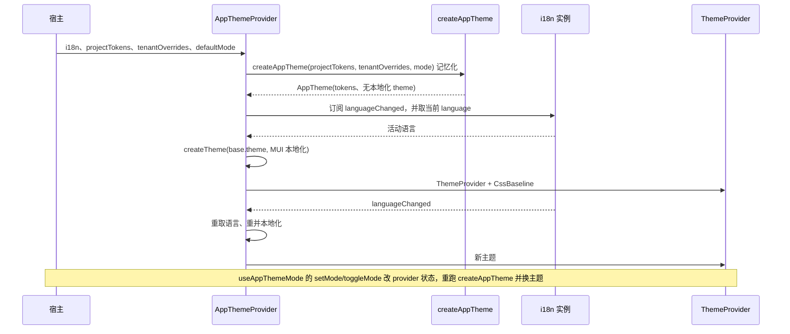

# ui-kit

## 职责

本包是平台第一个渲染 DOM 的包。它交付：

- **主题工厂**：`createAppTheme` 把合并后的 `@speed/tokens` token 树映射成一个 MUI v9 主题，并承载触摸设备上所有可点击目标的 44×44 下限（组件级 `styleOverrides`，见下文主题工厂一节）；`AppThemeProvider` 把主题、MUI 本地化联动与全局重置组成一个运行期。
- **受控组件**：`PageHeader`、`EmptyState`、`ConfirmDialog`、`SidePanel`、`FormField`、`FormLayout`、`DataTable`、`FileUploader`、`InlineError`、`InlineSuccess`、`WriteFeedbackRegion`、`ListSkeleton`、`AsyncSection`，外加跨表面的状态原语（`errorCodeOf`、`useWriteFeedback`、`visuallyHiddenSx`、`touchTargetSx`）。每个组件自带的文案来自 `ui-kit` 命名空间。

**受控契约是本包全部组件的共同契约**：每一份状态都由宿主持有、经 props 流入；组件把状态回显并抛出变更回调，从不取数、从不改数据、从不持业务状态——同一个组件因此在表单、弹窗与服务端渲染的页面里表现一致。唯一的交互局部状态是 `ConfirmDialog` 的双次确认待命（弹窗一关即复位），且必须能证明只在交互内存在；`SidePanel` 不持有任何状态，打开、忙碌与内容都由宿主经 props 给出；`useWriteFeedback` 的状态属于调用它的宿主组件，ui-kit 的组件仍不持有业务状态与写入结果。

`FileUploader` 不是这条契约的例外：队列由宿主持有的 `rows` 渲染，每次选取、取消、重试、移除都经回调上报；一次上传进行中是宿主状态、跑在宿主自己的传输代码里，组件从不持有一个 File 超过收到它的事件处理器。

### 非职责

- **不复刻 MUI 的 chrome。** MUI 的控件已渲染标签、帮助文本与 aria 接线；表单家族所谓的「统一错误显示」是渲染状态契约加 `FormLayout` 的间距骨架，不是第二套标签/错误渲染器。MUI v9 缺失的控件在它的原语上搭，不分叉它。
- **不认识业务、租户与权限。** 组件是受控且 props 驱动的，使它们能在一个不同的认证方案下照常工作。
- **不注册命名空间，不渲染 `I18nextProvider`。** 命名空间注册与 provider 树在宿主启动处；本包只消费已注册的 `ui-kit` 命名空间。包内除 test-utils 外不 import `registerNamespace`。
- **不发请求，不定义上传传输。** `FileUploader` 不认识 URL、signal 或 body；取数与传输是宿主的代码，且后端调用只经生成的 api-sdk。
- **不算布局。** `DataTable` 的列优先级与 `FormLayout` 的两列是按容器宽度键控的 CSS，不是 JS 的布局判定。

## 外部接口契约

### 主题工厂

```ts
export type AppThemeMode = 'light' | 'dark'

export interface AppTheme {
  readonly tokens: SpeedTokens   // 合并后的 token 树
  readonly theme: Theme          // 由它建成、无本地化的 MUI 主题
}
export function createAppTheme(projectTokens?: TokensOverride, tenantOverrides?: TokensOverride, mode?: AppThemeMode): AppTheme

export interface AppThemeModeControl {
  readonly mode: AppThemeMode
  readonly setMode: (mode: AppThemeMode) => void
  readonly toggleMode: () => void
}
export function useAppThemeMode(): AppThemeModeControl

export interface AppThemeProviderProps {
  readonly i18n: I18nInstance
  readonly projectTokens?: TokensOverride
  readonly tenantOverrides?: TokensOverride
  readonly defaultMode?: AppThemeMode
  readonly children?: ReactNode
}
export function AppThemeProvider(props: AppThemeProviderProps): JSX.Element
```

**分层是 token 树自己的纪律逐层叠加**：内置默认、项目层、租户层，每层都是对下一层的差异，经 token 包的 `deepMerge` 合并。`createAppTheme` 的覆写层入参按序应用（各为差异，可选，undefined 的层整层跳过），产出一份合并树与一份由它建成的主题。

**颜色模式是第三个入参，缺省 `'light'`。** 它设定 `palette.mode`；`'dark'` 时把背景、文本与分隔线改从中性色阶的深端取值——token 树只带一套表面色（浅色），而中性色阶是完整标度，故深色表面是同一套 token 换个方向读，而非第二份写死的调色板；六个语义角色两种模式共用（它们的色调自带 light/dark 变体）。缺省即原行为，未传该入参的宿主逐字节不受影响。

**返回的主题无本地化，是有意的**：MUI 的内建文本随语言变化，故本地化合并发生在渲染期——`AppThemeProvider` 把活动语言的 MUI 本地化并到基础主题上，或宿主自行 `createTheme(appTheme.theme, muiLocaleFor(i18n.language))`。

**`AppThemeProvider` 的契约**：它持有主题装配（记忆化，使一组覆写加一个模式只建一次合并树与主题）、MUI 本地化联动（订阅 `languageChanged`，使 MUI 内建文本随每次切换更新；本地化合并落在 token 映射之后，使 MUI 组件默认不覆盖 token）、颜色模式状态（活动模式是 provider 自己的状态，起始为 `defaultMode`，经 `useAppThemeMode` 暴露 `mode`／`setMode`／`toggleMode`；切换即重建主题，子树随之重渲染），以及全局重置（渲染一次主题感知的 `CssBaseline`）。它刻意不渲染 `I18nextProvider`、不注册命名空间：两者属于宿主启动。

**主题层承载触摸目标下限。** 粗指针（`pointer: coarse`）下，基础控件的最小宽高为 44×44：`Button`、`IconButton`、`Checkbox`、`Radio`、`Switch`、`ListItemButton` 各有一项，`ButtonBase` 一项覆盖其余以它为根的控件（`Tab`、`MenuItem`、`ToggleButton`、`CardActionArea`、`TableSortLabel` 等）；`InputBase` 的根与输入槽同时取下限，使字段的视觉框与真正接收点击的输入元素都达标；可点击的 `Chip` 按 `MuiChip-clickable` 类取下限，非交互的状态标签保持紧凑。各包由此继承下限，不依赖逐处指定。所有下限声明都嵌在 `@media (pointer: coarse)` 内，细指针下不产生任何声明，桌面观感不变。`Link` 在粗指针下同时改为居中的 `inline-flex` 盒，因为 `min-height` 对非替换行内盒不生效。主题管不到的裸元素——裸 `<a>`、宿主自有的可点元素——由 `touchTargetSx` 兜底（见核心数据结构）。

### 受控组件

每个组件都是 props 进、回调出；下表给出各自的输入与上报面，详细契约在类型与 README。

| 组件 | 输入 | 上报 |
|---|---|---|
| `PageHeader` | 标题（渲染为语义 `h1`）、可选面包屑、描述、动作区 | 面包屑链接的 `onClick` |
| `EmptyState` | `variant`（`empty`/`noPermission`/`error`）、可覆写的标题与描述、动作、图标、`headingLevel`（`h1`–`h6` 或 `none`：`none` 把标题渲染为非标题元素、整块成为 `role="status"` 区域，用于不该进入目录层级的空/状态占位） | 动作节点内的宿主回调 |
| `ConfirmDialog` | `open`、标题、消息、`variant`、`doubleConfirm`、标签、`confirmLoading` | `onConfirm`、`onCancel` |
| `SidePanel` | `open`、`title`（必填）、`description`、`size`（`medium` 或 `wide`，缺省 `medium`）、`busy`、`closeLabel`、子节点 | `onClose`、`onExited` |
| `FormField` | `name`、`control`、`rules`、`defaultValue`、`required`、`render` | 经 `render` 暴露的绑定字段状态 |
| `FormLayout` | `form`、子节点、`onSubmit`、动作行、间距、宽度、`columns` | `onSubmit`（经 RHF 校验后） |
| `DataTable` | `rows`、`columns`、`rowKey`、`loading`、`sort`、`filter`、选择、分页、空态文案 | `onSortChange`、`filter.onValueChange`、`onSelectionChange`、分页回调 |
| `FileUploader` | `rows`、选取/取消/重试/移除回调、`multiple`、`accept`、`allowDrop`、`disabled`、标签 | `onSelectFiles`、`onCancel`、`onRetry`、`onRemove` |
| `InlineError` | `code`、`resolve` | — |
| `InlineSuccess` | `message`（`null` 时静默，仍挂载一个裁剪的 `role="status"` 区域；`severity` 恒为 success） | — |
| `WriteFeedbackRegion` | `outcome`（`WriteOutcome` 或 `null`）、`resolve`（码到当前语言文本）、`sx`（作用于区域根容器，在根容器的默认上边距之后应用） | — |
| `ListSkeleton` | `label`、`rows` | — |
| `AsyncSection` | `pending`、`payload`、`empty`、`loading`、`errorState`、`emptyState`、`headingLevel`、`emptyHeadingLevel`（空占位自己的标题级，含 `none`）、`staleState`（`{description, retryLabel, onRetry}`，由调用方在最近一次刷新失败、数据在屏且读不在进行中时给出，缺省不渲染）、`children` | `errorState.onRetry`、`staleState.onRetry` |

### 写入反馈

```ts
export type WriteOutcome =
  | { readonly kind: 'success'; readonly message: string }
  | { readonly kind: 'failure'; readonly code: string }

export interface WriteFeedback {
  readonly outcome: WriteOutcome | null          // 作用域的槽；null 即空
  readonly pending: boolean                      // 作用域内有尝试在途
  readonly run: (attempt: () => Promise<string | null>) => Promise<void>   // 一次尝试
  readonly reset: () => void                     // 清空槽位，不取消在途的尝试
  readonly succeed: (message: string) => void    // 槽位换成一条成功文案
  readonly fail: (error: unknown) => void        // 槽位换成一个失败码，经 errorCodeOf 折叠
}
export function useWriteFeedback(): WriteFeedback

export interface WriteFeedbackRegionProps {
  readonly outcome: WriteOutcome | null
  readonly resolve: (code: string) => string     // 当前语言的码文本，各包绑定自己的解析器
  readonly sx?: SxProps<Theme>
}
export function WriteFeedbackRegion(props: WriteFeedbackRegionProps): JSX.Element
```

`run` 是一次尝试的标准形态：先 `reset`，把在途计数加一（`pending` 为真），再等待 `attempt`；`attempt` 以字符串落定即以该串调用 `succeed`，以 `null` 落定则不碰槽位（提权门控接管的写，见「写入的反馈」；槽位在本次尝试自己的 `reset` 之后为空，之后由重叠的尝试或 `succeed`、`fail` 填入的结果照旧保留），抛出则调用 `fail`；最后把在途计数减一。`run` 自身从不抛出。`succeed`、`fail` 与 `reset` 供不能表达为单个 promise 的流程使用，例如登录的逐步答复。`useWriteFeedback` 不取数、不认识 react-query，状态属于调用它的宿主组件，各回调在组件存续期内引用稳定。`WriteFeedbackRegion` 把槽渲染为 `InlineSuccess`（成功文案，始终挂载）与 `InlineError`（失败码，失败时才挂载），自己没有文案：成功文案由宿主翻译，失败文本经 `resolve` 取自各包自己的命名空间。各包把 `resolve` 绑定进自己的 `internal/` 包装，与 `InlineError` 的包装同形，调用点只传槽。区域的根容器默认带一个间距单位的上边距，成功与失败两部分共用它，调用方的 `sx` 在其后应用；调用点不单独渲染 `InlineSuccess`。使用条款见「写入的反馈」。

### 表单校验桥

```ts
export function zodFormResolver<TFieldValues extends FieldValues>(
  schema: ZodType<TFieldValues>,
): Resolver<TFieldValues>
export const INVALID_ERROR_KEY = 'form.invalid'
```

`zodFormResolver` 把一个 zod schema 适配成表单家族的 `react-hook-form` `Resolver`，接入 `FormField` 的校验错误契约：它只产出 `ui-kit` 命名空间的键（缺值折成 `form.required`，其余折成 `form.invalid`），因而字段错误随活动语言渲染、随语言切换更新，绝不透出 zod 自己的英文文本。zod 与 `react-hook-form` 一样是 peer：schema 由宿主构造，树里只能有一份 zod。

### 文案命名空间

```ts
export const UI_KIT_NAMESPACE = 'ui-kit'
export const uiKitResources: Readonly<Record<string, ResourceBundle>>
```

`UI_KIT_NAMESPACE` 是裸名 `ui-kit` 命名空间，宿主在启动处在 i18n 实例上注册一次：`registerNamespace(i18n, UI_KIT_NAMESPACE, uiKitResources)`。**每个组件自己渲染的每一条面向用户的字符串都在这里**，zh-CN 与 en-US 键集一致，由注册期校验与工作区的 `no-literal-text` 规则共同守住。组件按各自前缀取键（`pageHeader.*`、`emptyState.*`、`confirmDialog.*`、`sidePanel.*`、`form.*`、`dataTable.*`、`fileUploader.*`），经一个绑定到该命名空间的 hook 取文本，因而措辞随活动语言切换、无组件重挂。

**宿主内容与命名空间默认是两回事**：`EmptyState` 与 `ConfirmDialog` 出命名空间默认的标题与文本，可被 props 覆写；列头与单元格渲染器完全是宿主的翻译面；`PageHeader` 的可见内容（标题、描述、面包屑标签、动作）也是宿主内容，它唯一的自建字符串是面包屑导航地的可及名与折叠展开按钮的标签。**没有组件对宿主给的字符串调用 `t()`。** 宿主改写整套措辞的办法是在启动处注册自己的一对同键 bundle 到 `UI_KIT_NAMESPACE`，而不是改组件里的文本。

### 对外接口面

`createAppTheme`、`AppThemeProvider`、全部组件与类型、`UI_KIT_NAMESPACE` 与 `uiKitResources` 的导出签名是宿主据以编写的接口面。变更按 TypeScript 的源码语义分类：新增导出、新增可选字段是源码兼容的；删除导出或字段、改既有导出或字段的含义或名、改签名（参数或返回类型），是不兼容变更。把必选与可选互转按位置判：输入位（宿主提供的 prop 或参数）放宽兼容、收紧不兼容；输出位（宿主读取的返回类型或结果字段）相反——放宽为可选使读出的值成为 `T | undefined`，strictNullChecks 下只有在要求 `T` 处使用它的消费者无法编译（对可能为 undefined 的值做成员访问报 TS18048，赋给 `T` 或传入要求 `T` 的形参报 TS2322/TS2345），仅转发或在宽松处使用（模板串、比较、`??`、可选链）的消费者仍编译，故可能破坏消费者、是不兼容变更。公开面的一次改动要与代码、测试、README 与 AGENTS 在同一提交内落地。可加性是模板：`FormLayout` 的 `columns` 与 `DataTableColumn` 的 `priority` 都以 `undefined` 缺省等于原行为，使现有消费方逐字节不受影响。

## 依赖

| 依赖 | 种类 | 用途 |
|---|---|---|
| `react`、`react-dom` | peer（必需，^18 或 ^19） | 宿主持有 React 树；单份使交付组件里的 hook 与 `useTranslation` 安全 |
| `@mui/material` | peer（必需，^9） | 主题与组件；双份会分裂主题上下文 |
| `@emotion/react`、`@emotion/styled` | peer（必需，^11） | MUI 自身的运行期要求；emotion 上下文须与宿主共享 |
| `react-hook-form` | peer（必需，^7） | 表单家族的 `FormProvider`/`Controller` 需要树里只有一份 RHF |
| `zod` | peer（必需，^4） | 表单校验桥 `zodFormResolver` 的 schema 类型；schema 由宿主构造，树里只能有一份 zod |
| `@speed/tokens`、`@speed/i18n` | 依赖 | 本包映射的 token 树，与全部组件据以渲染的 i18n 实例与绑定 |

框架相邻的 peer 一律是 peer：新加一个框架相邻依赖要在同一提交里给出「单份拷贝」的论证。

## UML 图

主题与本地化的运行期：工厂记忆化地由 token 层建出无本地化主题，provider 订阅语言事件并按活动语言并入 MUI 本地化。图里画不出的约束：项目的覆写层各为差异、按序合并；本地化合并落在 token 映射之后，使 MUI 组件默认不覆盖 token；语言超出 MUI 映射表时落到 en-US 本地化而非抛错（渲染路径从不抛）；provider 不注册命名空间、不渲染 `I18nextProvider`。



## 核心数据结构

| 概念 | 类型 | 说明 |
|---|---|---|
| 主题产物 | `AppTheme` | 合并后的 `tokens` 与由它建成的无本地化 `theme` |
| 主题 provider 入参 | `AppThemeProviderProps` | i18n 实例、项目层、租户层、子树 |
| 表单字段渲染状态 | `FormFieldRenderState` | 绑定字段、`invalid`、`isTouched`、`required`、原始错误消息、解析后的显示文本 |
| 表单校验桥 | `zodFormResolver`、`INVALID_ERROR_KEY` | 把 zod schema 适配成 RHF `Resolver`，失败折成 `ui-kit` 命名空间的键 |
| 表格列 | `DataTableColumn` | 列 id、表头、可排序、对齐、宽度、优先级、折行策略（`cellWrap`）、单元格渲染器 |
| 表格排序/过滤/分页 | `DataTableSort`、`DataTableFilter`、`DataTablePagination` | 受控状态回显与回调 |
| 上传行 | `FileUploaderRow` | 行 id、文件名、状态、可选进度、可选错误文本 |
| 行状态 | `FileUploaderRowStatus` | `uploading`/`succeeded`/`failed` 的闭集 |
| 空态变体 | `EmptyStateVariant` | `empty`/`noPermission`/`error` 的闭集 |
| 隐藏样式 | `visuallyHiddenSx` | 裁剪技法的共享样式对象 |
| 触控目标样式 | `touchTargetSx` | 粗指针（`pointer: coarse`）下不小于 44×44 的共享样式对象，精细指针下不产生任何规则；主题覆盖不到的裸控件用它兜底，基础控件由主题层统一给出 |

**`AppTheme.tokens` 的写语义**：未被覆写触及的分支按标识与 `defaultTokens` 共享，因而仍是 token 包里的冻结节点——经它写值在严格模式抛错；被覆写重建的分支是归该结果独有的普通对象，写在那里是局部的。覆写经工厂自己的入参给。

## 核心算法与流程

### token 到 MUI 主题的映射

`createAppTheme` 把合并树映射到 MUI 的 `createTheme` 面：

| token 段 | MUI 主题槽 | 适配决策 |
|---|---|---|
| `color.semantic.<角色>` | `palette.<角色>` | 逐键：`main`/`light`/`dark`/`contrastText` |
| `color.neutral` | `palette.grey` | 数值步按号映射；A 系列别名复用同号步；无 MUI 槽的色阶只在 token 里 |
| `color.text`/`background`/`divider` | 同名槽 | 直接 |
| `typography.fontFamily.sans` | `typography.fontFamily` | 直接 |
| `typography` 字号/字重 | `typography` 排版角色 | 标题角色取大字号、紧行高、半粗；副标题与正文角色取相应字号、常规行高、中/常规字重；按钮、说明文字、上划线各自成角色；字号换算为以 16px 为基的 rem |
| `spacing.unit` | 主题间距基数 | token 单位即 MUI 单位：数值间距选项设置基数，`theme.spacing(n)` 即 `n × 单位` |
| `shape.borderRadius` | `shape.borderRadius` | 直接 |
| `breakpoints.values` | `breakpoints.values` | 直接（槽名是 MUI 自己的） |
| `zIndex.values` | `zIndex` | 直接（槽名是 MUI 自己的） |
| `shadows`（高度槽） | `theme.shadows`（25 项斜坡） | 每个高度用不高于它的最近 token 槽（向下取整，绝不超出设计标度），0 为 `none` |
| 触摸目标下限 | `theme.components.*.styleOverrides` | 粗指针下基础控件与可点击 `Chip` 的最小宽高为 44×44；细指针下不产生任何声明 |

阴影斜坡是把 token 的高度槽铺成 MUI 的 25 项数组的确定性做法：`ELEVATION_SLOTS` 按升序，逐高度推进到不高于当前高度的最近槽。MUI 9 接受任意长度的数组，25 项是有意为之，使消费方像对任何原生 MUI 主题一样按下标取 `theme.shadows`。

### 语言与本地化的联动

provider 把活动 MUI 语言保存在状态里，初始取实例当前语言，并在 effect 里既重取实例的实时语言、又订阅 `languageChanged`。恢复路径是必要的：子组件的 effect 先于父组件运行，一个在自身挂载 effect 里切换语言的子组件会在本监听器存在之前发事件；换上一个新实例不会为它创建时的语言发事件——两者都由「监听器每次（重）挂时重采纳实例的实时语言」找回。合并本地化经一个落到 en-US MUI 本地化的兜底完成，因为 `createI18n` 的受支持集由宿主选择，可能超出本包携带的 MUI 映射，而渲染路径不能抛错。

### 表单的校验错误文本

`FormField` 把 react-hook-form 的 `Controller` 折成一段状态：`render` 收到绑定字段与解析后的错误文本。`required` 是便捷开关，注入 `form.required` 规则（除非 `rules` 已带一条）并把自身暴露到渲染状态供宿主打星号。错误消息的解析规则只有一条：**是 `ui-kit` 命名空间的键则渲染其当前语言译文，否则原样渲染**——本包只拥有一个命名空间，只在该命名空间里解析键，从不猜另一个命名空间的码。`REQUIRED_ERROR_KEY` 是给自建规则的宿主用的导出键。

### 表格的受控与列优先级

`DataTable` 的 `rows` 契约是「宿主此刻想显示的行的集合」——组件从不重排或重切，因为隐式二次排序会打乱宿主刚取到的服务端分页，切片会藏起分页标签仍在计数的行。排序与过滤因此只是状态回显加回调。选择经 `onSelectionChange` 开启，表头复选框只切换当前渲染的行。进行中的加载只在 `rows` 为空时显示一行状态，从不中途清空内容。

**列优先级是可加的可选重排**：一列的 `priority` 在容器窄于该档宽度时隐藏它，档位取自 token 的共享断点标度——`low` 在较高档之上才显示、最先被丢弃，`high` 在最低档之上即显示、最后被丢弃；未设优先级的列永不隐藏，使未设任何优先级的宿主逐字节不受影响。隐藏是纯 CSS（单元格上一个容器查询键控的 `display`），不是 JS 布局判定。表格始终包在 MUI 的 `TableContainer` 里，其默认为包装器给 `overflow-x: auto`，是超出宽度的水平滚动兜底。

### 单元格的折行策略

`DataTableColumn.cellWrap` 是逐列的选择性声明：`'nowrap'` 让该列的表头与每一行的单元格保持单行——短值（状态、操作、结果）不会被拆成两行，标识符不会从中间断开；该列因而以完整的不可断宽度计入表格，容器更窄时由上述 `TableContainer` 的横向滚动承接。缺省或显式 `'wrap'` 保持常规文本流，供说明类长文本换行；策略是逐列选择，不是整表开关。`'nowrap'` 是唯一发出声明的取值，未声明的列逐字节不受影响。

### 双次确认与锁定窗口

`ConfirmDialog` 的危险变体可与 `doubleConfirm` 搭配：确认按钮第一次点击不确认，而是以「再次点击确认」的内建文本重标自身、仅第二次点击触发 `onConfirm`。待命点击还把确认按钮锁死一个 `CONFIRM_ARM_LOCKOUT_MS` 窗口（600ms）：平台双击阈值约 500ms，该窗口长于它，故真实双击的第二个事件总是落在禁用按钮上，而读过新标签的用户的点击按构造晚于窗口。锁定窗口覆盖确认按钮一处——取消、Escape 与背景点击全程可用。待命与锁定在弹窗关闭时复位（并取消挂起的重启用定时器），也在退出处理器里同步复位，使宿主在同一次状态批里关闭当前弹窗并打开下一个时，下一个从不继承未经其取得的待命。待命还有一条不可视通道：一个礼貌的实时区域在待命时填入「再次点击确认」文本，因为聚焦下的标签变化屏幕阅读器不一定播报。

### 侧边面板的地标、版式、关闭与焦点

`SidePanel` 是 MUI `Drawer` 的 temporary 变体，锚定右缘。容器取舍与层级的约束见 [layout](design-web-layout.md)，决策见 [ADR-web-side-panel-2026-10-17](../../../adr/adr-web-side-panel-2026-10-17.md)。

**地标与可及名。** MUI 在纸张上给出 `role="dialog"` 与 `aria-modal`；本组件以 `aria-labelledby` 指向标题，仅在给出 `description` 时以 `aria-describedby` 指向描述。标题渲染为 `h2`：页面的 `h1` 是 `PageHeader`，面板标题是其下一级，面板内各节的标题从 `h3` 起。关闭按钮的可及名取 `closeLabel`，缺省取命名空间的 `sidePanel.closeLabel`。

**版式。** 纸张占满视口高度，头部（标题、描述、关闭按钮）固定，内容区是面板内唯一的滚动层，内边距取主题间距。`size` 的 `medium` 取固定宽度 36rem，`wide` 取 52rem；视口在 `sm` 及以上取该宽度，`sm` 以下占满视口宽度。层级取 `theme.zIndex.modal`。内容区宽度是面板宽度减去内边距：两列版式的 `FormLayout` 在 `medium` 内容区内低于它两列起算的容器宽度（`sm`），收为一列；在 `wide` 内容区内高于它，保持两列。

**关闭。** 关闭按钮、Escape 与遮罩点击三条路径都只调用 `onClose`，组件从不自行把 `open` 置假；宿主可以在 `onClose` 里拒绝关闭，例如有未保存内容时先请求确认。`busy` 为真时关闭按钮禁用，Escape 与遮罩点击不上报，与 `ConfirmDialog` 的 `confirmLoading` 同形。`onExited` 在退出过渡结束时调用一次：此时背后的页面已恢复对辅助技术可见，面板仍在文档中，内容在紧随其后的渲染提交里卸载。

**内容的存续。** 面板关闭后内容卸载；退出过渡期间渲染宿主此刻传入的子节点，宿主在发出关闭的同一次状态批里清掉内容，面板就带着空白滑出，因此需要内容保留到退出结束的宿主在 `onExited` 里清理。面板内的局部状态随卸载丢失，需要跨关闭保留的状态（表单的字段值）由宿主持有。

**焦点。** 打开后焦点落入面板：MUI 的焦点陷阱把焦点放在纸张上，纸张是带可及名的 `dialog`，读屏读出面板名；Tab 在面板内循环；关闭后焦点回到打开面板的元素。面板打开期间再打开对话框时，焦点陷阱归属最上层的模态，对话框关闭后焦点回到面板内触发它的控件。

### 上传队列的 settle 播报

`FileUploader` 在把 `rows` 与上一次提交比对后决定播报：一行离开 `uploading` 进入已结算状态、或一行被追加时已是结算态（其传输整段跑在宿主代码里、从未渲染过 `uploading` 提交），就在一个礼貌的实时区域里播报一次，按渲染时的活动语言渲染。宿主挂载时种下的行、以 `uploading` 追加的行、只有进度变化的行、以及宿主把 `failed` 直接治愈成 `succeeded` 的行都保持安静。重复路径仍可闻：一次重试（`failed` 回到 `uploading`）先清空区域；一次结算的播报文本与在座文本相同（同名行再次同样结局）时先清空、下一 tick 再播报——实时区域只在文本变化时发声。播报的目标行必须是当前 `rows` 仍携带的行；宿主更新行集合可能落在挂起的再播报与其 0ms 定时器之间，故再播报在触发时重按最新已提交的 `rows` 校验目标行仍在且仍是被播报的结算态，否则保持沉默。进度分数在渲染时折叠进 `[0, 1]`（缺失为不确定条，NaN 与非有限值折算）。

### 异步读的状态分支

`AsyncSection` 拥有一个异步读的状态映射，使各表面不各自漂移：`pending` 渲染加载播报；已结算的 `payload` 为 `undefined` 渲染可重试的错误占位；`empty` 载荷渲染空占位（对不可能为空的表面可省）；否则内容回调以收窄后的载荷渲染。`ListSkeleton` 是列表读的进行中占位：它拥有播报契约（一个带可及名与 `aria-busy` 的 `role="status"` 区域）与行信封，行的长相由调用方给。

**读的刷新失败保留旧数据并标明。** 已有数据时的刷新失败（重新取、窗口重新聚焦、写入后的失效再取）不清空内容。`staleState` 由调用方在最近一次刷新失败、数据仍在屏且读不在进行中时给出，其余时候不给；组件自身不观察失败，与其余状态由调用方预先推导同形。`payload` 已结算（含空载荷）且 `staleState` 给出时，内容或空占位照常渲染，并在其上渲染一条 `role="alert"` 提示与重试动作：提示的严重度是 warning，与内容之间隔两个间距单位，`staleState.description` 为空串时仍渲染提示与重试动作。重试一发出，调用方撤回 `staleState`，提示在读进行中卸载；再次失败时提示重新挂载，使 `role="alert"` 再次被播报。`staleState.description` 是调用方的文案，须说明所示内容可能已过期。`staleState` 只用于不使旧数据失去意义的失败：权限被撤（403）这类失败由调用方以对应占位替换内容，不经 `staleState`。发起刷新的控件在读进行中禁用并标忙（定义见「写入的反馈」）。`staleState` 缺省不渲染，行为不变。

### 写入的反馈

一次写入的结果落在一个**反馈作用域**里：作用域是一个 `useWriteFeedback` 实例加一个 `WriteFeedbackRegion`，区域紧贴发起写入的控件组之下。**控件组**是共用同一个结果位置的一组写控件，通常是页面上一个带标题的节，含它的表单与表内行内动作；一张表及其行内动作是一组。这条说明是判据，各包按自己的页面应用它，具体划分在各包的设计文档里。下列条款绑定每一个以反馈作用域报告写入结果的界面，各 UI 包以自己的错误码解析器与文案使用它们（[ADR-web-write-feedback-2026-10-17](../../../adr/adr-web-write-feedback-2026-10-17.md)）。

**单槽，最后落定的结果为准。** 作用域持有至多一个结果。`reset` 清空槽位，不取消在途的尝试；`succeed(message)` 与 `fail(error)` 各自替换槽位，成功与失败因此不会同时出现在一个作用域里；`pending` 在任一在途尝试落定之前为真。每次尝试以 `reset` 开头，包括被客户端校验拒绝、没有发出请求的提交，使上一次的服务端失败不与本次的字段错误并存。上下文变化也调用 `reset`，判据是变化之后旧结果会被读成描述另一个上下文，例如租户或所选对象改变、翻页与刷新。结果不自动消失。`fail` 经 `errorCodeOf` 把任意抛出值折成码，文本由区域的 `resolve` 解析，不取 API 的 `message`。成功文案是调用 `succeed` 时刻的译文快照，不随之后的语言切换更新，语言切换也不是 `reset` 的触发；失败码经 `resolve` 随活动语言重新渲染。写入本身会切换语言的动作（偏好节的语言写入）在切换落定之后才调用 `succeed`，使确认文案取自新语言。

**写入在途时，改变其作用域上下文的控件禁用。** 在途尝试落定时照常替换槽位，不因 `reset` 被丢弃；改变某作用域上下文的控件（租户选择器、所选对象的选择器、翻页与刷新）因此在该作用域 `pending` 时禁用，使 `reset` 之后不会有先前上下文发起的尝试落定。

**发起控件在写入进行中禁用并标忙。** 禁用即原生 `disabled`，不响应再次点击；标忙即 MUI `Button` 的 `loading`，与 `ConfirmDialog` 的 `confirmLoading` 同形；写入落定后恢复可用。写入由对话框确认发起时，对话框关闭后焦点回到触发控件，该控件随即进入禁用，焦点落回 `body`；结果由区域播报，不强制把焦点移回。

**一个动作是一次尝试。** 一个动作含多次请求（批量保存）时，以一次 `run` 结算：`attempt` 内等待全部请求落定（`mutateAsync` 配 `Promise.allSettled`），不用逐次 `mutate` 的回调，因为同一个 mutation 观察者的逐次回调只对最后发起的请求触发，它的 `isPending` 也只反映那一次。有失败时以提交顺序中第一个失败项的码抛出，失败项的草稿保留，成功项的草稿清掉。重叠的动作各自 `await` 一次调用，在途状态取自作用域的 `pending`，不共用一个观察者的逐次回调、`isPending` 与 `variables`。

**被 401 步进不足拒绝的写由提权门控接管。** 这样的拒绝不是整次尝试的失败：`attempt` 把它交给门控后以 `null` 落定，不碰槽位、不调用 `fail`；挑战成功后的重放是一次新的 `run`；取消步进不留任何结果。

**成功确认是默认。** 每个由操作者发起、落定且无一失败的动作都落一条成功文案，由宿主翻译，并点明被改动的对象：表单级与批量写入点明种类（「设置已保存」），行内动作、矩阵单元与逐项写入进一步点明那一行或那一项。含多次请求的动作只在整个动作完成时落一条；部分落地的批量以失败结算，不为已落地的各项另落成功文案，操作者靠保留草稿的失败项与待保存计数得知尚未落地的部分；多步流程的中间答复不单独确认，确认落在流程完成处。结果本身是一次性值的动作（只交出一次的令牌、服务密钥）另有展示面板，面板不替代成功文案：它由宿主组件自持，渲染在同一控件组之下、与区域并列，不经槽，因此不受 `reset`、`succeed`、`fail` 影响；它是单个 `role="status"` 的 live region，带一个显式关闭的按钮，可及名含它所属的租户、提供方、域名或账户的显示名；保留到操作者显式关闭或离开页面；同一控件组再次发放时，新值替换旧值。

**队列式界面每项自成一个槽。** 一组并发、互相独立的逐项传输（`FileUploader` 的各行）不占用页面的反馈作用域：行的状态与错误是该行的结果，重试把行回到进行中即该行的 `reset`，失败文本取自错误码，结算播报点名文件；一次选取 N 个文件是 N 次尝试。

**一个反馈作用域同一时刻至多渲染一条整次尝试的失败横幅。** 区域里的失败横幅出现时，同一作用域内其它来源的失败横幅先被清掉，反之亦然；浏览器端通行密钥仪式的失败是这种来源的一例——它是客户端原因，文本取自本包 bundle 的键而非 API 码，不进槽。任一次尝试开始与任一次 `succeed` 都清掉该来源的横幅。

**`ConfirmDialog` 至迟在写入落定时关闭。** `ConfirmDialog` 没有自己的反馈区域，其写入的失败属于发起控件组的作用域；`confirmLoading` 只表示进行中的窗口。模态打开期间背后的页面对辅助技术不可见，失败不得只落在被模态遮蔽的区域；自带表单或流程的模态（步进对话框、侧边面板）把失败渲染在模态之内、贴近发起控件，满足同一条判据。对话框的「关闭」以退出过渡结束、背后页面重新可读为准：写入在退出过渡内落定时，失败横幅在退出结束之后才被读屏读到，窗口不超过一个过渡时长。

## 错误与失败语义

| 情形 | 表现 |
|---|---|
| `FormField` 既无 `control` prop 又不在 `FormLayout` 的 provider 之下 | 抛错，指明修法 |
| 校验错误消息是 `ui-kit` 命名空间的键 | 渲染其当前语言译文 |
| 校验错误消息不是 `ui-kit` 键（宿主本地化文本或宿主码） | 原样渲染，不猜别的命名空间 |
| 整次尝试失败经 `InlineError` 渲染 | 非空码渲染一个 `role="alert"` 的错误横幅，`null` 不渲染 |
| 整次尝试成功经 `InlineSuccess` 渲染 | 始终挂载一个 `role="status"` 区域；`null` 时裁剪静默，非空时填文播报 |
| `errorCodeOf` 收到非 ApiError 形状的抛出，含读取 `.code` 即抛出的值 | 坍缩到一个没有解析器会列出的码（`client.unknown`），由解析器渲染其未知兜底——操作只要抛了错就总有一个码可显示 |
| 活动语言超出 MUI 映射表 | provider 落到 en-US MUI 本地化，不抛错；应用自身译文仍按活动语言渲染 |
| `muiLocaleFor` 被直呼且标签未知 | 抛错（直呼者要主题装配期的响亮失败） |
| `SidePanel` 的 `busy` 为真时收到关闭请求（按钮、Escape、遮罩点击） | 不调用 `onClose` |
| `SidePanel` 关闭时打开它的元素已不在文档中（例如面板内移除了列表中的那一行） | 焦点落回 `body`；宿主在 `onExited` 里自行落点 |
| 同一反馈作用域内两次尝试几乎同时落定 | 后落定者占槽，先落定者的结果被替换 |
| `reset` 时作用域仍有尝试在途（改变上下文的控件未按规则禁用的宿主） | 在途尝试落定时照常替换槽位，不被丢弃 |
| `fail` 收到非 ApiError 形状的抛出 | 经 `errorCodeOf` 坍缩到 `client.unknown`，区域经 `resolve` 渲染其未知兜底 |
| 写入被 401 步进不足拒绝，`attempt` 交给门控后以 `null` 落定 | 不碰槽位、不调用 `fail`（槽位在本次尝试自己的 `reset` 之后为空）；重放是一次新的 `run` |
| `succeed` 或 `run` 以空串落定 | 槽位存该空串，成功区域渲染一条没有文字的横幅；调用方须传非空文案 |
| 语言切换时槽里是成功文案 | 文案保持调用 `succeed` 时的译文；失败码随活动语言重新渲染 |
| 写入在确认对话框的退出过渡内落定为失败 | 失败横幅在退出结束、背后页面重新可读之后才被读屏读到 |
| 进行中的发起控件进入禁用而失去焦点 | 焦点落回 `body`，结果由区域播报，不强制把焦点移回 |
| `AsyncSection` 已有数据、`staleState` 给出 | 内容保留，其上渲染陈旧提示与重试动作；重试发出后调用方撤回它，提示卸载，再次失败时重新挂载并再次播报 |

命名空间键集在工作区 `no-literal-text` 规则与注册期校验下守住；组件内不出现语言字面量。本包无降级、无重试面。

## 扩展点

- **新增一个组件。** 它自带的所有面向用户的字符串进 `ui-kit` 命名空间的双语文案，且在同一提交内给两门语言各加一键、结构一致；组件经绑定到该命名空间的 hook 取文本，不硬编码。
- **宿主改写措辞。** 在启动处向 `UI_KIT_NAMESPACE` 注册自己的一对同键 bundle（结构一致、措辞自定），`uiKitResources` 只是发布的默认。
- **表单错误解析的可插层。** `zodFormResolver` 提供的 zod → `react-hook-form` 解析桥就是这一档；校验错误契约是它接入的接缝：解析层可以产出任意消息，表单家族照契约渲染。宿主也可以自行实现该接缝（例如从生成类型派生自己的 schema）。
- **可加性的默认等于原行为。** 面向已有消费方新加一个行为时，把新行为的缺省设成原行为（`FormLayout.columns` 缺省单列、`DataTableColumn.priority` 缺省常显），使未传该 prop 的宿主逐字节不受影响。

## 实现状态

| 能力 | 状态 | 代码 |
|---|---|---|
| 主题工厂与分层合并（含颜色模式） | 已实现 | `web/packages/ui-kit/src/theme/createAppTheme.ts` `createAppTheme`、`AppTheme`、`AppThemeMode` |
| 主题provider、本地化联动与颜色模式 | 已实现 | `web/packages/ui-kit/src/theme/AppThemeProvider.tsx` `AppThemeProvider`、`useAppThemeMode`、`AppThemeModeControl` |
| 页头与空态 | 已实现 | `web/packages/ui-kit/src/components/PageHeader.tsx` `PageHeader`；`web/packages/ui-kit/src/components/EmptyState.tsx` `EmptyState` |
| 确认弹窗与双次确认 | 已实现 | `web/packages/ui-kit/src/components/ConfirmDialog.tsx` `ConfirmDialog`、`CONFIRM_ARM_LOCKOUT_MS` |
| 侧边面板 | 已实现 | `web/packages/ui-kit/src/components/SidePanel.tsx` `SidePanel` |
| 写入反馈（`useWriteFeedback`、`WriteFeedbackRegion`） | 已实现 | `web/packages/ui-kit/src/write-feedback.ts` `useWriteFeedback`、`WriteFeedback`、`WriteOutcome`；`web/packages/ui-kit/src/components/WriteFeedbackRegion.tsx` `WriteFeedbackRegion` |
| `AsyncSection` 的 `staleState` | 已实现 | `web/packages/ui-kit/src/components/InlineSuccess.tsx` `InlineSuccess`；`web/packages/ui-kit/src/components/AsyncSection.tsx` `AsyncSection`、`AsyncSectionStaleState` |
| 表单家族与校验错误契约 | 已实现 | `web/packages/ui-kit/src/components/FormField.tsx` `FormField`、`REQUIRED_ERROR_KEY`；`web/packages/ui-kit/src/components/FormLayout.tsx` `FormLayout`；`web/packages/ui-kit/src/internal/validation-error.ts` `resolveValidationError` |
| 表单校验的 zod 解析桥 | 已实现 | `web/packages/ui-kit/src/zod-form-resolver.ts` `zodFormResolver`、`INVALID_ERROR_KEY` |
| 数据表与列优先级 | 已实现 | `web/packages/ui-kit/src/components/DataTable.tsx` `DataTable`、`columnVisibilitySx` |
| 数据表按列的折行策略 | 已实现 | `web/packages/ui-kit/src/components/DataTable.tsx` `columnCellWrapSx` |
| 文件上传队列 | 已实现 | `web/packages/ui-kit/src/components/FileUploader.tsx` `FileUploader`、`FileUploaderRow` |
| 跨表面状态原语 | 已实现 | `web/packages/ui-kit/src/components/InlineError.tsx` `InlineError`、`errorCodeOf`；`web/packages/ui-kit/src/components/InlineSuccess.tsx` `InlineSuccess`；`web/packages/ui-kit/src/components/ListSkeleton.tsx` `ListSkeleton`；`web/packages/ui-kit/src/components/AsyncSection.tsx` `AsyncSection`；`web/packages/ui-kit/src/visually-hidden.ts` `visuallyHiddenSx`；`web/packages/ui-kit/src/touch-target.ts` `touchTargetSx` |
| 主题层触摸目标下限 | 已实现 | `web/packages/ui-kit/src/theme/touch-floor.ts` `touchFloorComponents`；`web/packages/ui-kit/src/theme/createAppTheme.ts` `createAppTheme` |
| 文案命名空间与双语资源 | 已实现 | `web/packages/ui-kit/src/resources.ts` `UI_KIT_NAMESPACE`、`uiKitResources`；`web/packages/ui-kit/src/locales/zh-CN.json`、`en-US.json` |
