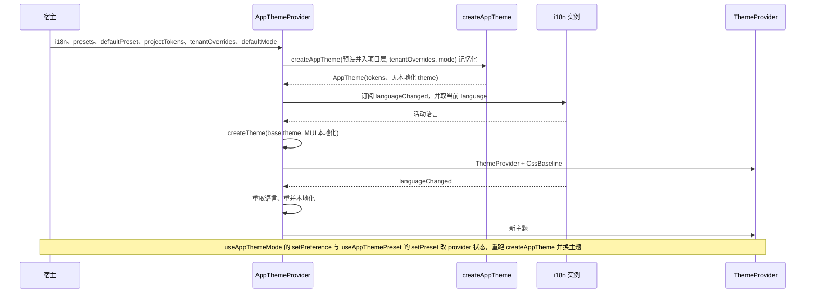

# ui-kit

ui-kit 是平台第一个渲染 DOM 的包，位于 tokens、i18n 与 theme-presets 之上，被能力 UI 包与装配壳取用。它拥有主题工厂、受控组件族、写入反馈、表单校验桥与命名空间资源。它不认识业务、[租户](../../../glossary.md)与权限，不定义传输，也不做页面与表单的 JS 布局判定。进入职责清单前的心智模型只有一句：组件是 props 进、回调出，状态由宿主持有，token 决定外观。

第一遍为“职责”“外部接口契约”的“主题工厂”“受控组件”与“写入反馈”，给出 token 到主题、props 到回调的主线；“依赖”“UML 图”“核心数据结构”随读随查，“核心算法与流程”按组件查阅，“错误与失败语义”“扩展点”作查表用。边界情形（受控契约、粗指针下的触摸下限、写入在途时的上下文控件、异步读的陈旧提示）是最后的自检项。

## 职责

本包是平台第一个渲染 DOM 的包。它交付：

- **主题工厂**：`createAppTheme` 把合并后的 `@speed/tokens` token 树映射成一个 MUI v9（[REF-mui](../../../references.md)）主题，并承载触摸设备上所有可点击目标的 44×44 下限、表面映射与页面基线（组件级 `styleOverrides`，见下文主题工厂一节）；`AppThemeProvider` 把主题、MUI 本地化联动、颜色模式、可选的主题预设层与全局重置组成一个运行期。
- **受控组件**：`PageLayout`、`PageHeader`、`SectionCard`、`ActionRow`（连同 `ActionButton`）、`EmptyState`、`ConfirmDialog`、`SidePanel`、`FormField`、`FormLayout`、`PhoneNumberField`、`DataTable`、`FileUploader`、`InlineError`、`InlineSuccess`、`WriteFeedbackRegion`、`AnnouncementRegion`、`ListSkeleton`、`AsyncSection`、`TotpQrCode`、`TotpEnrollmentPanel`，外加跨表面的状态原语（`errorCodeOf`、`httpStatusOf`、`useWriteFeedback`、`useActivationGuard`、`visuallyHiddenSx`、`touchTargetSx`）、电话号码的两部分组装辅助函数（`toE164`、`validatePhoneNumber`、`defaultPhoneCountry` 等）、邮箱地址规则（`parseEmailAddress`、`EMAIL_ADDRESS_MAX_BYTES`）、刷新动作的一对（`RefreshButton` 与 `usePageRefresh`／`pageRefreshRead`）、一次值交接的一对（`CopyButton`、`OneTimeValuePanel`）、两个显示偏好上下文（`DisplayTimeZoneProvider`／`useDisplayTimeZone`、`PhoneCountryDefaultProvider`／`usePhoneCountryDefault`）与显示时区的时间格式化入口（`useResolvedTimeZone`、`useFormatInstant`）。除 TOTP 登记的一对外，每个组件自带的文案来自 `ui-kit` 命名空间；`TotpQrCode` 与 `TotpEnrollmentPanel` 的全部文案与可及名由调用方经 props 传入。

**受控契约是本包全部组件的共同契约**：每一份状态都由宿主持有、经 props 流入；组件把状态回显并抛出变更回调，从不自带传输取数、从不改数据、从不持业务状态，同一个组件因此在表单、弹窗与服务端渲染的页面里表现一致。交互局部状态只出现在必须能证明它只在交互内存在的组件里，例如 `ConfirmDialog` 的双次确认待命（弹窗一关即复位）与 `PhoneNumberField` 的国际号码草稿和触碰标记；`SidePanel` 不持有任何状态，打开、忙碌与内容都由宿主经 props 给出；`useWriteFeedback` 的状态属于调用它的宿主组件，ui-kit 的组件仍不持有业务状态与写入结果。唯一的读接口是刷新动作的一对：`usePageRefresh` 调用宿主交来的查询句柄的 `refetch`，只按结构读取句柄，本包不 import 查询客户端、api-client 或任何传输；`CopyButton` 读剪贴板 API 在浏览器本地，不经网络。两个显示偏好 provider 只转交宿主的取值，自身不持状态、不做校验。TOTP 登记的一对同样只收宿主解析好的值与文案：它不解析 `otpauth://`、不读命名空间、不做网络或存储副作用；手动入口的展开是唯一交互局部状态，随组件卸载复位。

`FileUploader` 不是这条契约的例外：队列由宿主持有的 `rows` 渲染，每次选取、取消、重试、移除都经回调上报；一次上传进行中是宿主状态、跑在宿主自己的传输代码里，组件从不把一个 File 持有到收到它的事件处理器之后。

### 非职责

- **不复刻 MUI 的 chrome。** MUI 的控件已渲染标签、帮助文本与 aria 接线；表单家族所谓的“统一错误显示”是渲染状态契约加 `FormLayout` 的间距骨架，不是第二套标签/错误渲染器。MUI v9 缺失的控件在它的原语上搭，不另立分支。
- **不认识业务、租户与权限。** 组件是受控且 props 驱动的，使它们能在一个不同的认证方案下照常工作。
- **不注册命名空间，不渲染 `I18nextProvider`。** 命名空间注册与 provider 树在宿主启动处；本包只消费已注册的 `ui-kit` 命名空间。包内除 test-utils 外不 import `registerNamespace`。
- **不定义传输。** `FileUploader` 不认识 URL、signal 或 body；取数与传输是宿主的代码，且后端调用只经生成的 api-sdk。`usePageRefresh` 只调用宿主持有的读句柄的 `refetch`，不 import 查询客户端或 api-client，也不自行发出请求。
- **不做 JS 布局判定。** 本包交付页框 `PageLayout` 与表单骨架 `FormLayout`，两者的高度、间距与响应式断点都是 CSS；`DataTable` 的列优先级与 `FormLayout` 的两列是按容器宽度键控的 CSS，不是 JS 的布局判定。

## 外部接口契约

### 主题工厂

```ts
export type AppThemeMode = 'light' | 'dark'
export type AppThemeModePreference = AppThemeMode | 'system'

export interface AppTheme {
  readonly tokens: SpeedTokens   // 合并后的 token 树
  readonly theme: Theme          // 由它建成、无本地化的 MUI 主题
}
export function createAppTheme(projectTokens?: TokensOverride, tenantOverrides?: TokensOverride, mode?: AppThemeMode): AppTheme

export interface AppThemeModeControl {
  readonly mode: AppThemeMode                       // 已解析，可直接用于 createAppTheme
  readonly preference: AppThemeModePreference       // 用户选择，可能是 'system'
  readonly setPreference: (preference: AppThemeModePreference) => void
}
export function useAppThemeMode(): AppThemeModeControl

export interface AppThemePresetControl {
  readonly preset: string                       // 当前预设 id，无预设时为 'default'
  readonly setPreset: (id: string) => void      // 未知 id 忽略
}
export function useAppThemePreset(): AppThemePresetControl

export interface AppThemeProviderProps {
  readonly i18n: I18nInstance
  readonly projectTokens?: TokensOverride
  readonly tenantOverrides?: TokensOverride
  readonly defaultMode?: AppThemeModePreference
  readonly presets?: readonly ThemePreset[]     // 可切换的预设货架；缺席或为空即不叠预设层
  readonly defaultPreset?: string               // 起始预设 id；不在货架里时回退第一项
  readonly children?: ReactNode
}
export function AppThemeProvider(props: AppThemeProviderProps): JSX.Element
```

**分层是 token 树自己的纪律逐层叠加**：内置默认、预设、项目层、租户层，每层都是对下一层的差异，经 token 包的 `deepMerge` 合并。`createAppTheme` 的覆写层入参按序应用（各为差异，可选，undefined 的层整层跳过），产出一份合并树与一份由它建成的主题。`createAppTheme` 的公开签名不因预设改变：`presets` 只进 provider，provider 在调用它之前把活动预设并到项目层之前：`activePreset.tokens` 先于 `projectTokens` 合并，故客户的品牌色始终压过预设，租户层仍最高。

**活动预设是 provider 的局部状态，与颜色模式正交。** `presets` 缺席或为空时不叠任何预设层，`useAppThemePreset` 报 `'default'`；`defaultPreset` 不在货架里时取 `presets[0].id`，不抛错，因为部署配置写错不该白屏。`setPreset` 只接受货架里的 id，未知 id 忽略。与 `useAppThemeMode` 同样，没有 provider 时 `useAppThemePreset` 抛错，不做静默 no-op。切换预设即重建主题，子树随之重渲染。`@speed/theme-presets` 对本包是类型依赖：只 `import type { ThemePreset }`，预设数据不进运行时。

**等宽字体走模块扩充。** MUI 的排版没有等宽槽，而 token 树有 `typography.fontFamily.mono`；工厂经 `declare module '@mui/material/styles'` 给它加一个 `fontFamilyMono` 槽并总是填入合并后的取值（主题选项里该字段可选，宿主自行组合主题时不强制）。取值方式与 `fontFamily` 相同，含 `sx` 回调。

**颜色模式是第三个入参，缺省 `'light'`。** 它设定 `palette.mode`；`'dark'` 时把背景与文本改从中性色阶的深端取值，因为 token 树只带一套表面色（浅色），而中性色阶是完整标度，故深色表面是同一套 token 换个方向读，而非第二份写死的调色板。六个语义角色同守这条纪律：`main` 是浅色表面上的色调，`light` 是给深色表面的色调，故 `'dark'` 时每个角色的 `main` 取它的 `light` 色调、`contrastText` 取中性色阶的深端（900），使填充控件的标签在该底色上仍可读（对比度判据由测试钉住）。浅色模式下六个角色统一用 token 的 `contrastText`（白色）；warning、info、success 的 `main` 因此取各自的 700 调，使同一个值既作填充底色、又作提示与状态文案的文字色时都满足 4.5:1（[ADR-web-light-contrast](../../../adr/adr-web-light-contrast.md)）。MUI 的悬停填充读角色的 `dark` 槽，token 的最深一档在该标签下不足 4.5:1，故 `'dark'` 时的 `dark` 取 `light` 向白色混入 20% 的色调，既保留悬停步进又守住标签对比度。只覆写 `main` 不会作用于深色模式：给品牌换色需同时给出 `light`。缺省即原行为，未传该入参的宿主逐字节不受影响。

**偏好与已解析模式是两层。** `createAppTheme` 只接受已解析的 `AppThemeMode`；`'system'` 归 provider 解析：它在偏好为 `'system'` 期间读 `prefers-color-scheme: dark` 并订阅其变化，把结果作为 `mode` 交给工厂。引擎没有 `matchMedia`，构造或读取抛错，以及服务端渲染的快照，都解析为 `'light'`。偏好与模式是两份状态，主题预设与它们正交：改偏好只换 `mode`，改预设只换 token 层。

**返回的主题无本地化，是有意的**：MUI 的内建文本随语言变化，故本地化合并发生在渲染期：`AppThemeProvider` 把活动语言的 MUI 本地化并到基础主题上，或宿主自行 `createTheme(appTheme.theme, muiLocaleFor(i18n.language))`。

**`AppThemeProvider` 的契约**：它持有主题装配（记忆化，使一组覆写加一个模式只建一次合并树与主题）、MUI 本地化联动（订阅 `languageChanged`，使 MUI 内建文本随每次切换更新；本地化合并落在 token 映射之后，使 MUI 组件默认不覆盖 token）、颜色模式状态（provider 持有偏好，起始为 `defaultMode`；`useAppThemeMode` 暴露已解析的 `mode`、偏好 `preference` 与 `setPreference`；偏好为 `'system'` 时按系统偏好解析并订阅其变化，改偏好即重建主题，子树随之重渲染），以及全局重置（渲染一次主题感知的 `CssBaseline`）。它刻意不渲染 `I18nextProvider`、不注册命名空间：两者属于宿主启动。

**主题层承载触摸目标下限。** 粗指针（`pointer: coarse`）下，基础控件的最小宽高为 44×44：`Button`、`IconButton`、`Checkbox`、`Radio`、`Switch`、`ListItemButton` 各有一项，`ButtonBase` 一项覆盖其余以它为根的控件（`Tab`、`MenuItem`、`ToggleButton`、`CardActionArea`、`TableSortLabel` 等）；`InputBase` 的根与输入槽同时取下限，使字段的视觉框与真正接收点击的输入元素都达标；可点击的 `Chip` 按 `MuiChip-clickable` 类取下限，非交互的状态标签保持紧凑。各包由此继承下限，不依赖逐处指定。所有下限声明都嵌在 `@media (pointer: coarse)` 内，细指针下不产生任何声明，桌面观感不变。`Link` 在粗指针下同时改为居中的 `inline-flex` 盒，因为 `min-height` 对非替换行内盒不生效。主题管不到的裸元素（裸 `<a>`、宿主自有的可点元素）由 `touchTargetSx` 兜底（见核心数据结构）。

**主题层同时承载表面映射。** token 的 `surface` 段经工厂解析为 `theme.surface.<角色>`，再经 `theme.components` 落到具体槽位；样式与 `useTheme()` 读同一个值，不会不一致。解析按继承契约把缺省字段换成主题已有的槽：`page` 取 `background.default`，`container` 与 `overlay` 取 `background.paper`，边框取 `divider`（角色给出 `borderColorDark` 时，深色模式取它、浅色模式仍取 `borderColor`），`header` 取中性色阶（浅色 50、深色 900）。角色带 `opacity` 时，解析器把已解析的填充色按该 alpha 转成 `rgba(...)`，明暗两种模式各自转换；填充不是 `#RRGGBB` 时原样保留。`theme.surface` 与组件覆写读的是同一个解析结果，不会漂移。`SurfaceTheme` 是该值的类型。类型增强声明在主题工厂模块 `theme/createAppTheme.ts`（与等宽字体栈的增强同处），不放在内部模块 `theme/surface.ts`：按产物声明编译的宿主只加载包入口 `.d.ts` 图可达的模块，增强声明落在内部模块时对该类宿主不可见，`theme.surface` 会被读成未知属性。组件覆写为：`MuiCard` 的 `variant="outlined"` 取 container；`MuiDialog`、`MuiMenu`、`MuiPopover` 的 paper、`MuiTooltip` 的 tooltip 与 temporary `MuiDrawer` 的 paper 取 overlay；permanent 与 persistent 抽屉的 paper 取 container；`MuiTableCell.head` 取 header。`MuiPaper.root` 不设覆写，`MuiTableContainer` 不设表面。主题组件表按 `Mui*` 槽深合并：触摸目标下限、表面覆写与页面基线落在同一个组件上时，各组声明都保留。

**页面基线绘制 `page` 表面、文字辉光与画布。** `MuiCssBaseline` 的 body 取 `theme.surface.page.fill` 为背景色；`typography.textGlow` 给出时取同一 body 的 `textShadow`；`color.background.canvas` 给出时按活动模式取 `light` 或 `dark` 的止色，渲染为 `linear-gradient(160deg, from, to)` 与 `background-attachment: fixed`。缺省的页填充等于 `palette.background.default`，另两项缺席时不发声明，故未设置它们的宿主逐字节不变。**绘制次序：背景图在背景色之上**，不透明的画布会盖住页填充；需要页填充参与合成时画布止色自带透明度，以画布作为页面底色的预设不设 `surface.page` 填充。三项与触摸目标、焦点环、表面覆写、分隔线一起经 `mergeThemeComponents` 按槽深合并。

### 受控组件

每个组件都是 props 进、回调出；下表给出各自的输入与上报，详细契约在类型与 README。

| 组件 | 输入 | 上报 |
|---|---|---|
| `PageLayout` | `title`（渲染为页面的 `h1`）、`description`、`breadcrumbs`、`actions`、子节点、`sx` | 面包屑链接的 `onClick` |
| `PageHeader` | 标题（渲染为语义 `h1`）、可选面包屑、描述、动作区 | 面包屑链接的 `onClick` |
| `SectionCard` | `title`、`icon`、`description`、`actions`、`headingLevel`（`h2`～`h6`，缺省 `h2`）、`flushContent`、`contentAligned`（缺省 `true`）、子节点、`sx` | — |
| `ActionRow`／`ActionButton` | `ActionRow`：`children`（按显示顺序，主操作在后）、`size`（`medium`/`small`，缺省 `medium`）、`sx`；`ActionButton`：`emphasis`（`primary`/`secondary`，缺省 `secondary`）、`tone`（`default`/`danger`，缺省 `default`）、`size`（缺省继承所在行）、`busy`（本按钮发起的动作在途）、`unavailable`（前置条件不满足，或作用域有写入在途而本按钮会改变其上下文）、`unavailableReason`（不可用的原因文本）、`unavailableDescribedBy`（页面上已有说明文本的 id）、其余 MUI 按钮 props（不含 `variant`、`color`、`disabled`、`loading`） | 按钮自身的 `onClick` 等宿主回调；`busy` 或 `unavailable` 为真时不调用 |
| `EmptyState` | `variant`（`empty`/`noPermission`/`error`）、可覆写的标题与描述、动作、图标、`headingLevel`（`h1`～`h6` 或 `none`：`none` 把标题渲染为非标题元素、整块成为 `role="status"` 区域，用于不该进入目录层级的空/状态占位） | 动作节点内的宿主回调 |
| `ConfirmDialog` | `open`、标题、消息、`variant`、`doubleConfirm`、标签、`confirmLoading`、`children`（渲染在消息之后、不进 `aria-describedby`）、`confirmDisabled`（确认按钮呈不可用：可聚焦、激活被吞掉；不改动双次确认的待命与锁定逻辑）、`confirmDisabledReason`（`confirmDisabled` 成立时确认按钮的原因文本） | `onConfirm`、`onCancel` |
| `SidePanel` | `open`、`title`（必填）、`description`、`size`（`medium` 或 `wide`，缺省 `medium`）、`busy`、`closeLabel`、`actions`（固定的底部操作行，位于滚动内容之外）、子节点 | `onClose`、`onExited` |
| `FormField` | `name`、`control`、`rules`、`defaultValue`、`required`、`render` | 经 `render` 暴露的绑定字段状态 |
| `FormLayout` | `form`、子节点、`onSubmit`、动作行、间距、宽度、`columns` | `onSubmit`（经 RHF 校验后，[REF-react-hook-form](../../../references.md)） |
| `PhoneNumberField` | `country`、`nationalNumber`、国家/电话两个标签、帮助文本、`disabled`、`readOnly`（写入进行中使用：两部分都可聚焦、值不可改）、`showValidationError`、自动填充标记、`preferredCountries`（置顶列出的国家码，按给定次序；缺省即原次序） | `onCountryChange`、`onNationalNumberChange`；帮助文本**平铺在整行之下**（国家/地区选择器与号码字段之下），不挂在号码字段的 helper 上；逐国家的校验错误仍出现在号码字段下方并替换帮助文本；两者都以 `aria-describedby` 关联到号码输入 |
| `DataTable` | `rows`、`columns`、`rowKey`、`loading`、`sort`、`filter`（可选 `label`／`placeholder`）、选择、分页、空态文案、`rowVerticalAlign`（整行纵向对齐，缺省 MUI 的居中）、`pinLastColumn`（可选：钉住最后一列，仅在表格实际溢出容器时生效）、`ariaLabel`／`ariaLabelledBy`（替换命名空间默认的可及名） | `onSortChange`、`filter.onValueChange`、`onSelectionChange`、分页回调 |
| `FileUploader` | `rows`、选取/取消/重试/移除回调、`multiple`、`accept`、`allowDrop`、`disabled`、标签 | `onSelectFiles`、`onCancel`、`onRetry`、`onRemove` |
| `InlineError` | `code`、`resolve`（第二个入参是等待秒数）、`retryAfterSeconds`（拒绝声明的等待，整秒；可及句按它固定）、`liveRetryAfterSeconds`（宿主倒数时的剩余整秒；可见句随它变化，到零只去掉数字）、`detail`（渲染在同一横幅内的补充内容） | — |
| `InlineSuccess` | `message`（`null` 时静默，仍挂载一个裁剪的 `role="status"` 区域；`severity` 恒为 success） | — |
| `WriteFeedbackRegion` | `outcome`（`WriteOutcome` 或 `null`）、`resolve`（码到当前语言文本，第二个入参是拒绝声明的等待秒数）、`sx`（作用于区域根容器，在根容器的默认上边距之后应用） | — |
| `AnnouncementRegion` | `message`（`null` 或空串即空区域）、`politeness`（`status` 缺省，或 `alert`）、`id`、`sx` | —（区域自身不发起动作，只播报调用方给的文本） |
| `ListSkeleton` | `label`、`rows` | — |
| `AsyncSection` | `pending`、`payload`、`empty`、`loading`、`errorState`、`emptyState`、`headingLevel`、`emptyHeadingLevel`（空占位自己的标题级，含 `none`）、`staleState`（`{description, retryLabel, onRetry}`，由调用方在最近一次刷新失败、数据在屏且读不在进行中时给出，缺省不渲染）、`refusedState`（`{title, description}`，调用方判定为拒绝后给出；非 pending 时替换内容且不提供重试）、`children` | `errorState.onRetry`、`staleState.onRetry` |
| `HumanVerification` | `scope`（`phone`／`other`）、`gate`（发现文档的 `{phone, other}`，本面缺省、不需证明或 `off` 时不渲染）、`proof`、`status`（`idle`／`working`／`ready`／`failed`）、`captcha`（本面的自托管人机验证码挑战）、`audioRetryAfterSeconds`（无障碍入口被拒绝时声明的等待秒数）、`onToken`、`onRetry`、`onRefreshCaptcha`、`onRequestAudio`、`disabled` | `onToken`（Turnstile token 或 captcha 的 `<挑战标识>.<答案>`，过期或失败时 null，[REF-cloudflare-turnstile](../../../references.md)）、`onRetry`（PoW 失败后重试）、`onRefreshCaptcha`（换取当前选择下的下一个挑战，不指定形式）、`onRequestAudio`（无障碍入口：显式请求音频替代） |
| `RefreshButton` | `busy`、`disabled`、`writePending`、`describedBy`、`disabledReason`、`ariaLabel`、`label`（可见文字，缺省取命名空间键） | `onClick` |
| `CopyButton` | `value`、`label`（可及名）、`copiedLabel`（播报文本）、`visibleLabel`（给出即渲染文字按钮）、`pinned` | 写入本机剪贴板并播报（不经网络） |
| `OneTimeValuePanel` | `message`、`value`、`copyLabel`、`details`（在主值旁附带的带标签详情，每条各有自己的值、复制控件与文案）、`closeLabel`、`closeAriaLabel` | `onClose`（状态归调用方） |
| `TotpQrCode` | `uri`（`otpauth://` 地址）、`label`（图片可及名）、`size`（渲染边长，缺省 192 CSS 像素） | —（空地址或编码器无法表示的地址不渲染） |
| `TotpEnrollmentPanel` | `otpauthUri`、`qrLabel`、`guidance`、`manualToggleLabel`、`secret`（`{value, display?}`）、`secretLabel`、`copyLabel`、`copiedLabel`、`copyVisibleLabel`、`parameters`（带标签的算法、位数、周期行）、`codeLabel`、`code`、`onCodeChange`、`busy`、`secondaryAction`、`primaryAction` | `onCodeChange`；复制经内部 `CopyButton` 写入本机剪贴板并播报；两个动作由调用方持有 |
| `DisplayTimeZoneProvider`／`PhoneCountryDefaultProvider` | 时区名或 `undefined`／国家码或 `undefined` | —（经 `useDisplayTimeZone`／`usePhoneCountryDefault` 读取） |

`AnnouncementRegion` 是单条播报的实时区域。`politeness="status"`（缺省）渲染 `role="status"` 与 `aria-live="polite"`；`politeness="alert"` 只带 `role="alert"`，由角色给出 assertive 设定，不另写 `aria-live`（两处同时写会被部分读屏播报两次）。两者都带 `aria-atomic="true"`，整块内容被读出，而不是只读变化的节点。区域始终留在文档里，每次变化先插入一个空的文本节点，两帧动画之后才写入文本：实时区域只播报它出现之后的内容变化，与文本同帧挂载的区域是静默的；由此写入落在已被辅助技术收进可及树的区域上。消息变化时文本节点以世代为键重挂，前一个节点的卸载取消它挂起的两帧；组件卸载同样取消。根元素在持有已写入文本时带 `data-announcement-written`，宿主的可见外壳据此经 `:has()` 裁掉自己，直到文本真的到位。浏览器不支持 `:has()` 时，带该选择器的整条样式规则失效，外壳不被裁剪，文本写入前的约两帧里可见外壳显示一个空框，播报本身不受影响。外观全由调用方的 `sx` 决定，组件不加自己的视觉规则。

### 页框

`PageLayout` 是一个路由页渲染内容的页框：`PageHeader`（标题、描述、面包屑、动作区）在上，页面内容在下，两者相隔一个主题间距步长。页框是 inline-size 容器，页面自己的响应式规则按它实际得到的宽度解析，而不是视口宽度：外壳导航展开或收起、面板变窄都改变这个宽度，而不改变视口。

页框只拥有页面的纵向节奏与这一包含上下文：它占满宿主外壳给出的宽度，不自设宽度上限：外边距与版心归外壳，同一产品的两个页面因此落在同一条导轨上，并在导航收起时一起变宽。只有页头的页面不传子节点。

### 人机验证块

`HumanVerification` 只渲染宿主交来的状态，不发请求、不持有会话、不求解。`scope` 选择本块服务的发送面；`gate` 是发现文档的整份门槛（`{phone, other}`），本面缺省、`required` 为假或 `provider` 为 `off` 时不渲染。`turnstile` 以显式渲染模式加载 Cloudflare 的控件脚本（每页一次），控件以门槛在发现文档里给出的 `action` 渲染，把控件交出的 token 经 `onToken` 上交，并在宿主消费证明、`proof` 清空后重置控件；脚本被拦截或加载失败时不渲染自造的文案，宿主因没有 token 而保持发送不可用。`pow` 显示求解中、已完成或失败，失败时经 `onRetry` 请求重试；求解本身与证明的寿命在 auth-core，本包不 import 它。`captcha` 渲染宿主交来的挑战：数字图片形式显示图片与答案输入框，滑块形式把背景与拼图放在原生 `range` 输入之后（方向键移动、`End` 到边缘，因此键盘可操作），音频形式以播放控件读出数字作为屏幕阅读器的替代，出现时接收焦点并以 `lang` 标出朗读所用的活动语言；三种形式共用一个刷新控件与一个失败后重试；图片与音频经各自的答案控件交出 `<挑战标识>.<答案>`，滑块在松开或按 Enter 时把偏移量交出。图片与滑块由服务端轮换，块不提供二者之间的选择；唯一指名的形式是无障碍入口 `onRequestAudio`，它在当前挑战不是音频时渲染，`audioRetryAfterSeconds` 给出被拒绝时声明的等待时该入口被按住并显示秒数，刷新控件不受影响；音频形式在服务端按来源单独计数、上界比轮换形式更严，这次拒绝只关住无障碍入口，不涉及在屏的视觉挑战。滑块背景随容器缩小时，拼图与偏移量按同一比例缩放，查看者对齐的位置仍映射回服务端比较的自然宽度偏移量。`disabled` 在宿主发送在途时置上，控件同时不接受指针事件。

### 写入反馈

```ts
export type WriteOutcome =
  | { readonly kind: 'success'; readonly message: string }
  | {
      readonly kind: 'failure'
      readonly code: string
      readonly retryAfterSeconds?: number   // 拒绝声明的等待，整秒
      readonly waitUntil?: number           // 该等待的截止时刻（epoch 毫秒），落定时记录
    }

export interface WriteFeedback {
  readonly outcome: WriteOutcome | null          // 作用域的槽；null 即空
  readonly pending: boolean                      // 作用域内有尝试在途
  readonly run: (attempt: () => Promise<string | null>) => Promise<void>   // 一次尝试
  readonly reset: () => void                     // 清空槽位，不取消在途的尝试
  readonly succeed: (message: string) => void    // 槽位换成一条成功文案
  readonly fail: (error: unknown) => void        // 槽位换成一个失败码，经 errorCodeOf 折叠
}
export function useWriteFeedback(): WriteFeedback

export interface WriteFeedbackRegionProps {
  readonly outcome: WriteOutcome | null
  readonly resolve: (code: string, retryAfterSeconds?: number) => string     // 当前语言的码文本与等待秒数，各包绑定自己的解析器
  readonly sx?: SxProps<Theme>
}
export function WriteFeedbackRegion(props: WriteFeedbackRegionProps): JSX.Element

export interface ActivationGuardState {
  readonly busy: boolean            // 本控件发起的动作在途
  readonly unavailable?: boolean    // 前置条件不满足，或作用域写入在途而控件会改变其上下文
}
export function useActivationGuard<A extends readonly unknown[]>(
  handler: (...args: A) => void,
  state: ActivationGuardState,
): (...args: A) => void
```

`run` 是一次尝试的标准形态：先 `reset`，把在途计数加一（`pending` 为真），再等待 `attempt`；`attempt` 以字符串落定即以该串调用 `succeed`，以 `null` 落定则不碰槽位（加强认证门控接管的写，见“写入的反馈”；槽位在本次尝试自己的 `reset` 之后为空，之后由重叠的尝试或 `succeed`、`fail` 填入的结果照旧保留），抛出则调用 `fail`；最后把在途计数减一。`run` 自身从不抛出。`succeed`、`fail` 与 `reset` 供不能表达为单个 promise 的流程使用，例如登录的逐步答复。`useWriteFeedback` 不取数、不认识 react-query（[REF-tanstack-query](../../../references.md)），状态属于调用它的宿主组件，各回调在组件存续期内引用稳定。宿主可用 `WriteFeedbackPageProvider` 提供页面级协调：作用域挂载时向它登记自己的清除回调，任一作用域写入时由它清空同页其余作用域的槽（见“写入的反馈”的“单槽”）。一次失败的槽还带上该次拒绝声明的等待：`retryAfterSecondsOf` 从错误的 `retryAfterMs` 读出整秒存入 `retryAfterSeconds`，并在落定时记下该等待的截止时刻 `waitUntil`（epoch 毫秒），使区域无需调用方持有任何时钟即可自己倒数剩余秒数；`retryAfterSeconds` 与 `waitUntil` 随 `resolve` 的第二个入参交给包的解析器，由它在自己的文案里说出“多久之后再试”。`WriteFeedbackRegion` 把槽渲染为 `InlineSuccess`（成功文案，始终挂载）与 `InlineError`（失败码，失败时才挂载），自己没有文案：成功文案由宿主翻译，失败文本经 `resolve` 取自各包自己的命名空间。各包把 `resolve` 绑定进自己的 `internal/` 包装，与 `InlineError` 的包装一致，调用点只传槽。区域的根容器默认带一个间距单位的上边距，成功与失败两部分共用它，调用方的 `sx` 在其后应用；调用点不单独渲染 `InlineSuccess`。使用条款见“写入的反馈”。

`useActivationGuard` 包一层激活处理：`busy` 或 `unavailable` 为真时调用被吞掉，`handler` 不被调用；被吞掉的调用若首个实参是 `submit` 事件，还调用它的 `preventDefault`，浏览器因此不提交表单。两者都为假时以原实参调用 `handler`。返回的函数在组件存续期内引用稳定，调用时按最近一次渲染的状态判定。它不持有写入状态、不读作用域：`busy` 由调用方从作用域的 `pending` 或自己的逐项在途状态传入。用法见“写入的反馈”。

### 表单校验桥

```ts
export function zodFormResolver<TFieldValues extends FieldValues>(
  schema: ZodType<TFieldValues>,
): Resolver<TFieldValues>
export const INVALID_ERROR_KEY = 'form.invalid'
```

`zodFormResolver` 把一个 zod（[REF-zod](../../../references.md)） schema 适配成表单家族的 `react-hook-form` `Resolver`，接入 `FormField` 的校验错误契约：它只产出 `ui-kit` 命名空间的键（缺值折成 `form.required`，其余折成 `form.invalid`），因而字段错误随活动语言渲染、随语言切换更新，绝不透出 zod 自己的英文文本。zod 与 `react-hook-form` 一样是 peer：schema 由宿主构造，树里只能有一份 zod。

### 文案命名空间

```ts
export const UI_KIT_NAMESPACE = 'ui-kit'
export const uiKitResources: Readonly<Record<string, ResourceBundle>>
```

`UI_KIT_NAMESPACE` 是裸名 `ui-kit` 命名空间，宿主在启动处在 i18n 实例上注册一次：`registerNamespace(i18n, UI_KIT_NAMESPACE, uiKitResources)`。**除 TOTP 登记的一对外，每个组件自己渲染的每一条面向用户的字符串都在这里**，zh-CN 与 en-US 键集一致，由注册期校验与工作区的 `no-literal-text` 规则共同守住。组件按各自前缀取键（`pageHeader.*`、`emptyState.*`、`confirmDialog.*`、`sidePanel.*`、`form.*`、`phoneNumber.*`、`dataTable.*`、`fileUploader.*`），经一个绑定到该命名空间的 hook 取文本，因而措辞随活动语言切换、无组件重挂。`TotpQrCode` 与 `TotpEnrollmentPanel` 不取任何键：它们的句子、标签与可及名全部由调用方经 props 传入，命名空间里没有登记件的条目，因为认证器词汇与 `otpauth://` 解析归登记它的表面。

**宿主内容与命名空间默认是两回事**：`EmptyState` 与 `ConfirmDialog` 出命名空间默认的标题与文本，可被 props 覆写；列头与单元格渲染器完全由宿主翻译；`PageHeader` 的可见内容（标题、描述、面包屑标签、动作）也是宿主内容，它唯一的自建字符串是面包屑导航的可及名与折叠展开按钮的标签。**没有组件对宿主给的字符串调用 `t()`。** 宿主改写整套措辞的办法是在启动处注册自己的一对同键 bundle 到 `UI_KIT_NAMESPACE`，而不是改组件里的文本。

### 对外接口

`parseEmailAddress` 把 authn 账户模块的邮箱规范化规则（`NormalizeIdentifier` 的 email 分支）表述在客户端：去空白、可打印 ASCII（0x21 到 0x7e）、恰好一个 `@` 且两侧非空、不超过 254 字节；返回去空白后的地址，不合格返回 `null`。它不改大小写，因为服务端折叠大小写，而折叠用户正在编辑的值会改掉他们的输入。

`createAppTheme`、`AppThemeProvider`、`useAppThemePreset` 与 `AppThemePresetControl`、全部组件与类型、`UI_KIT_NAMESPACE` 与 `uiKitResources` 的导出签名是宿主据以编写的接口。基线导出之外的接口：`AnnouncementRegion` 及其 `AnnouncementRegionProps`、`WriteFeedbackPageProvider`、`useWriteFeedbackPageCoordination` 及其类型 `WriteFeedbackPageCoordination`、`ActionRow`／`ActionButton` 及其 `ActionRowSize`、`ActionEmphasis`、`ActionTone`、`ActionButton.busy`／`unavailable`／`unavailableReason`／`unavailableDescribedBy`、`useActivationGuard` 及其 `ActivationGuardState`、`httpStatusOf`（与 `errorCodeOf` 并列的结构判定）、`AsyncSection.refusedState`、`RefreshButton`／`usePageRefresh`／`pageRefreshRead` 及其类型、`CopyButton`、`OneTimeValuePanel`、`OneTimeValuePanelDetail`（`details` 的元素：标签、值与其复制控件的文案）、`TotpQrCode`、`TotpEnrollmentPanel`、`TotpEnrollmentParameter`、`TotpEnrollmentSecret`、`DisplayTimeZoneProvider`／`useDisplayTimeZone`、`useFormatInstant`／`useResolvedTimeZone` 及其 `UseFormatInstantOptions`、`PhoneCountryDefaultProvider`／`usePhoneCountryDefault`、`parseEmailAddress`／`EMAIL_ADDRESS_MAX_BYTES`、`DataTable.ariaLabel`／`ariaLabelledBy` 与 `DataTableFilter.label`／`placeholder`、`ConfirmDialog.children`／`confirmDisabled`／`confirmDisabledReason`、`PhoneNumberField.readOnly`、`PhoneNumberField.preferredCountries`，以及主题上的 `typography.fontFamilyMono`。变更按 TypeScript 的源码语义分类：新增导出、新增可选字段是源码兼容的；删除导出或字段、改既有导出或字段的含义或名、改签名（参数或返回类型），是不兼容变更。把必选与可选互转按位置判：输入位（宿主提供的 prop 或参数）放宽兼容、收紧不兼容；输出位（宿主读取的返回类型或结果字段）相反：放宽为可选使读出的值成为 `T | undefined`，strictNullChecks 下只有那些在要求 `T` 的地方用到它的使用方无法编译（对可能为 undefined 的值做成员访问报 TS18048，赋给 `T` 或传入要求 `T` 的形参报 TS2322/TS2345），仅转发或在宽松处使用（模板串、比较、`??`、可选链）的使用方仍编译，故可能破坏使用方、是不兼容变更。公开接口的一次改动要与代码、测试、README 以及 AGENTS 在同一提交内落地。可加性是模板：`FormLayout` 的 `columns` 与 `DataTableColumn` 的 `priority` 都以 `undefined` 缺省等于原行为，使现有使用方逐字节不受影响。

## 依赖

| 依赖 | 种类 | 用途 |
|---|---|---|
| `react`、`react-dom` | peer（必需，^18 或 ^19） | 宿主持有 React 树；单份使交付组件里的 hook 与 `useTranslation` 安全 |
| `@mui/material` | peer（必需，^9） | 主题与组件；双份会分裂主题上下文 |
| `@emotion/react`（[REF-emotion](../../../references.md)）、`@emotion/styled` | peer（必需，^11） | MUI 自身的运行期要求；emotion 上下文须与宿主共享 |
| `react-hook-form` | peer（必需，^7） | 表单家族的 `FormProvider`/`Controller` 需要树里只有一份 RHF |
| `zod` | peer（必需，^4） | 表单校验桥 `zodFormResolver` 的 schema 类型；schema 由宿主构造，树里只能有一份 zod |
| `@speed/tokens`、`@speed/i18n` | 依赖 | 本包映射的 token 树，与全部组件据以渲染的 i18n 实例与绑定 |
| `@speed/theme-presets` | 依赖（仅类型） | `ThemePreset` 类型；运行时只 `import type`，预设数据不进本包产物。依赖仍写进 `package.json`，构建的 filter 链与 `@speed/tokens` 同处理 |
| `libphonenumber-js`（[REF-libphonenumber-js](../../../references.md)） | 依赖 | `PhoneNumberField` 与号码辅助函数的逐国家/地区数据：国际区号、随输入分组、号段校验。取它的 `mobile` 元数据集（约 100 KB 原文 / 25 KB gzip 的元数据，另加解析与格式化代码）。选 `mobile` 是因为它带有手机号段模式，长度合法但号段不可能的号码会被拒绝而不是发往短信通道。本包 `sideEffects: false`，不使用该控件的构建会把依赖摇掉 |
| `qrcode-generator`（[REF-qrcode-generator](../../../references.md)） | 依赖 | `TotpQrCode` 把调用方的 `otpauth://` 地址编成模块矩阵。本包 `sideEffects: false`，不使用登记一对的构建会把它摇掉 |

框架相邻的 peer 一律是 peer：新加一个框架相邻依赖要在同一提交里给出“单份拷贝”的论证。

## UML 图

主题与本地化的运行期：工厂记忆化地由 token 层建出无本地化主题，provider 订阅语言事件并按活动语言并入 MUI 本地化。图里画不出的约束：预设层先于项目层合入，项目的覆写层各为差异、按序合并；活动预设与颜色模式是两个正交的 provider 状态；本地化合并落在 token 映射之后，使 MUI 组件默认不覆盖 token；语言超出 MUI 映射表时落到 en-US 本地化而非抛错（渲染路径从不抛）；provider 不注册命名空间、不渲染 `I18nextProvider`。



## 核心数据结构

| 概念 | 类型 | 说明 |
|---|---|---|
| 主题产物 | `AppTheme` | 合并后的 `tokens` 与由它建成的无本地化 `theme` |
| 主题 provider 入参 | `AppThemeProviderProps` | i18n 实例、预设货架与起始预设、项目层、租户层、子树 |
| 预设控制 | `AppThemePresetControl` | 当前预设 id 与切换函数；由 `useAppThemePreset` 读取 |
| 表面角色（解析后） | `SurfaceTheme`、`SurfaceThemeRole` | `page`、`container`、`overlay`、`header`；`fill`（已乘 `opacity`）、`borderColor`（按模式取 `borderColorDark` 或 `borderColor`）、`borderWidth` 是解析后的具体值，`elevation` 与 `backdropFilter` 缺席表示保留组件自身层级或不加滤镜 |
| 内容节入参 | `SectionCardProps` | 标题、图标、描述、动作、标题层级（`h2`～`h6`）、`flushContent`、内容对齐（`contentAligned`）、子节点、`sx` |
| 操作行尺寸与按钮档位 | `ActionRowSize`、`ActionEmphasis`、`ActionTone` | 行的两个尺寸（`medium`/`small`）与按钮的两个正交档位（权重与语义色）；缺省 `medium`、`secondary`、`default` |
| 表单字段渲染状态 | `FormFieldRenderState` | 绑定字段、`invalid`、`isTouched`、`required`、原始错误消息、解析后的显示文本 |
| 表单校验桥 | `zodFormResolver`、`INVALID_ERROR_KEY` | 把 zod schema 适配成 RHF `Resolver`，失败折成 `ui-kit` 命名空间的键 |
| 表格列 | `DataTableColumn` | 列 id、表头、可排序、对齐、宽度、优先级、折行策略（`cellWrap`）、完整值访问器（`cellFullValue`）、内容宽度上限（`contentMaxWidth`）、单元格渲染器 |
| 表格排序/过滤/分页 | `DataTableSort`、`DataTableFilter`、`DataTablePagination` | 受控状态回显与回调 |
| 上传行 | `FileUploaderRow` | 行 id、文件名、状态、可选进度、可选错误文本 |
| 行状态 | `FileUploaderRowStatus` | `uploading`/`succeeded`/`failed` 的闭集 |
| 空态变体 | `EmptyStateVariant` | `empty`/`noPermission`/`error` 的闭集 |
| 隐藏样式 | `visuallyHiddenSx` | 裁剪技法的共享样式对象 |
| 触控目标样式 | `touchTargetSx` | 粗指针（`pointer: coarse`）下不小于 44×44 的共享样式对象，精细指针下不产生任何规则；主题覆盖不到的裸控件用它兜底，基础控件由主题层统一给出 |

**`AppTheme.tokens` 的写语义**：未被覆写触及的分支按标识与 `defaultTokens` 共享，因而仍是 token 包里的冻结节点，经它写值在严格模式抛错；被覆写重建的分支是归该结果独有的普通对象，写在那里是局部的。覆写经工厂自己的入参给。

## 核心算法与流程

### token 到 MUI 主题的映射

`createAppTheme` 把合并树映射到 MUI 的 `createTheme` 入参：

| token 段 | MUI 主题槽 | 适配决策 |
|---|---|---|
| `color.semantic.<角色>` | `palette.<角色>` | 浅色模式逐键：`main`/`light`/`dark`/`contrastText` 取 token 值；深色模式 `main` 与 `light` 取该角色的 `light` 色调、`contrastText` 取中性色阶 900、`dark` 取该色调向白色混入 20%（MUI 的悬停填充） |
| `color.neutral` | `palette.grey` | 数值步按号映射；A 系列别名复用同号步；无 MUI 槽的色阶只在 token 里 |
| `color.text`/`background`/`divider` | 同名槽 | 直接 |
| `typography.fontFamily.sans` | `typography.fontFamily` | 直接 |
| `typography.fontFamily.mono` | `typography.fontFamilyMono` | MUI 主题没有等宽槽，经 `@mui/material/styles` 的模块扩充新增；工厂总会填入，主题选项里可选，取值方式与 `fontFamily` 相同（含 `sx` 回调） |
| `typography` 字号/字重 | `typography` 排版角色 | 标题角色取大字号、紧行高、半粗；副标题与正文角色取相应字号、常规行高、中/常规字重；按钮、说明文字、上划线各自成角色；字号换算为以 16px 为基的 rem；**大写变换按变体区分**：实心与描边按钮保留组件库的缺省大写变换（它们是按钮外观），文本按钮按语言包原样大小写呈现（它们是链接式动作，如“创建账户”“忘记口令”） |
| `spacing.unit` | 主题间距基数 | token 单位即 MUI 单位：数值间距选项设置基数，`theme.spacing(n)` 即 `n × 单位` |
| `shape.borderRadius` | `shape.borderRadius` | 直接 |
| `breakpoints.values` | `breakpoints.values` | 直接（槽名是 MUI 自己的） |
| `zIndex.values` | `zIndex` | 直接（槽名是 MUI 自己的） |
| `shadows`（高度槽） | `theme.shadows`（25 项斜坡） | 每个高度用不高于它的最近 token 槽（向下取整，绝不超出设计标度），0 为 `none` |
| `surface` 角色 | `theme.surface` 与 `theme.components` | 缺省字段按继承契约从 palette 槽解析；`opacity` 乘在已解析的 `#RRGGBB` 填充上，明暗两种模式各自转换；解析结果落在 `theme.surface`，组件覆写读它（见“表面到 theme.components 的映射”） |
| `typography.textGlow` | `MuiCssBaseline` 的 body `textShadow` | 给出时落到 body，缺席不发声明 |
| `color.background.canvas` | `MuiCssBaseline` 的 body `backgroundImage` | 按活动模式取 `light` 或 `dark` 的止色，渲染为 `linear-gradient(160deg, from, to)` 与 `backgroundAttachment: fixed`；缺席不发声明 |
| 触摸目标下限 | `theme.components.*.styleOverrides` | 粗指针下基础控件与可点击 `Chip` 的最小宽高为 44×44；细指针下不产生任何声明 |

阴影斜坡是把 token 的高度槽铺成 MUI 的 25 项数组的确定性做法：`ELEVATION_SLOTS` 按升序，逐高度推进到不高于当前高度的最近槽。MUI 9 接受任意长度的数组，25 项是有意为之，使使用方像对任何原生 MUI 主题一样按下标取 `theme.shadows`。

### 表面到 theme.components 的映射

**解析与映射是两步。** token 的 `surface.<角色>` 只携带项目要加重的字段；工厂先按继承契约把它解析成每个字段都具体的角色（`page` 对应 `background.default`，`container` 与 `overlay` 对应 `background.paper`，边框对应 `divider`（`borderColorDark` 给出时深色模式改取它），`header` 对应中性色阶浅 50 或深 900；`borderWidth` 缺省 0，`elevation` 与 `backdropFilter` 保留缺席），角色带 `opacity` 时把填充色转成对应 alpha 的 `rgba`，把结果放进 `theme.surface`，组件覆写再从 `theme.surface` 读取并生成 CSS。两处读同一个值，`useTheme()` 读到的与组件绘制的一致。

| 角色 | 主题槽位 |
|---|---|
| container | `MuiCard` 的 `variants` 中 `props.variant === 'outlined'` 一项；`MuiDrawer.paper` 且 drawer 为 `permanent` 或 `persistent` |
| overlay | `MuiDialog.paper`、`MuiMenu.paper`、`MuiPopover.paper`、`MuiTooltip.tooltip`、temporary `MuiDrawer.paper` |
| header | `MuiTableCell.head` |
| page | `MuiCssBaseline` 的 body `backgroundColor`，取 `theme.surface.page.fill`；缺省等于 `palette.background.default` |

**`MuiCard` 走 `variants` 而不是 `styleOverrides`。** Card 只有 `root` 一个槽，`styleOverrides.outlined` 不会被解析；`props: { variant: 'outlined' }` 的变体是主题组件表里能按 variant 附着样式的写法。圆角不在这里设置：Paper 的根样式读取 `shape.borderRadius`。

**两处不设覆写。** `MuiPaper.root` 不设：MUI 深色模式经 `backgroundImage` 给 elevation Paper 叠一层提亮，清掉它会让 Dialog 与 Menu 在深色下失去层次。`MuiTableContainer` 不设：内容节的表面由 `SectionCard` 承担，表格不再叠第二层表面。

**组件表按槽深合并。** 多个来源的 `components`（触摸目标下限、表面映射与页面基线）按 `Mui*` 键、再按槽合并：变体数组拼接，同一槽上的两个回调组合为返回两份样式的回调。浅展开会让后者整体覆盖前者的 `styleOverrides`。决策见 [ADR-web-surface-system](../../../adr/adr-web-surface-system.md)。

### 分隔线与菜单表面

**分隔线在两种模式下都由主题画实。** MUI 的 `Divider` 根把每条边归零、再用 CSS 的 `thin` 关键字抬起一条边，背景保持透明，线条的宽度因此交给引擎的默认值。主题的 `MuiDivider` 覆写把可见的那条边显式给出：水平分隔线画 1px 实线的下边，垂直分隔线画 1px 实线的右边，明暗两种模式一致；方向不用的那条边归零，使一条分隔线不带出第二条淡线。颜色按模式取。浅色模式取 `palette.divider`。深色模式下该 token（中性色阶 700）与纸面（中性色阶 800）只差一档，1px 画出来如同没有线，故取 `alpha(palette.text.primary, 0.16)` 的墨色薄层：它相对深色纸面的对比度不低于 1.5:1，同时保持半透明，预设的半透明表面（玻璃预设一类）因此透得出来，不会被一条不透明的线压平。颜色读 palette 而非写死，宿主覆写 `text.primary` 时这条线随之移动。带子节点的分隔线由 MUI 的 with-children 变体经 `::before`／`::after` 画线、根边框本身归零，故该变体只取同一 `borderColor`，几何留给 MUI。实现见 `divider.ts` 的 `dividerComponents` 与 `DARK_RULE_ALPHA`，与其他主题覆写一起经 `mergeThemeComponents` 按槽深合并。

**菜单保留预设给出的填充，只添一条描边与一层阴影。** 菜单的纸面取 `overlay` 表面，填充由活动预设给出，半透明预设因此仍是半透明。需要可见边界的宿主在纸面上只添一条 `palette.divider` 色的 1px 描边与一层更深的阴影（取 `theme.shadows`），不改 `background`：用写死的底色覆盖纸面会让预设失效，也把菜单从主题的表面体系里切出去。

### 内容节 SectionCard

**`SectionCard` 是内容容器的唯一原语。** 它渲染 `Card variant="outlined" component="section"`：`Card` 自带 `overflow: hidden`，表格贴边时由它收住圆角；`section` 使内容节成为可被辅助技术识别的区域。

**标题与可及名。** 有标题时标题渲染为真实标题元素，层级由 `headingLevel` 决定，缺省 `h2`（页面 `h1` 是 `PageHeader`）；视觉字号固定为 `h5` 排版角色，语义层级与视觉大小因此独立。标题经 `aria-labelledby` 成为节的名称，节同时成为 `region` 地标。无标题时不渲染标题块，也不设 `aria-labelledby`；`description` 与 `actions` 依附标题块，只在有标题时渲染。**纯表面（`SectionSurfaceProvider value="plain"`）只丢卡片与标题元素，不丢节的名字。** 标题是字符串时，节以该字符串为 `aria-label`，仍是 `region` 地标；由区块卡片拼出的页面因此每一节都有自己的名字。

**内容内边距。** 内容默认取主题间距的 `p: 3`；`flushContent` 去掉内容内边距，让表格或列表贴边，表面本身不变。贴边时节标题块取主题间距的 `pb: 3`：标题与贴边内容之间的距离因此是一段间距标尺值，不取决于行高余量，因为行高余量随预设收紧行高而消失，表头的底色带会压上标题的下伸笔画。

**图标。** 标题可带一个 `icon`，渲染在标题左侧固定宽度的前导列里，取 `text.secondary` 色；它只在有标题且渲染卡片表面时出现，纯表面不渲染它。节的可及名仍是标题，图标不进入名字。

**内容对齐。** 带图标的节默认把内容对齐到标题的左缘（`contentAligned`，缺省 `true`）：内容区左侧跳过图标列与它之后的间距，表单、说明块与标题自同一条左缘起排。带表格的节传 `contentAligned={false}`：标题保留图标列，内容却从卡片自己的内边距起排，把图标列让给表格的可用宽度。`flushContent` 去掉内容内边距后内容直接贴到卡片边缘，`contentAligned` 不再起作用。

**嵌套层级。** 节内再分的块用 `h3`（`headingLevel="h3"`），依次向下。`SidePanel` 本身是浮层表面，面板内不叠 `SectionCard`，用标题与分隔线分节。

### 操作行

**`ActionRow` 是页面表单、对话框与行内动作的唯一布局原语，`ActionButton` 是它承载的按钮档位。** 操作行把一组动作靠右成组：行容器取 `display: flex`、`justify-content: flex-end`、`align-items: center` 与 `flex-wrap: wrap`，组内相邻控件之间只用主题间距的一个步长（`theme.spacing(1)`，即 `gap: 1`）。行容器只拥有这一条布局规则，不持有状态、不排序、不裁剪子节点；动作的显示顺序由调用方给出。

**位置：整行靠右，不把按钮分置两端。** 操作行里的按钮是一个相邻的组，主操作在组的最右端。调用方不得用 `marginLeft: 'auto'`（或等价的自动外边距）把某个按钮推到行的另一端：这种做法把组拆成两半，使相邻间距不再由唯一 token 决定，也让键盘与读屏用户面对两个互不相关的动作区。需要把两个动作分开的场合不属于操作行。

**间距只有一个 token。** 组内相邻控件之间的距离恒为 `theme.spacing(1)`；操作行不提供逐控件间距，也不读第二个间距值。`gap` 同时作用于折行后的行间距，窄宽度下折行时纵向间隔与横向一致。

**层级由按钮档位表达，调用方不另立体。** `ActionButton` 以两个正交的档位描述一个动作：`emphasis` 定视觉权重，`tone` 定语义色。
- `emphasis="secondary"`（缺省）配 `tone="default"`：`text` 变体，是行里的次要动作（取消、返回、更换）。
- `emphasis="primary"` 配 `tone="default"`：`contained` 变体，一行至多一个，渲染在组的最右端。
- `tone="danger"`：取 error 语义色；作为主操作时是 `contained` 填充，作为次操作时是 `outlined` 描边。删除、撤销、停用这类不可逆动作使用它。

`ActionButton` 不接受 `variant` 与 `color`：变体与语义色由档位决定，调用方无法在操作行里另立一套按钮外观；按钮的其他外观由主题承担，与主题工厂一节的映射一致。它也不接受 `disabled` 与 `loading`，不可用与忙态由下一段的 `busy` 与 `unavailable` 表达。

**不可用与忙态不置原生禁用。** `ActionButton` 以两个属性表达两种不可用：`busy` 是本按钮发起的动作在途，`unavailable` 是前置条件不满足，或作用域有写入在途而本按钮会改变其上下文。二者任一为真时按钮保持原生可聚焦，带 `aria-disabled="true"`，`onClick` 不被调用，`type="submit"` 时该次点击还被阻止提交表单。`busy` 另带 `aria-busy="true"` 并渲染进度指示：外观与 MUI `loading` 的居中形态一致，文字透明但保留占位与可及名，按钮宽度不变；指示器以 `aria-labelledby` 指向按钮，与 `RefreshButton` 同一接线。`unavailable` 的原因经 `unavailableReason` 或 `unavailableDescribedBy` 给出：前者由组件渲染一段视觉隐藏的原因文本并以 `aria-describedby` 关联，悬停与聚焦时以提示气泡显示同一文本；后者把 `aria-describedby` 指向页面上已有的说明文本，不另渲染原因。原生禁用使控件变为不可聚焦；按 HTML 规范它不再持有焦点，各浏览器引擎在何时、如何挪走焦点并不相同。在侧边面板与对话框的焦点陷阱里，发起控件在这一刻实际会失去焦点：真实 Chromium 下账户页的复现里，焦点落在抽屉纸张上（[ADR-web-write-feedback](../../../adr/adr-web-write-feedback.md)）。故本包任何在变为不可用的那一刻可能持有焦点的控件都不渲染原生 `disabled`。判据：它自己发起了使它不可用的那个动作，或使它不可用的条件随使用者在同一控件组里的输入成立。按钮形控件一律按可能持有焦点处理。`HumanVerification` 的点位是现状的例外：它在等人机验证时仍按原生 `disabled` 呈现，由“等人机验证时焦点留在发起处”这一单元改造，在那之前是已知例外。

**尺寸由调用方按场合传入，行内按钮继承。** `ActionRow` 的 `size` 只有两个取值：页面表单与对话框用 `medium`（缺省），表格行内与菜单用 `small`。尺寸经 provider 传给行内的 `ActionButton`，按钮不必逐个声明；脱离操作行单独使用的 `ActionButton` 可按同一取值自行给出 `size`。尺寸不随容器宽度自动切换：同一场合的按钮大小是版式决定，不是容器查询。

**例外是不构成操作行的控件组。** `EmptyState.action` 是居中的重试动作，不是靠右成组的操作行，保持原样。行内控件组（与文字同处一行、承担同一类次要操作的一组小控件）也不是某个表面的主/次动作对，保留自身布局与各自的按钮外观，例如管理后台的 SSO 域名行是“验证／删除”一对，demo 账户页的设置项标题行是单个“添加”控件，短信登录的验证码步是“重发／换号”一对。两类例外都不以自动外边距定位：同行的文字块取剩余宽度，控件组因此落在行末；全树没有用自动外边距把动作推到行另一端的控件组。除此之外，页面的表单、内联表单、流程步、对话框、侧边面板底部与表格行内的动作行都以本原语为唯一承载，表格行内的动作行使用 `size="small"`。

### 焦点环与降级动效

**统一焦点环。** 键盘焦点落在基础控件上时显示 2px 实线轮廓、向外偏移 2px，颜色取 `palette.primary.main`；轮廓只在键盘焦点成立时出现，指针点击不显示。实现落在文档化的 `styleOverrides` 槽里（`&.Mui-focusVisible`），不使用未文档化的 `theme.focusVisible`。以 `ButtonBase` 等基础控件为根的控件继承该环；自有的可聚焦元素若不以它们为根，需在自己的槽里加上同一规则。贴在被裁切表面边缘的控件，其焦点环由内容内边距留出的空间容纳，不被 `Card` 的 `overflow: hidden` 裁掉。

**不可用外观随 `aria-disabled` 出现。** 主题为 `MuiButton`、`MuiIconButton`、`MuiSwitch` 与 `MuiCheckbox` 在根元素或输入元素带 `aria-disabled="true"` 时给出与 `Mui-disabled` 相同的视觉，指针悬停不出现可点击的反馈；统一焦点环照常显示，不可用的控件被键盘聚焦时仍可见焦点位置。

**输入框的静止描边取 `palette.text.secondary`。** MUI 默认以 23% 的前景色画描边，在本主题的表面上约为 2:1，低于 WCAG 1.4.11（[REF-wcag21](../../../references.md)）对“标识控件的边界”要求的 3:1。静止态因此改取 `palette.text.secondary`，在两种模式的每个表面角色上都超过 3:1；悬停与聚焦态分别由 MUI 改取 `text.primary` 与 `primary.main`，不受影响。项目覆写文字色时描边随之移动。

**降级动效。** 主题设 `motion.reducedMotion: 'system'`，MUI 自己的过渡（Collapse、Fade、Grow、Slide、Zoom 与菜单、抽屉等）按操作系统的减少动态偏好关闭或缩短。以写死关键帧实现的动画不在该设置的作用范围内（`Skeleton` 的 pulse 与 wave），它们在同样的媒体查询条件下停止动画。既有的 JS 滚动位置判断保持不变：它们读的是滚动位置而不是动画时长。

**动效不承载状态。** 任何过渡被关闭时，控件的状态、层级与可读性不变；动效只改变到达状态的过程。

### 语言与本地化的联动

provider 把活动 MUI 语言保存在状态里，初始取实例当前语言，并在 effect 里既重取实例的实时语言，又订阅 `languageChanged`。恢复路径是必要的：子组件的 effect 先于父组件运行，一个在自身挂载 effect 里切换语言的子组件会在本监听器存在之前发事件；换上一个新实例不会为它创建时的语言发事件，两者都由“监听器每次（重）挂时重采纳实例的实时语言”找回。合并本地化经一个落到 en-US MUI 本地化的兜底完成，因为 `createI18n` 的受支持集由宿主选择，可能超出本包携带的 MUI 映射，而渲染路径不能抛错。

### 表单的校验错误文本

`FormField` 把 react-hook-form 的 `Controller` 折成一段状态：`render` 收到绑定字段与解析后的错误文本。`required` 是便捷开关，注入 `form.required` 规则（除非 `rules` 已带一条）并把自身带进渲染状态供宿主打星号。错误消息的解析规则只有一条：**是 `ui-kit` 命名空间的键则渲染其当前语言译文，否则原样渲染**：本包只拥有一个命名空间，只在该命名空间里解析键，从不猜另一个命名空间的码。`REQUIRED_ERROR_KEY` 是给自建规则的宿主用的导出键。

### 表格的受控与列优先级

`DataTable` 的 `rows` 契约是“宿主此刻想显示的行的集合”：组件从不重排或重切，因为隐式二次排序会打乱宿主刚取到的服务端分页，切片会藏起分页标签仍在计数的行。排序与过滤因此只是状态回显加回调。选择经 `onSelectionChange` 开启，表头复选框只切换当前渲染的行。进行中的加载只在 `rows` 为空时显示一行状态，从不中途清空内容。

**列优先级是可加的可选重排**：一列的 `priority` 在容器窄于该档宽度时隐藏它，档位取自 token 的共享断点标度：`low` 在较高档之上才显示、最先被丢弃，`high` 在最低档之上即显示、最后被丢弃；未设优先级的列永不隐藏，使未设任何优先级的宿主逐字节不受影响。隐藏是纯 CSS（单元格上一个容器查询键控的 `display`），不是 JS 布局判定。表格始终包在 MUI 的 `TableContainer` 里，其默认包装器给出 `overflow-x: auto`，是超出宽度的水平滚动兜底。

**行操作列的钉住是可加的可选开关**：整表给 `pinLastColumn` 时，表格最后一列（宿主放行操作列的位置）的表头与每一行单元格取 `position: sticky` 与 `right: 0`，主列横向滚动时贴住容器右缘；单元格取不透明的表面色，滚动到其下的内容不透过，起始缘以一条细分隔线标出边界。未给该开关的宿主逐字节不受影响，表格本就放得下时钉住也不起作用；管理后台账户页在窄视口开启它，使“管理”与“删除”在主列滚动时仍可达。

### 单元格的折行策略

`DataTableColumn.cellWrap` 是逐列的选择性声明：`'nowrap'` 让该列的表头与每一行的单元格保持单行：短值（操作、结果）不会被拆成两行，标识符不会从中间断开；该列因而以完整的不可断宽度计入表格，容器更窄时由上述 `TableContainer` 的横向滚动承接。缺省或显式 `'wrap'` 保持常规文本流，供说明类长文本换行；策略是逐列选择，不是整表开关。`'nowrap'` 是唯一发出声明的取值，未声明的列逐字节不受影响。

### 单元格的完整值

`DataTableColumn.cellFullValue` 是逐列的选择性声明，供单元格内容可能被截断或只显示一部分的列（标识符、键、码）：它返回一行的完整值，表格把它渲染成单元格的 `title`（悬停可得），并在单元格内容旁放一个可聚焦的复制控件（键盘与触摸可用，复制经实时区域播报），完整文本因此不依赖容器的滚动位置才可达。单元格里显示的内容仍由 `cell` 决定，可以是完整值的缩写。未声明的列逐字节不受影响；对某一行返回 `undefined` 时，该行既没有 `title` 也没有复制控件。标识符列通常同时声明 `cellWrap: 'nowrap'`。`DataTableColumn.contentMaxWidth` 是逐列的选择性声明，取数值，或取 `{ belowMd, fromMd }` 的命名对，包内转成容器查询，调用方不接触容器查询的写法：它约束整个单元格内容，即文本与完整值的复制控件合计，复制控件不被截断也不额外超出；只约束文本会让带复制控件的列总是比声明的上限宽出一个控件的宽度。文本在上限内的形态取该列的折行策略：`cellWrap: 'nowrap'` 的列单行截断，`cellWrap: 'wrap'` 的列在上限内换行，不可断的长值也随处断行，使该列的最小宽度取最长词而不是上限，表格因此能在所在档内收窄而不是横向滚动。未声明的列逐字节不受影响。共用的上限值由本包导出：主辨识列的 `PRIMARY_COLUMN_MAX_WIDTH`（`{ belowMd: 160, fromMd: 200 }`）与其余长文本列的 `LONG_TEXT_COLUMN_MAX_WIDTH`（160），各页不内联数字，也不再另导出派生常量。`DataTable` 的 `rowVerticalAlign` 是整行的纵向对齐开关：缺省保持 MUI 的居中；取 `'top'` 时整行单元格顶对齐，`cellFullValue` 的复制控件也对齐到单元格内容的顶部而不是垂直中点，供主格在标识之下另叠多行说明文字的表使用（设置页的键与其说明、声明默认值）。

### 双次确认与锁定窗口

`ConfirmDialog` 的危险变体可与 `doubleConfirm` 搭配：确认按钮第一次点击不确认，而是以“再次点击确认”的内建文本重标自身、仅第二次点击触发 `onConfirm`。待命点击还把确认按钮锁死一个 `CONFIRM_ARM_LOCKOUT_MS` 窗口（600ms）：平台双击阈值约 500ms，该窗口长于它，故真实双击的第二个事件总是落在不可用的按钮上、被吞掉，而读过新标签的用户的点击按构造晚于窗口。锁定期间确认按钮保持可聚焦（`aria-disabled="true"`），以键盘待命的用户不失去焦点。锁定窗口覆盖确认按钮一处，取消、Escape 与背景点击全程可用。`confirmLoading` 为真时确认按钮带 `aria-busy` 并呈不可用，取消按钮呈不可用，二者都保持可聚焦。待命与锁定在弹窗关闭时复位（并取消挂起的重启用定时器），也在退出处理器里同步复位，使宿主在同一次状态批里关闭当前弹窗并打开下一个时，下一个从不继承未经其取得的待命。待命还有一条不可视通道：一个礼貌的实时区域在待命时填入“再次点击确认”文本，因为聚焦下的标签变化屏幕阅读器不一定播报。

### 侧边面板的地标、版式、关闭与焦点

`SidePanel` 是 MUI `Drawer` 的 temporary 变体，锚定右缘。容器取舍与层级的约束见 [layout](design-web-layout.md)，决策见 [ADR-web-side-panel](../../../adr/adr-web-side-panel.md)。

**地标与可及名。** MUI 在纸张上给出 `role="dialog"` 与 `aria-modal`；本组件以 `aria-labelledby` 指向标题，仅在给出 `description` 时以 `aria-describedby` 指向描述。标题渲染为 `h2`：页面的 `h1` 是 `PageHeader`，面板标题是其下一级，面板内各节的标题从 `h3` 起。关闭按钮的可及名取 `closeLabel`，缺省取命名空间的 `sidePanel.closeLabel`。

**版式。** 纸张占满视口高度，头部（标题、描述、关闭按钮）固定，内容区是面板内唯一的滚动层，内边距取主题间距。可选的 `actions` 页脚位于滚动层之下、同样固定，渲染为一条靠右的操作行（`medium` 档），使任务自身的提交与取消在正文滚动时始终可达。`size` 的 `medium` 取固定宽度 36rem，`wide` 取 52rem；视口在 `sm` 及以上取该宽度，`sm` 以下占满视口宽度。层级取 `theme.zIndex.modal`。内容区宽度是面板宽度减去内边距：两列版式的 `FormLayout` 在 `medium` 内容区内低于它两列起算的容器宽度（`sm`），收为一列；在 `wide` 内容区内高于它，保持两列。

**关闭。** 关闭按钮、Escape 与遮罩点击三条路径都只调用 `onClose`，组件从不自行把 `open` 置假；宿主可以在 `onClose` 里拒绝关闭，例如有未保存内容时先请求确认。`busy` 为真时关闭按钮呈不可用（可聚焦、`aria-disabled="true"`，激活不调用 `onClose`），Escape 与遮罩点击不上报，与 `ConfirmDialog` 的 `confirmLoading` 一致。`onExited` 在退出过渡结束时调用一次：此时背后的页面已恢复对辅助技术可见，面板仍在文档中，内容在紧随其后的渲染提交里卸载。

**内容的存续。** 面板关闭后内容卸载；退出过渡期间渲染宿主此刻传入的子节点，宿主在发出关闭的同一次状态批里清掉内容，面板就带着空白滑出，因此需要内容保留到退出结束的宿主在 `onExited` 里清理。面板内的局部状态随卸载丢失，需要跨关闭保留的状态（表单的字段值）由宿主持有。

**焦点。** 打开后焦点落入面板：MUI 的焦点陷阱把焦点放在纸张上，纸张是带可及名的 `dialog`，读屏读出面板名；Tab 在面板内循环；关闭后焦点回到打开面板的元素。面板打开期间再打开对话框时，焦点陷阱归属最上层的模态，对话框关闭后焦点回到面板内触发它的控件。面板内的写入不移动焦点：发起控件在写入进行中与落定后都保持可聚焦（见“写入的反馈”），焦点不离开它，面板的焦点陷阱因此不会把焦点收回到纸张上；确认对话框与加强认证对话框关闭时归还的目标就是这个控件。

### 非模态浮层的焦点空档

**非模态浮层的焦点只留一次按键的空档。** `Select`、`Menu`、`Autocomplete` 打开时是 MUI 的非模态浮层：背景被设为对辅助技术隐藏，而浮层管理器不设 `inert`。第一次按 Tab，焦点落到背景里打开这个浮层的控件上，那一步没有可见焦点，读屏通常也不播报；从第二次按键起，浮层的焦点陷阱接管，焦点回到浮层内并保持。本库接受这一行为，不改 MUI 的浮层管理器。测试里 axe 的 `aria-hidden-focus` 对这些浮层只报告、不判定失败，条目留在门禁日志里。

### 上传队列的 settle 播报

`FileUploader` 在把 `rows` 与上一次提交比对后决定播报：一行离开 `uploading` 进入已结算状态、或一行被追加时已是结算态（其传输整段跑在宿主代码里、从未渲染过 `uploading` 提交），就在一个礼貌的实时区域里播报一次，按渲染时的活动语言渲染。宿主挂载时种下的行、以 `uploading` 追加的行、只有进度变化的行以及宿主把 `failed` 直接变为 `succeeded` 的行都保持安静。重复路径仍可闻：一次重试（`failed` 回到 `uploading`）先清空区域；一次结算的播报文本与当前文本相同（同名行再次同样结局）时先清空、下一 tick 再播报，因为实时区域只在文本变化时发声。播报的目标行必须是当前 `rows` 仍携带的行；宿主更新行集合可能落在挂起的再播报与其 0ms 定时器之间，故再播报在触发时重按最新已提交的 `rows` 校验目标行仍在且仍是被播报的结算态，否则保持沉默。进度分数在渲染时折叠进 `[0, 1]`（缺失为不确定条，NaN 与非有限值折算）。

### 异步读的状态分支

`AsyncSection` 拥有一个异步读的状态映射，使各表面不各自漂移：`pending` 渲染加载播报；已结算的 `payload` 为 `undefined` 渲染可重试的错误占位；`empty` 载荷渲染空占位（对不可能为空的表面可省）；否则内容回调以收窄后的载荷渲染。`ListSkeleton` 是列表读的进行中占位：它拥有播报契约（一个带可及名与 `aria-busy` 的 `role="status"` 区域）与行信封，行的长相由调用方给。

**读的刷新失败保留旧数据并标明。** 已有数据时的刷新失败不清空内容。刷新有两类来源：操作者点击的刷新，与自动重读：页面重新挂载、标签页由隐藏变为可见（查询客户端的聚焦重读只监听可见性变化）、重新联网与写入后的失效再取。`staleState` 由调用方在最近一次刷新失败、数据仍在屏且读不在进行中时给出，其余时候不给；组件自身不观察失败，与其余由调用方预先推导的状态一致。`payload` 已结算（含空载荷）且 `staleState` 给出时，内容或空占位照常渲染，并在其上渲染一条 `role="alert"` 提示与重试动作：提示的严重度是 warning，与内容之间隔两个间距单位，`staleState.description` 为空串时仍渲染提示与重试动作。重试一发出，调用方撤回 `staleState`，提示在读进行中卸载；再次失败时提示重新挂载，使 `role="alert"` 再次被播报。`staleState.description` 是调用方的文案，须说明所示内容可能已过期。提示撤销时若焦点在提示内（键盘激活重试，或提示在屏期间发生自动重读），焦点交给留在屏上的已结算内容容器（可编程聚焦，不进入 Tab 序列），不回退到文档正文；已经移到别处的焦点不被抢回。`staleState` 只用于不使旧数据失去意义的失败：权限被撤（403）这类失败由调用方以对应占位替换内容，不经 `staleState`。`staleState` 缺省不渲染，行为不变。

**拒绝由调用方判定，经 `refusedState` 交给本组件。** `refusedState` 与 `staleState` 结构相同，都是调用方预先推导的状态标记，取值是 `{title, description}`（无权限 `EmptyState` 的文案）；非 pending 时它替换内容、空占位与错误分支，且不提供重试，因为拒绝之后的重试只会再被拒绝。ui-kit 不读 403、不认识任何权限语义：判定与文案都属于调用方，缺省时各分支逐字节不变。

**刷新控件从不置原生 `disabled`。** 被刷新重读的读有任一在进行中时，控件保持原生可聚焦并报告忙态（`RefreshButton` 自带指示器），再次激活不发第二次请求、也不排队。另有两种理由使控件不可用，表现与发起控件相同（可聚焦、`aria-disabled="true"`、激活被吞掉，见“写入的反馈”）：其一，页面任一反馈作用域有写入在途（重读会与写入竞争）；其二，页面的寻址取值为空、没有可重读的读，此时控件以 `aria-describedby` 指向页面原有的选择提示，使不可用的原因可被感知。三种状态都不渲染成原生禁用：原生禁用使控件变为不可聚焦，按 HTML 规范它不再持有焦点，各浏览器引擎的时机不同，键盘用户按下 Enter 后可能要从页首重新 Tab。

### 刷新动作

页面不轮询、不推送，刷新动作是对账手段：标签页一直停在前台、数据在别处被改动时，操作者用它立即重读。控件与机制成对：`RefreshButton` 是控件，`usePageRefresh` 是机制，两者只依赖 React、MUI 与本包自己的文案接口（`RefreshButton` 经 `src/internal/translation.ts` 读本包命名空间），不 import 查询客户端、api-client 或传输。

**机制只重读宿主交来的读。** 页面把描述页面主体的每一个读都经 `pageRefreshRead(key, handle, options?)` 交给机制；句柄按结构读取（`isEnabled`、`isFetching`、`status`、`dataUpdatedAt`、`isPlaceholderData`、`refetch`），本包不 import 查询客户端、api-client 或传输。刷新先执行调用方的 `reset`（上下文变化：旧的写入结果会被读成描述另一个上下文），再重读此刻启用的每个读；禁用的读跳过（重读会发出缺实参的请求），解析到同一查询键的读只重读一次并通知该键的每个落定回调。`keyDriven` 标记由页面更换键来重读的读：它参与播报判定，但不发出旧键的 `refetch`。`options.enabled` 覆盖读自身的启用状态（页面知道某个读不在主体上时）。

**更新时间与完成播报。** `updatedAt` 取参与读中最近一次成功落定的最旧时刻：换键后仍以旧值在屏的读沿用换键前的时刻，属性缺席或从未落定的读不计，没有任何读落定时不渲染。每次点击把 `announcements` 归零，使相同文本再次填入也构成变化；被本次刷新重读的每个读都在不早于点击时刻成功落定后，计数加一；任一失败或一次被拒绝的重读抑制播报。自动重读不播报，也不 `reset`，因为它重读的可能正是刚落定的那次写入。

**控件把三种状态分开。** 读忙态是 `aria-busy` 加可聚焦（见“异步读的状态分支”）；写入在途是不可用且不带说明；寻址取值为空是不可用并带页面自己的选择提示（`aria-describedby` 与提示气泡）。三种状态都保持可聚焦。可见文字由调用方传入本包既有译文键（`admin-ui` 为 `common.refresh`、objectstore 为 `page.refresh`），本包只在调用方未传时用 `refreshButton.label`；`ariaLabel` 供重读对象比页面更具体的场合使用，且必须以可见文字起头。

admin-ui 已改用本包的 `RefreshButton` 与 `usePageRefresh`，不再保留 `internal/refresh-button.tsx` 与 `internal/use-page-refresh.ts` 的内部副本。

### 一次值交接与显示偏好

**`CopyButton` 承载剪贴板动作，`OneTimeValuePanel` 只负责呈现。** `CopyButton` 把 `value` 写入本机剪贴板并在礼貌实时区域里播报；没有 `visibleLabel` 时是 `DataTable` 在 `cellFullValue` 旁渲染的图标控件，给出 `visibleLabel` 时是小的描边文字按钮。`label`／`copiedLabel` 缺省取 `copyButton.*` 文案；`pinned` 供 `contentMaxWidth` 上限内的单元格，控件拒绝收缩。无剪贴板 API（非安全上下文）或被拒绝的写入都保持安静，不让页面失败。`OneTimeValuePanel` 是一次性值（邀请链接、令牌）的展示：调用方持有值与生命周期，组件不持状态，取 `message`、`value`、`copyLabel`、可选 `details`（每条带标签、值与自己复制控件的详情）、`closeLabel`、`closeAriaLabel` 与 `onClose`；整块是一个 `role="status"` 区域，值用主题的 `fontFamilyMono` 渲染，不可断的值随处断行，复制由内部控件自行播报。

**两个显示偏好上下文只转交、不校验。** `DisplayTimeZoneProvider` 携带 IANA 时区名（[REF-iana-tz](../../../references.md)）或 `undefined`，`useDisplayTimeZone` 在缺席时返回 `undefined`。解析与兜底只在 `@speed/i18n` 一处：`useResolvedTimeZone` 把上下文值套进三级链（宿主值、浏览器时区、UTC），`useFormatInstant` 再用这个已解析的时区与活动语言格式化时刻，渲染方直接经这两个入口渲染，不自带兜底，也不固定时区（[ADR-web-display-time-zone](../../../adr/adr-web-display-time-zone.md)）。`PhoneCountryDefaultProvider` 携带首选 ISO alpha-2（[REF-iso3166](../../../references.md)）国家码或 `undefined`，`usePhoneCountryDefault` 有值时返回它、否则回退到既有的 `defaultPhoneCountry()`。两者的缺省都是 `undefined`，未挂 provider 的树逐字节不变。

### 写入的反馈

一次写入的结果落在一个**反馈作用域**里：作用域是一个 `useWriteFeedback` 实例加一个 `WriteFeedbackRegion`，区域紧贴发起写入的控件组之下。**一个结果位置只有一个槽**：共用同一个结果位置的写控件属于同一个控件组，也只有一个作用域，不按动作各开一个。**控件组**是共用同一个结果位置的一组写控件，通常是页面上一个带标题的节，含它的表单与表内行内动作；一张表及其行内动作是一组。这条说明是判据，各包按自己的页面应用它，具体划分在各包的设计文档里。下列条款绑定每一个以反馈作用域报告写入结果的界面，各 UI 包以自己的错误码解析器与文案使用它们（[ADR-web-write-feedback](../../../adr/adr-web-write-feedback.md)）。

**单槽，后落定的结果替换前一条。** 作用域持有至多一个结果。`reset` 清空槽位，不取消在途的尝试；`succeed(message)` 与 `fail(error)` 各自替换槽位，后落定的结果因此替换先落定的那条，同一结果位置不会同时出现两条结果，成功与失败也不会同时出现在一个作用域里。**宿主挂了 `WriteFeedbackPageProvider` 时，同页至多一条结果**：任一作用域的 `run` 开始、`succeed` 或 `fail` 落定先清空同页其它作用域的槽，以最后落定者为准；`reset` 只清自己，取消或上下文变化不清掉别组的确认。provider 只做协调，不持有槽、不渲染界面；没有 provider 时各作用域的槽互不影响，库的独立使用保持单作用域语义。`pending` 在任一在途尝试落定之前为真。每次新的写尝试以 `reset` 开头，包括被客户端校验拒绝、没有发出请求的提交，使上一次的服务端失败不与本次的字段错误并存。上下文变化也调用 `reset`，判据是变化之后旧结果会被读成描述另一个上下文，例如租户或所选对象改变、翻页、操作者点击的刷新与离开该节；自动重读不是上下文变化，不调用 `reset`。结果不自动消失：本接口不设置计时器，槽里的结果保留到下一次尝试的 `reset` 或上下文变化，`WriteFeedbackRegion` 与 `useWriteFeedback` 都不加自动清除。`fail` 经 `errorCodeOf` 把任意抛出值折成码，文本由区域的 `resolve` 解析，不取 API 的 `message`。成功文案是调用 `succeed` 时刻的译文快照，不随之后的语言切换更新，语言切换也不是 `reset` 的触发；失败码经 `resolve` 随活动语言重新渲染。写入本身会切换语言的动作（偏好节的语言写入）在切换落定之后才调用 `succeed`，使确认文案取自新语言。

**声明的等待只在可见句里倒数，可及句不动。** 失败横幅带拒绝声明的等待时，区域把该等待渲染为两句话：按声明等待解析出的句子留在可及树里但被裁剪出视野，读屏因此只在拒绝出现时播报这一次；可见的一句带 `aria-hidden`，随剩余整秒递减，由区域按落定时记下的截止时刻每秒重算，调用方不持有时钟。到零时可见句按无等待的文本解析，只去掉数字，结果本身仍在屏上。`InlineError` 的 `retryAfterSeconds` 是两句共同的起点，`liveRetryAfterSeconds` 是可见那句的当前值；只给前者时可见句不再递减。

**写入在途时，改变其作用域上下文的控件不可操作。** 在途尝试落定时照常替换槽位，不因 `reset` 被丢弃；改变某作用域上下文的控件（租户选择器、所选对象的选择器、翻页与刷新）因此在该作用域 `pending` 时不可操作，使 `reset` 之后不会有先前上下文发起的尝试落定。按钮形的上下文控件（翻页、刷新）与发起控件同一表现：可聚焦、`aria-disabled="true"`、激活被吞掉，不带原因说明。选择形的上下文控件（下拉、自动完成）原生禁用：写入从别的控件发起，此刻焦点不在选择器上，而不可用的下拉仍会展开选项（[ADR-web-write-feedback](../../../adr/adr-web-write-feedback.md)）。选择器自身发起写入（改动即保存）时它是发起控件，按下文的“改动即保存”处理。

**发起控件在写入进行中保持可聚焦，呈不可用并标忙。** 发起控件以 `ActionButton` 的 `busy` 表达在途：按钮带 `aria-disabled="true"` 与 `aria-busy="true"`，渲染进度指示，再次激活被吞掉、不发第二次请求，与 `ConfirmDialog` 的 `confirmLoading` 一致；写入落定后恢复。焦点因此停在发起控件上（REQ-presentation-040）：直接激活时焦点不动；写入由对话框确认发起时，对话框关闭后焦点回到触发控件并停在它上面；写入被加强认证接管时，加强认证对话框打开时记下的归还目标就是它，关闭后焦点回到它；侧边面板内发起的写入，焦点不被面板的焦点陷阱收到纸张上。结果由区域播报，焦点不移动（[ADR-web-write-feedback](../../../adr/adr-web-write-feedback.md)）。

**前置条件不满足的发起控件同样可聚焦，并说明原因。** 表单无改动、必填为空、对象已撤销这类前置条件不满足时，发起控件以 `unavailable` 呈不可用：可聚焦、`aria-disabled="true"`、激活被吞掉；原因经 `unavailableReason` 或 `unavailableDescribedBy` 给出，二者必给其一。作用域写入在途造成的上下文不可操作不带原因。写入成功后前置条件随即成立的控件（成功后清空输入、改动归零、对象已撤销）由此不丢焦点，读屏读出它不可用与原因（REQ-presentation-041）。

**表单提交与改动即保存的控件经守卫。** 输入框里按 Enter 的隐式提交在浏览器里表现为对缺省提交按钮的合成点击，被按钮自己的守卫拦下；表单的提交处理另经 `useActivationGuard`，覆盖没有提交按钮或以程序方式提交的表单。写入进行中，表单的输入框取 `readOnly` 而不是 `disabled`：仍可聚焦，值不可改，在输入框里按 Enter 提交时焦点留在输入框。开关、复选框这类改动即保存的控件，写入进行中带 `aria-disabled="true"`，改动经 `useActivationGuard` 被吞掉，受控的值因此不变；改动即保存的下拉写入进行中取 `readOnly`。

**发起控件随写入落定而卸载时，宿主指定焦点落点。** 写入成功使发起控件离开文档（列表移除了那一行、结束冒充后“当前冒充”一节消失）时，焦点不留在文档正文：宿主在移除它的同一次提交里把焦点交给相邻行的同一控件（下一行，没有则上一行）；没有相邻行时交给该控件组的容器，容器可编程聚焦、不进入 Tab 序列，与陈旧提示卸载时的落点一致（见“异步读的状态分支”）。本包不提供落点组件：落点取决于宿主的页面结构。

**一个动作是一次尝试。** 一个动作含多次请求（批量保存）时，以一次 `run` 结算：`attempt` 内等待全部请求落定（`mutateAsync` 配 `Promise.allSettled`），不用逐次 `mutate` 的回调，因为同一个 mutation 观察者的逐次回调只对最后发起的请求触发，它的 `isPending` 也只反映那一次。有失败时以提交顺序中第一个失败项的码抛出，失败项的草稿保留，成功项的草稿清掉。重叠的动作各自 `await` 一次调用，在途状态取自作用域的 `pending`，不共用一个观察者的逐次回调、`isPending` 与 `variables`。

**被 401 加强认证强度不足拒绝的写由加强认证门控接管。** 这样的拒绝不是整次尝试的失败：`attempt` 把它交给门控后以 `null` 落定，不碰槽位、不调用 `fail`；挑战成功后的重放是一次新的 `run`；取消加强认证不留任何结果。

**成功确认是默认。** 每个由操作者发起、落定且无一失败的动作都落一条成功文案，由宿主翻译，并点明被改动的对象：表单级与批量写入点明种类（“设置已保存”），行内动作、矩阵单元与逐项写入进一步点明那一行或那一项。含多次请求的动作只在整个动作完成时落一条；部分落地的批量以失败结算，不为已落地的各项另落成功文案，操作者靠保留草稿的失败项与待保存计数得知尚未落地的部分；多步流程的中间答复不单独确认，确认落在流程完成处。结果本身是一次性值的动作（只交出一次的令牌、服务密钥）另有展示面板，面板不替代成功文案：它由宿主组件自持，渲染在同一控件组之下、与区域并列，不经槽，因此不受 `reset`、`succeed`、`fail` 影响；它是单个 `role="status"` 的实时区域，带一个显式关闭的按钮，可及名含它所属的租户、提供方、域名或账户的显示名；保留到操作者显式关闭或离开页面；同一控件组再次发放时，新值替换旧值。

**队列式界面每项自成一个槽。** 一组并发、互相独立的逐项传输（`FileUploader` 的各行）不占用页面的反馈作用域：行的状态与错误是该行的结果，重试把行改回进行中即该行的 `reset`，失败文本取自错误码，结算播报点名文件；一次选取 N 个文件是 N 次尝试。

**一个反馈作用域同一时刻至多渲染一条整次尝试的失败横幅。** 区域里的失败横幅出现时，同一作用域内其它来源的失败横幅先被清掉，反之亦然；浏览器端通行密钥仪式（[REF-webauthn](../../../references.md)）的失败是这种来源的一例：它是客户端原因，文本取自本包 bundle 的键而非 API 码，不进槽。任一次尝试开始与任一次 `succeed` 都清掉该来源的横幅。

**`ConfirmDialog` 至迟在写入落定时关闭。** `ConfirmDialog` 没有自己的反馈区域，其写入的失败属于发起控件组的作用域；`confirmLoading` 只表示进行中的窗口。模态打开期间背后的页面对辅助技术不可见，失败不得只落在被模态遮蔽的区域；自带表单或流程的模态（加强认证对话框、侧边面板）把失败渲染在模态之内、贴近发起控件，满足同一条判据。对话框的“关闭”以退出过渡结束、背后页面重新可读为准：写入在退出过渡内落定时，失败横幅在退出结束之后才被读屏读到，窗口不超过一个过渡时长。

## 错误与失败语义

| 情形 | 表现 |
|---|---|
| `FormField` 既无 `control` prop 又不在 `FormLayout` 的 provider 之下 | 抛错，指明修法 |
| 校验错误消息是 `ui-kit` 命名空间的键 | 渲染其当前语言译文 |
| 校验错误消息不是 `ui-kit` 键（宿主本地化文本或宿主码） | 原样渲染，不猜别的命名空间 |
| 整次尝试失败经 `InlineError` 渲染 | 非空码渲染一个 `role="alert"` 的错误横幅，`null` 不渲染；`detail` 给出的补充内容渲染在同一横幅内，随横幅一次性播报 |
| 整次尝试成功经 `InlineSuccess` 渲染 | 始终挂载一个 `role="status"` 区域；`null` 时裁剪静默，非空时填文播报 |
| `errorCodeOf` 收到非 ApiError 结构的抛出，含读取 `.code` 即抛出的值 | 折叠到一个没有解析器会列出的码（`client.unknown`），由解析器渲染其未知兜底，因为操作只要抛了错就总有一个码可显示 |
| 活动语言超出 MUI 映射表 | provider 落到 en-US MUI 本地化，不抛错；应用自身译文仍按活动语言渲染 |
| `muiLocaleFor` 被直呼且标签未知 | 抛错（直呼者要主题装配期的响亮失败） |
| `SidePanel` 的 `busy` 为真时收到关闭请求（按钮、Escape、遮罩点击） | 不调用 `onClose` |
| `SidePanel` 关闭时打开它的元素已不在文档中（例如面板内移除了列表中的那一行） | MUI 的归还落空、焦点落到文档正文；宿主在 `onExited` 里按“发起控件随写入落定而卸载”的落点判据落点 |
| 同一反馈作用域内两次尝试几乎同时落定 | 后落定者占槽，先落定者的结果被替换 |
| `reset` 时作用域仍有尝试在途（改变上下文的控件未按规则置为不可操作的宿主） | 在途尝试落定时照常替换槽位，不被丢弃 |
| `fail` 收到非 ApiError 结构的抛出 | 经 `errorCodeOf` 折叠到 `client.unknown`，区域经 `resolve` 渲染其未知兜底 |
| 写入被 401 加强认证强度不足拒绝，`attempt` 交给门控后以 `null` 落定 | 不碰槽位、不调用 `fail`（槽位在本次尝试自己的 `reset` 之后为空）；重放是一次新的 `run` |
| `succeed` 或 `run` 以空串落定 | 槽位存该空串，成功区域渲染一条没有文字的横幅；调用方须传非空文案 |
| 语言切换时槽里是成功文案 | 文案保持调用 `succeed` 时的译文；失败码随活动语言重新渲染 |
| 写入在确认对话框的退出过渡内落定为失败 | 失败横幅在退出结束、背后页面重新可读之后才被读屏读到 |
| 发起控件在写入进行中或落定后不可用 | 控件保持可聚焦，焦点不动；读屏读出不可用，前置条件不满足时还读出原因；结果由区域播报 |
| 不可用的按钮被激活（点击、Enter、空格、缺省提交按钮承接的隐式提交） | `onClick` 不被调用，`type="submit"` 时该次点击不提交表单；不发请求、不排队 |
| 表单的提交处理在 `busy` 或 `unavailable` 为真时被调用（没有提交按钮、以程序方式提交） | 经 `useActivationGuard` 吞掉，并阻止浏览器的默认提交 |
| 发起控件随写入成功离开文档 | 宿主在同一次提交里把焦点交给相邻行的同一控件，否则交给控件组容器；不落到文档正文 |
| `AsyncSection` 已有数据（含空载荷）、`staleState` 给出 | 内容或空占位保留，其上渲染陈旧提示与重试动作；重试发出后调用方撤回它，提示卸载，再次失败时重新挂载并再次播报 |
| `AsyncSection` 的陈旧提示卸载时焦点在提示内 | 焦点交给留在屏上的已结算内容容器，不落到文档正文；焦点已在别处时不抢回 |
| `AsyncSection` 非 pending、`refusedState` 给出 | 无权限占位替换内容、空占位与错误分支，不提供重试 |
| `httpStatusOf` 同时读到数字 `status` 与 `client.http.<n>` 码 | 取数字 `status`（应答自身的字段优先） |
| `httpStatusOf` 两种结构都没有，或读取即抛出 | 返回 `null`，从不抛出 |
| `CopyButton` 在无剪贴板 API 的上下文或被拒绝的写入 | 保持安静，不渲染播报，不让页面失败 |
| `OneTimeValuePanel` 关闭 | 只调用 `onClose`；值的去留是调用方的状态 |

命名空间键集在工作区 `no-literal-text` 规则与注册期校验下守住；组件内不出现语言字面量。本包无降级、无重试接口。

## 扩展点

- **新增一个组件。** 它自带的所有面向用户的字符串进 `ui-kit` 命名空间的双语文案，且在同一提交内给两门语言各加一键、结构一致；组件经绑定到该命名空间的 hook 取文本，不硬编码。组件若像 TOTP 登记的一对那样完全由调用方给文案，则命名空间不增键，契约在类型与 README 里说明。
- **宿主改写措辞。** 在启动处向 `UI_KIT_NAMESPACE` 注册自己的一对同键 bundle（结构一致、措辞自定），`uiKitResources` 只是发布的默认。
- **表单错误解析的可插层。** `zodFormResolver` 提供的 zod 到 `react-hook-form` 的解析桥就是这一档；校验错误契约是它接入的扩展点：解析层可以产出任意消息，表单家族照契约渲染。宿主也可以自行实现该扩展点（例如从生成类型派生自己的 schema）。
- **改表面风格。** 覆写 token 的 `surface` 角色（`fill`、`opacity`、`backdropFilter`、`borderColor` 等），不改页面与组件；一种新风格是 token 取值，不是组件的新 prop 或主题工厂的新参数。成品风格以 `@speed/theme-presets` 的 `ThemePreset` 数据交给 provider，本包只负责把它并到项目层之前、再映射成主题。
- **新增一个内容节。** 它落在 `SectionCard` 上，标题层级从 `h2` 起；不手写 `Paper` 或裸 `section` 表面。
- **可加性的默认等于原行为。** 面向已有使用方新加一个行为时，把新行为的缺省设成原行为（`FormLayout.columns` 缺省单列、`DataTableColumn.priority` 缺省常显），使未传该 prop 的宿主逐字节不受影响。

## 实现状态

| 能力 | 状态 | 代码 |
|---|---|---|
| 主题工厂与分层合并（含颜色模式） | 已实现 | `web/packages/ui-kit/src/theme/createAppTheme.ts` `createAppTheme`、`AppTheme`、`AppThemeMode` |
| 表面解析与主题组件映射 | 已实现 | `web/packages/ui-kit/src/theme/surface.ts` `resolveSurfaceTheme`、`surfaceComponents`、`mergeThemeComponents`、`SurfaceTheme`；`web/packages/ui-kit/src/theme/createAppTheme.ts` `createAppTheme` |
| 分隔线在明暗两种模式下画实 | 已实现 | `web/packages/ui-kit/src/theme/divider.ts` `dividerComponents`；`web/packages/ui-kit/src/theme/createAppTheme.ts` `createAppTheme` |
| 浅色模式 warning、info、success 的 700 调 `main` 与白色标签 | 已实现 | `web/packages/ui-kit/src/theme/createAppTheme.ts` `createAppTheme`；`web/packages/tokens/src/color.ts` `colorTokens.semantic` |
| 内容节表面 `SectionCard` | 已实现 | `web/packages/ui-kit/src/components/SectionCard.tsx` `SectionCard`、`SectionCardProps` |
| 操作行 `ActionRow` 与按钮档位 `ActionButton` | 已实现 | `web/packages/ui-kit/src/components/ActionRow.tsx` `ActionRow`、`ActionButton`、`ActionRowSize`、`ActionEmphasis`、`ActionTone` |
| 按钮的可聚焦不可用（`ActionButton` 的 `busy`、`unavailable` 与原因关联） | 部分实现 | `web/packages/ui-kit/src/components/ActionRow.tsx` `ActionButton` |
| 不可用外观随 `aria-disabled`（按钮、图标按钮、开关、复选框） | 已实现 | `web/packages/ui-kit/src/theme/unavailable.ts` `unavailableComponents`；`web/packages/ui-kit/src/theme/createAppTheme.ts` `createAppTheme` |
| 激活守卫 `useActivationGuard` | 已实现 | `web/packages/ui-kit/src/activation-guard.ts` `useActivationGuard`、`ActivationGuardState` |
| 统一焦点环 | 已实现 | `web/packages/ui-kit/src/theme/focus-ring.ts` `focusRingComponents`；`web/packages/ui-kit/src/theme/createAppTheme.ts` `createAppTheme` |
| 输入框静止描边取 `text.secondary`（非文本 3:1） | 已实现 | `web/packages/ui-kit/src/theme/control-borders.ts` `controlBorderComponents`；`web/packages/ui-kit/src/theme/createAppTheme.ts` `createAppTheme` |
| 降级动效 | 已实现 | `web/packages/ui-kit/src/theme/reduced-motion.ts` `reducedMotionComponents`、`REDUCED_MOTION_QUERY`；`web/packages/ui-kit/src/theme/createAppTheme.ts` `createAppTheme` |
| 主题provider、本地化联动与颜色模式 | 已实现 | `web/packages/ui-kit/src/theme/AppThemeProvider.tsx` `AppThemeProvider`、`useAppThemeMode`、`AppThemeModeControl` |
| 三态颜色模式偏好与系统偏好解析 | 已实现 | `web/packages/ui-kit/src/theme/createAppTheme.ts` `AppThemeModePreference`；`web/packages/ui-kit/src/theme/AppThemeProvider.tsx` `AppThemeProvider`、`AppThemeModeControl`；`web/packages/ui-kit/src/theme/system-color-mode.ts` `useSystemColorMode` |
| 主题预设层与切换（`presets`/`defaultPreset`、`useAppThemePreset`） | 已实现 | `web/packages/ui-kit/src/theme/AppThemeProvider.tsx` `AppThemeProvider`、`AppThemePresetControl`、`useAppThemePreset` |
| 表面填充 `opacity` 的解析 | 已实现 | `web/packages/ui-kit/src/theme/surface.ts` `resolveSurfaceTheme`、`withOpacity` |
| 页面基线（页填充、文字辉光、画布渐变） | 已实现 | `web/packages/ui-kit/src/theme/baseline.ts` `baselineComponents`；`web/packages/ui-kit/src/theme/createAppTheme.ts` `createAppTheme` |
| 页头与空态 | 已实现 | `web/packages/ui-kit/src/components/PageLayout.tsx` `PageLayout`、`PageLayoutProps`；`web/packages/ui-kit/src/components/PageHeader.tsx` `PageHeader`；`web/packages/ui-kit/src/components/EmptyState.tsx` `EmptyState` |
| 确认弹窗与双次确认 | 已实现 | `web/packages/ui-kit/src/components/ConfirmDialog.tsx` `ConfirmDialog`、`CONFIRM_ARM_LOCKOUT_MS` |
| 侧边面板 | 已实现 | `web/packages/ui-kit/src/components/SidePanel.tsx` `SidePanel` |
| 写入反馈（`useWriteFeedback`、`WriteFeedbackRegion`） | 已实现 | `web/packages/ui-kit/src/write-feedback.ts` `useWriteFeedback`、`WriteFeedback`、`WriteOutcome`；`web/packages/ui-kit/src/components/WriteFeedbackRegion.tsx` `WriteFeedbackRegion` |
| 单条播报区域 `AnnouncementRegion`（status 与 alert 两种角色，挂载为空、下一帧之后写入、卸载取消） | 已实现 | `web/packages/ui-kit/src/components/AnnouncementRegion.tsx` `AnnouncementRegion`、`AnnouncementRegionProps` |
| `AsyncSection` 的 `staleState` | 已实现 | `web/packages/ui-kit/src/components/AsyncSection.tsx` `AsyncSection`、`AsyncSectionStaleState` |
| 表单家族与校验错误契约 | 已实现 | `web/packages/ui-kit/src/components/FormField.tsx` `FormField`、`REQUIRED_ERROR_KEY`；`web/packages/ui-kit/src/components/FormLayout.tsx` `FormLayout`；`web/packages/ui-kit/src/internal/validation-error.ts` `resolveValidationError` |
| 表单校验的 zod 解析桥 | 已实现 | `web/packages/ui-kit/src/zod-form-resolver.ts` `zodFormResolver`、`INVALID_ERROR_KEY` |
| `PhoneNumberField` 与电话号码辅助函数 | 已实现 | `web/packages/ui-kit/src/components/PhoneNumberField.tsx` `PhoneNumberField`；`web/packages/ui-kit/src/phone-number.ts` `toE164`、`validatePhoneNumber`、`defaultPhoneCountry` |
| 邮箱地址规则辅助函数（服务端规则的客户端表述） | 已实现 | `web/packages/ui-kit/src/email-address.ts` `parseEmailAddress`、`EMAIL_ADDRESS_MAX_BYTES` |
| 数据表与列优先级 | 已实现 | `web/packages/ui-kit/src/components/DataTable.tsx` `DataTable`、`columnVisibilitySx` |
| 数据表的内容宽度上限 `contentMaxWidth`（约束文本与复制控件合计） | 已实现 | `web/packages/ui-kit/src/components/DataTable.tsx` `DataTableColumn` 的 `contentMaxWidth`、`PRIMARY_COLUMN_MAX_WIDTH`、`LONG_TEXT_COLUMN_MAX_WIDTH` |
| 数据表的完整值访问器 | 已实现 | `web/packages/ui-kit/src/components/DataTable.tsx` `DataTableColumn` 的 `cellFullValue` |
| 数据表的整行纵向对齐 `rowVerticalAlign`（顶对齐时复制控件贴住内容顶部） | 已实现 | `web/packages/ui-kit/src/components/DataTable.tsx` 的 `DataTableProps.rowVerticalAlign` |
| 数据表按列的折行策略 | 已实现 | `web/packages/ui-kit/src/components/DataTable.tsx` `columnCellWrapSx` |
| 数据表的行操作列钉住 `pinLastColumn` | 已实现 | `web/packages/ui-kit/src/components/DataTable.tsx` `DataTableProps.pinLastColumn`、`pinnedColumnSx` |
| 文件上传队列 | 已实现 | `web/packages/ui-kit/src/components/FileUploader.tsx` `FileUploader`、`FileUploaderRow` |
| 跨表面状态原语 | 已实现 | `web/packages/ui-kit/src/components/InlineError.tsx` `InlineError`、`errorCodeOf`；`web/packages/ui-kit/src/components/InlineSuccess.tsx` `InlineSuccess`；`web/packages/ui-kit/src/components/ListSkeleton.tsx` `ListSkeleton`；`web/packages/ui-kit/src/components/AsyncSection.tsx` `AsyncSection`；`web/packages/ui-kit/src/visually-hidden.ts` `visuallyHiddenSx`；`web/packages/ui-kit/src/touch-target.ts` `touchTargetSx` |
| 人机验证块 | 已实现 | `web/packages/ui-kit/src/components/HumanVerification.tsx` `HumanVerification`、`HumanVerificationScope`、`HumanVerificationGate`、`HumanVerificationGateSet`、`HumanVerificationStatus`、`HumanCaptchaChallenge`、`HumanCaptchaForm` |
| 主题层触摸目标下限 | 已实现 | `web/packages/ui-kit/src/theme/touch-floor.ts` `touchFloorComponents`；`web/packages/ui-kit/src/theme/createAppTheme.ts` `createAppTheme` |
| 文案命名空间与双语资源 | 已实现 | `web/packages/ui-kit/src/resources.ts` `UI_KIT_NAMESPACE`、`uiKitResources`；`web/packages/ui-kit/src/locales/zh-CN.json`、`en-US.json` |
| `httpStatusOf`（结构判定 HTTP 状态） | 已实现 | `web/packages/ui-kit/src/components/InlineError.tsx` `httpStatusOf` |
| `AsyncSection` 的 `refusedState` | 已实现 | `web/packages/ui-kit/src/components/AsyncSection.tsx` `AsyncSection`、`AsyncSectionRefusedState` |
| 刷新动作的控件与机制 | 已实现 | `web/packages/ui-kit/src/components/RefreshButton.tsx` `RefreshButton`；`web/packages/ui-kit/src/use-page-refresh.ts` `usePageRefresh`、`pageRefreshRead` |
| 剪贴板控件与一次值面板 | 已实现 | `web/packages/ui-kit/src/components/CopyButton.tsx` `CopyButton`；`web/packages/ui-kit/src/components/OneTimeValuePanel.tsx` `OneTimeValuePanel` |
| TOTP 登记件（二维码与面板） | 已实现 | `web/packages/ui-kit/src/components/TotpQrCode.tsx` `TotpQrCode`；`web/packages/ui-kit/src/components/TotpEnrollmentPanel.tsx` `TotpEnrollmentPanel`、`TotpEnrollmentParameter`、`TotpEnrollmentSecret` |
| 显示时区与国家缺省上下文 | 已实现 | `web/packages/ui-kit/src/display-time-zone.tsx` `DisplayTimeZoneProvider`、`useDisplayTimeZone`；`web/packages/ui-kit/src/phone-country-default.tsx` `PhoneCountryDefaultProvider`、`usePhoneCountryDefault` |
| 显示时区的时间格式化 | 已实现 | `web/packages/ui-kit/src/use-format-instant.ts` `useResolvedTimeZone`、`useFormatInstant` |
| `PhoneNumberField.preferredCountries` | 已实现 | `web/packages/ui-kit/src/components/PhoneNumberField.tsx` `PhoneNumberField` |
| `DataTable` 的可及名覆盖与过滤器标签 | 已实现 | `web/packages/ui-kit/src/components/DataTable.tsx` `DataTable`、`DataTableFilter` |
| `ConfirmDialog` 的宿主内容与确认禁用 | 已实现 | `web/packages/ui-kit/src/components/ConfirmDialog.tsx` `ConfirmDialog` |
| 主题的等宽字体槽 | 已实现 | `web/packages/ui-kit/src/theme/createAppTheme.ts` `typography.fontFamilyMono` 模块扩充 |
