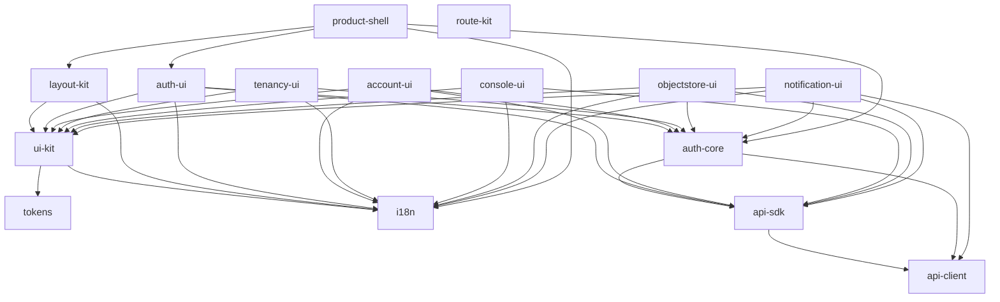

# web

## 职责

前端模块交付一组发布的 `@speed/*` 包与一个装配入口。产品把包族组合成一个浏览器应用，并在自己的 `main` 模块里调用装配入口把它挂到页面上。

模块持有下列各件事：

- **包的分层。** 包按依赖方向分层，依赖只从上层流向下层，同层之间互不依赖。
- **契约边界。** 与后端耦合的只有一个由 orval 生成的包；传输运行时手写，与契约无关。
- **装配与内容分离。** 壳拥有框架与会话分支机，不做导航、不发请求；业务内容由宿主经一份定义传入。
- **新增业务的接入面。** 路由与导航独立成层，业务模块以一份声明接入，租户作用域的查询键由框架提供。
- **契约生成的两级形态。** 平台契约生成发布的包，应用自己的契约在应用内另生成一份。

### 划分轴与判据

包按下列各条轴划分，各条轴同时成立。

**按层。** `tokens` 与 `i18n` 处于底层，其上依次是 `ui-kit`、`layout-kit`、能力 UI 包、`product-shell`。判据是依赖方向：一个包的依赖只指向同族中比它低的层，同层的两个包互不依赖。证据是各包 `package.json` 的依赖声明与 `src/index.ts` 的公开面——`ui-kit` 取 `tokens`，`layout-kit` 取 `ui-kit` 与 `i18n`，`auth-ui` 与 `account-ui` 同层而互不 import（`web/packages/account-ui/src/index.ts` 的包文档写明同一层的包从不互相 import，provider 词表按约定复制）。

**按后端能力。** 一个能力 UI 包对一个后端能力目录：`auth-ui` 对 authn、`tenancy-ui` 对 tenant、`account-ui` 对 authn 的账户面、`console-ui` 对租户与设置与审计三个管理面、`notification-ui` 对通知的收件箱、偏好与推送三个面。判据是每个能力 UI 包都是某个后端能力在浏览器里的面。证据是各包 `src/index.ts` 的包文档——`auth-ui` 驱动会话的登录切片，`account-ui` 驱动账户切片，`tenancy-ui` 驱动租户切换。

**按契约边界。** `api-sdk` 是唯一与后端耦合的包，且是 orval 的生成产物；`api-client` 是契约无关的手写传输运行时。判据是包与后端契约的耦合程度。证据是 `web/packages/api-sdk/src/runtime.ts` 的包文档（生成面保持与 fetch、axios、tenant 无关）与 `web/orval.config.ts` 的 mutator 指向（生成面经该接缝转发给宿主绑定的请求函数）。

**装配与内容分离。** 壳拥有框架与会话分支机（未登录、已登录、会话结束），不做导航、不发请求；业务内容由宿主经 `SpeedAppDefinition` 传入。判据是导航与请求是否由壳做出。证据是 `web/packages/product-shell/src/index.ts` 的包文档（壳不做任何会话操作、不导航、不发请求）与 `web/packages/product-shell/src/bootstrap.tsx` 的 `bootstrapSpeedApp`（视图根由 `SpeedAppDefinition.view` 给出）。

**判据一句话：按后端能力切，不按页面切。** 加一个后端能力目录就加一个与它对应的 UI 包；契约只从 `api-sdk` 流出；装配由壳承担，业务内容由宿主传入。

### 非职责

- **不做服务端渲染。** 产物在浏览器里渲染；服务端只交出产物，不渲染它（[ADR-web-static-hosting-2026-10-15](../../../adr/adr-web-static-hosting-2026-10-15.md)）。
- **不内建业务页面。** 模块交付框架、组件族与装配入口，不交付任何具体业务页面。
- **不决定业务模块的形态。** 业务模块的声明面由模块自己给出，前端只收集与渲染。
- **不拥有后端契约。** `api-sdk` 的面由后端模块的 OpenAPI 片段生成；前端不定义端点，也不定义请求形状。
- **不托管构建产物。** 把产物经 HTTP 交出（静态应答、客户端路由回退、缓存口径）归后端的静态托管模块（[webui](../design-webui.md)）；前端只产出它（[ADR-web-static-hosting-2026-10-15](../../../adr/adr-web-static-hosting-2026-10-15.md)）。

## 外部接口契约

### 交付的包与公开面

每个包以它的 `src/index.ts` 为公开面。另有几个文档化的子路径出口：

| 包 | 子路径出口 | 内容 |
|---|---|---|
| `@speed/product-shell` | `./bootstrap` | 装配入口 `bootstrapSpeedApp` 与 `SpeedAppDefinition` 等类型 |
| `@speed/api-sdk` | `./runtime` | 宿主绑定请求函数的接缝：`bindRequestFn` |
| `@speed/api-client` | `./react` | go/config 公开端点的 React hooks：`usePublicConfig`、`useFeature` |
| `@speed/i18n` | `./mui-locale`、`./platform-errors` | MUI 本地化助手与平台错误文案包 |

### 装配入口

应用在自己的 `main` 模块里调用一次：

```ts
bootstrapSpeedApp(container: Element, definition: SpeedAppDefinition): SpeedAppBootstrap
```

`SpeedAppDefinition` 是一个应用变化的部分：

```ts
interface SpeedAppDefinition {
  namespaces?: readonly SpeedAppNamespace[]   // 应用自带的 i18n 命名空间
  providers?: readonly SpeedAppProvider[]      // 应用级 provider，最外层在前
  view: ReactNode                               // 应用的视图根
  sessionEnded?: SpeedSessionEndedHandler       // 会话结束时的动作
  baseUrl?: string                              // 客户端 base URL，缺省 window.location.origin
}
```

**一次装配的接线次序固定**：i18n 实例（先注册框架命名空间并开启平台错误兜底，再依次注册应用的命名空间）→ 会话（内存 access token store 喂会话状态机并 attach）→ 客户端（`createClient` 以会话静默刷新为 401 腿、以 i18n 实例当前语言为语言源）→ 把客户端绑进 `api-sdk` 的 runtime 接缝 → 查询客户端与会话结束策略 → provider 栈（I18next → 主题 → QueryClient → 应用的 provider，应用 provider 最外层在前）→ 视图。装配返回 `SpeedAppBootstrap { root, i18n, queryClient, session }`。

**装配入口是一个子路径出口**（`@speed/product-shell/bootstrap`）：主出口维持组件包最小的依赖底（`auth-core`、`auth-ui`、`layout-kit`、`i18n`），这个出口额外 import 应用入口要驱动的那几件（`@speed/api-client`、`@speed/api-sdk/runtime`、`@speed/ui-kit` 与 react-query），它们都在主出口的传递闭包内。

### 契约生成的两级形态

平台契约生成发布的 `@speed/api-sdk`：它由后端模块的 OpenAPI 片段合并后经 orval 生成（`web/orval.config.ts`），被多个包 import，因此只含平台端点。应用自己的契约在应用内另生成一份：应用自己的合并契约经第二份 orval 配置生成到应用内（[ADR-web-two-build-artifacts-2026-10-15](../../../adr/adr-web-two-build-artifacts-2026-10-15.md)）。两级都经 `api-sdk` 的 runtime 接缝发请求，没有一处生成码或桥接码自己做 HTTP。

### 运行期的 API origin 注入

`bootstrapSpeedApp` 的 `baseUrl` 缺省是 `window.location.origin`，即假设前后端同源。跨域部署要在运行期注入：产物在入口文档旁带一份 `runtime-config.json`，应用入口取它、把其中的 API origin 作为 `baseUrl` 传给 `bootstrapSpeedApp`；文件不存在、不可读或没有 origin 时回落到同源（[ADR-web-runtime-config-2026-10-15](../../../adr/adr-web-runtime-config-2026-10-15.md)）。这份文件按**入口文档所在源下的根路径**解析，不按当前 URL 解析：深链接（如控制台页的 `/console/tenants`）因而仍取到根下的文件，而不是它自己目录下的同名文件。该解析不依赖已解析的 origin，故不陷入「取配置本身需要配置」的循环；它也不随部署拓扑变化，故同一份产物在合一拓扑与分离拓扑下共用。`api-client` 的 `config-fetcher` 帮不上这件事：它经 API 取配置，本身就需要 `baseUrl`。

**是否配置 CORS 由部署拓扑决定。** 合一拓扑是单端口同源：产物与 API 由同一个进程在同一个源答出，浏览器不发跨域请求，部署面里因而没有 CORS 这一环——demo 骨架即此拓扑。分离拓扑把前端交静态主机、后端只做 API，两者异源，跨域请求才出现，CORS 在此时进入部署面。跨域部署是受支持的形态，但它不是 demo 骨架的形态。

### 新增三件的契约

**路由与导航独立成层（`@speed/route-kit`）。** 壳保持不做导航不变；路由与导航是独立一层，新增业务接入它而不动壳（[ADR-web-route-seam-2026-10-15](../../../adr/adr-web-route-seam-2026-10-15.md)）。

**声明式注册面。** 业务模块导出结构相同的声明——路径、视图、导航标签、所需权限——由收集方收齐后渲染。它与后端的命令树点名模块对称：它是「加一个业务模块」在前端的对应动作。

**租户作用域的查询键归框架。** 框架提供查询键工厂（形状 `tenantQueryKey(tenantId, ...tail)`，产出以租户标识为最外层段的键）与「切换租户时逐出整棵子树」的助手，落在 [auth-core](design-web-auth-core.md)（[ADR-web-tenant-query-key-2026-10-15](../../../adr/adr-web-tenant-query-key-2026-10-15.md)）。`api-sdk` 的生成面保持与 tenant 无关，不改。

### 稳定性承诺

- 每个包的 `src/index.ts` 公开面、文档化的子路径出口，以及 `bootstrapSpeedApp` 与 `SpeedAppDefinition`、`SpeedAppBootstrap`、`SpeedAppServices`、`SpeedAppNamespace` 的形状，是对使用者的契约；加字段为兼容变更，改或删字段为不兼容变更。
- 包以锁定版本组发布（`web/.changeset/config.json` 的 fixed 组），使用者不会同时持两个版本的同名包。
- `SpeedAppDefinition.baseUrl` 的缺省同源是承诺：合一拓扑不写任何配置的前提就是它。

## 依赖

依赖方向满足架构不变量：依赖只从上层流向下层，同层不互相依赖。

表现层的层自下而上：`tokens`、`i18n`；`ui-kit`；`layout-kit`；能力 UI 包；`product-shell`。

与后端契约相关的一条链路自下而上：`api-client`（契约无关的传输运行时）；`api-sdk`（生成的契约面）；`auth-core`（会话状态机）；能力 UI 包与 `product-shell`。

下表是本模块的每个包、它对这个能力的职责、以及它依赖哪些同族包。

| 包 | 职责 | 依赖的同族包 |
|---|---|---|
| `tokens` | 设计令牌的默认值与覆盖入口 | 无 |
| `i18n` | 每宿主一个 react-i18next 实例、按包命名空间登记与校验、缺键纪律 | 无 |
| `ui-kit` | `tokens` 到 MUI 主题的适配与一组受控组件 | `tokens`、`i18n` |
| `layout-kit` | 与认证无关的框架与路由门禁 | `ui-kit`、`i18n` |
| `api-client` | 契约无关的手写 HTTP 运行时与错误、重试、超时、上报接缝 | 无 |
| `api-sdk` | 唯一与后端耦合的包，由 orval 生成 | `api-client` |
| `auth-core` | 浏览器会话状态机与 hooks | `api-sdk`、`api-client` |
| `auth-ui` | 登录组件族 | `ui-kit`、`i18n`、`auth-core`、`api-sdk` |
| `account-ui` | 已登录账户管理组件族 | `ui-kit`、`i18n`、`auth-core`、`api-sdk` |
| `tenancy-ui` | 租户切换控件 | `ui-kit`、`i18n`、`auth-core` |
| `product-shell` | 组装壳与装配入口 | `layout-kit`、`auth-ui`、`auth-core`、`i18n`（主出口的直接依赖；`./bootstrap` 出口另直接取 `api-client`、`api-sdk`、`ui-kit`） |
| `route-kit` | 路由与导航独立层、声明式注册面 | 无 |
| `console-ui` | 控制台面组件族，第二种壳 | `ui-kit`、`i18n`、`api-sdk` |
| `objectstore-ui` | 对象存储能力面：对象页（列表、上传、下载、删除、详情） | `ui-kit`、`i18n`、`api-sdk`、`auth-core` |
| `notification-ui` | 站内通知面：未读铃铛、收件箱与已读、偏好矩阵、实时订阅与声明式入口 | `ui-kit`、`i18n`、`auth-core`、`api-sdk`、`api-client` |

**`api-sdk` 是唯一 import 后端契约的包**，它只依赖 `api-client` 的请求函数类型，本身不 import 任何 UI 包。**`api-client` 不依赖任何同族包**，也不认识 tenant。**能力 UI 包之间同层不互依赖**：`auth-ui` 与 `account-ui` 各自定义 provider 词表。**`route-kit` 与 `product-shell` 都不 import 对方**，两者由应用的组合层分别消费。

**`billing-ui` 不在新树里。** 后端不做计费，对应的前端包随旧树留在 `web-legacy/`，不进本模块的包清单（[ADR-web-reuse-2026-10-15](../../../adr/adr-web-reuse-2026-10-15.md)）。

## UML 图

图给出包之间的依赖方向。图里画不出的约束：依赖只向上，同层的包之间没有边；`api-client` 与 `api-sdk` 这条契约链路与 UI 分层是两条链路，在能力 UI 包处汇合（能力 UI 包既取 `ui-kit` 也取 `auth-core`）；`route-kit` 与 `product-shell` 并列在顶层，应用分别消费两者。



## 核心数据结构

| 概念 | 类型 | 说明 |
|---|---|---|
| 应用定义 | `SpeedAppDefinition` | 一个应用变化的部分：`namespaces`、`providers`、`view`、`sessionEnded`、`baseUrl` |
| 装配产物 | `SpeedAppBootstrap` | 装配交出的句柄：`root`、`i18n`、`queryClient`、`session` |
| 装配服务 | `SpeedAppServices` | 装配传给宿主 provider 的服务：`session`、`api`、`queryClient` |
| 应用命名空间 | `SpeedAppNamespace` | 应用自带的一个 i18n 命名空间：`namespace` 与 `resources` |
| 会话结束上下文 | `SpeedSessionEndContext` | 会话结束动作拿到的值：`session`、`queryClient`、`evictAllQueries` |
| 路由声明 | 结构性类型 | 一个业务模块导出的一份声明：路径、视图、导航标签、所需权限 |
| 租户查询键 | 数组 | `tenantQueryKey(tenantId, ...tail)` 产出以租户标识为最外层段的键 |

## 核心算法与流程

### 一次装配

1. 应用在自己的 `main` 模块里构造一份 `SpeedAppDefinition`，调用 `bootstrapSpeedApp(container, definition)`。
2. 装配建一个 i18n 实例：注册框架命名空间（`ui-kit`、`layout-kit`、`auth-ui`、`product-shell`），注册平台错误文案包并把它设为实例的兜底命名空间，再依次注册定义里的应用命名空间。注册发生在渲染之前。
3. 装配建一个内存 access token store 与会话，把会话 attach 到 hooks 面。
4. 装配以 `createClient` 建客户端（`baseUrl` 取定义的值或缺省同源，语言源读 i18n 实例的当前语言，静默刷新接会话的 `refresh`），并把客户端绑进 `api-sdk` 的 runtime 接缝。
5. 装配建查询客户端（查询与变更都不重试）并装上会话结束策略。
6. 装配把 provider 栈按次序套在定义的视图根之外（I18next → 主题 → QueryClient → 应用的 provider，应用 provider 最外层在前），挂到容器上。
7. 装配返回 `SpeedAppBootstrap`。

**引入一份新契约不改变这条次序。** 平台契约与应用契约都经同一个绑定的请求函数发请求，装配只绑一次。

### 装配与内容的分离

壳渲染一台视图机：认证快照下渲染框架包住应用内容；已到达过应用而快照转匿名时渲染会话结束面（可被宿主的槽替换）；从未到达的匿名访客渲染登录槽或空。壳不驱动会话、不导航、不发请求——分支由快照驱动，登录与登出由宿主槽里的视图调用。框架的字符串取自 `layout-kit` 命名空间，默认会话结束面的字符串取自 `auth-ui` 命名空间，其余字符串是宿主内容。

### 声明式注册面的收集

一个业务模块导出它的路由声明（路径、视图、导航标签、所需权限）。收集方把各模块的声明收齐，按路径匹配渲染对应视图，并按标签构造导航。路由层只按登记面匹配路径；路径与权限之间的关系不在这里建立，授权仍是宿主在内容区里的组合（[ADR-web-route-seam-2026-10-15](../../../adr/adr-web-route-seam-2026-10-15.md)）。

## 错误与失败语义

| 情形 | 表现 |
|---|---|
| 同一容器装配两次 | 双重挂载；一个页面只装配一次 |
| 同一 i18n 命名空间注册两次 | 注册时抛错 |
| 生成的调用在宿主绑定请求函数之前发生 | 以程序员错误快速失败，不发未配置的请求 |
| 跨域部署未注入 origin（`runtime-config.json` 缺失） | 回落到同源，请求打向错误 origin |

## 扩展点

**新增一个后端能力 UI 包。** 每条准入条件是：一个能力 UI 包对一个后端能力目录；依赖只指向比它低的层，同层不互相依赖；自带 i18n 命名空间与资源，由宿主登记；经 `api-sdk` 的生成面发请求，不自己写 HTTP。

**新增一个业务页面。** 业务模块导出它的路由声明，经声明式注册面接入（见核心算法与流程）；不动壳。

**新增一个控制台面。** 控制台面挂在不解析租户的端上，是第二种壳：没有租户切换器，也就没有租户作用域的查询键。它复用声明式注册面，用另一套壳。

**新增一个应用。** 应用在自己的 `main` 模块里写一份 `SpeedAppDefinition` 交给装配入口，并跑应用自己的第二级契约生成。

## 实现状态

| 能力 | 状态 | 代码 |
|---|---|---|
| 设计令牌 | 已实现 | `web/packages/tokens/src/index.ts` `defaultTokens`、`deepMerge` |
| 平台 i18n 层 | 已实现 | `web/packages/i18n/src/index.ts` `createI18n`、`registerNamespace` |
| 组件族与主题适配 | 已实现 | `web/packages/ui-kit/src/index.ts` `createAppTheme`、`AppThemeProvider` |
| 与认证无关的框架与门禁 | 已实现 | `web/packages/layout-kit/src/index.ts` `AppShell`、`RouteGuard` |
| 契约无关的传输运行时 | 已实现 | `web/packages/api-client/src/index.ts` `createClient`、`ApiError`；`web/packages/api-client/src/react.ts` `usePublicConfig`、`useFeature` |
| 生成的契约面 | 已实现 | `web/packages/api-sdk/src/runtime.ts` `bindRequestFn`、`speedRequest`、`speedRequestCredentialless`；生成面见 `web/packages/api-sdk/src/index.ts` |
| 浏览器会话状态机与 hooks | 已实现 | `web/packages/auth-core/src/session.ts` `createAuthSession`；`web/packages/auth-core/src/hooks.ts` `attachSession`、`useAuthState`、`usePermission` |
| 登录组件族 | 已实现 | `web/packages/auth-ui/src/SignInScreen.tsx` `SignInScreen`；`web/packages/auth-ui/src/SignOutButton.tsx` `SignOutButton`；`web/packages/auth-ui/src/SessionEndedScreen.tsx` `SessionEndedScreen` |
| 账户管理组件族 | 已实现 | `web/packages/account-ui/src/index.ts` `ProfileSection`、`PasswordSection`、`PhoneSection`、`IdentifiersSection`、`PreferencesSection`、`SessionsSection`、`SocialBindingsSection`、`MfaSection` |
| 租户切换控件 | 已实现 | `web/packages/tenancy-ui/src/index.ts` `TenantSwitcher`、`TenantOption`、`TenantSwitcherProps`；`web/packages/tenancy-ui/src/resources.ts` `TENANCY_UI_NAMESPACE`、`tenancyUiResources` |
| 组装壳与装配入口 | 已实现 | `web/packages/product-shell/src/index.ts` `ProductShell`；`web/packages/product-shell/src/bootstrap.tsx` `bootstrapSpeedApp` |
| 路由与导航独立层 | 已实现 | `web/packages/route-kit/src/index.ts` `RouteProvider`、`RouteView`、`RouteLink`、`useNavItems`、`useNavigate` |
| 控制台面组件族 | 已实现 | `web/packages/console-ui/src/index.ts` `ConsoleShell`、`TenantRosterPage`、`SettingsPage`、`AuditPage` |
| 对象存储能力面 | 已实现 | `web/packages/objectstore-ui/src/index.ts` `ObjectsPage`、`ObjectDetailDialog`；`web/packages/objectstore-ui/src/internal/queries.ts` |
| 站内通知面组件族 | 已实现 | `web/packages/notification-ui/src/index.ts` `NotificationBell`、`NotificationInbox`、`NotificationPreferences`、`NotificationCenter`、`NotificationStreamProvider`、`notificationRoutes` |
| 声明式注册面 | 已实现 | `web/packages/route-kit/src/types.ts` `RouteDeclaration`、`RouteTable`；`web/packages/console-ui/src/route.ts` `ConsoleRoute` |
| 租户作用域的查询键工厂与逐出助手 | 已实现 | `web/packages/auth-core/src/query-key.ts` `tenantQueryKey`、`useTenantQueryKey`、`evictTenantQueries` |
| 运行期的 API origin 注入 | 已实现 | `starters/demo/web/src/runtime-config.ts` `loadRuntimeConfig`；`starters/demo/web/src/main.tsx` `bootstrapDemoApp` |
