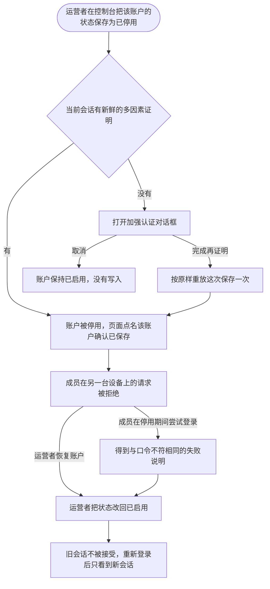

# 停用账户并让它的会话失效

## 参与者

- 平台运营者：持有平台域的账户管理权限，从控制台管理任意账户。
- 被停用的成员：某个组织中的普通成员，不持有平台权限；停用发生时，该成员在多台设备上处于登录状态。

## 前置条件

- 存在一个已启用的成员账户，它属于一个组织，并且在两台或更多设备上留有活跃的登录会话。
- 一个持有平台管理权限的运营者账户可以登录并进入控制台。

## 步骤

1. 运营者登录后从页头进入控制台，打开账户页。
2. 运营者在筛选区按该成员的登录标识前缀与「已启用」状态查询；结果只列出匹配的账户，运营者从中打开该成员的详情。
3. 运营者把详情里的状态改为「已停用」并保存；页面给出点名该账户的状态已保存确认，列表里该账户的状态显示为「已停用」。
4. 该成员在另一台设备上打开产品中的任意页面；这一次请求被拒绝，界面改为会话已结束的说明与「重新登录」入口，原来的页面内容不再呈现。

## 结果

- 停用生效后，该成员在设备上的请求被拒绝，界面只给出会话已结束的说明与重新登录入口，原来的页面内容不再呈现。
- 控制台的详情页与列表把该账户显示为已停用，并给出点名该账户的状态已保存确认。

## 备选路径

**运营者的会话强度不足。** 保存状态可能被拒绝：运营者当前会话不具备新鲜的多因素证明时，这次保存不发生，页面打开加强认证对话框。运营者完成一次身份再证明后，系统按原样重放这次保存一次，得到与直接保存相同的成功确认；运营者取消对话框时这次保存不重放，账户保持已启用。

**停用期间的登录尝试。** 成员可以在账户恢复之前就尝试重新登录。提交原用户名与口令后，界面给出与口令不符相同的一处失败说明，不提示账户已被停用，成员无法从这次应答判断原因。

**运营者恢复账户，成员重新登录。** 运营者回到该账户的详情，把状态改回「已启用」并保存；页面给出点名该账户的状态已保存确认，列表里该账户的状态回到「已启用」。成员刷新页面得到登录面，恢复没有把旧会话带回。成员用原来的用户名与口令登录成功，并就地回到被拒绝之前所在的产品页面。成员打开账户设置的「登录会话」页，列表只有当前这台设备的会话并标为当前会话；停用之前的其他会话不在列表里。成员回到租户区，页头的组织切换控件把其所属组织显示为当前组织，该组织那一项在列表里不可选中。

## 覆盖的需求

- `REQ-platform-admin-012`
- `REQ-platform-admin-014`
- `REQ-platform-admin-018`
- `REQ-security-013`
- `REQ-security-014`
- `REQ-security-022`
- `REQ-security-025`
- `REQ-signin-006`
- `REQ-signin-007`
- `REQ-signin-030`
- `REQ-tenancy-022`
- `REQ-presentation-027`

## 端到端测试

`starters/demo/web/e2e/specs/journey-account-offboarding.spec.ts` `account-offboarding: an operator disables a member and the member returns after the restore`
