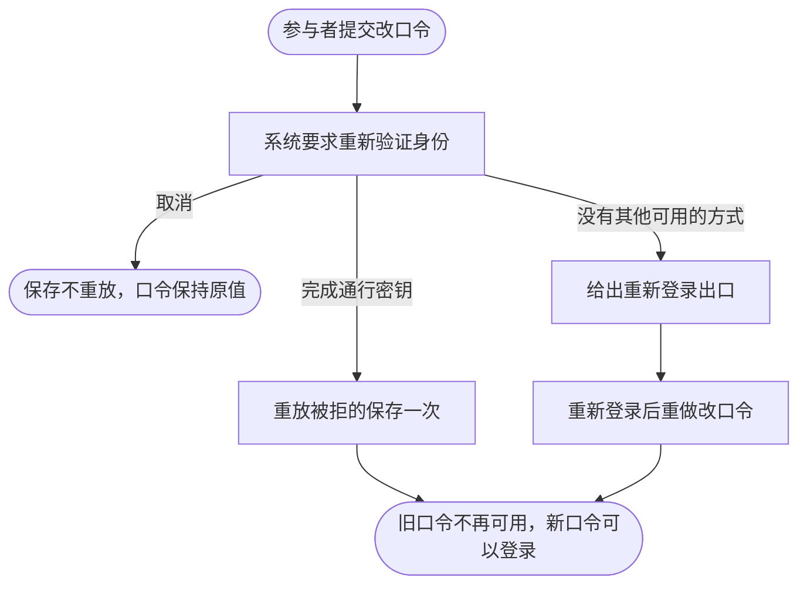

# 登记第二因素并执行一次敏感操作

## 参与者

终端用户：本部署的一位账户持有人。该账户可以自助管理本人的资料、联系方式与登录方式、会话与两步验证。当前会话不是冒充身份。

## 前置条件

- 参与者已用口令登录，账户没有任何已启用的两步验证方式。
- 账户持有一条已证明归属的邮箱，因此管理面的人类写入不会因邮箱未证明被拒绝。
- 参与者所在设备支持并能够完成通行密钥仪式。
- 账户页提供身份验证器应用与通行密钥两种登记入口。

## 步骤

1. 参与者在设备 A 打开账户设置。个人资料页的联系方式块列出本人的邮箱并标明其归属已证明；密码与安全页的登录方式块列出用户名，该块不提供移除用户名的动作；两步验证块显示尚未设置任何方式，登记入口包含身份验证器应用与通行密钥。
2. 参与者选择身份验证器应用，向导给出一次性设置密钥与六位验证码输入；在验证器应用中录入后输入当前验证码并提交。该方式出现在两步验证清单中，状态为已启用。
3. 参与者从账户菜单退出登录，回到登录面。
4. 参与者以用户名与口令登录；第一因素通过后，系统要求再通过一个两步验证方式，可选方式与本次登录已用的口令通道不同；参与者选择身份验证器应用并输入当前验证码，登录完成。
5. 参与者在账户页添加通行密钥：界面进入等待设备的状态，并提供取消与重试；参与者在设备上完成凭据仪式后，该方式出现在两步验证清单中，状态为已启用。
6. 参与者再次退出登录，再以用户名与口令登录，并在第二因素步骤选择身份验证器应用完成登录。
7. 参与者在设备 B 上以同一账户登录，依次完成口令与身份验证器应用两步，随后回到设备 A；设备 A 与设备 B 的会话都保持登录。
8. 参与者回到设备 A 的账户设置，打开「登录会话」页：会话表逐行给出设备摘要、地址、最近活动与操作，当前会话带标记；参与者撤销属于设备 B 的那条会话。
9. 参与者在设备 B 上继续操作，下一次请求回到登录面，需要重新登录。
10. 参与者回到设备 A 的账户页，在账户设置中修改口令：填入当前口令与新口令并提交。当前会话的多因素证明不够新，系统拒绝这次保存并打开加强认证对话框，对话框只提供本次登录没有用过的通行密钥；参与者在设备上完成凭据仪式。被拒的保存随后被重放一次并成功。

## 结果

- 账户的两步验证清单包含身份验证器应用与通行密钥，此后登录需要第二因素。
- 设备 B 的会话不再出现在活跃会话列表中，其下一次请求回到登录面；设备 A 的会话继续可用。
- 改口令在重新验证身份之后被放行；此后旧口令不能登录，新口令可以。

## 备选路径

重新验证身份一节存在分叉。参与者在对话框中取消时，被拒的改口令不重放，口令保持原值，其余步骤不受影响。账户只登记了一种两步验证方式时，本次登录已经用过该种类的通道，没有可用于加强认证的方式，对话框给出重新登录的出口而不提供可完成的挑战；参与者重新登录后重做改口令，操作成功。

## 覆盖的需求

- 账户自助：`REQ-account-007`、`REQ-account-061`
- 账户安全：`REQ-security-001`、`REQ-security-002`、`REQ-security-003`、`REQ-security-005`、`REQ-security-008`、`REQ-security-009`、`REQ-security-013`、`REQ-security-014`、`REQ-security-015`、`REQ-security-017`、`REQ-security-022`、`REQ-security-023`、`REQ-security-025`、`REQ-security-030`
- 登录：`REQ-signin-006`

## 端到端测试

`starters/demo/web/e2e/specs/journey-account-security-hardening.spec.ts` `account-security-hardening: an account enrols two factors, ends another device and changes its password through a step-up`
