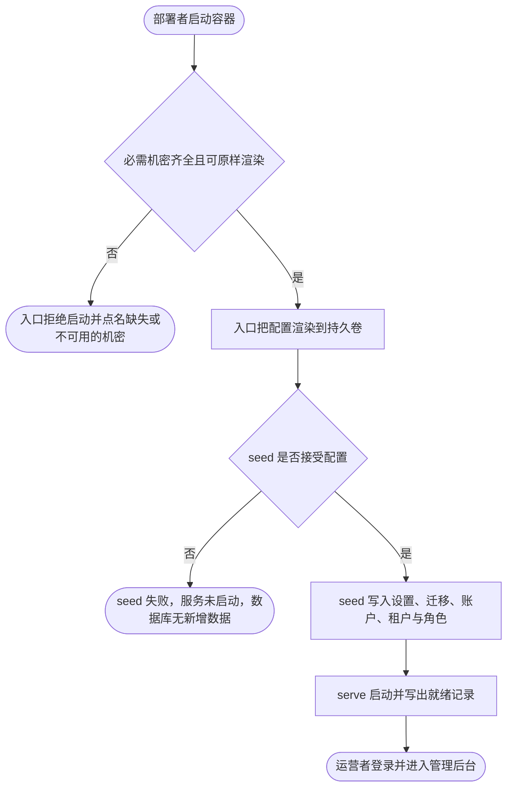

# 把 demo 部署到云主机并让运营者能登录

## 参与者

部署者：持有部署目标平台的账户与容器运行时，能创建持久卷、写入部署机密、启动容器并读取运行日志；以 `seed` 写入并标记为平台管理员的账户在浏览器中完成交付验收。

## 前置条件

- 持有部署目标平台的账户与容器运行时，能在其上构建并运行容器镜像。
- 已创建一块持久卷，卷在重启与重新部署之间保留。
- 公开来源使用 https；Google（[REF-google-openid-connect](../../references.md)）与 GitHub（[REF-github-oauth-apps](../../references.md)）各自登记的授权回调地址为 `<公开来源>/api/v1/auth/callback/google` 与 `<公开来源>/api/v1/auth/callback/github`。
- 已取得邮件中继的主机与发件地址，以及 Google 与 GitHub 各自的应用标识与密钥。
- 已为数据库准备一个加密根键，并将在该卷的整个生命期内沿用同一个键。
- 配置中给出的运营者邮箱可接收邮件，该账户的口令满足部署当时的账户口令策略。
- 部署者能读取该部署的运行日志，并能在运维监听上发起请求。

## 步骤

1. 部署者构建并发布容器镜像。镜像中只有一个应用可执行程序，它内嵌前端产物，既承载页面与 API 的服务进程，也承载 `seed` 这类一次性运维命令；部署不需要另配静态文件服务。

2. 部署者向部署平台写入必需机密：运营者邮箱、运营者口令、数据库加密根键、邮件中继主机与发件地址、Google 与 GitHub 的应用标识与密钥；公开来源可另给出。全部取值都能原样写入配置并落在允许范围内。缺少任一项时容器入口拒绝启动并点名缺失项。

3. 部署者把容器指向持久卷并启动。入口把渲染后的配置写到持久卷上，随后先运行 `seed`，再把进程交给 `serve`。部署中只有一个长期运行的应用进程。镜像与编译进程序的默认配置中不存在凭据。

4. 部署者观察首次启动的输出。`seed` 在一个从未迁移过的数据库上施加迁移，并写入配置点名的运行期设置、运营者账户、租户与运营者持有的内置管理员角色，逐项报告已写入或已存在；运营者账户的凭据取配置给出的明文口令或口令哈希中的一项。`serve` 在全部模块启动后写出就绪记录。持久卷上出现首次运行生成的签名密钥，文件权限只允许属主读写。

5. 部署者用浏览器访问对外地址。根路径得到前端入口文档；直接请求一条不存在的页面路径同样得到入口文档，而请求一个不存在的静态资源得到 404。页面与 API 由同一个对外服务端口交付，浏览器从页面访问 API 与页面同源。

6. 部署者打开该地址并直接请求一条受保护的页面路径：未登录时看到登录面，而不是错误页；登录面列出的登录方式取自该部署的发现文档，包含口令、Google 与 GitHub。

7. 部署者以 `seed` 写入的登录名与口令在该登录面登录。登录完成后回到此前请求的路径并渲染其内容；当前组织是 `system` 时，账户菜单出现管理后台入口，首页出现管理后台卡片。

8. 部署者直接打开账户设置：个人资料页显示本人资料与联系方式，密码与安全页显示登录方式；邮箱验证卡此时不发送验证码，等待手动发送。应用栏之下持续显示邮箱验证提示，提示不可关闭，提供「去验证」与「更换邮箱」入口。部署者打开管理后台并尝试一项管理写，操作被拒并提示先到账户页验证邮箱。

9. 部署者从账户菜单中的管理后台入口进入管理后台，进入后看到分组导航；概览页显示租户总数、已启用数与已停用数，各数值由该部署的租户名册读得出。首页的管理后台卡片打开同一个页面。

10. 部署者在该部署的运维监听上请求存活探针与就绪探针。存活探针每次请求都答成功；就绪探针在本次进程声明的每个端点都在接受请求且数据库应答时答成功，否则答失败并逐项点名失败项。该监听不作为对外服务发布。

11. 部署者在运维监听上读取合并后的 API 规格。规格覆盖该二进制所提供的全部声明，包括当前命令没有运行的模块所声明的操作。

12. 部署者重启容器。入口再次先运行 `seed`；对已存在的账户、租户、角色、授权与绑定逐项报告跳过，不重复写入；此前经设置面修改过的运行期设置保持运营者给定的值。`serve` 重新写出就绪记录。

13. 部署者向进程发送终止信号。进程排空在途请求，写出停止记录后退出。

## 结果

- 对外只有一个服务端口，根路径与未知页面路径得到同一份前端入口文档，API 与页面同源。
- 首次启动的 `seed` 在一个从未迁移过的数据库上完成迁移并写入运营者账户、配置租户与内置管理员角色；重启再次运行 `seed` 时逐项跳过，且不覆盖运营者经设置面做出的修改。
- `seed` 写入的登录名与口令可以登录：登录完成后回到此前请求的页面，当前组织是 `system` 时账户菜单出现管理后台入口，首页出现管理后台卡片。
- 该账户在证明邮箱之前执行管理写被拒绝并提示先到账户页验证邮箱；管理后台的读取不受影响，入口与卡片打开同一个页面，概览显示租户统计。
- 存活探针恒答成功；就绪探针在全部端点与数据库就绪后答成功；合并 API 规格可读。
- 持久卷上有首次运行生成的签名密钥与渲染后的配置；镜像与默认配置不含凭据。

## 备选路径

启动在机密校验与 `seed` 处各有分叉，每条分叉都停在服务未启动。

- 缺少任一必需机密：入口拒绝启动并打印缺失的机密名。
- 某个机密含双引号、反斜杠、换行或控制字符，公开来源不是 https 来源或带路径、查询、空格，端口不是整数，或 TLS 姿态不在允许集内：入口拒绝启动并说明该取值不可用。
- 配置点名一个既没有口令也没有口令哈希的初始账户，或租户名使用保留的平台域名：`seed` 在写入任何数据之前失败。
- 运行期设置的键拼错或取值越出声明的域，或配置把口令最小长度调到高于运营者口令的值：`seed` 失败，该账户不被写入，服务不启动。

## 覆盖的需求

- `REQ-deployment-001`
- `REQ-deployment-002`
- `REQ-deployment-003`
- `REQ-deployment-004`
- `REQ-deployment-005`
- `REQ-deployment-006`
- `REQ-deployment-007`
- `REQ-deployment-008`
- `REQ-deployment-009`
- `REQ-deployment-010`
- `REQ-deployment-011`
- `REQ-deployment-012`
- `REQ-deployment-013`
- `REQ-deployment-014`
- `REQ-deployment-015`
- `REQ-deployment-017`
- `REQ-deployment-018`
- `REQ-deployment-019`
- `REQ-deployment-024`
- `REQ-deployment-025`
- `REQ-deployment-026`
- `REQ-deployment-027`
- `REQ-deployment-028`
- `REQ-deployment-029`
- `REQ-signin-001`
- `REQ-signin-004`
- `REQ-signin-006`
- `REQ-signin-030`
- `REQ-signup-027`
- `REQ-platform-admin-001`
- `REQ-platform-admin-006`
- `REQ-platform-admin-007`
- `REQ-platform-admin-017`

## 端到端测试

未实现。既有用例 `starters/demo/web/e2e/specs/journey-deploy-and-operate.spec.ts` 仍以 seed 写入的邮箱登录，与 REQ-deployment-007 规定的用户名登录不一致。
