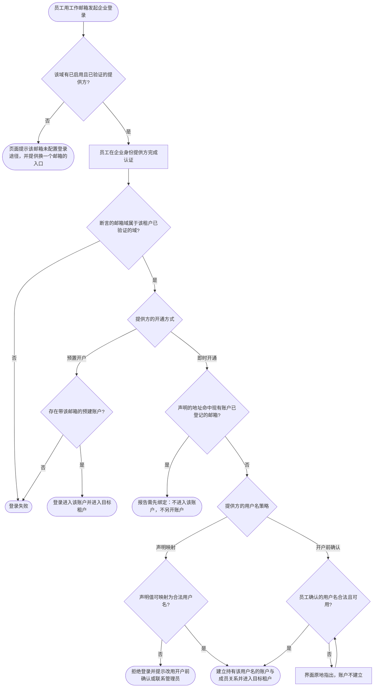

# 为租户接入企业身份提供方

## 参与者

- **平台运营者**：能进入管理后台，持有平台域的账户管理权限，在目标租户的域内持有身份提供方管理权限与成员关系管理权限。
- **企业员工**：持有该企业的邮箱，是该租户的现有成员，或将被该租户接纳的员工；可以尚无本产品账户。

## 前置条件

- 目标租户已登记且处于启用状态。
- 本次装配纳入了企业 OIDC（[REF-openid-connect-core](../../references.md)）或 SAML（[REF-saml2](../../references.md)）登录方式，并提供了企业身份提供方的管理面。
- 企业身份提供方已在自身一侧配置好，运营者持有其签发者、客户端标识与密钥（OIDC），或实体标识、登录地址与签名证书（SAML）。
- 该企业的邮箱域可以由运营者发布 DNS TXT 记录。
- 企业身份提供方一侧已登记本部署为该提供方生成的回调地址：OIDC 的 redirect_uri，或 SAML 的 ACS 与 SP 元数据。
- 运营者的账户已证明本人邮箱。
- 企业员工在目标租户之外已经是另一个组织的成员，因此账户菜单的组织行显示当前租户，展开后另有至少一个可进入的租户。

## 步骤

1. 运营者从管理后台打开“SSO 提供方”页，选定目标租户。
2. 运营者新建一个提供方：选择协议（OIDC 或 SAML）、填写名称、把开通方式选为预置开户、勾选启用，填入该提供方的配置与客户端密钥，然后保存。保存成功后，写入区确认已创建该提供方，表单复位，列表中出现这条提供方，所属租户就是刚选定的租户。
3. 运营者为这条提供方声明企业邮箱域。页面给出一枚一次性的 DNS 验证令牌与复制控件；运营者按页面给出的记录名与值，在 `_speed-authn.<域>` 下发布一条 TXT 记录，然后点击验证。验证成功后，写入区确认该提供方的该域已验证，域列表标为已验证；此域此后参与按邮箱域的登录发现。
4. 运营者在管理后台账户页建立一个用户账户，填写员工的显示名与用户名，并把企业邮箱登记为该账户的邮箱标识：标识由管理员写入，不作登录方式，登记即作为联系方式；未证明因此不能作默认联系地址。随后在邀请与成员页把这个账户加为目标租户的成员。
5. 员工打开登录页，看到企业登录入口；这个入口随本部署的登录方式清单出现，清单本身不含任何企业提供方。员工选择它并输入工作邮箱；页面按该邮箱的域单独列出可用的组织，员工看到自己企业的那一项并选择它，浏览器跳到企业身份提供方。
6. 员工在企业身份提供方完成认证，随后被带回产品，落在发起登录的页面。提供方断言的已验证邮箱地址与运营者预置账户的邮箱标识是同一个地址，系统直接进入该账户，不再新建账户；这是企业预置开户的允许例外，不适用提供方声明地址命中现有账户时报告需先绑定的规则。
7. 员工在账户菜单的组织行看到当前租户，展开后看到其余可进入的租户；当前租户不在展开项中重复。员工选择目标租户后，界面切到该租户，此后展示的数据属于该租户。

## 结果

- 目标租户下存在一条已启用的企业身份提供方，其企业邮箱域已验证，并参与按邮箱域的登录发现。
- 员工可以从登录页选择企业登录，输入工作邮箱后看到该组织，经企业身份提供方完成认证并进入目标租户。
- 预置开户的登录进入运营者预先建好的账户与成员关系，这是企业预置开户的允许例外，不属按提供方声明地址的自动关联；以即时开通方式配置的提供方首次登录时，按提供方声明的用户名策略取得用户名：声明映射时由系统从提供方声明取得，不出现用户名提交步；开户前确认时，员工在建账前确认或填写用户名。系统建立持有该用户名、只带提供方显示名的账户与该租户的成员关系，提供方声明的地址不写入账户。该地址命中现有账户已登记的邮箱地址时，登录报告需先绑定，不进入该账户，也不另开账户；当事人以自己的登录方式登录后，在账户面的登录方式中显式绑定该提供方。
- 员工进入该租户不需要口令，企业身份提供方是该员工进入该租户的登录方式。
- 停用的提供方或未验证的域不出现在按邮箱域的登录发现中。

## 备选路径

- **提供方采用即时开通（声明映射）**：员工首次登录时，系统从提供方声明取得用户名，不出现用户名提交步；声明值缺失、不合规、是保留字或已被占用时，登录被拒绝并提示改用开户前确认或联系管理员，账户不建立。取得合法用户名时，系统建立持有该用户名、只带提供方显示名的账户，并把成员关系挂到该账户；提供方声明的地址不写入账户。提供方声明的地址命中现有账户已登记的邮箱地址时，登录报告需先绑定，不进入该账户，也不另开账户；当事人以自己的登录方式登录后，在账户面的登录方式中显式绑定该提供方。
- **提供方采用即时开通（开户前确认）**：员工首次登录时，系统在建账前要求确认或填写用户名；用户名合法且可用时，系统建立持有该用户名、只带提供方显示名的账户，并把成员关系挂到该账户；提供方声明的地址不写入账户。用户名不合法、是保留字或已被占用时，界面在原地指出，账户不建立。提供方声明的地址命中现有账户已登记的邮箱地址时，登录报告需先绑定，不进入该账户，也不另开账户；当事人以自己的登录方式登录后，在账户面的登录方式中显式绑定该提供方。
- **按域发现不到提供方**：该域没有已验证的提供方，或提供方已停用；页面提示该邮箱未配置登录途径，并提供换一个邮箱的入口。停用的提供方在重新启用后重新参与发现。
- **提供方被停用**：停用的提供方仍出现在 SSO 提供方页的列表中，并标记为未启用；它不参与按邮箱域的登录发现，重新启用后重新参与。
- **断言的邮箱域不属于该租户已验证的域**：登录失败，员工不能经该提供方进入该租户。
- **预置开户没有对应的预建账户**：登录失败，系统不为这次登录新建账户。
- **域已被另一个提供方验证**：为当前提供方声明或验证这个域被拒绝，两个提供方的域验证状态都不改变。运营者要接入该域，须先删除原先验证它的提供方；删除会连同它名下的全部邮箱域声明一并移除。

## 覆盖的需求

- 平台运营：`REQ-platform-admin-013`
- 平台设置与授权：`REQ-platform-config-017`、`REQ-platform-config-018`、`REQ-platform-config-019`、`REQ-platform-config-020`、`REQ-platform-config-021`、`REQ-platform-config-038`、`REQ-platform-config-048`
- 登录：`REQ-signin-001`、`REQ-signin-003`、`REQ-signin-004`、`REQ-signin-017`、`REQ-signin-020`、`REQ-signin-021`、`REQ-signin-022`、`REQ-signin-023`、`REQ-signin-027`、`REQ-signin-028`
- 自助注册：`REQ-signup-018`、`REQ-signup-048`、`REQ-signup-049`、`REQ-signup-053`
- 用户名：`REQ-signup-045`、`REQ-signup-046`、`REQ-signup-047`、`REQ-signup-054`、`REQ-account-060`
- 账户自助：`REQ-account-067`
- 账户安全：`REQ-security-029`
- 组织与成员：`REQ-tenancy-009`、`REQ-tenancy-022`、`REQ-tenancy-023`、`REQ-tenancy-035`、`REQ-tenancy-036`
- 界面偏好：`REQ-presentation-027`

## 端到端测试

`starters/demo/web/e2e/specs/journey-enterprise-sso-onboarding.spec.ts` `enterprise-sso-onboarding: an operator connects an OIDC provider and an employee signs in with the work email`；`enterprise-sso-onboarding: a just-in-time provider asks for a username before it opens an account`（开户前确认策略）；`enterprise-sso-onboarding: a claim-strategy provider opens the account with the asserted username`（声明映射策略，含非法值与名称冲突拒绝）
