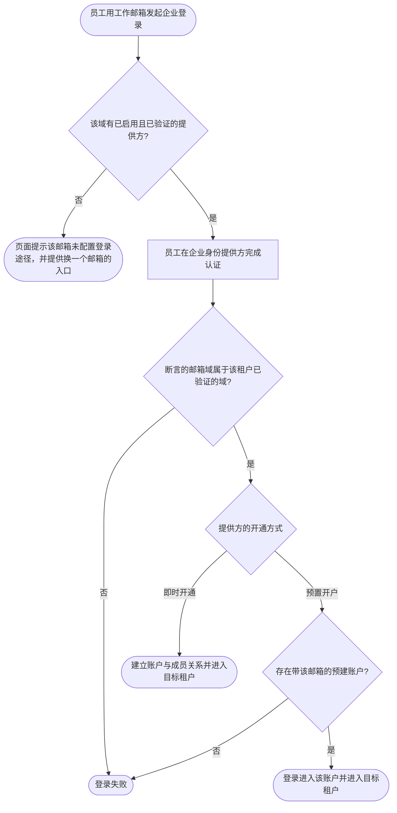

# 为租户接入企业身份提供方

## 参与者

- **平台运营者**：能进入控制台，持有平台域的账户管理权限，在目标租户的域内持有身份提供方管理权限与成员关系管理权限。
- **企业员工**：持有该企业的邮箱，是该租户的现有成员，或将被该租户接纳的员工；可以尚无本产品账户。

## 前置条件

- 目标租户已登记且处于启用状态。
- 本次装配纳入了企业 OIDC 或 SAML 登录方式，并提供了企业身份提供方的管理面。
- 企业身份提供方已在自身一侧配置好，运营者持有其签发者、客户端标识与密钥（OIDC），或实体标识、登录地址与签名证书（SAML）。
- 该企业的邮箱域可以由运营者发布 DNS TXT 记录。
- 企业身份提供方一侧已登记本部署为该提供方生成的回调地址：OIDC 的 redirect_uri，或 SAML 的 ACS 与 SP 元数据。
- 运营者的账户已证明本人邮箱。
- 企业员工在目标租户之外已经是另一个组织的成员，因此租户切换器里至少有两个可进入的租户，当前租户是其中之一。

## 步骤

1. 运营者从控制台打开「SSO 提供方」页，选定目标租户。
2. 运营者新建一个提供方：选择协议（OIDC 或 SAML）、填写名称、把开通方式选为预置开户、勾选启用，填入该提供方的配置与客户端密钥，然后保存。保存成功后，写入区确认已创建该提供方，表单复位，列表中出现这条提供方，所属租户就是刚选定的租户。
3. 运营者为这条提供方声明企业邮箱域。页面给出一枚一次性的 DNS 验证令牌与复制控件；运营者按页面给出的记录名与值，在 `_speed-authn.<域>` 下发布一条 TXT 记录，然后点击验证。验证成功后，写入区确认该提供方的该域已验证，域列表标为已验证；此域此后参与按邮箱域的登录发现。
4. 运营者在控制台账户页建立一个用户账户，填写员工的显示名，并把企业邮箱作为该账户的登录标识；随后在邀请与成员页把这个账户加为目标租户的成员。
5. 员工打开登录页，看到企业登录入口；这个入口随本部署的登录方式清单出现，清单本身不含任何企业提供方。员工选择它并输入工作邮箱；页面按该邮箱的域单独列出可用的组织，员工看到自己企业的那一项并选择它，浏览器跳到企业身份提供方。
6. 员工在企业身份提供方完成认证，随后被带回产品，落在发起登录的页面。系统按邮箱匹配运营者预先建好的账户，不再新建账户。
7. 员工在租户切换器中看到自己可进入的租户，当前租户那一项不可再选。员工选择目标租户后，界面切到该租户，此后展示的数据属于该租户。

## 结果

- 目标租户下存在一条已启用的企业身份提供方，其企业邮箱域已验证，并参与按邮箱域的登录发现。
- 员工可以从登录页选择企业登录，输入工作邮箱后看到该组织，经企业身份提供方完成认证并进入目标租户。
- 预置开户的登录进入运营者预先建好的账户与成员关系；以即时开通方式配置的提供方首次登录时，系统建立新账户与该租户的成员关系。
- 员工进入该租户不需要口令，企业身份提供方是该员工进入该租户的登录方式。
- 停用的提供方或未验证的域不出现在按邮箱域的登录发现中。

## 备选路径

- **提供方采用即时开通**：员工首次登录时，系统用提供方声明的邮箱建立账户，并把它加为该租户的成员关系。
- **按域发现不到提供方**：该域没有已验证的提供方，或提供方已停用；页面提示该邮箱未配置登录途径，并提供换一个邮箱的入口。停用的提供方在重新启用后重新参与发现。
- **断言的邮箱域不属于该租户已验证的域**：登录失败，员工不能经该提供方进入该租户。
- **预置开户没有对应的预建账户**：登录失败，系统不为这次登录新建账户。
- **域已被另一个提供方验证**：为当前提供方声明或验证这个域被拒绝，两个提供方的域验证状态都不改变。运营者要接入该域，须先删除原先验证它的提供方；删除会连同它名下的全部邮箱域声明一并移除。

## 覆盖的需求

- 平台运营：`REQ-platform-admin-013`
- 平台设置与授权：`REQ-platform-config-017`、`REQ-platform-config-018`、`REQ-platform-config-019`、`REQ-platform-config-020`、`REQ-platform-config-021`、`REQ-platform-config-038`
- 登录：`REQ-signin-001`、`REQ-signin-003`、`REQ-signin-004`、`REQ-signin-020`、`REQ-signin-021`、`REQ-signin-022`、`REQ-signin-023`、`REQ-signin-027`、`REQ-signin-028`
- 自助注册：`REQ-signup-018`
- 账户安全：`REQ-security-029`
- 组织与成员：`REQ-tenancy-009`、`REQ-tenancy-022`、`REQ-tenancy-023`、`REQ-tenancy-035`、`REQ-tenancy-036`
- 界面偏好：`REQ-presentation-027`

## 端到端测试

`starters/demo/web/e2e/specs/journey-enterprise-sso-onboarding.spec.ts` `enterprise-sso-onboarding: an operator connects an OIDC provider and an employee signs in with the work email`
