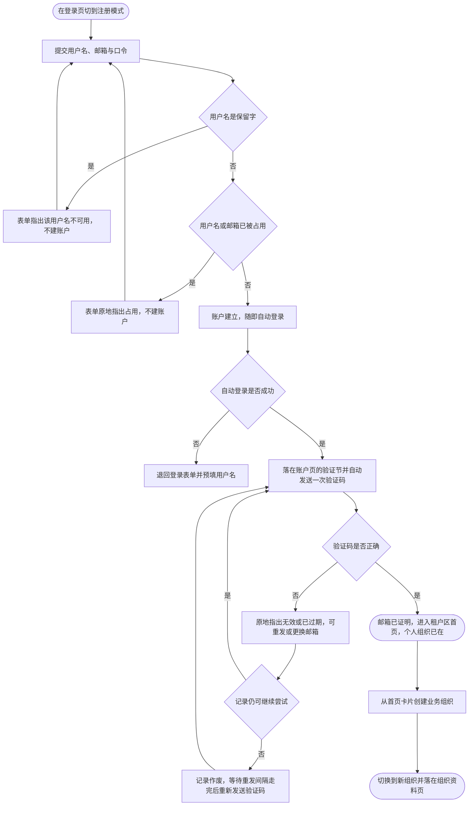

# 口令注册到个人组织

## 参与者

尚无账户、也不属于任何组织的新用户。开户后即拥有个人组织，邮箱是否已证明不影响这个组织的存在。账户在邮箱被证明之前处于未验证状态；验证完成后继续以个人组织的租户管理员身份操作，所得权限限于其非内建 `tenant-admin` 角色的允许集。

## 前置条件

- 该部署已开放口令注册，并装配了能把验证码投递到邮箱的邮件通道，因此登录页出现注册入口。
- 账户建立时即建立个人租户，没有独立的启用开关；邮箱是否验证、账户是否已属于其他组织都不影响这一点。
- 参与者拟使用的用户名与邮箱此前都未被占用。
- 参与者能够读取该邮箱收到的邮件。
- 浏览器已打开该部署的登录页，可用的登录方式取自该部署的发现文档。

## 步骤

1. 在登录页点「创建账户」切到注册模式。页面呈现一张口令注册表单，要求用户名、邮箱与口令；注册模式下呈现的开户方式只包含本部署实际能为未知标识开户的方式。

2. 填写用户名、邮箱与口令后提交。字段不合法时，表单在原地指出该字段，账户不被创建；用户名是保留字时同样被拒绝，且该结果与「用户名已被占用」不同；否则账户在一次提交内被建立，系统随即以同一凭据自动发起一次登录。

3. 自动登录成功后，页面落到账户页的「验证邮箱地址」一节。该节自动向刚填写的邮箱发送一次验证码，页面提示验证码已发送，焦点移到验证码输入框；「重新发送验证码」在服务端给出的间隔内禁用并显示剩余等待时间。参与者从邮箱读到验证码。

4. 在验证节输入验证码并提交。验证码正确时，该邮箱被记为已证明，验证节显示完成；验证码错误或已过期时，节内指出并清空输入，参与者可以重新发送、重试或更换邮箱地址。

5. 邮箱被证明后，应用栏之下的持续验证提示不再出现。参与者前往租户区首页，账户菜单的组织行显示当前组织；本旅程的注册表单未填写显示名，该行以账户的用户名指称个人组织，首页与导航可用。

6. 参与者从首页的创建入口打开自助创建页，填写一个未被占用的名称、显示名与可选描述后提交。组织在一次提交内建立，创建者成为该组织的所有者与首任 `tenant-admin`，当前组织切换到新组织，页面落到组织资料页；账户菜单的组织行显示新组织的显示名。

## 结果

- 账户已存在且其邮箱已被证明；应用栏之下的持续验证提示不再出现，账户不再受未验证状态的限制。
- 该账户在建立时即拥有一个个人组织，进入租户区时它就是当前组织；个人组织的对外名称是账户的用户名。
- 该账户自助创建一个业务组织后成为它的所有者与首任 `tenant-admin`，当前组织切换到新组织并落在组织资料页。
- 用该用户名与邮箱再次进入注册会分别得到用户名占用与邮箱已注册的拒绝。

## 备选路径

注册提交处的占用与保留字拒绝分支，以及自动登录失败的分支，都与主路径不同：

- 用户名已被占用：提交后表单在用户名一处指出该用户名已被占用，停留在注册模式，不产生账户。
- 用户名是保留字：提交后表单在用户名一处指出该用户名不可用，停留在注册模式，不产生账户；该用户名未被任何账户持有，与用户名已被占用是两种结果。
- 邮箱已被占用：提交后表单在邮箱一处指出该邮箱已被注册，停留在注册模式，不产生账户、用户名或口令凭据。
- 账户已建立但自动登录被拒：系统退回登录表单并预填用户名，说明账户已创建、可再次登录；不重发注册请求。
- 验证码连续错误达到尝试上限后作废，参与者须重新发送才能继续。

## 覆盖的需求

- `REQ-signin-001`
- `REQ-signin-004`
- `REQ-signin-006`
- `REQ-signup-001`
- `REQ-signup-002`
- `REQ-signup-003`
- `REQ-signup-004`
- `REQ-signup-005`
- `REQ-signup-008`
- `REQ-signup-009`
- `REQ-signup-010`
- `REQ-signup-024`
- `REQ-signup-028`
- `REQ-signup-029`
- `REQ-signup-045`
- `REQ-signup-046`
- `REQ-account-010`
- `REQ-account-015`
- `REQ-account-016`
- `REQ-account-017`
- `REQ-account-019`
- `REQ-account-020`
- `REQ-account-038`
- `REQ-account-060`
- `REQ-tenancy-022`
- `REQ-tenancy-026`
- `REQ-tenancy-027`
- `REQ-tenancy-028`
- `REQ-tenancy-059`
- `REQ-tenancy-065`
- `REQ-presentation-010`

## 端到端测试

`starters/demo/web/e2e/specs/journey-first-registration-to-personal-organization.spec.ts` `first-registration: a new visitor reaches a personal organization, and occupancy is refused`
