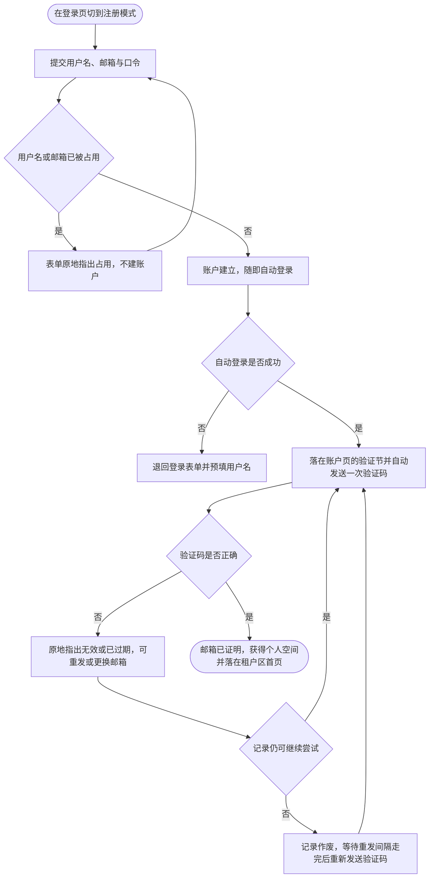

# 口令注册到个人空间

## 参与者

尚无账户、也不属于任何组织的新用户。开户后，其账户在邮箱被证明之前处于未验证状态；验证完成后，以个人空间所有者的身份继续操作，所得权限限于个人空间所有者角色的允许集。

## 前置条件

- 该部署已开放口令注册，并装配了能把验证码投递到邮箱的邮件通道，因此登录页出现注册入口。
- 该部署已启用个人空间，开户且没有任何成员关系的账户会得到个人租户，邮箱是否验证不影响这一点。
- 参与者拟使用的用户名与邮箱此前都未被占用。
- 参与者能够读取该邮箱收到的邮件。
- 浏览器已打开该部署的登录页，可用的登录方式取自该部署的发现文档。

## 步骤

1. 在登录页点「创建账户」切到注册模式。页面呈现一张口令注册表单，要求用户名、邮箱与口令；注册模式下呈现的开户方式只包含本部署实际能为未知标识开户的方式。

2. 填写用户名、邮箱与口令后提交。字段不合法时，表单在原地指出该字段，账户不被创建；否则账户在一次提交内被建立，系统随即以同一凭据自动发起一次登录。

3. 自动登录成功后，页面落到账户页的「验证邮箱地址」一节。该节自动向刚填写的邮箱发送一次验证码，页面提示验证码已发送，焦点移到验证码输入框；「重新发送验证码」在服务端给出的间隔内禁用并显示剩余等待时间。参与者从邮箱读到验证码。

4. 在验证节输入验证码并提交。验证码正确时，该邮箱被记为已证明，验证节显示完成；验证码错误或已过期时，节内指出并清空输入，参与者可以重新发送、重试或更换邮箱地址。

5. 邮箱被证明后，应用栏之下的持续验证提示不再出现。参与者前往租户区首页，组织切换器把「个人空间」显示为当前组织，首页与导航可用。

## 结果

- 账户已存在且其邮箱已被证明；应用栏之下的持续验证提示不再出现，账户不再受未验证状态的限制。
- 该账户拥有一个个人空间，进入租户区时它就是当前组织。
- 用该用户名与邮箱再次进入注册会分别得到用户名占用与邮箱已注册的拒绝。

## 备选路径

注册提交处的两个占用分支，以及自动登录失败的分支，都与主路径不同：

- 用户名已被占用：提交后表单在用户名一处指出该用户名已被占用，停留在注册模式，不产生账户。
- 邮箱已被占用：提交后表单在邮箱一处指出该邮箱已被注册，停留在注册模式，不产生账户、用户名或口令凭据。
- 账户已建立但自动登录被拒：系统退回登录表单并预填用户名，说明账户已创建、可再次登录；不重发注册请求。
- 验证码连续错误达到尝试上限后作废，参与者须重新发送才能继续。

## 覆盖的需求

- `REQ-signin-001`
- `REQ-signin-004`
- `REQ-signin-006`
- `REQ-signup-001`
- `REQ-signup-002`
- `REQ-signup-003`
- `REQ-signup-004`
- `REQ-signup-005`
- `REQ-signup-008`
- `REQ-signup-009`
- `REQ-signup-010`
- `REQ-signup-024`
- `REQ-signup-028`
- `REQ-signup-029`
- `REQ-account-010`
- `REQ-account-015`
- `REQ-account-016`
- `REQ-account-017`
- `REQ-account-019`
- `REQ-account-020`
- `REQ-tenancy-022`
- `REQ-tenancy-026`
- `REQ-tenancy-027`
- `REQ-tenancy-028`
- `REQ-presentation-010`

## 端到端测试

`未实现`
