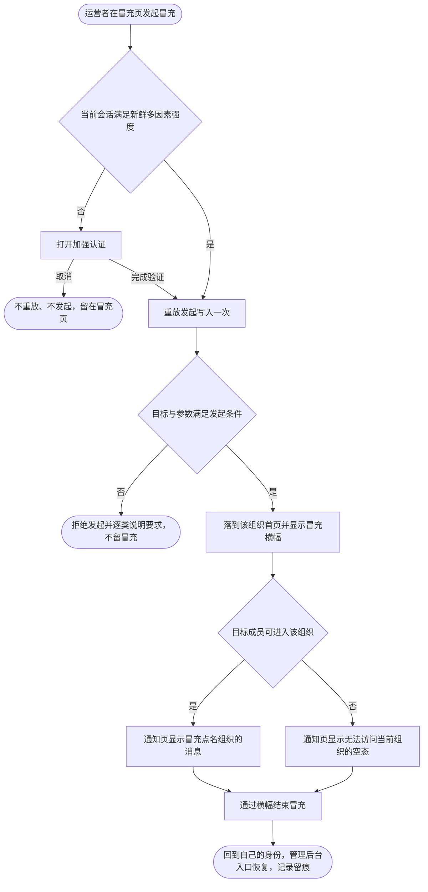

# 冒充一位成员排障后结束冒充

## 参与者

平台运营者：持平台管理权限、能够进入管理后台并打开冒充页的员工账户。当前会话不是冒充身份。

## 前置条件

- 运营者已用已证明邮箱的账户登录，当前会话不是冒充身份，且不具备发起冒充所需的新鲜多因素证明。
- 运营者名下已登记两种两步验证方式，其中至少一种是已启用满规定时长的非短信方式（认证器应用或通行密钥），使发起冒充所要求的新鲜多因素与因素成熟度都能满足。
- 存在一个组织，以及该组织中一位已启用、未受保护、不持有任何平台域权限的成员账户；目标账户是该组织的有效成员。
- 发起冒充的运营者不是该组织成员，在该组织不持有任何权限。
- 本次部署装配了冒充能力，以及冒充页依赖的管理后台与组织管理能力。

## 步骤

1. 运营者从管理后台入口进入管理后台，打开冒充页。页面的当前冒充节显示当前未冒充任何账户；发起区要求先选定组织与目标账户，并填写理由与有效期。
2. 运营者选定目标成员所在的组织与目标账户，填写理由与有效期，提交发起。
3. 当前会话还没有这次发起所需要的新鲜多因素证明，系统拒绝这次发起并要求重新验证身份，界面打开加强认证。运营者以一种在本次会话认证之前已启用、且通道不同于本次登录所用通道的两步验证方式完成验证；验证成功后，系统把刚才被拒的发起重放一次。
4. 发起成功：页面出现点名目标账户的发起确认，落到该组织的首页，应用栏之下出现冒充横幅，说明正在以目标成员的身份操作、当前组织、到期时刻，以及冒充期间管理功能不可用，并提供结束冒充的入口；应用栏出现冒充中的身份指示，账户菜单出现结束冒充项。管理后台入口与组织切换控件不再出现，访问任何管理后台路径都被静默带回租户区首页。
5. 运营者打开通知页。运营者自己在该组织不持任何权限，此时仍能看到收件箱：他以目标成员的身份行事，拿到的能力来自该成员在该组织持有的权限。收件箱只包含冒充点名组织发给该成员的消息。
6. 运营者通过冒充横幅的结束冒充结束冒充。横幅撤下并播报冒充已结束，运营者的身份回到自己，管理后台入口与组织切换控件恢复；整个过程不需要重新登录。
7. 运营者回到管理后台的冒充页，选择该组织，看到刚才结束的这条冒充记录，含操作者、目标账户、开始时刻、结束时刻与结束原因；在审计记录里也能按操作者与动作找到这次冒充的开始与结束；结束那一条的操作者是发起冒充的运营者，并带有被冒充账户、冒充限定的组织与会话。

## 结果

- 运营者的会话回到自己的身份：冒充横幅、应用栏的冒充中指示与账户菜单的结束冒充项都撤下。
- 管理后台入口与组织切换控件恢复为冒充前的可用状态，页头的管理后台入口与首页的管理后台卡片指向同一管理后台。
- 以目标成员身份查看通知页时所见的消息范围属于冒充点名的那一个组织，且可用能力来自该成员在该组织持有的权限，而不是运营者自己的权限。
- 该组织的冒充记录里保留这次冒充，含操作者、目标账户、开始时刻、结束时刻与结束原因（主动结束）。
- 审计记录里存在这次冒充的开始与结束动作，可按操作者与动作查到；结束那一条记录实际操作者、被冒充账户、组织与会话。

## 备选路径

发起一处存在两个分叉：会话不满足新鲜多因素时，运营者取消加强认证，则被拒的发起不重放、冒充不开始，页面留在冒充页；目标或参数不满足发起条件时，系统拒绝发起并逐类陈述对目标与当前会话的要求，不指向单一原因，冒充不开始。查障一处存在一个分叉：目标成员不能进入该组织时，通知页显示无法访问当前组织的空态且不给重试，运营者仍可通过横幅结束冒充。

## 覆盖的需求

- 平台运营：`REQ-platform-admin-001`、`REQ-platform-admin-003`、`REQ-platform-admin-021`、`REQ-platform-admin-022`、`REQ-platform-admin-023`、`REQ-platform-admin-024`、`REQ-platform-admin-026`、`REQ-platform-admin-027`、`REQ-platform-admin-029`、`REQ-platform-admin-078`、`REQ-platform-admin-081`、`REQ-platform-admin-082`、`REQ-platform-admin-084`、`REQ-platform-admin-107`、`REQ-platform-admin-108`、`REQ-platform-admin-109`、`REQ-platform-admin-110`
- 账户安全：`REQ-security-013`、`REQ-security-014`、`REQ-security-015`、`REQ-security-018`
- 组织与成员：`REQ-tenancy-024`、`REQ-tenancy-038`
- 通知：`REQ-notifications-001`、`REQ-notifications-025`

## 端到端测试

`starters/demo/web/e2e/specs/journey-impersonation-for-support.spec.ts` `impersonation-for-support: the operator acts as a member and the record and audit trail survive the end`
