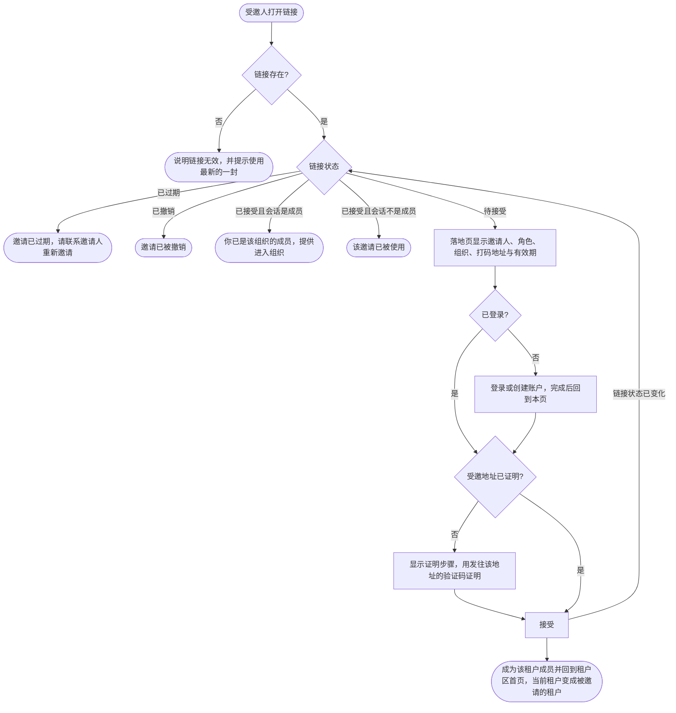

# 邀请一位成员进入租户

## 参与者

- **平台运营者**：持平台管理权限，能进入管理后台；在目标租户的域内持有成员与邀请管理权限；本人邮箱已证明。
- **受邀人**：被邀请地址的持有人。受邀地址可以已有账户，也可以尚无账户；接受本身不建账户，所以尚无账户时当事人先注册或登录，再证明该地址。接受所要求的证明是该地址的已证明邮箱，不要求它是当事人的登录方式。

## 前置条件

- 目标租户已登记且处于启用状态。
- 运营者已证明本人邮箱，并在目标租户持有成员与邀请管理权限。
- 本次装配提供邀请面，并配置了邀请通知邮件，邮件内容可从测试日志读取。
- 受邀人已有账户，或所在装配开放了注册，使受邀人能在接受前建立会话；受邀人能收到发往被邀请地址的验证码。

## 步骤

1. 运营者在管理后台打开邀请与成员页，选择一个租户；页面列出该租户已有的邀请与成员。
2. 运营者在签发区填写被邀请人的邮箱地址，并选择有效期（1 天、7 天、30 天，缺省 7 天），发出邀请；成功后页面确认已向该地址发出邀请，系统同时向该地址发送含接受链接的通知邮件。投递成功时，签发应答不再交出令牌，页面的一次性面板只报告已发送。
3. 投递失败或本部署未配置邮件时，页面在发起区之下的一次性面板展示这条邀请的接受链接、投递结果与复制控件；面板保留到运营者显式关闭或离开页面，此后页面不再提供该链接。投递成功时面板只报告已发送，没有链接可转交。
4. 运营者在邀请列表看到这条邀请，状态为待接受，并带有被邀请地址、邀请人、角色与到期时间。
5. 运营者对列表中这条待接受邀请选择重发；系统在同一条邀请上换一枚令牌并重新投递，旧链接立即失效，邀请标识、地址、角色与到期时间不变。对已有未过期待接受邀请的地址再次签发被拒绝为冲突，不新增行。
6. 受邀人打开通知邮件中的链接；投递失败或未配置时，运营者经自己的渠道把面板中的链接交给受邀人，两者指向同一条邀请。
7. 受邀人打开链接时，尚未登录也先看到邀请落地页：邀请人显示名、受邀角色（邀请带角色时）、组织名称（组织设了显示名时显示显示名）、打码后的被邀请地址与有效期，以及登录与创建账户两个入口。两个入口都在原链接上完成，登录或注册后仍停留在该链接；已登录时直接看到接受页。
8. 接受页显示邀请摘要：邀请人、组织、受邀角色、打码后的被邀请地址与有效期。
9. 受邀人选择接受。账户尚未证明被邀请地址时，接受页在打开时就显示证明步骤，不等点击接受；接受被拒绝，邀请保持待接受。受邀人经发往该地址的邮箱验证码完成证明，回到链接再次接受。
10. 接受成功后，页面给出已成为该租户成员的确认，并落在被邀请租户的租户区首页，当前租户即该租户，账户菜单的组织行把它显示为当前组织。
11. 受邀人在租户区的账户菜单中看不到管理后台入口。于应用内导航到任一管理后台路径时，界面静默回到租户区首页，不显示任何管理后台内容；以整页加载方式打开管理后台路径时，页面停在访问检查中的等待视图，不渲染管理后台内容，也不落到租户区首页。
12. 运营者回到邀请与成员页，成员表出现该受邀人，邀请列表中这条邀请显示为已接受；重发前的旧链接按摘要已查不到，打开时说明链接无效。

## 结果

- 受邀人成为被邀请租户的成员，接受后落在该租户的租户区首页并得到已成为成员的确认；当前租户是被邀请的租户。
- 受邀人不持平台管理权限：租户区账户菜单不出现管理后台入口；于应用内导航到管理后台路径时被静默送回租户区首页，不显示任何管理后台信息；以整页加载方式打开管理后台路径时停在访问检查中的等待视图，不渲染管理后台内容，也不落到租户区首页。
- 运营者在成员表看到该受邀人（来源为邀请），邀请列表中该邀请显示为已接受。
- 投递失败或未配置时，一次性面板与通知邮件指向同一条链接；投递成功时面板只报告已发送，链接在通知邮件里。重发后旧链接失效，新链接可接受。
- 接受不建立账户；账户未证明被邀请地址时，接受页在打开时即显示证明步骤，接受被拒绝而邀请保持待接受。

## 备选路径

分歧点取决于访问者是否已登录、其账户是否已证明被邀请地址，以及链接此刻的状态。接受从不建立账户。

- **邀请邮件投递失败或未配置**：签发仍成功，一次性面板显示投递结果并保留接受链接；运营者改用复制链接转交，受邀人仍可接受。
- **邀请邮件投递成功**：签发应答不交出令牌，一次性面板只报告已发送，链接在通知邮件里；重发后旧链接不能再被接受，新链接出现在新的通知邮件中。
- **对已有未过期待接受邀请的地址再次签发**：被拒绝为冲突，不新增行，也不把原邀请置为已撤销；要重新投递，用列表中的重发。
- **面板链接与邮件链接一致**：投递失败或未配置时，同一条签发或重发得到的链接在一次性面板与通知邮件中相同，接受任一条产生同一条成员关系。
- **被邀请地址尚无账户**：接受不建立账户；当事人先在装配开放注册的前提下注册并登录，再证明该地址并接受。
- **账户尚未证明被邀请地址**：打开链接即显示证明步骤，邀请保持待接受；当事人用发往该地址的验证码完成证明，回到链接再次接受。
- **账户已证明另一个地址**：证明步骤同样在打开时出现，接受被拒绝，不产生成员关系；证明被邀请地址是唯一可行路径。
- **被邀请地址不是登录方式**：证明它只解除接受的限制，不把它选作登录方式，也不改变默认联系地址。
- **接受后再次打开同一条链接**：当前会话已是该组织成员时显示已是成员并提供进入组织，否则说明该邀请已被使用；都不新增成员关系。
- **链接不可用**：链接不存在时说明邀请不存在，并提示收到过多次邀请时使用最新的一封；已过期、已撤销与已接受各自说明，不产生成员关系。

## 覆盖的需求

- 平台运营：`REQ-platform-admin-001`、`REQ-platform-admin-002`、`REQ-platform-admin-032`、`REQ-platform-admin-033`、`REQ-platform-admin-036`
- 组织与成员：`REQ-tenancy-008`、`REQ-tenancy-011`、`REQ-tenancy-013`、`REQ-tenancy-015`、`REQ-tenancy-016`、`REQ-tenancy-017`、`REQ-tenancy-018`、`REQ-tenancy-019`、`REQ-tenancy-020`、`REQ-tenancy-021`、`REQ-tenancy-035`、`REQ-tenancy-043`、`REQ-tenancy-057`、`REQ-tenancy-078`
- 登录：`REQ-signin-030`

## 端到端测试

`starters/demo/web/e2e/specs/journey-invitation-to-tenant.spec.ts` 的两条用例覆盖签发、一次性面板交出链接、对同一地址再次签发被拒为待接受邀请的冲突，以及受邀人经落地页注册、用邮箱验证码证明被邀请地址、接受并成为成员。第一条用例在受理后重新打开已接受的链接，断言成员终态与进入组织；第二条用例以一个证明过不同地址的账户打开链接，断言证明步骤在打开时出现、接受被拒绝且不写成员关系。该用例的服务器以未配置邀请邮件的装配启动，因此签发应答带令牌、面板交出链接；投递成功时的应答不带令牌由后端用例覆盖。
