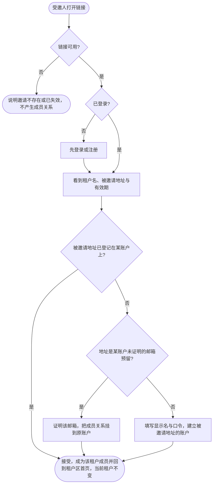

# 邀请一位成员进入租户

## 参与者

- **平台运营者**：持平台管理权限，能进入管理后台；在目标租户的域内持有成员与邀请管理权限；本人邮箱已证明。
- **受邀人**：被邀请地址的持有人。受邀地址可以已有账户，也可以尚无账户。

## 前置条件

- 目标租户已登记且处于启用状态。
- 运营者已证明本人邮箱，并在目标租户持有成员与邀请管理权限。
- 本次装配提供邀请面。
- 受邀人已有账户，或所在装配开放了注册，使受邀人能在接受前建立会话。

## 步骤

1. 运营者在管理后台打开邀请与成员页，选择一个租户；页面列出该租户已有的邀请与成员。
2. 运营者在签发区填写被邀请人的邮箱地址与过期时间，发出邀请；成功后页面确认已向该地址发出邀请。
3. 页面在发起区之下的一次性面板展示这条邀请的接受链接与复制控件；面板保留到运营者显式关闭或离开页面，此后页面不再提供该链接。
4. 运营者在邀请列表看到这条邀请，状态为待接受，并带有被邀请地址、邀请人与到期时间。
5. 运营者复制接受链接，经自己的渠道交给受邀人。
6. 受邀人打开链接；尚未登录时先看到登录面，装配开放注册时也可先注册，登录后仍停留在该链接；已登录时直接看到邀请摘要。
7. 接受页显示邀请摘要：所属租户名、被邀请的地址与有效期。
8. 受邀人选择接受；页面给出已成为该租户成员的确认，并落在被邀请租户的租户区首页，当前租户即该租户，租户切换控件把它显示为当前项。
9. 受邀人在租户区页头看不到管理后台入口。于应用内导航到任一管理后台路径时，界面静默回到租户区首页，不显示任何管理后台内容；以整页加载方式打开管理后台路径时，页面停在访问检查中的等待视图，不渲染管理后台内容，也不落到租户区首页。
10. 运营者回到邀请与成员页，成员表出现该受邀人，邀请列表中这条邀请显示为已接受。

## 结果

- 受邀人成为被邀请租户的成员，接受后落在该租户的租户区首页并得到已成为成员的确认；当前租户是被邀请的租户。
- 受邀人不持平台管理权限：租户区页头不出现管理后台入口；于应用内导航到管理后台路径时被静默送回租户区首页，不显示任何管理后台信息；以整页加载方式打开管理后台路径时停在访问检查中的等待视图，不渲染管理后台内容，也不落到租户区首页。
- 运营者在成员表看到该受邀人（来源为邀请），邀请列表中该邀请显示为已接受。

## 备选路径

分叉取决于被邀请地址在系统中的已存在形态，以及链接此刻的状态。

- **被邀请地址尚无账户**：接受页在摘要下要求填写显示名与口令；接受后为被邀请地址建立一个启用的账户，再把成员关系挂到该账户，不产生第二个账户。
- **被邀请地址是一条未证明的邮箱预留**（先自助注册、后收到邀请）：接受时同时证明该邮箱，成员关系挂到该预留所属的原账户，不新建账户。
- **接受时登录的账户不是被邀请地址的账户**：成员关系仍挂在被邀请地址所属的账户上，不挂到当前登录的账户。
- **接受后再次打开同一条链接**：界面说明邀请已失效，不新增成员关系。
- **链接不可用**：链接不存在时说明邀请不存在；已过期、已撤销或已被接受时说明邀请已失效；两种情形都不产生成员关系。

## 覆盖的需求

- 平台运营：`REQ-platform-admin-001`、`REQ-platform-admin-002`、`REQ-platform-admin-032`、`REQ-platform-admin-033`、`REQ-platform-admin-036`
- 组织与成员：`REQ-tenancy-008`、`REQ-tenancy-011`、`REQ-tenancy-013`、`REQ-tenancy-015`、`REQ-tenancy-016`、`REQ-tenancy-017`、`REQ-tenancy-018`、`REQ-tenancy-019`、`REQ-tenancy-020`、`REQ-tenancy-021`、`REQ-tenancy-035`、`REQ-tenancy-043`
- 登录：`REQ-signin-030`

## 端到端测试

`starters/demo/web/e2e/specs/journey-invitation-to-tenant.spec.ts` `invitation-to-tenant: an operator invites an address and the invitee joins the tenant`
