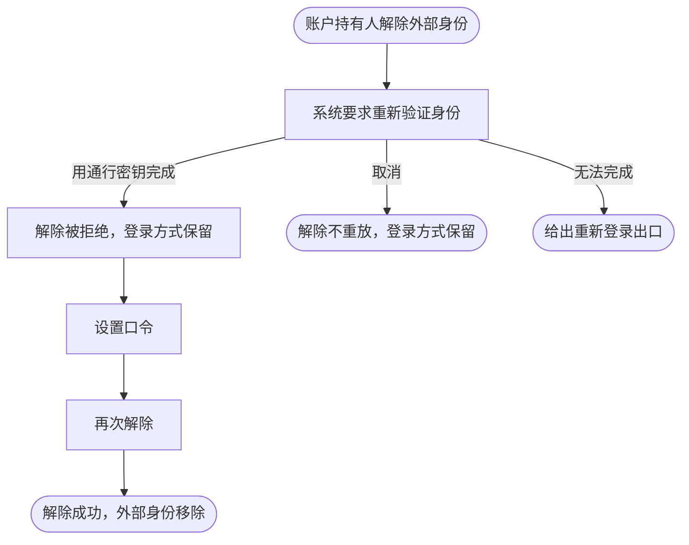

# 账户必须保留一个非通行密钥的登录方式

## 参与者

账户持有人。该账户由一次企业即时开通的首次登录开户：这次登录本身把提供方的外部身份绑定到账户，并在会话建立之前登记了一枚通行密钥；当前会话就是这次登录建立的会话，不是冒充身份。

## 前置条件

- 账户经企业即时开通开户：持有建号时取得的用户名，没有口令凭据、邮箱或手机。
- 这次开户登录把提供方的外部身份绑定到账户，该身份即账户的一条非通行密钥的登录方式；同一次登录在会话建立之前登记了一枚通行密钥。
- 部署要求全部账户启用第二种验证。

开户与绑定是产品写入，不是夹具注入：企业即时开通的开户、外部身份绑定与通行密钥登记都由这次登录在界面上完成。

## 步骤

1. 账户持有人打开账户设置：个人资料页的联系方式为空；密码与安全页的登录方式块里有用户名与该外部身份，口令块没有当前口令、只提供首次设置，两步验证清单里有一枚通行密钥。
2. 账户持有人在登录方式中解除该外部身份，并在确认对话框中确认。
3. 系统要求重新验证身份；账户持有人用刚登记的通行密钥完成这次证明。
4. 解除操作被拒绝，界面说明账户没有其他非通行密钥的登录方式、需要先补一种登录方式；该外部身份仍留在登录方式中。
5. 账户持有人在口令节设置新口令。
6. 账户持有人再次解除同一个外部身份；这次操作成功，该身份从登录方式中消失。

## 结果

- 会移除最后一个非通行密钥的登录方式的解除被拒绝，拒绝点明需要先补一种登录方式；账户与该外部身份的关系保持不变，该绑定仍留在登录方式中。
- 补上口令之后，同一个解除成功，账户不再持有该外部身份。
- 账户的联系方式为空：企业即时开通不写入提供方声明的地址，本旅程的账户也没有手机，因此没有联系方式。

## 备选路径

重新验证身份一节存在分歧点。账户持有人在对话框中取消时，被拒的解除不重放，外部身份保持为登录方式，其余步骤不受影响。重新验证无法完成时，系统按 REQ-security-017 给出重新登录的出口，而不是停在无法推进的步骤。

## 覆盖的需求

- 账户安全：`REQ-security-040`、`REQ-security-013`、`REQ-security-017`
- 账户自助：`REQ-account-023`、`REQ-account-061`、`REQ-account-067`
- 企业首登：`REQ-signup-018`、`REQ-signin-022`

## 端到端测试

`starters/demo/web/e2e/specs/journey-last-login-way.spec.ts` `last-login-way: removing the last way that is not a passkey is refused`
