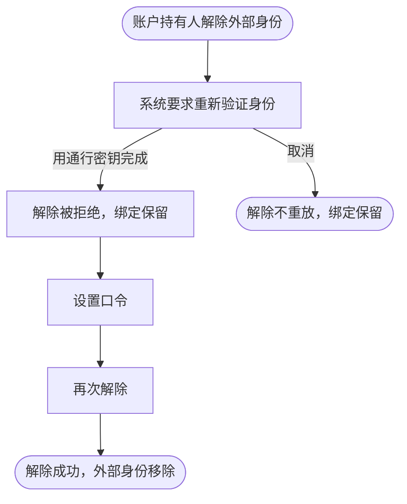

# 账户必须保留一个非通行密钥的登录方式

## 参与者

账户持有人。该账户经外部身份开户，当前会话由该外部身份建立；不是冒充身份。

## 前置条件

- 账户经外部身份开户，因此没有口令凭据，也没有已验证手机号。
- 该外部身份仍是账户的绑定。
- 账户已登记一枚通行密钥。
- 部署要求全部账户启用第二种验证。

## 步骤

1. 账户持有人打开账户页：登录标识只有提供方声明的邮箱；绑定节列出该外部身份；口令节没有当前口令，只提供首次设置；两步验证清单里有一枚通行密钥。
2. 账户持有人在绑定节解除该外部身份，并在确认对话框中确认。
3. 系统要求重新验证身份；账户持有人用刚登记的通行密钥完成这次证明。
4. 解除操作被拒绝，界面说明账户没有其他登录方式、需要先补一种（口令或其他账户）；该外部身份仍留在绑定节。
5. 账户持有人在口令节设置新口令。
6. 账户持有人再次解除同一个外部身份；这次操作成功，该身份从绑定节消失。

## 结果

- 会移除最后一个非通行密钥登录方式的解除被拒绝，拒绝点明需要先补一种登录方式；账户与外部身份的绑定保持不变，此后仍可用该身份登录。
- 补上口令之后，同一个解除成功，账户不再持有该外部身份。

## 备选路径

重新验证身份一节存在分叉。账户持有人在对话框中取消时，被拒的解除不重放，外部身份保持绑定，其余步骤不受影响。重新验证无法完成时，系统给出重新登录的出口，而不是停在无法推进的步骤。

## 覆盖的需求

- 账户安全：`REQ-security-040`、`REQ-security-013`

## 端到端测试

`starters/demo/web/e2e/specs/journey-last-login-way.spec.ts` `last-login-way: removing the last way that is not a passkey is refused`
