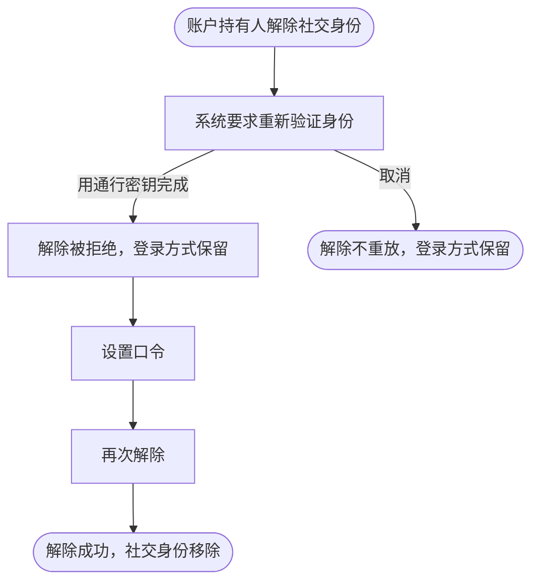

# 账户必须保留一个非通行密钥的登录方式

## 参与者

账户持有人。该账户先用短信验证码首次登录开户，随后在账户页绑定了一个社交身份；当前会话以该社交身份建立，不是冒充身份。

## 前置条件

- 账户经短信首登开户：持有建号时取得的用户名与作为登录方式的已证明手机，没有口令凭据，也没有邮箱。
- 账户在账户页绑定了一个社交身份，并已登记一枚通行密钥。
- 手机已从账户上移除：移除时该社交身份仍在，因此移除被允许；此后账户的登录方式只剩用户名与该社交身份。没有口令，用户名因此不是可用的口令登录名。
- 部署要求全部账户启用第二种验证。

前三条是产品写入，不是夹具注入：开户、绑定、登记通行密钥与移除手机都在界面上完成。

## 步骤

1. 账户持有人打开账户设置：个人资料页的联系方式为空；密码与安全页的登录方式块里有用户名与该社交身份，口令块没有当前口令、只提供首次设置，两步验证清单里有一枚通行密钥。
2. 账户持有人在登录方式中解除该社交身份，并在确认对话框中确认。
3. 系统要求重新验证身份；账户持有人用刚登记的通行密钥完成这次证明。
4. 解除操作被拒绝，界面说明账户没有其他非通行密钥的登录方式、需要先补一种登录方式；该社交身份仍留在登录方式中。
5. 账户持有人在口令节设置新口令。
6. 账户持有人再次解除同一个社交身份；这次操作成功，该身份从登录方式中消失。

## 结果

- 会移除最后一个非通行密钥登录方式的解除被拒绝，拒绝点明需要先补一种登录方式；账户与该社交身份的关系保持不变，此后仍可用该身份登录。
- 补上口令之后，同一个解除成功，账户不再持有该社交身份。
- 账户的联系方式为空：短信首登写下的手机已在步骤之前移除，本旅程的账户也不是经社交首登开户的，因此没有提供方声明的地址进入账户。

## 备选路径

重新验证身份一节存在分叉。账户持有人在对话框中取消时，被拒的解除不重放，社交身份保持为登录方式，其余步骤不受影响。重新验证无法完成时，系统给出重新登录的出口，而不是停在无法推进的步骤。

## 覆盖的需求

- 账户安全：`REQ-security-040`、`REQ-security-013`
- 账户自助：`REQ-account-061`、`REQ-account-064`、`REQ-account-067`
- 短信首登：`REQ-signup-012`、`REQ-signup-047`

## 端到端测试

`starters/demo/web/e2e/specs/journey-last-login-way.spec.ts` `last-login-way: removing the last way that is not a passkey is refused`
