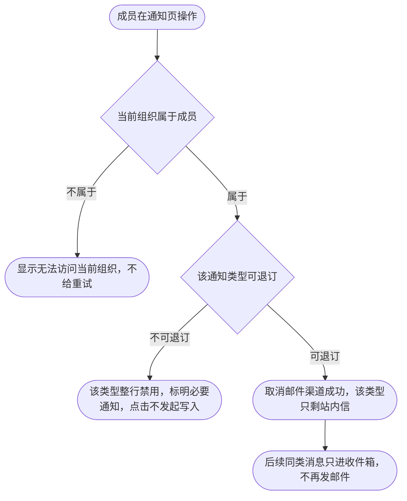

# 成员在租户里收发通知

## 参与者

租户成员：已加入某个组织，并持有该组织通知收件箱与通知偏好的访问权。该成员不是平台运营者，不持平台域管理权限。

## 前置条件

- 成员已登录，已加入组织「示例组织」，且当前组织为「示例组织」。
- 本次部署装配了通知收件箱、通知偏好矩阵与实时推送。
- 本次部署具备邮件渠道，并已声明一个可退订的通知类型，该类型的默认渠道包含站内信与邮件。
- 该组织内另一名成员或系统行为会按该类型向该成员发出一则通知。
- 该成员的收件箱中另有一则未读消息。

## 步骤

1. 成员在租户区确认当前组织为「示例组织」；页头的组织切换控件把「示例组织」显示为当前组织，打开控件时当前组织这一项不可选中。

2. 成员停留在租户区的另一个页面时，系统按该类型向该成员发出了一则通知；页头铃铛的未读数随之增加，不需要整页刷新。成员打开通知页，收件箱列出这则消息并显示未读标记，铃铛的可及名报出未读总数。

3. 成员在这则消息上点标记为已读。该行不再显示未读标记，铃铛的未读数减一。

4. 成员在通知页点「全部标记为已读」。确认信息报出本次标记的条数，与点击前收件箱中未读的条数一致；列表所有行都不再显示未读标记，铃铛的未读数归零。

5. 成员在通知页的偏好矩阵找到该类型。渠道列依次为站内信与部署具备的邮件；该类型当前在站内信与邮件两列都处于勾选状态。

6. 成员取消该类型的邮件渠道并保存。页面在矩阵下方的反馈区确认所改的类型、渠道与目标状态；回读后该类型只剩站内信一列勾选，并标明这份渠道集合来自显式设置。

7. 此后同一类型再发生一则通知。该消息出现在收件箱列表的顶部，铃铛未读数增加，成员的邮箱没有收到该类型的邮件。

## 结果

- 该成员在「示例组织」的收件箱中看到该类型的站内信，标记已读后该行不再未读，铃铛未读数减一。
- 全部标记已读后，确认信息报出本次标记的条数，收件箱所有行不再未读，铃铛未读数归零。
- 该类型在偏好矩阵中的生效渠道只剩站内信，并标明这份选择来自显式设置；此后同一类型的新消息只出现在收件箱，成员的邮箱不再收到该类型的邮件。

## 备选路径

- 成员打开一个自己不属于的组织时（例如经旧链接）：通知页显示无法访问当前组织的空态，指引联系管理员，不提供重试。
- 该通知类型不可退订时：偏好矩阵中该类型整行禁用，并标明该类型是必要通知、无法关闭；点击任一渠道不发起写入，该类型的生效渠道保持默认，不因这次点击改变。

## 覆盖的需求

- 通知：`REQ-notifications-001`、`REQ-notifications-003`、`REQ-notifications-004`、`REQ-notifications-009`、`REQ-notifications-010`、`REQ-notifications-013`、`REQ-notifications-025`、`REQ-notifications-028`、`REQ-notifications-029`、`REQ-notifications-030`、`REQ-notifications-031`、`REQ-notifications-051`、`REQ-notifications-057`
- 组织与成员：`REQ-tenancy-022`、`REQ-tenancy-025`、`REQ-tenancy-036`

## 端到端测试

`starters/demo/web/e2e/specs/journey-member-workspace.spec.ts` `member-workspace: a member receives, reads and configures notifications`
