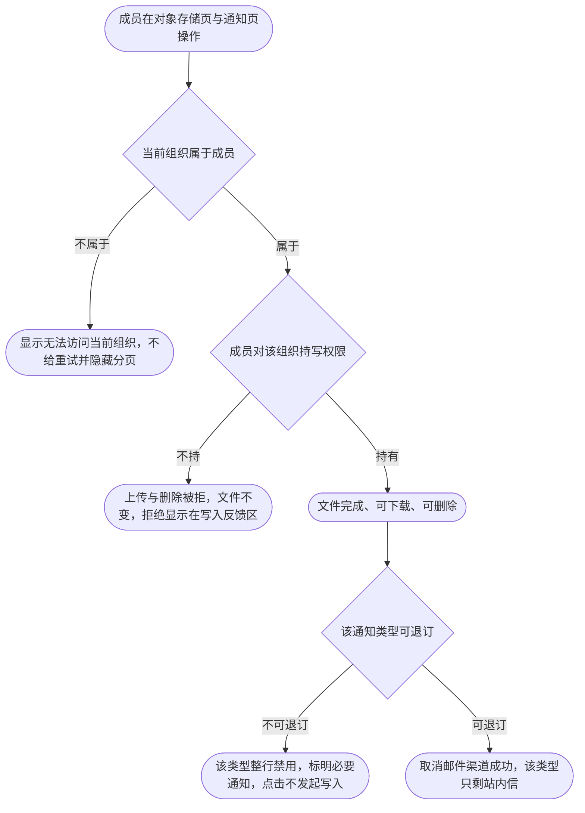

# 成员在租户里使用文件与通知

## 参与者

租户成员：已加入某个组织，并在该组织内持有文件的上传、下载与删除权限，以及通知收件箱与通知偏好的访问权。该成员不是平台运营者，不持平台域管理权限。

## 前置条件

- 成员已登录，已加入组织「示例组织」，且当前组织为「示例组织」。
- 成员在「示例组织」持有文件的读权限与写权限。
- 「示例组织」内当前没有文件。
- 本次部署装配了对象存储页、通知收件箱、通知偏好矩阵与实时推送。
- 本次部署具备邮件渠道，并已声明一个可退订的通知类型，该类型的默认渠道包含站内信与邮件。
- 该组织内另一名成员或系统行为会按该类型向该成员发出一则通知。

## 步骤

1. 成员在租户区确认当前组织为「示例组织」；页头的组织切换控件把「示例组织」显示为当前组织，打开控件时当前组织这一项不可选中。

2. 成员打开对象存储页。组织内还没有文件，页面显示空态，说明暂无对象并在页面上方给出上传入口，而不是错误页或示例数据。

3. 成员在上传区选取一个文件并提交上传。该文件在上传区自成一行，先显示为待上传，随后显示为已完成，并出现在已存对象列表；列表中该行显示名称、状态、大小、内容类型与创建时间。

4. 成员打开该行的详情。详情显示名称、状态、大小、内容类型、创建时间与过期时间；文件没有过期时刻时，过期时间显示为永不。

5. 成员点该行的下载。浏览器按文件名称保存文件，保存下来的内容与上传的文件相同。

6. 成员点该行的删除，经一次确认后删除。该行从已存对象列表消失，页面给出点名该对象的删除确认。

7. 成员再次打开该文件的详情或下载。页面答该对象已不存在，并提示它可能已被删除或已过期；详情与下载两处给出同一结果。

8. 成员停留在租户区的另一个页面时，系统按该类型向该成员发出了一则通知；页头铃铛的未读数随之增加，不需要整页刷新。成员打开通知页，收件箱列出这则消息并显示未读标记，铃铛的可及名报出未读总数。

9. 成员在这则消息上点标记为已读。该行不再显示未读标记，铃铛的未读数减一。

10. 成员在通知页的偏好矩阵找到该类型。渠道列依次为站内信与部署具备的邮件；该类型当前在站内信与邮件两列都处于勾选状态。

11. 成员取消该类型的邮件渠道并保存。页面在矩阵下方的反馈区确认所改的类型、渠道与目标状态；回读后该类型只剩站内信一列勾选，并标明这份渠道集合来自显式设置。

12. 此后同一类型再发生一则通知。该消息出现在收件箱列表的顶部，铃铛未读数增加，成员的邮箱没有收到该类型的邮件。

## 结果

- 文件以已完成状态出现在「示例组织」的对象列表，列表与详情显示同一名称；下载按名称保存，内容与上传的文件相同。
- 删除后，该文件在列表、详情与下载三处都表现为不存在，列表不再有该行。
- 该成员在「示例组织」的收件箱中看到该类型的站内信，标记已读后该行不再未读，铃铛未读数减一。
- 该类型在偏好矩阵中的生效渠道只剩站内信，并标明这份选择来自显式设置；此后同一类型的新消息只出现在收件箱，成员的邮箱不再收到该类型的邮件。

## 备选路径

- 成员对该组织不持写权限时：上传的提交与行上的删除被拒绝，拒绝显示在写入反馈区，文件不发生改变；已存对象列表仍照常列出，下载仍可用。
- 成员打开一个自己不属于的组织时（例如经旧链接）：对象页显示无法访问当前组织的空态，指引联系管理员，不提供重试并隐藏分页。
- 该通知类型不可退订时：偏好矩阵中该类型整行禁用，并标明该类型是必要通知、无法关闭；点击任一渠道不发起写入，该类型的生效渠道保持默认，不因这次点击改变。

## 覆盖的需求

- 文件：`REQ-objects-001`、`REQ-objects-006`、`REQ-objects-008`、`REQ-objects-012`、`REQ-objects-014`、`REQ-objects-015`、`REQ-objects-023`、`REQ-objects-024`、`REQ-objects-025`、`REQ-objects-028`、`REQ-objects-029`
- 通知：`REQ-notifications-001`、`REQ-notifications-003`、`REQ-notifications-004`、`REQ-notifications-009`、`REQ-notifications-010`、`REQ-notifications-012`、`REQ-notifications-013`、`REQ-notifications-028`、`REQ-notifications-029`、`REQ-notifications-030`、`REQ-notifications-031`
- 组织与成员：`REQ-tenancy-022`、`REQ-tenancy-025`

## 端到端测试

`未实现`
