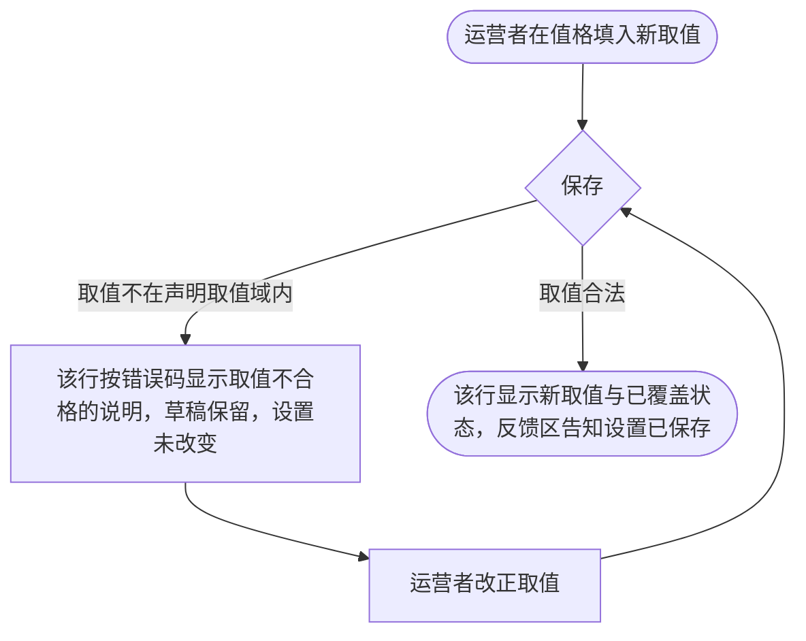

# 调整运行期设置并在出错时回退

## 参与者

平台运营者：持平台域的 settings.read、settings.write 与 audit.read，账户邮箱已证明，管理后台的设置页与审计页对其开放。观察登录面时使用同一操作者的未登录浏览器窗口，以匿名访客的视角读取登录面。

## 前置条件

- 操作者已登录，账户邮箱已证明，并在平台域持有 settings.read、settings.write 与 audit.read。
- 部署装配了设置管理面与审计面，管理后台的设置页与审计页可以打开。
- 部署装配了至少一种能为未知身份开户的登录方式（例如社交登录），且运行期设置 authn.account.signup 在全局层已有显式取值 open，authn.account.password-signup 在全局层已有显式取值 open。登录面因此显示注册入口，注册模式提供口令注册表单。
- 操作者手边有一个未登录的浏览器窗口。

## 步骤

1. 操作者从首页的管理后台卡片或页头入口进入管理后台，打开「设置」页。设置项按命名空间分组列出，每行给出键、类型、当前值与状态。找到键 `authn.account.password-signup` 的一行：当前值为 open，状态为「已覆盖」。
2. 操作者在该行的值格把取值改成 closed，点「保存改动」。保存成功后该行的当前值显示 closed、状态仍为「已覆盖」，页面反馈区告知设置已保存。整个过程服务没有重启。
3. 操作者在未登录窗口打开登录面。登录面仍显示注册入口；进入注册模式后，口令注册表单不再出现，可用来开户的只剩其余能为未知身份开户的登录方式。这次读取发生在保存之后，读到的是新取值。
4. 操作者判断这个结果并非所要的结果：本意是让注册入口整体消失，实际只移除了口令注册表单。操作者回到设置页，把该行改回 open 并保存；该行显示当前值 open、状态「已覆盖」，页面反馈区告知设置已保存。
5. 操作者在未登录窗口重新载入登录面，注册模式重新呈现口令注册表单，与第一次改动前一致。
6. 操作者打开「审计」页，在筛选栏填入覆盖两次保存时刻的起始时间与结束时间，动作填 settings.set，点「应用」。列表按时间由近及远给出这两次保存各一行，两行的动作都是 settings.set、对象都是 `authn.account.password-signup`、操作者都是本人、结果都是成功。
7. 操作者打开其中一行进入审计详情。页面列出标识、租户、时间、操作者、来源、动作、对象、结果、用途与明细；这条记录没有租户，租户一栏显示占位符；明细中记有该设置键与它所在的层，不含取值。操作者点返回入口回到审计查询。

## 结果

- `authn.account.password-signup` 的全局层取值回到 open，状态为「已覆盖」；未登录窗口的登录面与改动前一致：注册入口在，注册模式提供口令注册表单。
- 审计页以 settings.set 为动作筛选、在覆盖两次保存时刻的时间窗内检索到两行，对象均为 `authn.account.password-signup`，操作者为该运营者，结果均为成功。
- 两次保存之后的下一次页面读取都直接反映新取值，期间服务没有重启。

## 备选路径

分叉落在保存一步：填入的取值不符合该项声明的取值域。

- 取值不合格：运营者把该行填成声明取值域之外的值（例如 `paused`），保存被拒。该行按错误码显示取值不在声明范围内的说明，草稿留在控件里，设置保持原值；这次被拒的写入在审计里以失败结果留痕。
- 改正取值后保存成功，后续步骤与主路径相同。

## 覆盖的需求

- `REQ-platform-admin-001`
- `REQ-platform-admin-029`
- `REQ-platform-admin-031`
- `REQ-platform-config-001`
- `REQ-platform-config-003`
- `REQ-platform-config-006`
- `REQ-platform-config-007`
- `REQ-signup-002`
- `REQ-signup-003`
- `REQ-presentation-027`
- `REQ-presentation-028`

## 端到端测试

`starters/demo/web/e2e/specs/journey-operator-configuration.spec.ts` `operator-configuration: a switch is closed and reopened, and the audit trail carries both writes`
